# 10 Oracle WebCenter Spaces 概述

通信技术的最新改进有助于促进人与人之间的互动和协作。电子邮件和聊天等工具就是这一事实的有力证明。

想象一下，将这些 Web 2.0 工具整合到一个专注于促进我们公司工作组协作和知识共享的解决方案中，可以实现多大的生产力！

正是，这是 Oracle WebCenter Spaces 提供的好处之一。除了提高工作组的生产力之外，这个解决方案还有助于改善公司每位员工的工作环境。与 WebCenter 套件中的其他技术（WebCenter Framework、WebCenter Composer）不同，Oracle WebCenter Spaces 是一个预构建的应用程序。但是，IT 团队可以帮助配置和个性化这个解决方案。

需要注意的是，Oracle WebCenter Spaces 是一个使用了本书中所学习的所有技术的解决方案。

本章展示了如何配置和自定义 Oracle WebCenter Spaces。此外，我们将使用这项技术创建个人和工作组环境。

## Oracle WebCenter Spaces

正如我们在介绍中所指出的，WebCenter Spaces 提升了用户和群组的性能。为此，它提供了两个环境：

- **Oracle WebCenter Personal Spaces**：旨在为用户提供个性化环境，且生产力很高。使用此功能，用户可以自定义其环境，以添加对常用应用程序的访问、指标可视化（销售百分比、会议目标）以及关键文档等 Web 2.0 环境提供的其他功能。

- **Oracle WebCenter Group Spaces**：工作组使用它来提高生产力，得益于提供的众多通信工具和协作环境。工作组可以与公司的领域（采购、人力资源）、项目（新产品发布、新系统实施）或组织所需的任何分组相关联。

## Oracle WebCenter Personal Spaces

WebCenter 的这一功能使最终用户能够个性化其工作环境，以提高生产力。

为了实现这一点，WebCenter Personal Spaces 允许用户构建一个环境，以便访问其个人电子邮件、最近的文档、他们喜欢的论坛、来自任何 BPEL 服务器的工作列表项目，以及一组用于快速访问的应用程序。

此外，它还为他们提供了访问其个人用户和专家社交网络的权限。

将这些工具整合在一个上下文中，就是 Oracle WebCenter Personal Spaces 所提供的。

## Oracle WebCenter Group Spaces

Group Spaces 旨在为组织的工作组提供协作环境。例如，项目成员或公司业务领域的员工。

Group Spaces 允许自定义内容、共享资源，并为工作组提供工作环境。

## Oracle WebCenter Spaces 安装

Oracle WebCenter 安装在 Oracle 官方网站上有详细说明：
http://www.oracle.com/technology/products/webcenter/index.html
安装时请考虑以下几点：

- 必须拥有 Oracle 数据库版本 10.2.0.4 及更高版本或 11.1.0.7 及更高版本。但是，使用 Patchset 1 可以使用 MS SQL Server 和 IBM DB2。
- 必须运行 **Repository Creation Utility (RCU)** 来创建 WebCenter Spaces 正常工作所需的架构。
- 两款产品都可以从以下网址下载：http://www.oracle.com/technology/software/products/middleware/htdocs/fmw_11_download.html。

> > 我们建议遵循指南中的步骤：Oracle Fusion Middleware Quick Installation Guide for Oracle WebCenter。

## Oracle Spaces 配置

在开始创建个人空间和群组空间之前，管理员需要配置 Repository Services Content、Discussions、Wikis 等。
在此示例中，作为管理员，我们将设置从 WebCenter Spaces 访问包含每个用户文件的文件夹的访问权限。该文件夹将具有用户名，并位于服务器的文件系统中。

1. 转到 Enterprise Manager 控制台：http://localhost:7001/em。
2. 单击 WebCenter Spaces 服务。

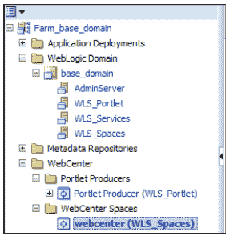

3. 选择以下选项：Setting | Service Configuration。

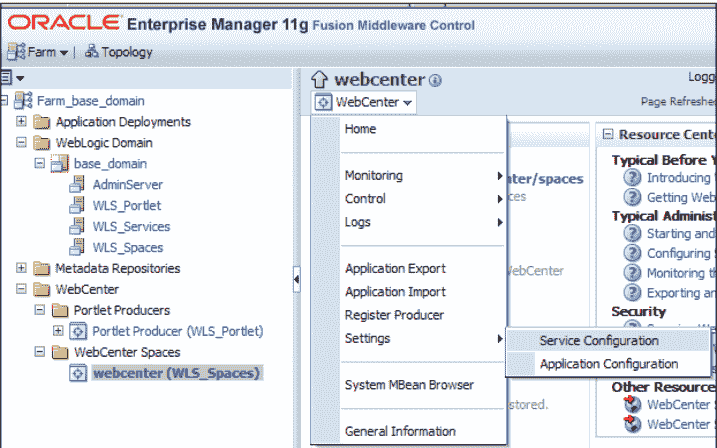

4. 选择 Content Repository 类别，然后单击 Add 按钮。

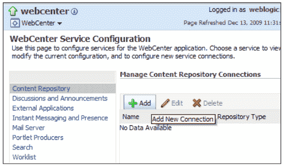

5. 输入以下值：

- **Connection Name**: `paracas_fs`
- **Repository Type**: File System
- **Active Connection**: Yes (Define as a default connection)
- **Base Path**: `/ParacasRepository/` (我们需要在服务器上创建此目录。)

6. 按 OK。

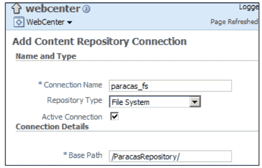

将需要重新启动 Oracle Spaces 服务以应用更改。

> > 您可以遵循相同的过程来启用与 Oracle Spaces 一起使用的讨论、维基和门户。

## 开发员工工作环境

开发个人工作环境可以通过以下方式完成：

1. 转到浏览器并输入 Oracle Spaces URL。在我们的情况中：http://localhost:8888/webcenter。
2. 要创建个人环境，请按 **Register** 按钮。

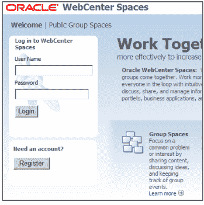

## Oracle WebCenter Spaces 概述

3. 在下一页中，输入以下值。然后单击 **Register**。

- User Name: eduardo.pulido
- Password: oracle
- First Name: Eduardo
- Last Name: Pulido
- Email: eduardo.pulido@paracascorp.com

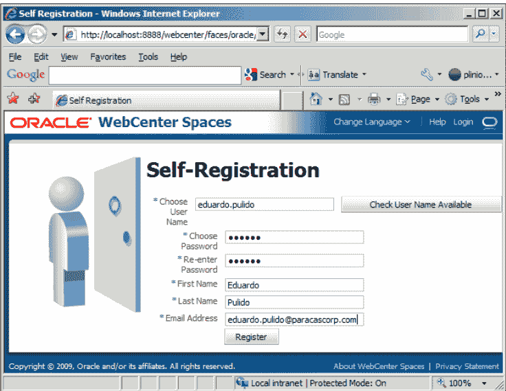

4. 单击左上角的 **Login** 链接以重新进入应用程序。

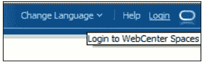

5. 在登录页面，输入用户名：eduardo.pulido 和密码：oracle。单击 Login。

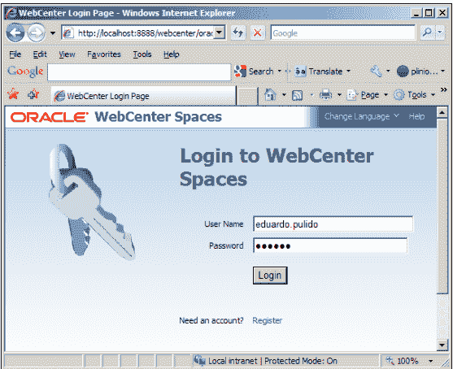

6. 接下来，您可以看到 Oracle Personal Spaces 环境。

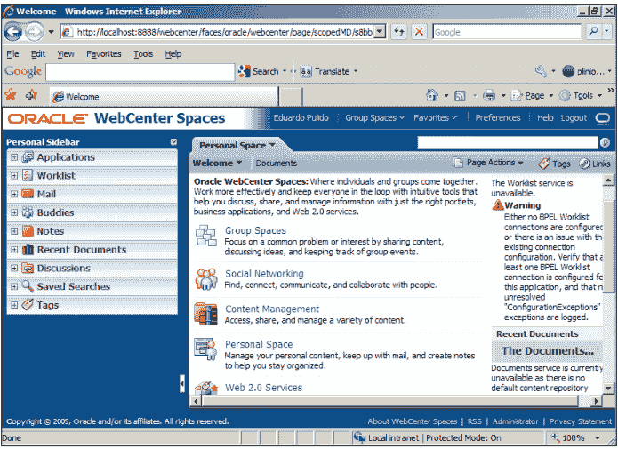

7. 在左侧，Oracle Personal Spaces 显示名为 Sidebar 的工具栏。此工具可快速访问 Oracle WebCenter Spaces 提供的资源。

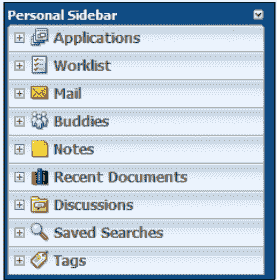

8. Sidebar 的元素如下：

- **Application**：提供对用户使用的业务应用程序的访问。它包括用于保存密码的 Single Sign-On。
- **Worklist**：用户通常参与工作流，例如审批和评审。此任务流或端口将提供对待用户审批的流程的访问。
- **Mail**：链接到用户电子邮件或第三方电子邮件（如 Yahoo 和 Google）以及其企业电子邮件。
- **Buddies**：访问其即时消息联系人列表。
- **Notes**：允许用户创建简短笔记。
- **Recent Documents**：用户最近访问的文档将在此区域显示。
- **Discussions**：访问相关的热门和收藏话题。
- **Tags**：通过标签提供对页面的访问，并提供直接访问 Tag Center 的途径。

9. 在右侧，Oracle Personal Spaces 显示连接用户所属的页面。请注意，默认情况下有两个页面，**Welcome** 和 **Documents**，它们通过选项卡显示。

10. 第一个页面是信息页面，第二个页面允许我们访问在上一步中配置的文档存储库。

## 11. 要配置其页面，用户可以使用选项 Page Actions | Manage Pages…。

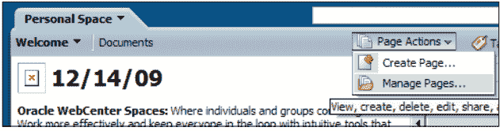

请注意，此窗口允许您管理所有用户页面。此外，用户还可以访问 WebCenter Spaces 中的 Role Based Pages。这些是分配给公司中角色的页面。因此，如果用户属于销售角色，则他或她将自动拥有仅限于该角色的页面的访问权限。

## 12. 让我们使用此功能创建一个新页面。单击 Create Page 按钮。

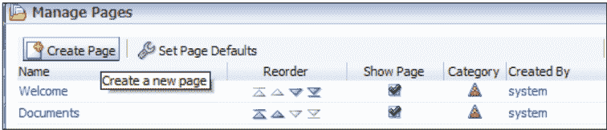

## 13. 输入页面名称为 Custom Information，方案为 Dunes。单击 Create 按钮。

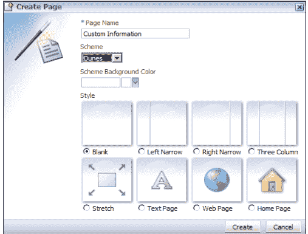

## Oracle WebCenter Spaces Overview

14. 通过单击此链接更改页面布局：**Change Layout | Two columns above…**。

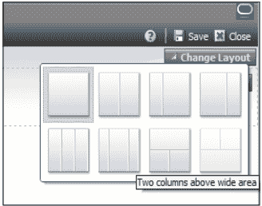

15. 请注意，我们现在有三个区域可供用户使用，以放置与购买天然纤维相关的数据。首先，在左上角，单击按钮 **Add Content**。

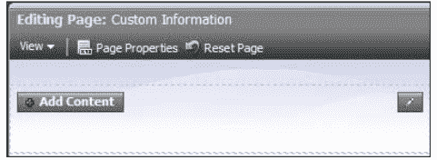

16. 在窗口组件目录中，单击 **Layout** 选项。

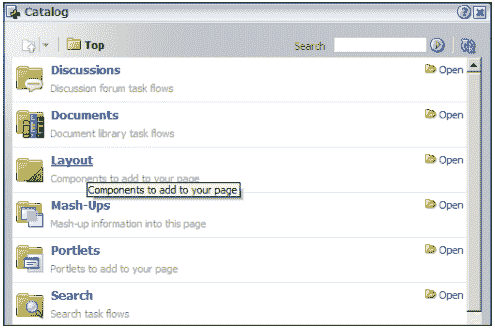

17. 在下一个窗口中，单击与 Text 控件关联的 **Add** 按钮，然后按 **Close** 按钮关闭组件目录。

18. 请注意，您已在此新页面上创建了一个文本组件。接下来，单击 **Edit Text** 链接并添加有关市场上天然纤维类型的信息。您可以选择并格式化任何文本段落。通过单击 **Done Editing** 链接完成此更改。

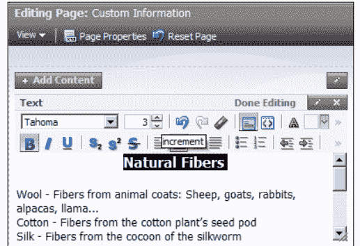

19. 现在，在右上部分，我们将放置有关世界天然纤维可用性的新闻。为此，我们将使用 RSS 服务。接下来，单击右上区域中的 **Add Content** 按钮。

20. 单击 RSS 控件的 **Add** 链接。然后，按 **Close** 按钮关闭目录。

## Oracle WebCenter Spaces Overview

21. 创建 RSS 控件后，您必须对其进行配置。为此，单击 **Edit** 链接（铅笔图标）。

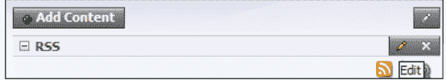

22. 完成 **RSS Feed URL** 字段，填入包含所需信息的地址。在我们的情况中，我们使用以下 URL：
`http://rss.globalsources.com/I/Cotton-fiber-manufacturers/r/2000000003844/3000000179301/21806/RSS.xml.`

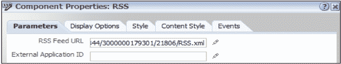

23. 按 **OK** 应用更改。
24. 最后，在页面的下部区域，用户将放置用户在采购过程中使用的文件。为此，单击底部的 **Add Content** 按钮。

25. 选择类别 **Documents**。

26. 单击 **Documents** 的 **Add** 链接并按 **Close** 按钮。

