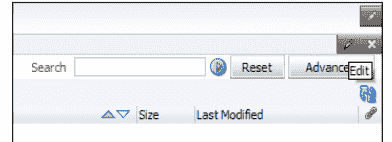
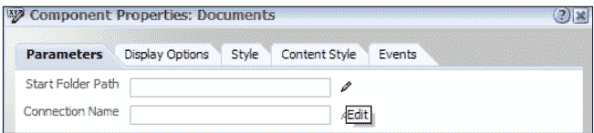
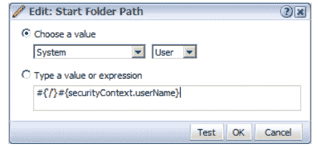
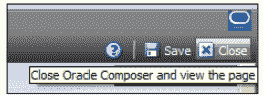
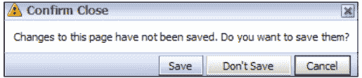
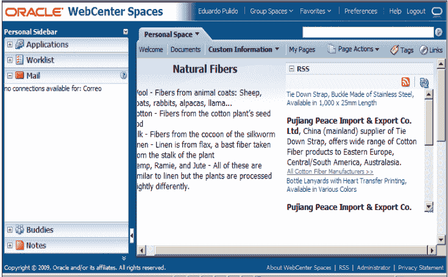
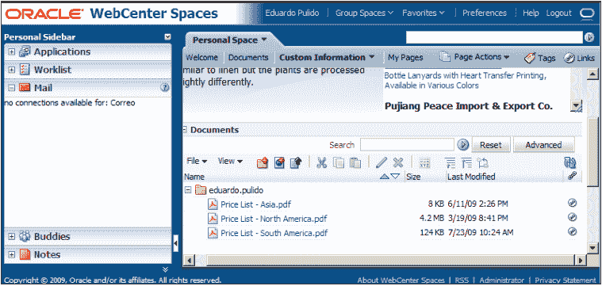

## Chapter 10

27. 现在自定义此控件以仅显示用户的目录。为此，单击与 Document 控件关联的 **Edit** 按钮。

28. 在 **Start Folder Path** 字段中，单击 **Edit** 按钮。

29. 在下一个屏幕中选择值，以定义带有用户名的目录作为存储库的根。在打开的窗口中按 **OK**。

30. 最后，单击页面右上角的 **Close** 按钮。

31. 通过单击 **Save** 按钮接受对页面所做的更改。

## 32. 最后，您将在用户页面上欣赏以下更改。

