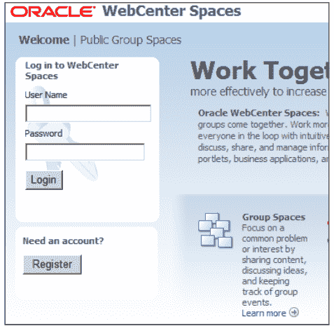
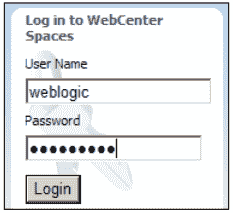

## Hands on

- 1. 转到 Oracle Spaces 登录页面：`http://localhost:8888/webcenter`。
- 2. 与创建 `eduardo.pulido` 用户的方式相同，单击 Register 按钮并继续创建用户 `martin.alban` 和 `diego.munoz`，两者的密码均为 `oracle`。

- 3. 注册后，返回初始页面并以管理员用户身份登录，在我们的情况中，用户为 **weblogic**。

