## Chapter 10

7. 接下来，输入 **Purchaser** 并选择模板 **Spaces-User**。按 **OK**。

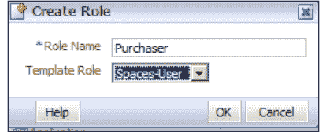

8. 创建角色后，我们将注册属于该角色的用户。为此，单击 **Users** 选项卡。

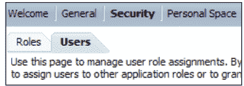

9. 此页面定义属于角色的用户。输入 **eduardo.pulido**，选择角色 **Purchaser**，并单击 **Grant Access**。这样，用户即与角色关联。

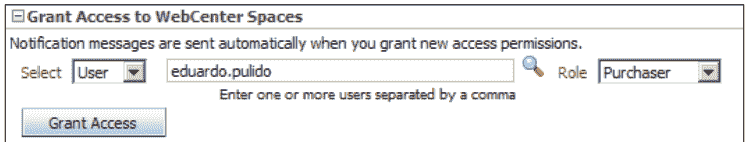

10. 对用户 **martin.alban** 和 **diego.munoz** 重复此操作。

11. 注册用户后，页面底部应显示以下信息。

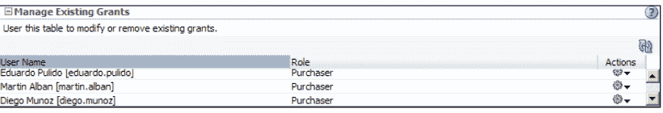

## 12. 单击选项卡 WebCenter Administration 中的链接 Welcome。

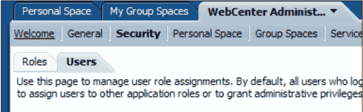

## 13. 现在创建一个可被该角色所有成员访问的页面。只需选择选项：Create Business Role Pages。

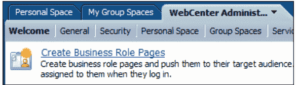

## 14. 按 Create New Business Role Page 链接。

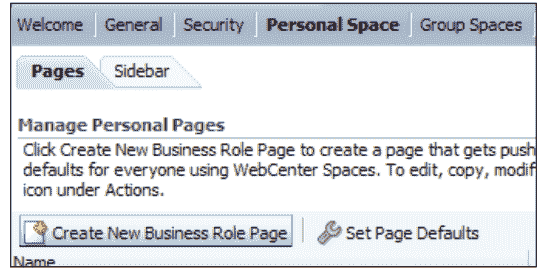

## 15. 输入以下信息：

- Page Name: Certified Providers
- Scheme: Dunes
- Style: Text Page

## 16. 按 **Create** 按钮。

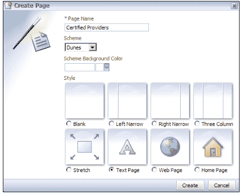

## 17. 创建页面后，使用编辑器编写认证提供商列表，然后按 **Done Editing** 链接完成注册。

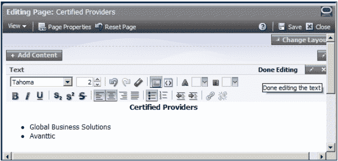

## 18. 然后，要将页面与角色关联，单击 **Page Properties** 选项。

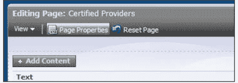

## 19. 在弹出窗口中，选择 **Security** 选项卡并单击 **Add Access** 按钮。

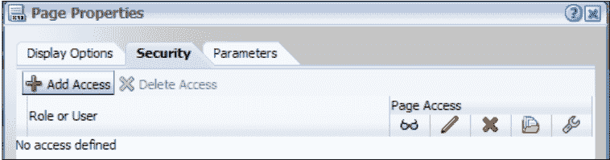

## 20. 找到 **Purchaser** 角色并通过按 **Select** 按钮选择它。

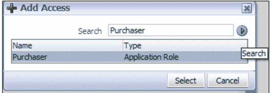

## 21. 确保所有用户都可以编辑页面的信息。为此，选择编辑复选框（铅笔图片）。然后单击 OK。

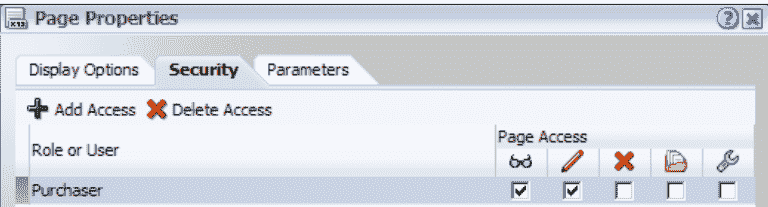

## 22. 单击 **Save** 和 **Close** 按钮以保存更改。

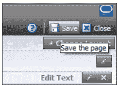

## 23. 单击 **Logout** 链接并使用用户 **martin.alban** 登录。请注意，该用户现在可以看到指向 Certified Providers 页面的链接。

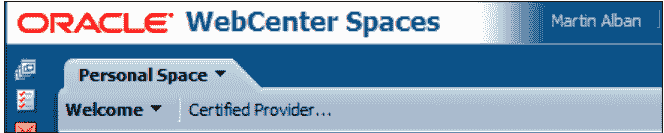

## 24. 单击此选项，您可以查看有关认证供应商的信息。此外，如果单击 **Page Actions | Edit Page** 选项，您可以修改此列表。

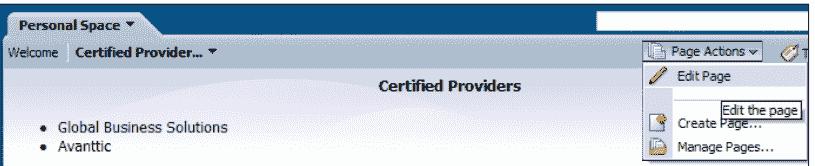
