## 开发群组空间

Oracle Space 提供的另一项功能是使用 Oracle Group Spaces 工具开发工作群组空间。此选项允许创建可用于促进项目、区域或工作组成员之间协作的工作环境。

在此练习中，我们将使用它为参与新采购系统的团队创建工作环境。

1. 以管理员身份登录 Oracle Spaces。

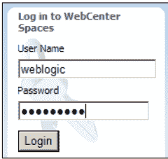

2. 在菜单栏中，选择 **Group Spaces** | **Create Group Space...**

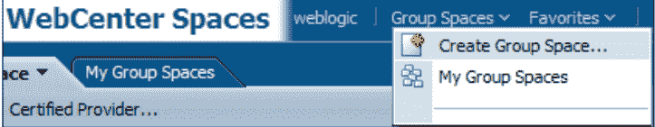

3. 输入项目数据以管理此群组并选择 **Group Project**。单击 **Create** 按钮。

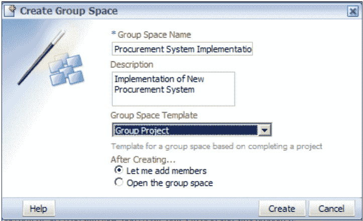

4. 接下来，您可以添加群组成员。为此，输入成员姓名，选择 Participant 角色，并单击 Add Members 按钮将成员添加到群组中。

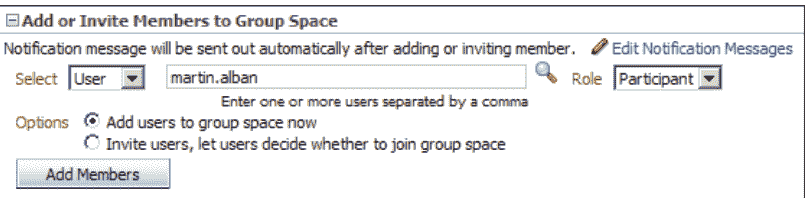

5. 重复该过程以添加所有先前注册的用户。
6. 再次使用 **martin.alban** 作为用户名登录 Oracle Spaces。

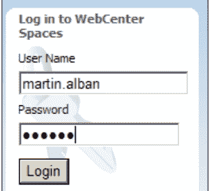

7. 从主菜单中，选择 **Group Spaces | Procurement System Implementation**。

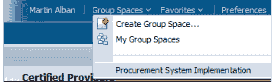

8. 请注意，已自动创建用于管理群组项目的环境。上半部分定义群组将要执行的活动。单击 **Create** 按钮以添加新活动。

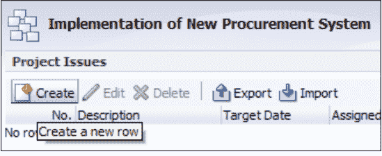

9. 输入活动信息并将其分配给 diego.munoz。单击 Save 按钮。

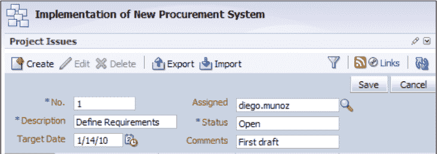

10. 在群组环境底部，您有一个日程表来定义团队的议程。单击 **Create** 按钮。

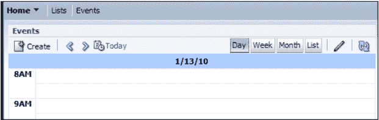

11. 输入会议数据并按 **Create** 按钮。

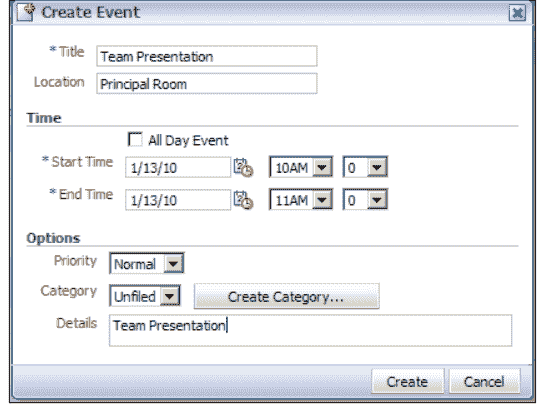

12. 请注意，您已创建新的日历事件。

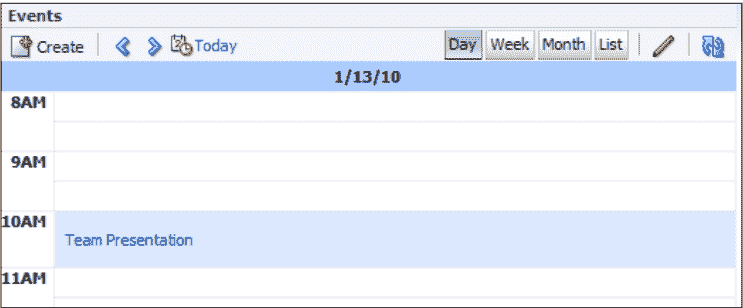

13. 现在以用户 **diego.munoz** 身份登录。

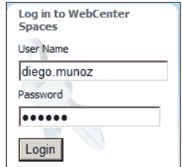

14. 转到 Oracle Spaces 环境和采购群组。
15. 单击选项 **Group Spaces | Procurement System Implementation**。

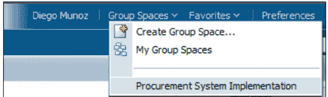

16. 最后，您会发现先前输入的活动和事件已定义在 **diego.munoz** 的群组环境中。

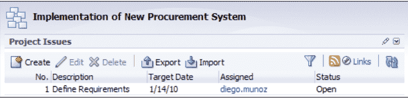
