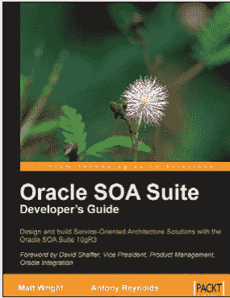

## Oracle SOA Suite 开发者指南

ISBN: 978-1-847193-55-1    平装本: 652 页

使用 Oracle SOA Suite 10gR3 设计和构建面向服务的架构解决方案

+   1. 一本关于使用和应用 Oracle SOA Suite 交付实际 SOA 应用程序的实践指南。

+   2. 详细介绍 Oracle Service Bus、BPEL 流程管理器、Web Service Manager、规则、人工工作流和业务活动监控。

+   3. 掌握在 SOA 解决方案实现中组合/使用每个不同组件的最佳方式。

