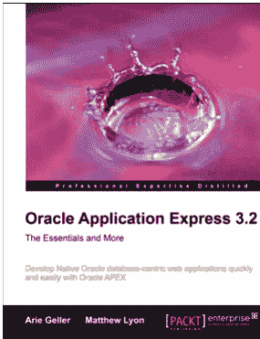

## Oracle Application Express 3.2 - 基础与进阶

ISBN: 978-1-847194-52-7    平装本: 644 页

快速轻松地使用 Oracle APEX 开发原生 Oracle 数据库中心 Web 应用程序

+   1. 掌握 APEX 背后的原理，为 Oracle 环境开发高效且优化的数据中心原生 Web 应用程序

+   2. 更好地理解 APEX 的主要原理和构建块，如 IDE 及其模块

+   3. 回顾与 APEX 相关的技术，如 HTML 和 DOM、CSS 和 JavaScript，这些将帮助您开发更好、更丰富且更高效的 APEX 应用程序

请查看 www.PacktPub.com 以获取我们书籍的信息

