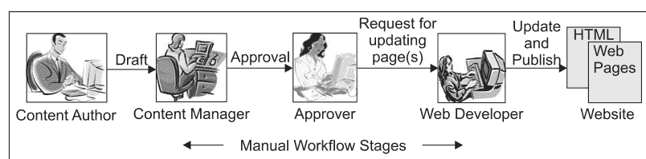
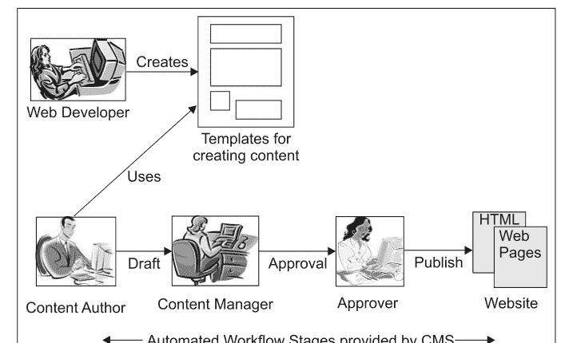
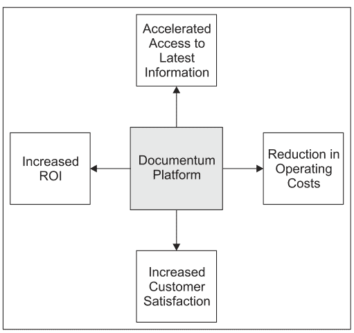

## 内容与 Documentum

网站上看到的每一条信息都可以归类为内容，无论是文本、图形、富媒体、视频、工程图纸、XML、图像、扫描文件——几乎任何东西！

内容可以是各种类型，从纯文本页面到培训材料、在线参考手册、图形屏幕截图甚至复杂的数据图表。

描述内容管理最简单的方法之一是通过每日报纸网站的例子。我们大多数人从浏览自己喜爱的报纸版面开始一天（无论是传统的纸质版还是在线版）。您是否注意到大多数报纸的共同点？报纸大多数版面的结构或布局每天都保持不变。真正发生变化的是同一版面内每天的实际内容。

头条的版面布局保持不变——尽管实际的头条每天都在变化。像漫画、编辑专栏和天气预报这样的版面每天都保持相同的外观和感觉，但其内容会随着报纸的最新版而每天变化。

报纸的在线版本需要根据新闻每天用新的 HTML、图形和文本进行更新。想象一下，每天手动更新网站的 HTML/JSP 页面以反映最新新闻需要花费多少时间。这会导致对技术网页开发人员更新内容的依赖增加。每天更新数百个 HTML 页面也会造成时间和资源问题。

此外，这意味着技术网页开发人员要处理他们甚至不理解的内容，却必须在组织的安全边界内安全上传。编辑人员和内容贡献者/作者每天都必须依赖 IT 人员，以便他们的内容能够进入实际网站。

问题会加剧，因为大多数组织中 IT 人员的流动率极高——想象一下，必须定期招聘新的网页开发人员来维护实时网站。而且，如果页面更新花费的时间相当长——以至于更新内容出现在网站上时已经太晚，实际上已经过时了！

当前业务环境要求组织的网站 24/7 全天候提供即时且正确的数据。漫不经心的态度可能会让企业直接被挤出当前市场。随着网站今天可见度的增加，管理网站内容的问题将随着时间的推移而不断增长。

现在很容易理解有效的内容管理方法的需求，它可以带来以下结果：

- 减少对 IT 员工运行和维护核心业务的依赖
- 维护核心业务的成本降低，投资回报率更好
- 非技术人员可自行维护其业务网站
- 无需非 IT 员工学习 HTML、JavaScript、JSP 等互联网网页技术即可运行核心业务
- 在业务网站上始终无需不必要的延迟即可获得最新信息
- 安全机制限制无关业务部门编辑信息，例如将敏感财务信息的编辑权限限制在行政部门
- 通过工作流机制实现内容创建/审批/发布自动化
- 维护文档/手册/内容的纸质版本费用减少
- 在需要从网站撤回更新内容时提供回滚机制
- 有效捕获和使用内容元数据以进行索引和搜索

这个列表并不完整——拥有良好的内容管理方法的优点是多种多样的。上述列表只是让我们了解内容管理在当今苛刻的商业环境中的关键性。

简而言之，内容管理到底是什么？众多关于内容管理的网站之一将内容管理描述如下：

> 内容管理是对信息资源（文本、图像、文档等）进行组织、分类和结构化，以便能够轻松灵活地存储、发布和编辑。内容管理系统（CMS）用于收集、管理和发布内容，将内容存储为组件或完整文档，同时保持组件之间的动态链接。

图 1.1：传统的内容创作流程

图 1.1 表示为网站创建内容的传统流程，经过一系列业务用户的审批，最后由网页开发人员（IT 人员）更新 HTML 页面以反映此已批准的内容。

然而，这种方法并非没有缺点。创作内容并由一系列业务用户手动审查和批准是一个耗时过程，然后又严重依赖 IT 人员手动在网站页面上进行更改。等到一系列步骤完成后，内容可能已经过时，不再适合在组织网站上展示！

### 1.1 有效 CMS 的需求

上述内容管理的大多数问题都可以通过使用内容管理系统（CMS）来解决。良好的 CMS 允许内容作者通过一些预定义模板以文章形式创建内容。内容作者只需在模板字段中提供内容（纯文本、图片等）。内容管理系统随后使用一些预定义规则来设置文章样式，从而将实际内容与其显示/布局结构分离。作者只需关注核心内容，而不必担心其外观和格式，从而节省大量时间和精力。一些内容管理系统还可选择要求作者输入内容的元数据，例如创建者姓名、关键词等，以便将其与内容关联并用于网站的索引和搜索。

与传统的内容管理方法不同，作者需手动让编辑和来自业务内容审批部门的高级成员批准内容/文章，良好的 CMS 具有自动化工作流机制。作者只需指定批准文章的审批者序列，自动工作流就会完成剩余工作。它确保内容不会在编辑和审批者序列通过自动化工作流批准之前发布到网站。

This requires the IT staff (web developers) to prepare the templates and associated rules as a one-time activity, along with stylesheets that format the entered content articles and are responsible for the look-and-feel of the website.

The IT staff additionally needs to configure and establish the CMS software once and from then onwards the content authors simply use the system and templates, getting rid of future dependency on web developers.

图 1.2：使用内容管理系统

图 1.2 只是从图形角度展示了使用 CMS 的好处。

网页开发人员在创建模板/规则方面投入的一次性努力，以便日后内容创建者能够继续使用，这是一种节省成本的好方法。

CMS 中可用的自动化工作流程将内容通过其不同的生命周期阶段路由，最终使其获得批准并发布到企业网站。

### 1.2 良好 CMS 的品质

由于需求旺盛，今天有大量公司涉足提供内容管理服务。幸运或不幸的是，市场上今天有众多内容管理系统可供选择，各自有其优缺点，但最终目标相同——便于管理内容。

良好的 CMS 应该经过精心挑选，因为大多数成本相当高，并且涉及培训开销，以便最终用户（主要是业务内容贡献者/编辑/审批者）能够有效地使用它们。

以下是评估组织 CMS 时应考虑的一些（但并非全部）要点。务必记住一点——没有“一刀切”的解决方案！应先分析自身业务需求，然后再从市场上可用的 CMS 范围中进行选择。

### 良好的 CMS：
- 允许非技术核心业务人员在无需 IT 人员（网页开发人员）协助的情况下撰写/发布内容
- 通过提供创建模板和相关规则/演示文件的简便方式，将实际内容与结构（外观和感觉）分离
- 确保内容贡献者遵守组织的网站标准，并维护安全和导航元素
- 确保及时发布内容的机制，以便网站信息始终保持最新
- 将业务数据和内容整合到单一存储库中以便更快检索，同时降低维护内容纸质版本的成本
- 允许通过标准网页浏览器撰写内容，从而减少培训需求
- 出于安全原因，创建对内容/文章执行的操作的审计跟踪
- 根据用户在业务中的角色/组/部门限制内容编辑
- 提供流程机制，通过自动化工作流程控制内容撰写、审阅和发布
- 在多个操作系统平台和网页浏览器上提供支持，并且可以轻松地与 Web 应用服务器、第三方软件或现有业务系统集成
- 提供版本控制/历史机制，允许将特定内容/页面回滚到其旧版本
- 通过简单的签入/签出用户界面提供文档控制
- 在指定的发布/到期日期安排内容的自动发布/删除
- 允许轻松创建/管理 CMS 用户、组和角色
- 提供内置富文本编辑界面，允许使用格式、超链接支持、图像/文件上传以及从其他创作应用程序复制粘贴等丰富功能进行内容创作
- 免除了在最终用户机器上安装任何软件的需求
- 支持多个同时用户
- 支持基于内容元数据的索引/搜索
- 为最终用户和系统管理员提供全面的报告系统

### 1.3 为什么选择 Documentum？

目前市场上存在众多内容管理系统，各自提供其专业功能。Documentum、Broadvision、Ektron 产品、Vignette 内容产品和 Interwoven 产品套件是市场上一些可用的内容管理系统。本书无意强调使用 Documentum 作为网页内容管理解决方案相对于其他可用产品的优势。

Documentum 提供企业内容管理（ECM）解决方案，使多元化组织能够在单一平台上集成其分布式内容和相关业务流程，从而使团队能够协作创建、管理和处理以及交付其非结构化内容。Documentum 的客户包括多家大型组织，它们成功利用其广泛的能力，通过降低运营成本、获得更好的投资回报率以及通过准时交付实现客户满意度提升来扩展其核心业务。

Documentum 主要应被视为一个平台，由多种产品组成，这些产品协同工作以提供企业级内容管理功能。Documentum 不仅提供产品套件中可用的大量开箱即用（OOTB）功能，而且还提供可定制/可配置的平台，可单独满足不同企业的特定需求。

### 1.4 Documentum 功能

选择合适的 CMS 一直是人人关注的有趣问题。然而，在评估 Documentum 时，有很多功能会引起你的注意。其中一些是非常基本的功能，任何好的 CMS 都应提供，而另一些则非常特定于 Documentum。

列出 Documentum 的所有可用功能是不可能的，这可能不足以体现其价值。

然而，以下列表应作为使用 Documentum 进行项目/业务的人员的快速参考：

- 允许通过“生命周期”（或 Documentum 用语中的业务策略）创建、管理和归档内容
- 支持与多个行业标准创作应用程序集成，如 Microsoft Office 产品、Adobe 出版产品、CAD 应用程序和 XML 创作工具
- 提供基于 Web 的协作环境（Documentum 'eRoom'），可公开内容管理服务
- 通过记录管理、SSL 和 LDAP 对 Documentum 仓库及之外的内容进行加密
- 提供文档/内容的自动版本控制和历史跟踪
- 允许以 HTML 和 PDF 等多种格式创建内容的多个呈现版本
- 支持虚拟文档管理，用于从各种来源汇编信息
- 支持使用 XSLT 支持解析、验证和转换 XML 文档的能力
- 支持集群、负载均衡和备份/恢复功能
- 通过 Documentum Web Publisher 提供内容创作/管理功能，并通过站点缓存服务（SCS）提供发布功能
- 通过站点部署服务（SDS）将网站内容部署到多个服务器
- 通过内容分发服务（CDS）根据业务规则将内容从源部署到订阅者
- 支持众多归档/存储技术，例如 RAID、光学激光盘、CD 和 DVD 点唱机
- 支持自动化工作流程，将内容项路由到其生命周期的各个阶段（创建、审阅和批准）
- 通过企业间工作流服务为外部参与者和组织提供工作流流程扩展，以实现更好的协作
- 提供详尽的数据字典（包含仓库及其对象中的信息），供应用程序使用以执行业务规则或为用户提供价值帮助
- 支持业务对象以封装业务规则，这些规则可进一步作为 Web 服务公开给第三方应用程序
- 支持基于内容元数据的索引/搜索
- 支持多个同时用户
- 为内容管理提供广泛的库服务
- 允许通过内容智能服务（CIS）自动智能提取 Documentum 文档的属性列表
- 提供内容聚合服务，从多个来源收集内容以存储在集中位置
- 提供像 Content Services 这样的产品，允许 SAP、Siebel 和 Lotus Notes 等各种企业应用程序与 Documentum CMS 交互
- 通过多个内容服务器为单个仓库提供服务以及仓库复制以备备份，支持高可用性
- 符合 UTF-8 Unicode——单字节和双字节字符语言

### 1.5 摘要

本章我们讨论了内容管理系统（CMS）是什么，以及它们的优点和缺点。我们看到了内容管理系统如何通过减少对 IT 人员维护业务网站的依赖，并提供安全、精简和自动化的机制来输入和发布数据到网站，从而成为组织的福音。另一方面，内容管理系统确实需要培训开销，以便让业务用户熟悉使用自动化系统。

Documentum 是一个企业内容管理系统，有助于组织在单一平台上集成其非结构化内容。我们讨论了一些良好内容管理系统的品质，以及 Documentum 产品套件如何解决其中大部分（如果不是全部）问题。

最后，我们提到了 Documentum 平台的一些突出功能，以及它如何帮助组织协作创建、管理和处理以及交付其庞大的非结构化内容。

