## 2 Documentum 基础

Documentum 产品套件是一个极其庞大的体系，在一本图书中描述 Documentum 的全部产品是不合理的。然而，对于刚刚开始探索 Documentum 的人来说，至少应熟悉一些关键特性，以便更好地构思/设计和开发 Documentum 应用。

那些已经使用过 Documentum 和/或了解 Documentum 周围基础知识的读者可能希望跳过本章，直接进入后续章节。

在阅读接下来的几章时，您可以随时返回本章进行快速参考。

### 2.1 Documentum 基石

Content Server 构成了 Documentum 的核心，提供在 Documentum 系统中创建、版本化、管理和归档内容和对象的核心服务。

Content Server（早期称为“eContent Server”）托管一个存储库，Documentum 将其称为“Docbase”，用于存储各种内容及其相关属性（元数据）。

### Documentum 5.3 Update

请注意，Documentum 5.3 版本在 Content Server 中增加了一些新功能和改进，例如对动态组的支持，即其成员列表被视为潜在成员列表，以及通过 ACL（访问控制列表）增强的对象级权限分配。

### 2.2 Docbase

Docbase 应被视为一个巨大的集中式存储库，以“对象”及其属性的形式存储内容和元数据。

内容的元数据无非是描述内容的各种属性；例如其所有者、创建日期、版本号等。

有些属性可以是“单值”的，仅有一个值，例如内容名称，而其他属性可以是“多值”的，具有多个值，例如描述内容的关键字。

Documentum 依赖于底层 RDBMS 将各种对象的元数据存储在各种表中。另一方面，众多对象的内容文件存储在以下任一存储类型中：

- 主服务器的操作系统文件系统
- 以 BLOB（二进制大对象）的形式存储在 RDBMS 中
- 内容存储设备（例如：EMC Centera）
- Documentum 范围之外的外部系统

此外，Content Server 具有嵌入式全文搜索引擎 Verity，因此 Docbase 存储库包含多个全文索引，使用户能够对 Docbase 执行基于全文的内容搜索。

可以使用此功能搜索内容属性以及内容文件中的数据。

### Documentum 5.3 Update

请注意，在 5.3 版本中，Documentum 已用 Fast Search & Transfer™（FAST™）取代 Verity 作为其新的搜索基础设施。

如果除了 Content Server 之外还安装了 Documentum Media Services，则 Documentum 系统可以管理视频和音频文件等数字内容。

请注意，每个 Documentum Content Server 安装并不限于单个 Docbase。它可以托管多个 Docbase。然而，这些多个 Docbase 中的每一个都必须由一个称为 Docbase ID 的唯一标识符标识。

Documentum 随其软件一起提供大量有效的 Docbase ID 以供组织内部使用。有效的 Docbase ID 不能以零（0）开头。

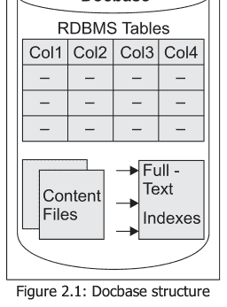

图 2.1 将 Docbase 描述为一个逻辑单元，由内容文件、RDBMS（数据库）表和全文索引组成。

### Documentum 5.3 Update

值得指出的是，Documentum 5.3 版本将 Docbase 称为存储库。

### 2.3 DocBroker

每当客户端想要与服务器建立连接时，DocBroker 充当桥梁或中介。（请参阅图 2.2）

DocBroker 并不是向服务器请求信息，而是反过来——Content Server 会定期向多个 DocBroker 广播其连接信息，相同的信息会被发送回请求客户端。

客户端可以根据返回的信息选择使用哪台服务器。

Web Publisher 和 Documentum Application Builder 等客户端可以通过在客户端的 dmc1.ini 文件中定义主 DocBroker 和备份 DocBroker 来与多个 DocBroker 通信。

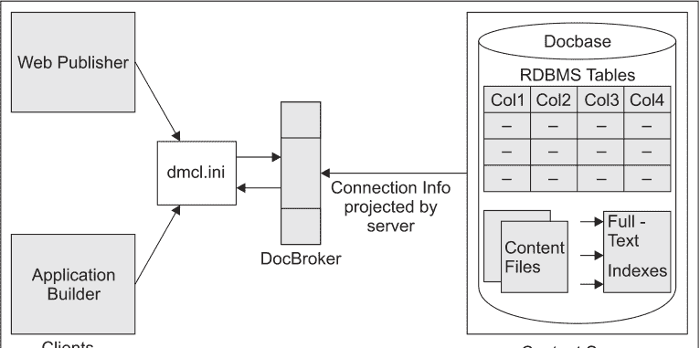

图 2.2：DocBroker 架构

### Documentum 5.3 Update

在 Documentum 5.3 版本中，DocBroker 被称为连接代理。

### 2.4 DocApp

DocApp 只不过是 Documentum 对象的打包单元。

通常 Documentum 项目中的所有开发工作都在开发 Docbase 上进行，开发的对象会在系统测试前发布到测试 Docbase，然后最终发布到生产 Docbase。

DocApp 作为可部署的打包单元，用于在 Docbase 之间移动对象。

在 DocApp 中可以包含多个 Docbase 对象，如生命周期、工作流、文件夹等，并从中创建 DocApp 归档。归档是 DocApp 在文件系统上的文件表示形式。

然后通过 Documentum DocApp 安装程序将此归档安装到另一个 Docbase。我们将在第 25 章进一步探讨此问题。

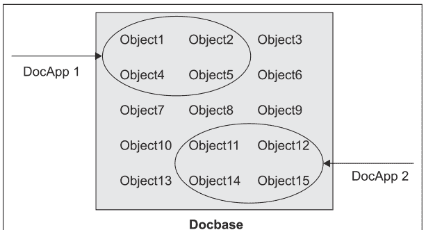

图 2.3：DocApps 的逻辑表示

### 2.5 Object Types

如果您刚刚开始使用 Documentum，请记住一条重要经验法则——开始将 Documentum 系统中的一切都视为对象。存储文档的文件夹是对象，创建的文档本身也是对象，用于文档评审的工作流是对象，事实上创建文档的用户也是对象！

对象太多？适应这种理念可能需要一段时间，但很快您就会开始认识到其重要性。

Documentum 是一个面向对象的系统，Documentum 中的每个对象都属于一个对象类型。内部，Content Server 使用对象类型作为模板来创建各种对象实例。对象类型由多个属性组成，这些属性描述了从其创建的各种对象。我们将在第 11 章通过详细示例介绍对象类型和属性。

现在术语太多？让我们举一个例子来简化问题：

用户创建了一篇文章，希望将其发布到组织的网站上。该文章可以是文档类型（在 Documentum 用语中为 dm_document）。

用户填写文章的属性，例如其标题和主题。

- 对象类型：document（具体为 dm_document）
- 对象类型的属性：title 和 subject
- 创建的文档：对象类型为 dm_document，且为属性 title 和 subject 指定了值

Documentum 对象类型遵循图 2.4 所示的层次结构。子类型从超类型扩展并继承其超类型的全部属性（属性）。请注意，子类型还可以是另一个对象类型的超类型。所有对象类型各自具有自己的特定属性以及其超类型的继承属性。

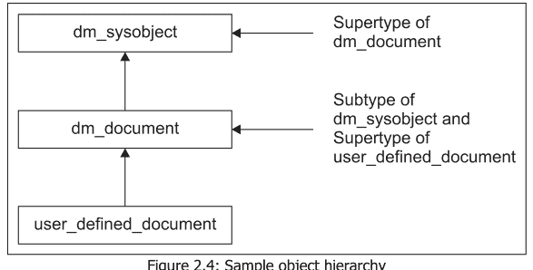

图 2.4：示例对象层次结构

请注意，对象类型不必从另一个对象类型扩展。Documentum 允许存在没有超类型的对象类型。

图 2.5 所示的表格列出了一些 Documentum 对象及其各自的对象类型。

| 实体 | Documentum 对象类型 |
|---|---|
| 访问控制列表 (ACL) | dm_acl |
| 工作流活动 | dm_activity |
| 别名集 | dm_alias_set |
| 审计跟踪 | dm_audittrail |
| 文件柜 | dm_cabinet |
| 分类 | dm_category |
| 内容对象 | dmr_content |
| 文档 | dm_document |
| 文件夹 | dm_folder |
| 格式 | dm_format |
| 组 | dm_group |
| 作业 | dm_job |
| 方法 | dm_method |
| 生命周期定义（策略） | dm_policy |
| 过程 | dm_procedure |
| 工作流过程定义 | dm_process |
| 已注册表 | dm_registered |
| 关系 | dm_relation |
| SysObject | dm_sysobject |
| 用户 | dm_user |
| XML 应用程序 | dm_xml_application |
| XML 配置 | dm_xml_config |

图 2.5：示例 Documentum 对象类型列表

### 2.6 Attributes

属性是描述 Documentum 中对象的特性。例如，对于一篇新闻文章，其作者姓名和创建日期可以被视为其属性。

应该注意的是，存储在 Docbase 中的所有持久对象最终都是内部持久对象类型的子类型。

持久对象类型具有三个属性，所有子类型都继承这些属性。r_object_id 是每个使用 Documentum 的人都应了解的内容：

- `r_object_id` 是由 Content Server 生成的唯一标识符，并在对象创建时分配给所有对象。需要注意的是，在 Docbase 中，两个对象不能共享相同的 `r_object_id`。
- `i_is_replica` 和 `i_vstamp` 是内部服务器生成的属性，通常在典型应用中不需要。

#### 2.6.1 对象 ID（对象标识符：r_object_id 属性）

对象 ID 由 Content Server 在 Docbase 中创建新对象时生成。这些表示为 16 个字符的字符串，用于在 Docbase 内部唯一标识对象。对象 ID 中的前两个字符称为 **类型标识符**，表示相关对象的对象类型。

例如，考虑一个 `r_object_id` 为 090015558000c629 的 `dm_document` 对象。此对象 ID 中的前两个字符 (09) 表示对象的类型：本例中为 `dm_document`。图 2.6 所示的表格显示了一些常见的 Documentum 对象类型及其类型标识符。

| 对象类型 | 类型标识符 |
|---|---|
| 访问控制列表 (dm_acl) | 45 |
| 别名集 (dm_alias_set) | 66 |
| 文件柜 (dm_cabinet) | 0c |
| 内容 (dmr_content) | 06 |
| 文档 (dm_document) | 09 |
| 文件夹 (dm_folder) | 0b |
| 组 (dm_group) | 12 |
| 作业 (dm_job) | 08 |
| 生命周期策略 (dm_policy) | 46 |
| 方法 (dm_method) | 10 |
| 用户 (dm_user) | 11 |
| 工作流流程 (dm_process) | 4b |
| 系统对象 (dm_sysobject) | 08 |

图 2.6：一些对象类型及其类型标识符

#### 2.6.2 属性类型

属性可以分为多个类别。

- **单值和重复属性**：单值属性顾名思义只能有一个值。例如，文档的标题或主题就是一个例子。重复属性可以保存多个值。例如，文档的关键字就是一个例子。例如，一份文档可以有多个关键字来描述它，而其标题只能有一个。

- **读写和只读属性**：读写属性可以由应用程序和用户修改。示例：title、object_name、a_content_type 等。

需要注意的是，以 a_ 开头的属性通常由应用程序开发人员使用，而不是用户使用。

只读属性由服务器管理，建议不要篡改这些属性。然而，这些属性可以被应用程序读取。
示例：r_object_id、r_creation_date、i_contents_id 等。

- **计算属性**：除了存储在 Docbase 中的持久对象的属性外，Content Server 还为对象计算某些属性。这些属性称为计算属性，并不持久存储在 Docbase 中，而是在运行时由服务器生成。示例：_alias_set、_policy_name 等。

图 2.7 描述了一些 Documentum 对象类型及其所属的示例属性。

| 对象类型 | 属性名称 |
|---|---|
| 持久对象 | r_object_id |
|  | i_is_replica |
|  | i_vstamp |
| 系统对象 (dm_sysobject) | r_object_type |
|  | r_modify_date |
|  | r_creation_date |
|  | r_version_label |
|  | i_chronicle_id |
|  | object_name |
|  | a_effective_date |
|  | a_expiration_date |
|  | title |
|  | subject |
|  | authors |
|  | keywords |
| 文件夹 (dm_folder) | r_folder_path |
| 文件柜 (dm_cabinet) | is_private |
| 用户 (dm_user) | user_name |
|  | user_os_name |
|  | user_group_name |
| 组 (dm_group) | group_name |
|  | users_names |

图 2.7：示例对象类型及其部分属性

### 2.7 DQL

DQL 是 Document Query Language（文档查询语言）的缩写，使用的是 ANSI 标准 SQL（结构化查询语言）的超集语法。对于熟悉 SQL 的人来说，DQL 可以简单地被视为 Documentum 对 SQL 的封装。

DQL 用于在 Docbase 中执行以下操作：

- 在 Docbase 中查询、更新和删除对象
- 在 Docbase 中创建新对象
- 在 Docbase 中搜索内容
- 查询已注册表

简单 DQL 查询示例：

```
select r_object_id from dm_document where object_name = 'SampleDocument.xml'
```

上述查询选择了名称为 SampleDocument.xml 的 dm_document 类型对象的唯一对象 ID

DQL 查询可以从以下位置发出：

- Documentum Administrator（Documentum Web 客户端）
- DFC（Documentum Foundation Classes）
- IDQL 实用工具

IDQL 是一个与 Content Server 一同安装的交互式实用工具/工具，允许我们针对 Docbase 执行 DQL 查询。图 2.8 显示了如何使用 IDQL 实用工具发出示例 DQL 查询。

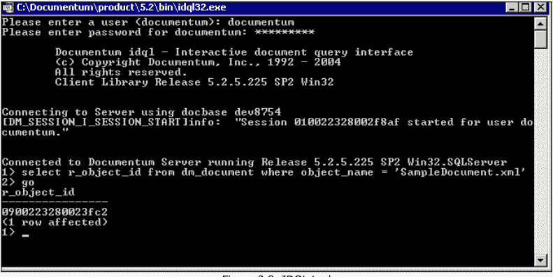

图 2.8：IDQL 工具

### Documentum 5.3 更新

Documentum 5.3 版本引入了一种新的查询方法，称为 FTDQL 查询，其类似于 SELECT 语句，不同之处在于查询针对全文索引而不是 Docbase（存储库）运行，以获得性能提升。

如需了解更多关于 DQL 查询的信息，请参阅第 26 章。

### 2.8 API

API 命令（也称为 Server API）是通过 DMCL（Documentum Client Library）由客户端发送给 Content Server 的指令。与 DQL 类似，API 命令用于：

- 在 Docbase 中查询、更新和删除对象
- 在 Docbase 中创建新对象

与可以一次操作多个对象的 DQL 查询不同，API 命令旨在一次对一个对象执行。

示例：

```
get,c,0900223280023fc2,object_name
...
```

结果：SampleDocument.xml

让我们分解 API 命令来解释示例：

- get: 用于检索特定属性值信息的 Server API 方法
- c: 表示当前 Docbase 会话
- 0900223280023fc2: 相关对象的 r_object_id
- object_name: 需要检索其值的属性名称

请注意，Server API 方法的参数是按位置排列的，不应包含任何空白字符。

IAPI 是一个与 Content Server 一同安装的交互式实用工具/工具，允许用户针对 Docbase 执行 Server API 方法。图 2.9 显示了如何使用 IAPI 实用工具发出示例 API 命令。

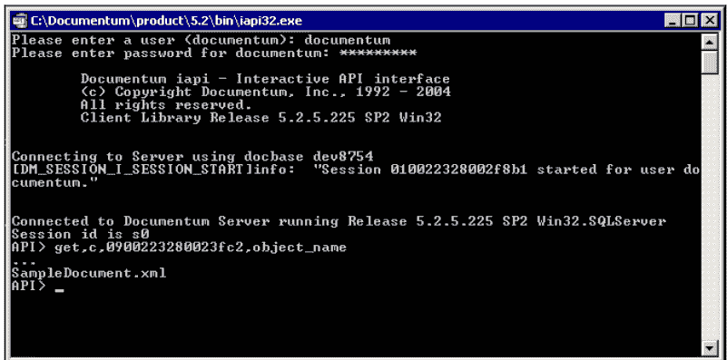

图 2.9：IAPI 工具

如需了解更多关于 API 命令的信息，请参阅第 26 章。

### 2.9 文件柜和文件夹

Docbase 中的对象通过放置在文件柜和文件夹中来组织。文件柜构成最高级别的组织，包含文件夹、文档和其他对象。对象可以驻留在文件柜中或文件夹中。文件夹存在于文件柜中或其它文件夹中。

在文件柜和文件夹中组织对象可以帮助我们更好地对内容进行分类，并实现对关键信息的更快搜索。

Documentum 中文件柜对象类型为 dm_cabinet，文件夹对象类型为 dm_folder。需要注意的是，dm_folder 是 dm_cabinet 对象类型的超类型。

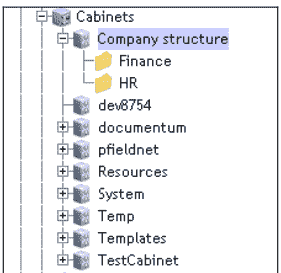

图 2.10：文件柜-文件夹结构

图 2.10 显示了在 'Web Publisher' 客户端中看到的 Docbase 中的示例文件柜-文件夹结构。

### 2.10 版本控制

与任何优秀的 CMS 一样，Documentum 内部管理同一文档的多个版本，并维护自文档初始创建以来所有更新的历史记录。**版本控制**是通过 **版本标签** 由 Content Server 提供的自动功能。

除文件夹、文件柜及其子类型外，所有 SysObjects 均由 Content Server 进行版本控制。文档的各个版本存储在 **版本树** 中。版本标签存储在 SysObjects 或其子类型的 r_version_label 重复属性中。

版本标签有两种类型：

- **数字（或隐式）标签**：这些是由服务器生成的数字标签，并存储在 r_version_label 属性的第一位置。
  示例：`r_version_label[0]=1.0`
- **符号标签**：这些是系统定义或用户定义的描述性标签。与数字标签不同，这些标签传达有意义的信息，因此对应用程序有用。它们存储在 r_version_label 属性的第二位置及以后，并且区分大小写。
  示例：`r_version_label[1]=WIP`

需要注意的是，CURRENT 是 Content Server 自动分配给文档最后一次签入版本的唯一符号标签。

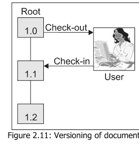

由于我们正在讨论版本控制，这里是讨论 Documentum 中 SysObjects 的 r_object_id 和 i_chronicle_id 属性的好地方。Documentum 中的版本树包含原始对象及其所有修改版本。Content Server 如何推断特定对象属于哪个版本树？答案是：通过 i_chronicle_id 属性。

请注意，i_chronicle_id 属性存储对象的原始（根）版本的 object ID（r_object_id）。每次创建新版本时，Content Server 都会将 i_chronicle_id 值复制到新创建的对象。让我们举一个小例子。

创建一个新文档。Content Server 为文档分配对象 ID 和编年史 ID。签出并签入。服务器现在分配一个新的对象 ID 但保留原始

chronicle ID。再次签出并签回。服务器再次分配一个新的对象 ID，但保留原始的编年史 ID。

请参考图 2.12 以了解 Content Server 如何管理原始文档的不同版本。对于文档的原始（根）版本，对象 ID 和编年史 ID 的值相同。

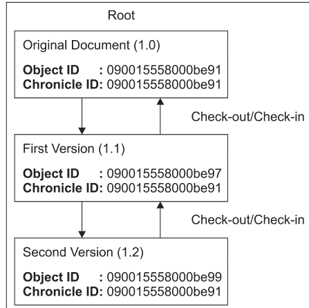

图 2.12：对象 ID 与编年史 ID 之间的关系

### 2.11 生命周期

企业中的文档会经过一个定义明确的编写-审阅流程。

让我们以这样一个流程为例：

- 1. 文档由作者创建。在此创建的初始阶段，文档处于草稿状态。
- 2. 文档正在由作者处理，因此属于“进行中”状态。
- 3. 当它被送出进行第一轮审阅时，可能处于“审阅中”状态
- 4. 当文档最终获得批准时，它就属于“已批准”状态（假设）。

Content Server 提供生命周期来自动化文档生命周期中的这些各个阶段。

简单来说，生命周期是一系列状态，描述了对象的各个生命周期阶段。Documentum 以策略对象（dm_policy）的形式将生命周期存储在 Docbase 中。

图 2.13 显示了在 Documentum Application Builder 中看到的示例生命周期。

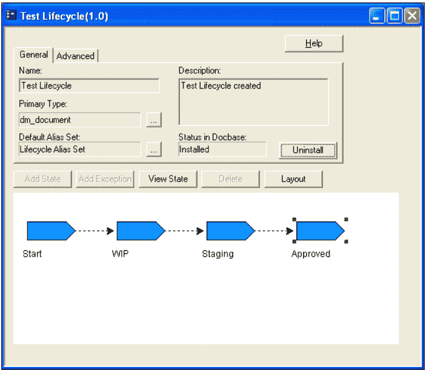

图 2.13：Documentum 测试生命周期

我们将在第 12 章更深入地探讨生命周期。

### 2.12 工作流

简单来说，工作流对业务流程进行建模。以下示例可以更好地解释这一点：

一家在线报纸出版公司在将内容发布到其实时报纸网站之前需要对创建的内容进行各种审批。无需手动将内容的纸质副本转移给各个审阅者组，工作流可以规范、标准化和自动化整个流程。

工作流由众多活动组成，每个活动包含各种需要执行的任务。用户或指定的自动化脚本执行任务并将相关文档传递给后续活动。工作流本质上所做的是通过不同用户将内容路由到其生命周期的各个阶段。每个用户在其收件箱中收到指定的任务，并可能同时收到电子邮件通知。Documentum 以业务流程对象（'dm_process'）的形式将工作流定义存储在 Docbase 中。

图 2.14 显示了在 Workflow Manager 工具中看到的示例 Documentum 工作流模板。

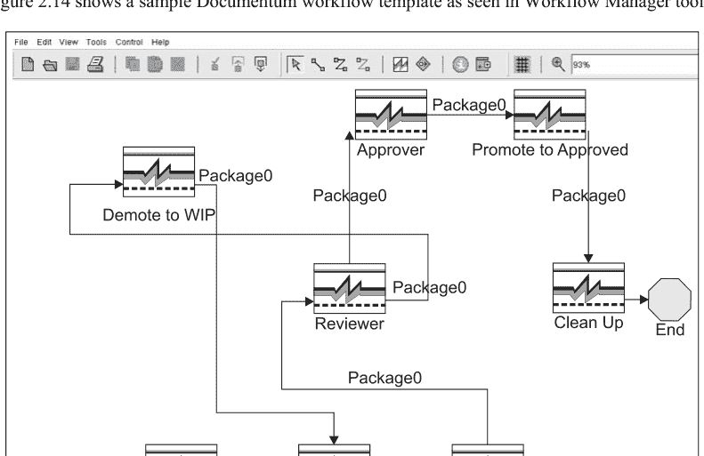

图 2.14：一个示例 Documentum 工作流

我们将在第 19 章后面详细介绍工作流。

至此，我们对 Documentum 基础的讨论结束。如果您仍然不太理解本章所涵盖的许多主题，请不要感到困惑。随着您开始动手使用 Documentum 系统，您将更好地理解这些概念并更加欣赏它们。如果您觉得现在对 Documentum 有了基本的了解，您可以继续阅读下一章，了解 Documentum 中的一些高级功能。

### 2.13 摘要

本章我们讨论了 Content Server，即 Documentum 架构的核心，托管 Docbase。Docbase 可以被视为一个逻辑存储库，由内容文件及其关联的元数据组成。另一方面，DocApp 是 Docbase 的打包单元，由 Docbase 中的对象组成。

我们继续讨论了 DocBrokers，它充当中间件，允许客户端与 Content Server 建立连接。

我们看到了 Documentum 系统如何以对象的形式处理所有实体。在 Documentum 中，对象可以被视为称为对象类型的模板的运行时实例。Documentum 中的对象具有自己的元数据，称为属性或特性。

我们看到了使用 DQL（Document Query Language）和 Server API 命令查询和操作 Docbase 中对象的示例。

我们还涉及了 Content Server 的版本控制功能，并对生命周期和工作流进行了简要介绍。生命周期代表了对象生命中的逻辑阶段，而工作流则对业务流程进行建模，并定义对象在何种条件下移动到不同的生命周期状态，以及参与实体是谁。
