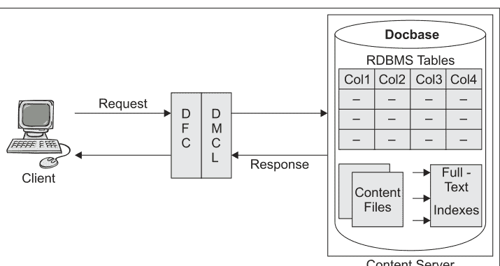
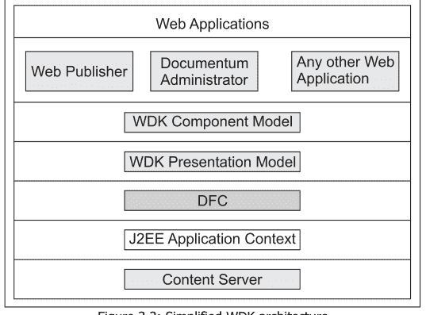
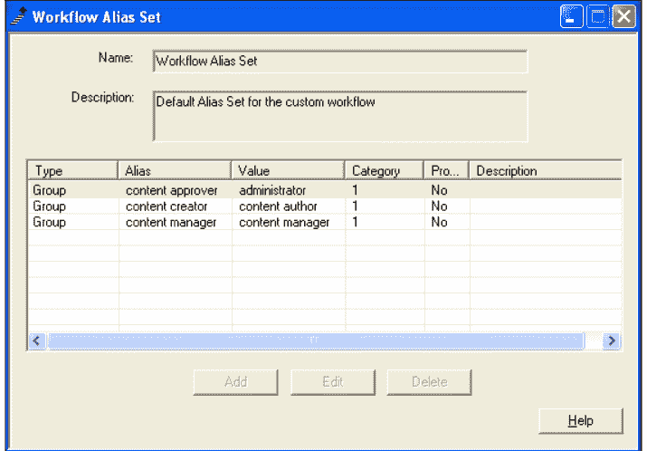
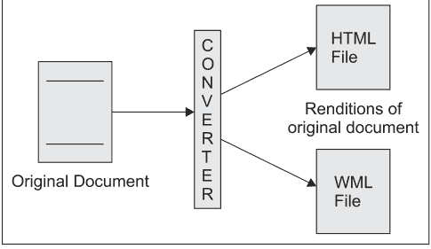
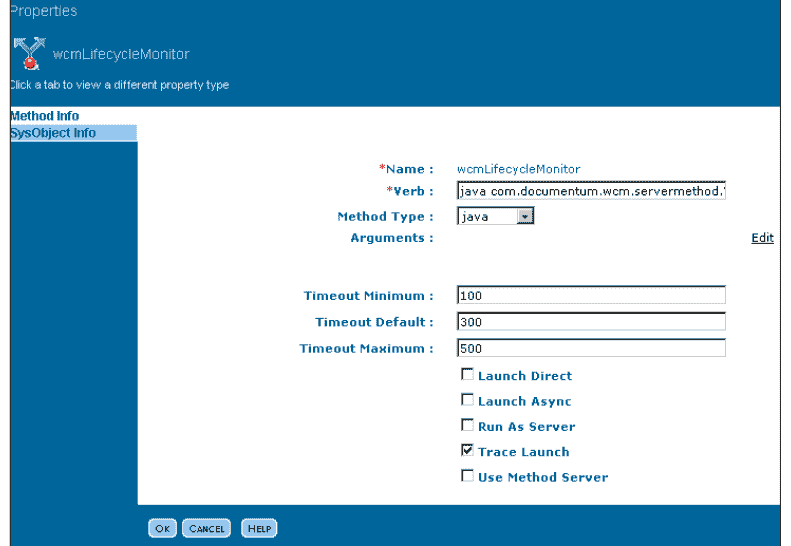
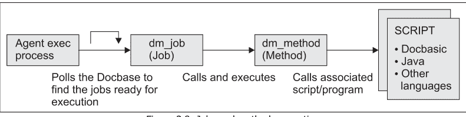
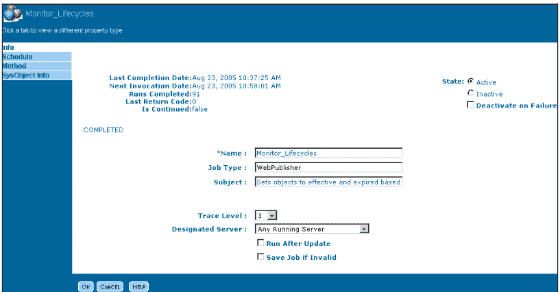
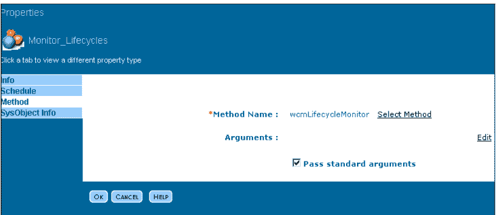

## 3 Documentum 高级概念

我们现在可以假设您已经复习了关于 Documentum 系统的基本概念。在本章中，我们将讨论 Documentum 架构的更多重要方面。毋庸置疑，如果您已经理解下面列出的概念，可以跳过本章继续阅读。

我们不要忘记 Documentum 系统极其庞大，并不仅仅局限于我们讨论的基础/高级概念。

> 为了全面了解该系统，强烈建议阅读 Documentum 的产品手册。

### 3.1 DMCL

DMCL 代表 Documentum Client Library，它在终端客户端和 Content Server 之间提供通信层（RPC）。

客户端请求通过 DMCL 层到达 Content Server，该层由在 Content Server 上执行的 C++ API 库组成。

建议不要从客户端直接执行 DMCL API 调用。相反，应该使用一组 Documentum Java 类或下面描述的 DFC。

### 3.2 DFC

DFC 代表 Documentum Foundation Classes，是一种面向对象（OO）框架，由用于访问和扩展 Content Server 功能的 API 组成。简单来说，它是一组作为 DMCL 包装器编写的 Java 接口和类。除了常规的 DMCL 功能外，DFC 还提供诸如数据验证、虚拟文档管理等功能。

此外，DFC 还提供 Documentum Java-COM Bridge（DJCB），以便 Java 接口可以在 Microsoft COM 环境中使用，也可被 Visual Basic 等程序使用。DFC 还包括 Business Objects Framework（BOF），使开发人员能够以可重用的模块化组件/元素形式建模应用程序业务规则。

图 3.1 显示了客户端与 Content Server 之间通过 DMCL 和 DFC 层如何进行请求-响应范式的工作。

图 3.1：DFC-DMCL 架构

我们将在第 23 章的众多示例中更深入地了解 DFC。

### Documentum 5.3 更新

Documentum 5.3 版本对 DFC 进行了一些增强。5.3 版本中作为 DFC 引入的一些新功能包括：

- 支持统一客户端设施（UCF），以协助诸如签出、签入、导入和导出等内容相关服务，作为基于 WDK 的应用程序的内容传输机制
- 与 .NET 的更深层次集成

### 3.3 BOF

Business Objects Framework（BOF）内置于 DFC 中，帮助开发人员创建称为 Business Objects 的可重用业务逻辑组件。使用 DFC 的应用程序可以轻松访问 BOF，并可以将 BOF 作为中间层或客户端应用程序中的可插拔组件/实体使用。让我们举一个简单的例子来理解这一点。

假设您需要在特定对象类型的特定文档签入 Docbase 时执行特定验证的特定业务功能。这可以通过使用 BOF 并覆盖特定对象类型的签入功能来实现。一旦编写完成，无论使用的是 Webtop、Web Publisher、某些桌面应用程序还是某些自定义 DFC 类，相同的业务对象都会被调用。简而言之，我们实现的是可重用组件/功能。

Business Objects 有两种类型：

- **基于类型（TBO）**：这对于扩展特定的 Content Server 对象类型并添加新的自定义方法或覆盖现有方法很有用。此类 Business Object 仅在 Docbase 中特定对象类型的所有对象上工作。
  示例：为对象类型 `my_custom_document` 添加了一些自定义行为（其中 `my_custom_document` 对象类型扩展了 Documentum `dm_document` 对象类型）
- **基于服务（SBO）**：与基于类型的 Business Objects 不同，此类 Business Object 不限于特定的 Docbase 对象类型。相反，它作为为 Docbase 中所有对象类型提供的通用服务，而不仅仅是一个特定对象类型。
  示例：无论对象类型如何，Docbase 中全局覆盖的签入方法、Documentum 收件箱对象等。

注意：对于来自 EJB（Enterprise Java Beans）背景的人来说，可将 TBO 类比为实体 Bean，将 SBO 类比为会话 Bean。

### Documentum 5.3 更新

在 Documentum 5.3 版本中，TBO 不仅与对象类型相关联，还与 Docbase（存储库）相关联。此外，Documentum 在本版本中增加了通过 Web Services 访问 Business Objects 的支持。

### 3.4 WDK

Web Development Kit（简称 WDK）是 Documentum 提供的框架，可在此基础上构建用于与 Content Server 通信的 Web 应用程序。

WDK 编程模型完全基于 J2EE 和 XML，WDK 应用程序可以部署在符合 J2EE 标准的任何应用程序服务器上。WDK 应用程序通过 DFC 调用与 Content Server 交互并获取数据。

以下是 WDK 框架的一些功能：

- 由可重用和可配置的组件组成，这些组件生成 HTML 控件/小部件，提供对 Content Server Docbase 的访问
- 提供可配置 UI 控件的标签库
- 提供框架服务，如品牌、历史、错误处理、消息传递、国际化和内容传输

In short, WDK is a set of server-side reusable components supported by Documentum that allow one to rapidly develop and deploy web-based applications.

WDK architecture consists of:

- **表示模型**: Incorporates JSP tag libraries to separate the UI from business logic.
- **组件模型**: Incorporates server-side components that extend the Content Server functionality.

Figure 3.2 represents a simplified version of the WDK architecture, showing how the various Documentum entities fit in the various layers.

Figure 3.2: Simplified WDK architecture

**Webtop** is a Documentum reference implementation with WDK components. Web Publisher tool is built over Webtop and is used mostly for content authoring and publishing.

WDK and its usage are discussed in detail in Chapter 24.

### 3.5 Web 发布器

Web Publisher is a browser-based web application provided by Documentum for content creation, review, and finally publishing to websites.

In the Documentum architecture, Web Publisher utilizes the content management services from Content Server, publishing services from **SCS** (Site Caching Services), and rendition (see section 3.9) management from **CRS** (Content Rendition Services).

Apart from these, Web Publisher also works with a host of other Documentum products.

Web Publisher defines its own specific groups in order to divide the responsibilities of the participating entities. For example, a content author can use Web Publisher to use predefined templates and create content for the website without requiring any knowledge of web design/construction.

A web developer on the other hand, understands web design and uses Web Publisher to create content templates, automates the review process through workflows, and maintains the website categories and structures.

An administrator has the highest privileges and maintains the Web Publisher system, administering and monitoring it and running reports for various objects and events.

Throughout this book, we shall explore Web Publisher in great detail and utilize it for various operations such as content authoring, categorizing, and publishing.

### 3.6 ACL

ACL (Access Control List) forms a part of Documentum's security mechanism to restrict certain groups/users from accessing a particular object. Documentum stores restricted objects as dm_acl objects. Note that all SysObjects in Docbase have an ACL assigned to them.

An ACL, also called a permission set, stores information regarding the groups/users that have access to a particular object as well as their access levels (or privilege levels).

Keep in mind that the permission levels are hierarchical, which means a permission level of 'READ' for example would grant permission levels above it as well—'NONE' and 'BROWSE'.

Go through the table shown in figure 3.3 to understand the basic access levels available in Documentum:

| 许可级别（r_accessor_permit 属性） | 权限 | 简短说明 |
|---|---|---|
| 1 | NONE | 对对象无访问权限。 |
| 2 | BROWSE | 用户可以查看对象的属性但不能查看其关联内容。 |
| 3 | READ | 用户可以查看内容但不能修改它。 |
| 4 | RELATE | 用户可以向对象附加注释（即评论）。 |
| 5 | VERSION | 用户可以创建对象的新版本但不能更新现有版本。 |
| 6 | WRITE | 用户可以写入并更新对象的现有版本。 |
| 7 | DELETE | 用户可以删除对象。 |

Figure 3.3: Basic permissions in Documentum

Apart from providing the above basic permission levels, Documentum provides some extended permission levels as well.

The table in figure 3.4 shows the extended permissions available in Documentum pre version 5.3:

| 权限 | 简短说明 |
|---|---|
| Change State | 用户可以更改对象的生命周期状态。 |
| Change Permission | 用户可以更改对象的权限。 |
| Change Ownership | 用户可以更改对象的所有者。 |
| Execute Procedure | 用户可以执行与对象关联的外部过程。 |
| Change Location | 用户可以更改对象的位置，例如从一个文件夹到另一个文件夹。 |

Figure 3.4: Extended permissions in Documentum (pre 5.3)

It is worth mentioning here that Documentum uses two reserved aliases in ACLs:

- `dm_owner`: Symbolizes the current owner of the object
- `dm_world`: This is an alias for all the users present in the Docbase

Let us take an example of a sample ACL attached to a folder in the Docbase:

**ACL 名称:** `OrganizationHR_ACL`

The permissions are as follows:

- `dm_owner`: DELETE
- `Hr_group`: WRITE
- `Finance_group`: READ
- `dm_world`: NONE

This means that the owner of the ACL (i.e. the one who created this ACL) has the highest rights—DELETE. The Human Resources (HR) group in the organization has WRITE access to the folder. The Finance group in the organization has just READ access to the folder. All other groups can not even see the folder since they have NONE access to the folder.

### 3.7 别名集

An Alias Set, as the name suggests is a list of Aliases. Now what exactly is an Alias? An Alias in plain terms should be considered to be a placeholder for value. An Alias resolves to a particular value called the Alias value. Alias sets are stored as dm_alias_set objects in Docbase.

Let us take an example here, in order to clear up all confusions.

An organization's workflow needs to go through a sequence of reviewers before it can be finally approved and published over to the website. A content author creates the content and needs to send it to his or her content manager for review. After the initial review, it needs to be finally approved by an approver.

Now, for each individual content author, his or her manager and approver would be different. Should a separate workflow be created individually for each content author? Or should it be hard-coded with the actual names of all the content authors in the organization and their content managers and approvers? What would happen if a new author or manager joins the organization in the future?

An alias set comes to our rescue! An alias set can be created for the workflow with placeholders for content authors, content managers, and approvers, etc. At run time, when the workflow is executed, the alias names can be substituted with their actual values.

In Documentum, an Alias Set can have placeholders for the following entities:

- Unknown (this is for the case when no existing entity fits)
- User
- Group
- User or Group
- Cabinet Path
- Folder Path
- Permission Set

Figure 3.5 shows a sample Alias Set in the Docbase as seen in Documentum Application Builder.

Figure 3.5: Sample alias set

We shall create custom Alias Sets in Chapter 12.

### 3.8 用户和组

It might sound bizarre, but Documentum stores users and groups in the form of objects!

#### 3.8.1 用户

Users are stored as dm_user objects in the Docbase. We will now discuss some important attributes of the dm_user object:

- user_name: This is the actual name of the user and can contain spaces, for example 'Gaurav Kathuria'. Internally Content Server assigns this value to the owner_name attribute for the objects created by this particular user.
- user_os_name: This is what Documentum uses to validate the user's credentials for authentication purposes, for example 'gauravk'.
- user_address: This stores the user's email address and is used by Content Server to send notifications.

These three attributes are mandatory for a user object and should always be filled in when creating a Documentum user.

Each user has certain user privileges assigned to him or her:

- None (no special privileges)
- Create Type (can create object types)
- Create Cabinet (can create cabinets)
- Create Group (can create groups)
- Sysadmin (system administration privileges)
- Superuser (highest-level privileges)

Users in Documentum can be created through numerous mechanisms:

- DQL queries
- API commands
- LDIF file (import users)
- Documentum Administrator user interface
- DFC classes

#### 3.8.2 组

Documentum groups are nothing but sets of Documentum users and groups. Documentum stores groups as dm_group objects. Let us take an example to understand the importance of groups in Docbase.

假设有一个权限集（ACL）分配给一个对象，并且特定用户可以访问它。例如，人力资源部门的所有用户对其具有写入访问权限，而财务部门的用户具有读取权限。

如果我们为人力资源部和财务部的每个用户单独设计 ACL 以授予特定权限，我们就会陷入混乱。每当人力资源部或财务部有新用户加入时，我们就必须重新审视 ACL。

组帮我们避免了这种麻烦。不是为每个用户单独分配权限，而是将所有人力资源用户归为一个 HR 组，将所有财务用户归为一个 Finance 组，然后在组级别而不是针对特定用户分配权限。组可以分为两种类型：

- **公开：** 如果系统管理员或超级用户创建组，则该组被标记为公开。
- **私有：** 如果具有“Create group”权限的用户创建组，则该组被标记为私有。

在内部，Documentum 并不会对这两种类型的组进行区别对待。具体如何解释则取决于各个应用程序根据业务需求来决定。

组可以通过以下方式创建：

- DQL 查询
- API 命令
- Documentum Administrator 用户界面
- DFC 类

### 3.9 渲染

文档的渲染基本上是原始文档的表示，仅在格式上有所不同。Content Server 内部具有转换器来支持众多渲染。此外，将 Media Services 与 Content Server 集成还可以提供对富媒体格式的支持。

渲染的示例如下：

一名 Web 开发人员创建了一个内容模板，例如 create_article.xml，并将演示 XSL 文件附加到它，以便将其转换为 HTML 文件和 WML 文件。从此模板创建的内容将以 HTML 文件和 WML 文件的形式呈现，分别用于在网站和无线应用程序上显示。

HTML 和 WML 文件与原始内容文件仅在格式上不同，而内容相同。

图 3.6 以简化的方式解释了这一点。

Figure 3.6: 渲染

## 3.10 注册表

大多数应用程序维护一些应用程序表以存储特定于应用程序的数据。这些应用程序表可能包含 Documentum 客户端需要访问的记录。例如，Documentum 客户端应用程序中的下拉菜单可能需要从外部数据库表中显示世界上所有国家的列表，以便内容作者在创建内容时进行选择。

在注册之前，Content Server 不会知道外部数据库表。简而言之，注册表是 Content Server 所知的普通 RDBMS 表，尽管它们不是 Docbase 的一部分。

Documentum 为“Registered”表创建一个 dm_registered 对象，允许开发人员使用 DQL 查询从表中获取信息。

dm_registered 对象包含有关表名、表所有者、表列以及定义谁有权查询表并执行插入/更新/删除行等操作的信息。

我们将在第 11 章更详细地讨论注册表。

## 3.11 数据字典

Docbase 中的数据字典（DD）存储有关 Documentum 对象类型及其属性的信息。数据字典在以下场景中非常有用：

- **向用户显示的值帮助**
  示例：显示属性可能取值集合的下拉菜单
- **应用某些业务特定规则**
  示例：对属性值的约束，如“not null”和“unique key”

DD 可以支持多种语言环境，因此可以根据各种终端用户的默认语言环境对存储的信息进行本地化。此外，DD 信息由 Content Server 内部管理，一旦我们发布其中包含的数据，就可以将其提供给终端用户。

在撰写本书时，安装 Content Server 时 Documentum 提供的以下语言环境的数据字典信息为：

- 英语
- 法语
- 德语
- 意大利语
- 日语
- 韩语
- 西班牙语

## 3.12 方法和作业

方法是在 Docbase 中可执行的程序和脚本，可以由作业自动安排运行，作业是 Documentum 对象（dm_job），用于自动执行方法对象。以下各节将详细介绍方法和作业。

### 3.12.1 方法

方法脚本可以用 Java、Docbasic（Documentum 的专有语言）或其他语言编写。在 Documentum 中，方法被视为方法对象（dm_method），其属性定义了各种方法参数，例如执行代理、方法类型、超时时间和方法参数。方法可以由以下服务器执行代理执行：

- **Content Server：** 这是方法的默认执行代理，除非指定了特定的执行代理。Content Server 用于执行与 Docbasic 脚本或其他编程语言脚本相关的方法对象。
- **Method Server：** 这是一个守护进程，只要 Docbase 运行就一直运行，并由 Content Server 管理。注意，Method Server 默认随 Content Server 一起安装。Method Server 可用于执行与 Docbasic 脚本相关的方法对象。
- **Java 方法服务器：** 在 Content Server 安装期间，Documentum 在 Content Server 主机上将 Apache Tomcat 应用服务器安装为 Java 方法服务器。Java 方法服务器可用于执行调用 Java 方法的方法对象。

Documentum 方法可以在 Documentum Administrator 中的以下位置创建、修改和查看：Administration | Job Management | Methods。

Figure 3.7: wcmLifecycleMonitor 方法

图 3.7 显示了在 Documentum Administrator 中看到的示例方法 wcmLifecycleMonitor。

### 3.12.2 作业

无需手动或通过脚本调用方法，而是可以使用作业定期安排其执行。dm_job 对象属性定义作业参数，如关联方法、执行计划、方法参数等。

作业由随 Content Server 安装的 Documentum agent exec 进程执行。图 3.8 显示了作业和方法在 Documentum 架构中如何协同工作。

Figure 3.8: 作业和方法执行

Documentum 作业可以在 Documentum Administrator 中的以下位置创建、修改和查看：Administration | Job Management | Jobs。

Figure 3.9: Monitor_Lifecycles 作业

图 3.9 显示了在 Documentum Administrator 中看到的示例作业（Monitor_Lifecycles）。该作业进而调用图 3.10 中所示的方法 wcmLifecycleMonitor。

Figure 3.10: 'Monitor_Lifecycles' 作业调用的 'wcmLifecycleMonitor' 方法

## Documentum 5.3 更新

Documentum 5.3 版本引入了名为 Job Sequences 的新功能。这允许您配置多个作业按顺序（按指定顺序）在指定时间运行。

就目前而言，这就是我们希望在 Documentum 高级概念部分涵盖的全部内容。随着您阅读以下章节，您将更好地理解这些概念。

如果您对术语感到困惑或想再次复习概念，请将本章视为随时可查阅的参考。随时需要时都可以返回本章。

## 3.13 摘要

本章我们涉及了一些 Documentum 的高级概念。

我们讨论了 DMCL（Documentum 客户端库）作为客户端库，充当客户端与 Content Server 之间的 RPC 层。另一方面，DFC（Documentum 基础类）作为 DMCL 的包装器，公开 API 以执行基本内容管理功能。DFC 由一组 Java 接口和类组成，并内置了 Business Objects Framework（BOF），可帮助您通过扩展和自定义内容管理功能创建可重用的业务组件。

我们继续讨论了 Documentum WDK（Web 开发工具包），它作为一个框架，由多个服务器端可重用组件组成，使我们能够快速开发和部署需要与 Content Server 通信的基于 Web 的应用程序。

Webtop 是 Documentum 基于 WDK 提供的参考 Web 客户端实现。Web Publisher 是 Webtop 的扩展。它是一个基于 Web 浏览器的应用程序，为内容创建、审阅和发布到网站提供丰富的用户界面。

我们还讨论了访问控制列表（ACLs），它通过仅允许 Docbase 中特定组或用户拥有某些权限来帮助对 Documentum 对象施加安全限制。

别名集是 Documentum 系统不可或缺的一部分，定义了 Documentum 架构中各种实体的占位符，以便同一对象可以在多个上下文中重复使用。

我们了解了 Documentum 中组和用户如何被视为对象。用户是 Documentum 系统中一个或多个组的一部分。Documentum 中的渲染是与原始版本仅在格式上不同的文档。注册表是与 Docbase 注册的 RDBMS 表，以便可以在 Docbase 的上下文中使用这些数据中的数据。Documentum 中的数据字典是一个存储有关所有 Documentum 对象类型及其属性（属性）信息的存储库。最后，我们讨论了方法，即 Documentum Docbase 中的可执行程序，可以通过 Documentum 作业自动安排运行。

