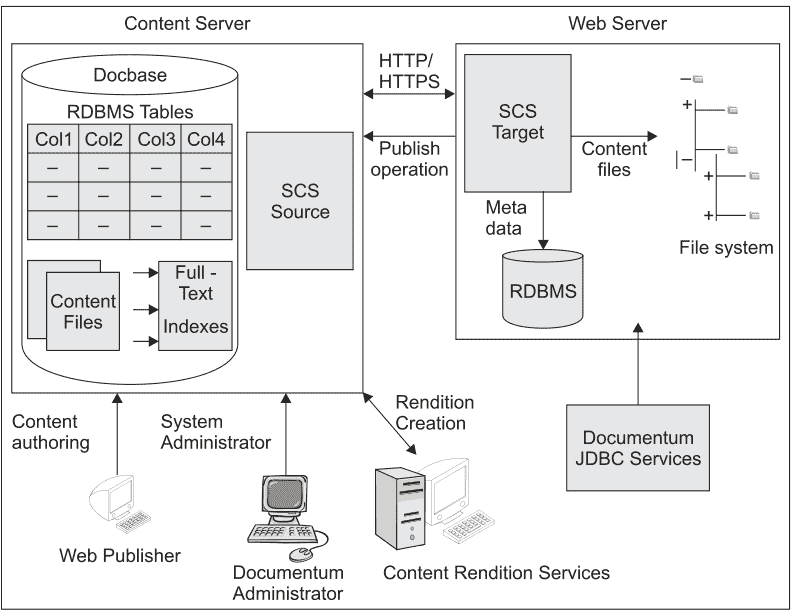
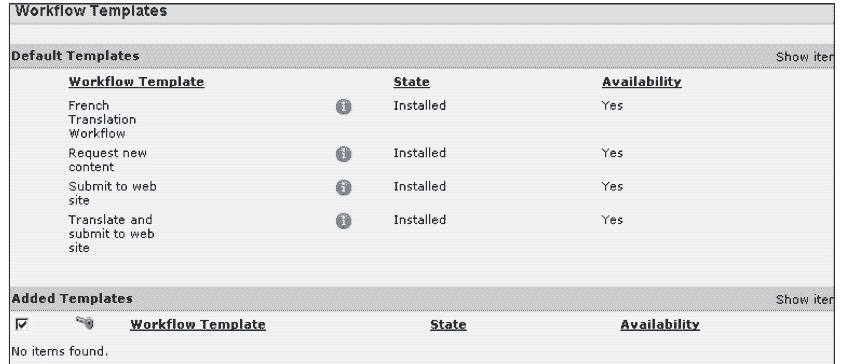
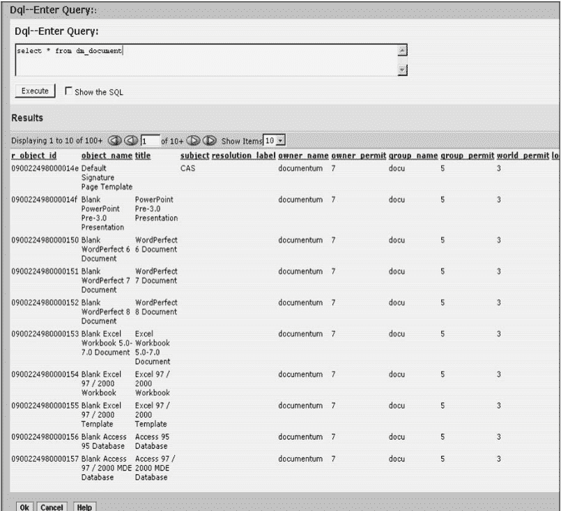
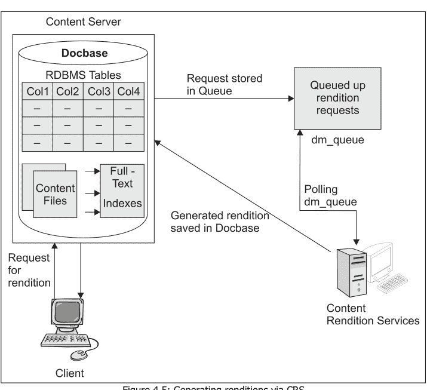
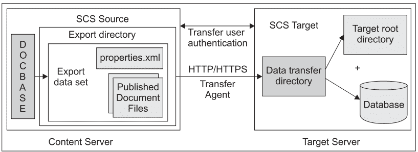
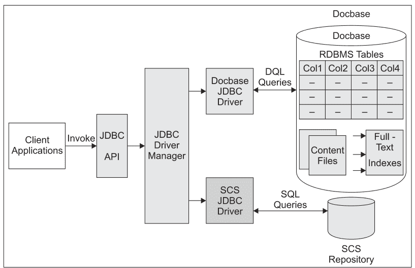

## 4 网站内容管理系统

在前几章讨论了一些 Documentum 的关键特性之后，让我们开始踏上 Documentum 的世界之旅，通过帮助一家实际企业解决在网站中管理大量内容的古老难题。

可以合理假设，阅读本书的人要么是真心想了解更多关于 Documentum 的信息，要么需要评估它是否能成为满足其特定业务需求的良好内容管理选项。

无论哪种情况，我们首先应弄清当前项目是否真的需要网页内容管理（简称 WCM）。所有 WCM 系统都有各自的优缺点。我们应细致分析业务需求，以验证业务需求能否由一个良好的内容管理系统满足。

Documentum 是一款企业内容管理系统，提供众多丰富的工具来满足不断增长的企业需求。然而，我们不能忘记其中存在 caveat。良好的 CMS 系统成本高昂，并且会给最终使用者带来培训开销。此外，我们还需要一个开发/系统团队来搭建和配置 CMS 系统，以及一名系统管理员来监控 CMS 系统以确保平稳运行。

### 4.1 何时应使用 WCM 系统？

当企业需要在网站/门户上频繁更新内容时，Documentum 作为 WCM 系统就显得很有价值。这意味着，需要不断更新其网站上展示的业务信息，以确保网站用户在特定时间点能够查看最新信息的企业，是 WCM 的良好候选者。

这可以通过几个例子更好地解释：

- **一个在线购物网站：** 在线购物网站会上传其产品信息，如产品描述、产品图片、价格和库存可用性详情等。在任何时间点，这些信息都需要保持最新，否则客户可能会以过时的价格购买商品！如果网站上的库存信息未及时更新，将导致对商店中实际不可用产品的采购订单！

而不是每天/每周手动更新网站的 HTML/JSP 页面，在线购物网站公司可以通过 WCM 系统有效管理。最新的内容信息可以通过 WCM 内容创作工具进行更新，并且可以在无需了解网页脚本工具的情况下轻松录入新产品信息。

- **一个在线报纸网站：** 报纸网站的结构/布局基本保持不变，但其实际内容每天都在变化。事实上，旧新闻每天都会从网站上过期，并在某些情况下被归档。此外，出现在网站上的新闻文章在最终批准前必须通过工作流机制经过一组审阅者审核。安装了 WCM 系统后，内容创建者和编辑无需学习网页技术/脚本语言即可在网站上上传/编辑内容。经过培训后，他们可以通过内容管理系统本身提供的创作工具进行内容创作。因此，报纸网站可被视为 WCM 系统的良好候选者。

### 4.2 何时不应使用 WCM 系统？

这是一个很有争议的领域，可能因企业类型和性质以及客户需求而异。

然而，以下内容可作为一些实用建议，基于过去涉及“内容密集型”网站项目的经验。需要注意的是，这些是个人观点，不应被视为通用行业标准或全球公认的规则。

如果符合以下情况，请在启动 WCM 系统前三思：

- 网站上的大部分数据相当静态，且不易更新。
如果您不需要在网站上频繁更新内容，请尝试想出另一种管理内容的方式。在这种情况下使用自动化内容管理系统可能会过度设计并导致额外且不必要的成本。

- 您既没有时间也没有资金来培训员工。
对于利润率较低的小型公司而言，购买 CMS 系统、请一批软件开发人员/专家安装/设置，然后再培训业务用户使用系统，可能是一件成本过高的事情。此类组织应在投入之前详细分析并规划其费用和/或时间，并详细核算资源需求。

- 网站上没有太多内容需要展示。
有一些交易密集型网站，如银行网站、在线航班预订网站等，不需要由网站内容贡献者手动输入大量数据。

只有需要管理大量非结构化数据的网站才应被视为内容管理系统的合适候选者。

### 4.3 Documentum WCM 架构

如果您已做好功课并确信自己对像 Documentum 这样有效的 Web 内容管理系统有业务需求，那么欢迎加入！

让我们使用 Documentum 产品套件讨论一个典型的 Web 内容管理架构。

我们接下来要讨论的并不是“最佳”的 WCM 架构，而是一个相当标准化的架构，能够满足许多企业的大多数常见基于网络的内容需求。

先进的 WCM 架构并不仅限于图 4.1 中所示的产品/组件。根据业务需求，设计和架构可能会有所变化，并且可以向图 4.1 中添加更多组件或移除现有组件。

如果您无法理解架构中描绘的所有组件，请不要担心。随着您继续阅读本书的其余部分，所有这些内容都会变得更清晰、更易理解。



图 4.1：使用 Documentum 的 WCM 架构

### 4.4 如何在系统中录入内容？

**Web Publisher** 是在 Documentum 系统中录入内容的最简单工具之一，也是进入 WCM 系统的入口。它是一款基于 Web 的客户端工具，连接到 Content Server Docbase，并协助内容作者、经理和管理员为业务站点创建、管理和管理内容。

### 4.4.1 Web Publisher

使用 Web Publisher 的好处在于，它只需在应用服务器上对 Web Publisher 系统和业务特定的自定义文件进行一次性设置。Web Publisher 的终端用户（或客户端）无需在其笔记本电脑/桌面上进行任何安装，只需通过一系列受支持的浏览器访问 Web Publisher URL 即可。

安装了 Web Publisher 的应用服务器主机上的 dmc1.ini 文件指向正确的 DocBroker 和端口。正是通过它建立了与 Docbase 的连接。

示例 dmc1.ini 文件：

```
[DOCBROKER_PRIMARY]
host ==<<Your DocBroker host Name>>
port =1489 # default port
```

Web Publisher 中可用的广泛操作不仅限于为网站创建或管理内容。Web Publisher 是 Documentum WCM 架构不可或缺的一部分，并具有直观的 GUI，可实现以下功能：

- 为 Web Publisher 终端用户设置组、用户和角色
- 创建直观的分类或分类法，业务用户可借此为其组织创建分类内容。
- 创建交付（Web）柜，创建的内容可从 Documentum 系统中发布。
- 通过将权限集（ACL）附加到相关对象，为 Docbase 对象设置安全权限。
- 在生命周期状态中提升和降级对象。使用 Web Publisher 的 'Promote'、'Demote' 和 'Power promote' 功能，可以将文档推送到其生命周期的下一个状态或将其降级到先前的状态。
- 创建内容模板及相关规则和演示文件，以便用户无需学习任何网页脚本技术即可使用模板创建内容。
- 通过将内容项推送到工作流以供其他用户审阅和批准。值得一提的是，Documentum Web Publisher 提供了一些开箱即用的工作流可供使用。示例：Request new content, submit to website workflow, etc.
- 与实用服务和工具集成，如自动属性提取、Content Intelligence 服务、企业间工作流服务、In-Context 编辑、eWebEditPro 富文本编辑器等。


- 运行大量报告以管理系统对象，例如可用的生命周期、工作流、活动内容等。

根据登录的 Web Publisher 用户的 'role'，Web Publisher GUI 对不同用户显示不同，有时提供受限功能。例如，内容作者不会看到交付 Web 柜，而 Web 开发人员或管理员可以查看这些。此外，并非所有内容管理功能都对所有 Web Publisher 用户可用。

例如，内容作者不允许导入文件，而内容管理员可以这样做；内容管理员不能 'power promote' 对象，而 Web 开发人员拥有这些权限；等等。

这些设置可以通过更改一些上下文敏感的角色配置文件并在 Web Publisher 系统中重新加载更新后的文件来进行调整。



图 4.2：Web Publisher 显示可用的工作流模板

图 4.2 显示了在 'Web Publisher' 中看到的 Docbase 中已安装和可用的工作流列表。如果您想详细了解工作流，可以跳到第 19 章。

## 4.5 内容存储在哪里以及如何存储？

如前所述，Content Server 通过提供各种内容管理服务，成为 Documentum 系统的生命线

### 4.5.1 Content Server

Content Server 应被视为托管业务特定 Docbase 的后端服务器。请记住，Docbase 只不过是一组逻辑内容文件（存储在主机服务器操作系统的文件系统中）、内容的元数据（存储在底层 RDBMS 中）以及对象的全文索引。不管使用何种工具创建内容，它都存储在 Docbase 中，而 Docbase 由 Content Server 管理。

Documentum 分布式架构中存在许多可能的配置，可提供故障转移机制。可以为单个 Docbase 设置多个服务器，或从一个 Docbase 向另一个 Docbase 提供对象复制等。

Documentum 的安全机制会混淆底层主机服务器操作系统上内容文件的实际名称。因此，如果您例如使用 Web Publisher 创建内容项，则存储在操作系统上的内容文件将不易识别。

## 4.6 如何执行系统管理？

Documentum 内容管理系统与市场上任何其他现有 CMS 一样，需要系统管理和监控以确保系统平稳运行。

### 4.6.1 Documentum Administrator

在 WCM 架构中，Web Publisher 作为简单易用的内容创作工具，而 Documentum Administrator 则是另一款基于 Web 的工具，主要用于 Documentum 系统管理。与 Web Publisher 类似，Documentum Administrator 可通过受支持的 Web 浏览器访问。与 Web Publisher 一样，Documentum Administrator 需要一个可安装其的应用服务器主机。

安装后，Documentum Administrator 可作为执行和管理 Documentum Docbase 上各种操作的优秀工具，例如：

- 配置和维护 Documentum 服务器和 Docbase
- 创建和维护 Documentum 用户、组和角色
- 创建和维护对象类型及其属性
- 创建和维护 Documentum 作业和方法
- 创建和维护格式和权限集（ACLs）
- 创建和维护 Docbase 联合
- 创建和维护存储区域
- 创建和维护站点发布配置
- 执行 DQL 查询和 API 命令
- 监控资源使用情况
- 审计管理

通过 Documentum Administrator 可以执行的各种系统管理任务需要适当的用户权限。

例如，审计配置和清除分别要求用户具有 'config audit' 和 'purge audit' 权限。

如果没有必要的权限，Documentum Administrator 不能用于系统管理目的。

图 4.3 显示了使用 Documentum Administrator 中的 DQL 编辑器执行的简单 DQL 查询。



图 4.3：在 Documentum Administrator 中执行 DQL 查询

## 4.7 如何创建内容的多个呈现？

Content Rendition Services (CRS)，前身为 AutoRenderer Pro，是 Documentum 的一个工具，用于生成 Docbase 中原始文档的呈现或替代格式。

### 4.7.1 Content Rendition Services

CRS 处理来自客户端应用程序（如 Web Publisher）对原始文档呈现（例如 PDF、文本、HTML）的请求。然而，CRS 不会为 Docbase 中处于签出状态的文档生成呈现。

CRS 应在单独的专用网络工作站上运行，并且该工作站上应仅执行此软件。

图 4.4 指示了 Documentum Docbase 中的一些源格式以及是否可以通过 CRS 生成其 PDF 和 HTML 呈现。

| 源格式 | 是否可能生成 HTML 呈现？ | 是否可能生成 PDF 呈现？ |
|---|---|---|
| Microsoft Word | 是 | 是 |
| Microsoft Excel | 是 | 是 |
| Microsoft PowerPoint | 是 | 是 |
| WordPerfect | 否 | 是 |
| Lotus WordPro | 否 | 是 |
| PostScript | 否 | 是 |
| PDF | 否 | 是 |

图 4.4：某些 Documentum 格式的 CRS 呈现

图 4.5 显示了内容呈现服务如何为 Docbase 提供呈现请求。



图 4.5：通过 CRS 生成呈现

通过 CRS 生成呈现的过程如下：

1. 客户端向 Content Server 发送呈现请求。
2. Content Server 将客户端的呈现请求存储在 dm_queue 中。
3. CRS 以预配置的间隔轮询 dm_queue，以确定是否有待处理的呈现请求需要处理。
4. CRS 根据 dm_queue 中的呈现请求创建呈现，并将其发送到 Content Server，Content Server 将呈现保存到 Docbase 中。

我们可以配置 CRS 轮询 Docbase 以获取呈现请求的频率。此外，请注意，一台 CRS 工作站最多可以为八个 Docbase 提供呈现请求服务。

## Documentum 5.3 更新

Content Rendition Services 已拆分为两个产品：Document Transformation Services (DTS) 和 Advanced Document Transformation Services (ADTS)。

## 4.8 如何将内容发布到网站？

我们已经了解如何使用 Web Publisher 工具将内容输入 Docbase，以及如何使用 Documentum Administrator 执行系统管理。

Documentum 系统中的内容及其属性（元数据）现在需要发布到网站，以便在网站上显示。Documentum **Site Caching Services**（SCS），前身为 WebCache，帮助我们将内容和元数据（文档属性）从 Documentum Web Publisher 系统发布到网站，确保网站上看到的内容准确无误。

### 4.8.1 Site Caching Services

SCS 不在 Documentum 中创建、管理和存储内容；这是由 Content Server 完成的。SCS 只是将文档（其对象类型是 dm_sysobject 对象类型的子类型）及其相关属性从 Docbase 导出到预配置的网站。

SCS 与 Web Publisher 的集成通过 'Site Publishing Configuration' 实现，该配置使用 Documentum Administrator 创建。通过 Site Publishing Configuration，可以指定需要发布哪些类型的文档、从 Web Publisher 中的哪些文件夹发布以及其他详细信息。

我们将在第 21 章详细介绍 Site Publishing Configurations。

创建通过 SCS 发布内容的 Docbase 的 Site Publishing Configuration 时，需要填写以下配置参数：

- 配置名称
- 需要发布文档的 Web Publisher 交付柜
- 要发布的文档的版本标签，例如 'Staging'、'WIP' 等。
- 发布文档的目标主机名和端口号
- 连接类型：是否安全或非安全
- 发布文档的目标根目录
- 是否需要将文档的元数据（即对象属性，如标题、主题、关键字等）发布到目标数据库
- 如果需要发布元数据，则存储已发布属性的表名以及要发布的具体属性。
- 要发布的文档格式，例如 HTML、PDF、XML、Excel 等。
- Content Server 主机文件系统上的导出目录
- 是否需要在线同步
- 在发布操作之前和/或之后在目标上执行的任何自定义脚本
- 目标服务器身份验证详细信息，如传输用户名、密码和域


## 4.8.2 SCS 架构

站点缓存服务包含两个主要组件：

- **SCS 源**：安装在 Docbase 所在的服务器上
- **SCS 目标(们)**：安装在需要发布文档的机器上

图 4.6 以简化的方式描述了 Documentum SCS 架构。



图 4.6：站点缓存服务架构

以下步骤简要说明了 SCS 发布流程在 Documentum 中的工作原理：

1. 在 Documentum Administrator 中创建站点发布配置，指定 Content Server 主机文件系统上的导出目录以及需要发布数据的目标服务器。
2. 发布开始时，来自 Docbase 的文档以及可选的属性（如果在站点发布配置中指定）会被放置到 Content Server 机器上的“导出目录”中。这称为 **导出数据集**，它由实际发布的文档文件和一个包含文档发布属性列表的 properties.xml 文件组成。
3. SCS 以站点发布配置中指定的 **传输用户** 身份连接到目标服务器（Web 服务器主机）
4. 在传输用户身份验证通过后，如果已建立到 Web 服务器主机的连接，SCS 会将导出数据集传输到 Web 服务器主机上的 **数据传输目录**。需要注意的是，数据传输目录是在 Web 服务器主机上安装 SCS Target 时指定的。
5. 然后 SCS 将目标存储库（文档 + 属性数据集）从数据传输目录移动到 Web 服务器主机上的 **目标根目录**。目标根目录是在创建站点发布配置时指定的。它是网站的 webroot，并对应于 Docbase 中的发布文件夹
6. 文档连同其包含的文件夹一起复制到目标根目录，而属性则通过读取 properties.xml 文件中的值插入到数据库中。需要注意的是，数据库主机和连接参数是在 Web 服务器主机上安装 SCS Target 时指定的。

SCS 发布可以通过多种方式进行：

- 通过 Web Publisher 手动调用（工具 | 发布 选项）
- 通过 Documentum Administrator 中直接的站点发布配置调用
- 在预定义间隔运行计划发布作业
- 通过 DQL、API 或自定义编写的 DFC 脚本调用发布

不难看出，SCS 在 Web 内容管理中发挥着至关重要的作用，它将内容及其属性发布到目标文件系统和数据库，从而节省了网站应用程序直接从 Documentum 系统读取数据的开销。

通过计划作业，可以在目标服务器上发布更新的增量数据，保持站点的完整性，并确保数据及时、准确地在网站上显示。

## 4.9 如何查询已发布内容以在网站上显示？

一旦数据发布到目标服务器，应用程序就需要查询已发布的数据（内容文件及其相关属性和特性）以在网站上显示。

这就是 Documentum JDBC Services 登场的地方，它以前称为 eConnector for JDBC。JDBC 是从基于 Java 的应用程序访问数据库的标准接口。

### 4.9.1 Documentum JDBC Services

Documentum JDBC Services 是 Documentum 的实用工具，支持大多数标准 JDBC API，并帮助应用程序执行以下功能：

- 连接到 Docbase 或 SCS 存储库。
- 在 Docbase 中发出 DQL 查询，或在 SCS 存储库中发出 SQL 查询。
- 从 Docbase 或 SCS 存储库检索内容文件和相关元数据（属性）。
- 通过其对 JNDI（Java 命名和目录接口）的支持，使用逻辑名称而非实际名称连接到数据库。
- 在池中重用现有连接，通过其对数据库连接池的创建支持，节省打开和关闭新数据库连接的开销。

Documentum JDBC Services 提供了 Docbase JDBC 驱动程序和 SCS JDBC 驱动程序。Docbase JDBC 驱动程序使用 Documentum 专有的 DQL（文档查询语言）实现 JDBC API。另一方面，SCS JDBC 驱动程序充当“包装驱动程序”，支持使用标准 JDBC 驱动程序连接到常见的数据库服务器，如 Oracle、Sybase 等。

图 4.7 应能让您大致了解 Documentum JDBC Services 架构。



图 4.7：Documentum JDBC Services 架构

## 4.10 如何将网站内容部署到服务器场？

SDS 或站点部署服务，formerly known as ContentCaster，是一种可配置的基于 Java 的应用程序，有助于将网站内容从 SCS 目标服务器部署到多个本地或远程服务器的目录中。

### 4.10.1 站点部署服务

SDS 在需要在多个站点位置之间同步和复制网站内容时很有用。

以下是 SDS 的一些关键特性：

- 支持与第三方负载均衡器的集成
- 即使部署操作中途停止，也能从系统故障中恢复
- 执行字节级差异比较，确保部署期间仅更新已更改的字节
- 提供内容更新的集中监控
- 支持多阶段部署以及多版本回滚
- 支持更新或安装的自动回滚
- 在处理大量和大尺寸文件方面具有高度可扩展性

现在您已经了解了标准的 Documentum WCM 系统，您应该分析特定的业务需求，以便评估哪些 WCM 工具最能满足您的需求。

话虽如此，让我们继续前进，开始了解基本的 Documentum 基础设施以及为 WCM 架构安装/配置 Documentum 产品套件。

## 4.11 摘要

本章首先描述了在业务应用程序中应使用 Web 内容管理（WCM）系统的场景以及应避免使用的场景。WCM 系统为那些拥有内容密集型网站的组织增加了价值，这些网站需要在任何时间点使用业务关键数据进行更新，而无需依赖 IT 人员。另一方面，组织如果只需要不频繁地更新其网站，并且没有培训和 CMS 基础设施成本的能力或预算，则不应使用 WCM 系统。

我们进一步讨论了使用 Documentum 产品套件的示例 WCM 架构，该套件包含 Web Publisher、Content Server、Documentum Administrator、Content Rendition Services、Site Caching Services、Documentum JDBC Services 和 Site Deployment Services 等实体和工具。

Content Server 在前几章中讨论过，是 Documentum 架构的基础，提供内容管理系统所需的基本内容管理服务。

Web Publisher (WP) 是一种内容创作工具，提供丰富的用户界面，用于创建和管理企业网站的内容。

Documentum Administrator (DA) 是一种基于 Web 的工具，用于在 Documentum 系统中执行多个系统管理任务。

Content Rendition Services (CRS) 是一种用于在 Documentum Docbase 中生成文档的多种呈现/格式的工具。

Site Caching Services (SCS) 有助于将文档及其相关属性从 Docbase 发布到预配置的网站。

Documentum JDBC Services 是 Documentum 工具，支持大多数标准 JDBC API，并帮助应用程序连接到 Docbase 或 SCS 存储库并操作其中包含的数据。

最后我们看到，Site Deployment Services (SDS) 是一种基于 Java 的应用程序，有助于将企业网站内容从 SCS 目标服务器部署到多个本地或远程服务器的目录中。


