## 6 创建我们的第一个 Docbase

在上一章中我们已经设置了 Content Server，现在可以创建我们的第一个 Docbase。一旦 Docbase 就绪，我们就可以在 Docbase 中创建自定义 DocApps 并使用我们自定义定义的对象进行操作。

首先——让我们在继续之前为您的 Docbase 想一个好（当然也是合理的）名字。在本书中，dev_doc 是我们选择的名称。本书中我们的自定义 Docbase 将始终以此名称引用。

### 6.1 创建 Docbase

如同几乎所有商业软件一样，设置 Docbase 有一些先决条件。重复强调一下，在安装过程中应始终完整查阅相关的发行说明，以避免任何意外的故障。

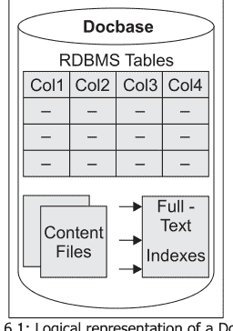

图 6.1：Docbase 的逻辑表示

图 6.2 列出了在开始创建 Docbase 之前需要注意的一些要点：

| 实体 | 注释 |
|---|---|
| Content Server | 创建 Docbase 之前应正确设置。 |
| Windows 区域设置 | 需要设置为指定四位数字的日期格式。 |
| Docbase 名称 | 限制：
最大长度为 32 个字符。
可由字母、数字和下划线组成。
第一个字符应为字母。
不应包含空白字符或非字母数字字符。
不能命名为 "docu"。
在同一 Content Server 上存在多个 Docbase 时必须唯一。 |
| Docbase ID | 限制：
必须为 1 到 16777215 范围内的数字。
不应以零 (0) 开头。
在同一 Content Server 上存在多个 Docbase 时必须唯一。 |
| Docbase 所有者 | 安装所有者用户名的限制：
由数字、字母、连字符和下划线组成。
第一个字符应为字母。
所有字符必须是 ASCII。
密码应由数字、字母、句点、连字符和下划线组成。
在同一 Content Server 上存在多个 Docbase 时必须唯一。 |
| ODBC 数据源 | 在使用 SQL Server 时应正确配置。 |

图 6.2：设置 Docbase 的先决条件

- 1. 在 Content Server 机器上设置 DSN（数据源名称），以便 Docbase 可以连接到底层的 SQL Server RDBMS 并与其通信。在 Windows 机器上，前往 程序 | 管理工具 | 数据源 (ODBC)。选择 系统 DSN 并单击 添加 按钮。

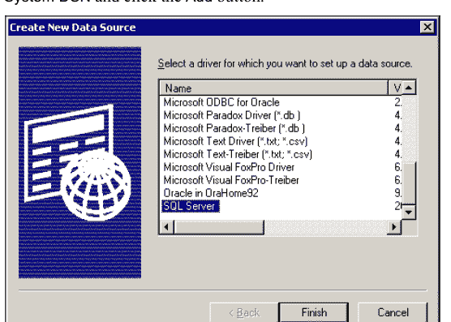

图 6.3：选择 SQL Server 作为数据源

选择 SQL Server 后，单击 完成 按钮。

- 2. 指定 DSN 名称和简短描述。也提供 SQL Server DB 的主机名。在此示例中，SQL Server 安装在与 Content Server 相同的机器上本地。

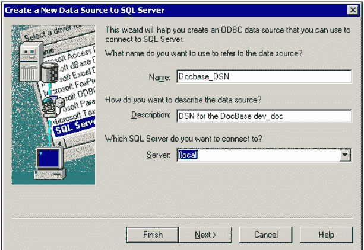

图 6.4：指定 SQL Server 服务器名称

- 3. 在 SQL Server 身份验证的情况下，提供有效的登录 ID 和密码。

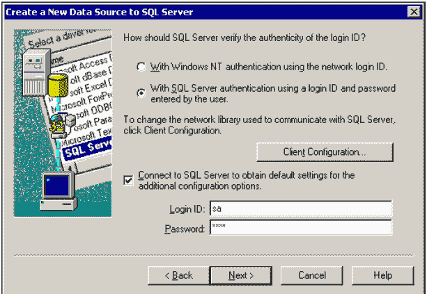

图 6.5：SQL Server 身份验证凭据

- 4. 除非必要，否则不要更改默认数据库或 SQL Server 系统消息的语言。一直单击 下一步 按钮直到到达 完成 按钮。

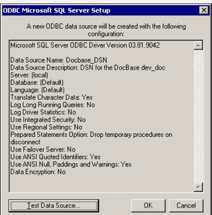

图 6.6：测试数据源

- 5. 单击 测试数据源 以检查数据库连接是否能正确建立。如果操作正常，单击 确定。

创建的 DSN 现在会与系统 DSN 选项卡中的其他 DSN 一起显示。最后单击 确定。我们已成功为连接到 SQL Server 数据库创建了 DSN。

- 6. 以安装所有者身份登录 Content Server 机器并前往 程序 | Documentum | Documentum Server Manager。从 Documentum Server Manager 面板中，选择 Utilities 选项卡并单击 Server Configuration。

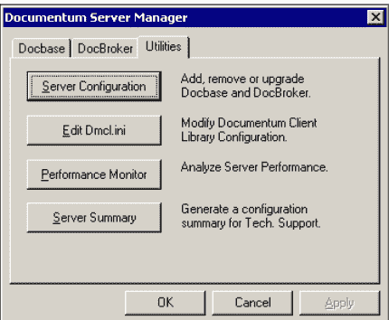

图 6.7：Documentum Server Manager

如果由于连接问题导致域不可用，或者用户所属的域发生了某些更改，则可能会看到以下错误消息：

> "Unable to initialize admin dll (OSEnv)"

- 7. 输入安装所有者的密码并单击 下一步。
- 8. 如有需要，可选择启用受信任内容服务 (TCS) 并提供许可证密钥。然后单击 下一步 按钮。
- 9. 如有需要，可选择启用 EMC Centera 的内容服务并提供许可证密钥。然后单击 下一步 按钮。
- 10. 选择配置类型：
  - Express Configuration
    - 快速。安装过程中需要提供的信息较少。设置期间 Documentum 提供的默认参数。
    - 限制了我们可以对 Docbase 和 Content Server 进行的自定义程度。
  - Custom Configuration
    - 需要用户在安装期间提供更多输入的较长机制。
    - 允许自定义 Docbase 配置脚本、数据文件等。

本示例使用 Express Configuration 类型创建 Docbase。

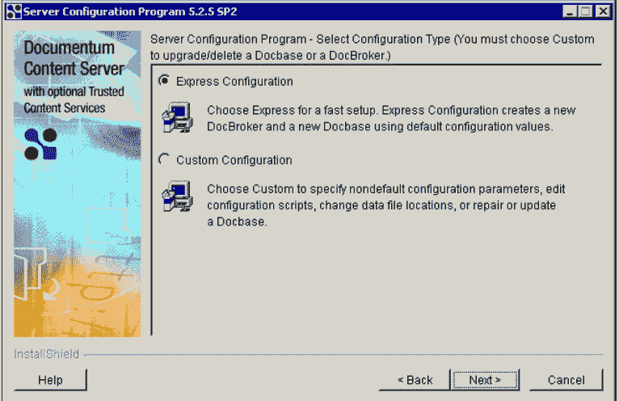

图 6.8：选择配置类型

- 11. 如有需要，可选择内容存储服务。然后单击 下一步 按钮。
- 12. 提供有效的 Docbase 名称和 Docbase ID（根据本章开头指定的限制）。选择 Docbase 大小、Windows 身份验证域，并指定用于管理 Docbase 的 Windows 服务启动类型应为自动还是手动。

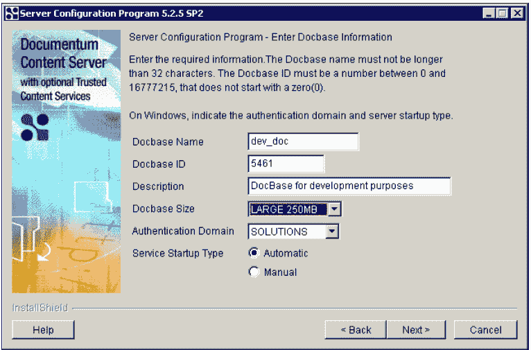

图 6.9：指定设置 Docbase 参数

- 13. 要么允许 Documentum 为您创建/配置 Docbase 所有者（数据库用户），要么如果您已创建，则选择现有的 SQL Server 数据库帐户。

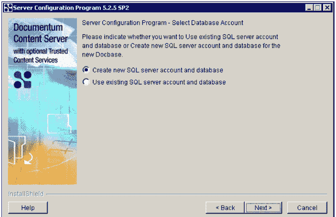

图 6.10：设置数据库帐户

- 14. 选择用于数据库连接的 DSN（在最初几步中创建）。

在本示例中，已选择 Documentum 为 Docbase 所有者名称（指定 Docbase 的名称）提供的默认值。默认数据库名称格式如下：DM_<Specified Docbase name>_docbase

- 15. 提供 Docbase 所有者密码以及 SQL Server DB 管理员用户名和密码。

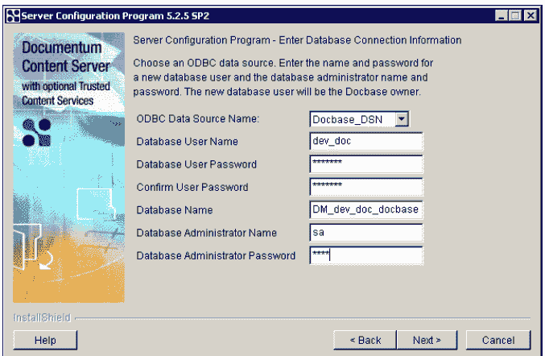

图 6.11：提供数据库连接参数

Docbase 创建后，如果有人无意中更改了 Docbase 所有者（DB 所有者）的密码，则在 Docbase 启动期间会看到以下错误消息：

[DM_SESSION_I_RETRYING_DATABASE_CONNECTION] info: "The following error was encountered trying to get a database connection:  STATE=28000, CODE=18456, MSG=[Microsoft][ODBC SQL Server Driver][SQL Server]Login failed for user 'dev_doc'.

- 16. 提供 SMTP 服务器名称或 IP 地址以及 Documentum 安装所有者的有效电子邮件地址。单击 下一步 按钮。

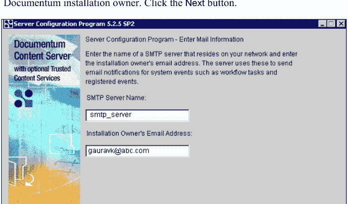

图 6.12：指定 SMTP 服务器和安装所有者的电子邮件地址

- 17. 在需要使用 Web Publisher 与相关 Docbase 的情况下，选择要安装在 Docbase 上的 WebPublisher DocApp。

- 18. 这完成了 Docbase 的创建，新创建的 Docbase 会在 Documentum Server Manager 面板下的 Docbase 选项卡中显示。

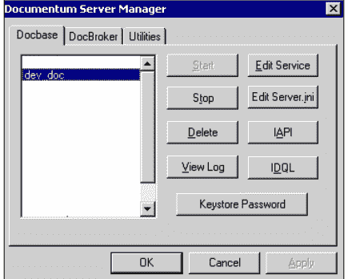

图 6.13：在 Documentum Server Manager 中看到的新创建的 Docbase

如果 Docbase 在使用不区分大小写的 SQL Server 的 Content Server 上进行配置，则在 Docbase 启动期间会看到以下错误消息：

```
[DM_SESSION_I_INIT_BEGIN]info: "Initialize Crypto Objects."
[DM_SESSION_E_INIT_FAILURE1]error: "Failure to complete Crypto Objects initialization."
[DM_SERVER_I_START_ID]info: "Docbase dev_doc was not successfully opened."
```

您可以在同一 Content Server 上创建多个具有不同名称的 Docbase，以用作开发 Docbase 和测试 Docbase（例如）。此外，您可以为单个 Docbase 创建多个服务器，以便将请求处理分散到多个服务器上以获得性能提升。然而，关于此类配置的详细讨论超出了本书的范围。

### 6.2 安装 Web Publisher Server Files 和 DocApp

Docbase 就绪后，我们可以在新 Docbase 上安装 Web Publisher Server Files，以便 Documentum WebPublisher DocApp 安装并可供我们使用。

> 许多人将“Web Publisher Server Files”安装与应用程序服务器安装混淆。请注意，Web Publisher 安装包含两个组件：
> 
> - Web Publisher 安装
> - Web Publisher Server Files 安装


Web Publisher 安装通常在托管应用程序服务器的单独机器上进行。另一方面，Web Publisher Server Files 安装在 Content Server 机器上。

请注意，Web Publisher Server Files 安装是必需的，因为我们将使用 Web Publisher Web 客户端输入内容，并且需要默认的 Web Publisher 对象来工作。默认的 Web Publisher 对象可从 WebPublisher DocApp 获得，该 DocApp 在 Content Server 主机上安装 Web Publisher Server Files 时进行配置。

Documentum 建议以 Content Server 安装所有者的身份安装 Web Publisher Server Files 和 DocApp。在 Windows 上，Web Publisher Server Files 安装在 Content Server 上的以下位置：

```
%DM_HOME%, for example: C:\Documentum\product\<product version>
```

### 6.2.1 Web Publisher Server Files 包含什么？

'Web Publisher Server Files' 包含 wcm 和 wcmMethods JAR 文件，其中包含一些由 Documentum Java 方法服务器在 Content Server 上运行的 Java 方法。这些方法调用从 Web Publisher 工作流活动中需要执行的类。

### 6.2.2 WebPublisher DocApp 包含什么？

'WebPublisher DocApp' 包含 Web Publisher 与相关 Docbase 配合工作所需的一些基础 Web Publisher 对象。

例如：
- Web Publisher 作业和方法
- Web Publisher 工作流模板
- Web Publisher 生命周期
- Web Publisher 对象类型
- WebPublisher 用户默认 ACL
- Web Publisher 组：内容作者、内容管理员、Web 开发人员和管理员
- Web Publisher 角色：wcm_content_author_role、wcm_content_manager_role、wcm_web_developer_role 和 wcm_administrator_role

## 6.3 开始安装

首先从 Documentum 网站下载 web_Publisher_Server_Files_5.2.5_SP2_windows.exe。

1. 以安装所有者身份登录，在 Content Server 机器上解压 web_Publisher_Server_Files_5.2.5_SP2_windows.exe 并运行 wpServerWinSetup.exe。
2. 单击“Next”按钮。

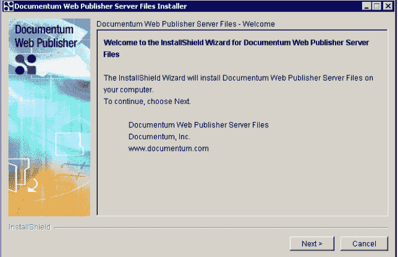

图 6.14：安装 Web Publisher 服务器文件的初始屏幕

3. 接受许可协议并单击“Next”按钮。
4. 显示 Web Publisher Server Files 将要安装的路径。单击 Next。在我们的例子中，显示的默认位置为 c:\documentum\product\5.2\bin。
5. 选择需要安装 Web Publisher Server Files/DocApp 的 Docbase。示例显示我们刚刚创建的新 Docbase 已被选中。提供安装所有者名称和密码，然后单击 Next。

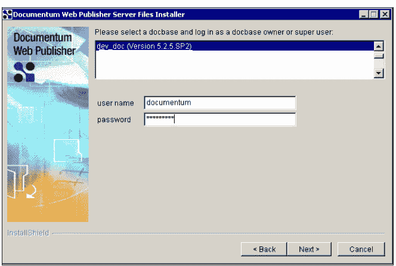

图 6.15：选择 Docbase

### 创建我们的第一个 Docbase

6. 选择 WebPublisher DocApp 的复选框并单击 Next。

如果需要使用 Documentum 为其示例网站提供的示例 Docbase 对象，您还可以选择 Accelera DocApp：http://www.Accelera.com。

请注意，如果您选择安装 Accelera DocApp，则必须同时安装 WebPublisher DocApp 才能使 Accelera 应用程序正常工作。

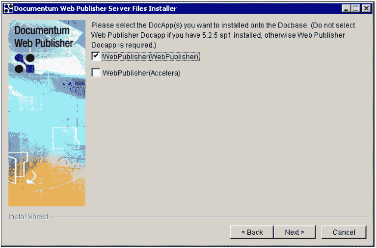

图 6.16：选择要安装的 DocApp(s)

7. WebPublisher DocApp 安装在所选 Docbase 上开始（在我们的例子中为 dev_doc）。

安装程序会创建一个 DocApp 日志文件，其中包含有关已安装对象的的信息，并在有警告和错误时提及。

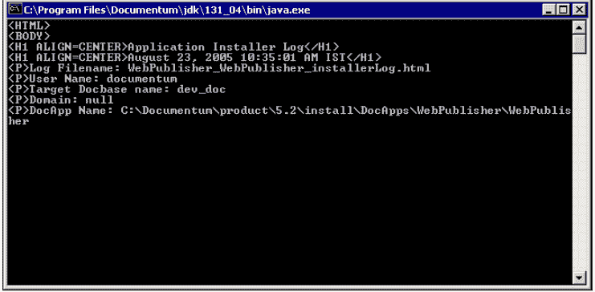

图 6.17：DocApp 安装控制台窗口

8. WebPublisher DocApp 安装可能需要几分钟时间。完成后，将显示 DocApp 安装日志。如果未显示错误，请单击 Next。

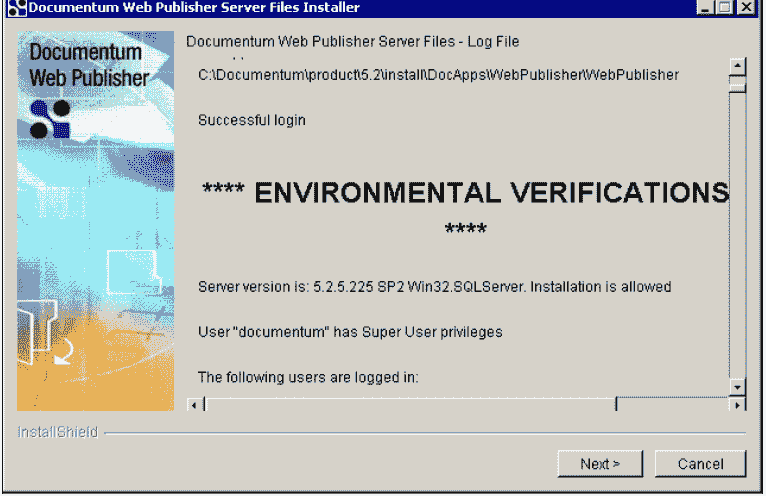

图 6.18：Web Publisher Server Files 安装日志

9. 安装完成后，在 Content Server 主机上停止并重新启动 Documentum Java Method Server。

## 6.4 停止和启动 Docbase 和 DocBroker

Documentum Server Manager 在 Content Server 安装并设置后即被安装。它是一个简单的界面，可用于启动和停止 DocBroker 和 Docbase。事实上，Documentum Server Manager 还可用于执行许多其他操作，例如：
- 执行 DQL 和 Server API 命令
- 查看 Docbase 服务器日志和 DocBroker 日志文件
- 修改 server.ini 和 dmcl.ini 文件
- 通过性能监视器分析服务器性能

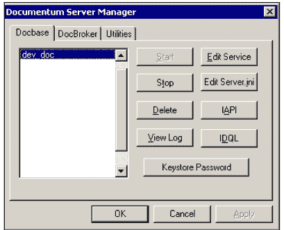

图 6.19：Documentum Server Manager 显示现有 Docbase(s)

您可以通过如图 6.19 所示选择相关 Docbase 并单击“Stop”按钮来停止正在运行的 Docbase 服务。或者，您也可以单击“Start”按钮启动已停止的 Docbase。

同样，通过切换到 Documentum Server Manager 中的 DocBroker 选项卡，您可以按图 6.20 所示启动和停止 DocBroker(s)。

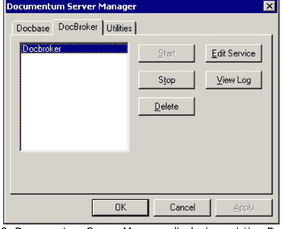

图 6.20：Documentum Server Manager 显示现有 DocBroker(s)

## 6.5 dmcl.ini

dmcl.ini 文件定义客户端应用程序的配置信息，每个客户端都需要有此文件的一份副本。此文件的位置取决于 Documentum 客户端以及客户端的主机机器。

图 6.21 列出了 dmcl.ini 文件中定义的一些键及其解释：

| 键 | 默认值 | 说明 |
|---|---|---|
| client_caching_enabled | T | 这默认允许客户端持久缓存查询结果和对象。 |
| cache_queries | F | 如果键 client_caching_enabled 设置为 False，将此键设置为 True 仅允许缓存查询结果。 |
| client_cache_size | -1 | 这用于定义最大客户端缓存大小，其值被解释为对象数。 |
| connect_pooling_enabled | F | 这用于启用连接池。 |
| max_collection_count | 10 | 这控制会话的最大查询集合 ID 数。 |
| max_session_count | 10 | 这控制任何给定客户端应用程序允许的最大会话数。请确保其与 server.ini 中的 concurrent_sessions 键一致。 |
| trace_file | Server log | 这控制 DMCL 异常发生时 DMCL 堆栈跟踪日志的路径和文件名。 |
| trace_level | 3 | 这设置 DMCL 跟踪的跟踪级别。 |

图 6.21：dmcl.ini 文件中的一些键

## 6.6 server.ini

与包含客户端所需配置信息的 dmcl.ini 文件相反，server.ini 文件中的信息由服务器使用。server.ini 在 Windows Content Server 主机上的位置为：

```
$DOCUMENTUM\dba\config\<Docbase name>
```

在我们的例子中，server.ini 的位置为：C:\Documentum\dba\config\dev_doc。

图 6.22 提到了 server.ini 中定义的一些键及其解释。

| 键 | 默认值 | 说明 |
|---|---|---|
| client_session_timeout | 5 minutes | 这定义了服务器在断开会话之前等待客户端通信的持续时间。 |
| concurrent_sessions | 100 | 这控制服务器在给定时间内可以处理的最大会话数。 |
| database_conn |  | 这包含 Content Server 为建立与 RDBMS 服务器的连接而所需的数据库连接字符串。 |
|  |  | （由 Oracle 和 DB2 需要，而 Sybase 和 SQL Server 不需要。） |
| database_name |  | 这标识 RDBMS 中的数据库或表空间。 |
|  |  | （由 Sybase 和 SQL Server 需要，而 Oracle 和 DB2 不需要。） |
| distinct_query_results | F | 这可用于指示服务器在查询结果中返回重复行。 |
|  |  | 设置为 True 会指示服务器仅返回没有重复的唯一行。 |
| login_ticket_timeout | 5 minutes | 这确定登录票证在生成后保持有效的时间。 |
| mail_notification | T | 这控制当工作项或事件已被排队时是否向用户发送电子邮件消息。 |

图 6.22：server.ini 文件中的一些键

就这样！我们已创建了第一个 Docbase 并在其上安装了 WebPublisher DocApp，使其可供 Web Publisher 使用。根据第 5 章图 5.1 中显示的安装路线图，我们现在可以继续安装站点缓存服务（SCS）源和目标，以便将 Docbase 内容发布到 Documentum 系统之外。

## 6.7 摘要

本章我们讨论了在 Documentum Content Server 中创建 Docbase。我们简要谈到了创建 Documentum Docbase 的先决条件。然后我们讨论了为 Docbase 创建 DSN（数据源名称）以连接到其底层数据库的步骤。

我们随后讨论了创建 Docbase 的详细步骤，然后在新创建的 Docbase 上安装了 Web Publisher Server Files。服务器文件安装设置了 WebPublisher DocApp 和对象，以便新的 Docbase 能与 Web Publisher 应用程序良好配合。

我们还看到了如何通过简单的 Documentum Server Manager 界面启动和停止 Docbase 和 DocBroker，并最后讨论了 dmcl.ini 和 server.ini 文件中的一些重要键。


