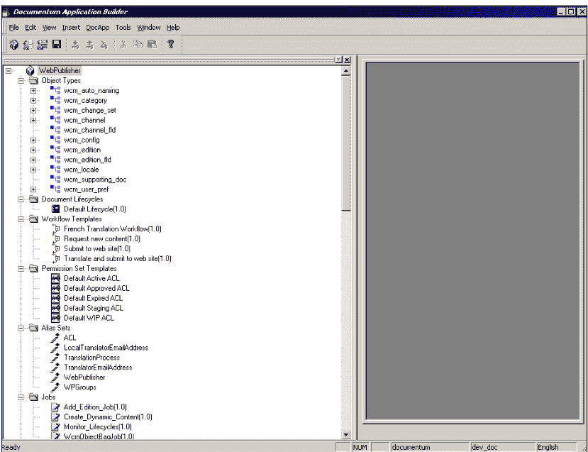
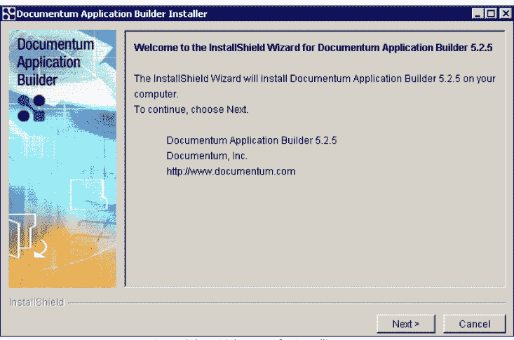
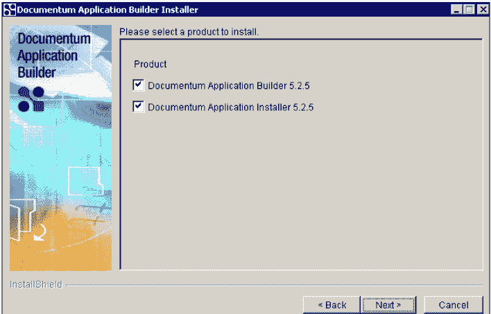
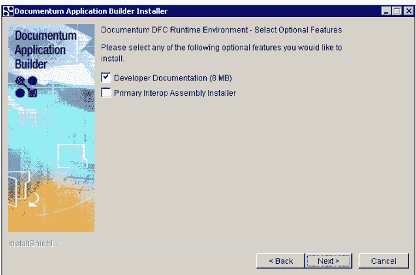
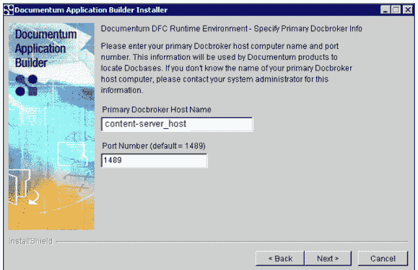
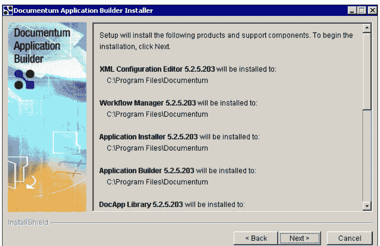
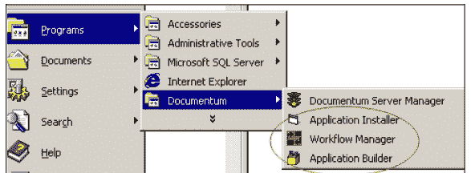

## 8 设置 Documentum Application Builder

Documentum Application Builder（以前称为 Documentum Developer Studio）是一种用于创建 Documentum 应用程序打包单元（称为 DocApps）的工具，其中包含对象类型、生命周期、工作流模板和其他 Documentum 对象。

回顾我们在第 2 章中关于 DocApps 的讨论。DocApp 可以使用 Documentum Application Builder 创建，并可以使用 Documentum Application Installer 归档并部署到其他 Docbase。

DocApp 可以包含多种类型的 Documentum 对象，例如：

- 对象类型
- 生命周期
- 工作流模板
- 权限集模板
- 别名集
- 作业
- 方法
- 过程
- 关系类型
- 数据对象

使用 Documentum Application Builder（DAB）我们可以通过简单的图形向导创建这些对象。请注意，**Workflow Manager** 特用于创建工作流模板。安装 DAB 也会自动安装 Workflow Manager。Workflow Manager 与 DAB 无缝集成，因此可以从 DAB 内部打开，也可作为独立应用程序打开。

### 8.1 Documentum Application Builder

Documentum Application Installer（DAI），用于部署 Documentum DocApps，如果用户正确选择选项，也会随 DAB 安装程序一起安装。使用简单的用户界面，我们可以在自己的自定义 DocApps 中创建不同类型的 Documentum 对象，而无需担心 Docbase 连接和会话等细节。

请注意，DAB 不必安装在 Content Server 主机上。只要相关 Docbase 的 DocBroker 连接可用，它就可以安装在单独的桌面上。

图 8.1 显示了我们在自定义 Docbase 中安装的 WebPublisher DocApp 中的 Web Publisher 对象。



图 8.1：在 Documentum Application Builder 中显示的 WebPublisher DocApp


### 8.1.1 先决条件

图 8.2 指定了安装 Documentum Application Builder 5.2.5 SP2 及其相关组件的一些先决条件：

| 实体 | 注释 |
|---|---|
| 硬件 | 90 MB 硬盘空间、256 MB RAM 和 450 MHz CPU。 |
| Content Server | Content Server、DocBroker 和 Docbase 应正确设置。 |
| Internet Explorer | 应在桌面上可用以查看在线帮助。 |
| Java 运行时环境 | Sun JRE 1.4.1、1.4.2。 |
| 其他 | 有关 Windows OS 和 JRE 的支持组合，请参阅 Documentum 的发行说明。 |

图 8.2：安装 Application Builder 的先决条件

### 8.2 安装 DAB 5.2.5 SP2

确保您已从 Documentum 下载站点下载安装程序软件 Application_Builder_5.2.5_SP2_windows.exe。

- 1. 在桌面机器上解压可执行文件 Application_Builder_5.2.5_SP2_windows.exe 并运行 setup.exe。
- 2. 单击“Next”按钮。



图 8.3：安装 DAB 的初始屏幕

## 设置 Documentum Application Builder

- 3. 选择 Application Builder 和 Application Installer 的复选框，然后单击“Next”按钮。



图 8.4：选择要安装的工具

- 4. 可选择安装 DFC 文档，然后单击“Next”按钮。



图 8.5：选择要安装的可选功能

- 5. 指定主 DocBroker 主机机器和端口号（显示默认值），以便 DAB 可以连接到投射到指定 DocBroker 的服务器。
- 6. 单击“Next”按钮。



图 8.6：指定 DocBroker 主机和端口

在幕后，Documentum 在桌面机器上的 C:\WINNT 或 C:\WINDOWS（取决于操作系统）下创建 dmc1.ini 文件并添加以下条目：

```
[DOCBROKER_PRIMARY]
host =content-server_host
port =1489
```

DAB 安装完成后，如果有人在 dmc1.ini 中错误地将指定的 DocBroker 主机名称更改为无效值（例如 content-server_host222），则在打开 DAB 时会看到以下错误消息：

```
[DM_DOCBROKER_E_HOST_NAME] error: "Unable to find host with name: content-server_host222. Network specific error: Host not found. Network error: invalid host name."
```

## 设置 Documentum Application Builder

- 7. 将显示要安装的组件列表。单击“Next”按钮。



图 8.7：要安装的组件列表

- 8. 安装完成后重新启动系统。

机器重新启动后，您将在“开始 | 程序 | Documentum”下看到 Application Installer、Workflow Manager 和 Application Builder 图标。



图 8.8：DAB 及相关工具

如果系统和用户环境变量的类路径信息不同，DAB 在输入登录/密码信息后有时会崩溃。将它们设为相同以解决此问题。

在这种情况下会看到以下错误消息：

ERROR: "Dab.exe - Application Error"

The instruction at "0x6d393c07" referenced memory at "0x00000000".

Click OK to terminate the program.

Click CANCEL to debug the program

现在 Documentum Application Builder 已安装，您可以开始使用它并创建满足特定业务需求的自定义对象。

### 8.3 摘要

本章介绍了 Documentum Application Builder 作为用于创建和管理 Documentum DocApps 的客户端工具。在之前的讨论中，我们将 DocApps 视为 Documentum 对象的打包单元，例如 Lifecycles、Workflows、Alias Sets、Jobs 和 Methods。

我们继续讨论了安装 Documentum Application Builder 的一些先决条件以及详细的安装说明。
