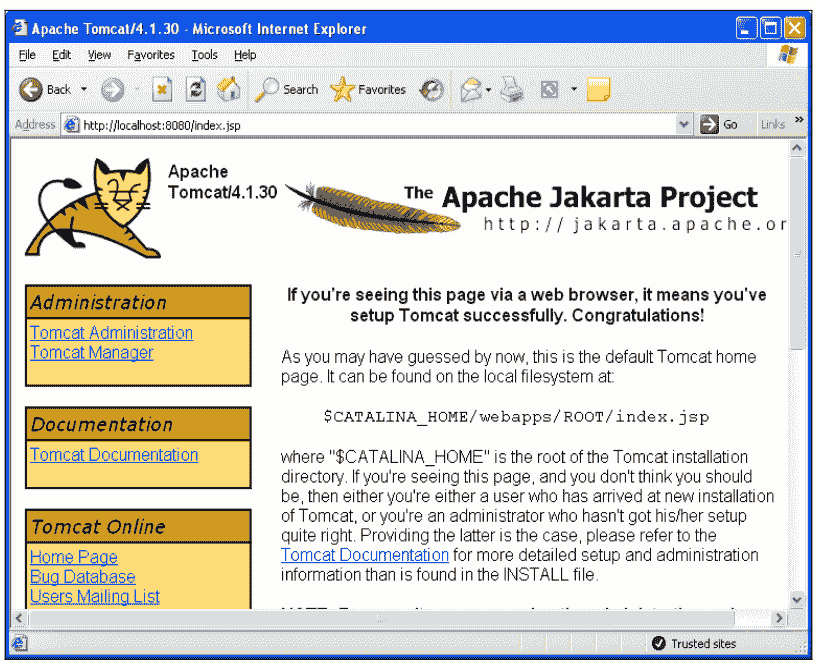
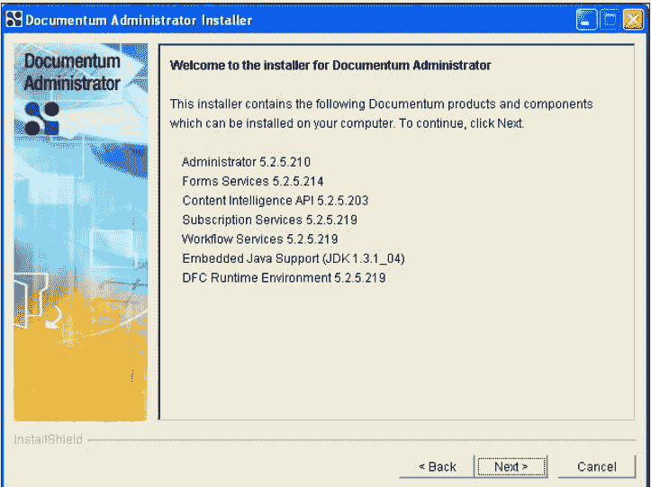
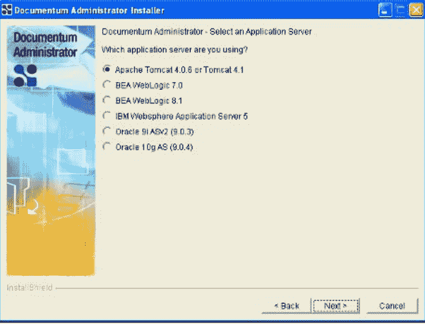
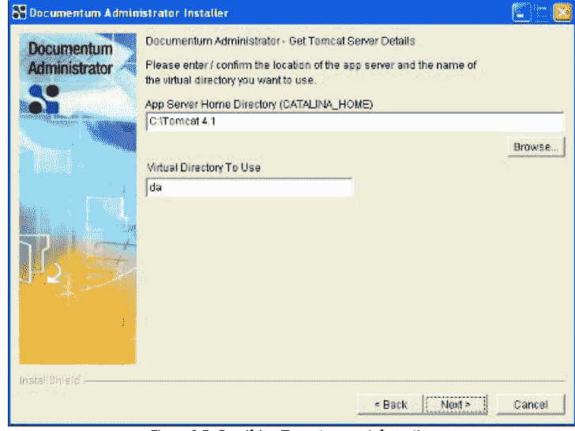
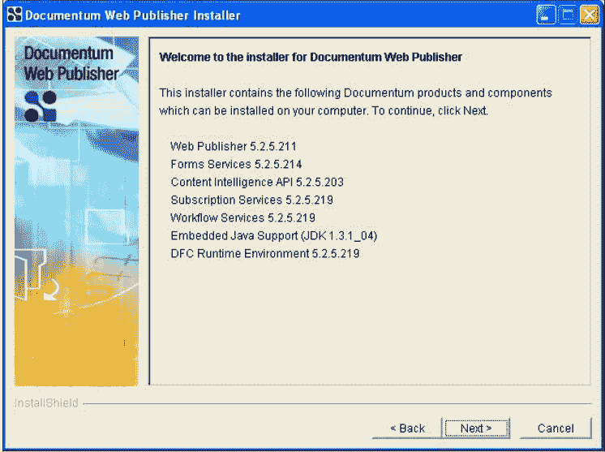
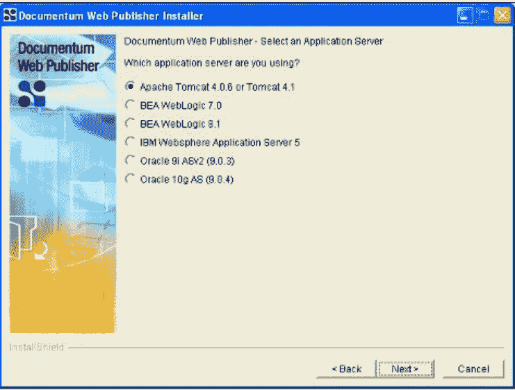
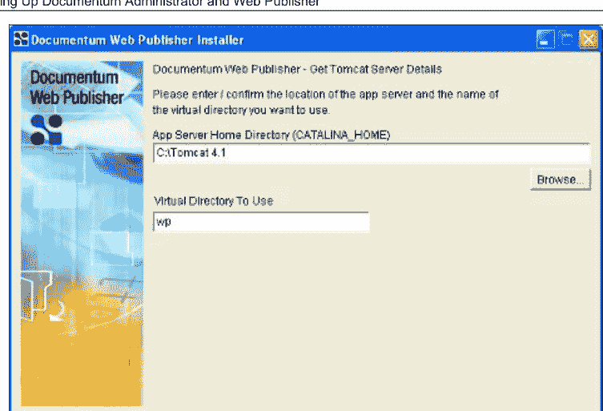
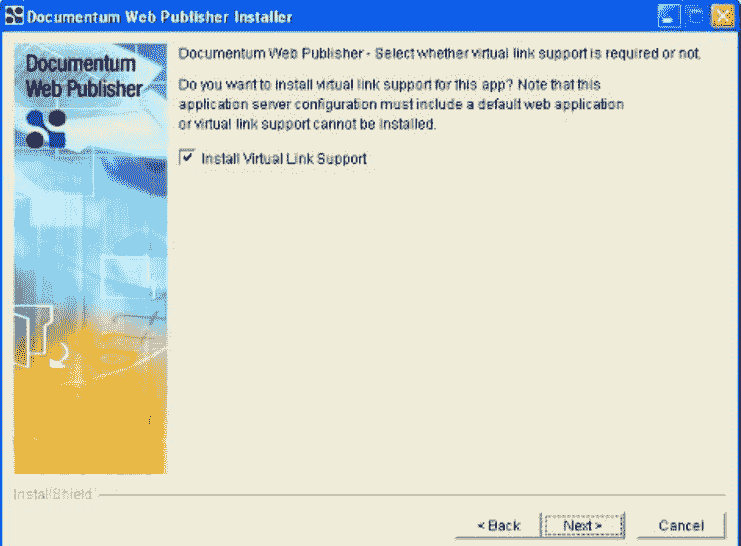

## 9 设置 Documentum Administrator 和 Web Publisher

## 设置 Documentum Administrator 和 Web Publisher

Documentum Administrator (DA) 是一种基于 Web 的工具，允许管理员对 Documentum Docbases、服务器、联合等执行系统管理和监控活动。

要访问 Documentum Administrator 并连接到相应的 Docbase 以及配置/监控各种 Docbase 对象，系统管理员所需的一切就是一个 Web 浏览器。DA 是一种功能强大的工具，可帮助管理员执行常规管理任务和其他大量活动。

使用 Documentum Administrator 可以执行的任务包括：

- Docbase、Docbase 会话和资源的系统监控
- 运行 DQL 和 Server API 命令
- 创建和修改 Docbase 对象，如 Methods、Jobs、对象类型、格式、ACL（权限集）、存储区域和站点发布配置（用于站点缓存服务）
- 执行 Methods 和 Jobs

值得一提的是，Documentum Administrator 是使用 WDK 框架开发的。我们将在本书的后续章节中进一步探讨 Documentum Administrator。目前，只需了解它是一个用于 Content Server 管理任务的基于浏览器的应用程序。

### 9.1 Documentum Administrator

Documentum Administrator 软件作为 Web 应用程序安装在受支持的应用程序服务器平台上，例如 Tomcat、BEA WebLogic、WebSphere 和 Oracle AS。本章中，我们将在 Apache Tomcat 上安装 Documentum Administrator 和 Web Publisher。

在继续安装和配置 Documentum Administrator 之前，请牢记以下先决条件。

### 9.1.1 先决条件

图 9.1 所示的表格列出了安装 Documentum Administrator 的一些先决条件：

| 实体 | 注释 |
|---|---|
| Content Server 和 DocBroker | 主机 DA 的应用程序服务器机器应能够访问相关 Docbase 的 DocBroker 主机。 |
| 安装所有者 | Documentum 建议使用相同的安装所有者来安装应用程序服务器和 DA。  
安装所有者用户名的限制：  
- 由数字、字母、连字符 (-) 和下划线 (_) 组成  
- 第一个字符应为字母  
- 所有字符必须是 ASCII  
- 用户应在内容传输目录上具有 'Write' 权限  
- 密码应由数字、字母、句点 (.)、连字符 (-) 和下划线 (_) 组成 |
| 应用程序服务器 | 在安装 DA 之前，应正确安装和配置受支持的应用程序服务器。 |
| 应用程序服务器机器 | 600 MB 硬盘空间、1 GB RAM 和最低 800 MHz CPU。  
(Documentum 由于安全原因不建议在 Content Server 主机上安装 DA) |
| 浏览器机器 | 访问 DA 的浏览器 Windows 机器应具有 5 MB 硬盘空间、128 MB 可用 RAM 和 800 MHz CPU。 |
| 其他 | 有关 Windows OS、浏览器版本和 JRE、应用程序服务器版本和 JDK 的支持组合，请参阅 Documentum 的发行说明。 |

图 9.1：安装 DA 的先决条件

开始时，请下载以下内容：

- Documentum Administrator 5.2.5 SP2 软件安装程序 (`Administrator_5.2.5_SP2_windows.exe`) 来自 Documentum 站点。
- `jakarta-tomcat-4.1.30.exe` 来自 Apache Jakarta Tomcat 主页 (http://jakarta.apache.org/tomcat/)

### 9.1.2 安装 Documentum Administrator 5.2.5 SP2

我们现在将介绍安装 Documentum Administrator 5.2.5 SP2 的步骤：

- 1. 以应用程序服务器安装所有者的身份登录到应用程序服务器主机，并在安装 DA 之前安装 Apache Tomcat 4.1.30 Servlet 容器。有关 Tomcat 安装的详细信息，请参阅 Apache Jakarta 站点提供的 Tomcat 文档。
- 2. 在应用程序服务器主机上安装 Tomcat 4.1.30 后，需要设置以下系统环境变量：
- JAVA_HOME: 这是 Java 安装目录，例如 C:\j2sdk1.4.2
- CATALINA_HOME: 这是 Tomcat 安装目录，例如 C:\Tomcat 4.1
- 3. 启动 Tomcat 4.1.30 以确保其已正确安装，然后再继续 DA 安装。

运行位于 %CATALINA_HOME%\bin 下的批处理文件 startup.bat。

Tomcat 启动后，通过从 Web 浏览器调用以下 URL 打开默认 Tomcat 页面：http://<app server host>:<port>/index.jsp。

图 9.2：Tomcat 主页

## 设置 Documentum Administrator 和 Web Publisher

- 4. 在开始安装 Documentum Administrator 5.2.5 SP2 之前停止 Tomcat 服务器。以应用服务器安装所有者的身份在应用服务器主机上解压 `Administrator_5.2.5_SP2_windows.exe`。运行 `dawinSetup.exe` 可执行文件。
- 5. 单击“下一步”按钮。

图 9.3：DA 安装程序组件

- 6. 接受许可协议条款和条件，然后单击“下一步”按钮。
- 7. 可选择安装开发者文档，然后单击“下一步”按钮。
- 8. 如果机器上已存在 Documentum，则不会显示 Documentum 目标目录屏幕。如果 Documentum 是首次在应用服务器主机上安装，则会显示默认目标目录（C:\Program Files\Documentum）。选择不同的目标目录或继续使用默认值，然后单击“下一步”按钮。

- 9. 如果机器上已存在 Documentum，则不会显示 Documentum 用户目录屏幕。如果 Documentum 是首次在应用服务器主机上安装，则会显示默认用户目录（C:\Documentum）。选择不同的用户目录或继续使用默认值，然后单击“下一步”按钮。
- 10. 如果机器上已存在 Documentum，则不会显示主 DocBroker 信息屏幕。如果 Documentum 是首次在应用服务器主机上安装，请提供主 DocBroker 主机的名称以及端口号（默认端口号为 1489），然后单击“下一步”按钮。
- 11. 选择将安装 DA 的应用服务器。单击“下一步”按钮。

图 9.4：为安装 DA 选择应用服务器

- 12. 确保在继续安装设置之前已停止 Apache Tomcat 应用服务器。单击“下一步”按钮。
- 13. 提供 Tomcat 应用服务器主目录和 DA Web 应用（虚拟目录）的名称。选择屏幕上显示的默认值，然后单击“下一步”按钮。

图 9.5：指定 Tomcat 服务器信息

- 14. 选择默认内容传输文件夹或提供新的文件夹。单击“下一步”按钮。屏幕上显示的默认文件夹为 c:\Documentum\contentxfer\da。
- 15. 不要选择安装虚拟链接支持的选项，然后单击“下一步”按钮。DA 无需虚拟链接支持即可运行。
- 16. 将显示与 DA 安装一起安装的产品/受支持组件列表。单击“下一步”按钮，然后按“完成”按钮完成安装。
- 17. 启动 Tomcat 并从 Web 浏览器调用以下 URL 以确保 DA 已正确安装：http://<app server name>:<port>/da。

如果您指定的虚拟目录不是 da，则将上述 URL 中的 da 替换为您指定的名称。

就我们的目的而言，Documentum WCM 软件安装到此为止已完成所有步骤。安装了 Documentum Administrator 后，我们现在可以在托管 DA 的同一应用服务器主机上继续安装 Web Publisher 5.2.5 SP2。

### 9.2 Web Publisher

安装 Documentum Administrator 的先决条件同样适用于 Web Publisher。您可能希望参考图 9.1 中提及的 DA 的先决条件。此外，必须在 Content Server 主机上安装 Web Publisher Server 文件和 WebPublisher DocApp，以便 Web Publisher 正常工作。

### 9.2.1 先决条件

在开始安装程序之前，请下载：

- 来自 Documentum 站点的 Web Publisher 5.2.5 SP2 软件安装程序 `(web_Publisher_5.2.5_SP2_windows.exe)`。
- 来自 Apache Jakarta Tomcat 主页的 `Jakarta-tomcat-4.1.30.exe`：`http://jakarta.apache.org/tomcat/`（仅当应用服务器机器上*未*安装 Tomcat 4.1.30 时才下载。）

### 9.2.2 安装 Web Publisher 5.2.5 SP2

我们现在将介绍安装 Web Publisher 5.2.5 SP2 的步骤：

- 1. 以应用服务器安装所有者的身份登录应用服务器主机，并在安装 Web Publisher 之前安装 Apache Tomcat 4.1.30 servlet 容器。请注意，此步骤*仅*在应用服务器机器上不存在 Tomcat 时才需要执行。如果您已安装 DA，则已安装/配置了 Tomcat，因此可以跳过此步骤。有关 Tomcat 安装的详细信息，请参阅 Apache Jakarta 网站提供的 Tomcat 文档。
- 2. 假设 Tomcat 4.1.30 已正确安装，停止 Tomcat 服务器并以应用服务器安装所有者的身份在应用服务器主机上解压 `web_Publisher_5.2.5_SP2_windows.exe`。运行 `wpwinSetup.exe`。

- 3. 单击“下一步”按钮。

图 9.6：Web Publisher——安装程序组件列表

- 4. 接受许可条款和协议，然后单击“下一步”按钮。
- 5. 可选择安装开发者文档，然后单击“下一步”按钮。
- 6. 如果机器上已存在 Documentum，则不会显示 Documentum 目标目录屏幕。如果 Documentum 是首次在应用服务器主机上安装，则会显示默认目标目录（C:\Program Files\Documentum）。选择不同的目标目录或继续使用默认值，然后单击“下一步”按钮。
- 7. 如果机器上已存在 Documentum，则不会显示 Documentum 用户目录屏幕。如果 Documentum 是首次在应用服务器主机上安装，则会显示默认用户目录（C:\Documentum）。选择不同的用户目录或继续使用默认值，然后单击“下一步”按钮。

- 8. 如果机器上已存在 Documentum，则不会显示主 DocBroker 信息屏幕。如果 Documentum 是首次在应用服务器主机上安装，请提供主 DocBroker 主机的名称以及端口号（默认端口号为 1489），然后单击“下一步”按钮。
- 9. 选择将安装 Web Publisher 的应用服务器。单击“下一步”按钮。

图 9.7：为安装 Web Publisher 选择应用服务器

- 10. 确保在继续安装设置之前已停止 Apache Tomcat 应用服务器。单击“下一步”按钮。
- 11. 提供 Tomcat 应用服务器主目录和 Web Publisher Web 应用（虚拟目录）的名称。选择屏幕上显示的默认值，然后单击“下一步”按钮。

图 9.8：指定 Tomcat 服务器信息

- 12. 选择默认内容传输文件夹或提供新的文件夹。单击“下一步”按钮。屏幕上显示的默认文件夹为：c:\Documentum\contentxfer\wp。
- 13. 仅当您希望将 Ektron eWebEditPro 富文本编辑器与 Web Publisher 集成时，才选择安装虚拟链接支持的选项。单击“下一步”按钮。

图 9.9：指定虚拟链接启用

- 14. 将显示与 Web Publisher 安装一起安装的产品和受支持组件列表。单击“下一步”按钮，最后按“完成”按钮完成安装。
- 15. 启动 Tomcat 并从 Web 浏览器调用以下 URL 以确保 Web Publisher 已正确安装：
http://<app server name>:<port>/wp。

与 DA 情况相同，如果您为 Web Publisher 提供的虚拟目录不是 wp，请将上述 URL 中的 wp 替换为您指定的名称。

就这样！所有必要的 Documentum 产品已为我们使用而安装和配置。一旦 WCM 架构就位并且必要的产品套件已设置完毕，我们就可以开始设计和实现我们的应用程序。

## 9.3 摘要

我们本章首先简要介绍了 Documentum Administrator，作为在 Documentum 系统中执行系统管理任务时十分有用的工具。

随后我们讨论了安装 Documentum Administrator 的一些先决条件。然后我们安装了 Apache Tomcat 服务器，并在其上作为 Web 应用安装了 Documentum Administrator。

同样地，我们也讨论了安装 Documentum Web Publisher 应用的先决条件和详细步骤。
