## 11 设计和创建自定义对象类型

我们之前讨论过，Documentum 中的几乎所有内容都被视为对象，而对象不过是对象类型的实例。Documentum 成功实施的关键在于良好地设计自定义对象类型。

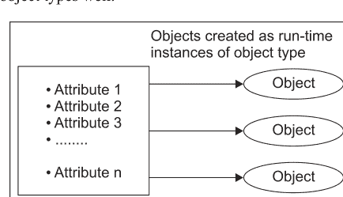

图 11.1：Documentum 对象类型的逻辑表示

如第 2 章所述，Documentum 对象类型遵循层次协议。子类型从超类型扩展而来，并且本身也可以成为另一个对象类型的超类型。图 11.2 显示了 Documentum 中对象类型层次结构的快照。注意，虽然 SysObject（dm_sysobject）在 Documentum 中是 Persistent 对象的子类型，但它是诸如文件夹、文档、作业和方法等对象的超类型。尽管图中未显示，文件夹对象（dm_folder）本身又是柜子对象（dm_cabinet）的超类型。

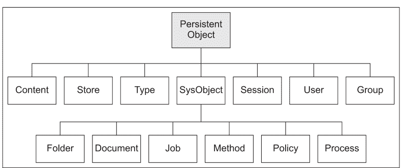

图 11.2：Documentum 中的示例对象类型层次结构

在了解了 Documentum 对象的基础知识后，让我们继续以虚拟新闻网站的案例研究为例，为中心窗格新闻文章设计/创建一种对象类型。

### 11.1 创建对象类型

在本节中，我们将详细介绍创建对象类型的步骤。首先需要确定应用程序所需的对象类型。对于中心窗格文章，我们需要一个对象类型，例如 cust_newsarticle（custom news article 的缩写），并且新闻文章模板将与此对象类型关联。要创建新的对象类型，请在 DocApp 构建器中选择 Insert | Object Type，并在 Type name 下指定名称 cust_newsarticle，如图 11.3 所示。新的对象类型以签出模式显示在 Application Builder 左侧树窗格中的 Object Types 文件夹下。

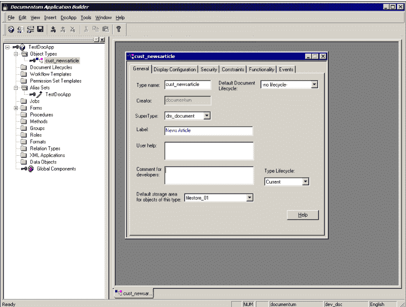

图 11.3：创建新的对象类型

### 11.1.1 类型名称

对象类型名称在 Docbase 中是唯一的且全局可访问的，因此为自定义对象类型采用智能命名约定至关重要，以便将其与 Docbase 中数千个现有对象区分开来。此外，在将对象类型部署到其他 Docbase 时，良好的命名约定可避免在目标 Docbase 中出现潜在的命名冲突。

### 11.1.2 对象类型名称的限制

图 11.4 显示了我们在命名对象类型时需要牢记的一些限制。

| 限制 |
|---|
| 不应以 'dm_' 开头，因为 Documentum 使用命名方案 dm_ 为其内部对象命名 |
| 不应以以下开头：空白字符、单引号 (') 或数字 |
| 长度最大为 18 个字符 |
| 不应使用与 Documentum DQL 中的保留字相同名称（例如：CABINET、DELETED、SELECT、INTEGER 等。） |

图 11.4：对象类型命名规范限制

对象类型“常规”选项卡如图 11.5 所示：

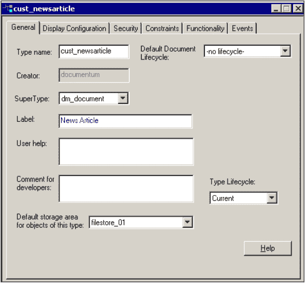

图 11.5：对象类型“常规”选项卡

### 11.1.3 超类型

每个对象类型可以从 Documentum 中现有的对象类型扩展，也可以将其超类型设为 NULL。

在我们的案例中，新闻文章是一个文档对象类型，因此我们将其从 dm_document 对象类型扩展而来。Super Type 下拉列表中显示的其他对象类型有：dm_job、dm_folder、dm_user 等。

Docbase 中的每个对象类型都存储在其底层 RDBMS 的独立数据库表中。

作为经验法则，不要将对象类型层次结构扩展得太深（超过三层），因为在内部这意味着 Documentum 需要执行相应数量的数据库连接。例如，您可以让自定义对象类型 cust_newsarticle 从 dm_document 扩展，并进一步让另一个自定义对象类型（例如 cust_newsarticle_sub）从 cust_newsarticle 扩展，但不能更深！

> 建议在自定义对象类型上仔细决定名称和超类型，因为在 Docbase 中签入对象类型后，您无法更改其名称或超类型。

现在按照以下步骤完成对象类型的创建：

- 1. 在 Display Configuration 选项卡下，可以配置在特定条件下为特定对象类型显示的特定属性。
- 但是请注意，此功能仅适用于 WDK 5.2 + 应用程序（如 Webtop、Web Publisher 等）和 Desktop 5.2 + 应用程序（如 Desktop Client）。
- 您可以在图 11.6 中看到，默认情况下为 DcDesktopClient（桌面）、Web Publisher 和 Webtop（WDK 客户端）显示了三个应用程序范围。
- 对于这些范围中的每一个，您可以选择需要在属性屏幕中各自选项卡下显示的特定属性（显示在图 11.6 的底部部分）。

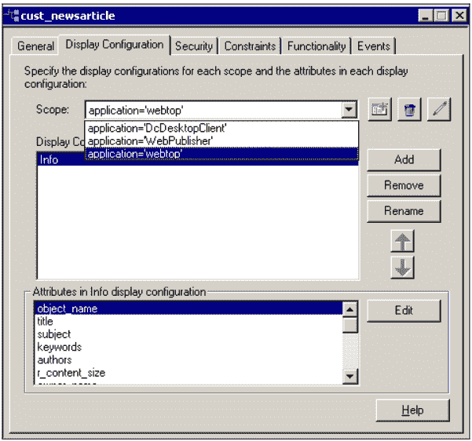

图 11.6：对象类型显示配置选项卡

Web Publisher 中的属性屏幕（参见图 11.7）显示了各种选项卡，如 Info、Publishing、History 等。这些选项卡下显示的属性可以通过对象类型中的显示配置部分进行配置。

## 设计和创建自定义对象类型

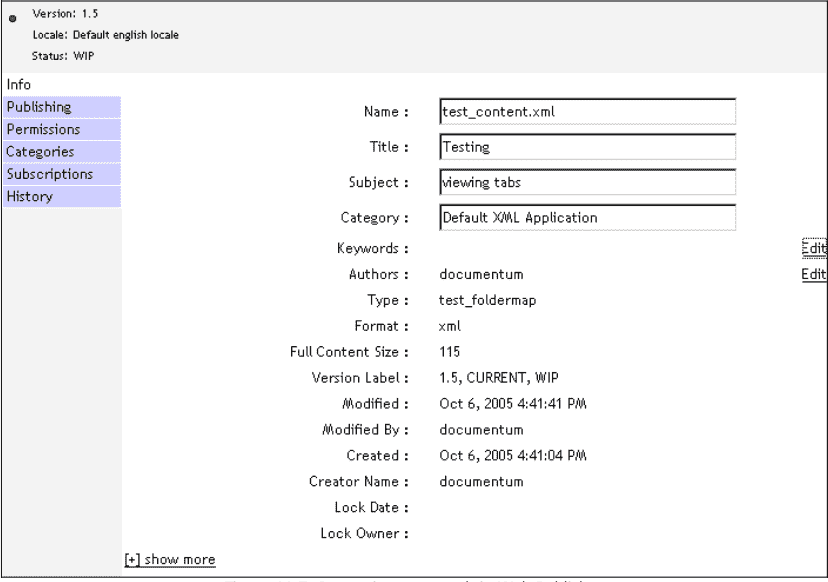

图 11.7：Web Publisher 中的属性屏幕选项卡

在 Display Configuration List 下，您可以通过分别单击 Add 或 Rename 按钮来引入新选项卡或重命名现有选项卡，如图 11.6 所示。您甚至可以通过 Remove 按钮完全删除一个选项卡。

在 Attributes in... 显示配置部分中，您可以通过单击 Edit 按钮来选择要为所选选项卡显示的特定属性。

- 2. 在 Security 选项卡内（参见图 11.8），有一个选项可以将默认权限集（访问控制列表）与对象类型关联。这确保了每当从此对象类型创建对象时，它将被分配我们为该对象类型设定的默认权限集。

这是控制特定对象类型对象的访问或修改权限级别的良好机制

要指定权限集，请从 Name: 下拉列表中选择现有权限集。所有其他字段，如 Owner、Description、Permissions 和 Your Permission 均为只读字段，在您从下拉列表中选择权限集后由 Documentum 自动填充。

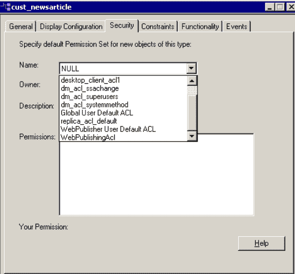

图 11.8：对象类型“安全”选项卡

- 3. 在 Constraints 选项卡内（参见图 11.9），您可以使用 Docbasic（Documentum 的专有语言）表达式为对象类型的属性值指定一致性检查。在 Constraint expression 部分输入 Docbasic 表达式。

假设我们需要确保每当从对象类型 cust_newsarticle 创建内容对象时，其主题属性绝不能留空。在这种情况下的 Docbasic 表达式将为：

```
not(subject = "")
```

输入 Docbasic 表达式后，单击 Check Syntax 以确认输入的 Docbasic 表达式具有正确的语法。您可以参考 Documentum Docbasic 参考手册以了解 Docbasic 及其应用用法。

如果未满足属性约束，则应用程序需要向用户显示的错误消息应输入在 Error message string... 部分。

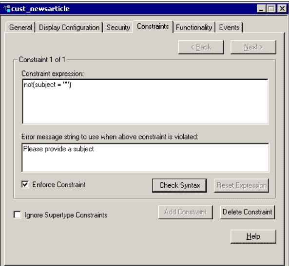

图 11.9：对象类型“约束”选项卡

在我们的案例中，如果内容对象的 subject 属性留空，则会向内容创建者显示错误消息 Please provide a subject。

您可以通过单击 Add Constraint 按钮添加多个约束。执行此操作后，后退和下一步按钮将被启用，允许我们在添加的约束之间前后移动。

- 4. 对象类型继承了其所扩展的超类型的大部分功能。此外，默认 DocApp 的组件用于实现从超类型继承的大部分功能。

使用 Documentum Application Builder，您可以执行各种操作，例如：

- 添加新的功能类及其用于实现的组件。
- 指定不同的组件来实现从超类型继承的功能类。
- 完全禁用继承的功能类。


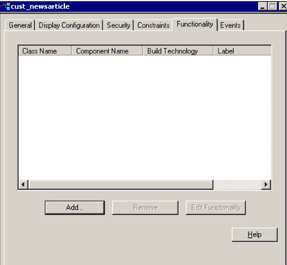

图 11.10：对象类型功能选项卡

图 11.10 显示了 Documentum Application Builder 中对象类型的功能选项卡。

5. 在事件选项卡下（参见图 11.11），会显示该对象类型的系统事件（只读）。

您可以通过分别点击“添加”、“删除”和“编辑...”按钮来添加、修改和删除特定于应用程序的事件。这些事件用于 Docbase 中的审计目的。

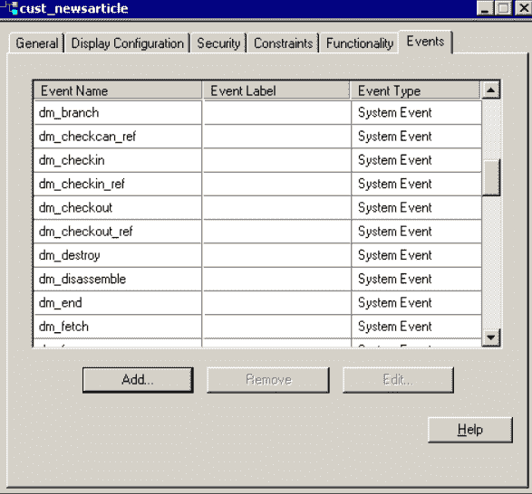

图 11.11：对象类型事件选项卡

6. 填写完所有必要选项卡中的相关数据后，在左侧树窗格中右键单击对象类型 cust_newsarticle，并选择“检入所选对象(s)”选项以将对象类型检入 Docbase。这样做会使新创建的对象类型在 Docbase 中可供应用程序使用。

7. 到目前为止，对象类型 cust_newsarticle 未关联任何生命周期。现在让我们将其与 Documentum 的默认生命周期关联起来，以便每次从该对象类型创建内容时，它都会自动附加到默认生命周期。

通过选择菜单选项 插入 | 从 Docbase | 文档生命周期 中的对象，将默认生命周期插入 TestDocApp。

一旦默认生命周期包含在我们的 DocApp 中，如图 11.12 所示，以编辑模式打开它。

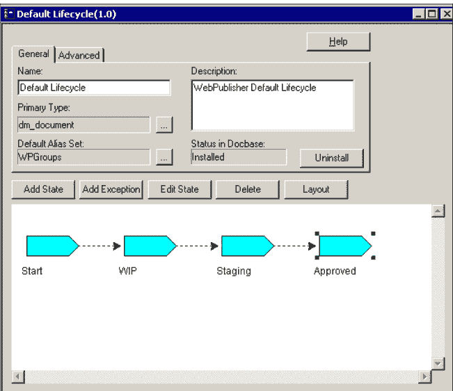

图 11.12：Documentum 默认生命周期

8. 请点击“主类型”字段旁显示的小方框 (...)，在打开的弹出窗口中（参见图 11.13），通过点击 → 按钮将 cust_newsarticle 对象类型从“可用子类型”移动到“可接受子类型”部分。最后，点击“确定”。

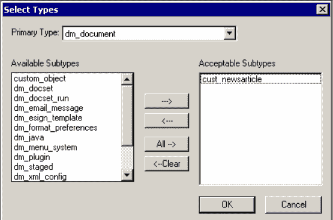

图 11.13：选择类型弹出窗口

现在通过在左侧树窗格中右键单击生命周期对象并选择“检入所选对象(s)”选项，将修改后的生命周期检入 Docbase。

请记住将生命周期（参见图 11.14）以“相同版本”而非“主要/次要版本”的方式检入 Docbase。这将防止在 Docbase 中创建多个生命周期版本，从而避免因众多版本而产生的可能混淆。

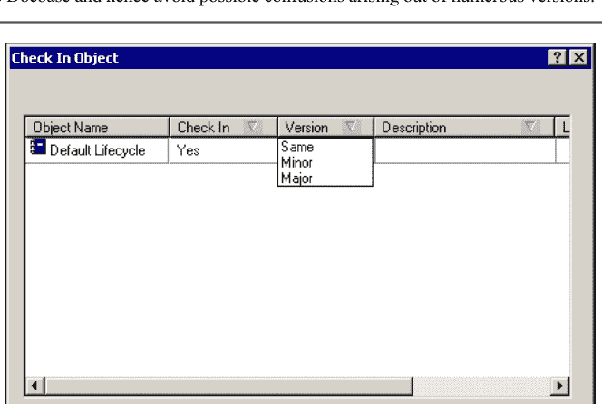

图 11.14：在 Docbase 中检入生命周期对象

9. 默认生命周期检入后，系统会将其恢复为草稿状态，从而使其无法供应用程序使用。以查看模式打开生命周期，然后点击“验证”，再点击“安装”，将生命周期重新安装到 Docbase。

10. 现在我们需要为新创建的对象类型指定默认生命周期。以编辑模式打开对象类型 cust_newsarticle，并在“默认文档生命周期”下拉列表中选择“默认生命周期”，如图所示 11.15。将修改后的对象类型重新检入 Docbase。

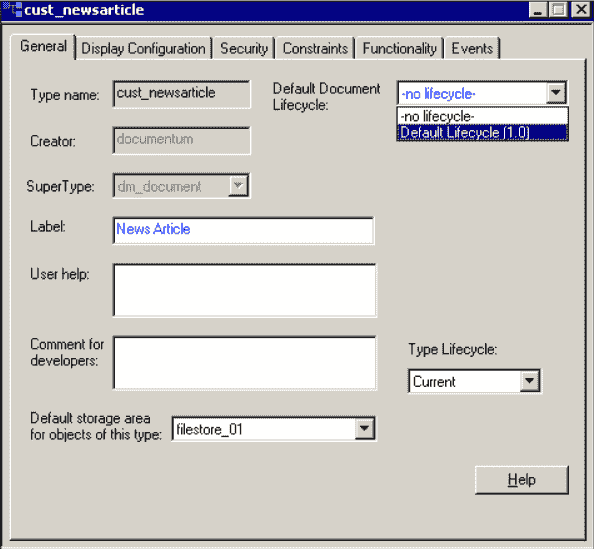

图 11.15：为对象类型设置生命周期

我们将在下一章详细介绍生命周期；因此，如果您对对象类型与生命周期之间的关系不太理解，请不要担心。

## 11.2 设计和创建对象类型的自定义属性

一旦您设计了自定义对象类型，它将继承其超类型对象类型的所有属性（属性）。您可能还想额外创建一些在超类型中不可用且仅特定于此对象类型的自定义属性。

对于我们的 cust_newsarticle 对象类型，我们可能需要以下自定义属性（例如）：

- 新闻文章一句话摘要
- 用于标识该新闻文章是否为新闻稿的标志
- 新闻文章优先级：在所有已发布的新闻文章中，该文章需要在网站上按什么顺序显示。
- 新闻文章编辑者和审批者姓名

最好准备一个小表格来设计自定义对象类型的属性，并根据您的业务特定需求填写表格的相应列。让我们在我们的示例网站的上下文中讨论这个问题（请参见图 11.16）：

| 属性名称 | 属性标签 | 数据类型 | 长度 | 单值/重复 | 必填 | 值 |
|---|---|---|---|---|---|---|
| cust_news_summary | 新闻文章摘要 | String | 200 | 单值 | 是 | 无 |
| cust_news_is_press_rel | 是否为新闻稿？ | Boolean | 0 | 单值 | 否 | 无 |
| cust_news_display_order | 显示顺序 | Integer | 0 | 单值 | 否 | 条件：
- 如果新闻文章为新闻稿，则为 1,3,5,7
- 如果新闻文章不是新闻稿，则为 0,2,4,6 |
| cust_news_edit_approvers | 编辑者/审批者 | String | 100 | 重复 | 否 | 无 |

图 11.16：属性设计表

应非常仔细地设计属性，因为在属性创建并检入 Docbase 后，以下内容无法修改：

- 属性名称
- 属性数据类型
- 属性是单值还是重复
- 属性长度（只能增加）

## 11.3 向对象类型添加属性

在 DocApp 中选择相关对象类型并选择 插入 | 属性。我们将首先通过为对象类型 cust_newsarticle 创建属性 cust_news_summary 来举例说明。

如图 11.17 所示，在新的属性创建屏幕中填写相关字段。

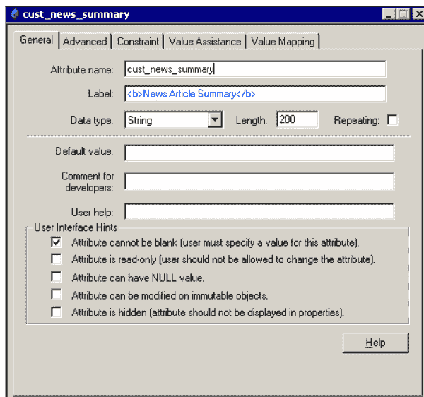

图 11.17：属性常规选项卡

### 11.3.1 属性名称

与对象类型名称类似，属性名称也有某些限制需要严格遵守。图 11.18 列出了属性名称的一些限制。

### 11.3.2 对象类型属性名称的限制

| 限制 |
|---|
| 应为小写 |
| 不应以空格、单引号 (') 或数字开头 |
| 不应以 'dm_'、'i_'、'r_' 和 'a_' 开头，因为 Documentum 在其对象属性命名方案中内部使用这些前缀 |
| 不应使用与 Documentum 中以下保留字匹配的名称：'from'、'where' 和 'select' |

图 11.18：属性命名约定限制

### 11.3.2.1 标签

标签字段将是对象属性页中显示在此属性字段旁边的实际标签。您也可以用 HTML 标记包围文本，以在属性页中显示属性时获得视觉效果。我们将在第 24 章中更详细地介绍这一点。

### 11.3.2.2 数据类型

从“数据类型”下拉列表中为属性选择数据类型。下拉列表中显示的可用数据类型有：

- Boolean
- Integer
- String
- ID
- Time
- Double

### 11.3.2.3 长度

长度字段仅对 String 数据类型的属性启用。请注意，使用 Application Builder 时，我们为字符串属性指定的最大长度为 2000。

### 11.3.2.4 重复

为了将属性指定为多值，可以选择“重复”复选框。如果未选中，则表示单值属性。

根据您的具体要求填写“常规”选项卡下显示的其他属性字段。在我们的例子中，我们已确定 cust_news_summary 属性为必填项（参见图 11.16 中的属性设计），因此我们选中了“属性不能为空”字段旁边的复选框。

在“高级”选项卡下（参见图 11.19），您可以指定客户端应用程序根据其属性值在 Docbase 中搜索对象的搜索参数。默认情况下，每个属性都是可搜索的。您可以通过取消选中图中显示的“可搜索”复选框来否定此条件。

### 11.3.2.5 默认搜索值

您可以在使用客户端应用程序根据此特定属性搜索对象时，始终显示一些默认搜索值。

### 11.3.2.6 允许的搜索运算符

您可以添加/删除客户端应用程序将用于根据所讨论属性的某些条件搜索 Docbase 对象的搜索运算符。


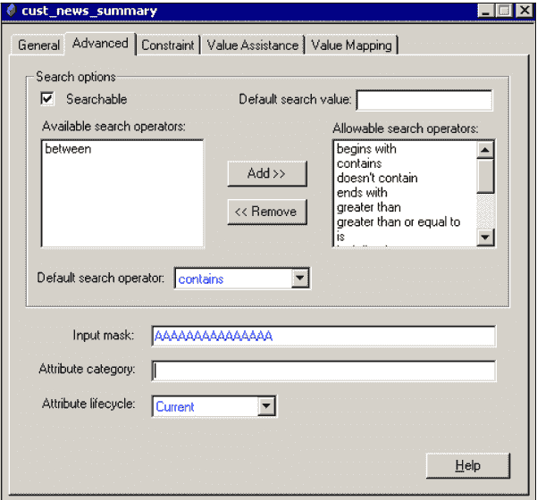

图 11.19：属性高级选项卡

Documentum 提供了众多搜索运算符，例如：

- 包含
- 以...结尾
- 大于
- 是
- 小于

## 11.3.2.7 输入掩码

这是一个重要的字段，如果使用得当，可以发挥奇效。输入掩码字段可以作为对象属性的有用验证机制。

例如，根据您的业务需求，您希望内容创建者为属性 cust_news_summary 提供仅 15 个字符长的字母数字值。以下属性中的输入掩码可以在无需任何脚本/编码的情况下实现所需条件：

```
AAAAAAAAAAAAAAA
```

连续的十五个 A 表示只允许 A 类性质的 15 个字符，即字母数字。
请参阅图 11.20，了解 Documentum 提供的所有可用掩码字符和符号：

| Symbol | Interpretation |
|---|---|
| A | 仅允许字母数字字符。即 a-z、A-Z 和 0-9 |
| # | 仅允许纯数字值。即 0-9 |
| ? | 仅允许纯字母值。即 a-z 和 A-Z |
| & | 允许任何 ASCII 字符 |
| U | 允许大写字母字符 |
| L | 允许小写字母字符 |

图 11.20：Documentum 中可用的掩码字符

1. 与我们在对象类型中看到的类似，在约束选项卡中（请参阅图 11.21），您可以使用 Docbasic 表达式为对象类型的属性值指定一致性检查。

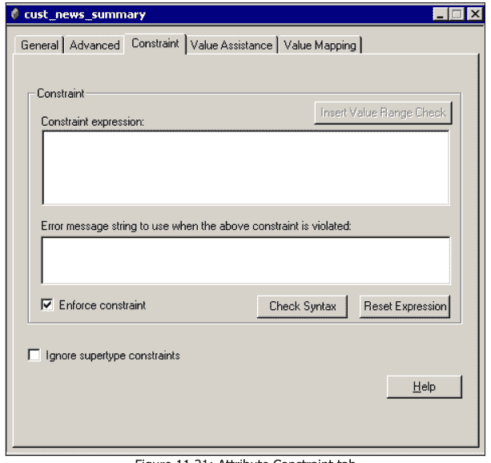

图 11.21：属性约束选项卡

2. 当您希望用户为属性选择一些预定义值时，值辅助功能非常有用。使用值辅助功能，您可以将属性字段转换为属性屏幕中的下拉列表（选择列表），用户在创建新对象时可以从中选择现有值。单击“添加默认值”按钮（请参阅图 11.22）为属性添加值。默认“值辅助”弹出窗口显示（图 11.23）。

这里值得一提的是，当属性的数据类型为 Boolean 时，值辅助功能不可用。在这种情况下，“添加默认值”按钮为灰色。

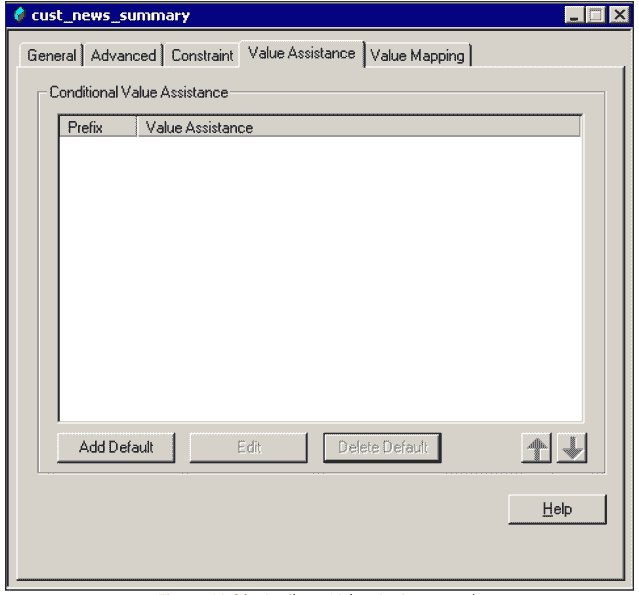

图 11.22：属性值辅助选项卡

您可以提供各个值，每行一个（按 Enter 键），并通过选中复选框“列表已完成....”将选择列表标记为完整。请参阅图 11.23 了解详情。

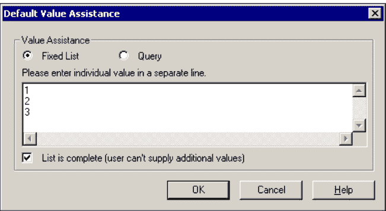

图 11.23：值辅助固定列表弹出窗口

或者，您可以改选“查询”选项旁边的单选按钮，而不是“固定列表”选项（请参阅图 11.24）。这将允许您使用通过 DQL 查询的对象类型或 Documentum 中的注册表动态填充下拉列表的值。我们将在本章后面详细介绍这一点。现在，请不要关心“查询”选项如何用于查询注册表。对于 cust_news_summary 属性，我们不需要在下拉列表中显示任何预定义值。但是，对于 cust_news_display_order 属性，我们将查询注册表并详细介绍“查询”选项的使用。

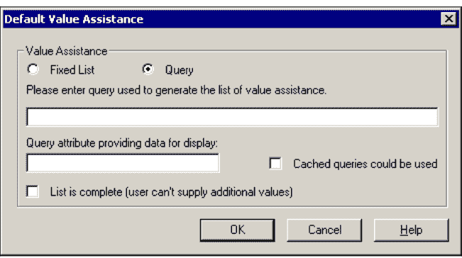

图 11.24：查询选项的值辅助弹出窗口

## 11.3.2.8 条件值辅助

Documentum 通过允许开发人员根据某些属性值有条件地配置下拉值，进一步改进了值辅助功能。让我们通过一个快速示例来了解 Documentum 中条件值辅助的工作原理。

在为属性提供默认“值辅助”后，“添加条件”按钮将被启用，如图 11.25 所示。

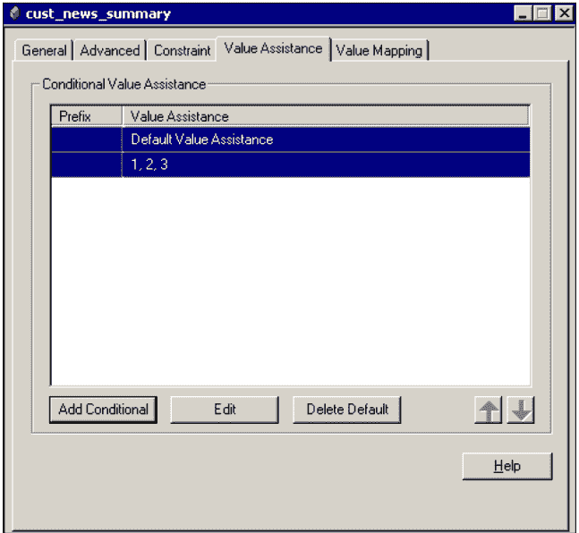

图 11.25：使用条件值辅助

单击“添加条件”按钮会显示如图 11.26 所示的值辅助子句弹出窗口。条件可以以 Docbasic 表达式的形式提供（如我们在创建对象类型时在约束选项卡中看到的）。输入的 Docbasic 表达式可以通过单击“检查语法”按钮进行验证。根据输入的 Docbasic 表达式（属性条件）的评估，将在弹出窗口的值辅助部分下为用户提供下拉列表。

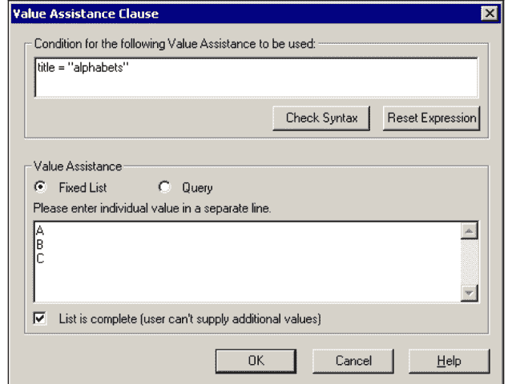

图 11.26：值辅助子句弹出窗口

您可以通过以与输入第一个条件子句相同的方式提供额外的 Docbasic 表达式来提供额外的条件和子句。所有现有条件均以“如果...则...”子句的形式显示，如图 11.27 所示。

它表示如果 title 属性的值为字母，则下拉列表将显示值：A、B、C。

如果 title 属性的值为数字，则下拉列表将显示值：1、2、3、4、5。

如果没有满足任何条件，则下拉列表中显示的默认值是：1、2、3。

但是，请记住，由于 Docbasic 的限制，您不能在 Application Builder 中提供超过 35 条此类条件值辅助语句。

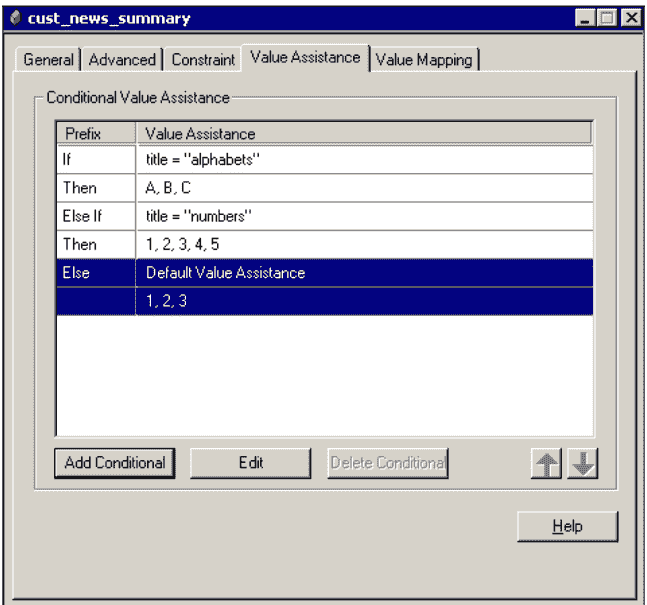

图 11.27：现有条件子句

一个常见的需求是在下拉值中显示一些用户友好的文本，同时为应用程序读取和理解的每个值保存简短代码。

在我们的示例中，我们可能希望用户在下拉列表中看到的值为“One、Two、Three”，而实际上在 Docbase 后台分别将其保存为 1、2 和 3。

在“值映射”选项卡下，如图 11.28 所示，在“数据”列中输入 Docbase 值，并在“显示字符串”列中输入其映射的下拉显示值。

“显示字符串”下的值仅用于在下拉列表中视觉显示。“数据”列中的值将作为属性的值保存在 Docbase 中。

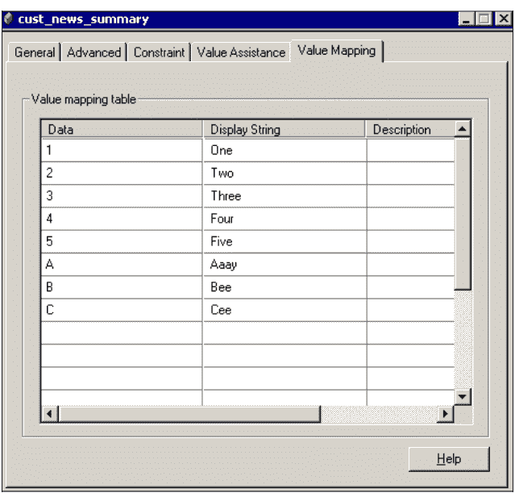

图 11.28：属性值映射选项卡

在所有必要的选项卡中填写相关数据后，右键单击对象类型 cust_newsarticle（在左侧树窗格中）并选择选项“检入所选对象(s)”以将对象类型（连同其属性）检入 Docbase。这样做使新创建的属性在 Docbase 中可供应用程序使用。

根据属性设计表 11.16 中的规范创建其他属性 cust_news_is_press_rel 和 cust_news_edit_approvers。我们现在将通过创建属性 cust_news_display_order 如下，介绍使用查询选项的条件值辅助的示例。

> 您可能希望跳回第 3 章，在继续以下部分之前快速回顾我们之前关于注册表的讨论。

## 11.4 使用 DQL 查询注册表以进行值辅助

创建一个新属性 cust_news_display_order 并如 11.29 图所示填写“常规”选项卡。

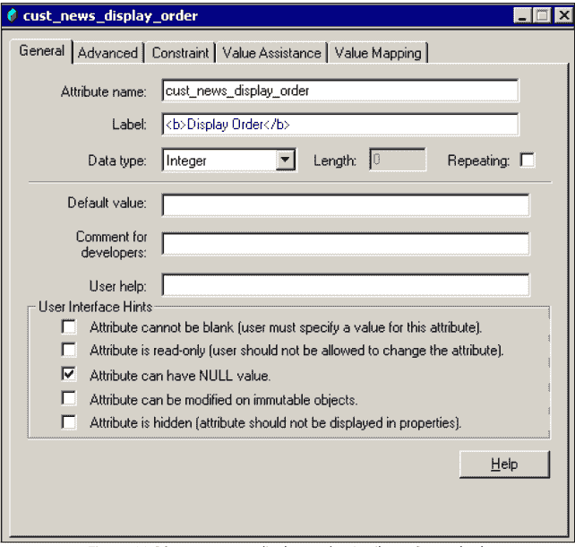

图 11.29：cust_news_display_order 属性常规选项卡

如果属性 cust_news_is_press_rel 的值为 true，则该属性需要显示下拉值：1、3、5、7；如果属性 cust_news_is_press_rel 的值为 false，则显示值：0、2、4、6。

这可以通过条件值辅助和使用注册表来实现，如下所示：

1. 根据以下设计在底层 RDBMS 中创建表：
  - **表名：** cust_values_table
  - **列 1 (int)：** cust_odd_values
  - **列 2 (int)：** cust_even_values

将值插入两列，如图 11.30 所示：

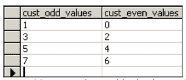

图 11.30：cust_values_table 数据库表

2. 以管理员身份登录 Documentum Administrator 并通过以下 DQL 查询注册 RDBMS 表 cust_values_table：

```
register table dm_dbo.cust_values_table (cust_odd_values int,cust_even_values int)
update dm_registered_object set owner_table_permit=15 where object_name='cust_values_table'
update dm_registered_object set group_table_permit=15 where object_name='cust_values_table'
update dm_registered_object set world_table_permit=15 where object_name='cust_values_table'
```

请注意，这里 dm_dbo 是 Docbase 所有者的别名，而权限级别 15 用于选择、插入、更新和删除权限。

现在通过 DQL 查询编辑器在 Documentum Administrator 中发出以下 SELECT 查询，以确定注册表中的值是否返回：

```
select cust_odd_values, cust_even_values from dm_dbo.cust_values_table
```

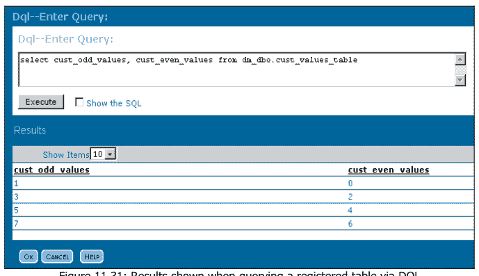

图 11.31：通过 DQL 查询注册表时显示的结果


图 11.31 所示的结果证明注册表已正确设置，并且可以通过 Application Builder 中的值辅助子句中的查询选项访问。

3. 转到“值辅助”选项卡并单击“添加默认值”按钮，以输入要为该属性显示的默认值集。

选择“查询”单选按钮，并在文本框“请输入查询...”中输入以下 DQL 查询（参见图 11.32）：

```
select cust_odd_values, cust_even_values from dm_dbo.cust_values_table
```

这将在运行时评估注册表中可用的值并将结果集返回给客户端应用程序。请注意，Documentum 在运行时内部查询实际的底层 RDBMS 表，而不是注册表对象。

在“查询属性...”文本框中提供将用于填充下拉列表的注册表列名。我们将其设置为 cust_odd_values，因此如果未满足任何条件/子句，cust_news_display_order 属性将在下拉列表中显示以下值：1, 3, 5, 7。

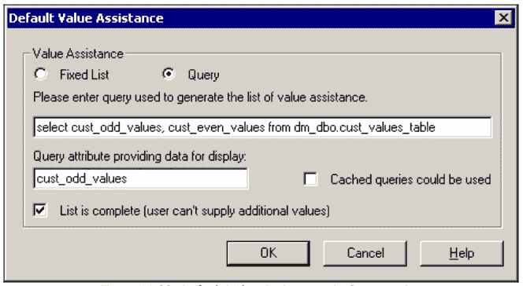

图 11.32：通过查询选项的默认值辅助

填写完默认值辅助后，单击“添加条件”按钮并输入如图 11.33 所示的条件子句。如表 11.15 属性设计中所述，cust_news_display_order 属性将在属性 cust_news_is_press_rel 的值为 true 时显示下拉值：1, 3, 5, 7，而在属性 cust_news_is_press_rel 的值为 false 时显示值：0, 2, 4, 6。

- 条件/子句：cust_news_is_press_rel = true
- 提供显示数据的查询属性：cust_odd_values
- 条件/子句：cust_news_is_press_rel = false
- 提供显示数据的查询属性：cust_even_values

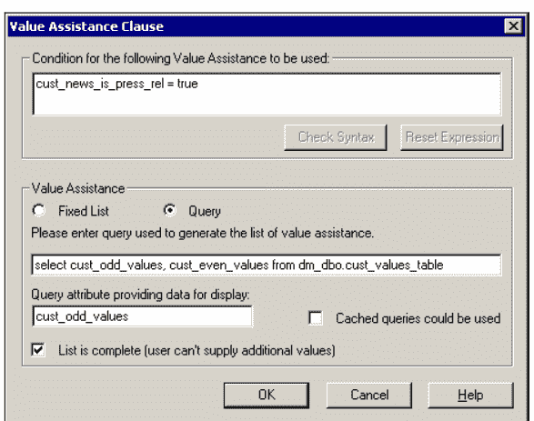

图 11.33：使用查询选项的值辅助子句弹出窗口

4. 填写完所有必要选项卡中的相关数据后，在左侧树窗格中右键单击对象类型 cust_newsarticle，然后选择“签入所选对象(s)”选项以将对象类型（连同其属性）签入 Docbase。这样，新创建的属性 cust_news_display_order 即可在 Docbase 中供应用程序使用。

新添加的属性 cust_news_summary、cust_news_is_press_rel、cust_news_display_order 和 cust_news_edit_approvers 可以通过自定义默认的新内容页面添加到新的内容属性页面中。图 11.34 显示了新属性在实际场景中的外观。要完成此自定义所需的代码更改超出了本章的范围。我们将在第 24 章讨论 WDK 配置时再研究这个问题。

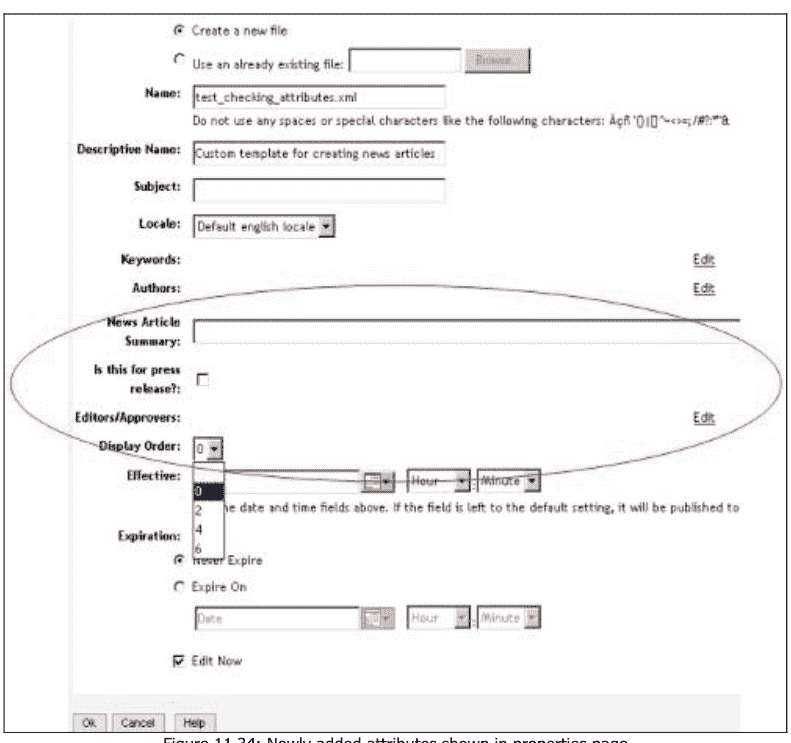

图 11.34：属性页面中显示的新添加的属性

## 11.5 $value() 关键字

$value() 是一个重要的关键字，在设计条件值辅助时应考虑。让我们通过一个简单的示例来了解其使用方法和好处。

考虑一个属性 cust_name，它代表某些办公室员工姓名的下拉列表，例如 Tom、Harry 和 Chris，如图 11.35 所示。

| cust_name |
|-----------|
| Tom       |
| Harry     |
| Chris     |

图 11.35：员工姓名表

另一个属性 cust_age 需要代表每个办公室工作人员的年龄下拉列表。根据 cust_name 中选择的姓名，需要填充 cust_age 中的值。

例如，代表办公室工作人员姓名和对应年龄的表如表 11.36 所示：

| Name | Age |
|------|-----|
| Tom | 23 |
| Harry | 45 |
| Chris | 19 |

图 11.36：员工姓名和年龄表

可以建立如下的条件值辅助：

```
If cust_name = "Tom"
Then cust_age = 23
Else If cust_name = "Harry"
Then cust_age = 45
Else If cust_name = "Chris"
Then cust_age = 19
Else ...
```

如果办公室工作人员人数接近 100 人？您会定义这么多条件语句吗？这既不是好的实现，Application Builder 也不支持这么多条件值辅助语句。

$value() 在这种情况下可以帮到你。让我们看看如何操作。

设计一个注册表（例如 cust_employee_data），其列为 emp_name 和 emp_age。用所有员工的实际值及其年龄填充底层表中的行。按如下方式为属性 cust_age 定义值辅助：

```
select emp_age from dm_dbo.cust_employee_data where emp_name = '$value(cust_name)'
```

得益于 $value()，在运行时 Documentum 会在 where 子句中替换属性 cust_name 的值，因此查询会返回正确的员工年龄，而无需编写多个条件语句！有趣且非常有用，不是吗？

现在我们已经创建了自定义对象类型和属性，我们可以扩展我们的新闻文章示例并创建新闻文章 Web 发布者模板（类似于 UI 中的“表单”），以便在创建内容时，在填写新闻属性页面后，用户可以提供实际的新闻文章内容。在此之前，让我们先创建一个自定义生命周期并将其附加到本章中创建的自定义对象类型。

## 11.6 摘要

本章介绍了 Documentum 对象类型及其属性（属性）。我们详细介绍了如何使用 Documentum Application Builder 工具在 Docbase 中创建对象类型。我们看到了对象类型命名约定的一些限制。

然后我们看到了如何创建示例新闻文章对象类型并将其与 Documentum 生命周期关联。

在本章后半部分，我们设计了示例新闻文章对象类型的一些属性，并讨论了使用 Documentum Application Builder 工具创建属性的详细步骤。

我们介绍了值辅助的使用，用于为对象类型的属性显示预定义的数据集，以及如何根据某些条件有条件地显示不同的值。

值辅助可以通过提供一组固定的硬编码数据或通过在运行时查询对象和注册表来使用。

我们讨论了如何在 Documentum 中创建注册表以及如何使用值辅助查询它们。

我们以简要介绍 $value() 关键字如何帮助避免在值辅助中编写多个条件语句结束本章。
