## 12 创建生命周期、别名集和权限集

在上一章中，我们为新闻文章对象创建了自定义对象类型和一些属性。现在让我们为新闻文章对象设计一个自定义生命周期，以便从新闻文章对象类型创建的实例（或内容对象）可以在将内容上线之前在各个生命周期阶段（如暂存（或审查）、审批等）之间移动。Documentum 中的生命周期对象与一些相关对象（如别名集、权限集（ACL）等）相关联，建议快速浏览介绍性章节以回顾我们之前讨论的基础知识。

总体而言，在设计生命周期时，您需要牢记三个重要组件：

- 生命周期用的别名集(s)
- 生命周期流程中各个阶段的权限集（ACL）
- 实际生命周期设计，如阶段、标签、预处理或后处理的任何脚本等。

我们将在本章中通过非常简单的示例介绍这些内容，以便您获得一定的理解和舒适度，而这些理解和舒适度可以在软件项目中设计实时应用程序时进一步扩展和丰富。

### 12.1 生命周期中的别名集

在生命周期的上下文中，别名集是一组别名，使生命周期能够在众多环境中移植。别名只不过是在给定上下文中称为别名名称的某些实际值的占位符或符号名称。别名值是别名名称的实际值。别名名称和值的配对构成一个别名，而一组这样的别名构成一个别名集。

想象一下，新闻文章的内容对象是由内容作者创建并由内容经理审阅的。在某个部门，内容作者可能是 Mr. X，内容经理可能是 Ms. Y。在另一个部门，内容作者和经理可能是不同的人，不一定是 Mr. X 和 Ms. Y。


An Alias Set comes in handy in such circumstances, helping us design an application with symbolic names for content author/manager groups, the actual values for which are resolved by the system at run time as per the current context/environment.

You can specify multiple Alias Sets for a Lifecycle and have one of them designated as the default Alias Set; the others are treated as Additional Alias Sets. This is just the right time to discuss something called the scope of an Alias within Documentum. The scope of an Alias is the context in Documentum within which the system resolves the actual value for a given Alias name.

Documentum recognizes the following scopes:

- **生命周期作用域：** 生命周期对应的别名集。附加到特定生命周期的 Documentum 中的 SysObjects 有助于系统解析值。
- **工作流作用域：** 附加到工作流流程模板的别名集在运行时通过查找工作流中所有执行者的实际值来解析，每当从给定的工作流流程定义启动工作流时。
- **会话作用域：** 特定 Docbase 会话（会话配置对象）的生命周期内的别名集有助于系统解析别名的实际值。
- **用户作用域：** 用户作用域用于从在 Documentum 中创建给定用户和组时定义的别名集中解析别名值。
- **系统作用域：** 此作用域用于解析为给定 Docbase 的服务器配置对象定义的别名集的别名名称的值。

每当内容对象附加到 Documentum 中的生命周期时，系统首先根据附加到生命周期对象的别名集评估所有别名值。这体现了别名集在生命周期上下文中的重要性。因此，在本章中，我们将首先学习如何为生命周期创建别名集，然后继续在各个生命周期阶段构建安全性（使用 ACL），最终创建完整的生命周期对象。

## 12.2 创建别名集

本节将详细介绍创建别名集涉及的步骤。

在我们的自定义 DocApp TestDocApp 中，选择菜单选项 Insert | Alias Set 以创建新的别名集。图 12.1 显示了空的别名集屏幕。为自定义别名集提供一个唯一名称以及简短描述以说明其用途。

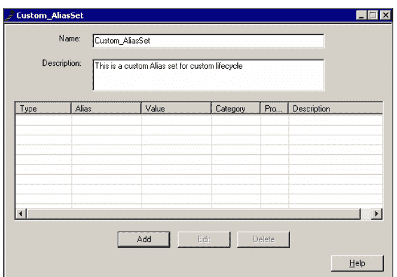

图 12.1：空白别名集屏幕

要在别名集中添加新的别名，请单击 Add。单击此按钮将打开别名对象对话框，如图 12.2 所示。

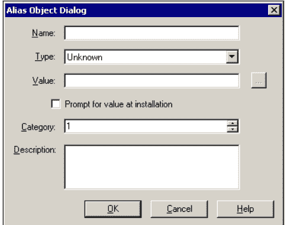

图 12.2：在别名集中添加新的别名

在 Name 文本框中为别名提供名称。从 Type 下拉列表中选择别名类型。下拉列表中可用的别名类型有：

- Unknown
- User
- Group
- User or Group
- Cabinet Path
- Cabinet or Folder Path
- Permissions Set

根据所选的别名类型，单击省略号按钮 (...) 时，Value 字段中的值将被填充。

如果希望系统在解析别名时提示别名的值，请选择 Prompt for value at installation 复选框。

Alias Category 未被系统使用，但可用于对自定义应用程序的别名集进行分类。

可以提供简短描述来解释别名的意图/用途。单击 OK 按钮。

在为别名集提供别名后，添加的别名将作为单独的行显示在别名集屏幕中，如图 12.3 所示。

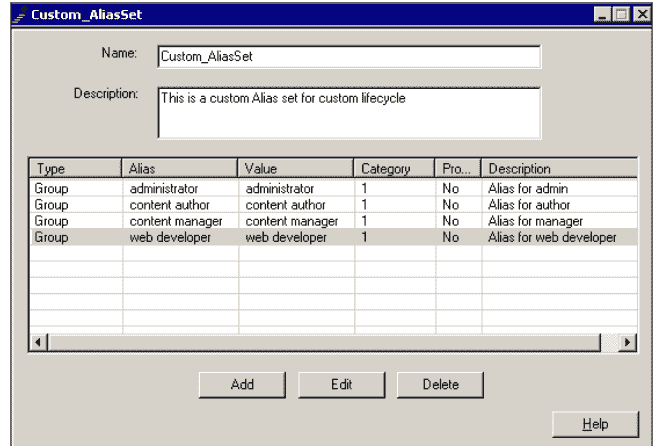

图 12.3：新创建的别名集

选择 Documentum Application Builder 左窗口窗格中显示的 Custom_AliasSet 别名集，右键单击并选择 Check in selected object(s) 以将别名集签入 Docbase。

## 12.3 创建权限集

需要采取安全措施，以便在生命周期的不同阶段，只有处理内容对象的特定授权用户才能获得特定的权限或权利来操作内容。例如，我们的自定义生命周期有四个阶段：

- Start（内容创建时）
- WIP（Work in progress 的缩写）
- Staging（内容审核中）
- Approved（内容最终审核并批准，准备在实时站点上显示）

您可以为每个生命周期阶段设计 ACL（访问控制列表或权限集）。例如，在生命周期的 Staging 阶段，管理员、内容管理员、内容作者和 Web 开发人员用户可以拥有 VERSION 权限，而内容所有者可以获得 WRITE 权限，其余用户（称为“world”）可以获得 READ 权限。

请参阅第 3 章中关于 ACL 的早期讨论，以快速了解 Documentum 中的基本和扩展权限级别及其语义。

现在让我们为生命周期的 WIP 生命周期状态创建一个权限集模板（ACL），并相应地为其他生命周期状态创建 ACL。

1. 在我们的自定义 DocApp TestDocApp 中，选择 Insert | Permission Set Template。为自定义权限集提供一些唯一名称（如 Custom WIP ACL）以及简短描述以说明其用途（参见图 12.4）。
2. 选择第一个单选按钮 Show Alias-Sets in Application 以在我们的自定义 DocApp 中选择一个别名集。选择第二个单选按钮 Show All Alias-Sets in Docbase 以从 Docbase 中现有的别名集中选择一个现有别名集。选择第三个单选按钮 Show Users and Groups 以直接从 Docbase 中所有现有组中选择一个组。如果选择了前两个单选按钮之一，则从别名名称中选择一个条目；如果选择了第三个单选按钮，则选择一个组名，并为涉及的每个实体提供基本和扩展权限。从 Permissions 下拉列表中选择七个基本权限级别之一，并根据需要选择扩展权限级别的复选框（如果有）。Documentum 中共有五个扩展权限级别。因此，您可以单击 Add to Set 按钮将权限包含在 ACL 中，或单击 Remove from Set 按钮删除已添加的权限。请注意，当您开始创建新的权限集时，Documentum 会自动为 dm_owner 和 dm_world 别名包含条目。您可以显然修改这两个别名的特定权限。

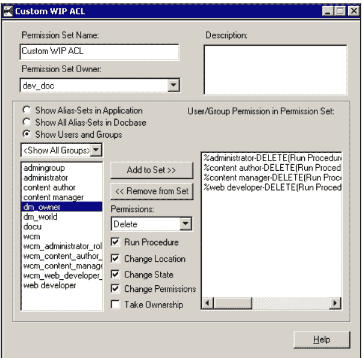

图 12.4：创建权限集

3. 在提供必要的权限后，可以在 Documentum Application Builder 的左窗口窗格中选择权限集，右键单击并通过选择 Check in selected object(s) 选项将其签入 Docbase。

请注意，我们不需要为生命周期的 Start 阶段创建 ACL，因为一旦在 Web Publisher 中创建内容，Documentum 会自动将其推送到 WIP 生命周期状态。实际上，需要为 Start 状态之外的所有生命周期状态创建权限集。

图 12.5 基于 Documentum 默认生命周期的开箱即用 ACL，列出了 WIP、Staging 和 Approved 每个生命周期状态的权限集设计。毋庸置疑，您可以根据业务需求更改权限级别。

| 生命周期阶段 | 别名 | 基本权限 | 运行流程 | 更改位置 | 更改状态 | 更改权限 | 取得所有权 |
|---|---|---|---|---|---|---|---|
| WIP | administrator | DELETE | Y | Y | Y | Y | N |
|  | content author | DELETE | Y | Y | Y | Y | N |
|  | content manager | DELETE | Y | Y | Y | Y | N |
|  | web developer | DELETE | Y | Y | Y | Y | N |
|  | dm_owner | DELETE | Y | Y | Y | Y | N |
|  | dm_world | READ | Y | Y | N | N | N |
| Staging | administrator | VERSION | Y | Y | Y | Y | N |
|  | content author | VERSION | Y | Y | Y | Y | N |
|  | content manager | VERSION | Y | Y | Y | Y | N |
|  | web developer | VERSION | Y | Y | Y | Y | N |
|  | dm_owner | WRITE | Y | Y | Y | Y | N |
|  | dm_world | READ | Y | Y | N | N | N |
| Approved | administrator | VERSION | Y | Y | Y | Y | N |
|  | content author | VERSION | Y | Y | Y | Y | N |
|  | content manager | VERSION | Y | Y | Y | Y | N |
|  | web developer | VERSION | Y | Y | Y | Y | N |
|  | dm_owner | WRITE | Y | Y | Y | Y | N |
|  | dm_world | READ | Y | Y | N | N | N |

图 12.5：不同生命周期状态的权限

## 12.4 创建自定义生命周期

本节将讨论创建自定义生命周期的详细步骤。

1. 在我们的自定义 DocApp TestDocApp 中，选择菜单选项 Insert | Document Lifecycle 以创建新的生命周期。为自定义生命周期提供一些唯一名称（如 `Custom_Lifecycle`）（参见图 12.6）以及简短描述以说明其用途。


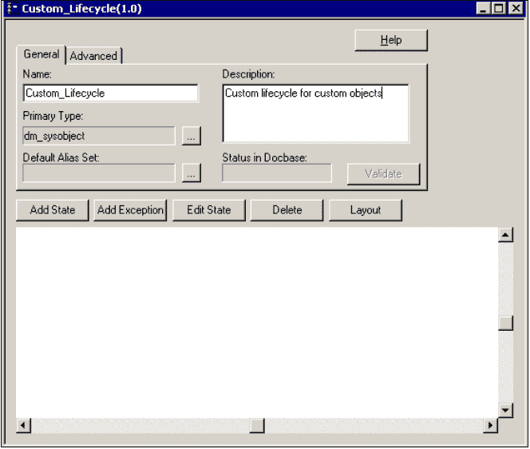

Figure 12.6: 创建新的生命周期对象

生命周期编辑器用于创建**生命周期状态图**，在其中您可以创建生命周期的各个状态及其特定的行为/属性。

请注意，此时 Validate 按钮处于禁用状态。生命周期正在创建中，因此被称为处于草稿状态。当您完成生命周期的创建并将其签入 Docbase 后，Validate 按钮将被启用。单击 Validate 按钮相当于进行系统验证，以检查生命周期参数是否一致。如果验证检查通过，生命周期将被验证，并且 Install 按钮将被启用。单击 Install 按钮后，生命周期将被安装到 Docbase 中，并最终可供适当的对象使用。

### 2. 通过单击对应于 Default Alias Set 选项的省略号按钮为生命周期附加别名集。Select Alias Sets 对话框如图所示 12.7 所示。

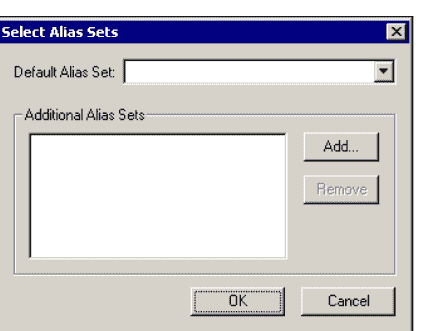

Figure 12.7: 为生命周期指定默认别名集

从下拉列表中选择我们之前创建的别名集 Custom_AliasSet。您还可以通过单击 Add... 按钮将 Docbase 中存在的其他别名集附加到生命周期。

### 3. 现在您需要提供对象类型，其对象实例可以附加到自定义生命周期。例如，我们要求我们的自定义生命周期附加到新闻文章对象。

单击对应于 Primary Type 字段的省略号按钮并选择 dm_document 作为 Primary Type（参见图 12.8）。这意味着 dm_document 对象类型的对象实例可以附加到我们的自定义生命周期。此外，基本对象类型（在我们例子中为 dm_document）的子类型显示在 Available Subtypes 列表下。选择 dm_document 的子类型，其对象实例也可以附加到相关生命周期。单击 → 按钮将把 dm_document 子类型包含在 Acceptable Subtypes 列表下。单击 OK 按钮。

请注意，如图 12.8 所示，我们已将 dm_document 指定为自定义生命周期的基本对象类型，并将 cust_newsarticle 对象类型指定为生命周期的 dm_document 的可接受子类型。

这确保了从新闻文章类型创建的内容对象可以附加到我们的自定义生命周期。

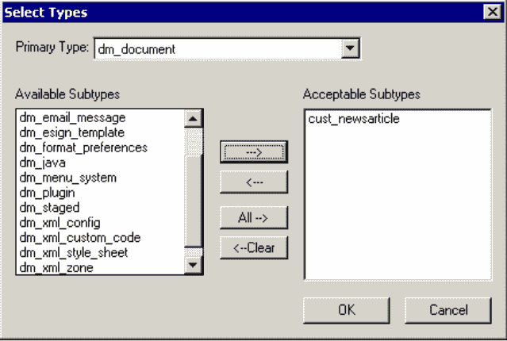

Figure 12.8: 指定基本对象类型和可接受子类型

我们现在准备一个包含四个正常生命周期状态的生命周期状态图：

- Start
- WIP
- Staging
- Approved

请注意用于描述生命周期状态的单词 normal。生命周期中也可能存在异常状态，以表示在状态的否则顺序且线性的正常流程中的异常流程或偏离。

您可以通过单击 Add State 并为状态提供一些独特易懂的名称来在生命周期中引入状态。单击 Add State 会在生命周期状态图（如图 12.9 所示）中添加一个五边形状态。

第一个状态称为**基本状态**，而结束状态称为**最终状态**。我们的自定义生命周期有四个正常状态，包括一个基本状态（称为 Start）和一个最终状态（称为 Approved）。

当您将文档附加到生命周期时，您实际上是将文档与生命周期关联。这样做允许您将文档提升到下一个顺序线性正常状态，或将其降级回其上一个正常状态。让我们举一个快速例子。

我们创建一个 Word 文档 abc.doc 并将其与我们的自定义生命周期关联。此时，文档处于生命周期的 WIP 状态。提升文档会将其推到下一个正常状态——Staging。在 Staging 状态下，如果您降级文档，它将返回到 WIP 状态。简单，不是吗？

尽管我们不会在自定义生命周期中涵盖异常状态，但值得在此提及，与提升和降级类似，从正常状态移动到异常状态称为**挂起**，而从异常状态返回到正常状态称为**恢复**。

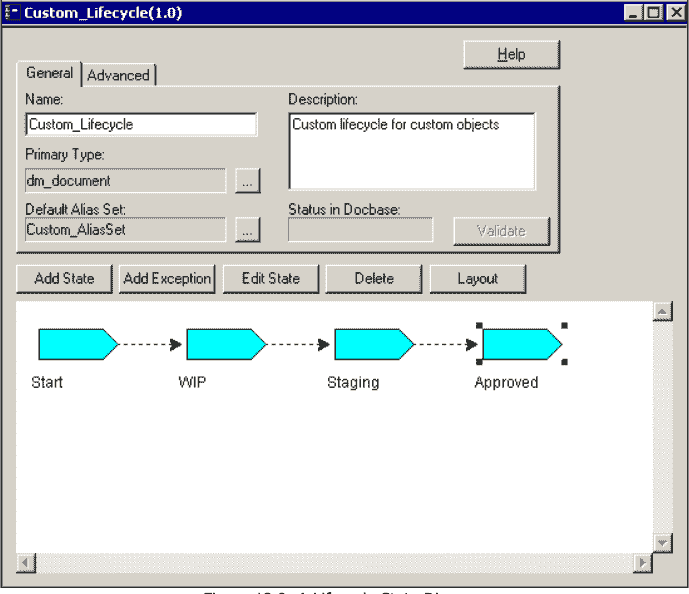

Figure 12.9: 一个生命周期状态图

### 4. 双击添加的状态或选择该状态并单击 Edit State 按钮以打开生命周期状态编辑器。我们将以创建生命周期的 WIP 状态为例。同样，其他生命周期状态也可以使用生命周期编辑器创建。

在 General 选项卡下（参见图 12.10），您可以指定生命周期状态的名称和描述，并提供以下状态转换（状态更改）设置：

- **允许直接附加到此状态**：如果对象满足生命周期状态的进入条件，则此生命周期状态将是它们的初始状态。
- **允许降级到上一个状态**：这允许从此状态降级到其上一个正常状态。对于生命周期的第一个状态，此选项处于禁用状态。
- **允许从此状态进行计划转换：** 这允许基于时间计划进行生命周期状态更改，而无需用户发起的任何明确操作。

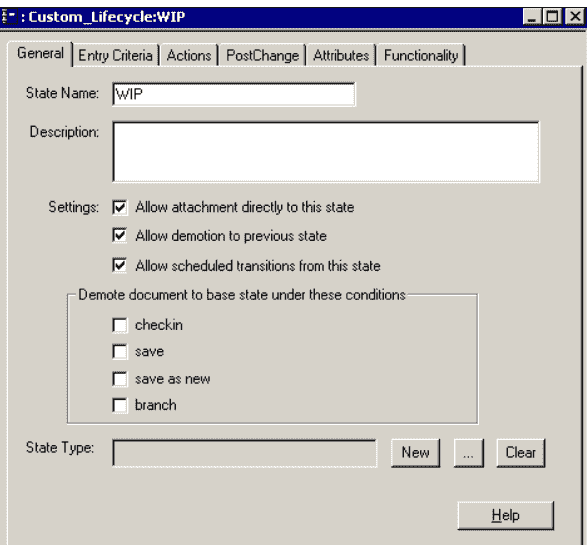

Figure 12.10: 生命周期状态编辑器 General 选项卡

- **在这些条件下将文档降级到基本状态：** 如果满足提及的条件（例如保存、签入等），此选项允许将文档降级到生命周期中的基本状态。

### 5. 在 Entry Criteria 选项卡下（参见图 12.11），您可以指定系统在文档进入生命周期中特定状态之前执行的某些条件或检查。

请注意，在降级期间，Documentum 不会检查生命周期状态的进入条件。

进入条件检查可以通过属性值和表达式测试执行。您可以指定多个条件，Documentum 将从列表顶部到底部对其进行评估。此外，系统确保一旦某个条件失败，就不会评估其他条件，从而节省执行时间。

单击 Add Value Test 按钮，选择属性名称和关系运算符（=、<、>、<>、<= 和 >=）并指定属性需要对其进行评估的值。单击 Add Expression Test...，选择一个属性，然后单击 Validate 后跟 OK，以引入系统在进入此特定生命周期状态时需要检查的表达式。

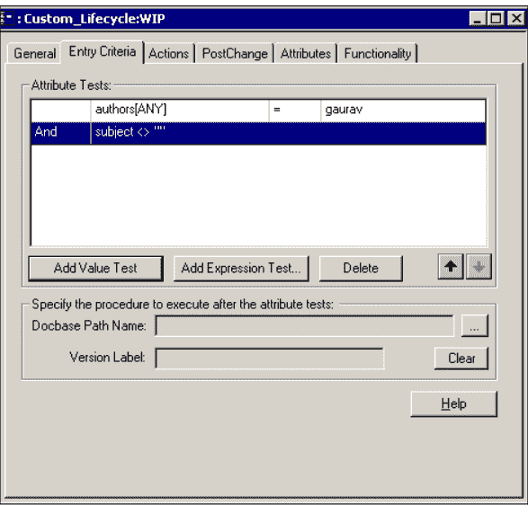

Figure 12.11: 生命周期状态编辑器 Entry Criteria 选项卡

您甚至可以编写自定义 Docbasic 过程，系统在评估属性表达式后可以运行它。自定义过程可以以编程方式评估 Docbase 中的某些条件，这些条件在文档进入生命周期中此特定状态之前必须为真。

您可以通过单击 Docbase Path Name 字段旁边的省略号按钮并浏览到正确 Docbase 位置下的过程，来选择性地指定 Documentum 即用型过程。

### 6. 现在让我们转到生命周期状态编辑器中的 Actions 选项卡。系统评估生命周期状态的进入条件后，在给定生命周期状态下系统需要执行的操作集合在 Actions 选项卡中指定。

Documentum 按以下执行顺序执行操作：

- 首先评估标准操作
- 运行可选的 Docbasic 操作过程

在 Actions 选项卡中单击 Add Action... 按钮会显示 Define Action 屏幕（参见图 12.12），允许用户选择众多操作类型之一并定义系统需要执行的具体操作。通过 GUI 向导定义操作非常简单。

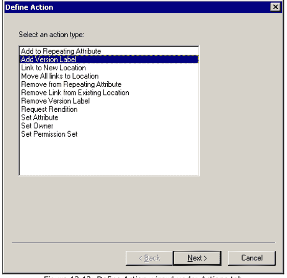

Figure 12.12: Actions 选项卡下的 Define Action 向导

使用 Define Action 向导，您可以指定多个操作，例如在文档处于给定生命周期状态时向文档添加特定版本标签或从文档中删除特定版本标签。

除此之外，您还可以设置文档的所有者或其一个属性的特定值，以及其他多个操作定义。

要在文档处于生命周期的 WIP 状态时向文档添加 WIP 版本标签，请从 Define Action 向导中选择 Add Version Label 选项，并在后续屏幕中输入值 WIP（参见图 12.13）。


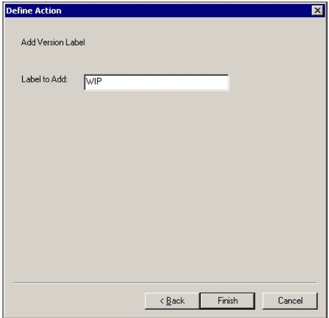

图 12.13：为给定生命周期状态提供版本标签值

同样，你可以指定当文档处于 WIP 生命周期状态时需要从文档中移除的以下版本标签：Approved、Active、Expired。这可以通过从 Define Action 向导中选择 Remove Version Label 选项来实现。

此外，你还可以使用相同的 Define Action 向导，将我们之前创建的自定义权限集（Custom WIP ACL）附加到处于 WIP 生命周期状态的文档上。

正如我们在设置 Entry Criteria 选项卡时所看到的，可以指定一个 Docbasic 过程供系统在执行指定的标准操作后执行。

图 12.14 显示了为 WIP 生命周期状态添加的所有标准操作。

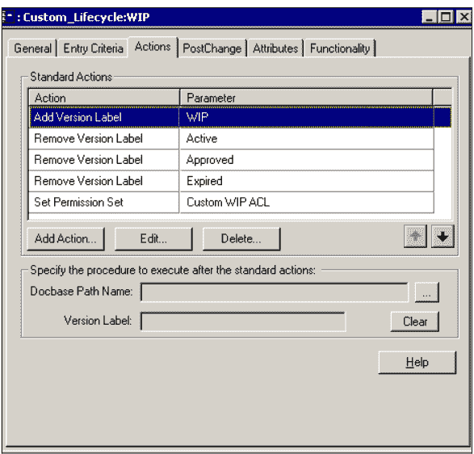

图 12.14：Lifecycle 状态编辑器 Actions 选项卡下列出的指定操作

## Documentum 5.3 更新

Documentum 5.3 版本允许您在生命周期入口条件、操作、PostChange 以及验证中指定 Java 类作为过程。

7. 在 PostChange 选项卡下（参见图 12.15），您可以指定一个 post-change Docbasic 过程，系统可在状态转换完成后执行该过程。

单击 Docbase Path Name 字段旁显示的省略号按钮，并浏览到正确的 Docbase 位置以指定 Docbasic 过程。

请注意，对于 WIP 生命周期状态，我们已指定执行开箱即用的过程 wcmLifecycleScript，该过程负责多个标准生命周期操作和文档的系统检查。

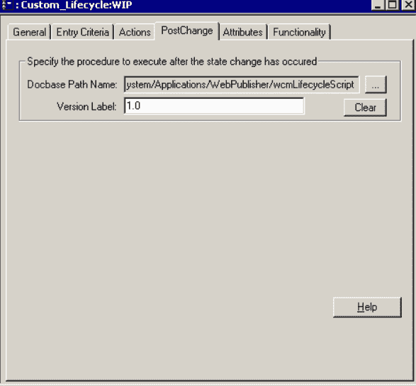

图 12.15：生命周期状态 PostChange 选项卡

8. 指定 PostChange 过程后，您可以转到生命周期状态编辑器中的 Attributes 选项卡（参见图 12.16）。此功能允许您在文档达到特定生命周期状态时修改所选文档属性的某些属性。

选择您希望修改其属性的文档属性。这里我们以选择属性 subject 并单击 Change Properties... 按钮为例。

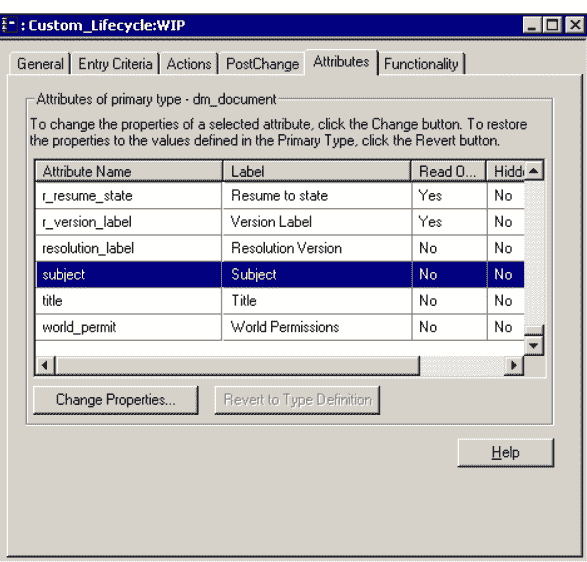

图 12.16：生命周期状态 Attributes 选项卡

属性窗口打开（参见图 12.17），显示所选属性并允许用户以任意组合更改以下内容：

- **Label Text:** 在客户端应用程序（例如 Web Publisher）中显示在属性旁边的文本（描述属性的名称）。
- **Help Text:** 有关该属性的一些帮助文本。
- **Comment:** 属性的简短描述或注释。
- 其他属性，例如设为只读、隐藏等。

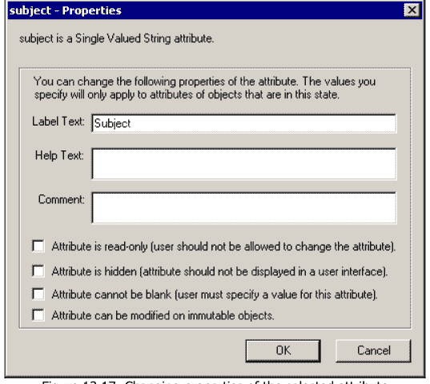

图 12.17：更改所选属性的属性

9. 生命周期中的文档通过某些客户端应用程序（如 Desktop Client、Web Publisher 等）进行操作。客户端程序将文档的功能（例如：签出、链接到位置等）与实现这些功能的实际组件（功能类）相匹配。

如果您还记得我们关于对象类型的讨论，我们看到对象类型定义包含实现其功能的一定功能类。

使用生命周期状态编辑器，您可以修改与对象类型定义关联的功能类、添加新组件及其实现类以及执行其他此类操作。

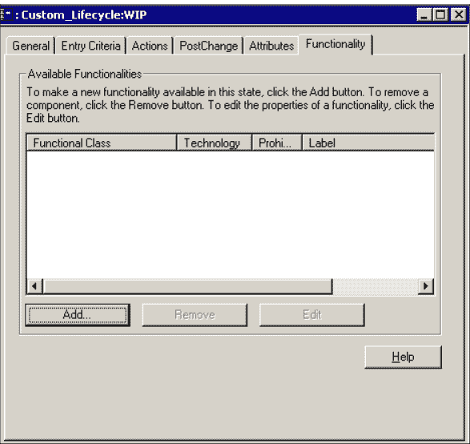

图 12.18：生命周期状态编辑器 Functionality 选项卡

10. 与设置 WIP 状态类似，请根据图 12.19 所示的定义创建 Start、Staging 和 Approved 生命周期状态。这些基于 Documentum 的默认生命周期，并且可以根据您的具体业务需求进行更改。

创建所有生命周期状态后，您可以像权限集和别名集一样将自定义生命周期签入 Docbase。

Documentum 允许您对文档和生命周期进行版本控制。在某一时刻，多个文档版本可以附加到同一生命周期的多个版本。

例如，假设您有一个新闻文章文档 news_story001.xml，由新闻文章对象类型 cust_newsarticle 创建，并与我们的自定义生命周期 Custom_Lifecycle 相关联。

此时该文档与生命周期版本 1.0 相关联。开发人员修改了生命周期并将修改后的生命周期以版本 1.1 的形式签入 Docbase。

然而，这并不意味着文档 news_story001.xml 现在会自动与生命周期版本 1.1 相关联。它仍然链接到生命周期版本 1.0，这在某些情况下可能会造成混淆。

> 除非在您的业务场景中绝对需要，否则不要以次要版本或主要版本的形式将生命周期签入 Docbase。相反，将生命周期以修改前的同一版本签入，以便文档不会丢失关联。

图 12.19 显示了我们自定义生命周期的生命周期状态定义：

| 生命周期状态 | 通用 | 入口条件 | 操作 | 更改后 | 属性 | 功能 |
|---|---|---|---|---|---|---|
| Start | 允许附加：是<br>允许降级：否<br>允许计划转换：是 | N/A | N/A | N/A | N/A | N/A |
| WIP | 允许附加：是<br>允许降级：是<br>允许计划转换：是 | N/A | 添加版本标签：WIP<br>移除版本标签：Active、Approved、Expired<br>设置权限集：Custom WIP ACL | 过程 Docbase 路径名称：/System/Applications/WebPublisher/wcmLifecycleScript | N/A | N/A |
| Staging | 允许附加：是<br>允许降级：是<br>允许计划转换：是 | N/A | 添加版本标签：Staging<br>移除版本标签：Approved<br>设置权限集：Custom Staging ACL | N/A | N/A | N/A |
| Approved | 允许附加：是<br>允许降级：是<br>允许计划转换：是 |  | 添加版本标签：Approved<br>设置权限集：Custom Approved ACL | 过程 Docbase 路径名称：/System/Applications/WebPublisher/wcmLifecycleScript | N/A | N/A |

图 12.19：各种生命周期状态的定义

11. 将生命周期签入 Docbase 后，请按本章前面讨论的方式安装生命周期，以便应用程序可以使用它。

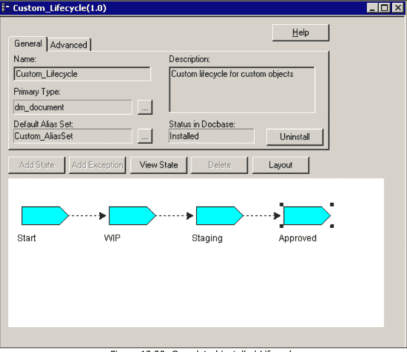

图 12.20：已完成的已安装生命周期

## 12.5 通过生命周期提升和降级内容

附加到生命周期的创建内容可以通过以下一种机制在各种生命周期状态之间推进：

- Web Publisher 的 Promote 和 Demote 菜单选项
- 工作流
- 服务器 API 命令：promote 和 demote
- BATCH_PROMOTE 管理方法

我们将在 Web Publisher 中创建示例内容，并查看如何使用上述机制通过其各种生命周期状态提升和降级它。

使用以下任一方法在 Web Publisher 中创建附加到 Custom_Lifecycle 的新闻文章：

- 使用我们在第 13 章中介绍的新闻文章 Web Publisher 模板
- 通过菜单选项 File | Import 在 Web Publisher Web 文件柜中导入内容文件，并将其附加到自定义对象类型 cust_newsarticle 和生命周期 Custom_Lifecycle（参见图 12.21）

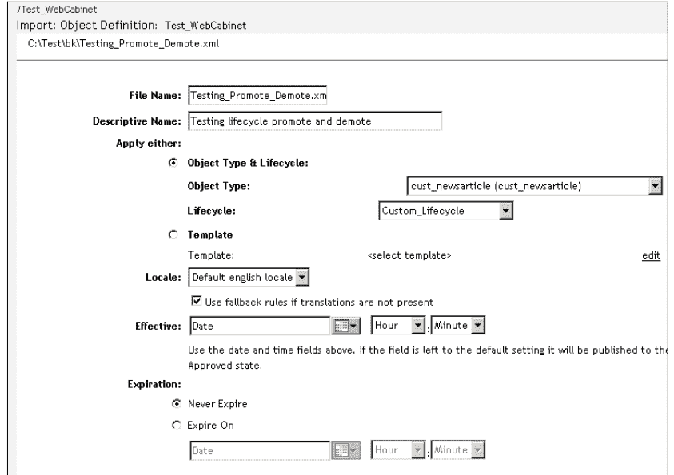

图 12.21：导入内容文件并将其附加到 Custom_Lifecycle

您可以通过图 12.22 中显示的 Status 列验证新创建/导入的内容处于 WIP 生命周期状态。选择内容旁边的复选框并选择菜单选项 Document | Lifecycle | Promote。


## 创建生命周期、别名集和权限集

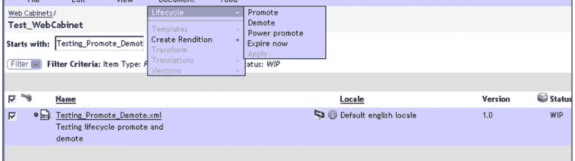

图 12.22：推广内容

系统需要花费一点时间将内容提升到生命周期中的下一个正常状态。您可以点击“任务状态”按钮查看生命周期提升操作的进度。系统提升内容后，内容将显示在其下一个正常生命周期状态（以 Custom_Lifecycle 为例为 Staging），如图 12.23 所示。

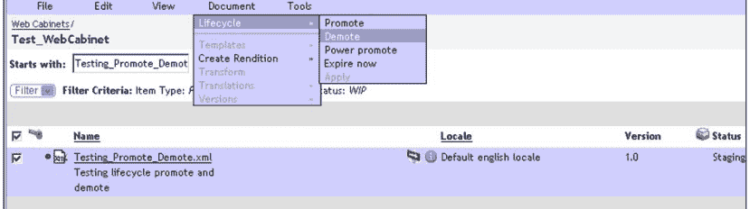

图 12.23：降级内容

为了将内容从其当前正常生命周期状态降级，请选中内容旁边的复选框并选择菜单选项 Document | Lifecycle | Demote（参见图 12.23）。

为了强制提升内容，请选中内容旁边的复选框并选择菜单选项 Document | Lifecycle | Power promote。强制提升会将内容直接推送到其 Approved 生命周期状态（即生命周期中的最后状态）。此时，讨论 Web Publisher Monitor_Lifecycles 作业至关重要（参见图 12.24）。

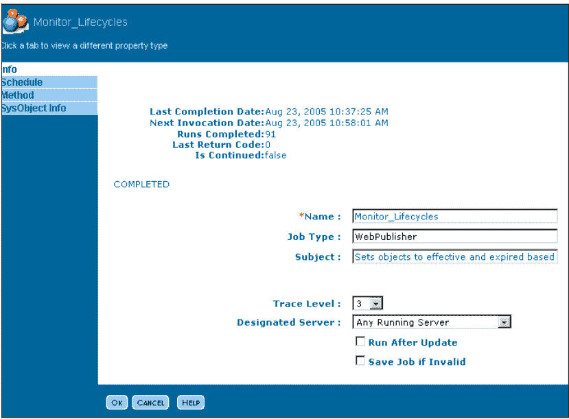

图 12.24：Documentum 中的 Monitor_Lifecycles 作业

Documentum 中的 Monitor_Lifecycles 作业按预定义间隔运行并执行以下功能：

如果 Approved 对象的生效日期（a_effective_date 属性）与当前系统日期匹配，Monitor_Lifecycles 作业会通过将其版本标签更改为 Active 使对象处于活动状态。

如果 Active 对象的到期日期（a_expiration_date 属性）与当前系统日期匹配，Monitor_Lifecycles 作业会通过将其版本标签更改为 Expired 使对象过期。

默认情况下，如果内容的生效日期为空，强制提升会立即使文件处于活动状态并发布内容。但是，通过提供 Web Publisher 系统设置，您可以更改此行为。

以管理员身份登录 Web Publisher，并在 Lifecycles 部分下进入 Administration | Web Publisher Admin | Settings。

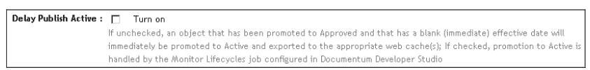

如图 12.25 所示，如果您选中 Delay Publish Active 复选框，则提升到 Active 状态的强制提升将由 Monitor_Lifecycles 作业处理。

以下 API 命令（通过 Documentum Administrator 中的 IAPI 实用程序或 API Tester 执行）也可用于推广和降级内容。请参阅第 26 章以更好地了解服务器 API 命令。

- **推广内容**
  `API>id,c,cust_newsarticle where object_name = Testing_Promote_Demote.xml`
  `090015558000bc5b`
  请注意，API 命令 id 返回与指定限定条件匹配的对象的对象 ID。在我们的例子中，090015558000bc5b 是名称为 Testing_Promote_Demote.xml 的新闻文章内容的对象 ID（r_object_id 属性）。
  `API>promote,c,090015558000bc5b`
  `...`
  `OK`
- **降级内容**
  `API>demote,c,090015558000bc5b`
  `...`
  `OK`
- **批量推广内容**
  管理方法 BATCH_PROMOTE 可通过简单的 API 命令将多个对象提升到其下一个生命周期状态。BATCH_PROMOTE 的有趣之处在于它可用于存在于不同生命周期状态并附加到不同生命周期的多个对象。您可以在一次 BATCH_PROMOTE 执行中提升多达 200 个对象。
  现在让我们使用 BATCH_PROMOTE 提升两个内容文件 Testing_Promote_Demote.xml 和 Testing_Promote_Demote002.xml：
  `API>id,c,cust_newsarticle where object_name = Testing_Promote_Demote002.xml`
  `...`
  `090015558000bc71`
  `API>id,c,cust_newsarticle where object_name = Testing_Promote_Demote.xml`
  `...`
  `090015558000bc5b`
  获取两个内容文件的 r_object_id 后，发出以下简单的 API 命令进行批量提升。
  `API> apply,c,NULL,BATCH_PROMOTE,ARGUMENTS,S,090015558000bc71,090015558000bc5b`

BATCH_PROMOTE 方法反过来调用 dm_bp_batch Documentum 方法，并在执行后返回包含一个结果对象的集合。

### 12.5 过期内容

有时，网站上出现的内容在内容过时或需要进行任何更改时需要从网站上移除。Documentum 提供了一些机制，允许您使内容过期并将其从网站上移除。

首先，您需要了解 Documentum 提供了 SysObject 属性 a_expiration_date，内容作者可以填写该属性以指定内容需要过期的时间。

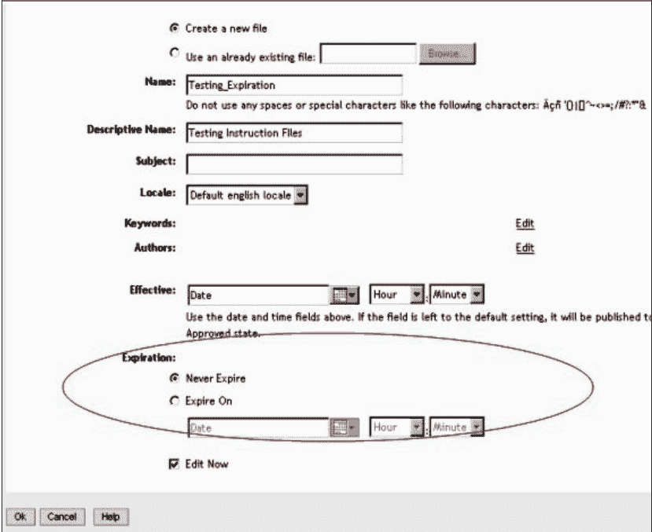

图 12.26：创建内容期间显示的到期日期字段

图 12.26 显示了在 Web Publisher 中创建新内容时，新内容屏幕中的到期日期字段。如果您在创建内容时忘记指定到期日期，您始终可以通过属性（信息）屏幕中的 Publishing 选项卡指定它。

以下是过期 Documentum 中创建内容的某些机制：

- 指定了到期日期的内容的 Monitor_Lifecycles 作业
- Web Publisher Expire now 菜单选项

当活动内容的到期日期与当前系统日期匹配时，Monitor_Lifecycles 作业会使内容过期，并在发布后将其从网站上移除。

使用 Web Publisher Expire now 菜单选项（Document | Lifecycle | Expire now），您可以在其指定的到期日期之前使内容过期，如图 12.27 所示。

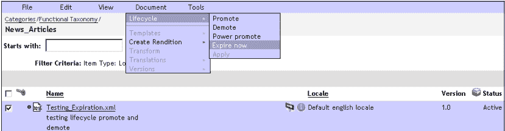

图 12.27：在 Web Publisher 中手动过期内容项

请注意，如图 12.28 所示，内容的版本标签更改为 Expired（参见状态列）。过期的内容仍保留在 Docbase 中，尽管它已从活动网站中移除。

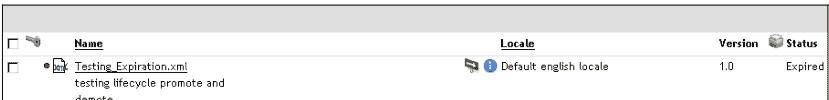

图 12.28：在 Web Publisher 中看到的过期内容

> 为了对处于 Active 状态的内容进行更改，请先使用 Expire now 功能使内容过期，然后再根据需要进行编辑。值得注意的是，以下状态的内容无法降级：WIP、Approved、Active 和 Expired。

这完成了我们对生命周期及其在 Documentum 中用法的讨论。您可以使用生命周期与工作流结合使用。虽然生命周期只是表示文档生命中的阶段，例如草稿、审阅和已批准，但工作流实际上将文档路由通过这些生命周期阶段，并定义谁在何时以及在什么条件下处理文档。从本质上讲，生命周期和工作流互为补充。我们将在第 19 章讨论工作流。现在，您已准备好开始创建 Web Publisher 模板并将其与自定义对象类型关联。从这些创建的内容对象可以与本章中创建的自定义生命周期关联。

### 12.6 摘要

在本章中，我们详细讨论了 Documentum 别名集、权限集（ACL）和生命周期。我们提到了为生命周期创建别名集、为生命周期的各种状态创建权限集以及自定义生命周期对象的详细步骤。

我们还看到了 Documentum 如何在生命周期范围、工作流范围、会话范围、用户范围和系统范围内解析别名的别名值。

本章中创建的自定义生命周期包含四个状态：Start、WIP、Staging 和 Approved，并将 dm_document 作为链接到的主要对象类型。我们将 News Article 对象类型添加为生命周期中的可接受子类型，允许从 News Article 对象类型创建的对象附加到此自定义生命周期。

最后，我们看到了在生命周期的不同状态下提升、强制提升和降级对象的各种机制，以及从网站过期内容的某些方法。


## 13 使用 Web Publisher 模板文件工作

## 使用 Web Publisher 模板文件工作

一旦您创建了自定义对象类型并将其作为可接受的对象类型包含在自定义生命周期中，您就可以继续为该对象类型创建 **Template**。回顾我们之前关于模板和对象类型的讨论：对象类型是对对象的定义，其中包含诸如对象创建者、最后修改时间、标题、主题、描述以及一些自定义属性等信息。

每当从特定对象类型创建对象时，它都会继承所有属性，并允许用户为每个属性分配特定值。对象类型仅充当从其创建的所有实时对象的模板。然而，这仅涵盖对象的元数据或属性。那么此类对象的实际内容数据（网页）怎么办，例如关联的图像、段落/文本摘要、关联的超链接以及其他可归类为实际内容而非元数据、在网站上显示的信息？这就是 Web Publisher Templates（或宽松地说 **UI forms**）发挥作用的地方。

使用 Web Publisher Templates，您可以设计并创建带有占位符字段的表单，供业务用户为创建的对象填写实际数据。同一 Template 可被多个业务用户在创建内容时使用，以便根据具体的业务场景在模板字段中填写适当的值。

简而言之，如果我们以我们的虚拟新闻网站示例为例，我们谈论的是两种类型的信息：

- **Content**：在网站上显示的 HTML 内容/网页（新闻文章），显示实际的新闻信息，如头版图片、主要新闻内容等。
- **Properties**：新闻文章的元信息/属性，例如谁创建了新闻文章、何时创建、这是否是新闻稿新闻文章以及其他相关属性信息。

如果您仍然感到困惑，请不要担心，但请继续。 我们将在本章中举出详细的示例来了解 Templates 是什么以及它们如何在 Documentum 架构中发挥作用。 目前，只需理解 Documentum 开发人员只需为网站上不同种类的网页创建带有占位符字段的不同 Templates。 业务用户使用适当的模板来创建网站上众多类别的网页，而无需了解任何网页语言或脚本方法，例如 HTML 和 JavaScript。 Documentum 模板通过演示文件（样式表）将输入的数据转换为具有所需外观的 HTML 网页。

您可能希望参考第 10 章，快速回顾 Templates 是什么以及它们如何在 Documentum 中与其他 Web Publisher 文件耦合。

为了方便起见，让我们再次讨论 Web Publisher **template-rules-presentation** 架构（参见图 13.1），以便修复任何遗漏的螺栓和松散的末端。

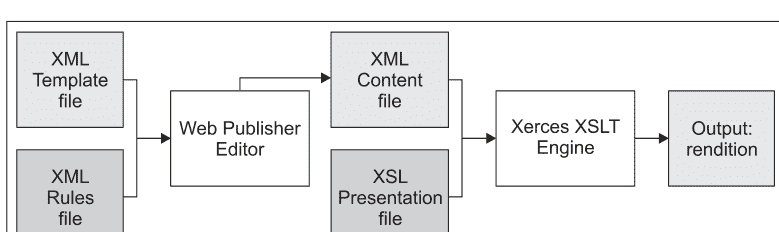

图 13.1：Web Publisher 模板-规则-演示架构

Web Publisher Template 文件可以在 Documentum 中作为 XML 文件创建，其元素对应于模板中的各个字段。

**Rules file** 在 Documentum 中作为 XML 文件创建，并为模板字段元素添加了语义。 字段类型（复选框、文本框等）、字段长度和字段验证（必填、只读等）均在 Rules file 中定义。

Web Publisher 内部解释 Template 和 Rules XML 文件，以在 Web Publisher 中创建并显示模板字段，形成用户可用于创建网页的表单。 在 Web Publisher 编辑器模板字段中填写的实际值会创建一个内容文件，该文件不过是将数据分配给模板 XML 元素。

**Presentation files**（XSL 样式表）使用 Documentum 的 Xerces XSL 转换引擎对内容 XML 文件进行样式设置，以创建所需格式/呈现形式的网页（例如 HTML、WML 等）

如果要谈论业务用户（内容创建者）和 IT 开发团队之间的职责划分，则可以总结如下：

IT 开发团队创建对象类型、生命周期、Templates、Rules 文件、演示文件以及其他 Documentum 配置项/相关对象，而业务用户只需使用这些对象和模板来填写并为其网站创建内容，而无需了解任何编程语言/脚本/配置设置！

Web Publisher Template 在 Documentum 中使用以下支持文件：

- **Rules files：** 用于在 Web Publisher 编辑器中定义模板字段以供编辑。
- **Presentation files：** 用于从内容文件设置样式并生成网页格式/呈现形式。
- **Previews：** 这些是模板的图形表示（缩略图），让内容作者可以轻松识别模板。

在此阶段讨论对象类型与模板之间的关系是值得的。 图 13.2 应能让您了解这两个对象之间的关系以及它们在内容创建过程中如何协同工作。

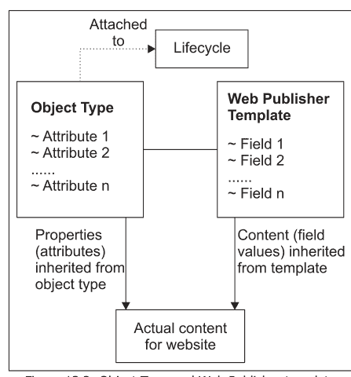

图 13.2：对象类型和 Web Publisher 模板

正如我们之前讨论的那样，对象类型与生命周期相关联（在我们的示例中，cust_newsarticle 对象类型与 custom_Lifecycle 生命周期相关联）。 Template 反过来在 Documentum 中链接到特定对象类型。 每当从对象类型创建内容时：

- 新创建的内容继承对象类型定义中定义的属性（或元数据），并使用内容作者指定的实际值。
- 实际的网页内容继承自业务用户在填写模板字段时指定的值。

讨论了这一点后，让我们现在开始我们的之旅，通过为我们的虚拟新闻网站示例创建 Template。 我们将看到在 Documentum 中创建 Templates 和支持文件是多么简单。

### 13.1 创建模板文件

在创建 Template 之前，第一步是在 Web Publisher 中创建一个类别（或分类法），模板将与之关联。

明智的做法是先整理网站上所有类型的网页，然后再提出众多内容类别。 根据每个类别，可以创建 Templates，以便内容作者确切知道要查看哪个类别以找到相关 Templates 来创建网页内容。

- 1. 以管理员或 Web 开发人员用户身份登录 Web Publisher。 请注意，Web Publisher Templates 位于 Docbase 内的 Site Manager | Templates 文件夹中。 在 Web Publisher 中转到 Site Manager | Templates 并单击 File | New | Category。 新类别屏幕如图 13.3 所示。

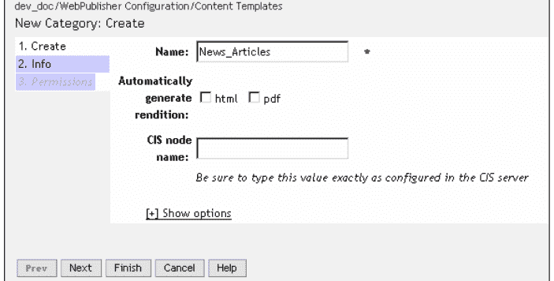

图 13.3：为模板创建类别

为类别提供信息丰富且自解释的名称，然后单击 Finish。 如有需要，还可以通过转到 Permissions 选项卡来设置类别的安全设置。 在 Permissions 选项卡中，您可以为类别分配一个 Permission Set（ACL），允许仅特定组访问该类别，并禁止/限制其他人访问同一类别。

- 2. 下一步也是无可争议的最重要的一步是创建 Template XML 文件，以便将其与上一步中创建的类别关联。 Template 文件可以在市场上提供的众多和多样的 XML 编辑器和网页创作应用程序中的任何一种中创建，例如 XML Spy®、Dreamweaver，甚至是 WordPad 或 Notepad 等文本编辑器。

即使 Web Publisher 允许您创建基于 HTML 的 Templates 以及 XML Templates，使用 XML Template 文件也是更明智的选择。 使用 XML Templates 可以更灵活地使用 XSL 样式表设置样式和解析内容 XML 文件，而使用 HTML Template 文件则不具备这种灵活性。

为 Template XML 文件提供一些合理的名称（例如 cust_news_art_temp1.xml），以表明它是新闻文章的自定义 Template 文件。

每当使用此 Template 文件创建新内容时，内容创建者可以为内容文件提供一些有效名称，例如 news_article_oct31_2005.xml。

可能存在内容文件的名称对业务团队无关紧要的情况，或者他们可能希望为从 Template 文件创建的内容文件提供某种系统生成的自动命名方案，以避免手动提供名称的麻烦。

在这种情况下，您可以使用以下命名约定创建 Template 文件，例如 cust_news_art_temp1###.xml。

每当使用此 Template 创建内容时，在运行时 Documentum 会用按顺序生成的数字值替换哈希符号（#），并将内容文件命名如下：

```
cust_news_art_temp1_001.xml
```

```
cust_news_art_temp1_002.xml ... and so on.
```

此功能在 Web Publisher Templates 中称为自动命名。

为我们的新闻文章示例创建的示例 Template XML 文件如下所示：

```
<?xml version="1.0" encoding="UTF-8"?>
<NEWSART>
<BANNERIMG></BANNERIMG>
<IMGALTTEXT></IMGALTTEXT>
<DATE></DATE>
<BODYTEXT></BODYTEXT>
<REPEATBLOCK>
<NEXTLINKNAME></NEXTLINKNAME>
<NEXTLINKURL></NEXTLINKURL>
</REPEATBLOCK>
</NEWSART>
```

让我们讨论一下典型的 XML 模板文件的解剖结构：

```
<?xml version="1.0" encoding="UTF-8"?>
```

这是带有字符编码的标准 XML 声明标签。 将编码指定为 UTF-8 可以支持扩展字符，例如 ®、© 而不仅仅是 ASCII 字符。

<NEWSART> 是 XML 文件的根标签。 其他 XML 元素表示模板编辑器中的各个字段。 例如，<DATE> 表示在模板编辑器中输入日期的字段，而 <BANNERIMG> 表示在模板编辑器中提供横幅图像的字段。


在 Web Publisher XML 文件（模板文件、规则文件、演示文件）中使用特殊字符时，请使用字符引用而不是 HTML 实体引用。

例如，使用 &#163; 表示英镑符号 (£)，而不是使用 &pound;

这是由于 Documentum 内部用于解析 XML 文件的 Xerces XML 解析器的限制所致。

- 3. 将上一步创建的模板文件复制到机器本地驱动器上的某个位置。进入上一步 1 中新建的分类，并选择菜单选项 File | Import。点击 Add Files（参见图 13.4），并浏览机器的本地驱动器直到找到要导入的模板文件。然后点击 Next 按钮。

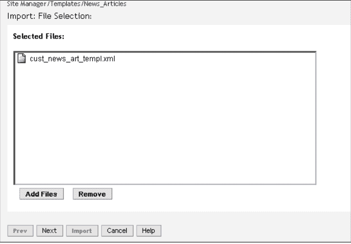

Figure 13.4: 在 Docbase 中导入模板文件

- 4. 图 13.5 显示了 Import: Object Definition 屏幕。为相关模板文件提供一个具有信息性的描述性名称，并选择需要关联的对象类型。选择我们之前为新闻文章示例创建的 cust_newsarticle 对象类型。

选择对象类型后，Lifecycle 下拉菜单会填充 Docbase 中所有已安装的生命周期，其中包含所选对象类型作为其可接受的主类型/子类型。

从 Lifecycle 下拉菜单中选择 Custom_Lifecycle 并点击 Import 按钮。

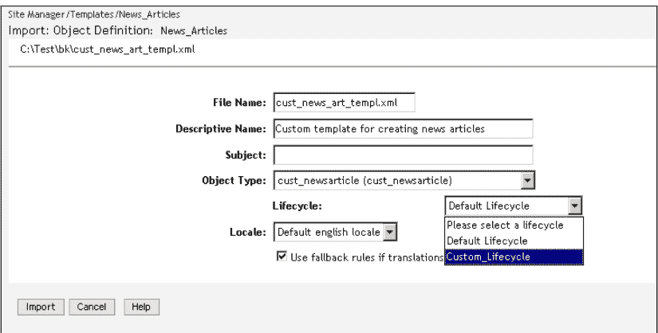

Figure 13.5: 将模板文件与对象类型关联

- 5. 导入的模板文件在关联的分类中显示为 Unavailable 状态，如图 13.6 所示。这表示即使它已导入到 Docbase 中，内容创建者仍无法使用它。

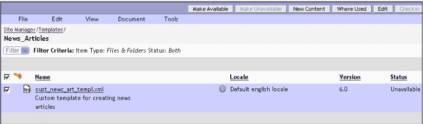

Figure 13.6: 模板文件处于不可用状态

使用 IDQL 实用程序或通过 Documentum Administrator 中的 DQL 编辑器运行以下 DQL 查询：

```
DQL> select object_name, a_is_template, r_version_label, r_object_type
from cust_newsarticle where a_is_template = '1'
```

> 请注意，所有从 cust_newsarticle 对象类型创建的内容对象，其 a_is_template 系统属性都将被设置为 0，而只有模板文件才会将此值设置为 1。

### 上述 DQL 查询的结果：

r_version_label 属性的值将为 CURRENT, 1.0。

现在通过选择它并点击工具栏中显示的 Make Available 按钮（参见图 13.6）使模板文件对内容作者可用。

再次运行上述 DQL 查询，注意此时模板文件的 r_version_label 属性的值将为 Approved, WIP, CURRENT, 1.0。

- 6. 模板文件现在可以供内容作者使用，但仍需要将其与支持文件（如规则文件和演示文件）关联。

选择模板文件并选择 View | Associations 查看关联的支持文件，如图 13.7 所示。

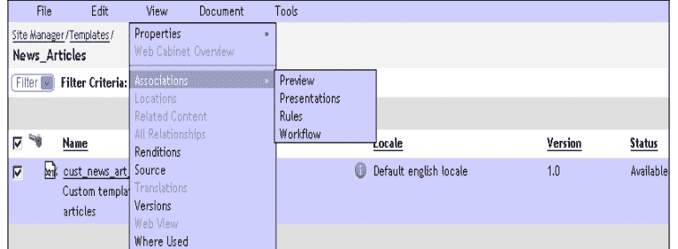

Figure 13.7: 模板文件与支持文件的关联

恭喜！您已成功在 Documentum 中创建了一个模板文件，内容作者可使用它为其网站输入内容。在我们进一步进行并开始将模板文件与其支持文件关联之前，至关重要的是首先为上述模板文件创建支持文件。请移至下一章，了解如何为本章创建的模板文件创建规则文件。

## 13.2 摘要

我们讨论了 Documentum 对象的两种信息类型；显示在网站上的实际内容以及内容对象的元数据或属性。

在 Web Publisher 中，内容作者使用模板文件创建内容。内部，Documentum 根据用于内容创建的模板 XML 文件的结构创建内容 XML 文件。

在 Web Publisher 中创建的模板附加到 Docbase 对象类型。每当使用模板创建内容时，关联的对象都会作为链接对象类型的运行时实例创建。

如第 10 章所述，我们再次简要讨论了 Web Publisher 规则文件和演示文件。最后，我们查看了为我们的新闻文章示例创建示例模板的详细步骤。
