## 14 创建规则文件

在上一章为我们的新闻文章示例创建了模板文件后，我们已准备好继续为该模板设计规则文件。请记住，规则文件是一个简单的 XML 文件，用于定义模板文件中的各个字段。规则文件位于 Documentum Web Publisher 的 Docbase 中的 Site Manager | Rules 文件夹内。请按照以下部分中提到的步骤为您的模板文件创建规则文件。请注意，Documentum 允许您将特定规则文件与多个模板文件关联。

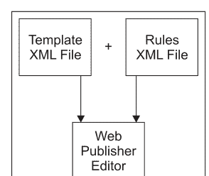

Figure 14.1: 规则文件与模板文件的关联

### 14.1 创建规则文件

本节将讨论创建规则文件的详细步骤。

- 1. 以管理员或 Web 开发人员用户身份登录 Web Publisher 并进入 Site Manager | Rules 文件夹。在 Rules 文件夹内创建一个新文件夹以标识和分离自定义应用程序的特定规则文件是一个不错的做法。

选择菜单选项 File | New | Folder。新文件夹创建屏幕如图所示 14.2 所示。

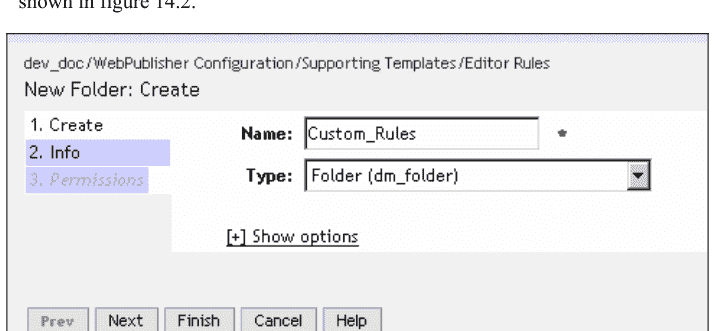

Figure 14.2: 用于存储规则文件的新文件夹

为您的自定义规则文件夹提供一个有效名称（例如 Custom_Rules）并点击 Finish 按钮。出于安全原因，您还可以将一些 ACL（权限集）附加到自定义规则文件夹，以允许或禁止某些组和用户访问它。这可以通过点击图 14.2 所示的 Permissions 选项卡来完成。

- 2. 规则文件可以使用任何可用的 XML/文本编辑器创建，但这需要您理解并学习 Documentum 的规则文件语法并遵循 Documentum 手册中提供的说明。相反，Documentum 在 Web Publisher 中开发了一个简单的规则文件编辑器应用程序，可帮助您根据通过简单的规则文件创建 GUI 屏幕选择的/指定的参数自动创建规则文件。

在开始使用规则文件编辑器应用程序之前，需要执行一个简单的配置步骤。点击 Web Publisher 中的 Preferences 按钮并进入图 14.3 所示的 Web Developers 选项卡。

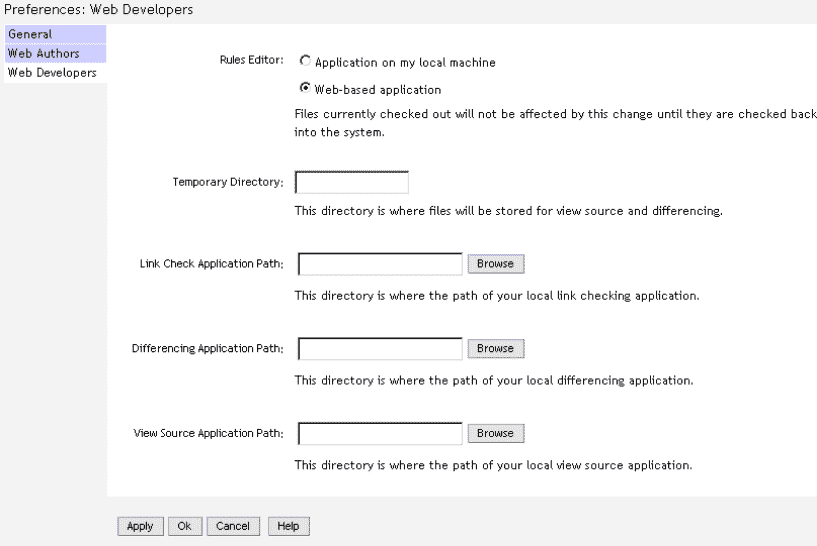

Figure 14.3: 设置 Documentum 规则编辑器应用程序的首选项

在 Rules Editor 部分，选择 Web-based application 的单选按钮。点击 Apply 然后点击 OK。这可确保在创建新规则文件或编辑现有规则文件时，Documentum 内部的规则文件编辑器会自动调用。

- 3. 设置规则编辑器首选项后，进入自定义规则文件夹 custom_Rules 并选择菜单选项 File | New | Rule。新规则创建屏幕如图所示 14.4 所示。为规则文件提供一个有效名称（例如 cust_news_art_rule.xml）并点击 OK。

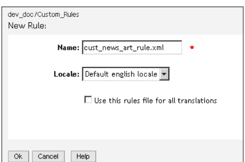

Figure 14.4: 为自定义规则文件提供名称

- 4. 系统要求您浏览 Docbase 中的现有分类并选择需要为其创建规则文件的模板，如图 14.5 所示。

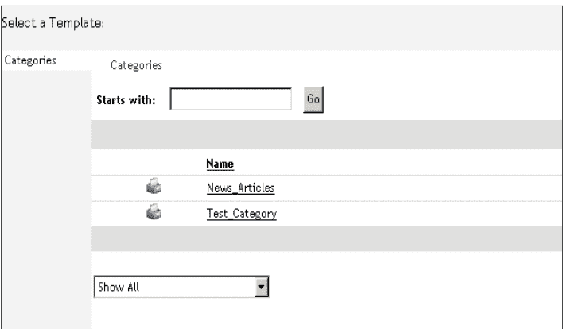

Figure 14.5: Docbase 中的现有分类

参考图 14.6；选择包含我们在上一章创建的模板的分类（News_Articles）并选中模板文件（就我们而言为 cust_news_art_templ.xml）旁边的复选框。最后，点击 OK。

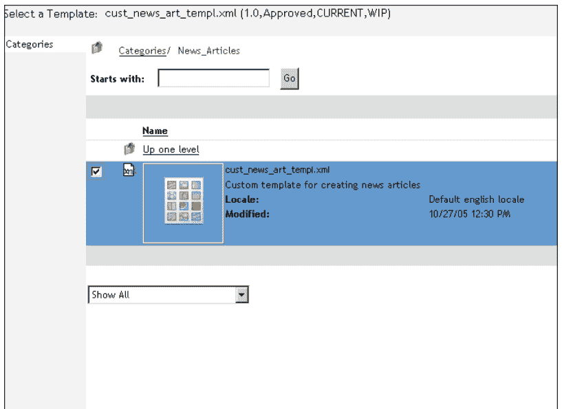

Figure 14.6: 选择需要为其创建规则文件的模板文件

Documentum 调用如图 14.7 所示的规则文件编辑器。我们现在可以为模板文件中的各个字段添加规则。

模板文件中的所有 XML 元素都显示在规则编辑器的 Tree View 选项卡下。您只需单独选择这些 XML 元素并为其添加规则即可。

请注意，在 Tree View 选项卡内，模板 XML 元素处于只读模式，阻止您修改模板文件结构。但是，通过切换到 Text View 选项卡，您可以灵活地更改关联模板文件中 XML 元素的结构。


## 创建规则文件

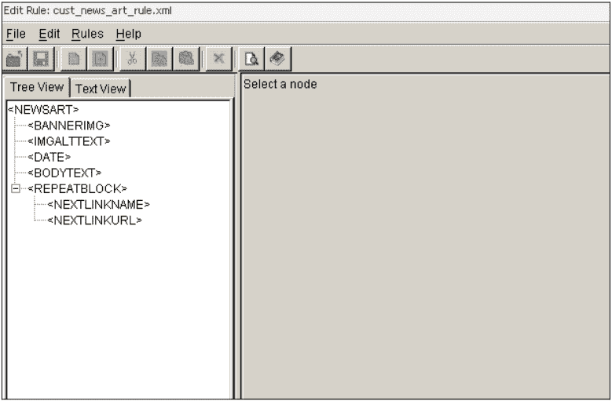

图 14.7：规则文件编辑器

建议在创建过程中通过选择 File | Save 保存规则文件。在任何时候都可以关闭规则编辑器并退出，选择选项 File | Close。

5. 参考图 14.8；在 Tree View 选项卡下从模板文件选择一个 XML 元素（例如 <BANNERIMG>）并选择菜单选项 Rules | Add Rule。

在 Web Publisher 编辑器中可以为模板 XML 元素创建以下类型的部件：

- **文本行**：这是一个单行文本字段部件，允许内容作者在没有任何格式的情况下输入文本
- **内容**：这是一个多行文本字段部件，允许内容作者输入文本并通过可用的菜单选项对其进行格式化，例如：加粗、斜体、更改字体等。
- **选择**：这是一个下拉选择列表，允许内容作者从现有值中选择特定值。列表中的值可以从硬编码的固定列表中填充，也可以通过 Docbase 中的 DQL 查询动态填充。
- **文本选择器**：这是一个部件，允许内容作者从 Docbase 中选定的现有文件中选择一些文本。
- **图形**：这是一个选择列表部件，允许内容作者从 Docbase 中现有的图像中选择图像。
- **复选框：** 这是一个复选框部件，允许内容作者选择或取消选择它。
- **X 选择器：** 这是一个文件选择部件，允许内容作者从 Docbase 中现有文件列表中选择文件。
- **重复块：** 这是一个用作其他元素容器的部件。将一组元素/字段指定为可重复允许您在编辑器中多次呈现这些元素。这允许内容作者复制特定字段或为同一字段的多个实例指定多个值。

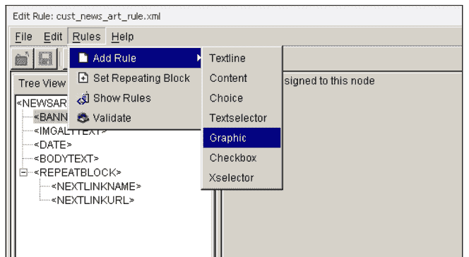

图 14.8：添加 Graphic 规则

如图所示 14.8，选择 Graphic 选项为 <BANNERIMG> 模板元素添加规则。

6. 填写图 14.9 所示的图形部件的字段。为字段提供一些标签，例如 Banner Image。为内容作者的方便提供一些说明性标签，例如 Please choose a banner image。通过选择 Required 旁边的复选框使字段成为必填项。

7. 定义用于显示 Docbase 中现有图像的选择列表，内容作者可以从中进行选择。将显示选项选择为 List control。
输入 DQL 查询以填充选择列表：

```
dm_document where folder(/Test_WebCabinet/Custom_Images)
```

请注意，您无需提供关键字 select * from。

这里的假设是，在 Test_WebCabinet Web 柜内的 Docbase 中预先存在一个包含图像文件的 Custom_Images 文件夹。如果不存在，请创建它并在其中放置一些图像。

要在 select 查询中使用的属性名称需要提供，例如 object_name。这最终转换为以下 DQL：

```
select object_name from dm_document where
folder(/Test_WebCabinet/Custom_Images)
```

单击 Test Query 按钮以检查输入的 DQL 语法是否正确，并找出在运行时将在部件中显示的查询结果。

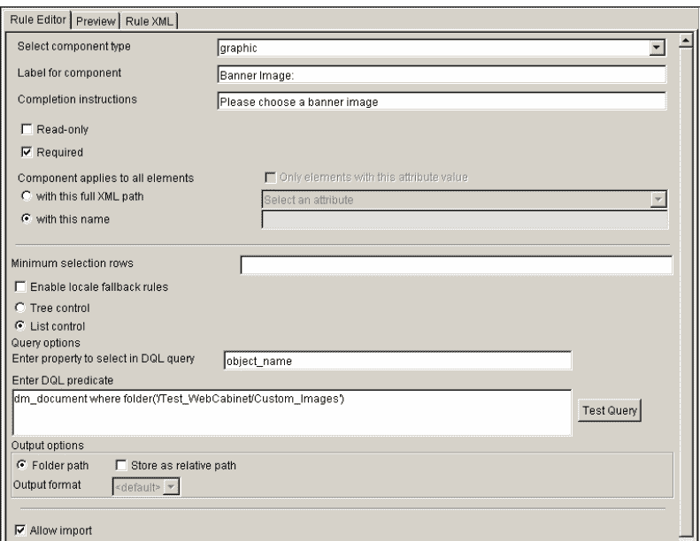

图 14.9：为图形元素定义规则

8. 您可以通过选择 Allow import 复选框，可选地提供内容作者通过图形部件在 Docbase 中指定文件夹内导入图像的选项。
9. 单击图 14.10 中显示的 Browse Docbase 按钮并选择图像文件将被导入并保存到的文件夹。
10. 通过单击 Type 字段旁边的 Select 按钮，选择导入的图像将与其关联的对象类型。

11. 通过单击 Lifecycle 字段旁边的 Select 按钮，选择导入的图像将附加到的生命周期。

12. 通过单击 Category 字段旁边的 Select 按钮，选择导入的图像将与其关联的类别。

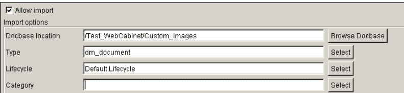

图 14.10：在图形元素中允许图像导入选项

13. 保存规则文件并单击 Preview 选项卡（参考图 14.11），以查看当内容作者使用 News Article 模板创建内容时横幅图像字段的外观。

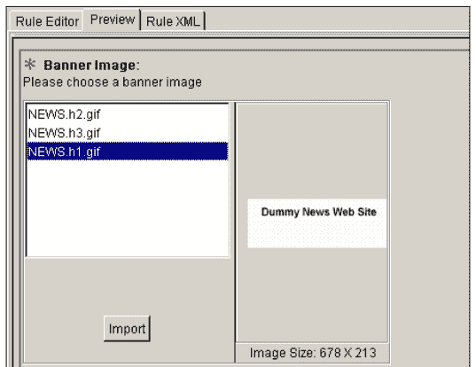

图 14.11：横幅图像图形部件的预览

请注意，Import 按钮也已添加，允许您从本地计算机导入图像文件到 Docbase 内的指定文件夹位置。

14. 为了查看图形元素的自动系统生成的规则文件代码，请单击 Rule XML 选项卡（参考图 14.12）：

```
<tagcontent tag_name="BANNERIMG">
<graphic enable_locale_fallback="N"
    import="Y"
    instruction="Please choose a banner image"
    label="Banner Image:"
    lifecycle="Default Lifecycle"
    location="/Test_WebCabinet/Custom_Images"
    output_property="folderPath"
    property="object_name"
    query="dm_document where folder(&#39;/Test_WebCabinet/Custom_Images&#39;)"
    query_type="query"
    required="Y"
    type="dm_document">
</graphic>
</tagcontent>
```

图 14.12：系统生成的规则文件代码

同样，您可以通过选择图 14.13 中显示的规则编辑器部件类型为剩余的模板字段创建其他部件。

| 模板 XML 元素 | 规则文件部件 |
|---|---|
| BANNERIMG | Graphic |
| IMGALTTEXT | Textline |
| DATE | Textline |
| BODYTEXT | Content |
| REPEATBLOCK | Repeating Block |
| NEXTLINKNAME | Textline |
| NEXTLINKURL | Textline |

图 14.13：规则文件部件

15. 在突出显示相应的模板 XML 元素并为其添加规则后，您可以保存规则文件并通过选择菜单选项 File | Close 退出编辑器。

检入新创建的规则文件（cust_news_art_rule.xml）并通过单击 Make Available 按钮使模板文件（cust_news_art_temp1.xml）可用，如上一章所述。

为方便起见，下面显示了一些在为剩余模板 XML 元素创建规则时拍摄的屏幕截图。您可以在创建规则文件时将其作为指南：

### 14.1.1 IMGALTTEXT 元素

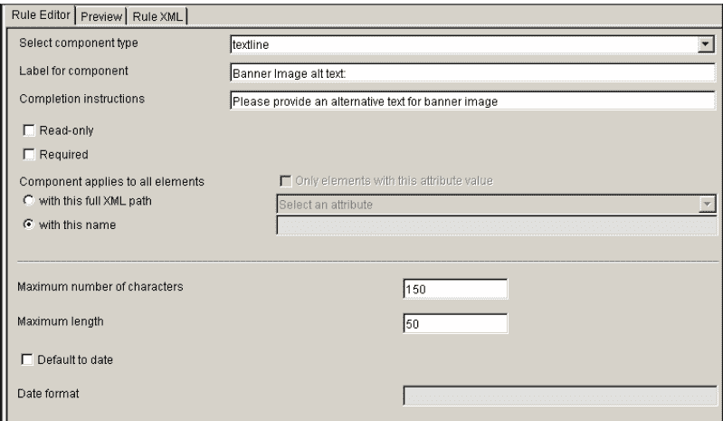

图 14.14：IMGALTTEXT 元素的 Textline 部件

### 14.1.2 DATE 元素

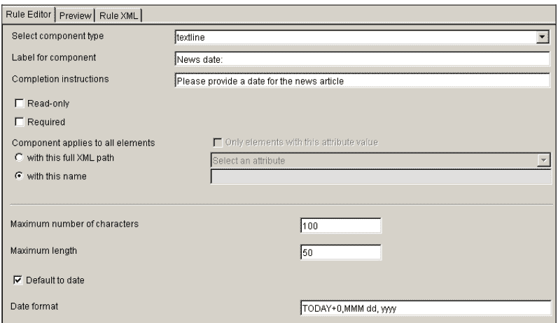

图 14.15：DATE 元素的 Textline 部件

请注意，图 14.15 中的默认日期格式已设置为：TODAY+0,MMM dd, yyyy。

每当使用 News Article 模板创建内容时，News date: 字段将以指定格式预先填充当天的日期。

### 14.1.3 BODYTEXT 元素

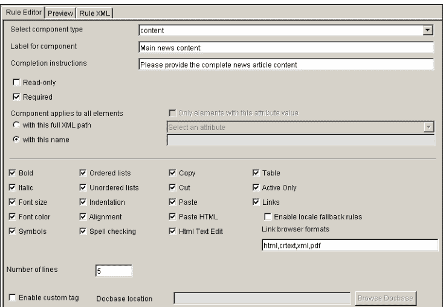

图 14.16：BODYTEXT 元素的 Content 部件

在图 14.16 中，可以为多行文本字段选择众多格式选项。此外，您可以选择 Links 选项旁边的复选框，以允许内容作者创建指向 Docbase 中现有文件的超链接。Link browser formats 允许您指定希望为内容作者选择显示的各种文件格式。默认情况下，仅启用 html 和 crtext 格式，允许显示具有 .htm、.html 和 .txt 扩展名的文件。

### 14.1.4 REPEATBLOCK 元素

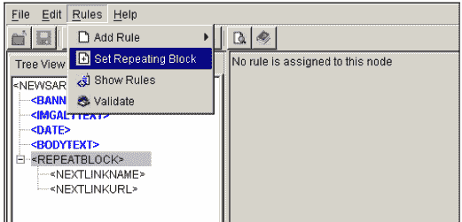

图 14.17：为 REPEATBLOCK 元素设置重复块

<REPEATBLOCK> 模板元素包含 <NEXTLINKNAME> 和 <NEXTLINKURL> 元素，表示内容作者可以在此块内提供多个文章链接名称及其 URL。为了使 <REPEATBLOCK> 成为重复块部件，请突出显示它并选择菜单选项 Rules | Set Repeating Block，如图 14.17 所示。

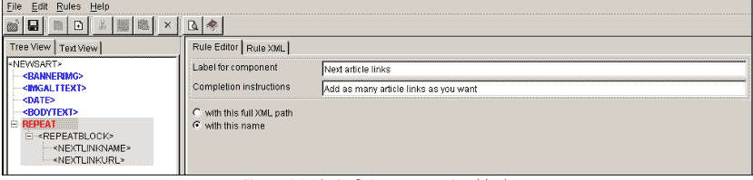

图 14.18：定义重复块

为方便内容作者，在重复块中提供标签和说明性文本，如图 14.18 所示。

### 14.1.5 NEXTLINKNAME 元素

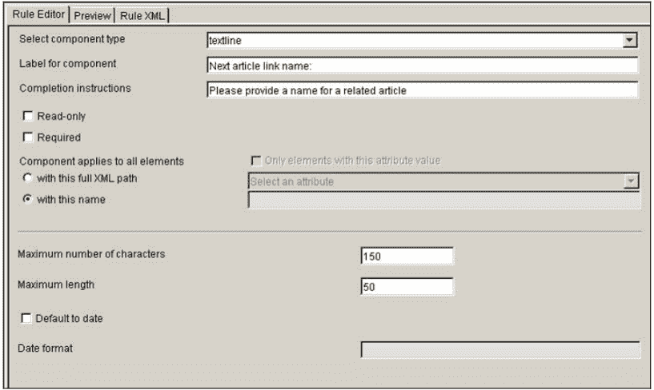

图 14.19：NEXTLINKNAME 元素的 Textline 部件


### 14.1.6 NEXTLINKURL 元素

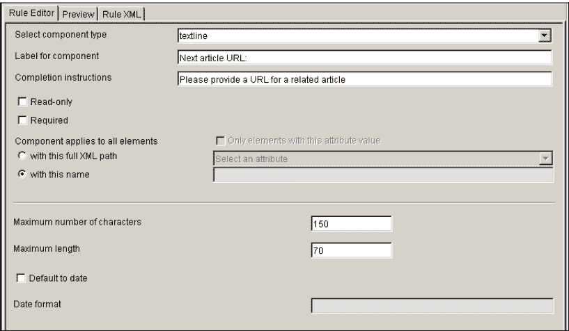

Figure 14.20: NEXTLINKURL 元素的文本行小部件

## 14.2 Web Publisher 编辑器中的最终模板

假设您已按照屏幕截图中显示的规范创建了 Rules 文件并将其签入 Docbase，让我们通过浏览 News_Articles 类别并选择菜单选项 File | New | Content 来创建新的新闻文章内容。

填入新内容的属性信息后，Web Publisher 编辑器打开，显示根据我们创建的 Rules 文件中定义的 Rules 显示的新闻文章模板。图 14.21 和 14.22 显示了在 Web Publisher 编辑器中看到的新闻文章模板。

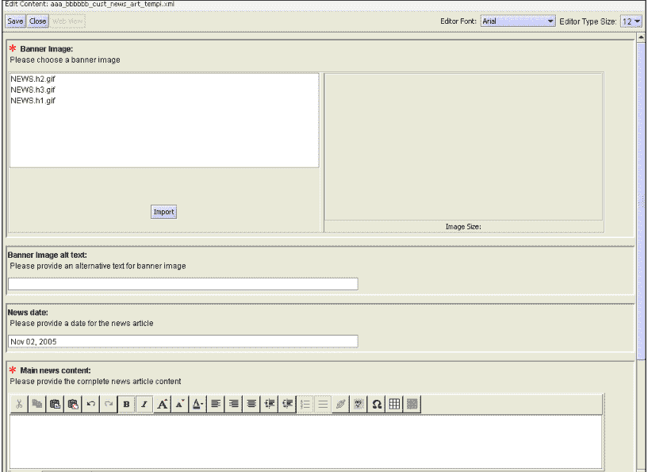

Figure 14.21: 新闻文章模板

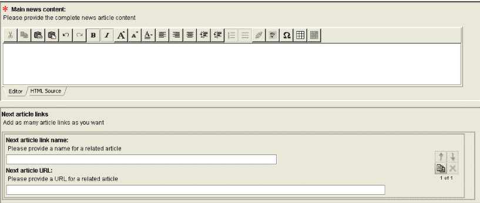

Figure 14.22: 新闻文章模板——续

请参阅图 14.22；注意在“下一篇文章链接”重复块中添加的重复块小部件。您可以使用重复块小部件复制新闻文章链接名称/URL 字段、重新排列多个字段，甚至删除新添加的字段。

## 14.3 杂项 Rules 文件小部件

我们已经看到了一些 Web Publisher Rules 文件小部件，如文本行、内容、图形和重复块。以下是 Web Publisher 编辑器中显示的其他一些小部件。视觉吸引力会留下持久的影响，并有助于您更好地设计模板。

### 14.3.1 选择小部件

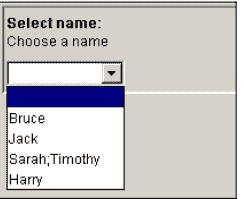

请注意，选择小部件中的分隔符是逗号（,）。这意味着字符串（Sarah, Timothy）在下拉列表中会显示为两个值，Sarah 和 Timothy。解决此类情况的唯一方法是用分号或其他分隔符代替逗号将它们分开。示例：Sarah;Timothy。

### 14.3.2 复选框小部件

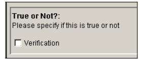

### 14.3.3 文本选择器小部件

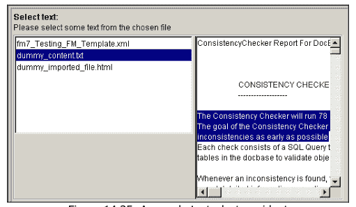

### 14.3.4 X 选择器小部件

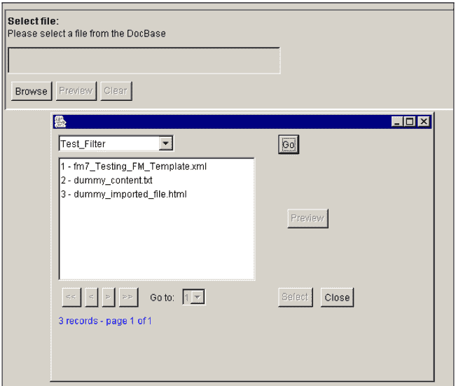

Figure 14.26: 在 X 选择器小部件中单击 Browse 按钮

可能值得快速讨论一下 Documentum 版本 5.3 中对 Web Publisher 所做的一些增强功能：

- Web Publisher 编辑器中的增强功能，具有富文本编辑功能并支持内容小部件中的链接管理
- 浏览器拖放支持，允许 Internet Explorer 用户将项目从桌面拖到系统文件夹并在 Web Publisher 内拖动项目
- 通过新的改进搜索算法改进搜索
- 支持指定应在文件夹列表、收件箱、搜索结果页面等中显示的列

本章应已让您对 Rules 文件是什么以及如何创建和与模板文件关联有了良好的了解。您应阅读 Documentum Web Publisher 管理手册，以更详细地了解 Rules 文件、不同小部件类型及其众多特定属性。现在，您可以继续前进，进入下一章，以便为我们的新闻文章模板创建 Presentation 文件。

## 14.4 摘要

Rules 文件定义了 Web Publisher 模板文件中各种 XML 元素的验证和行为。我们从详细示例开始了我们的介绍，即在 Web Publisher 中为我们的新闻文章模板创建 Rules 文件。我们了解了如何设置首选项以调用 Web Publisher Rules 编辑器来创建 Rules 文件。

我们简要讨论了以下可用的 Rules 文件小部件：

- 文本行
- 内容
- 选择
- 文本选择器
- 图形
- 复选框
- X 选择器
- 重复块

最后，我们看到了在 Web Publisher 编辑器中查看时某些 Rules 文件小部件的外观。
