## 15 创建 Presentation 文件

我们在前几章中创建了模板文件并将其与 Rules 文件关联起来。现在剩下的就是创建 Presentation 文件（XSL）以将内容文件中的数据格式化为 HTML、WML 等合适的呈现形式。网站页面不过是通过 Web Publisher presentation 文件对内容 XML 文件的网络呈现，因此在网络内容管理项目中，Presentation 文件的设计和创建至关重要。

此外，Presentation 文件将内容的结构与其布局分离。虽然模板和 Rules 文件只是捕获内容作者输入的内容的结构，但 Presentation 文件侧重于输入内容如何格式化以生成网络呈现。

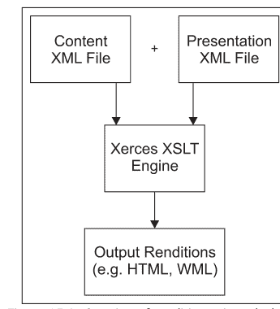

Figure 15.1: 通过样式表创建呈现

每当内容文件被保存并签入 Docbase 时，Documentum 都会创建呈现。在幕后，Web Publisher 将 Presentation 文件（XSL 样式表）应用于内容 XML 文件并生成规定的呈现。Web Publisher 中的 Presentation 文件有两种类型：

- **Editor Presentation 文件（XSL 样式表）**：用于格式化 Web Publisher 编辑器 XML 内容并存储在 Docbase 中的以下位置：Site Manager | Presentations | Editor.
- **External Presentation 文件（HTML 包装器）**：用于外部应用程序并存储在 Docbase 中的以下位置：Site Manager | Presentations | External。External presentation 文件为嵌入在 HTML 内容文件的 <body></body> 元素中的内容提供标准框架和包装器。

### 15.1 创建 Presentation 文件

在 Documentum 中创建 Presentation 文件并不是什么大问题，以下步骤说明了如何轻松构建它们并将其与模板文件关联。

1. 以管理员或 Web 开发人员用户身份登录 Web Publisher 并转到 Site Manager | Presentations | Editor。正如我们在 Rules 文件中所看到的，在 Editor 文件夹内创建一个新文件夹以标识和分离自定义应用程序的特定 Presentation 文件是一个好方法。
2. 选择菜单选项 File | New | Folder。新文件夹创建屏幕出现，如图 15.2 所示。

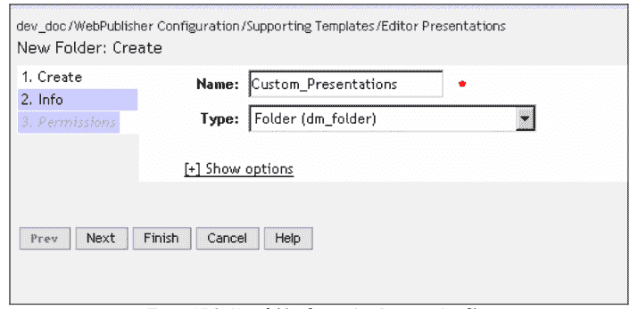

Figure 15.2: 用于存储 Presentation 文件的新文件夹

3. 为您的自定义 Presentation 文件夹提供一个有效名称（例如 Custom_Presentations）并单击 Finish 按钮。您还可以像 Rules 文件的情况一样将一些 ACL（权限集）附加到此文件夹。
4. 在您喜欢的编辑器（如 XML Spy®、Notepad 等）中创建有效的/格式良好的行业标准 XSL 样式表，并为其提供有意义的名称（例如 cust_news_art_pres.xsl 用于新闻文章模板）。将新创建的 Presentation 文件保存在机器硬盘上的方便文件夹位置中。

图 15.3 和 15.4 显示了新闻文章模板的示例 presentation 文件。请注意，您可以根据特定的业务需求对其进行改进（并且肯定有足够的改进空间！）。

```xml
<?xml version="1.0" encoding="UTF-8" ?>
<!DOCTYPE xsl:stylesheet [View Source for full doctype...]>
<xsl:stylesheet version="1.0" xmlns:xsl="http://www.w3.org/1999/XSL/Transform" xmlns:fo="http://www.w3.org/1999/XSL/Format" xmlns:java="http://xml.apache.org/xslt/java" xmlns:xalan="http://xml.apache.org/xalan" exclude-result-prefixes="xalan java fo">
  <xsl:output method="html" encoding="ISO-8859-1" indent="yes" />
  <xsl:strip-space elements="*" />
  <xsl:template match="*|@*|comment()|processing-instruction()|text()">
    <xsl:copy>
      <xsl:apply-templates select="*|@*|comment()|processing-instruction()|text()" />
    </xsl:copy>
  </xsl:template>
  <!-- Matching content XML file root element -->
  <xsl:template match="NEWSART">
    <table border="0">
      <tr>
        <th>News web site:</th>
      </tr>
      <tr>
        <td>
          <br />
        </td>
      </tr>
      <tr>
        <!-- Capturing location path of inserted banner image -->
        <xsl:variable name="imagePath">
          <xsl:value-of select="BANNERIMG/img/@src" />
        </xsl:variable>
        <!-- Capturing alternative text of inserted banner image -->
        <xsl:variable name="imageAltText">
          <xsl:value-of select="IMGALTEXT" />
        </xsl:variable>
        <td>
          
        </td>
      </tr>
      <tr>
        <td>
          <br />
        </td>
      </tr>
      <tr>
        <!-- Displaying news article date -->
```

Figure 15.3: 新闻文章 Presentation 文件示例


```
<!-- Displaying news article date -->
- <td>
  - <b>
    - <u>
      <xsl:copy-of select="DATE" />
    </u>
  </b>
</td>
</tr>
- <tr>
  - <td>
    <br />
  </td>
</tr>
- <tr>
<!-- Displaying news article body text -->
- <td>
  <xsl:copy-of select="BODYTEXT" />
</td>
</tr>
- <tr>
  - <td>
    <br />
  </td>
</tr>
<!-- Iterating through multiple next article links -->
<xsl:for-each select="REPEATBLOCK">
- <tr>
  - <td>
    - <a href="{NEXTLINKURL}">
      <xsl:copy-of select="NEXTLINKNAME" />
    </a>
  </td>
</tr>
</xsl:for-each>
</table>
</xsl:template>
</xsl:stylesheet>
```

图 15.4：示例新闻文章演示文件——续

请仔细注意 XSL 样式表中各种模板文件 XML 元素的格式。研究上述演示文件时，将模板 XML 文件翻到第 13 章并放在旁边可能很有价值。

- 5. 进入步骤 1 中创建的 Custom_Presentations 文件夹并选择 File | Import。文件导入选择屏幕会显示，如图 15.5 所示。点击 Add Files 按钮；浏览机器的文件夹路径以选择新创建的演示文件。选择演示文件后，点击 Next。

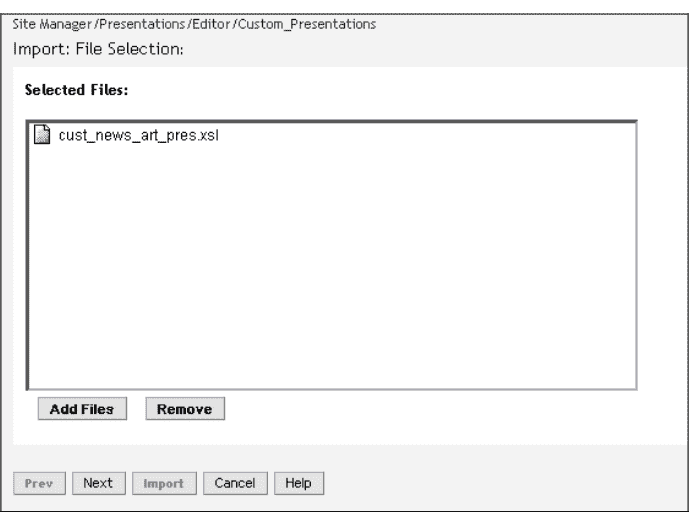

图 15.5：导入新创建的演示文件

6. 会显示 File Name 字段（参见图 15.6），供您为所选文件提供有效名称。保持演示文件名不变，不要更改它，然后点击 Import。

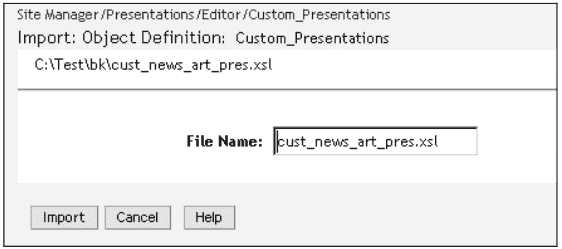

图 15.6：导入演示文件的最后一步

7. 演示文件被导入到 Docbase 中，路径为 /Site Manager/Presentations/Editor/Custom_Presentations。
现在您已在 Docbase 中创建并导入了演示文件，需要将其与我们在第 13 章中创建的新闻文章模板文件关联起来。但是，请理解，将演示文件与模板文件关联需要为 Web Publisher 的输出指定一个呈现格式。

## 创建演示文件

呈现格式可以是 Documentum 默认识别的格式，例如 html（标准 HTML 格式）或 crtext（文本格式），也可以是为业务需求确定的自定义格式。如果您需要我们的演示文件对新闻文章内容文件进行样式设置，并创建 MIME 类型为 html 但具有自定义文件扩展名（例如 .cshtml）的呈现格式，那么您需要执行以下操作：

以管理员用户身份登录 Documentum Administrator 并进入 Administration | Formats。

选择菜单选项 File | New | Format 并提供新格式的详细信息，如图 15.7 所示。详细信息如下：

- Name: `custom_format`
- Default File Extension: `cshtml`
- Description: `Custom format`
- Mime Type: `Text/html`

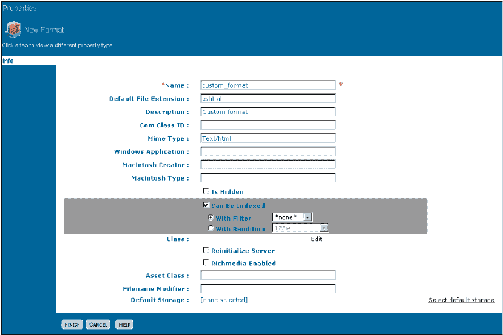

图 15.7：在 Docbase 中创建自定义格式

不要忘记在 Site Publishing 配置中，在 Content Selection Settings 部分的 Formats 字段下包含自定义格式。这可确保在发布操作期间，以自定义格式生成的呈现会从 Docbase 发布出去。有关更多信息，请参阅第 21 章。

8. 此步骤需要将演示文件与现有的新闻文章模板文件关联。登录 Web Publisher 并进入 Site Manager | Templates，选择 News_Articles 类别。选中 cust_news_art_templ.xml 模板旁边的复选框，并选择菜单选项 View | Associations | Presentations，如图 15.8 所示。

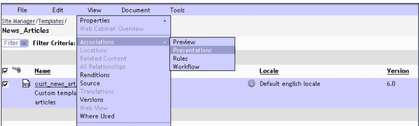

图 15.8：将演示文件与模板文件关联

9. 显示 Associations | Presentations 屏幕，未显示关联的演示文件。请注意，您可以将特定模板文件与多个演示文件关联，每个演示文件生成不同的呈现格式。点击 Add 并浏览 Site Manager | Presentations | Editor 文件夹内的自定义演示文件夹（Custom_Presentations）。选择演示文件 cust_news_art_pres.xsl 并点击 OK。

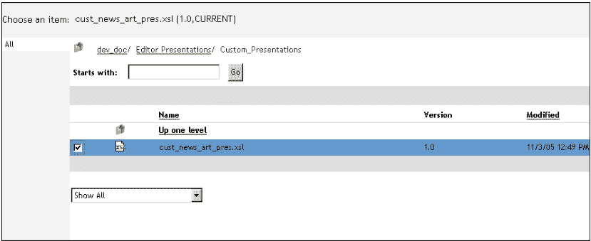

图 15.9：选择要与模板文件关联的演示文件

10. 如图 15.10 所示，选择用于通过演示文件转换内容 XML 文件的呈现格式。在我们的例子中，选择我们在步骤 5 中创建的 custom_format。从下拉菜单中选择 custom_format 后，其描述会自动填充到下拉菜单旁边的字段中。

## 创建演示文件

您有选项可以为今后基于所讨论模板创建的所有内容以及已从模板创建并已存在于 Docbase 中的内容指定所选的呈现格式。

点击 OK，然后点击 Close 以完成演示文件与模板文件的关联。

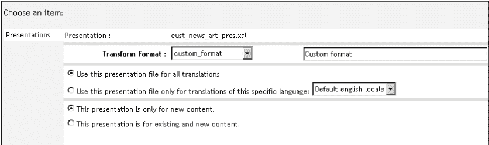

图 15.10：为演示文件选择呈现格式

### 15.2 查看内容呈现

从内容文件创建的呈现存储在 Docbase 中，与内容文件一起存储。查看呈现的便捷方法是选择已创建的内容文件并选择 View | Renditions，如图 15.11 所示。

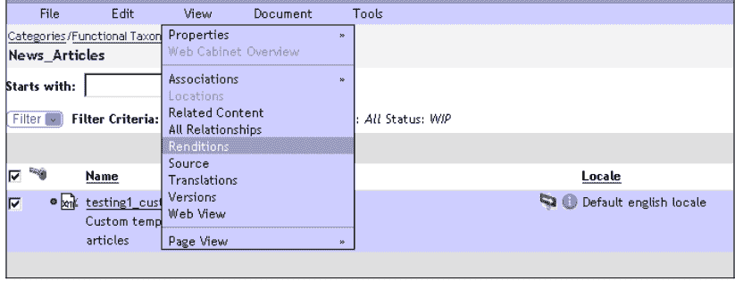

图 15.11：查看内容呈现

Web Publisher 显示主内容 XML 文件及其呈现格式（如我们的例子中，仅为 Custom 格式呈现），如图 15.12 所示。

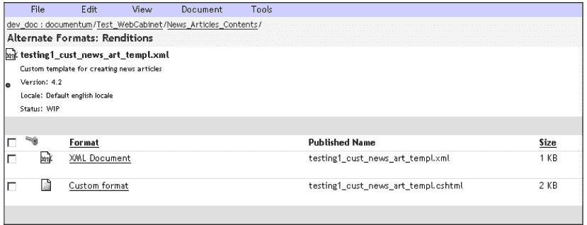

图 15.12：与内容文件关联的呈现

### 15.3 重新应用演示文件

网站中最常见的场景之一是网页布局需要更改。从技术上讲，这需要在演示层（Documentum 中的 presentation/XSL 文件）进行修改，而不是在模板文件或规则文件中。一旦演示文件被修改并将其更改版本签入 Docbase，已存在于 Docbase 中的内容会怎样？其呈现是否会根据修改后的演示文件自动更新？对于今后创建的新内容，系统肯定会生成正确的呈现。然而，在运行中的网站中可能存在大量现有内容，所有这些内容都需要根据修改后的演示布局进行更新。

不用担心——在这种情况下，Documentum 提供了名为 reapply presentation 的功能，允许您根据修改后的演示文件更新现有内容的呈现。

以下是实现此目的的一些简单步骤：

- 1. 在 Web Publisher 中浏览现有演示文件，并选中修改后的演示文件旁边的复选框。点击工具栏中显示的 Apply Presentation 按钮（参见图 15.13）。

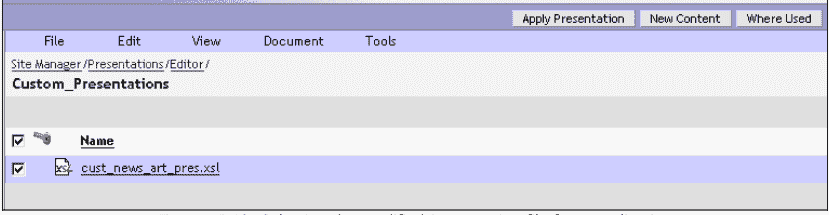

图 15.13：选择要重新应用的修改后演示文件

## 创建演示文件

- 2. 显示与所选演示文件关联的所有现有内容文件的列表；参见图 15.14。选中这些内容文件旁边的复选框并点击 OK。

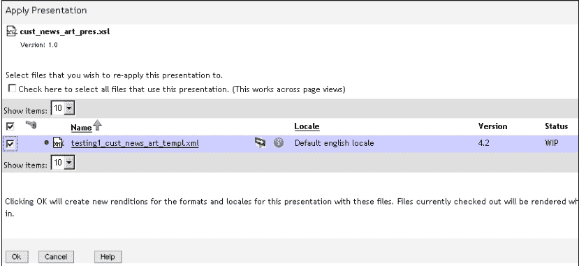

图 15.14：与演示文件关联的内容文件列表

系统需要一些时间将修改后的演示布局重新应用到所选内容文件。您可以通过点击 Web Publisher 浏览器状态栏中的 Task Status 按钮来检查重新应用操作的进度。

### 15.4 在样式表中使用 XDQL

XDQL 是 eXtensible Document Query Language 的缩写，正如名称所示，是一种从 XML 中触发 DQL 查询并通过 XML 处理查询结果的便捷机制。演示文件（或 XSL 样式表）可以从 XDQL 中极大地受益。

DQL 查询（仅选择，不进行任何更新！）可以使用 Documentum 的 XDQL 接口从演示文件中调用：com.documentum.xml.xdql.IDfXmlQuery。

此接口中定义的一组方法已由类 DfXmlQuery 实现。

DQL 查询结果以 XML 文档的形式存在，可以通过标准 XPath 语言和 XSL 样式表中可用的其他语言语义进行解析/处理。

这通过一个简单易用的 Documentum 接口利用了 XML 和 XSL 的工业标准且广泛使用的处理能力，该接口充当 DQL 的 XML 包装器。

从性能角度来看，这相当合理，因为 DQL 查询在 Docbase 中触发，结果通过 Documentum 层中的 XSLT 进行处理。一旦通过 XDQL 从 Docbase 获取 XML 内容文件中的动态数据，它就会通过 XSLT 转换为 Web 呈现格式（网页）并发布到网站！


请注意，XDQL 通常在 XSL 样式表中使用，只要您需要在网页上显示来自 Docbase 的实时（动态）数据。如果没有 XDQL，过时的数据将通过静态网页呈现在网站上。

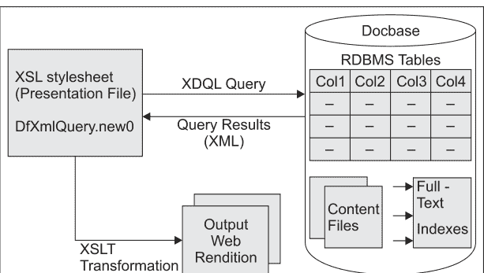

图 15.15：XDQL 的工作原理

## 15.5 XSL 样式表中的 XDQL 示例

让我们通过一个简单的示例来了解 XDQL 如何在演示文件（XSL 样式表）中动态获取 Docbase 数据。

以下示例模板文件将通过 XSL 样式表进行转换：

```
<?xml version="1.0" encoding="UTF-8"?>
<ROOTTAG>
  <TITLEOFPAGE/>
  <SHORTDESC/>
</ROOTTAG>
```

此示例中的 XSL 样式表将用于创建上述模板 XML 文件的 HTML 转换。转换后的文件（HTML 网页呈现）将显示使用上述模板创建的内容文件的名称（object_name 属性）。

创建 XSL 文件（如图 15.16 和 15.17 所示），并将其导入 Docbase 中的以下位置：/Site Manager/Presentations/Editor/Custom_Presentations。

## 创建演示文件

```
<?xml version="1.0" encoding="UTF-8" ?>
<!DOCTYPE xsl:stylesheet (View Source for full doctype...)>
<xsl:stylesheet version="1.0" xmlns:xsl="http://www.w3.org/1999/XSL/Transform" xmlns:fo="http://www.w3.org/1999/XSL/Format"
xmlns:java="http://xml.apache.org/xalan/java" xmlns:xalan="http://xml.apache.org/xalan" exclude-result-prefixes="xalan java fo">
<xsl:output method="html" encoding="ISO-8859-1" indent="yes" />
<xsl:param name="DMS_SESSION_ID" select="'default value'" />
<xsl:param name="DMS_INPUT_OBJECT_ID" />
<xsl:strip-space elements="*"/>
<xsl:template match="*|@|comment()|processing-instruction()|text()">
  <xsl:copy>
    <xsl:apply-templates select="*|@|comment()|processing-instruction()|text()" />
  </xsl:copy>
</xsl:template>
<!-- variable storing the DQL query -->
<xsl:variable name="dqlQuery">
select r_object_id, object_name from dm_document where r_object_id = '
<xsl:value-of select="$DMS_INPUT_OBJECT_ID" />
'
</xsl:variable>
<!-- variable storing the DQL query results -->
<xsl:variable name="query_results">
  <xsl:call-template name="XDQL">
    <xsl:with-param name="dql" select="string($dqlQuery)" />
  </xsl:call-template>
</xsl:variable>
<!-- variable storing the 'object_name' attribute from query results -->
<xsl:variable name="ObjectName">
  <xsl:for-each select="xalan:nodeset($query_results)/xdql/object">
    <xsl:value-of select="object_name" />
  </xsl:for-each>
</xsl:variable>
<!-- Matching content XML file root element -->
<xsl:template match="ROOTTAG">
<table border="0">
  <tr>
    <th>File name:</th>
  </tr>
</tr>
  <tr>
    <td>
      <br />
    </td>
  </tr>
</tr>
  <!-- Displaying the name of the file 'object name' attribute -->
```

图 15.16：使用 XDQL 的示例 XSL 文件

```
<!-- Displaying the name of the file ('object_name' attribute) -->
<td>
  <b>
    <u>
        <xsl:value-of select="$ObjectName" />
      </u>
    </b>
  </td>
</tr>
<tr>
  <td>
      <br />
    </td>
  </tr>
<tr>
  <!-- Displaying short description -->
  <td>
    <xsl:copy-of select="SHORTDESC" />
  </td>
</tr>
<tr>
  <td>
      <br />
    </td>
  </tr>
</table>
</xsl:template>
<!-- Template code for integrating DQL queries in XSL Starts -->
<xsl:template name="XDQL">
  <xsl:param name="dql" />
  <xsl:param name="rootTag" select="string('xdql')" />
  <xsl:param name="UpperTags" select="string('false')" />
  <xsl:param name="MaxRows" select="10" />
  <xsl:param name="RowIDAttrName" select="ID" />
  <xsl:param name="RowsetTag" select="Row" />
  <xsl:param name="UseGivenCaseTagNames" select="true" />
  <xsl:param name="UseNullAttrIndicator" select="false" />
  <xsl:variable name="xdql" select="java:com.documentum.xml.xdql.DfXmlQuery.new()" />
  <xsl:variable name="init" select="java:init($xdql)" />
  <xsl:variable name="param" select="java:setDql($xdql,$dql)" />
  <xsl:variable name="param1" select="java:setRootNode($xdql,$rootTag)" />
  <xsl:variable name="param3" select="java:includeContent($xdql,false())" />
  <xsl:variable name="setContentEncoding" select="java:setContentEncoding($xdql,string('dom'))" />
  <xsl:variable name="setContentFormat" select="java:setContentFormat($xdql,string('xml'))" />
  <xsl:variable name="execute" select="java:execute($xdql, 'DF_READ_QUERY', $DMS_SESSION_ID)" />
  <xsl:variable name="queryresult" select="java:getXMLDOM($xdql)" />
  <xsl:copy-of select="$queryresult" />
</xsl:template>
<!-- Template code for integrating DQL queries in XSL Ends -->
</xsl:stylesheet>
```

图 15.17：使用 XDQL 的示例 XSL 文件——续

我们现在将讨论上述 XSL 样式表的结构：

- **Namespaces**：在演示文件的 `<xsl:stylesheet>` 标签中添加以下 Java 和 Xalan 命名空间。例如：
  ```xml
  <xsl:stylesheet version="1.0"
  xmlns:xsl="http://www.w3.org/1999/XSL/Transform"
  xmlns:fo="http://www.w3.org/1999/XSL/Format"
  xmlns:java="http://xml.apache.org/xslt/java"
  xmlns:xalan="http://xml.apache.org/xalan" exclude-result-prefixes=
  "xalan java fo">
  ```
- **Parameters**：声明系统传递给样式表的参数。例如：
  ```xml
  <xsl:param name="DMS_SESSION_ID" select="'default value'"/>
  <xsl:param name="DMS_INPUT_OBJECT_ID"/>
  ```
- **XDQL classes**：使用 `<xsl:template>` 标签定义一个 XSL 模板，以实例化 `DFxmlQuery()` 类，传递 XDQL 参数，并在 XSL 样式表内部执行 DQL 查询。例如：
  ```xml
  <xsl:template name="XDQL">
  <xsl:param name="dql"/>
  <xsl:param name="roottag" select="string('dql')"/>
  <xsl:param name="UpperTags" select="string('false')"/>
  <xsl:param name="MaxRows" select="10"/>
  <xsl:param name="RowIDAttrName" select="ID"/>
  <xsl:param name="RowSetTag" select="Row"/>
  <xsl:param name="UseGivenCaseTagNames" select="true"/>
  <xsl:param name="UseNullAttrIndicator" select="false"/>
  <xsl:variable name="xdql" select="java:com.documentum.xml.xdql.DFxmlQuery.new()"/>
  <xsl:variable name="init" select="java:init($xdql)"/>
  <xsl:variable name="param" select="java:setDql($xdql,$dql)"/>
  <xsl:variable name="param1" select="java:setRootNode($xdql,$roottag)"/>
  <xsl:variable name="param3" select="java:includeContent($xdql,false())"/>
  <xsl:variable name="setContentEncoding" select="java:setContentEncoding($xdql,string('dom'))"/>
  <xsl:variable name="setContentFormat" select="java:setContentFormat($xdql,string('xml'))"/>
  <xsl:variable name="execute" select="java:execute($xdql, 'DF_READ_QUERY', $DMS_SESSION_ID)"/>
  <xsl:variable name="queryresult" select="java:getXMLDOM($xdql)"/>
  <xsl:copy-of select="$queryresult"/>
  </xsl:template>
  ```

DMS_SESSION_ID 是对当前 Docbase 会话的引用，而 DMS_INPUT_OBJECT_ID 是对当前对象 ID（r_object_id 属性）的引用。

建议查阅 com.documentum.xml.xdql.IDFxmlQuery 接口的 DFC Javadocs，以了解上文所示的 <xsl:template name="XDQL"> 中使用的众多方法的参数和返回类型。

变量：
定义一个变量来存储从样式表内部调用的 DQL 查询。
例如：
```xml
<xsl:variable name = "dqlQuery">select r_object_id, object_name from dm_document where r_object_id = '<xsl:value-of select="$DMS_INPUT_OBJECT_ID"/>' </xsl:variable>
```

此代码存储用于获取当前内容文件（即其对象 ID 与当前对象 ID DMS_INPUT_OBJECT_ID 匹配）的对象 ID（r_object_id 属性）和文件名（object_name 属性）的 DQL 查询字符串。

此外，通过调用预定义的 XDQL 模板并向其传递 DQL 查询字符串，定义一个变量来存储上述 DQL 查询的结果。例如：

```
<xsl:variable name = "query_results">
  <xsl:call-template name="XDQL">
    <xsl:with-param name="dql" select="string($dqlQuery)"/>
  </xsl:call-template>
</xsl:variable>
```

一旦将查询结果保存在变量中，就遍历它，检索所需的属性（在本例中为 object_name）并将其保存在变量中。

```
For example:
<xsl:variable name="ObjectName">
  <xsl:for-each select="xalan:nodeset($query_results)/xdql/object">
    <xsl:value-of select="object_name"/>
  </xsl:for-each>
</xsl:variable>
```

在 Web Publisher 中在 XSL 样式表中使用 XDQL 时，这就是需要处理的所有内容。在我们的示例中，显示内容文件的名称（object_name 属性）只需访问 objectName 变量的值即可。例如：

```
<!-- Displaying the name of the file (object_name attribute) -->
<td><b><u><xsl:value-of select="$objectName"/></u></b></td>
```

请注意，通过使用 $(variableName)，系统会在运行时替换变量中包含的值。

## 15.6 Create_Dynamic_Content 作业

使用 XDQL 查询的演示文件可以在以下情况下检索 Docbase 内容及其属性：

- 从模板创建新内容文件并在 Web Publisher 编辑器中保存
- 编辑并保存现有内容文件
- 对现有内容使用重新应用演示功能

然而，对于那些已发布并在网站上显示的活动内容文件，但其底层数据（属性或内容值）在 Docbase 中已被修改，会发生什么情况？内容作者是否必须再次编辑/保存并重新发布这些内容文件，以确保再次触发 XDQL 查询并在运行的网站上显示修改后的数据？答案是否定的。


## 创建演示文稿文件

在以下情况下需要执行以下步骤以利用 Documentum 提供的开箱即用功能：

- 1. 在 Web Publisher 中浏览到模板 XML 文件，并点击模板旁的信息图标（i）。选择 Publishing 选项卡并选中“当相关内容被修改时自动刷新此页面”旁边的复选框（参见图 15.18）。点击确定。

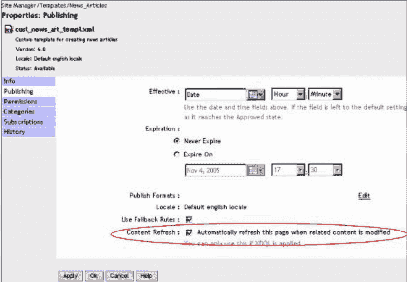

图 15.18：为内容模板设置内容刷新标志

- 2. 以管理员身份登录 Documentum Administrator 并进入 Job Management | Jobs。选择如图 15.19 所示的 Create_Dynamic_Content 作业。

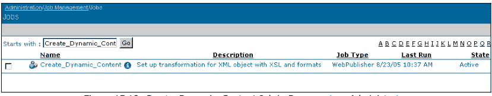

图 15.19：Documentum Administrator 中的 Create_Dynamic_Content 作业

首先确保此作业处于活动状态，然后为其设置在 Docbase 中定期运行的便捷计划。这是一个 Web Publisher 作业，可以设置为定期运行，以转换处于活动状态且其模板的内容刷新标志设置为 true 的内容文件。该作业会重新应用活动内容文件上的演示文稿文件，从而确保正确的 DQL 查询结果保存到转换后的输出网页呈现中。

Create_Dynamic_Content 作业转换现有活动对象后，您可以通过 Site Caching Service 站点发布配置将其发布到网站（SCS 目标）。

请注意，发布操作的详细信息将在第 21 章中介绍。

以上全部关于演示文稿文件、其用途以及 Documentum 中可用的功能。您可以通过浏览互联网来探索样式表。一般来说，网络上存在大量专门介绍 XSL 及其高级功能的网站。要深入了解 Web Publisher 演示文稿文件，您应阅读 Web Publisher 管理手册。

## 15.7 摘要

演示文稿文件是用于格式化内容文件以在网站上以所需呈现形式显示的样式表。在本章中，我们简要讨论了 Documentum 如何使用 Xerces XSL 转换引擎将演示文稿文件应用于内容 XML 文件以创建呈现。

然后我们看到了在 Web Publisher 中创建演示文稿文件并将其与模板文件关联的详细步骤。我们还看到了如何在 Documentum 中创建自定义格式并以自定义格式输出呈现。然后我们讨论了如何将更新的演示文稿文件重新应用于 Docbase 中现有内容。

接下来，我们讨论了 X DQL（可扩展文档查询语言）及其优势，并通过示例了解了它如何从 XML 内部触发 DQL 查询并通过 XML 处理查询结果。

最后，我们提到了一个 Web Publisher 作业 Create_Dynamic_Content，可以将其安排为定期运行，以自动将演示文稿文件重新应用于活动内容文件，从而在 Docbase 中创建更新的呈现。

## 16 文件夹映射

## 文件夹映射

所有内容贡献者在为其网站创建内容时都会面临一个共同问题。为了创建内容，他们需要了解网站结构，以便在 Documentum 中将内容创建在正确的文件夹下。如果他们在错误的文件夹下创建内容，已发布的内容将被网站应用程序错误读取，内容将显示在网站的错误部分！

通常，企业网站的文件夹结构相当复杂，培训用户在 Documentum 中在完全镜像的文件夹下输入内容既困难又存在人为错误的可能性。下面举一个简单的例子来说明这一点：

假设一家假设的企业生产一些产品，根据其专有的业务分类分为 category 1、2 和 3。然而，显示产品信息的最终网站分别在网站部分 Low end output、Average performance 和 High throughput products 下显示这些产品。

在创建内容时，业务用户将其归类为 category 1、2 或 3。Folder Map 在幕后将内容放置在网站上的适当文件夹结构下，而无需业务用户了解网站的确切文件夹结构。如果出于某种原因需要在网站上更改这些部分的名称，则无需对内容创建者进行培训。只需更新 Folder Map 配置，内容创建过程即可无缝继续。

图 16.1 显示了业务用户如何使用简单类别创建内容，以及 Documentum 如何使用 Folder Map 将其映射到网站所需的实际文件夹结构。

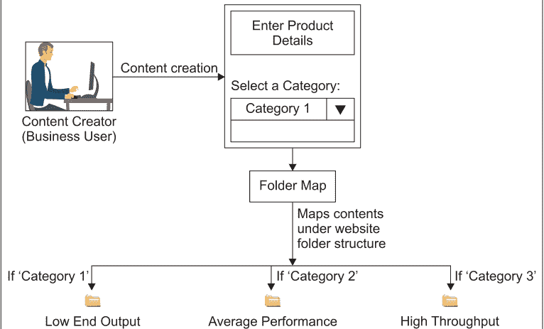

图 16.1：Folder Map 的工作原理

Web Publisher Folder Map (`FolderMap.xml`) 是一个简单的 XML 文件，其中包含根据内容文件的 Docbase 属性将创建的内容文件映射到 Web Cabinets 中指定文件夹所需的规则。

如果 Documentum 发现内容文件的属性与 Folder Map 规则中定义的属性值匹配，则 Documentum 会将内容文件放置在 `FolderMap.xml` 中指定的文件夹位置。

值得一提的是，每当创建新内容或更新内容属性时，Documentum Web Publisher 都会读取 `FolderMap.xml`。

- 如果您以管理员身份登录 Web Publisher，您可以在 Site Manager | Configurations | Foldermaps 文件夹下查看默认的 `FolderMap.xml` 文件，如图 16.2 所示。

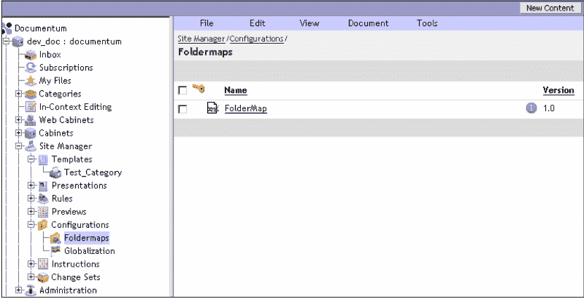

图 16.2：Web Publisher 中看到的 FolderMap.xml 文件

空 FolderMap.xml 文件的结构如下所示：

```
<folder_map>
  <rule>
    <attr_list>
      <attr>
        <name></name>
        <value></value>
      </attr>
    </attr_list>
    <path_list>
      <path></path>
    </path_list>
  </rule>
  <rule>
    <attr_list>
      <attr>
        <name></name>
        <value></value>
      </attr>
    </attr_list>
    <path_list>
      <path></path>
    </path_list>
  </rule>
</folder_map>
```

### 16.1 FolderMap.xml 文件的结构

请参阅图 16.3 以了解 FolderMap.xml 中的各种 XML 元素。

| 文件夹映射元素 | 执行的功能 |
|---|---|
| `<rule>` | 表示 Folder Map 中指定的每个规则。每个 `<rule>` 可以有 0 个或多个 `<attr_list>` 标签和 1 个或多个 `<path_list>` 标签。 |
| `<attr_list>` | 表示属性规则/条件列表。只有当此标签中指定的所有属性值条件都满足时，Folder Map 规则才适用。 |
| `<attr>` | 这是一个名称-值对，表示一个属性名称及其值。 |
| `<name>` | Docbase 属性的名称，例如 subject。 |
| `<value>` | Docbase 属性的值。 |
| `<path_list>` | 表示如果规则匹配，内容文件将被放置的一组路径/位置。 |
| `<path>` | Web Publisher Docbase 中内容文件将被放置的完整路径。 |

图 16.3：Folder Map XML 元素

### 16.2 Folder Map 的局限性

就像所有优秀的系统一样，Folder Map 也有其局限性，在设计内容映射规则时我们应注意。

下面列出了 Web Publisher 中 Folder Map 的一些局限性。要全面了解文件夹映射，请阅读 Documentum Web Publisher 管理员指南。

- Web Publisher 不允许您更改文件夹映射文件 (`FolderMap.xml`) 的名称。
- `FolderMap.xml` 的权限集（ACL）默认情况下为 WebPublisher User Default ACL 且无法更改。
- 如果在 Docbase 中不存在 `FolderMap.xml` 中指定的文件夹结构，Folder Mapping 会自动在 Docbase 中创建文件夹。但是，如果指定的 Web Cabinet 在 Docbase 中不存在，Folder Mapping 不会自动创建它，而是会抛出错误。
- 文件夹映射从 `FolderMap.xml` 文件的最顶层规则工作到文件中指定的最后一条规则。我们需要先定义具体的规则，然后再跟进一些通用规则。对于熟悉 Java 中异常处理最佳实践的人来说，这类似于在处理通用异常之前捕获特定于应用程序的异常。
- 一旦匹配到特定规则，Folder Mapping 就会停止进一步扫描 `FolderMap.xml` 文件。

理论够多了？让我们借助几个实际示例来了解 Folder Mapping 的工作原理。


## 16.3 文件夹映射示例

本节包含示例，解释如何在 Documentum 中实际实现文件夹映射。

### 16.3.1 属性匹配：使用通配符 (*)

让我们从一个简单的示例开始，其中文件夹映射配置为：仅当用户在创建内容时为其 subject 属性提供非空白值时，内容文件才会被放置在 Web Cabinet 中的指定位置。

1. 以管理员身份登录 Web Publisher，并在 Site Manager | Configurations | Foldermaps 下检出 FolderMap.xml 文件。按如下所示修改 FolderMap.xml 文件，然后将其签回 Docbase。

```
<folder_map>
    <rule>
        <attr_list>
            <attr>
                <name>subject</name>
                <value>*</value>
            </attr>
        </attr_list>
        <path_list>
            <path>/Test_webCabinet/Subject_Content</path>
        </path_list>
    </rule>
    <rule>
        <attr_list>
            <attr>
                <name></name>
                <value></value>
            </attr>
        </attr_list>
        <path_list>
            <path></path>
        </path_list>
    </rule>
</folder_map>
```

尝试使用模板创建一些内容并将 Subject: 字段留空。会抛出以下错误；可在 Web Publisher 状态栏中点击 All Messages 按钮查看：

新内容无法创建。根据文件夹映射，此文件无法链接到任何 Web 柜。您的文件将不会被创建。

## 文件夹映射

2. 通过为 Subject: 字段提供非空白值来创建新内容，如图 16.4 所示。

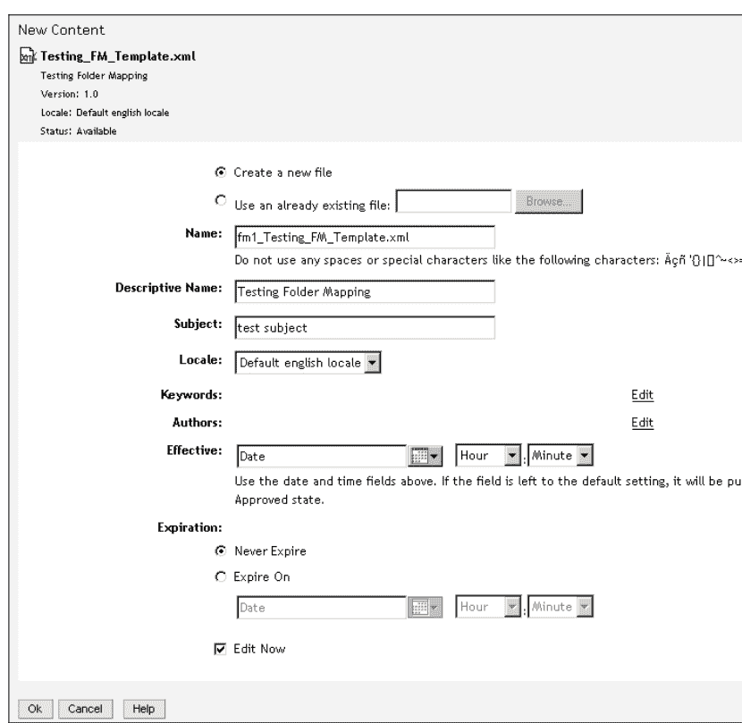

图 16.4：为 Subject 属性提供非空白值

3. 请注意，新内容已成功创建（参见图 16.5），位于 Web Cabinet 中指定的 Docbase 位置 /Test_WebCabinet/Subject_Content 下。

> 确保 Web Cabinet Test_WebCabinet 已存在于 Docbase 中。如果不存在，请在开始创建内容并尝试文件夹映射示例之前先创建它。

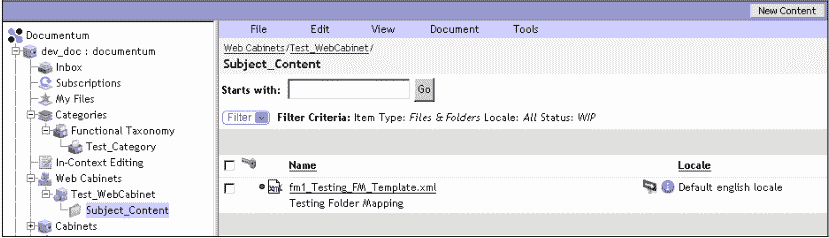

图 16.5：在 Web Cabinet 文件夹中成功创建内容

### 16.3.2 属性匹配：在 <attr_list> 中使用多个属性

现在让我们举一个示例，其中文件夹映射配置为：仅当内容满足以下两个属性条件时，内容文件才会被放置在 Web Cabinet 中的指定位置：

它应具有非空白的 Name: 字段（object_name 属性），并且其 Subject: 字段（subject 属性）的值应为 office。在同时满足这两个条件之前，内容文件不会被创建。

1. 以管理员身份登录 Web Publisher，并在 Site Manager | Configurations | Foldermaps 下检出 FolderMap.xml 文件。按如下所示修改 FolderMap.xml 文件，然后将其签回 Docbase。

```
<folder_map>
    <rule>
        <attr_list>
            <attr>
                <name>object_name</name>
                <value></value>
            </attr>
            <attr>
                <name>subject</name>
                <value>office</value>
            </attr>
        </attr_list>
        <path_list>
            <path>/Test_WebCabinet/official docs</path>
        </path_list>
    </rule>
    <rule>
        <attr_list>
            <attr>
                <name></name>
                <value></value>
            </attr>
        </attr_list>
        <path_list>
            <path></path>
        </path_list>
    </rule>
</folder_map>
```

尝试使用模板创建内容并执行以下任一操作：

- 将 Name: 字段留空
- 将 Subject: 字段留空
- 将 Subject: 字段的值写为 OFFICE
- 将 Subject: 字段的值提供为 office 以外的任何内容，例如 JUNK

在所有四种情况下，都会抛出以下错误（可在 Web Publisher 状态栏中查看 All Messages 按钮），并且新内容不会在 Web Publisher 中创建：

新内容无法创建。根据文件夹映射，此文件无法链接到任何 Web 柜。您的文件将不会被创建。

2. 现在让我们提供一个有效场景。创建具有有效非空白名称的新内容，并将其 Subject: 字段写为 office，如图 16.6 所示：

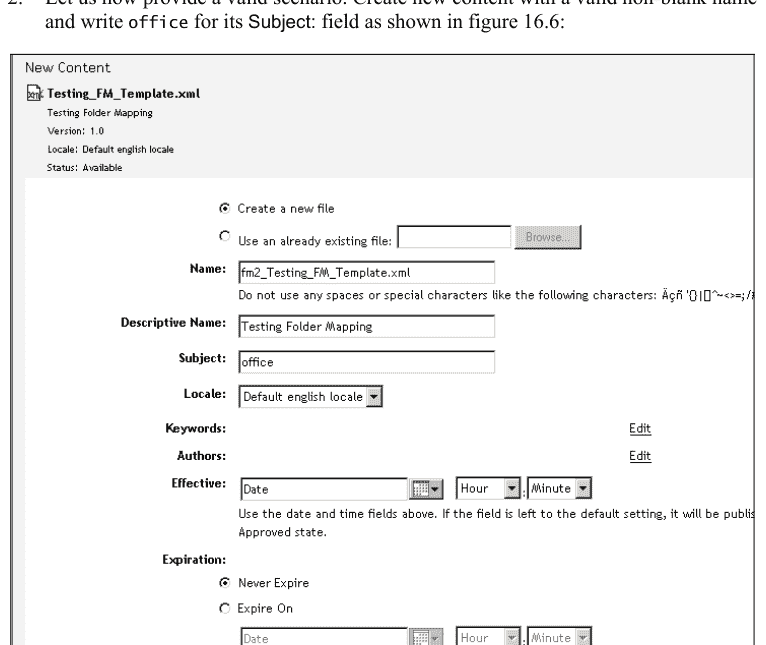

图 16.6：在内容创建期间提供了有效的 Name 和 Subject 字段

3. 新内容已成功创建（参见图 16.7），位于 Web Cabinet 中指定的 Docbase 位置：/Test_webCabinet/Official docs。

如前所述，您必须首先确保 Web Cabinet Test_webcabinet 已存在于 Docbase 中。如果不存在，请在开始创建内容之前先创建它。

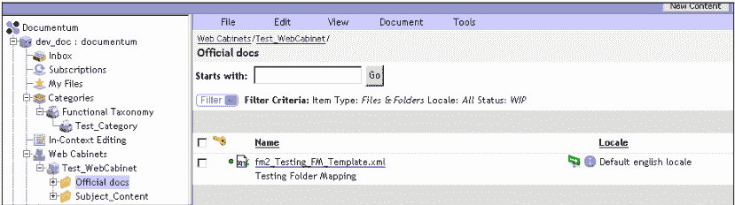

图 16.7：在 Official docs 文件夹下创建的内容

### 16.3.3 使用 <path_list> 将内容文件放置在多个位置

现在让我们举一个示例，其中文件夹映射配置为将同一内容文件放置在 Web Cabinet 中的两个不同指定位置。内容必须满足的一个重要条件是它应具有非空白的文件名（object_name 属性）。

如果满足上述条件，则同一内容文件将被放置在 Web Cabinet 中的两个文件夹下：/Test_WebCabinet/FilePath One 和 /Test_WebCabinet/FilePath Two。

1. 以管理员身份登录 Web Publisher，并在 Site Manager | Configurations | Foldermaps 下检出 FolderMap.xml 文件。按如下所示修改 FolderMap.xml 文件，然后将其签回 Docbase。

```
<folder_map>
    <rule>
        <attr_list>
            <attr>
                <name>object_name</name>
                <value>*</value>
            </attr>
        </attr_list>
        <path_list>
            <path>/Test_webCabinet/FilePath One</path>
            <path>/Test_webCabinet/FilePath Two</path>
        </path_list>
    </rule>
    <rule>
        <attr_list>
            <attr>
                <name></name>
                <value></value>
            </attr>
        </attr_list>
        <path_list>
            <path></path>
        </path_list>
    </rule>
</folder_map>
```

## 文件夹映射

尝试使用模板创建内容并提供非空白的文件名（Name: 字段），如图所示 16.8。

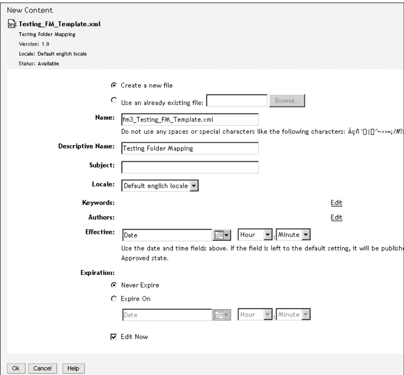

图 16.8：在创建新内容时提供文件名

2. 您会注意到新内容已成功在 Web Cabinet 中的两个指定 Docbase 位置下创建（参见图 16.9 和 16.10）：/Test_WebCabinet/FilePath One 和 /Test_WebCabinet/FilePath Two。

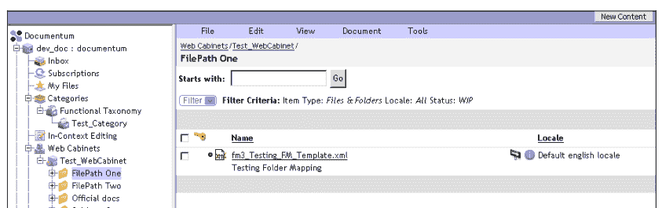

图 16.9：在第一个 Docbase 位置创建的内容

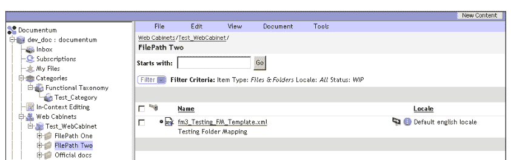

图 16.10：在第二个 Docbase 位置下创建的相同内容

### 16.3.4 属性匹配：简单重复属性

到目前为止，我们处理的是单值属性。现在让我们举一个示例，其中文件夹映射配置为：如果内容满足特定重复属性条件，则内容文件将被放置在 Web Cabinet 中的指定位置，如下所示：

> 它应具有非空白的 keywords 属性，且其第一个关键字为 abc。

如果满足上述条件，则内容文件将被放置在 Web Cabinet 中的以下位置：/Test_WebCabinet/Keywords_ABC。

1. 以管理员身份登录 Web Publisher，并在 Site Manager | Configurations | Foldermaps 下检出 FolderMap.xml 文件。
按如下所示修改 FolderMap.xml 文件，然后将其签回 Docbase。

## 文件夹映射

```
<folder_map>
    <rule>
        <attr_list>
            <attr>
                <name>keywords</name>
                <value>abc</value>
            </attr>
        </attr_list>
        <path_list>
            <path>/Test_WebCabinet/Keywords_ABC</path>
        </path_list>
    </rule>
    <rule>
        <attr_list>
            <attr>
                <name></name>
                <value></value>
            </attr>
        </attr_list>
        <path_list>
            <path></path>
        </path_list>
    </rule>
</folder_map>
```

2. 尝试使用模板创建内容并执行以下任一操作：

- 为 Keywords 值提供 ABC：keywords[0]='ABC'
- 为 Keywords 值提供 xyz：keywords[0]='xyz'
- 将 xyz 和 abc 作为 Keywords 值提供。请注意，这里 abc 是第二个关键字而不是第一个关键字。
  keywords[0]='xyz'
  keywords[1]='abc'

您会注意到以下错误被抛出（通过点击 Web Publisher 状态栏中的 All Messages 按钮查看），并且新内容不会在 Web Publisher 中创建：

新内容无法创建。

根据文件夹映射，此文件无法链接到任何 Web 柜。您的文件将不会被创建。


3. 创建一些有效的新内容并为其 Keywords：字段提供 abc，如图 16.11 所示。

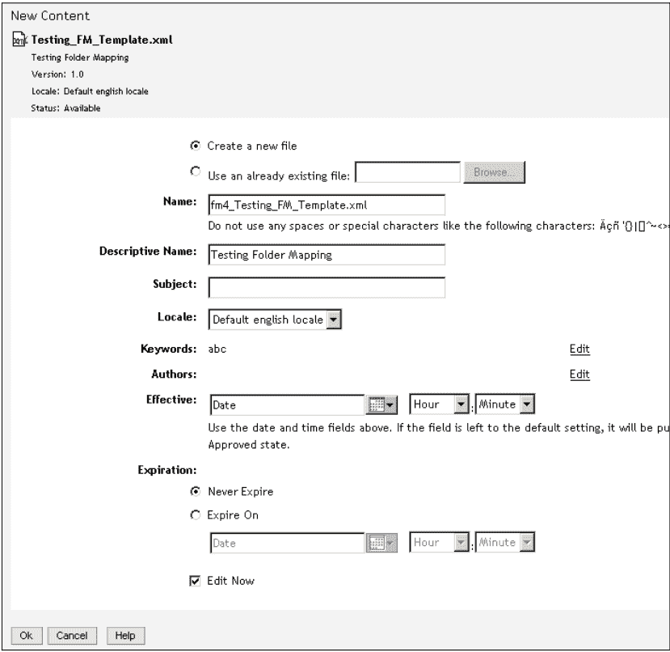

图 16.11：创建关键词属性设置为 abc 的内容

4. 你会注意到新内容已成功创建（参见图 16.12），位于 Web Cabinet 中指定的 Docbase 位置：/Test_webCabinet/Keywords_ABC。

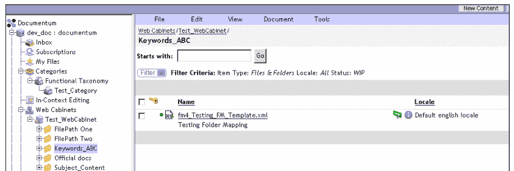

图 16.12：在 Keywords_ABC 文件夹下成功创建内容

## 16.3.5 属性匹配：重复属性索引

让我们举一个示例，其中 Folder Map 配置为将内容文件放置在 Web Cabinet 中的指定位置。内容必须满足的重复属性条件是：其 keywords 属性不能为空，且第二个关键词（索引位置 1）为 hello。

如果满足上述条件，则内容文件将放置在 Web Cabinet 中的以下位置：/Test_webCabinet/Keywords_Hello。

- 1. 以管理员身份登录 Web Publisher 并签出 Site Manager | Configurations | Foldermaps 下的 FolderMap.xml 文件。

按如下所示修改 FolderMap.xml 文件并将其签回 Docbase。

```
<folder_map>
    <rule>
        <attr_list>
            <attr>
                <name>keywords[1]</name>
                <value>hello</value>
            </attr>
        </attr_list>
        <path_list>
            <path>/Test_webCabinet/Keywords_Hello</path>
        </path_list>
    </rule>
    <rule>
        <attr_list>
            <attr>
                <name></name>
                <value></value>
            </attr>
        </attr_list>
        <path_list>
            <path></path>
        </path_list>
    </rule>
</folder_map>
```

- 2. 尝试使用模板创建一些内容：

  - 提供 hello 作为 Keywords 值：keywords[0]='hello'
  - 或：
  - 提供 xyz 和 HELLO 作为 Keywords 值。请注意 HELLO 为大写，即使它是第二个关键词。

```
keywords[0]='xyz'
keywords[1]='HELLO'
```

你会注意到以下错误被抛出（通过点击 Web Publisher 状态栏中的 All Messages 按钮查看），并且新内容未在 Web Publisher 中创建：

新内容无法创建。
此文件基于文件夹映射，无法链接到任何 Web 柜。你的文件将不会被创建。

- 3. 创建一些有效的新内容并为其 Keywords：字段提供 xyz 和 hello 作为值，如图 16.13 所示。

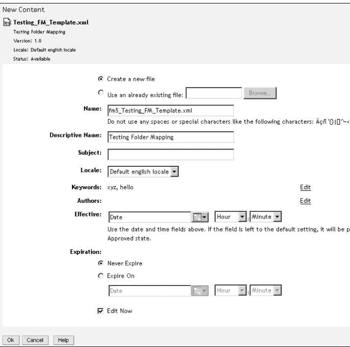

图 16.13：在内容创建期间将 hello 设置为第二个关键词

- 4. 你会注意到新内容已成功创建（参见图 16.14），位于 Web Cabinet 中指定的 Docbase 位置：/Test_webCabinet/Keywords_Hello。

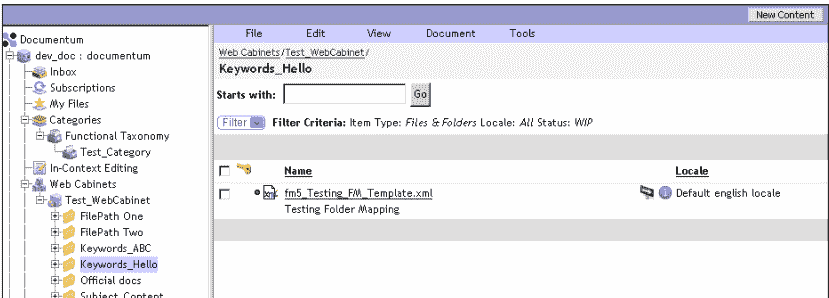

图 16.14：在 Web Cabinet 的 Keywords_Hello 文件夹下创建的内容

## 16.3.6 动态文件夹映射

到目前为止，我们考虑的示例都是在 FolderMap.xml 文件中基于某些属性值提供固定位置。Folder Map 提供了额外的功能，可根据某些属性/属性值在运行时动态创建位置/路径。

让我们举一个示例，其中 Folder Map 配置为将内容文件放置在 Web Cabinet 中动态创建的文件夹内。内容必须满足的属性条件是：其 subject 属性不能为空。

如果满足上述条件，则内容文件将放置在 Test_WebCabinet Web Cabinet 下，其中的文件夹名称与内容创建者为内容的 subject 属性提供的值相同。

- 1. 以管理员身份登录 Web Publisher 并签出 Site Manager | Configurations | Foldermaps 下的 FolderMap.xml 文件。

按如下所示修改 FolderMap.xml 文件并将其签回 Docbase。

```
<folder_map>
    <rule>
        <attr_list>
            <attr>
                <name>subject</name>
                <value></value>
            </attr>
        </attr_list>
        <path_list>
            <path>/Test_webCabinet/$(subject)</path>
        </path_list>
    </rule>
    <rule>
        <attr_list>
            <attr>
                <name></name>
                <value></value>
            </attr>
        </attr_list>
        <path_list>
            <path></path>
        </path_list>
    </rule>
</folder_map>
```

运行时 Web Publisher 将 subject 属性的值替换为文件夹名称。请注意，$(...) 表示对指定 Docbase 属性值的运行时替换。

- 2. 创建一些新内容并为其 Subject：字段提供一个非空白值（例如 test subject），如图 16.15 所示。

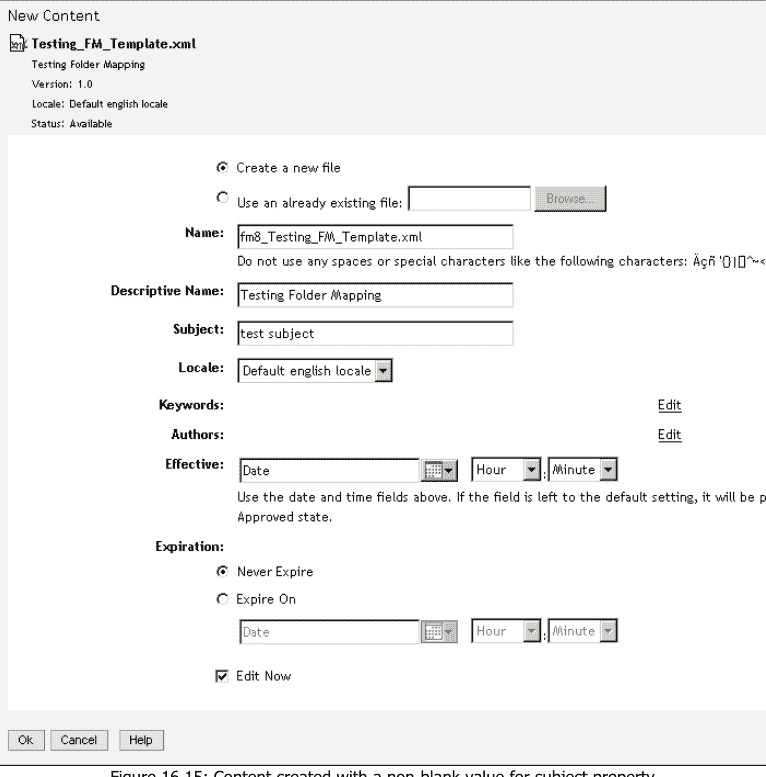

图 16.15：使用 subject 属性的非空白值创建的内容

- 3. 你会注意到新内容已成功创建（参见图 16.16），位于 Web Cabinet Test_WebCabinet 下，由 Folder Map 在运行时创建的 folder test_subject 中。

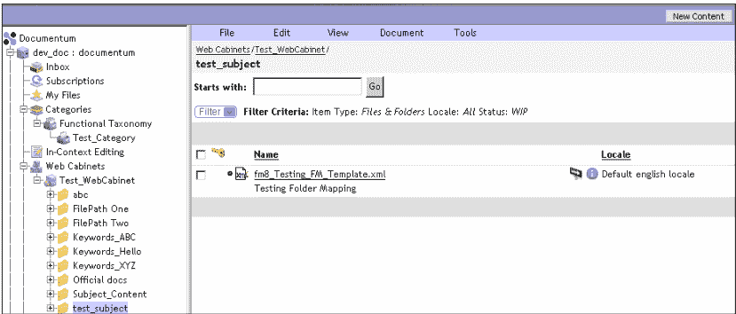

图 16.16：由 Folder Mapping 在运行时创建的 folder test_subject

## 16.3.7 带重复属性的动态文件夹映射

在了解了动态文件夹映射的简单示例后，现在让我们举一个示例，其中 Folder Map 配置为将内容文件放置在 Web Cabinet 中动态创建的文件夹内。内容必须满足的重复属性条件是：其第二个 keywords 属性为 abc：keywords[1]= 'abc'

如果满足上述条件，则内容文件将放置在 Test_WebCabinet Web Cabinet 下，其中的文件夹名称与内容创建者为内容的 keywords 属性提供的第二个值相同（即 abc）。

- 1. 以管理员身份登录 Web Publisher 并签出 Site Manager | Configurations | Foldermaps 下的 FolderMap.xml 文件。

按如下所示修改 FolderMap.xml 文件并将其签回 Docbase。

```
<folder_map>
    <rule>
        <attr_list>
            <attr>
                <name>keywords[1]</name>
                <value>abc</value>
            </attr>
        </attr_list>
        <path_list>
            <path>/Test_WebCabinet/$(keywords[1])</path>
        </path_list>
    </rule>
    <rule>
        <attr_list>
            <attr>
                <name></name>
                <value></value>
            </attr>
        </attr_list>
        <path_list>
            <path></path>
        </path_list>
    </rule>
</folder_map>
```

Folder Map 将在运行时创建与第二个关键词的值（即 keywords[1]）同名的文件夹。

- 2. 创建一些新内容并将 abc 写入 keywords 属性的第二个条目，如图 16.17 所示。

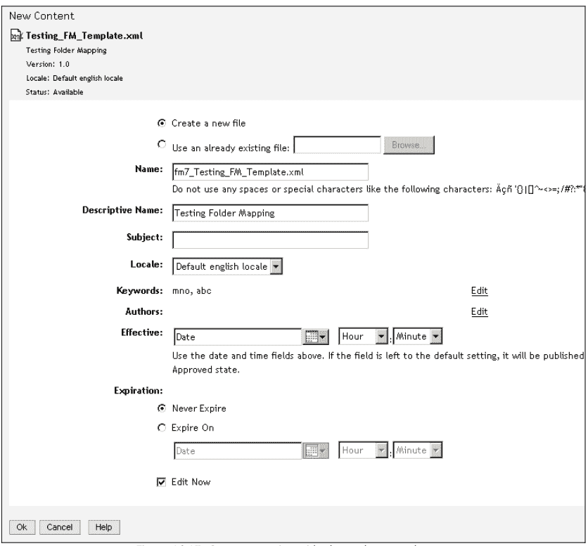

图 16.17：以 abc 作为第二个条目的内容创建

## 文件夹映射

- 3. 你会注意到新内容已成功创建（参见图 16.18），位于 Web Cabinet Test_WebCabinet 下，由 Folder Map 在运行时创建的 folder abc 中。

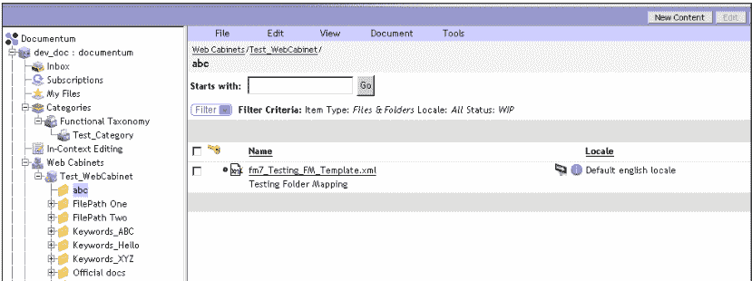

图 16.18：根据指定的重复属性值在运行时创建的文件夹

## Documentum 5.3 更新

Documentum Web Publisher 版本 5.3 为您提供创建和配置多个 Folder Maps 的功能。

Folder Mapping 的内容远不止本章所讨论的。Documentum Web Publisher 手册详细介绍了 Folder Mapping，您可以阅读它们以更好地理解该主题。

## 16.4 摘要

Web Publisher Folder Map (FolderMap.xml) 是一个 XML 文件，由规则组成，这些规则根据内容文件的匹配 Docbase 属性将创建的内容文件映射到 Web Cabinets 中的指定文件夹位置。

在本章中，我们最初在示例产品制造商公司的背景下讨论了 Folder Maps 以及其网站的结构。我们继续研究了 Folder Map 文件中的各种 XML 元素以及 Web Publisher 中 Folder Maps 的一些限制。

最后，我们查看了多个配置 Folder Maps 的示例，使用各种属性匹配机制、单属性和重复属性，以及运行时的动态文件夹映射。


## 17 使用指令文件

## 使用指令文件

在运行中的 Documentum 中最常见的问题之一是模板的更改。在任何给定时间，都有一定量的内容是从模板文件创建的。如果由于某些业务需求，该模板文件的结构需要更改，使用旧版本模板已创建的现有内容会怎样？

模板是否仍能正常运行？新的模板结构是否会自动反映在现有内容中？您是否必须重新创建所有现有内容，以便使其符合更新后的模板结构？

极其相关的问题——简短的回答是：不！Documentum 开发者预见到了这种情况，并在 Web Publisher 中加入了指令文件，以帮助您根据更新后的模板文件更新现有内容的结构。

让我们考虑一个小例子。

想象一个模板文件，内容创建者用它来为其网站创建常见问题解答（FAQ）部分。该模板在编辑器中有以下字段：

- 一个可重复的块，允许为模板字段输入多个值
- 问题字段
- 答案字段

假设内容创建者基于上述模板结构创建内容，为多个问答集提供值。然而，经过一段时间后，业务团队意识到他们需要在创建内容时根据相关性对问题进行标记。简而言之，他们希望在从同一模板创建内容时将问题分类为非常重要、重要和中等。

在这种情况下，我们只能采取以下两种方法：

- 通过包含所有必需字段（如问题、答案和相关性顺序）制作单独的模板，并使用此新模板重新创建所有现有内容。
- 通过引入名为相关性顺序的第三个字段修改现有模板，并手动编辑/更新所有现有内容。

通常，大多数业务用户会采用第二种方法，原因如下：

- 它节省了他们维护同一模板两个版本的开销。
- 它节省了他们重新创建内容的精力。

Web Publisher 指令文件通过提供可配置的 XML 元素帮助我们实现这一点，这些元素可根据更新后的模板结构更新现有的 XML 内容文件，而无需我们手动编辑/更新现有内容文件。

指令文件可以对现有 XML 内容文件执行各种功能，如图 17.1 所示。

| 执行的功能 | 指令文件元素 |
|---|---|
| 插入新的 XML 元素 | `<insert-element>` |
| 删除现有的 XML 元素 | `<delete-element>` |
| 向 XML 元素插入属性 | `<insert-attribute>` |
| 从 XML 元素删除属性 | `<delete-attribute>` |
| 更新现有 XML 元素的值 | `<update-element-value>` |

图 17.1：指令文件的一些 XML 元素

Documentum 开发者网站提供了一个用于创建指令文件的向导工具。请访问以下 URL 了解更多详情：

http://customernet.documentum.com/developer/tippage.htm

您可以下载此工具并按照 Instruction File Builder PDF 中提到的说明进行操作，以避免手动创建指令文件。

> 请注意，本书中的指令文件是使用标准文本/XML 编辑器创建的，而不是使用指令文件构建器工具。

### 17.1 指令文件的限制

在深入了解其具体用法之前，值得提及指令文件的一些限制。

为了更新现有 XML 元素的值，使用 <update-element-value> 指令文件元素。然而，前提是正在更新的 XML 元素不应包含任何子元素。

例如，如果使用 <update-element-value> 更新 <BOOK> XML 元素，则 <BOOK> 元素不应有任何子元素。以下 <BOOK> 元素无法更新：

```
<BOOK>
  <AUTHOR></AUTHOR>
</BOOK>
```

类似地，<update-element-value> 仅在正在更新的 XML 元素不为空时才能正常工作。简而言之，元素中存在一些文本（可能包括空白）。以下 <BOOK> 元素无法更新：

```
<BOOK></BOOK>
```

然而，以下 XML 元素是 <update-element-value> 的有效候选：

```
<BOOK>ABC</BOOK>
```

对于熟悉 XML/XSL 的人来说，相对路径在指令文件中不起作用。XML 路径语言（XPath）//（双斜杠）表达式在使用指令文件时失败，应作为规则避免使用。

在以下条件下，XML 文件无法使用指令文件进行更新：

- 如果 XML 文件处于其生命周期的暂存状态
- 如果 XML 文件处于签出状态
- 如果 XML 文件是更改集的一部分

指令文件始终对文件进行版本控制（即为 XML 文件提供新的版本号），即使指令未对相关 XML 文件的结构进行任何更改。此外，文件将被置于其生命周期的 WIP 状态。

例如，让我们考虑一个场景，其中在指令文件中使用 <delete-attribute> 指令从 XML 元素 <BOOK> 中删除属性 bookname。

如果 <BOOK> XML 元素不包含名为 bookname 的属性，<delete-attribute> 指令仍会对 <BOOK> XML 元素起作用，并且当它找不到名为 bookname 的属性时，仍会将 XML 文件保存为新版本。

### 17.2 指令文件示例

让我们举几个例子来了解指令文件在 Documentum 中是如何工作的。

### 17.2.1 使用 <delete-element> 从 XML 文件中删除 XML 元素

让我们通过一个非常简单的例子来说明，其中内容是从一个简单的模板 XML 文件创建的，后来模板文件中的一个 XML 元素被移除。现有内容通过使用 <delete-element> 指令的简单指令文件进行更新。

1. 根据以下结构创建模板文件（original_Template.xml）及其关联的规则文件（original_TemplateRules.xml）：

模板文件 original_Template.xml：

```
<?xml version="1.0" encoding="UTF-8"?>
<PRODUCTINFO>
  <NAME/>
  <SHORTDESC/>
  <COST/>
  <PRODUCTTYPE/>
</PRODUCTINFO>
```

规则文件 Original_TemplateRules.xml：

```
<?xml version="1.0" encoding="UTF-8"?>
<rules>
  <tagcontent tag_name="NAME">
    <textline instruction="Please enter a name" label="Product name:" required="Y">
    </textline>
  </tagcontent>
  <tagcontent tag_name="SHORTDESC">
    <content instruction="please provide a short description for product" label="Product Description:" lines="5">
    </content>
  </tagcontent>
  <tagcontent tag_name="COST">
    <textline instruction="Please enter cost in dollars" label="Cost:">
    </textline>
  </tagcontent>
  <tagcontent tag_name="PRODUCTTYPE">
    <choice instruction="Please choose a type" label="Product Type:" values="Type A,Type B,Type C">
    </choice>
  </tagcontent>
</rules>
```

2. 使用模板文件 Original_Template.xml 创建两组内容并为其命名（参见图 17.2 和 17.3）。例如：Testing1_Original_Template.xml 和 Testing2_Original_Template.xml。

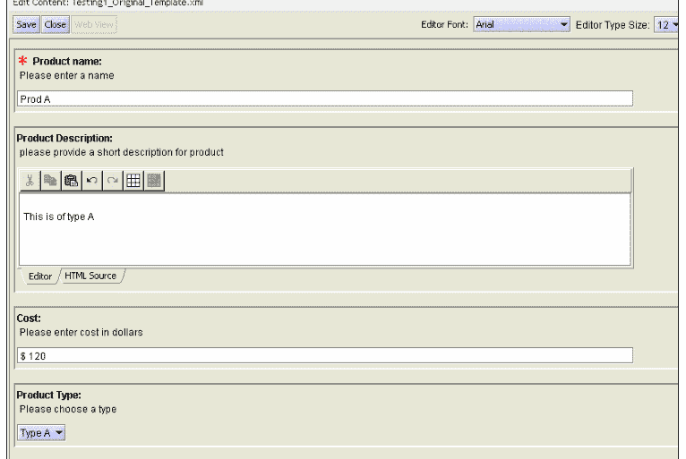

图 17.2：从模板 Original_Template.xml 创建的第一个内容

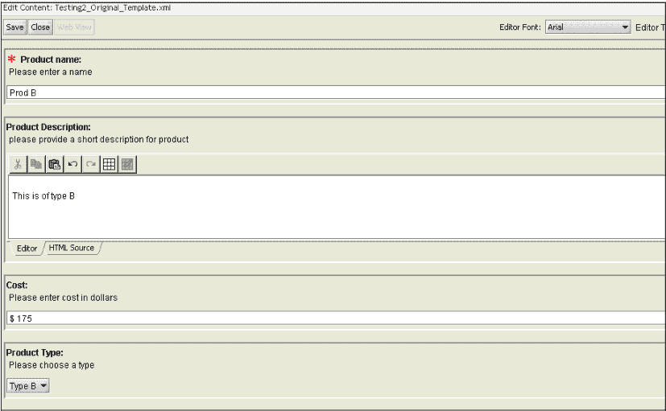

图 17.3：从模板 Original_Template.xml 创建的第二个内容

您可以通过 Web Publisher 中的文件 | 导出查看已创建内容的 XML 结构，并将内容 XML 文件导出到访问 Web Publisher 的本地机器上。

以下是上述创建的内容的内容 XML 文件。这些文件是从模板文件 original_Template.xml 版本 1.0 创建的：

```
Testing1_Original_Template.xml:
<?xml version="1.0" encoding="UTF-8"?>
<PRODUCTINFO>
    <NAME>Prod A</NAME>
    <SHORTDESC>
        <p>
This is of type A
        </p>
    </SHORTDESC>
    <COST>$ 120</COST>
    <PRODUCTTYPE>Type A</PRODUCTTYPE>
</PRODUCTINFO>
```

```
Testing2_Original_Template.xml:
<?xml version="1.0" encoding="UTF-8"?>
<PRODUCTINFO>
    <NAME>Prod B</NAME>
    <SHORTDESC>
        <p>
This is of type B
        </p>
    </SHORTDESC>
    <COST>$ 175</COST>
    <PRODUCTTYPE>Type B</PRODUCTTYPE>
</PRODUCTINFO>
```


3. 通过移除 <COST/> XML 元素来修改原始模板 XML 文件。
以下是修改后的模板文件（版本 2.0）original_Template.xml。

```
<?xml version="1.0" encoding="UTF-8"?>
<PRODUCTINFO>
  <NAME/>
  <SHORTDESC/>
  <PRODUCTTYPE/>
</PRODUCTINFO>
```

4. 使用任意 XML 编辑器，创建一个指令文件（Delete_Element_Instruction.xml），该文件通过移除其包含的 <COST> XML 元素来更新内容 XML 文件。
以下指令文件（Delete_Element_Instruction.xml）可在此类场景中使用：

```
<?xml version="1.0" encoding="UTF-8"?>
<instructions xmlns="http://www.documentum.com/wp" xmlns:xsi="http://www.w3.org/2001/XMLSchema-instance" xsi:schemaLocation="http://www.documentum.com/wp instructions.xsd">
  <delete-element>
    <path>/PRODUCTINFO</path>
    <nodename>COST</nodename>
    <comments>Deleting COST element</comments>
  </delete-element>
</instructions>
```

上述指令文件的结构解析：

- `<delete-element>`: 用于删除现有 XML 元素的指令文件元素
- `<path>`: 用于标识要删除的 XML 元素当前存在的路径的 XPath 表达式
- `<nodename>`: 要删除的目标节点（XML 元素）的名称
- `<comments>`: 说明指令文件用途的可选注释

5. 以管理员身份从 Web Publisher 左侧树窗格浏览至 Site Manager | Instructions。创建文件夹以存储自定义指令文件。在创建的文件夹内，通过选择 File | Import 导入 Delete_Element_Instruction.xml 指令文件，如图 17.4 和 17.5 所示。

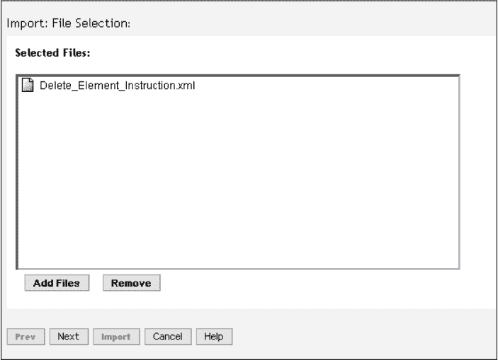

图 17.4：导入 Delete_Element_Instruction.xml 文件（步骤 1）

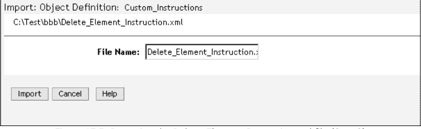

图 17.5：导入 Delete_Element_Instruction.xml 文件（步骤 2）

6. 就指令文件的配置而言，我们已全部准备就绪。现在，在 Site Manager | Templates 下浏览到修改后模板文件 `original_Template.xml` 的相应类别。选择修改后的模板文件 `original_Template.xml` 并点击如图 17.6 所示的 View | Versions 选项。

## 使用指令文件

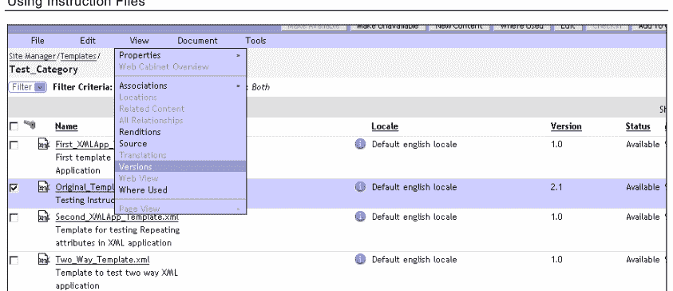

图 17.6：查看修改后模板文件的所有版本

7. 参考图 17.7；从所示版本中选择模板文件的版本 1.0，因为现有内容是从模板的旧版本（1.0）创建的，而不是修改后的模板文件版本 2.0。

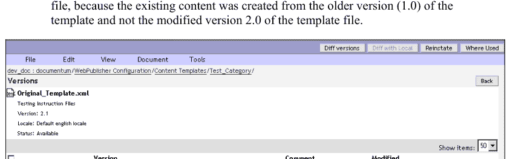

图 17.7：选择内容所创建的模板文件版本

选择版本 1.0 后，点击如图 17.7 所示位于右上角的 Where Used 按钮。所有从所选模板文件版本创建的内容文件都将被显示。

选择要由指令文件更新的内容文件，然后点击如图 17.8 所示右上角的 Update Content 按钮。

我们仅选择了 Testing1_Original_Template.xml 内容文件。

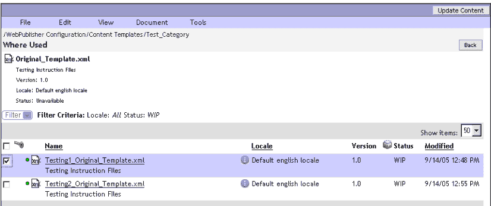

图 17.8：选择要由指令文件更新的内容文件

8. 选择相关指令文件，方法是点击如图 17.9 所示的 Select Instructions file 链接。我们选择了指令文件 Delete_Element_Instruction.xml。最后点击 OK。

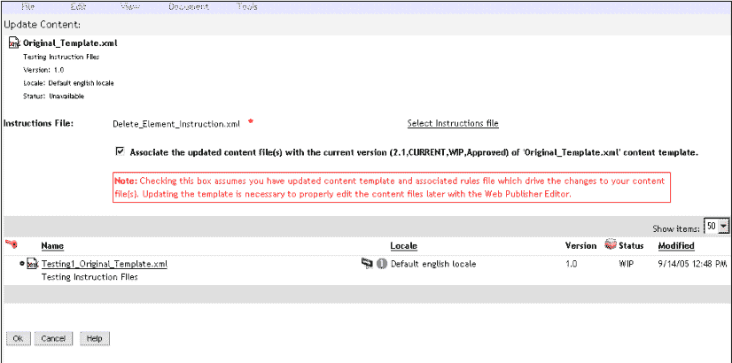

图 17.9：选择正确的指令文件

9. 指令文件处理被触发，所选内容文件根据更新后的模板文件结构进行修改。点击 Web Publisher 中的 Task Status 按钮可显示指令文件处理的狀態。例如：当您使用 Delete_Element_Instruction.xml 指令文件更新 XML Content Task 时，wcmLog 文件夹中会创建 UPDATE_XMLCONTENT_1126683079171 日志文件。

## 使用指令文件

10. 以管理员身份登录 Documentum Administrator 并进入 Cabinets | WebPublisher Configuration。点击 WcmLog 文件夹以查看上述指令文件处理生成的日志文件（参见图 17.10）。

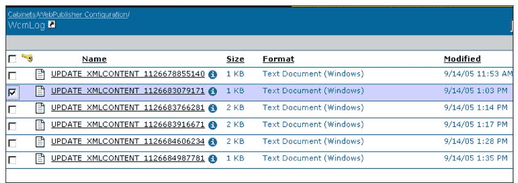

图 17.10：由于指令文件处理而存在的日志文件

11. 验证指令文件应用后内容文件 Testing1_Original_Template.xml 的状态，如图 17.11 所示。您可以看到 Testing1_Original_Template.xml 文件的版本现为 1.1（在应用指令文件之前其版本为 1.0）。选择该文件并点击 File | Export 将更新后的内容文件导出到您的客户端机器。

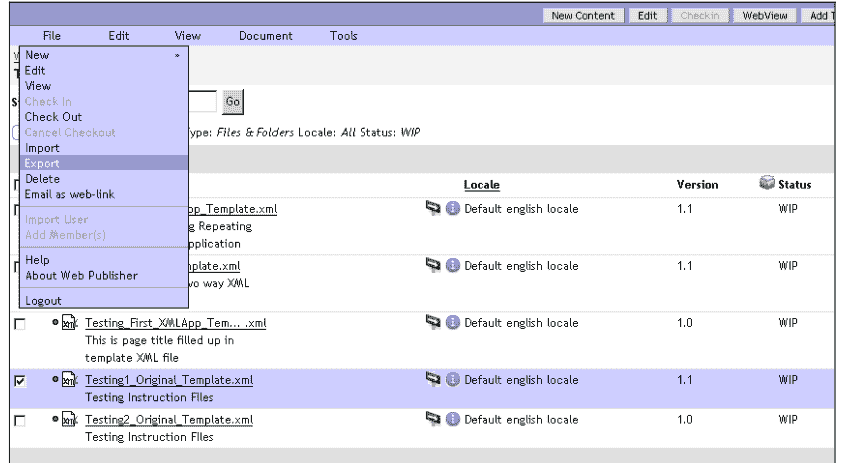

图 17.11：导出更新后的内容文件

更新后的内容文件 Testing1_Original_Template.xml：

```
<?xml version="1.0" encoding="UTF-8"?>
<PRODUCTINFO>
    <NAME>Prod A</NAME>
    <SHORTDESC>
<p>
This is of type A
</p>
</SHORTDESC>
    <PRODUCTTYPE>Type A</PRODUCTTYPE>
</PRODUCTINFO>
```

请注意此内容文件中不存在 <COST> XML 元素。

另一个内容文件（Testing2_Original_Template.xml）仍为版本 1.0，因为它未通过指令文件进行更新。

如果您使用 Web Publisher 编辑器编辑内容 Testing1_Original_Template.xml，则 Cost: 字段将不会显示，符合更新后的模板结构。图 17.12 显示了在 Web Publisher 编辑器中查看的、没有 Cost 字段的更新后内容文件。

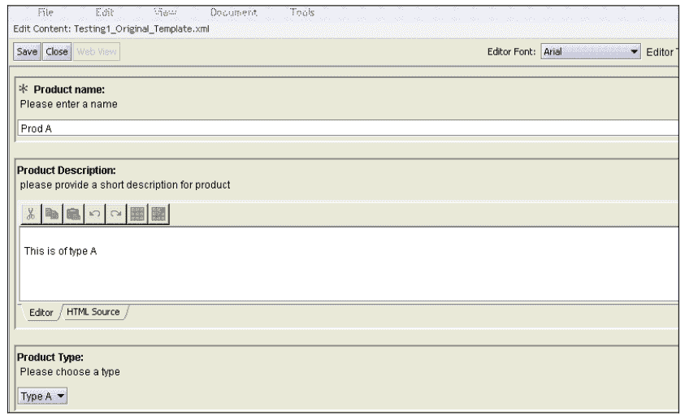

图 17.12：更新后的内容文件中未显示 Cost 字段

在 Web Publisher 编辑器中打开另一个内容文件 Testing2_Original_Template.xml 仍会根据模板文件的旧版本显示 Cost: 字段。

这是一个从内容文件中删除现有 XML 元素的简单示例。让我们继续进行更多示例，以便更好地理解指令文件的强大功能。

## 17.2.2 使用 <insert-element> 向 XML 文件添加 XML 元素

让我们举一个示例，其中内容是从简单的模板 XML 文件创建的，然后向模板文件添加新的 XML 元素。现有内容通过使用 <insert-element> 指令的指令文件进行更新。

1. 根据以下结构更新现有模板文件（original_Template.xml）及其关联的规则文件（original_TemplateRules.xml）：

更新后的模板文件 Original_Template.xml：

```
<?xml version="1.0" encoding="UTF-8"?>
<PRODUCTINFO>
    <NAME/>
    <SHORTDESC/>
    <PRODUCTTYPE/>
    <PRICEINFO/>
</PRODUCTINFO>
```

请注意，我们已向模板文件添加了新的 <PRICEINFO> XML 元素。

更新后的规则文件 Original_TemplateRules.xml：

```
<?xml version="1.0" encoding="UTF-8"?>
<rules>
    <tagcontent tag_name="NAME">
        <textline instruction="Please enter a name" label="Product name:" required="Y">
        </textline>
    </tagcontent>

    <tagcontent tag_name="SHORTDESC">
        <content instruction="please provide a short description for product" label="Product Description:" lines="5">
        </content>
    </tagcontent>

    <tagcontent tag_name="COST">
        <textline instruction="Please enter cost in dollars" label="Cost:">
        </textline>
    </tagcontent>

    <tagcontent tag_name="PRODUCTTYPE">
        <choice instruction="Please choose a type" label="Product Type:" values="Type A,Type B,Type C">
        </choice>
    </tagcontent>

    <tagcontent tag_name="PRICEINFO">
        <textline charlength="50" instruction="Please enter a price for the product" label="Enter price:">
        </textline>
    </tagcontent>
</rules>
```

图 17.13 显示了 Web Publisher 模板编辑器屏幕。

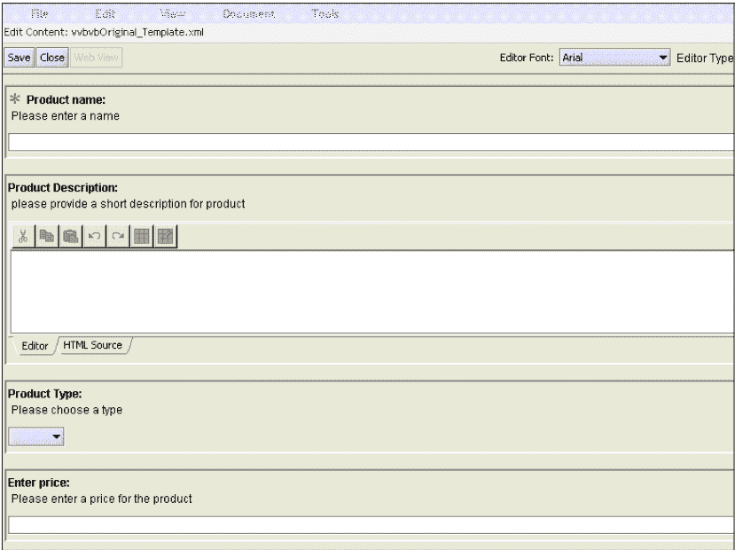

图 17.13：创建新内容时显示的 Web Publisher 编辑器

2. 使用任意 XML 编辑器，创建一个指令文件（Add_Element_Instruction.xml），该文件通过添加新的 <PRICEINFO> XML 元素来更新内容 XML 文件。

以下指令文件（Add_Element_Instruction.xml）可在此类场景中使用：

```
<?xml version="1.0" encoding="UTF-8"?>
<instructions xmlns ="http://www.documentum.com/wp"
xmlns:xsi="http://www.w3.org/2001/XMLSchema-instance"
xsi:schemaLocation="http://www.documentum.com/wp instructions.xsd">
<insert-element>
<path>/PRODUCTINFO</path>
<nodename>PRICEINFO</nodename>
<value>$ 100</value>
<comments>testing insert element PRICEINFO</comments>
</insert-element>
</instructions>
```


Anatomy of the above Instruction File:

- `<insert-element>`: Instruction File element to add an XML element to an XML content file
- `<path>`: XPath expression to identify the path where the XML element to be inserted/added currently exists
- `<nodename>`: Name of the target node (XML element) to be inserted
- `<value>`: Text value of the XML element to be set
- `<comments>`: Optional comments stating the purpose of the Instruction File

3. Browse to Site Manager | Instructions from the left tree pane in Web Publisher as an administrator and import the Add_Element_Instruction.xml Instruction File by choosing the File | Import option. Complete all the steps described in the previous example.

4. Update the content file Testing1_Original_Template.xml with the Instruction File Add_Element_Instruction.xml. You can verify that the version of the Testing1_Original_Template.xml file has been updated.

Choose the file and click on File | Export to export the updated content file on your client machine.

Here is the updated content file Testing1_Original_Template.xml after the Add_Element_Instruction.xml Instruction File has been applied:

```
<?xml version="1.0" encoding="UTF-8"?>
<PRODUCTINFO>
    <NAME>Prod A</NAME>
    <SHORTDESC>
<p>
This is of type A
</p>
    </SHORTDESC>

    <PRODUCTTYPE>Type A</PRODUCTTYPE>
<PRICEINFO>$ 100</PRICEINFO>
</PRODUCTINFO>
```

Notice that the <PRICEINFO> XML element has been added in this content file with the value $ 100.

The other content file (Testing2_Original_Template.xml) is still in version 1.0 since it was not updated via the Instruction File.

If you edit the content Testing1_Original_Template.xml using Web Publisher editor, the Enter price: field will be shown as per the updated template structure (refer to figure 17.14).

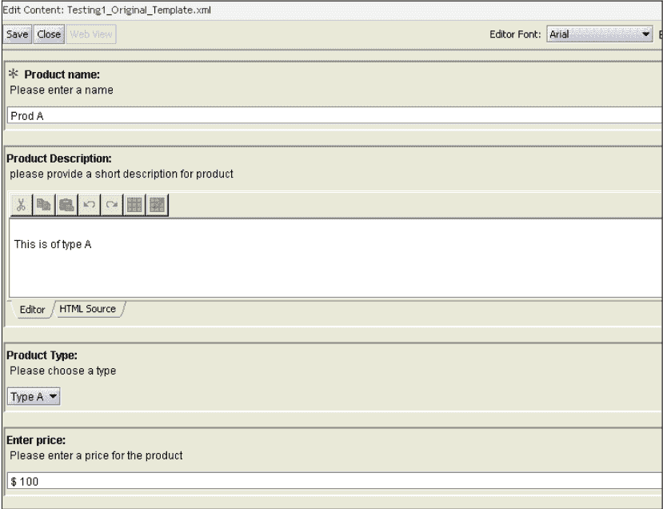

Figure 17.14: Enter price field shown as per updated template file

### 17.2.3 Updating the Value of an XML Element in an XML File with <update-element-value>

Let us now take an example where content is created from a simple template XML file and then the value of an XML element in content files is to be updated. The existing content is updated via an Instruction File using the <update-element-value> instruction.

+   1. Using any XML editor, create an Instruction File update_Element_value_Instruction.xml that updates content XML files by updating the value of their <PRICEINFO> XML element.

The following Instruction File (update_Element_value_Instruction.xml) can be used in such a scenario:

```
<?xml version="1.0" encoding="UTF-8"?>
<instructions xmlns ="http://www.documentum.com/wp"
xmlns:xsi="http://www.w3.org/2001/XMLSchema-instance"
xsi:schemaLocation="http://www.documentum.com/wp instructions.xsd">
<update-element-value>
<path>/PRODUCTINFO</path>
<nodename>PRICEINFO</nodename>
<value>Price Not available</value>
<comments>Updating the value of PRICEINFO element</comments>
</update-element-value>
</instructions>
```

Anatomy of this Instruction File:

- `<update-element-value>`: Instruction File element to set a new text value for the specified XML element in an XML content file
- `<path>`: XPath expression to identify the path where the XML element to be updated currently exists
- `<nodename>`: Name of the target node (XML element) whose value needs to be updated
- `<value>`: The new text value that needs to be set for the XML element in question
- `<comments>`: Optional comments stating the purpose of the Instruction File

+   2. Browse to Site Manager | Instructions from the left tree pane in Web Publisher as an administrator and import the Update_Element_Value_Instruction.xml Instruction File by choosing the File | Import option. Complete all the steps as described in the first example.
+   3. Update the content file Testing1_Original_Template.xml with the Instruction File Update_Element_Value_Instruction.xml. You can verify that the version of the Testing1_Original_Template.xml file has been updated.
+   4. Choose the file and click on File | Export to export the updated content file on your client machine.

The updated content file Testing1_Original_Template.xml after Update_Element_Value_Instruction.xml Instruction File has been applied:

```
<?xml version="1.0" encoding="UTF-8"?>
<PRODUCTINFO>
  <NAME>Prod A</NAME>
  <SHORTDESC>
    <p>
This is of type A
    </p>
  </SHORTDESC>
  <PRODUCTTYPE>Type A</PRODUCTTYPE>
  <PRICEINFO>
    Price Not available
  </PRICEINFO>
</PRODUCTINFO>
```

Notice that the value of the <PRICEINFO> XML element has been updated in this content file with the value Price Not available.

The other content file (Testing2_Original_Template.xml) is still in version 1.0 since it was not updated via the Instruction File.

If you edit the content Testing1_Original_Template.xml using Web Publisher editor, the Enter price: field will be shown as per the updated template structure (refer to figure 17.15).

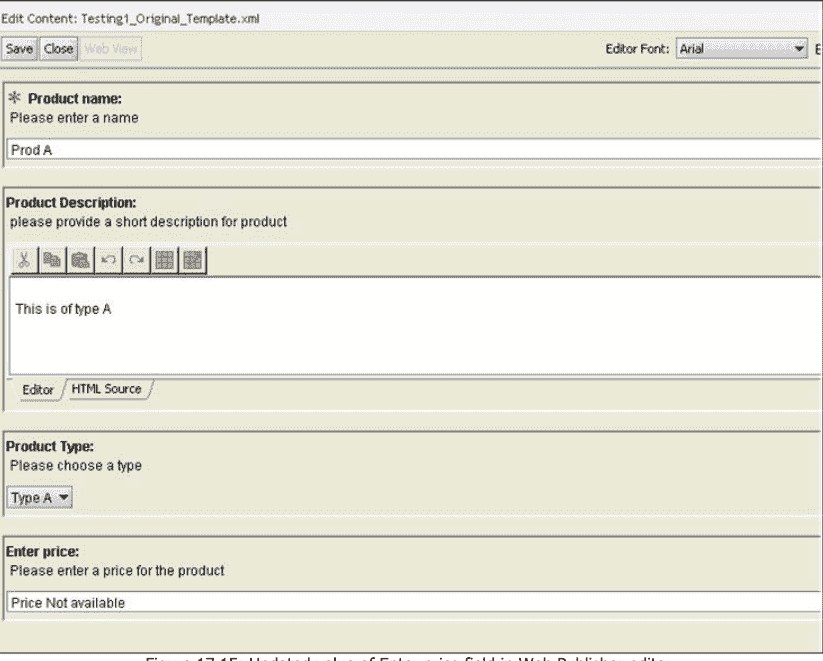

Figure 17.15: Updated value of Enter price field in Web Publisher editor

This should give you all a fairly good understanding of Instruction Files and their usage scenarios. For a comprehensive understanding of Instruction Files, go through the Documentum Web Publisher Administration guide.

## 17.3 Summary

In this chapter we learned that Web Publisher Instruction Files provide configurable XML elements allowing us to update the structure of existing XML content files as per the updated template structure.

We also looked at some of the XML elements in Instruction Files and discussed the limitations of using Instruction Files in Web Publisher.

With the help of detailed examples, we saw how to use Instruction Files to delete an XML element from a content XML file, add a new XML element, and update the existing value of an XML element.

## 18 Automatic Property Extraction (APE)

## Automatic Property Extraction (APE)

Automatic property extraction (or APE in short) is one of the most powerful and useful features provided by Documentum DFC. One of the most frequent business needs is to automatically set a document's attributes (properties) based on the values set by the content creator in the content template (XML file). Let us understand this through a very simple example.

Imagine a fictitious template that requires users to fill in an Article Title field in the XML template. The requirement is that the value entered by the content creator in this field should be automatically saved in the title attribute (property) of the document as well.

Let's say that the content creator provides the following value for Article Title: Major breakthrough in financial investments. The value is saved in the <ARTICLE TITLE> XML element (for example) in the content file created by the user.

Through its Automatic Property Extraction feature (and if configured correctly), Documentum automatically copies the value specified by the user in the <ARTICLE TITLE> field in to the title attribute (property) of the document, whenever the user saves and checks in the document.

Through some other configuration settings, it could even work the other way round. The XML element can also be populated automatically based on the value provided by a user in the attribute for the document.

Property extraction adds value for the business content creators in the following ways:

- It saves the effort of manually entering the same value at two places—the properties page and the content file (template editor).
- It saves the effort (and time) to open Web Publisher editor by allowing them to enter values in the Properties page itself.

Note that Automatic property extraction works with the following Web Publisher widgets only:

- textline
- checkbox
- choice

### 18.1 How Automatic Property Extraction Works

Internally Documentum uses the following two object types for managing Automatic property extraction for XML elements:

- `dm_xml_application` (supertype: `dm_folder`): Used for creating a folder under the \System\Applications folder in Docbase to store the XML configuration objects (`dm_xml_config`).
- `dm_xml_config` (supertype: `dm_document`): Specifies the XML configuration file to be used for the specified XML application.

The property extraction rules need to be specified within the XML configuration file. Once you have created the XML application folder and saved the XML configuration file within it, you need to set the a_category attribute of the content file. DFC queries this attribute and detects the Automatic Property Extraction rules to be applied to the content file based on its XML configuration file. You, however, need to ensure that the dm_xml_application folder and the dm_xml_config application file have exactly the same names, since Documentum Content Server searches for the XML application file based on the exact name that we specify in the content file's a_category attribute.

We are free to not specify any XML Application for the content file. In such cases, the Default XML Application provided by Documentum is used.

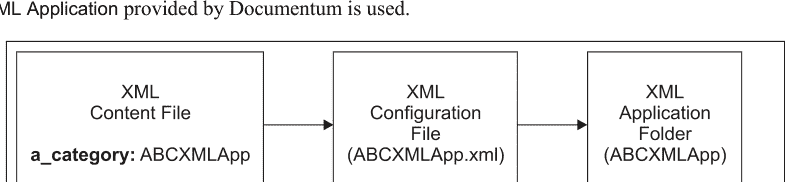

Figure 18.1: How XML Application works

Internally, Documentum uses a SAX parser for XML processing of documents against the associated XML Application and DOM for reading the XML configuration file.


## 18.2 自动属性提取的简单示例

让我们通过一个简单的示例来了解如何在 Documentum 中使用自动属性提取。我们将看到 XML 应用程序是如何创建的，如何将其附加到内容文件，以及它最终是如何工作的。

- 1. 请参阅图 18.2；在 Web Publisher 中创建并导入一个模板（例如 First_XMLApp_Template.xml）并将其附加到具有 Default Lifecycle 的 dm_document 对象类型。

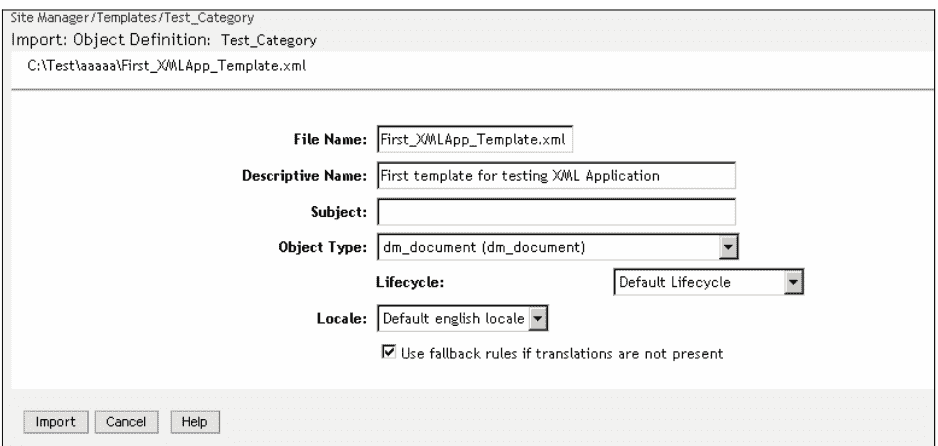

图 18.2：为我们的第一个 XML 应用程序创建模板文件

以下是模板文件 First_XMLApp_Template.xml：

```
<?xml version="1.0" encoding="UTF-8"?>
<ROOTTAG>
    <TITLEOFPAGE/>
    <SHORTDESC/>
</ROOTTAG>
```

- 2. 为模板创建一个规则文件（例如 First_XMLApp_TemplateRule.xml）并将模板文件与此规则文件关联。以下是规则文件 First_XMLApp_TemplateRule.xml：

```
<?xml version="1.0" encoding="UTF-8"?>
<rules>
    <tagcontent tag_name="TITLEOFPAGE">
        <textline charlength="200" instruction="Enter Title of the page" label="Page Title" required="Y">
        </textline>
    </tagcontent>
    <tagcontent tag_name="SHORTDESC">
        <textline charlength="200" instruction="Enter a small description/subject of the page" label="Page subject" required="Y">
        </textline>
    </tagcontent>
</rules>
```

- 3. 单击信息图标（i）并在模板的 Category 字段中提供 XML 配置文件的名称，如图 18.3 所示。这将设置模板的 a_category 属性。

- 4. 您甚至可以通过 IAPI 按如下方式执行此操作：

```
API>id,c,dm_document where object_name = 'First_XMLApp_Template.xml' and a_is_template = '1'
API>set,c,l,a_category
Data: FirstXMLApp
API>save,c,l
```

请注意，API 命令中显示的 'l' 是对执行查询时返回的对象 ID 的别名引用。有关 API 命令的更多信息请参见第 26 章。

我们将在接下来的几个步骤中创建 XML 应用程序文件 FirstXMLApp.xml。

请注意，在填写 Category 字段时，必须从 XML 配置文件名的名称中去掉 .xml 扩展名。如果未执行此操作，则针对该模板的 XML 应用程序将无法工作。

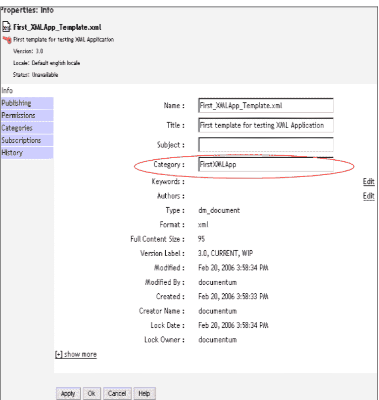

图 18.3：为模板指定 a_category 属性

- 5. 在您喜欢的 XML 编辑器中创建 XML 应用程序配置文件。我们将创建第一个名为 FirstXMLApp.xml 的 XML 配置文件。此 XML 应用程序的目的是将模板 XML 文件中 <TITLEOFPAGE> 元素和 <SHORTDESC> 元素中的值分别映射到 dm_document 对象的 title 和 subject 属性。XML 配置文件 FirstXMLApp.xml 如下所示：

```
<?xml version="1.0" encoding="UTF-8"?>
<!DOCTYPE application SYSTEM "config_5.2.dtd">
<application>
  <name>FirstXMLApp</name>
  <app_pattern>
<element>ROOTTAG</element>    <!-- Specifying the XML Root element-->
</app_pattern>

<map_rules>
    <xml_content_rule>
        <element_selection_pattern>
            <element>ROOTTAG</element>
        </element_selection_pattern>

        <variables>    <!-- Defining variables to map values in object
            attribute-->
            <variable>
                <name>TitleOfPage</name>    <!-- Storing the value of
                TITLEOFPAGE template element -->
                <content_of_element>
                    <element_selection_pattern>
                        <element>TITLEOFPAGE</element>
                    </element_selection_pattern>
                </content_of_element>
            </variable>
            <variable>
                <name>ShortDescOfPage</name>    <!-- Storing the value of
                SHORTDESC template element -->
                <content_of_element>
                    <element_selection_pattern>
                        <element>SHORTDESC</element>
                    </element_selection_pattern>
                </content_of_element>
            </variable>
        </variables>
        <object_type>dm_document</object_type>    <!-- Specifying the object
        type-->
        <metadata>
            <dctmatt>
                <name>title</name>    <!-- Saving value in title
                attribute-->
                <template><var name="TitleOfPage"/></template>
            </dctmatt>
            <dctmatt>
                <name>subject</name><!-- Saving value in subject attribute-->
                <template><var name="ShortDescOfPage"/></template>
            </dctmatt>
        </metadata>
        <make_entity/>
    </xml_content_rule>
</map_rules>

</application>
```

让我们讨论上述 XML 配置文件的结构：

```
<!DOCTYPE application SYSTEM "config_5.2.dtd">
```

这是 XML 文件序言。由于 XML 配置是一个 XML 文档，其将遵循的 DTD 在此处指定。XML 应用程序文件中引用的 config_5.2.dtd 文件可在 Web Publisher 中的以下位置找到：Cabinets | System | Applications | Default XML Application.

```
<application>
```

这是 XML 配置文件的根元素。

```
<name>FirstXMLApp</name>
```

这是 XML 应用程序的名称。

```
<element>ROOTTAG</element>
```

需要通过 XML 应用程序处理的模板 XML 文件的大小写敏感根元素。

```
<element>ROOTTAG</element>
```

这是需要通过 XML 应用程序处理的模板 XML 文件的根元素名称。

> 您在 XML 配置文件中看到的 XML 元素均在 config_5.2.dtd 文件中声明。

<variable> 表示定义的变量名及其值，例如 XML 元素名和属性值。在此声明了两个变量：变量 TitleOfPage 存储 TITLEOFPAGE XML 元素的值，变量 ShortDescOfPage 存储 SHORTDESC XML 元素的值。

```
<object_type>dm_document</object_type>
```

<object_type> 指定需要由 XML 元素映射其属性的 Documentum 对象类型。

<dctmatt r>：设置单个值的 Documentum 对象属性的值。

在这里，我们通过变量 TitleOfPage 设置 title 属性的值，通过变量 ShortDescOfPage 设置 subject 属性的值。

> 对于重复值的 Documentum 对象属性，请在 XML 配置文件中使用 <dctmatt r_repeating> 元素。我们将在本章后面查看一个相关示例。

- 6. 现在我们将执行使 XML 应用程序正常工作所需的必要配置。以管理员身份登录 Web Publisher 并转到 Cabinets | System | Applications。

选择 File | New folder 并创建新的 XML 应用程序文件夹，如图 18.4 所示。

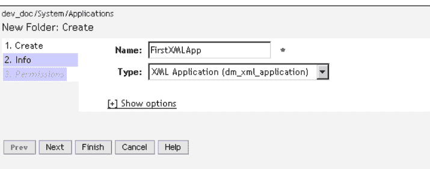

图 18.4：创建 XML 应用程序文件夹

- 7. 在创建了 FirstXMLApp 文件夹后，单击它并在此文件夹内导入 XML 配置文件。

在导入 XML 配置文件之前，请确保 config_5.2.dtd 和 FirstXMLApp.xml 文件位于您机器本地硬盘上的同一位置。选择 File | Import 并从本地机器中选择 FirstXMLApp.xml 文件，如图 18.5 所示。


图 18.5：导入 XML 配置文件

- 8. 在导入 XML 配置文件时，选择类型为 dm_xml_config，格式为 XML Document，XML Category 为 Default XML Application，如图 18.6 所示。导入此配置文件时请记住去掉名称中的 .xml。

这完成了将 XML 应用程序与内容模板 XML 文件关联所需的步骤。


图 18.6：创建 dm_xml_config 对象

## 18.3 测试我们的第一个 XML 应用程序

现在让我们在 Web Publisher 中创建一些示例内容并查看 XML 应用程序为我们工作。

如图 18.7 所示创建一些新内容并单击 Ok。

在模板中保存内容并关闭编辑器后，使用 File | Check In 将内容检入。


## 自动属性提取 (APE)


Figure 18.7: 新内容属性屏幕

在 Web Publisher 模板编辑器中填写一些虚拟数据（参考图 18.8）到 Page Title 和 Page subject 字段中。


Figure 18.8: 创建新内容时显示的模板编辑器

你可以看到（参考图 18.9），Title 和 Subject 字段已被自动填充为用户在模板中 Page Title 和 Page subject 字段中保存的值。


Figure 18.9: 创建内容的属性屏幕

> 请注意，使用 Web Publisher 模板编辑器的 content widget 来填充对象属性的值会带来问题。例如，你希望从内容模板字段捕获格式化的數據并填充到对象属性中。在这种情况下，不要使用 content widget，而应使用 textline widget。

你可以在 textline 字段中按如下方式输入格式化数据：<b>某些数据</b>。

这会通过我们的 XML Application 保存到属性中。现在你已经看到了一个非常简单的 XML Application 工作模型，让我们通过一些复杂示例进一步探索 XML Application。

## 18.4 使用自动属性提取填充重复属性

让我们创建一个模板文件，允许内容创建者在重复块中输入多个书籍名称以及其作者名称。

我们将开发一个自定义 XML Application，将文档的 authors 多值重复属性填充为在模板文件中输入的作者名称。

- 1. 在 Web Publisher 中创建并导入一个模板（例如 Second_XMLApp_Template.xml）并将其附加到具有默认生命周期的 dm_document 对象类型。模板文件 Second_XMLApp_Template.xml 如下：

```
<?xml version="1.0" encoding="UTF-8"?>
<BOOK>
    <REPEATBLOCK>
        <BOOKNAME/>
        <AUTHORNAME/>
    </REPEATBLOCK>
</BOOK>
```

为上述模板创建一个 Rules 文件（例如 Second_XMLApp_TemplateRule.xml）并将模板文件与此 Rules 文件关联。Rules 文件 Second_XMLApp_TemplateRule.xml 如下：

```
<?xml version="1.0" encoding="UTF-8"?>
<rules>
    <tagcontent tag_name="BOOKNAME">
        <textline charlength="100" instruction="Please provide the name of the book" label="Book Name">
        </textline>
    </tagcontent>

    <tagcontent tag_name="AUTHORNAME">
        <textline charlength="100" instruction="Please provide the name of the author" label="Author Name">
        </textline>
    </tagcontent>

    <repeatdef instruction="Provide as many values as you want" label="repeating block for books and authors" tag_list="REPEATBLOCK">
    </repeatdef>
</rules>
```

- 2. 创建一个 XML 配置文件 SecondXMLApp.xml，并在模板 Second_XMLApp_Template.xml 的 Category 字段中提供 XML 配置文件名称（不带 .xml）。这将设置模板的 a_category 属性。

SecondXMLApp.xml 文件如下所示：

```
<?xml version="1.0" encoding="UTF-8"?>
<!DOCTYPE application SYSTEM "config_5.2.dtd">
<application>
  <name>SecondXMLApp</name>
  <app_pattern>
    <element>BOOK</element>    <!-- Specifying the XML Root element BOOK-->
  </app_pattern>

  <map_rules>
    <xml_content_rule>
      <element_selection_pattern>
        <element>BOOK</element>
      </element_selection_pattern>

      <variables>    <!-- Defining variable to map values in object attribute authors-->
        <variable>
          <name>authorName</name>    <!--Getting the value of AUTHORNAME template element -->
          <content_of_element>
            <element_selection_pattern>
              <element>AUTHORNAME</element>
            </element_selection_pattern>
          </content_of_element>
        </variable>
      </variables>
      <object_type>dm_document</object_type>    <!-- Specifying the object type -->
      <metadata>
        <dctm attr_repeating>
          <name>authors</name>    <!-- Saving value in authors repeating attribute-->
          <template><var name="authorName"/></template>
        </dctm attr_repeating>
      </metadata>
      <make_entity/>
    </xml_content_rule>
  </map_rules>
</application>
```

<dctm attr_repeating>: 设置多值（重复）Documentum 对象属性的值。

在这里，我们通过变量 authorName 设置 authors 多值属性的值。

变量 authorName 捕获内容创建者在模板文件的 AUTHORNAME 重复元素中输入的多个值。

- 3. 完成配置此 XML Application 的所有必需步骤，与我们为第一个 XML Application 所做的完全相同。

## 18.5 测试第二个 XML Application

让我们再次使用 Second_XMLApp_Template.xml 模板在 Web Publisher 中创建示例内容，看看 XML Application 为我们工作。

按图 18.10 所示创建一些新内容并单击 Ok。

保存模板中的内容并关闭编辑器后，使用 File | Check In 检入内容。


Figure 18.10: 新内容属性屏幕

我们在 Web Publisher 模板编辑器中为书名和作者名填写了两个条目（使用模板重复小部件）。模板中填写的作者名为 Mr. Gary Harrow 和 Ms Jenny Hall，如图 18.11 所示。


Figure 18.11: 创建新内容时显示的模板编辑器

你可以看到 authors 属性已被自动填充为用户在模板中 Author Name 字段中保存的值（参考图 18.12）。
此外，默认情况下，Documentum 会为创建的所有内容在 authors 属性中填写内容创建者用户名称。由于我们以 documentum 用户身份创建了此内容，authors 属性也包含此值。

## 属性：信息

test_Second_XMLApp_Template.xml
用于测试 XML 应用中重复属性的模板
版本：1.3
语言环境：默认英语语言环境
状态：WIP

- 信息
- 发布
- 权限
- 分类
- 订阅
- 历史

名称：test_Second_XMLApp_Template.xml
标题：用于测试重复属性的模板
主题：
分类：SecondXMLApp
关键词：
作者：Mr. Gary Harrow, Ms Jenny Hall, documentum
类型：dm_document
格式：xml
完整内容大小：348
版本标签：1.3, CURRENT, WIP
修改时间：Feb 20, 2006 4:04:06 PM
修改者：documentum
创建时间：Feb 20, 2006 4:04:06 PM
创建者名称：documentum
锁定日期：Feb 20, 2006 4:04:06 PM
锁定所有者：documentum
[+ ] 显示更多
应用  确定  取消  帮助

Figure 18.12: 创建内容的属性屏幕

我们到目前为止看到的示例有一个共同点：内容创建者在模板字段中输入的值会通过 XML Application 自动填充到对象属性中。如果我们需要反向操作怎么办？一个典型的业务需求可能是内容创建者在某个属性字段（例如 subject）中输入值，并且该值应自动填充到模板文件中的特定字段。

Documentum 通过 XML 配置文件中的 two_way_dctm attr 元素提供此功能，我们现在将看到。

## 18.6 使用双向属性提取

让我们创建一个模板文件，允许内容创建者在文档的属性屏幕中输入 subject 属性。我们将创建一个自定义 XML Application，将此值填充到模板文件的 SUBJECT 元素中。

- 1. 在 Web Publisher 中创建并导入一个模板（例如 Two_way_Template.xml）并将其附加到具有默认生命周期的 dm_document 对象类型。以下是模板文件 Two_way_Template.xml：
- 2. 为上述模板创建一个 Rules 文件（例如 Two_Way_TemplateRule.xml）并将模板文件与此 Rules 文件关联。以下是 Rules 文件 Two_Way_TemplateRule.xml：
- 3. 创建一个 XML 配置文件 TwoWayXMLApp.xml，并在模板 TwoWayXMLApp.xml 的 Category 字段中提供 XML 配置文件名称（不带 .xml）。这将设置模板的 a_category 属性。TwoWayXMLApp.xml 文件如下所示：

```
<?xml version="1.0" encoding="UTF-8"?>
<INFORMATION>
<SUBJECT/>
</INFORMATION>
```

```
<?xml version="1.0" encoding="UTF-8"?>
<rules>
    <tagcontent tag_name="SUBJECT">
        <textline charlength="150" instruction="Enter a subject here" label="Subject:">
        </textline>
    </tagcontent>
</rules>
```

## 自动属性提取 (APE)

```xml
<?xml version="1.0" encoding="UTF-8"?>
<!DOCTYPE application SYSTEM "config_5.2.dtd">
<application>
    <name>TwoWayXMLApp</name>
    <app_pattern>
        <element>INFORMATION</element>      <!-- Specifying the XML Root element INFORMATION -->
    </app_pattern>
    <map_rules>
        <xml_content_rule>
            <element_selection_pattern>
                <element>INFORMATION</element>
            </element_selection_pattern>
            <variables>      <!-- Defining variable to map values in object attribute subject -->
                <variable>
                    <name>subjectValue</name>      <!--Getting the value of SUBJECT template element -->
                    <content_of_element>
                        <element_selection_pattern>
                            <element>SUBJECT</element>
                        </element_selection_pattern>
                    </content_of_element>
                </variable>
            </variables>
            <object_type>dm_document</object_type>      <!-- Specifying the object type -->
            <metadata>
                <two_way_dctmattr>
                    <name>subject</name>    <!-- Saving value in subject attribute-->
                    <var name="subjectValue"/>
                </two_way_dctmattr>
            </metadata>
            <make_entity/>
        </xml_content_rule>
    </map_rules>
</application>
```

在这段代码中，<two_way_dctmattr> 设置单个 Documentum 对象属性和映射的模板 XML 文件元素的值。

在这里，我们已通过变量 subjectvalue 将 subject 属性的值映射到内容创建者在模板文件中的 SUBJECT 元素中输入的值。

> 对于具有重复值的 Documentum 对象属性，请在您的 XML 配置文件中使用 <two_way_dctmattr_repeating> 元素。

- 4. 按照我们为之前的 XML 应用程序所做的方式，完成配置此 XML 应用程序所需的所有步骤。

### 18.7 测试双向属性提取 XML 应用程序：

让我们使用 Two_way_Template.xml 模板在 Web Publisher 中创建示例内容，以研究 Documentum 中双向属性提取的工作原理。

按图 18.13 所示创建一些新内容并单击“确定”。


图 18.13：创建新内容

在模板中显示的 Subject 字段中输入一些值（参见图 18.14）并保存数据。

## 自动属性提取 (APE)


图 18.14：模板中输入的 Subject 值

关闭模板后，单击新创建内容旁的信息图标 (i)。您可以看到其 Subject 属性已自动填充用户在模板中填写的值，如图 18.15 所示。


图 18.15：属性屏幕中自动填充的 Subject 属性

在 Subject 属性中输入新值（参见图 18.16）并单击“确定”。再次打开内容的模板文件。


图 18.16：修改 Subject 属性的值

您可以验证在属性屏幕中提供的 subject 属性的值已自动填充到模板中的 Subject: 字段中，如图 18.17 所示。


图 18.17：通过属性屏幕输入的值在模板字段中可见。

自动属性提取的内容远不止本章刚刚学习的内容。然而，就入门而言，本章肯定会帮助您了解 XML 应用程序中可用的丰富功能领域。如有必要，请阅读 Documentum 手册中有关 XML 应用程序的更多内容，以获得深入的理解。

### 18.8 摘要

自动属性提取 (APE) 是一种功能，允许您将指定模板 XML 元素的值自动分配给指定的文档属性，反之亦然。

在本章的介绍中，我们看到 APE 仅适用于以下 Web Publisher 小部件：Textline、checkbox 和 choice。

我们进一步了解了 Documentum 如何使用 dm_xml_application 和 dm_xml_config 对象来管理 APE。

我们随后研究了一个在 Documentum 中创建 XML 应用程序的简单示例，并对其在 Web Publisher 中创建的示例内容进行了测试。我们还查看了使用 APE 填充重复属性和进行双向属性提取的示例。
