## 19 使用工作流

我们已在第 11 章和第 12 章中创建了自定义生命周期并将其与自定义新闻文章对象类型关联。这意味着从新闻文章对象类型（和模板）创建的内容可以通过生命周期的不同状态进行路由，例如 WIP、Staging 和 Approved。你是否曾想过内容是如何自动在不同的生命周期状态之间进展的？你当然可以选择内容项并手动提升、降级或强制提升它们以在各种线性生命周期状态之间移动它们。然而，在实际场景中，你的业务用户希望有一个自动化流程来实现这一点。业务团队通常想要的是一种受控的自动化机制，即由一组用户创建的内容可以电子方式发送给审阅者组进行初步审阅。审阅者或批准者的顺序/并行组的数量可能特定于某个业务。一旦内容最终经过审阅和批准，它应该在实时网站上可用，并且处于终端生命周期状态（例如 Approved/Active）。在审阅和批准过程的任何时间点，内容都应处于中间生命周期状态，例如 WIP 或 Staging。

将内容通过其众多生命周期阶段路由，然后再发布到生产网站所需的这种自动化业务流程在 Documentum 用语中称为 **workflow**。

工作流与生命周期并行存在，并通过让内容创建者和审阅者遵守组织制定的规范来为团队定义业务策略。

请注意，虽然生命周期仅定义内容项生命的不同阶段，但工作流实际上定义了内容如何通过这些不同阶段移动、谁在各种活动中使其移动、个人组和用户在不同活动中执行什么操作等。

在 Documentum 中，工作流模板用于创建各种工作流实例 (`dm_workflow`) 以在生命周期阶段路由内容，并在 Docbase 中以 `dm_process` 对象存在。用于创建和管理工作流模板的 Documentum Workflow Manager 工具在您安装/配置 Documentum Application Builder 后可用。（请参阅第 8 章了解更多详细信息。）

您可以根据特定业务需求创建自定义工作流，或使用 Web Publisher 中开箱即用的以下工作流之一：

- French Translation Workflow
- Request new content
- Submit to website
- Translate and submit to website

启动 Documentum Application Builder 并在 /System/Applications/webPublisher 下打开 WebPublisher DocApp 以查看默认的 Web Publisher 工作流，如图 19.1 所示。

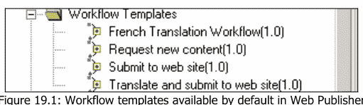

双击上述工作流模板将启动 Workflow Manager 工具并以 GUI 布局的形式显示工作流过程定义。

### 19.1 设计自定义工作流

在创建工作流之前，精心设计工作流至关重要。了解业务（最终）用户对工作流的需求。了解他们需要多少层级的审阅，以及在发布内容到正在运行的网站之前，哪些组/用户需要在内容上执行哪些操作。

我们将在本章中采用一个简单的示例，并创建一个具有以下所述活动/任务的工作流。（请确保根据业务需求自定义/扩展此示例工作流，通过删除/更改现有活动或在必要时添加一些活动。）

- 1. 内容作者创建的内容将提交到工作流。
- 2. 系统此时会自动将内容提升到 Staging 生命周期状态。
- 3. 内容（以工作流任务的形式）到达所有内容管理员组用户的收件箱中进行一轮审阅。
- 4. 第一个获取工作流任务的内容管理员用户可以对其进行审阅。
- 5. 内容管理员可以审阅内容，如果没问题，可以提交它。
- 6. 系统会自动将内容提升到 Approved 生命周期状态，标记为最终批准并准备根据内容指定的生效日期转为 Active。

- 7. 如果内容管理员审阅内容后不满意，他/她可以将内容退回给内容作者组，要求进行具体修改。
- 8. 系统会在此时自动将内容降级到 WIP 生命周期状态。
- 9. 内容（以工作流任务的形式）会到达所有内容作者组成员的收件箱中以便进行修改。
- 10. 第一个获取该工作流任务的内容作者用户可以开始处理它。
- 11. 内容作者可以编辑和修改内容，并再次提交给内容管理员组成员进行审阅。
- 12. 系统会在此时自动将内容提升到 Staging 生命周期状态。
- 13. 然后重复第 3 点所述的活动序列。

图 19.2 描述了上述提到的工作流步骤。

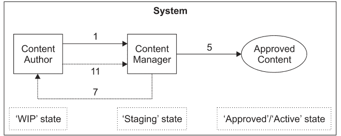

Figure 19.2: 自定义工作流的图形表示

## 19.2 设置自定义工作流模板

我们现在将使用 Documentum Workflow Manager 工具创建上述自定义工作流模板。

请按照以下步骤创建、保存、验证和安装您的自定义工作流模板：

- 1. 启动 Workflow Manager 并以管理员身份登录 Docbase。身份验证通过后，空白的工作流模板编辑器屏幕将显示给您，如图 19.3 所示。

## 使用工作流

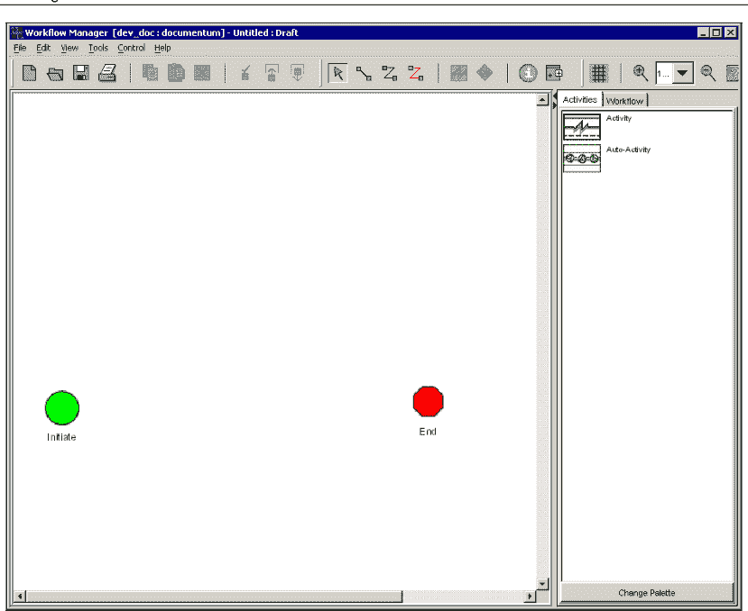

Figure 19.3: 创建工作流模板的空白编辑器

请注意，使用此工具创建的任何工作流模板中都已包含开始（Initiate）和结束活动。系统会阻止您从工作流中移除这两个活动。

- 2. 工作流模板是通过组合多个 **活动**（运行时转换为工作流任务）并通过 **流** 连接它们来创建的。然后您向流中添加 **包** 以通过工作流路由内容。现在不必担心这些术语。我们将在本章继续创建工作流时详细介绍它们。

右侧面板中的 Activities 选项卡显示了两种类型的活动（参见图 19.4）：

- **活动**：由组或个人用户手动执行
- **自动活动**：由系统自动执行，无需人工干预

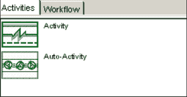

Figure 19.4: 工作流活动

您只需从 Activities 调色板将活动（手动或自动）拖放到工作流模板创建屏幕上。将这些自定义活动包含在 Initiate 和 End 活动之间。现在您需要使用流连接这些活动。

流有不同种类：

- **单段流**：如图 19.5 中箭头图标旁所示。用于以正向流用单条直线连接两个活动。
- **多段流**：以正向流用由多个线段组成的线连接两个活动。
- **拒绝流**：以反向流连接两个活动（当组/用户拒绝工作流任务时使用）。

箭头符号用于在工作流模板编辑器窗格中选择对象。

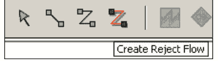

Figure 19.5: 工作流模板流

双击活动会打开一个 Activity Inspector 窗口，允许您为其提供配置详细信息。双击连接的流会打开一个 Flow Inspector，允许您向流中添加包并定义其他详细信息，例如包类型和版本。

图 19.6 是我们自定义工作流在工作流模板编辑器中创建时的最终视觉表示：

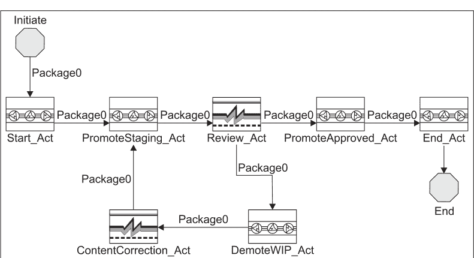

Figure 19.6: 自定义工作流模板（视觉表示）

请注意，某些活动如 Review_Act 和 ContentCorrection_Act 是手动的，而其他活动如 Start_Act、PromoteStaging_Act、PromoteApproved_Act、DemoteWIP_Act 和 End_Act 是自动的。这些活动已通过流连接，并按图 19.6 所示在名为 Package0 的包中路由内容。

我们将通过随后提到的步骤系列创建此自定义工作流模板，并在您继续阅读时定义各个活动。

- 3. 选择菜单选项 File | Template Properties 来定义有关该自定义工作流模板的一些基本信息。使用工作流模板属性屏幕（参见图 19.7），您可以指定：
- 工作流模板所有者：默认情况下，您是您创建的工作流模板的所有者。如果您是超级用户，可以更改工作流模板的所有者。
- 描述：您可以为工作流模板指定简短描述。
- 默认别名集：您可以选择为相关工作流模板指定别名集。
- 工作流模板说明：您可以向活动执行者提供有关他们有权执行的任务的说明。
- 模板审计跟踪设置：您可以为从工作流模板创建的工作流实例打开或关闭审计跟踪。
- 保存后始终显示验证和安装提示：如果您希望系统在您对工作流模板进行更改并保存时自动提示您进行验证然后安装，请选择此复选框。

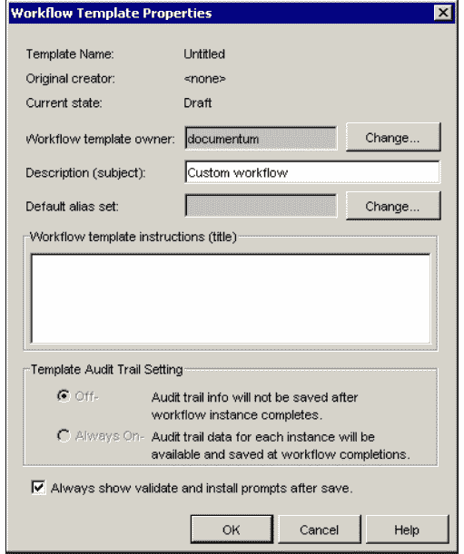

Figure 19.7: 工作流模板属性屏幕

- 4. 在您通过定义所有活动和流创建工作流模板后，选择菜单选项 File | Save（参见图 19.8）将工作流模板保存到 Docbase 中的某个方便位置。

为工作流模板提供一个唯一名称（例如 Custom_workflow）并浏览/选择 Docbase 柜路径以保存它。我们已将其保存在以下 Docbase 位置：/System/Applications/TestDocApp/Custom_workflow。

请注意，TestDocApp 是 Docbase 中我们自定义 DocApp 的名称。

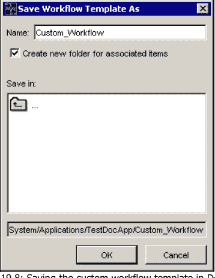

Figure 19.8: 在 Docbase 中保存自定义工作流模板

参见图 19.9；保存工作流模板后，系统将提示您验证模板，并在所有验证测试完成后安装它。

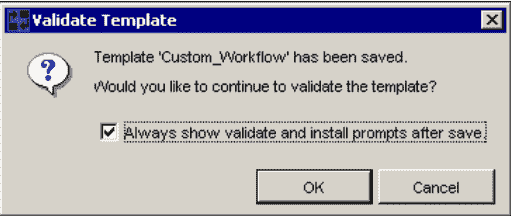

Figure 19.9: 工作流模板系统验证

请注意，如果您希望 Docbase 用户使用工作流模板，则安装工作流模板非常重要。未安装的工作流不能由用户在不同的生命周期状态下用于路由内容。

- 5. 已安装的工作流模板还需要在 Web Publisher 中设为可用，以便 Web Publisher 用户可以使用它创建工作流实例。

以管理员用户身份登录 Web Publisher 并进入 Administration | Web Publisher Admin | Workflow Templates 部分。

新创建的自定义工作流模板（Custom_workflow）在已安装状态下在 Web Publisher 中显示为不可用（参见图 19.10）。

选择自定义工作流模板旁边的复选框，并在工具栏中单击 Make Available，如图 19.10 所示。这使得自定义工作流模板可在 Web Publisher 中使用。

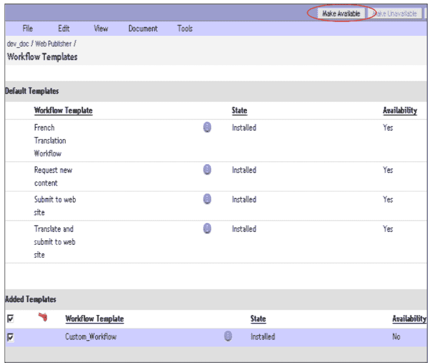

Figure 19.10: 在 Web Publisher 中使自定义工作流模板可用

- 6. 您需要为新创建的工作流模板进一步设置适当的 Permission Set 模板（ACL）。系统分配给自定义工作流模板的 ACL 可能由于权限不当而阻止某些用户将内容提交到从该模板创建的工作流实例。选择自定义工作流模板旁边的复选框并选择 View | Properties | Permissions。
- 单击 Active permissions set 字段旁显示的 Select 链接，并选择要与工作流模板关联的正确 Permission Set。

我们已将 WebPublisher User Default ACL 选择为模板的权限集，如图 19.11 所示。

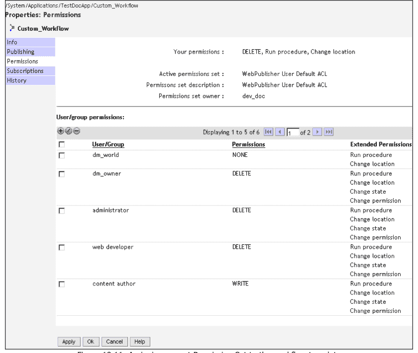

图 19.11：为工作流模板分配正确的权限集

单击“Apply”然后单击“Ok”。您的自定义工作流现在可供 Web Publisher 用户使用。

## 19.3 创建自定义工作流模板

请参考图 19.6，在工作流模板编辑器中从 Activity 调色板中拖放活动。按图所示使用流程箭头连接活动。请注意，您需要按图所示使用拒绝箭头（而不是多段流程）连接 Review_Act 和 DemoteWIP_Act 活动。连接所有活动流程后，双击流程并为所有流程添加类型为 dm_sysobject 的包（默认名称：Package0），以路由对象类型 dm_sysobject 及其子类型的內容。

1. 让我们以创建/配置工作流模板中第一个活动 Start_Act 的活动定义为例。

其余活动可以按照本示例以相同方式创建。

从活动调色板拖动一个 Auto-Activity，并将其放置在工作流模板编辑器中 Initiate（第一个活动）活动之后。

2. 双击新添加的自动活动以打开该活动的 Activity Inspector 屏幕（参见图 19.12）。

在 Activity Inspector 屏幕顶部显示的文本框中为活动提供有意义的名称（例如：Start_Act）。每个活动都需要通过 Activity Inspector 屏幕上显示的各个选项卡进行某些配置设置。

Performer 选项卡允许您选择活动的执行者以及执行者可以执行的动作。

Start_Act 在我们的案例中在工作流启动时由系统自动执行，无需人工干预。

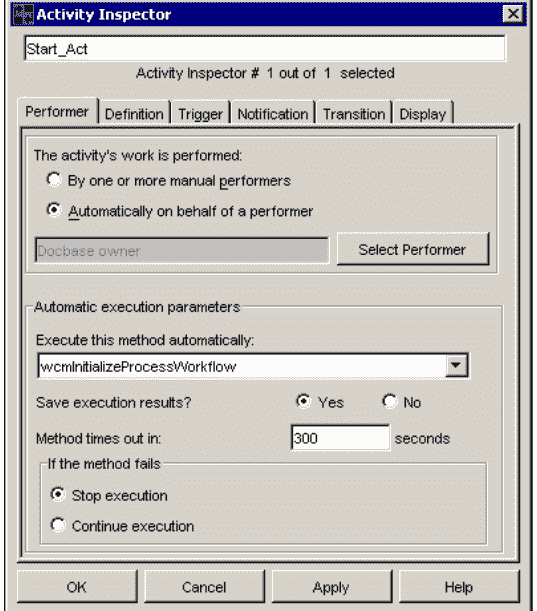

图 19.12：Activity Inspector Performer 选项卡

单击“Select Performer”按钮并选择以 Docbase 所有者的权限执行活动。您也可以选择以下任一方式运行此活动（参见图 19.13）：

-   工作流主管，即工作流的默认创建者
-   前一个活动的执行者
-   某个特定指定用户

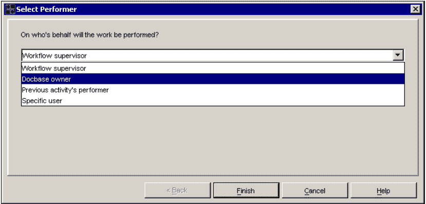

图 19.13：在自动活动中选择执行者

从现有工作流方法的下拉列表中选择在此活动中执行的系统方法（wcmInitializeProcessWorkflow）。

值得一提的是，wcmInitializeProcessWorkflow 是一个 Web Publisher 工作流方法，必须在所有工作流的开始活动中调用。这可防止在特定工作流实例中路由的内容文件在第一个实例完成前被发送到另一个工作流实例。

> 同样，在最后需要有一个清理活动来调用 Web Publisher 的 wcmTerminateProcessWorkflow 方法，以移除 wcmInitializeProcessWorkflow 方法施加的限制。

如果您需要在 Docbase 中保存方法执行结果，请选择适当的单选按钮。

默认情况下，所有活动的方法执行超时为 60 秒。您可以将其更改为 300 秒，为系统执行方法提供额外时间。

如果方法因某些原因失败，您可以通过选择“Stop execution”单选按钮来阻止后续工作流步骤的执行。

请注意，对于 Review_Act 等手动活动，该活动需要内容管理员组中的单个用户来处理任务，需要在 Performer 选项卡下进行以下设置：

-   选择单选按钮“By one or more manual performers”并单击“Select Performer”按钮。
-   从执行者显示的下拉值中选择选项“Single user from group”，如图 19.14 所示。

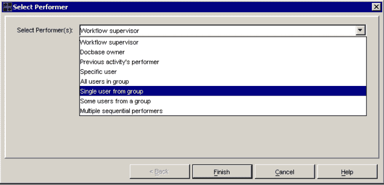

图 19.14：为手动活动选择执行者

参见图 19.15；在“Define Performer(s)”部分下选择“Assign performer(s) now”对应的单选按钮，然后单击“Next”。

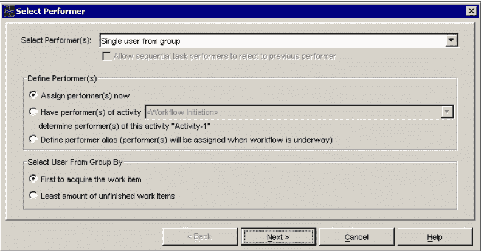

图 19.15：为“Single user from group”选项定义执行者

从图 19.16 所示的 Docbase 组列表中选择 content manager。

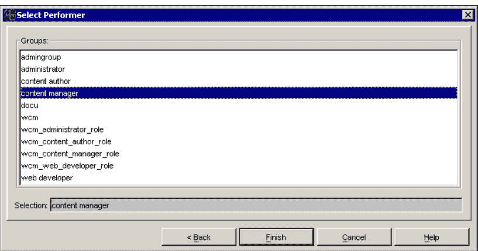

图 19.16：从现有 Docbase 组中选择特定的组名

单击“Finish”以完成该活动的 Performer 选项卡设置。

3. Definition 选项卡（参见图 19.17）允许您设置任务的优先级以及手动执行者的说明。

在 Activity Inspector 屏幕的 Definition 选项卡下，您可以执行以下操作：

-   为活动分配优先级：您可以将任务标记为 Low、Medium 或 High，指示 Content Server 相对于其执行队列中其他待处理操作按指定顺序执行活动。可选地，您可以通过从 Priority 下拉列表中选择 Dynamic 在运行时为其分配优先级。这仅在您通过为工作流编写的自定义代码在运行时设置活动的优先级，而不是通过工作流流程模板执行工作流时才有用。
-   为活动提供简短描述。
-   为活动的手动执行者提供说明。

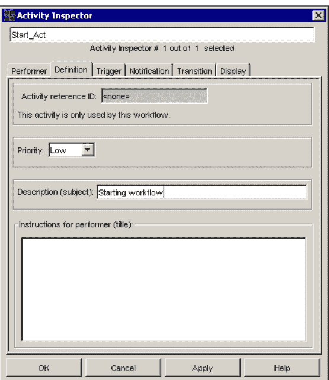

图 19.17：Activity Inspector Definition 选项卡

4. Trigger 选项卡（参见图 19.18）允许您指定活动开始的条件以及任务何时发送到执行者的收件箱。以下活动参数可以在 Definition 选项卡下设置：

-   活动触发时：如果活动有多个输入流，并且只有在所有前置活动完成后才能启动，请选择第一个单选按钮：“All input flows are selected”。如果您要求活动即使某些前置活动已完成也开始，请选择第二个单选按钮，“This number of input flows selected”。请注意，输入流的总数已显示，您只需说明在此活动开始前必须完成的流程数量。
-   您可以通过提供事件名称，可选地指定在触发此活动前发生的特殊事件。您可以提供系统事件，例如：dm_destroy、dm_checkin、dm_checkout 等，或某些自定义事件。您可以在给定的工作流实例中标记活动以运行多次。

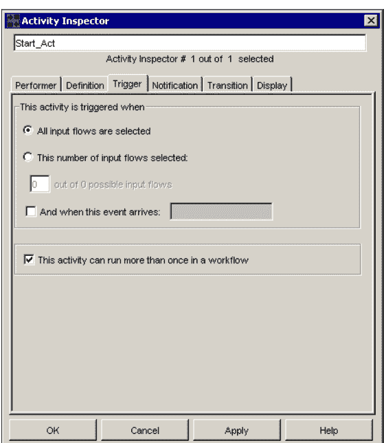

图 19.18：Activity Inspector Trigger 选项卡

请注意，活动 PromoteStaging_Act（请参见图 19.6）有两个输入流：一个来自 Start_Act 活动，一个来自 ContentCorrection_Act。图 19.19 显示了此类活动在 Trigger 选项卡中需要进行的设置。

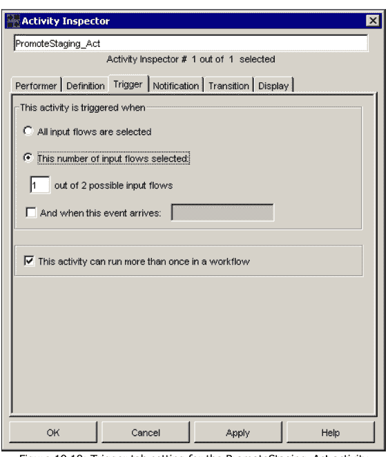

图 19.19：PromoteStaging_Act 活动的 Trigger 选项卡设置

此设置可确保在两个可能的输入流（前置活动）之一被选中时启动 PromoteStaging_Act 活动。

5. Notification 选项卡（参见图 19.20）允许您设置警告计时器，以防活动任务停滞或在指定时间内无人处理时提醒工作流主管。

您可以在工作流启动后的指定时间（以天和/或小时为单位）内，如果特定活动未被触发，系统可以通知工作流主管。

此外，如果特定活动在活动启动后的指定时间（以天和/或小时为单位）内未完成，您可以向工作流主管发送通知。

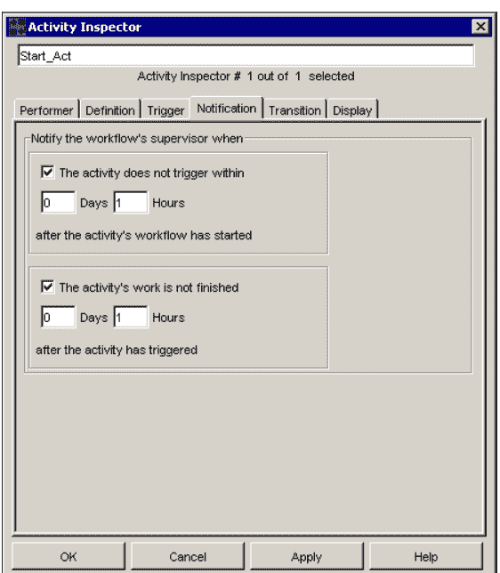

图 19.20：活动检查器通知选项卡

6. 转换选项卡（参见图 19.21）允许您指定工作流中哪些活动接下来跟随此特定活动。如果此活动有多個连接的活动（输出流），您可以：
- 指定系统在该活动完成后选择所有连接的活动。
- 允许活动执行者在运行时选择该活动完成后可以选中的下一个活动的数量。
- 指定某些条件，基于这些条件可在该活动完成后选择下一个活动。

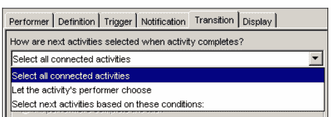

图 19.21：活动检查器中转换选项卡的选项

参见图 19.22；如果活动有多个执行者（基于执行者选项卡下的设置），您可以指定活动是在所有执行者完成其任务时结束，还是在一定数量的执行者完成其任务项时结束。

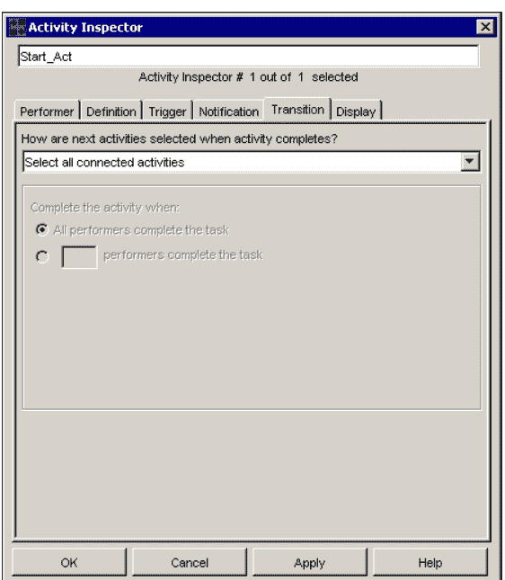

图 19.22：活动检查器转换选项卡

请参阅图 19.6 并注意 Review_Act 活动有两个输出流：一个正向流将其引导至 PromoteApproved_Act 活动，以及一个向后/拒绝流将其引导至 DemoteWIP_Act 活动。

在这种情况下，从下拉菜单中选择“让活动的执行者选择”选项，允许活动的执行者选择多达两个下一个活动（参见图 19.23）。

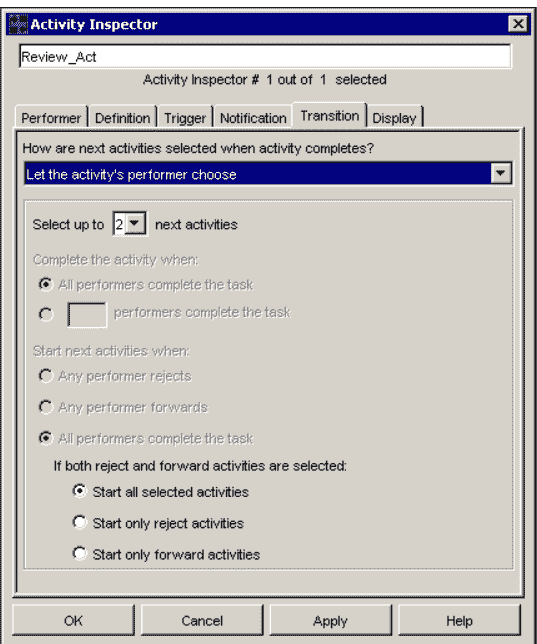

图 19.23：Transition tab setting for the Review_Act activity

7. 显示选项卡（参见图 19.24）只需允许您指定活动在工作流模板编辑器中视觉上如何显示。您可以通过显示选项卡控制以下内容：
- 用于在工作流模板编辑器中显示活动的图像及其显示尺寸。
- 用于在工作流模板编辑器中显示活动标签的字体、字体大小和其他格式功能。
- 是否应在工作流模板编辑器中将活动名称或活动执行者显示为活动的标签。

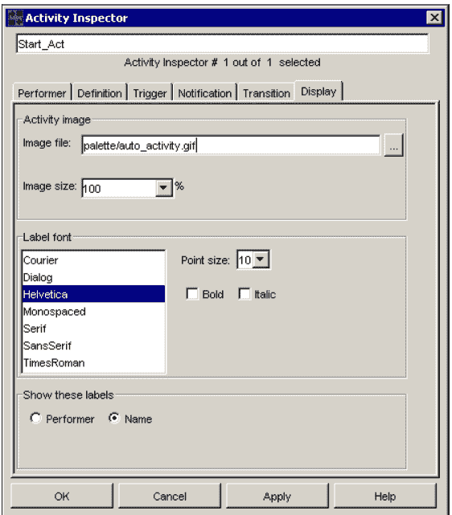

图 19.24：活动检查器显示选项卡

单击“应用”然后“确定”以完成 Start_Act 活动的设置。参阅图 19.6 和以下各节中的表格以创建自定义工作流模板的其他活动。

## 19.3.1 活动的执行者选项卡

| 活动名称 | 手动/自动 | 执行者 | 方法 | 保存执行结果 | 方法超时（秒） | 方法失败时 |
|---|---|---|---|---|---|---|
| Start_Act | Auto | Docbase owner | wcmInitializeProcessWorkflow | Yes | 300 | Stop |
| PromoteStaging_Act | Auto | Docbase owner | wcmPromoteToStaging | Yes | 300 | Stop |
| Review_Act | Manual | Single user from group: content manager | N/A | N/A | N/A | N/A |
| DemoteWIP_Act | Auto | Docbase owner | wcmDemoteToWIP | Yes | 300 | Stop |
| ContentCorrection_Act | Manual | Single user from group: content author | N/A | N/A | N/A | N/A |
| PromoteApproved_Act | Auto | Docbase owner | WcmPromoteToApproved | Yes | 300 | Stop |
| End_Act | Auto | Docbase owner | WcmTerminateProcessWorkflow | Yes | 300 | Stop |

图 19.25：执行者选项卡设置

## 19.3.2 活动的触发选项卡

| 活动名称 | 活动触发时 | 是否可多次运行？ |
|---|---|---|
| Start_Act | All input flows selected | Yes |
| PromoteStaging_Act | 1 out of 2 possible input flows | Yes |
| Review_Act | All input flows selected | Yes |
| DemoteWIP_Act | All input flows selected | Yes |
| ContentCorrection_Act | All input flows selected | Yes |
| PromoteApproved_Act | All input flows selected | Yes |
| End_Act | All input flows selected | Yes |

图 19.26：触发选项卡设置

## 19.3.3 活动的通知选项卡

| 活动名称 | 活动未在...内触发 | 活动工作未在...后完成 |
|---|---|---|
| Start_Act | 1 hour | 1 hour |
| PromoteStaging_Act | 1 hour | 1 hour |
| Review_Act | 1 hour | 1 hour |
| DemoteWIP_Act | 1 hour | 1 hour |
| ContentCorrection_Act | 1 hour | 1 hour |
| PromoteApproved_Act | 1 hour | 1 hour |
| End_Act | 1 hour | 1 hour |

图 19.27：通知选项卡设置

## 19.3.4 活动的转换选项卡

| 活动名称 | 如何选择下一个活动？ | 何时完成活动 | 如果同时选择拒绝和正向活动 |
|---|---|---|---|
| Start_Act | Select all connected activities | All performers complete | N/A |
| PromoteStaging_Act | Select all connected activities | All performers complete | N/A |
| Review_Act | Let the activity's performer choose (select up to 2 next activities) | All performers complete | Start all selected activities |
| DemoteWIP_Act | Select all connected activities | All performers complete | N/A |
| ContentCorrection_Act | Select all connected activities | All performers complete | N/A |
| PromoteApproved_Act | Select all connected activities | All performers complete | N/A |
| End_Act | Select all connected activities | All performers complete | N/A |

图 19.28：转换选项卡设置

## 19.4 向连接流添加包

双击特定连接流或选择连接流并选择菜单选项 Tools | Flow Inspector 以打开如图 19.29 所示的流检查器屏幕。

单击“添加新包”按钮并提供路由包的详细信息，例如其名称和对象类型，以及路由内容的版本。

您可以为包提供有意义的名称，或选择 Documentum 提供的默认包命名约定（Package0、Package1 等）。

包的默认版本标签为 CURRENT，这确保包将包含工作流中最新的内容版本。

您甚至可以为包中的路由内容指定符号（区分大小写）标签，例如 WIP，或数字版本标签，例如 1.0。

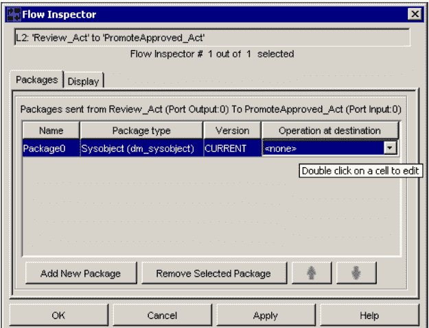

图 19.29：通过流检查器屏幕添加包

请记住，您必须对工作流模板中连接各种活动的每个流重复这些步骤。

## Documentum 5.3 更新

Documentum 版本 5.3 通过提供对单个收件箱的支持引入了新功能，该收件箱可包含来自多个 Docbase 仓库的多个任务。

恭喜！您已创建自己的自定义工作流模板，并已准备好通过将内容提交到此自定义工作流来对其进行测试。

如果您有兴趣了解有关工作流及其高级功能的更多信息，请阅读 Application Builder 用户手册、Web Publisher 管理手册和 Workflow Manager 在线帮助。Documentum 还提供了一个名为 Business Process Manager（简称 BPM）的先进工作流管理工具，扩展了 Workflow Manager 提供的许多功能。讨论 BPM 及其功能超出了本书的范围。不过，您可能希望从 Documentum 的下载站点下载 BPM 软件并阅读其管理手册。

请转到下一章测试您在本章中创建的自定义工作流模板。

## 19.5 摘要

在本章中，我们讨论了工作流如何通过定义业务策略并制定内容在各种生命周期状态下移动的规范、条件以及参与用户和组，与生命周期协同工作。

我们为应用程序设计了一个非常简单的工作流，涉及内容作者、经理和审批者作为参与实体。

我们看到工作流模板是使用 Workflow Manager 工具创建的。每次使用工作流模板启动工作流时，Documentum 都会为其创建一个新的运行时实例。

工作流模板由通过流连接的活动组成。包被添加到流中，以便它们可以通过工作流路由内容。

我们简要讨论了工作流活动分为两种——手动和自动。手动活动由组或用户执行，而自动活动由系统执行。

最后，通过详细的步骤，我们了解了如何创建本章开头设计的自定义工作流模板。

