## 21 使用 SCS 从 Docbase 发布

一旦网站的所有内容都在 Documentum Docbase 中创建，就已达成一个重要里程碑。下一个需要克服的重大障碍是使所有这些内容对网站应用程序（Docbase 之外）可用，以便可以在门户/网站上显示。这引发了一些问题：

- 将内容（以及显然其关联的元数据/属性）从 Documentum Docbase 导出到目标服务器和数据库存储库的难度或容易程度如何，以便 Web 应用程序可以轻松查询并在网站上显示此信息？
- 我们是否需要编写一些自定义代码，以便将 Documentum Docbase 中的庞大数据集发布/导出到文件服务器和数据库？
- 我们如何执行此发布代码/实用程序，使其按定期间隔运行，以确保输入 Docbase 的新内容或已更新的现有内容能够在网站上无缝反映，而无需太多人工干预？

你脑海中可能还有成千上万的其他疑问。好吧，答案是，你无需编写任何自定义代码或应用程序即可从 Documentum Docbase 发布文档及其属性。Documentum Site Caching Services 提供了易于配置且绝对极易使用的界面，用于为你的 Docbase 设置发布配置。

快速参考，请查阅我们在第 4 章中关于 Site Caching Services 和 SCS 架构的早期讨论。

Documentum **Site Caching Services**（SCS）允许你轻松配置并从 Docbase 直接向网站主机和数据库表发布文档及其属性（例如标题、作者、关键字、自定义添加的属性等）。通过在 Documentum Administrator 中创建站点发布配置，你可以指定需要发布哪些类型的文档、从哪个 Web Cabinet 文件夹发布这些文档、需要与实际内容文件一起发布哪些属性、需要导出文档的哪些呈现格式，以及许多其他参数。

只有在 SCS 软件（源和目标）正确安装并且 SCS 服务正常运行的情况下，站点发布配置才会从 Docbase 发布内容。

### 21.1 SCS 的限制

在设计和规划网站时，你需要牢记 SCS 和站点发布配置的一些限制。以下列出了其中一些：

- 只有 dm_sysobject 的子类型对象才能从 Documentum Docbase 发布。
  请注意，像用户、组等对象，它们是 Persistent Object 的子类型而不是 SysObject，不能发布。
- 内容需要在 Docbase 中先链接到发布文件夹，然后才能发布。
- 到对象的 Docbase 路径的总长度、对象的名称（object_name 属性）以及 SCS 源上的导出目录不应超过 255 个字符。这是 Windows 的限制，在 UNIX 服务器上不适用。
- 在 Windows 服务器上，文件名中包含以下字符的文档无法发布：
  \ / : * ? " < > |

### 21.2 发布类型

根据你的需求，SCS 发布操作有多种类型：

- **Full refresh**：这会从网站 webroot 以及数据库表中删除现有的已发布对象及其属性/属性，然后重新发布对象。
- **Incremental refresh/publish**：仅重新发布自上次发布操作以来新增或已更新的对象。
- **Force refresh**：强制覆盖现有的已发布对象及其属性/属性。
- **Single object publish**：选择性地仅发布所选对象。

假设你已分别在 Content Server 主机和网站主机上安装了 SCS Source 和 SCS Target（SCS 架构中的两个主要组件），让我们继续进行。有关安装 SCS Source 和 Target 的详细信息，请参阅第 7 章。

### 21.3 设置站点发布配置的步骤

发布操作的入口点是站点发布配置，可以使用 Documentum Administrator 轻松创建。请按照以下步骤根据你的具体需求创建新的站点发布配置：

1. 以管理员身份登录 Documentum Administrator 并转到 Administration | Site Publishing。选择 FILE | NEW | SITE PUBLISHING CONFIGURATION 会弹出空白的站点发布配置屏幕，如图 21.1 所示：

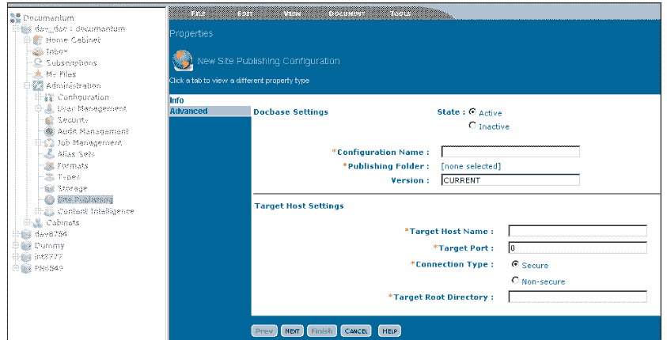

图 21.1：空白站点发布配置屏幕

默认情况下，站点发布配置以活动状态创建（如图 21.1 所示）。你可以通过选择 Inactive 单选按钮来停用配置。

Documentum 在 Docbase 中将站点发布配置内部管理为两个对象——dm_webc_config 和 dm_webc_target。dm_webc_config 对象中的 target_id 属性存储 dm_webc_target 对象的对象 ID，这就是两者关联的方式。

当你使用 Documentum Administrator 创建站点发布配置时，dm_webc_config 和 dm_webc_target 对象会为你隐式创建和管理（参见图 21.2）。

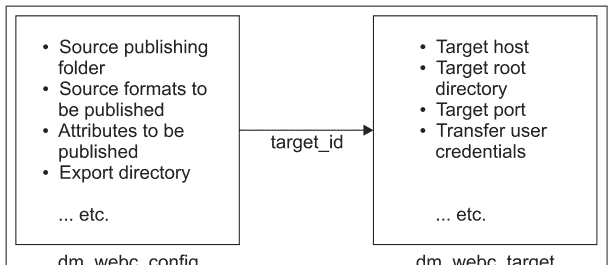

图 21.2：站点发布配置隐式对象

> 你可以为给定的 Docbase 创建任意数量的站点发布配置，并从同一源 Docbase 向多个网站发布。

2. 要创建站点发布配置，你需要在 Info 和 Advanced 选项卡下填写值。让我们先从 Info 选项卡开始。

按照以下方式填写 Docbase Settings 部分的值（参见图 21.3）：

- Configuration Name：站点发布配置的有效名称。
- Publishing Folder：选择 Web Cabinet（通过单击 Select Source Folder），内容需要从该位置发布。在我们的 Docbase 中，我们创建了 Test_webCabinet Web Cabinet。直接在此 Web Cabinet 下或在此 Web Cabinet 下包含的文件夹内创建的所有内容都将被发布。
- Version：发布应发生的文档生命周期状态。这对应于内容的 r_version_label 属性。

在我们的例子中，我们发布所有处于生命周期 Staging 状态的文档。如果未指定特定版本标签，则默认发布内容的 CURRENT 版本。

按照以下方式填写 Target Host Settings 部分的值：

- Target Host Name：网站主机的主机名或 IP 地址（SCS Target 已安装在该主机上）。
- Target Port：SCS Target 服务监听的端口号。默认值为 2788。
- Connection Type：与 SCS Target 的连接。可以是 raw（非安全）或 SSL（安全）
- Target Root Directory：这是网站主机上的 webroot，已发布文件将放置在此处。如果主机上不存在指定的文件结构，Documentum 在发布时会创建它。

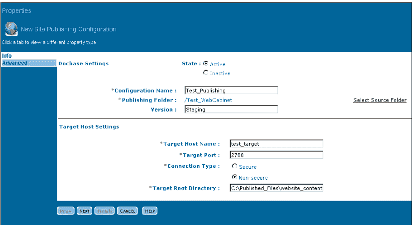

图 21.3：站点发布配置中的 Info 选项卡设置

单击 NEXT 按钮并转到 Advanced 选项卡。

3. 如果需要将文档的属性/属性作为 HTML 元标记添加，请选择复选框 Add properties as HTML Meta Tags（参见图 21.4）。

在这种情况下，已发布的 HTML 文档在 HTML <HEAD> 标签下包含已导出属性的元标记，如下所示。请注意，这些元标记会被搜索引擎爬虫（如：Google、Yahoo、Alta Vista 等）读取和索引以进行网络搜索。

```
<head>
<META http-equiv="Content-Type" content="text/html; charset=ISO-8859-1">
<META name="r_object_type" content="dm_document">
<META name="keywords" content="product, specifications, medium, tool">
</head>
```

请注意，keywords 作为重复属性具有多个值，用逗号（,）分隔。

要为其他具有非 HTML 格式的已发布文件插入元标记，请在 webcache.ini 文件中添加以下键：

```
additional_metatag_extensions=jsp, <any other format>
```

在 Windows 服务器的情况下，webcache.ini 文件通常位于 SCS Source 上的以下位置：

```
%DOCUMENTUM%\dba\config\<Docbase name>
```

```
For example: C:\Documentum\dba\config\<Docbase name>
```

## 使用 SCS 从 Docbase 发布

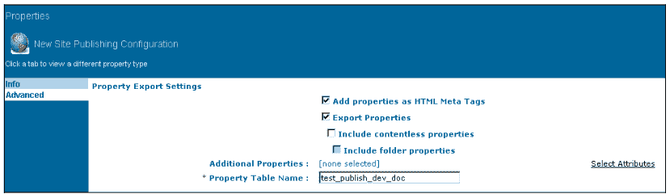

图 21.4：站点发布配置中的属性导出设置

为了将文档的属性/特性导出/发布到目标主机，请选择“导出属性”复选框。

Documentum SCS 以 properties.xml 文件的形式将所有文档属性导出到目标主机。SCS Target 读取并将这些值插入到指定的数据库表中。

您可以选择“包含无内容属性”复选框，以发布没有关联内容文件的对象。

此外，通过选择“包含文件夹属性”复选框，您还可以发布包含文档的文件夹的属性。

在“属性表名”字段中，指定应发布文档属性的数据库表名。我们在站点发布配置中提供了一个表名 test_publish_dev_doc。

当文档在目标服务器的数据库上发布时，Documentum 会创建以下四个表：

- test_publish_dev_doc_s：存储导出的单值文档属性
- test_publish_dev_doc_r：存储导出的重复值文档属性
- test_publish_dev_doc_l：存储已发布文档的关系（dm_relation 对象）
- test_publish_dev_doc_m：存储已发布文档的状态信息

> 关系对象（dm_relation 对象类型）可以通过在 webcache.ini 文件中设置以下键来发布：
>
> `export_relations=TRUE`

默认情况下，Documentum 会导出文档的某些属性，例如 r_object_id、object_name、i_chronicle_id 等。可以通过单击图 21.4 所示的“选择属性”链接来导出其他属性。

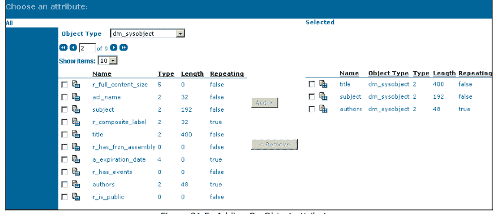

图 21.5：添加 SysObject 属性

默认情况下会显示 dm_sysobject 对象类型的属性（参见图 21.5）。您可以选择要发布到目标主机的 dm_sysobject 属性。选中属性名称旁边的复选框，然后单击“添加>”按钮。

为了包含自定义对象类型的属性，请从“对象类型”下拉列表中选择对象类型。这将自动显示所选对象类型的自定义（非继承）属性（参见图 21.6）。同样，您可以选中相关属性名称旁边的复选框，然后单击“添加>”按钮。

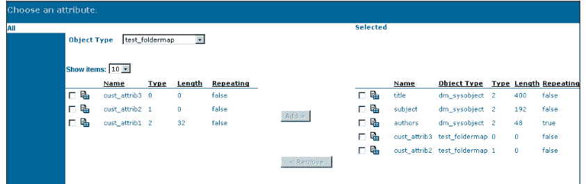

图 21.6：添加自定义对象类型的属性

如果 SCS Target 数据库是 SQL Server，发布期间经常会看到以下错误消息：

```
[Microsoft][ODBC SQL Server Driver][SQL Server]Cannot create a row of size 8140 which is greater than the allowable maximum of 8060.
```

这是 SQL Server 数据库施加的限制，不允许表中的单行超过 8060 字节。为克服此限制，请在 webcache.ini 文件的 WEBC_COMMON 部分下添加以下键：

```
[WEBC_COMMON]
mssql_store_varchar=TRUE
```

在创建站点发布配置时（如果目标数据库为 SQL Server），在添加可发布属性时应非常谨慎。所有发布属性的大小（总长度）越大，由于 SQL Server 行大小限制导致发布错误的机会就越大。

### 4. 现在您需要填写“内容选择设置”部分的数据（参见图 21.8）。

Documentum Docbase 中的文档可以以多种格式存在。例如，一个简单的 xyz.xml 文件可以通过 XSL 样式生成多个衍生版本，例如 xyz.html、xyz.wml、xyz.shtml 等。

在您的站点发布配置中，您可以指定是否只需要发布父格式（xyz.xml）还是其衍生格式也是如此。如果需要发布同一文件的多个衍生格式，请单击“选择格式”链接并选择要发布的附加格式。

请注意，在 Documentum 中，格式以 dm_format 对象的形式存在。您可以通过以下 DQL 查询（通过 IDQL 命令行实用程序或通过 Documentum Administrator）查看 Documentum 中的各种格式：

```
DQL > select name,description,dos_extension from dm_format
```

图 21.7 列出了 Documentum 中的一些格式以及文件名中的实际 DOS 扩展名。

| 格式名称 | DOS 扩展名 |
|---|---|
| ppt8 | ppt |
| ppt8_slide | ppt |
| excel8book | xls |
| mp3 | mp3 |
| zip | zip |
| msw8 | doc |
| rtf | rtf |
| pdf | pdf |
| jpeg | jpg |
| gif | gif |
| bmp | bmp |
| html | htm |
| swf | swf |
| crtext | txt |
| mpeg | mpg |

图 21.7：一些 Documentum 格式

请记住，单击“选择格式”链接会显示现有的格式名称，而不是实际的 DOS 扩展名。

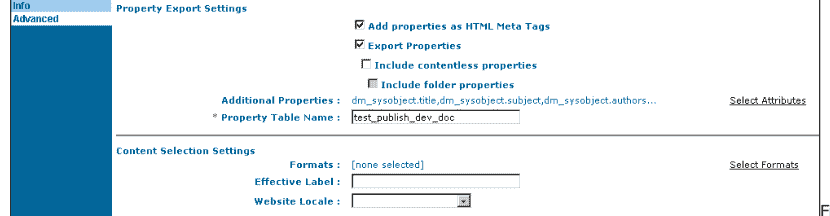

图 21.8：内容选择设置部分

以与在“属性导出设置”部分中添加属性相同的方式添加格式（参见图 21.9）。您甚至可以添加我们在第 15 章中创建的自定义格式 custom_format。

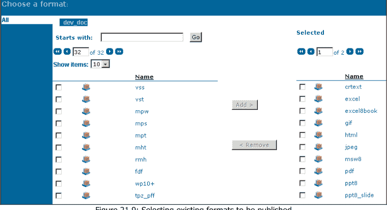

图 21.9：选择要发布的现有格式

在站点发布配置中分配的有效标签决定了根据其生效日期和到期日期发布文档。

每个文档由于是 dm_sysobject 对象类型的子类型而具有 a_effective_date、a_expiration_date 和 a_effective_label 属性。

以上三个属性都是重复属性，因此在创建内容时，用户可以为文档指定多个对应于不同有效标签的生效日期和到期日期。根据指定的有效标签，站点发布配置可以根据其特定的生效日期和到期日期分别发布或过期内容。

例如，内容可能具有以下有效标签和生效到期日期：

生效日期：20/10/2005
到期日期：25/10/2005
有效标签：UNDER REVIEW
生效日期：10/12/2005
到期日期：30/12/2005
有效标签：FINAL

适当设置站点发布配置可以将内容在 20/10/2005 发布，并在 25/10/2005 将其从网站上撤回（过期）以用于内容的 UNDER REVIEW 有效标签。

此外，具有 FINAL 有效标签的内容将在 10/12/2005 发布，并在 30/12/2005 从网站上撤回。

### 5. 请参阅图 21.10 以填写站点发布配置中的“杂项设置”部分：

在发布期间，Documentum 将可发布文档及其属性导出到 Content Server 机器上的导出目录中，形式为内容文件和包含属性信息的 properties.xml 文件。

这称为导出数据集，您需要指定应放置导出数据的位置。屏幕上显示默认位置，但您可以通过单击“选择目录”链接来更改它。

单击“选择目录”链接会显示 Content Server 文件系统上的现有文件/目录结构。

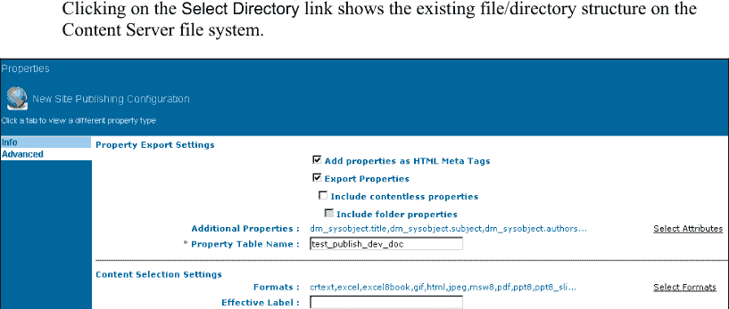

图 21.10：杂项设置部分

您可以指定跟踪级别以跟踪 SCS 发布操作跟踪。这些跟踪级别用于跟踪 API 方法中。

我们将在第 22 章讨论 WebView 时讨论 Web 服务器 URL 前缀。

### 6. 在线同步目录（参见图 21.11）

在线同步是在网站上以定期间隔进行批量发布而不是单项发布时的一项重要且有用的功能。

对于正在运行的网站，批量发布可能会导致网站出现损坏的区域/链接。使用在线同步，您需要在目标主机上指定一个在线同步目录。

SCS 导出数据集（即已发布的内容文件 + 属性）首先放置在目标主机上的在线同步目录中，然后切换到目标根目录（webroot）。实际上，webroot 目录和在线同步目录会被重命名以进行同步。这对正在运行的网站的影响最小，并在很大程度上减少了不一致的情况。

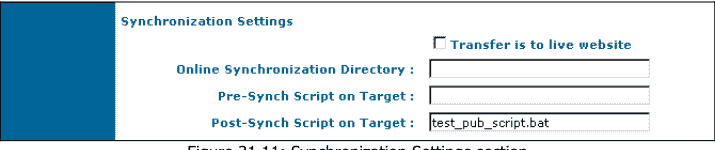

图 21.11：同步设置部分

使用“目标上的预/后同步脚本”选项，您可以编写自定义脚本，在发布更新网站之前或之后执行一些特定于您业务需求的任务。

预同步和后同步脚本分别在 SCS 更新网站之前和之后执行。

执行顺序（使用在线同步时）如下，从左到右：预同步脚本 —> 在线同步 —> 后同步脚本。

脚本可以在两个位置引用：

- **站点发布配置**：将脚本物理放置在 SCS Target 主机的以下位置：`%WEBCACHE%\product\bin` 示例：`C:\Documentum\SCS\product\bin` 或：
- **SCS Target 主机上的 agent.ini 文件作为 pre_sync_script 或 post_sync_script 键**：将脚本物理放置在 SCS Target 主机的以下位置：`%WEBCACHE%\product\bin`

请注意，agent.ini 在 Windows 服务器上可在 SCS Target 主机的以下位置找到：`%WEBCACHE%\admin\config\<SCS Target port number>`

Example: C:\Documentum\SCS\admin\config\2788

It is worth mentioning that Documentum allows you to pass arguments to scripts as well. For a more detailed understanding, please go through the Documentum Site Caching Services User manual.

In our example, we have specified test_pub_script.bat as a Post-Synch script in Site Publishing Configuration.

Content of test_pub_script.bat:

```
REM dummy script
echo "Publish done" > C:\Publish_Operation\pub_status.txt
pause
```

After the publishing operation completes, the Publish done message is seen in the file C:\Publish_Operation\pub_status.txt on the SCS Target host.

7. Finally, you need to fill in the Transfer Authentication Settings section before completing the details of Site Publishing Configuration (refer to figure 21.12).

- Enable system authentication on target: Selecting this checkbox requires providing a valid user name and password on the target host for authentication purposes. The data transfer from SCS Source to the SCS target server happens only after user credentials have been authenticated.
- Under the User Name field, provide a valid user name/account that will be used by the SCS transfer agent to make a connection to the target server.

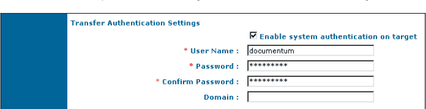

Figure 21.12: Transfer Authentication Settings

After providing all the required Site Publishing Configuration details, click on FINISH to save the newly created Site Publishing Configuration in the Docbase.

The existing Site Publishing Configurations show up under the Administration | Site Publishing section in Documentum Administrator, as can be seen in figure 21.13.

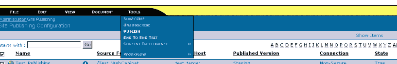

Figure 21.13: Newly created Site Publishing Configuration

## 21.4 Testing and Publishing Using Site Publishing Configuration

You should always run an End-to-End test (refer to figure 21.14) for the Site Publishing Configuration to ensure that it has been created successfully and is able to publish as per the parameters specified in it. Choose the Site Publishing Configuration and select menu option TOOLS | END TO END TEST.

An End-to-End test performs numerous operations such as making connections to the Docbase, source host, and target host, making test database tables, and inserting records.

The log files generated after an End-to-End test (or for that matter publishing logs) are located under Cabinets | System | Sysadmin | Reports | WebCache in the Docbase.

You need to specify a trace level while running an End-to-End test so that the logs generated have appropriate message/trace levels.

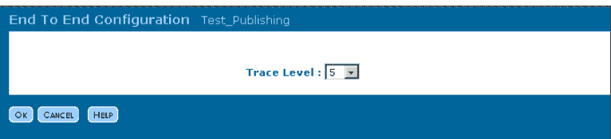

Figure 21.14: Running an End-to-End test

In order to publish from a particular Site Publishing Configuration, select the checkbox against the configuration name and select menu option TOOLS | PUBLISH.

The following Publish screen is shown:

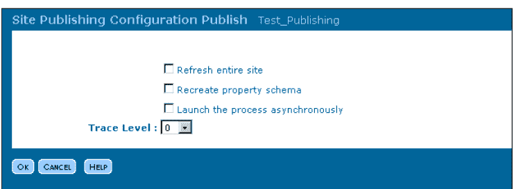

Figure 21.15: Publishing using Site Publishing Configuration

Let's discuss the various options shown in this screen:

- Refresh entire site: This performs a full refresh publish, wherein the entire SCS target repository is deleted and the complete source export data set is published.
- Recreate property schema: The database tables on the SCS target are dropped and recreated with the latest published data.
- Launch the process asynchronously: Check this option in order to refresh the screen before publishing is complete.
- Trace Level: Debug tracing level is set from 0 to 10 for the publishing operation.

The SCS publishing logs can be seen by selecting the checkbox against the Site Publishing Configuration in question and clicking on VIEW | LOGS.

Whenever a Site Publishing Configuration is created, Documentum automatically creates a publishing job (in the inactive state) for it so that publishing can proceed at periodic predefined intervals.

Go to Job Management | Jobs in Documentum Administrator and select Web Publishing from the dropdown shown at the extreme top right hand section of the screen (refer to figure 21.16).

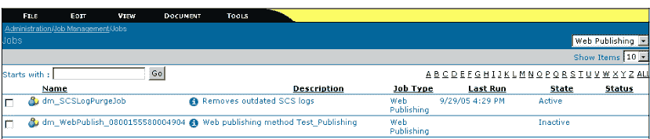

Figure 21.16: Automatically created publishing job

The system generated publishing job can be recognized by its name, which is in the format dm_webPublish_< Site Publishing Configuration object ID>.

Run the following DQL query in Documentum Administrator to find out the object ID of the Site Publishing Configuration in question:

```
DQL> select r_object_id,object_name from dm_webc_config
```

Results of the DQL query:

| r_object_id | object_name |
|---|---|
| 0800155580004904 | Test_Publishing |

In our case, the publishing job has thus been created with the following name:

```
dm_webPublish_0800155580004904
```

You can always activate the publishing job and schedule it to run at the desired intervals.

## 21.5 Published Data

Once the publishing operation is complete, you can verify the publish location on the target server and view the published content files. Figure 21.17 shows the published content files on the target host:

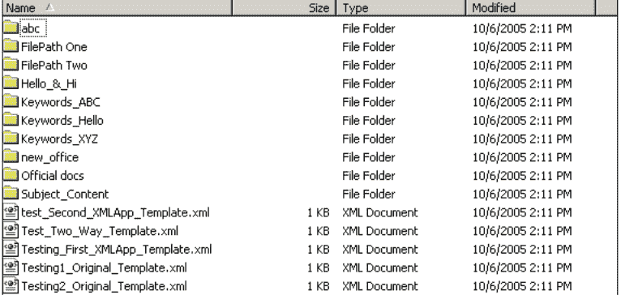

Figure 21.17: Published content files on target server

You can see that SCS automatically creates the exact folder structure as present in the Docbase Test_webCabinet Web Cabinet.

Additionally, you can see the published data in the target host database. Figure 21.18 shows the published database tables (test_publish_dev_doc_s, test_publish_dev_doc_r, and test_publish_dev_doc_m) as seen in SQL Server Enterprise Manager.

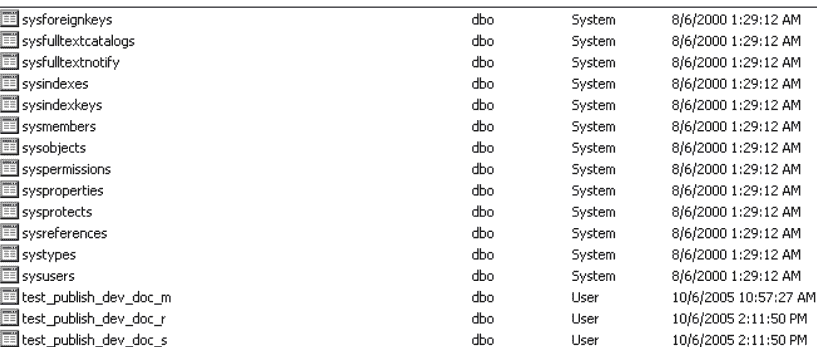

Figure 21.18: Published database tables on target database

Refer to figure 21.19; if you open either the _s or _r table, you can see the records inserted by SCS in the tables with the columns corresponding to the attributes we specified in Site Publishing Configuration under the Additional Properties (attributes) field.

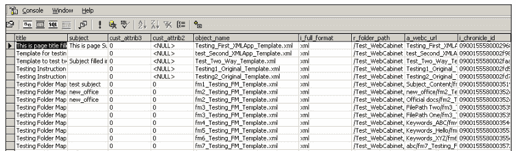

Figure 21.19: Published records in the test_publish_dev_doc_s table

You can see that the attributes/properties we included in the Site Publishing Configuration are present as columns in the table— title, subject, cust_attrb3, cust_attrb2, object_name, etc.

The records for repeating valued attributes can be found in the corresponding _r table (i.e. test_publish_dev_doc_r).

## 21.6 Unlocking Locked Publishing Operations

There are times when the publishing operation gets locked (almost endlessly!). This could be because of some publishing error or some network/hardware failure or because of multiple publishing operations running concurrently.

Under such scenarios, you can unlock the publishing configuration by one of the following means:

1. Stop and start the SCS Source service.
2. Execute the unlockConfig.bat script found under the following location on the SCS Source host:
   %DM_HOME%\webcache\bin
   Example: c:\Documentum\product\5.2\webcache\bin
   Execute the unlockConfig.bat script through the command prompt as follows:
   unlockConfig -u <user> -p <password> [-h <host> | -o <config-id>] <docbase-name>
   - Unlocking ALL publishing operations on a specific SCS source host for a specific Docbase:
     unlockConfig -u dummyuser -p userpasswd -h testhost dev_doc
   - Unlocking a specific publishing operation for a specific Docbase:
     unlockConfig -u dummyuser -p userpasswd -o 08002232800006d5 dev_doc

In order to find the publishing configuration ID, execute the following DQL:

```
DQL> select r_object_id,object_name from dm_webc_config where object_name = '<Your Site Publishing Configuration Name>'
```

The returned r_object_id (e.g. 08002232800006d5) is to be used to unlock using the batch file unlockConfig mentioned above.

3. Nullify the holder attribute in the webc_lock object. Whenever SCS Source software is installed, the webc_lock object type is installed in the Docbase. This object is used by Documentum whenever a particular publishing operation is running and the lock gets cleared whenever the operation finishes.

You could run the following DQL query in Documentum Administrator to find the publishing operation that is holding a lock and then accordingly clear its lock via DQL or API commands as follows:

```
DQL> select r_object_id,holder,object_name from webc_lock
```

This returns the lock status (holder attribute) for all publishing configurations (the object_name attribute is actually the r_object_id of the Site Publishing Configuration).

Copy the r_object_id value returned from the above DQL query for the case where the holder value is seen to be not null.

Now execute the following API commands in Documentum Administrator:

```
API>set,c,<object ID copied from above query>,holder
Data:<Leave this blank>
API>save,c,<object ID copied from above query>
```

This clears the locked Publishing Configuration by setting the holder attribute as null.

## 21.7 Monitoring the SCS Source Status

One of the most convenient means of viewing the status of SCS Source publish operations is by accessing the following URL with your browser:

```
http://<SCS Source host name>:<SCS Source port number>/webcache/state
```

Following is a sample XML result set displayed on your browser:

```
<?xml version="1.0" ?>
<state product-version="5.2.5.204 SP2">
<uptime>
<hours>26</hours>
<minutes>59</minutes>
<seconds>39</seconds>
<milliseconds>903</milliseconds>
</uptime>
<total-publishes>
<count>1</count>
</total-publishes>
<full-refreshes>
<count>1</count>
<average-duration>
<hours>0</hours>
<minutes>0</minutes>
<seconds>0</seconds>
<milliseconds>0</milliseconds>
```

```xml
</average-duration>
</full-refreshes>
<incrementals>
<count>0</count>
</incrementals>
<asynchronous-publishes>
<count>0</count>
</asynchronous-publishes>
<active-publishes>
<count>0</count>
</active-publishes>
</state>
```

图 21.20 解释了上述 XML 结果集传达的有价值信息。

| XML 元素 | 解释 |
|---|---|
| `<uptime>` | SCS Source 服务已启动并运行的总时间。 |
| `<total-publishes>` | 自 SCS Source 服务上次重启以来完成的发布总数。 |
| `<full-refreshes>`, `<incrementals>`, and `<asynchronous-publishes>` | 已完成的完全刷新发布、增量发布操作和异步发布操作的数量及其总持续时间。 |
| `<active-publishes>` | 当前正在进行的发布操作总数。 |

图 21.20：SCS Source 发布状态 XML 的解释

## 21.8 摘要

我们简要讨论了站点缓存服务（SCS）允许您轻松配置并从 Docbase 发布文档及其属性（如标题、作者、关键字等）到网站主机和数据库表。

然后我们查看了使用 SCS 的一些限制，并讨论了各种类型的发布操作：完全刷新、增量刷新/发布、强制刷新和单个对象发布。

然后我们查看了在 Documentum Administrator 中创建站点发布配置的详细步骤，以定义使用 SCS 发布时的源主机和目标主机参数。

创建站点发布配置后，我们运行了端到端测试以验证其是否正常工作。

有时由于某些发布错误或网络/硬件故障，发布操作会挂起。我们看到了在这种情况下解锁发布操作的各种方法。

最后，我们看到了通过浏览器访问的 URL 查看 SCS Source 发布操作状态的简单机制。
