## 22 Web 查看内容文件

## Web 查看内容文件

现在我们已经创建了站点发布配置并研究了 Documentum 中发布的工作原理，我们准备将讨论更进一步，了解 Web View。

Web View 是大多数 Web Publisher 用户探索最少的一个领域，如果利用得当，真的非常有用！Web Publisher 的 Web View 功能让您可以在 Web 服务器上预览内容文件，以便您对其进行 QA，并确保其外观、感觉以及其他方面（如网站上其他页面的链接）在发布到生产站点之前符合预期。

只要将 Web View 视为在您的 Web 服务器上查看 Web 内容即可。Web View 在 Web Publisher 中默认可用，图 22.1 显示了 Web Publisher 中 Web 查看的工作方式：

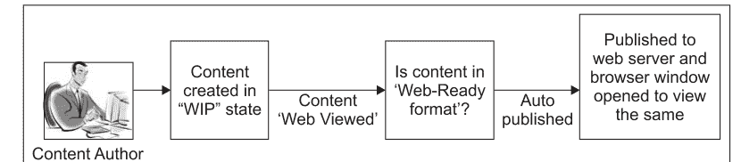

图 22.1：Web 查看 Web 就绪内容

Web 查看机制相当简单，步骤如下：

- 1. 确保 SCS Target 软件已在 Web 服务器上正确安装和配置。
- 2. 适当设置您的 Web 服务器，并将站点发布配置中的发布位置指向 Web 服务器的主目录。
- 3. 确定应进行 Web 查看的内容生命周期状态。如果是 WIP，则使用 Documentum Administrator 准备用于发布 WIP 内容的站点发布配置。（我们将在本章后面介绍此站点发布配置的详细信息。）
- 4. 为 Web Publisher 中的内容 XML 文件准备演示文件（XSL），以便为内容文件生成必要的呈现。
- 5. 在进行 Web 查看之前，确保要进行 Web 查看的内容处于 Web 就绪状态。这意味着它采用的是 Web 服务器可以理解并提供服务的格式。通常，Web Publisher 中内容文件旁边的绿色点表示其为 Web 就绪。黄色表示正在变为 Web 就绪，而红色表示没有可用的 Web 就绪呈现。
- 6. 选择要进行 Web 查看的内容并在 Web Publisher 中单击 WebView 按钮。
- 7. 如果内容采用 Web 就绪格式，Documentum 会显示内容文件的可用呈现。
- 8. 选择要进行 Web 查看的呈现。
- 9. Documentum 查找与内容生命周期状态（例如：WIP 状态）匹配的站点发布配置，并自动将内容发布到 WIP Web 服务器（假设）。
- 10. 显示一个浏览器窗口，从 WIP Web 服务器 webroot 访问已发布的内容文件，以便用户可以在网站上下文中预览页面的外观和感觉。

如果这看起来工作量太大或太令人困惑，请不要担心。我们将在本章中通过屏幕截图介绍所有这些内容。最好您也能亲自尝试，以获得一些实践经验，而不仅仅是理论知识。

### 22.1 先决条件

在开始尝试 Web 查看内容文件的步骤之前，请确保以下实体已就位：

- - SCS Source 软件已安装在您的 Content Server 主机上，并且 SCS Source 服务已正确启动并运行。
- - SCS Target 已安装在您的 Web 服务器主机上，并且 SCS Target 服务已正确启动并运行。
- - Web 服务器（我们的示例中使用 IIS）在您的 Web 服务器主机机器上已正确设置。
- - Web Publisher 中必要的模板和演示文件已创建，并且可以使用模板创建内容，其呈现可以通过关联的 XSL（演示文件）生成。

如果所有这些都已正确设置，您就可以进入下一节。祝您 Web 查看愉快！

### 22.2 设置和使用 Web View

在本节中，我们将介绍设置和使用 Web View 的详细步骤：

- 1. 登录您的 Web 服务器主机（在我们的例子中为 webview_server 机器）并转到 程序 | 管理工具 | Internet 服务管理器。

Internet Information Services 控制台打开，如图 22.2 所示。选择 默认网站，右键单击并选择 属性 选项。

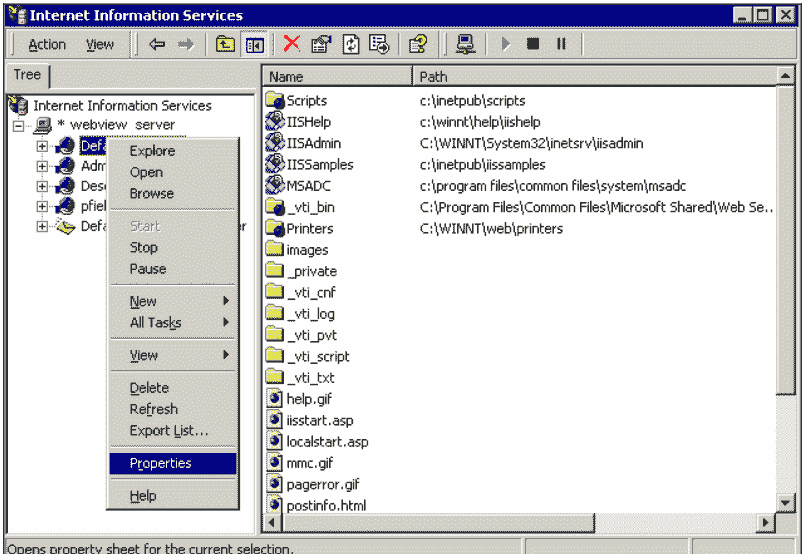

图 22.2：Internet Information Services 控制台

- 2. 在 默认网站 属性窗口中转到 主目录 选项卡（参见图 22.3）并记下 本地路径 部分中提到的位置。

默认位置为：c:\inetpub\wwwroot。

在设置 Web View 站点发布配置时，我们需要在 目标根目录 字段下指定此路径。

记下本地路径后关闭 默认网站 属性窗口。

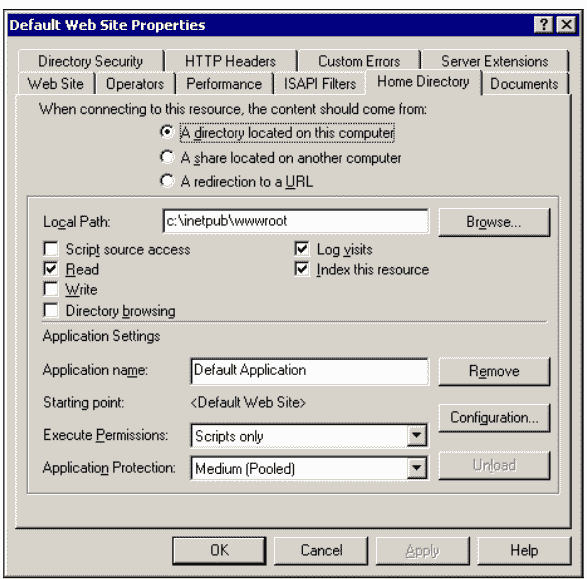

图 22.3：IIS 的默认网站属性

- 3. 以管理员身份登录 Documentum Administrator 并转到 管理 | 站点发布。选择 文件 | 新建 | 站点发布配置 会打开一个空的站点发布配置屏幕。
- 根据图 22.4 所示填写站点发布配置的 Info 选项卡下的信息：

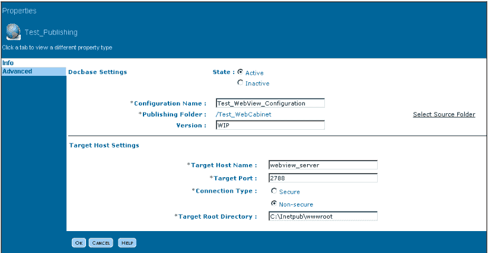

图 22.4：站点发布配置 Info 选项卡

让我们详细讨论此选项卡中显示的字段：

- - 配置名称：站点发布配置的有效名称，例如 Test_Webview_Configuration。
- - 发布文件夹：选择 Web Cabinet（通过单击 选择源文件夹），内容需要从该位置发布。在我们的 Docbase 中，我们创建了 Test_WebCabinet Web Cabinet。直接在此 Web Cabinet 下或在此 Web Cabinet 包含的文件夹内创建的所有内容都将被发布并进行 Web 查看。
- - 版本：应进行 Web 查看的文档的生命周期状态。这对应于内容的 r_version_label 属性。在我们的例子中，我们对生命周期处于 WIP 状态的所有文档进行 Web 查看。
- - 目标主机名：Web 服务器主机（已安装 SCS Target）的主机名或 IP 地址，在我们的例子中为 webview_server。
- - 目标端口：SCS Target 服务监听的端口号。默认值为 2788。
- - 连接类型：与 SCS Target 的连接。可以是 raw（非安全）或 SSL（安全）。
- - 目标根目录：这是网站主机上放置已发布文件的 webroot。这应为我们从 IIS 中默认网站属性窗口的主目录选项卡复制的本地路径。示例：C:\Inetpub\wwwroot。


## Web 查看内容文件

4. 填写完 Info 选项卡后，进入站点发布配置中的 Advanced 选项卡。

填写 Property Export Settings 和 Content Selection Settings 部分下的各个字段，如图 22.5 所示。

在 Miscellaneous Settings 部分，提供导出目录路径并设置跟踪级别。此外，还需要指定 Web Server URL Prefix 才能使 Web View 正常工作。

这是 Web 服务器名称和 IIS 端口号：

```
http://webview_server:80/    (Note that the default port for IIS is 80.)
```

每当内容呈现被 Web 查看时，Documentum 会将内容发布到 Web 服务器上指定的目标根目录 c:\Inetpub\wwwroot 下。在发布过程中，SCS 会在已发布的 Web Cabinet 下创建 Docbase 中存在的目录结构。

最后，Web View 浏览器会从以下拼接位置显示内容文件：

```
Web Server URL Prefix + Published folder structure under Target root directory on web server
```

示例：在 Docbase 内的 web_cabinet_folder 下的 webviewedfile.htm 文件被 Web 查看。

Web View 浏览器的 URL 如下：

```
http://webview_server:80/web_cabinet_folder/webviewedfile.htm
```

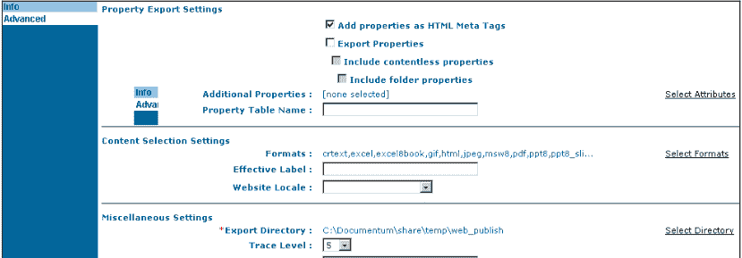

Figure 22.5: 站点发布配置中的 Advanced 选项卡

此外，请根据需要填写 Synchronization Settings 和 Transfer Authentication Settings（请参阅图 22.6）。

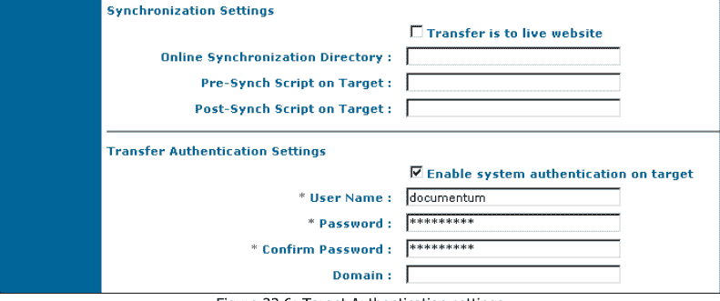

Figure 22.6: 目标身份验证设置

5. 提供所有必需的站点发布配置详细信息后，单击 FINISH 以保存新创建的站点发布配置到 Docbase。现有的站点发布配置会显示在 Documentum Administrator 中的 Administration | Site Publishing 部分下（请参阅图 22.7）。

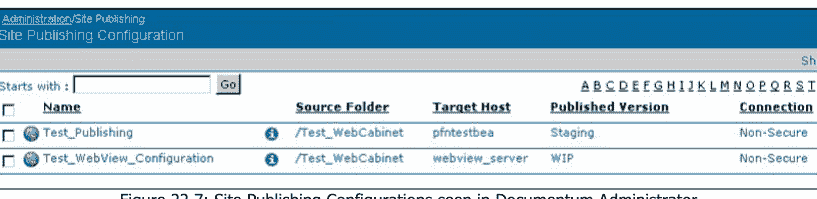

Figure 22.7: Documentum Administrator 中显示的站点发布配置

6. 现在应为新创建的 Web View 站点发布配置运行一次端到端测试，以确保其已成功创建并能够按照其中指定的参数进行发布。选择站点发布配置并选择菜单选项 TOOLS | END TO END TEST。端到端测试后生成的日志文件位于 Docbase 中的 Cabinets | System | Sysadmin | Reports | WebCache 下。如果端到端测试成功，您就可以继续在 Web Publisher 中测试 Web View。按照下面提到的简单步骤对内容文件进行 Web 查看。

## 22.3 测试 Web View

本节将详细介绍如何测试 Web View 功能：

- 1. 登录 Web Publisher 并使用模板创建一些内容，如图 22.8 所示。

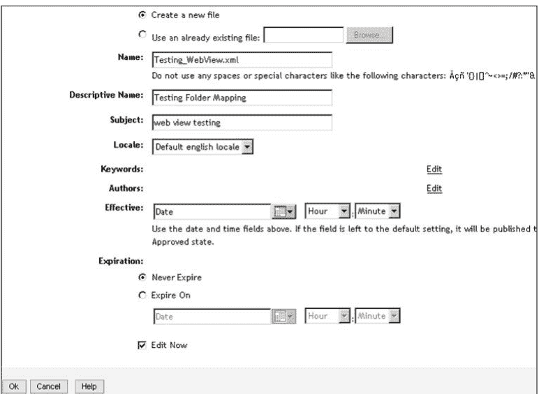

Figure 22.8: 创建一些内容并填写相关属性

按图 22.9 所示，在 Web Publisher 模板编辑器中填写模板字段。

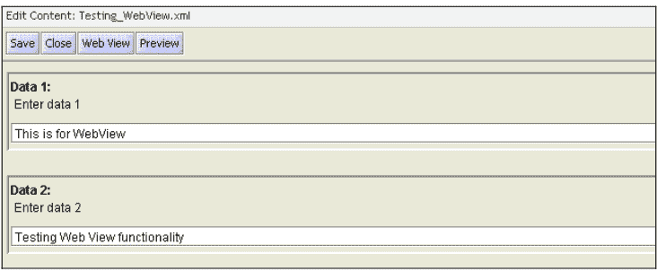

Figure 22.9: 为内容填写模板字段

2. 将新创建的内容签入。然后选中内容旁边的复选框并单击屏幕右上角显示的 WebView 按钮，如图 22.10 所示（或者也可以选择 View | Web View 菜单选项）。

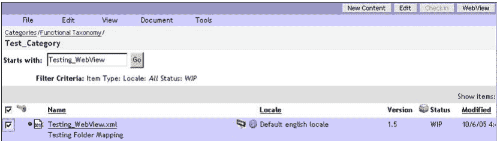

Figure 22.10: 右上角显示的 Web View 按钮

3. 根据关联的 Presentation 文件（XSL），会显示内容文件的各种呈现格式。您可以选择需要 Web 查看的呈现格式并单击 OK。

在我们的例子中，选定内容文件显示默认的 XML 格式和 HTML 格式，如图 22.11 所示。

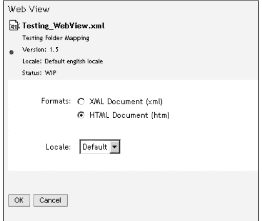

Figure 22.11: 选择内容文件的呈现格式

4. Documentum SCS 将选定的内容文件发布到 Web 服务器，并在浏览器中打开一个指向 Web 服务器 webroot 中已发布文件的窗口，如图 22.12 所示。

请注意，图中显示的内容文件的布局是在关联的 XSL（Presentation 文件）中指定的，并不是 Web View 自动为您完成的功能。

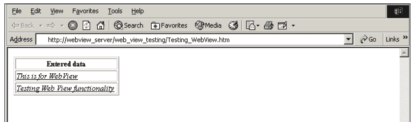

Figure 22.12: Web View 浏览器

就是这样。Web View 正常工作！请注意，浏览器窗口中的 URL（如前所述）是 Web Server URL Prefix 与 Web 服务器上目标根目录下的已发布文件夹结构的拼接。

## 22.4 摘要

Web Publisher Web View 允许您自动将内容发布到 Web 服务器上进行预览，以便在将其推广到实时网站之前进行验证和测试。

本章介绍了 Web View 的工作原理以及使其在 Web Publisher 中正常工作所需的一些前提条件。

通过详细步骤，我们讨论了如何使用 Documentum Administrator 中的站点发布配置在 Documentum 中设置 WebView。

最后，我们创建了一些内容并在 Web 服务器上对其进行 Web 查看，以查看其 HTML 呈现效果。
