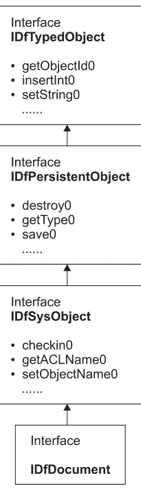
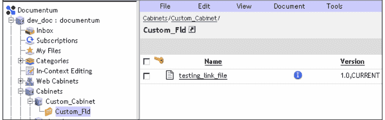
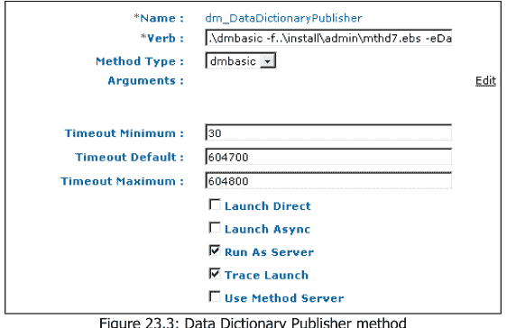
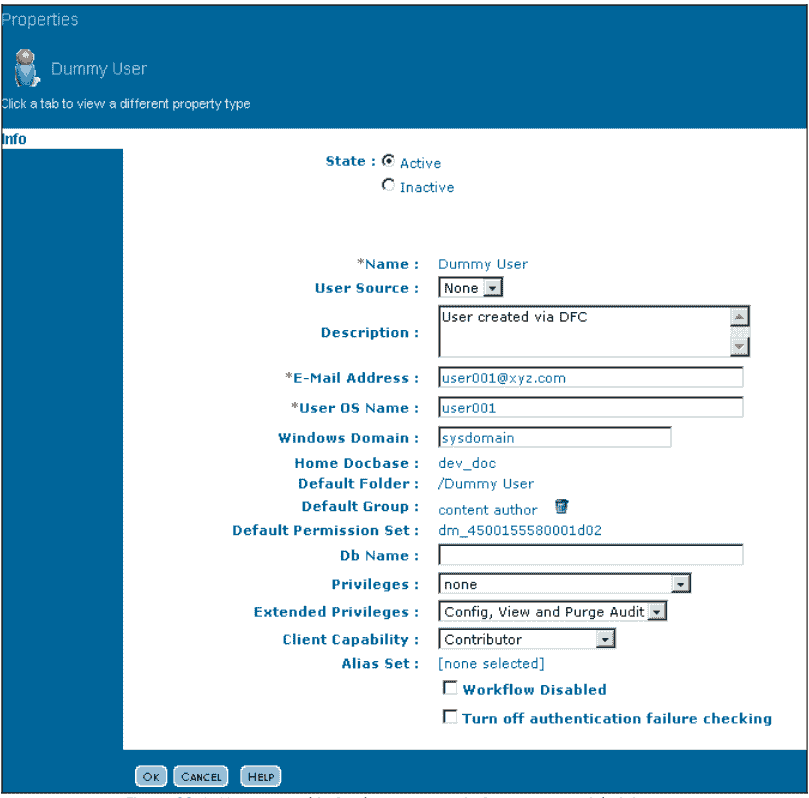

## 23 使用 DFC

在几乎所有基于 Documentum 执行的项目中，您可能需要自定义和扩展内容服务器提供的基本内容管理功能。

您可能需要编写自定义生命周期或工作流方法，或对现有 Documentum 产品（如 Desktop 或 Web Publisher）进行业务特定的自定义。如果要实现这些目标，您必须先了解和学习 Documentum 原生服务器 API 调用以及 Docbasic 等专有语言，那不是很困难吗？

好吧，Documentum 为您提供了一个更简单的包装接口，使您无需直接进行原生调用，并减少了熟悉任何专有语言及其语法的学习曲线。答案是 DFC。

DFC 是 Documentum Foundation Classes 的缩写，以一组 Java 接口及其实现类提供。然而，对于在 Microsoft COM（组件对象模型）环境中工作的人来说，DFC 提供了 Documentum Java-COM 桥（DJCB）来访问 Java 接口。最后，在 .NET 环境中，您可以使用 DFC PIA（Primary Interop Assembly）来访问 DFC 接口。此外，DFC 包含一个业务对象框架（BOF），使您能够以可重用组件的形式封装业务规则，从而扩展 DFC 实现类提供的功能。

简而言之，DFC 作为一个框架存在，公开内容服务器的内容管理功能供您有效利用。

> DFC 暴露了一些服务器 API 方法，如 apiGet 和 apiSet，通过进行原生服务器 API 调用来访问内容服务器功能。这仅为与未基于 DFC 的旧模型向后兼容而提供。您应避免使用此类服务器 API 方法，而应改用 DFC 中可实现相同目的的替代方法。

例如，考虑为 SysObject 设置 object_name 属性：

- **错误方式：** `sysObj.apiSet("set", "object_name", objectNameToBeSet);`
- **推荐方式：** `sysObj.setObjectName(objectNameToBeSet);`

### 23.1 DFC 简介

入门的最佳方式是查看 DFC Javadocs 中的 API 规范。如果您已安装 DFC（独立安装或与 Application Builder 或 Content Server 等其他 Documentum 产品一起安装），请浏览本地计算机上的以下位置：

示例：`c:\Program Files\Documentum\help\dfc\api`

打开 index.html 查看 DFC API，并花一些时间浏览可用的包、接口和类。

DFC API 中必须遵循以下命名约定：

- **包均以** `com.documentum.` 开头
  DFC 中有许多包，例如 `com.documentum.xml.xdql`，它提供用于使用 XDQL 的接口和类，以及 `com.documentum.fc.client`，它提供用于创建/管理 Docbase 会话和操作 Docbase 中数据的接口和类。
- **接口均以** `IDf.` 开头
  两个常用的 DFC 接口是 `IDfSessionManager` 和 `IDfSysObject`。
- **类均以** `Df.` 开头
  DFC 中两个常用的类是 `DfClient` 和 `DfQuery`。

如果您浏览 DFC Javadocs，您会注意到 DFC 中的接口遵循层次模式。这意味着每个接口继承层次链中在其之上的接口的所有方法和常量。例如，在图 23.1 中，请注意 `IDfPersistentObject` 接口从其超接口 `IDfTypedObject` 继承 `getObjectId()` 等方法，并添加了 `destroy()` 和 `save()` 等特定于它的 方法。




Figure 23.1: Sample DFC interface hierarchy
图 23.1：示例 DFC 接口层次结构

## 23.2 Environment Readiness
## 23.2 环境准备

Once you have DFC available on your machine, you need to ensure that the following entries are present in your system classpath (CLASSPATH environment variable) before you can start programming:
一旦你的机器上已安装 DFC，在开始编程之前，你需要确保以下条目存在于系统类路径（CLASSPATH 环境变量）中：

```
C:\Documentum\config
C:\Program Files\Documentum\dctm.jar
C:\Program Files\Documentum\shared\dfc.jar
C:\Program Files\Documentum\shared\dfcbase.jar
```

Assuming that you are working in a Java environment, find out the supported JRE (Java Runtime Environment) for DFC from the published Documentum release notes and install the correct JRE on your machine.
假设你正在 Java 环境中工作，请从发布的 Documentum 发行说明中查明 DFC 支持的 JRE（Java 运行时环境），并在你的机器上安装正确的 JRE。

In this book, all DFC examples will be compiled and executed using JDK1.4.2_04.
本书中的所有 DFC 示例都将使用 JDK1.4.2_04 编译和执行。

In order to establish a connection to Docbase via DFC, the dmc1.ini file on your machine should contain correct entries for DocBroker host and port number.
为了通过 DFC 建立到 Docbase 的连接，你机器上的 dmc1.ini 文件应包含 DocBroker 主机和端口号的正确条目。

On Windows machines, the dmc1.ini file is usually found under the %SystemRoot% location (such as C:\WINDOWS or C:\WINNT).
在 Windows 机器上，dmc1.ini 文件通常位于 %SystemRoot% 位置下（如 C:\WINDOWS 或 C:\WINNT）。

## 23.3 Simple Example Demonstrating DFC Usage
## 23.3 演示 DFC 用法的简单示例

Let us create a simple Java file (save it as FirstDFC.java) as shown below to create and establish a Docbase session via DFC.
让我们创建一个简单的 Java 文件（保存为 FirstDFC.java），如下所示，通过 DFC 创建并建立 Docbase 会话。

```java
import com.documentum.fc.client.*;
import com.documentum.fc.common.*;

import java.io.IOException;

public class FirstDFC{

//Main method
public static void main(String args[]){

    IDfSession session = null;
    IDfSessionManager sMgr = null;

    try
    {
        IDfClient client = new DfClient().getLocalClient();
        sMgr = client.newSessionManager();
        IDfLoginInfo loginInfo = new DfLoginInfo();

        loginInfo.setUser("documentum");
        loginInfo.setPassword("solutions");
        sMgr.setIdentity("dev_doc", loginInfo);
        session = sMgr.getSession("dev_doc");

        System.out.println("Session created !!");
    }catch(DfException dfe){
        System.out.println("DfException caught in main: " +
                dfe.getMessage());
    }
    catch(Exception e){
        System.out.println("Catching generic exception in main: " +
                e.getMessage());
    }
    finally {
        sMgr.release( session );
    }

}// end of Main

}// end of class
```

Let's discuss the anatomy of this DFC code:
让我们讨论这段 DFC 代码的结构：

```
import com.documentum.fc.client.*;
import com.documentum.fc.common.*;
```

The DFC Packages imported are com.documentum.fc.client and com.documentum.fc.common. Package com.documentum.fc.client provides interfaces and classes for establishing Docbase sessions and controlling Docbase data. Package com.documentum.fc.common provides some utility functions for manipulating Docbase objects.
导入的 DFC 包为 com.documentum.fc.client 和 com.documentum.fc.common。包 com.documentum.fc.client 提供了用于建立 Docbase 会话和控制 Docbase 数据的接口和类。包 com.documentum.fc.common 提供了用于操作 Docbase 对象的一些实用函数。

```
IDfClient client = new DfClient().getLocalClient();
```

The IDfClient interface is used for making connections with Documentum servers. The handle to IDfClient interface is obtained by calling the getLocalClient() method on class DfClient. The IDfClient interface is used as a factory for IDfSessionManager objects (see line 18), which are used for creating sessions (IDfSession objects).
IDfClient 接口用于与 Documentum 服务器建立连接。IDfClient 接口的句柄是通过在 DfClient 类上调用 getLocalClient() 方法获得的。IDfClient 接口用作 IDfSessionManager 对象的工厂（参见第 18 行），后者用于创建会话（IDfSession 对象）。

Note that you can use the IDfClientX interface for facilitating DFC access through the COM environment.
请注意，你可以使用 IDfClientX 接口通过 COM 环境促进 DFC 访问。

```
IDfLoginInfo loginInfo = new DfLoginInfo();
```

This references the IDfLoginInfo object required for encapsulating login information such as user name and password for a user in the Docbase.
这引用了用于封装 Docbase 中用户登录信息（如用户名和密码）的必需 IDfLoginInfo 对象。

```
sMgr.setIdentity( "dev_doc", loginInfo );
```

The setIdentity() method of IDfSessionManager sets the identity for user authentication in Docbase. You need to provide two parameters—the Docbase name (dev_doc) and the IDfLoginInfo set in the steps above.
IDfSessionManager 的 setIdentity() 方法设置 Docbase 中用户身份验证的身份。你需要提供两个参数——Docbase 名称（dev_doc）和上面步骤中设置的 IDfLoginInfo。

```
session = sMgr.getSession( "dev_doc" );
```

The getSession() method in IDfSessionManager is used to obtain Docbase sessions. You need to provide the Docbase name as a parameter to this method.
IDfSessionManager 中的 getSession() 方法用于获取 Docbase 会话。你需要将 Docbase 名称作为参数提供给此方法。

```
}catch(DfException dfe){
```

DfException extends java.lang.Exception and is thrown while invoking DFC methods.
DfException 扩展 java.lang.Exception，并在调用 DFC 方法时抛出。

```
sMgr.release( session );
```

The release() method in IDfSessionManager is used to release the session. This makes it available to Session Manager so that the same session can be recycled and made available to anyone who issues a getSession() call. This is good practice and should be followed as a rule.
IDfSessionManager 中的 release() 方法用于释放会话。这使其可供会话管理器使用，以便可以回收同一会话并使其可供发出 getSession() 调用的任何人使用。这是良好的实践，应作为规则遵循。

That's it! Compile the code by running javac FirstDFC.java and run it by calling java FirstDFC. You will see the Session created! message on the console, indicating that a successful Docbase session has been established.
就这样！通过运行 javac FirstDFC.java 编译代码，并通过调用 java FirstDFC 运行它。你将在控制台上看到 Session created! 消息，表明已成功建立 Docbase 会话。

## 23.4 Creating and Linking a File in a Docbase Cabinet
## 23.4 在 Docbase 文件柜中创建并链接文件

We saw a very simple example to establish a session with the Docbase. Once the Docbase session has been created, you can perform a host of operations in the Docbase. In this example, we will see how to create a document object in the Docbase, associate it with a text file, and link this object to a cabinet in the Docbase via DFC methods.
我们看到了一个非常简单的示例来建立与 Docbase 的会话。一旦 Docbase 会话创建完成，你就可以在 Docbase 中执行大量操作。在本示例中，我们将了解如何通过 DFC 方法在 Docbase 中创建文档对象，将其与文本文件关联，并将此对象链接到 Docbase 中的文件柜。

Create a simple Java file LinkingFileDFC.java as shown below:
创建一个简单的 Java 文件 LinkingFileDFC.java，如下所示：

```java
import com.documentum.fc.client.*;
import com.documentum.fc.common.*;
import java.io.IOException;

public class LinkingFileDFC{

//Main method
public static void main(String args[]){

IDfSession session = null;
IDfSessionManager sMgr = null;

try
{
    String strDocbaseName = "dev_doc";

    //Connecting to DocBase
    IDfClient client = new DfClient().getLocalClient();
    sMgr = client.newSessionManager();
    IDfLoginInfo loginInfo = new DfLoginInfo();

    loginInfo.setUser("documentum");
    loginInfo.setPassword("solutions");
    sMgr.setIdentity(strDocbaseName, loginInfo);
    session = sMgr.getSession(strDocbaseName);

    System.out.println("Connected to DocBase..");

    //Linking a text document to a DocBase cabinet
    IDfDocument document = null;
    document = (IDfDocument)session.newObject("dm_document");
    document.setObjectName("testing_link_file");
    document.setContentType("crtext");
    document.setFile("C:\\test\\DummyLinkedFile.txt");
    document.link("/Custom_Cabinet/Custom_Fld");
    document.save();

    System.out.println("Object saved and linked!!");
}catch(DfException dfe){
    System.out.println("DfException caught in main: " + dfe.getMessage());
}catch(Exception e){
    System.out.println("main::Exception is " + e.getMessage());
}
finally {
    sMgr.release( session );
}
}// end of Main
} // end of class
```

The anatomy of the DFC code follows:
DFC 代码的结构如下：

```
IDfClient client = new DfClient().getLocalClient();
sMgr = client.newSessionManager();
IDfLoginInfo loginInfo = new DfLoginInfo();

loginInfo.setUser("documentum");
loginInfo.setPassword("solutions");
sMgr.setIdentity(strDocbaseName, loginInfo);
session = sMgr.getSession(strDocbaseName);
```

A session is established with the Docbase.
与 Docbase 建立了会话。

```
document = (IDfDocument)session.newObject( "dm_document" );
```

The newObject() method of IDfSession is invoked to create a new persistent object in the Docbase of the type specified as a parameter (dm_document). The returned object is cast to the required interface (IDfDocument).
调用 IDfSession 的 newObject() 方法在 Docbase 中创建指定为参数的类型（dm_document）的新持久对象。返回的对象被强制转换为所需的接口（IDfDocument）。

It is worth mentioning that Documentum does not commit this object to the Docbase until and unless an explicit save() call is made via DFC (see line 36).
值得一提的是，除非通过 DFC 显式调用 save()（参见第 36 行），否则 Documentum 不会将此对象提交到 Docbase。

```
document.setObjectName( "testing_link_file" );
```

Here we set the name of the document object by passing the name as a parameter to the setObjectName() method of IDfDocument.
在这里，我们通过将名称作为参数传递给 IDfDocument 的 setObjectName() 方法来设置文档对象的名称。

```
document.setContentType( "crtext" );
```

Here we set the file format of the document's content by calling the setContentType() method of IDfSysObject object. (Remember that IDfSysObject is a superinterface of IDfDocument.)
在这里，我们通过调用 IDfSysObject 对象的 setContentType() 方法来设置文档内容的格式。（请记住 IDfSysObject 是 IDfDocument 的超接口。）

Pass the Documentum format name (of the type dm_format) as a parameter to the method. In our case we have passed crtext as the format name to the setContentType() method since we need to link a Windows text file with the document object.
将 Documentum 格式名称（类型为 dm_format）作为参数传递给该方法。在我们的例子中，我们将 crtext 作为格式名称传递给 setContentType() 方法，因为我们需要将 Windows 文本文件与文档对象链接。

Note that for UNIX, the format name for a text document is text while it is mactext for Mac OS.
请注意，对于 UNIX，文本文档的格式名称为 text，而对于 Mac OS 则为 mactext。

```
document.setFile( "C:\\test\\DummyLinkedFile.txt" );
```

This line creates a sample .txt file on your machine by providing the complete path to this file in the setFile() method of the IDfSysObject object.
此行通过在 IDfSysObject 对象的 setFile() 方法中提供此文件的完整路径，在你的机器上创建一个示例 .txt 文件。

This method sets the content file for the newly created document object in Docbase.
此方法设置 Docbase 中新创建的文档对象的内容文件。

```
document.link("/custom_cabinet/custom_Fld");
```

The document object is associated with a folder existing in the Docbase by calling the link() method. We have provided the folder path (custom_Fld folder within custom_cabinet cabinet) where the document object needs to be linked in the Docbase.
通过调用 link() 方法，文档对象与 Docbase 中已有的文件夹关联。我们提供了文件夹路径（custom_cabinet 文件柜内的 custom_Fld 文件夹），文档对象需要在 Docbase 中链接到该位置。

Note that you can also provide the object ID of the folder instead of its cabinet path in the link() method.
请注意，在 link() 方法中，你也可以提供文件夹的对象 ID 而不是其文件柜路径。

When you compile and execute the LinkingFileDFC.java code, the following messages are printed on your console:
当你编译并执行 LinkingFileDFC.java 代码时，以下消息会打印在你的控制台上：

Connected to DocBase. followed by Object saved and linked!!.
Connected to DocBase. 后跟 Object saved and linked!!。


你可以登录 Web Publisher 并在 Docbase 中浏览 Custom_Cabinet 文件柜内的 Custom_Fld 文件夹。你会注意到一个名为 testing_link_file 的文本文件对象已创建并通过 DFC 链接，如图 23.2 所示。



图 23.2：Docbase 文件柜中可见的已链接文本文件

## 23.5 通过 DFC 运行 Docbase 方法

Docbase 方法可以通过多种方式运行：

- 通过 Documentum Administrator 中的 Documentum 作业进行调度和运行
- 直接从 Documentum Administrator 运行方法
- 运行 DQL 命令 EXECUTE do_method
- 执行服务器 API 调用 apply

除了上述机制之外，你还可以通过进行 DFC 调用来调用和运行方法，正如我们在本示例中将看到的那样。

创建一个 Java 文件并将其保存为 RunningMethodThroughDFC.java。

声明常量，存储方法名称、其关联作业和方法参数，如下面的代码所示。

在本示例中，我们将通过 DFC 代码运行 Data Dictionary Publisher 方法。Documentum 提供的此管理工具将 Content Server 数据字典信息发布到客户端应用程序。回顾我们在第 3 章中对数据字典的早期讨论。

```
import com.documentum.fc.client.*;
import com.documentum.fc.common.*;

import java.io.IOException;

public class RunningMethodThroughDFC{
static final String methodName = "dm_DataDictionaryPublisher";
static final String jobName = "dm_DataDictionaryPublisher";
static final String methodArguments = "-docbase_name dev_doc.dev_doc -user_name documentum -method_trace_level 5";
//Main method
public static void main(String args[]){
```

请注意，所示 Data Dictionary 工具的方法参数为 docbase_name（dev_doc.dev_doc，即 <server>.<Docbase 名称>）、user_name（documentum，即用于运行方法的 Docbase 用户）以及 method_trace_level（5，即方法执行的跟踪级别）。

首先建立 Docbase 会话，然后按照下面显示的代码片段操作：

```
IDfQuery q = null;
IDfCollection coll = null;
String methodCmd = null;
String methResult = null;
String methObjectId = null;

// Fetching method reference
q = new DfQuery();
q.setDQL("select r_object_id from dm_method where object_name='" + methodName + "'");

coll = q.execute(session, DfQuery.DF_READ_QUERY);
while (coll.next()) {
    methObjectId = coll.getId("r_object_id").toString();
}

coll.close();

System.out.println("Object ID of the method:  " + methObjectId );

// Fetching associated job reference
IDfQuery qry = null;
IDfCollection colln = null;
String jobObjectId = null;

qry = new DfQuery();
qry.setDQL("select r_object_id from dm_job where object_name='" + jobName + "'");

colln = qry.execute(session, DfQuery.DF_READ_QUERY);
while (colln.next()) {
    jobObjectId = colln.getId("r_object_id").toString();
}

colln.close();

methodCmd="DO_METHOD,METHOD,S," + methodName +
          ",TIME_OUT,I,200,SAVE_RESULTS,B,T,ARGUMENTS,S," 
          + methodArguments + " -job_id " + jobObjectId;

//Obtaining handle to the method
IDfId sysobjID = new DfId(methObjectId);
IDfSysObject sysObject = (IDfSysObject)session.getObject(sysobjID);
// Executing the method
methResult = sysObject.apiGet("apply", methodCmd);

System.out.println("Result of executing the method:  " + methResult );

sysObject.save();

System.out.println("method executed successfully!!");

}catch(Exception e){
    System.out.println("main::Exception is " + e.getMessage());
}
finally {
sMgr.release( session );
```

```
}
}
}
```

下面讨论 DFC 代码的结构：

```
q = new DfQuery();
```

这会获取对 IDfQuery 对象的引用以对 Docbase 运行 DQL 查询。

```
q.setDQL("select r_object_id from dm_method where object_name='" + methodName + "'");
```

这调用 IDfQuery 对象的 setDQL() 方法，将要执行的 DQL 查询作为参数传递。确保 DQL 查询在语法上是正确的。

```
coll = q.execute(session, DfQuery.DF_READ_QUERY);
```

这调用 IDfQuery 对象的 execute() 方法，将 Docbase 会话和要执行的查询类型作为参数传递。在我们的例子中，由于我们只需要从 Docbase 检索对象引用（换句话说是一个只读的 select 查询），因此我们将查询类型指定为 DfQuery.DF_READ_QUERY。

```
while (coll.next()) {
```

执行 DQL 查询会返回一个集合结果（IDfCollection 对象）。

通过调用 next() 方法遍历集合，直到它返回 false。

关闭集合以节省系统资源是良好的实践。

```
methObjectId = coll.getId("r_object_id").toString();
```

我们调用 IDfTypedObject 对象的 getId() 方法来获取检索到的 Data Dictionary Publisher 方法的对象 ID（r_object_id）。

```
IDfQuery qry = null;
IDfCollection colln = null;
String jobObjectId = null;

qry = new DfQuery();
qry.setDQL("select r_object_id from dm_job where object_name='" + jobName + "'");
colln = qry.execute(session, DfQuery.DF_READ_QUERY);
while (colln.next()) {
    jobObjectId = colln.getId("r_object_id").toString();
}
colln.close();
```

在上面的行中，我们获取关联的 Data Dictionary Publisher 作业的对象 ID。

```
methodCmd="DO_METHOD,METHOD,S," + methodName + ",TIME_OUT,I,200,SAVE_RESULTS,B,T,ARGUMENTS,S," + methodArguments + " -job_id " + jobObjectId;
```

我们按如下方式定义方法执行命令参数：

- DO_METHOD 用于执行 Docbase 脚本和方法。
- METHOD 表示需要执行一个方法。
- S 表示方法名称的数据类型为字符串。
- TIME_OUT 表示方法执行的时间限制（秒）。
- I 表示超时的数据类型为整数。
- 200 表示方法的超时期限（秒）。
- SAVE_RESULTS 表示是否希望将执行结果保存到 Docbase 中的文档中。
- B 表示 SAVE_RESULTS 选项的布尔数据类型（true 或 false）。
- T 代表选项 true，要求将结果保存到文档中。
- ARGUMENTS 表示方法执行的命令行参数。
- S 表示方法参数的数据类型为字符串。
- job_id 参数捕获关联的 Data Dictionary Publisher 作业的对象 ID。

以下语句调用 IDfPersistentObject 对象的 apiGet() 方法来执行 apply 服务器 API 调用，并传递我们为 methodCmd 构造的参数。

```
methResult = sysObject.apiGet("apply", methodCmd);
```

执行方法的结果会返回一个结果对象。

当你编译并执行 RunningMethodThroughDFC.java 代码时，Data Dictionary Publisher 方法将被执行。如果你在方法中选中了 Trace Launch 字段旁边的复选框（参见图 23.3），则在运行上述 DFC 代码时，可以在 Docbase 服务器日志中看到方法执行的跟踪。



图 23.3：Data Dictionary Publisher 方法

请注意，可以通过浏览 Administration | Job Management | Methods 在 Documentum Administrator 中看到 Data Dictionary Publisher 方法。

## 23.6 使用 DFC 在 Docbase 中创建用户

可以通过 DFC IDfUser 接口及其相关方法在 Docbase 中创建用户。

创建一个名为 CreateUsersDFC.java 的 Java 文件，如下所示。查阅 DFC Javadocs 以了解本示例中使用的 IDfUser 接口的各种方法。

```java
import com.documentum.fc.client.*;
import com.documentum.fc.common.*;
import java.io.IOException;

public class CreateUsersDFC{

//Main method
public static void main(String args[]){

IDfSession session = null;
IDfSessionManager sMgr = null;

try
{
IDfClient client = new DfClient().getLocalClient();
sMgr = client.newSessionManager();
IDfLoginInfo loginInfo = new DfLoginInfo();
loginInfo.setUser("documentum");
loginInfo.setPassword("solutions");
sMgr.setIdentity("dev_doc", loginInfo);
session = sMgr.getSession("dev_doc");

System.out.println("Session created !!");

IDfUser userObj = null;
userObj = (IDfUser)session.newObject("dm_user");
// Setting client capability as 'contributor'
userObj.setClientCapability(2);
userObj.setDefaultFolder("/Dummy User",false);
userObj.setDescription("User created via DFC");
userObj.setHomeDocbase("dev_doc");
userObj.setUserAddress("user001@xyz.com");
// Setting user as member of 'content author' group
userObj.setUserGroupName("content author");
userObj.setUserName("Dummy User");
// Setting user's OS name and Windows domain
userObj.setUserOSName("user001","sysdomain");
// Setting extended privileges as 8(config audit) + 16(purge audit) + 32(view audit)
userObj.setUserXPrivileges(56);
userObj.save();

System.out.println("User created in DocBase!!");
}catch(Exception e){
System.out.println("Catching generic exception in main: " +
e.getMessage());
}
finally {
sMgr.release( session );
}
}// end of Main
}// end of class
```


请注意，上述 DFC 代码在 Docbase 中创建了一个名为 Dummy User 的用户对象，其操作系统名称为 user001，电子邮件 ID 为 user001@xyz.com。

用户已被设为内容作者组的一部分，并被授予 Config、View 和 Purge Audit 等扩展权限。

当您编译并执行 `createUsersDFC.java` 代码时，Docbase 中会创建名为 Dummy User 的用户对象！您可以通过以管理员身份登录 Documentum Administrator 并进入 Administration | User Management | Users 部分来验证这一点。

搜索名为 Dummy User 的用户会显示有效结果。点击其旁边的信息 (i) 图标会显示用户属性，如图 23.4 所示：



图 23.4：Docbase 中创建的用户在 Documentum Administrator 中的显示

可通过 DFC 执行的其他有趣功能不胜枚举。阅读 Documentum DFC 开发指南和 Business Objects Framework（BOF）手册是值得的。BOF 在本书中未涉及，但如果您对编写 DFC 代码感到自如，完全可以更进一步开始探索 BOF 框架！

## 23.7 摘要

Documentum Foundation Classes（DFCs）是一组 Java 接口和实现类，用于公开 Documentum 内容管理功能。

在本章中，我们简要讨论了 DFC 中的命名约定：接口以 IDf 开头，类以 Df 开头。我们进一步查看了为使 DFC 正常工作需要在系统类路径中指定的 Documentum JAR。我们随后通过详细示例介绍了如何使用 DFC 以编程方式创建 Docbase 会话、在 Docbase 文件柜中创建并链接文件，以及在 Documentum 中创建用户。

我们还看到了通过 DFC 在 Docbase 中运行 Data Dictionary Publisher 方法的示例。
