## 24 使用 WDK 进行配置和自定义

到目前为止，我们已经了解了如何通过默认 Web Publisher 屏幕提供的用户友好界面创建 Docbase 对象并管理它们。我们已了解内容文件如何通过 Web Publisher 中的 New Content 屏幕创建，以及现有对象的属性如何通过 Properties（属性）屏幕修改。事实上，我们在 Web Publisher 中看到的所有其他屏幕，例如显示现有 Web Publisher 类别的 Categories 页面、显示工作流任务的 Inbox 屏幕以及其他服务器通知等，都是由 Web Publisher 应用程序提供的默认屏幕。Webtop、Digital Asset Manager 和 Documentum Administrator 是 Documentum 中具有各自特定用户界面的其他基于 Web 的应用程序的示例。

如果您需要修改这些默认屏幕的外观或更改与这些屏幕相关的某些基本功能怎么办？欢迎来到 Documentum WDK（Web Development Kit 的简称）世界！

WDK（我们在第 3 章中讨论过）是 Documentum 提供的一个框架，用于构建和部署可连接 Documentum Content Server 的 J2EE Web 应用程序。WDK 由一组可重用且可扩展的服务器端 Java 组件组成，这些组件通过 DFC 调用与 Content Server 交互。

Webtop 是 Documentum 使用 WDK 框架提供的用于基本内容管理功能的参考实现。本书中介绍的 Web Publisher 和 Documentum Administrator 工具都是基于 Webtop 构建的。使用 WDK，您可以更改 Web Publisher/Documentum Administrator 屏幕的用户界面，甚至通过自定义扩展和修改其功能！WDK 框架编写良好，提供了覆盖默认功能并添加您自己的自定义组件的灵活性！

使用 WDK，您主要可以执行两类任务：

- **配置：** 这包括诸如引入新的菜单选项、修改屏幕中的标签和文本、更改外观（如按钮控件关联的图像）以及在各种屏幕中隐藏/显示属性/字段等简单操作。使用 WDK 提供的 XML 配置文件和 JSPs（Java Server Pages），您可以实现 Web 应用程序的简单配置。
- **自定义：** 这比简单配置需要更多的精力，包括在 WDK 框架中添加新操作和组件等任务。此外，这还包括扩展框架行为类以覆盖默认功能并引入自定义逻辑和功能。使用 WDK 中的行为 Java 类，您可以自定义 Web 应用程序。

图 24.1 显示了使用 WDK 框架可以执行的配置和自定义工作的性质。

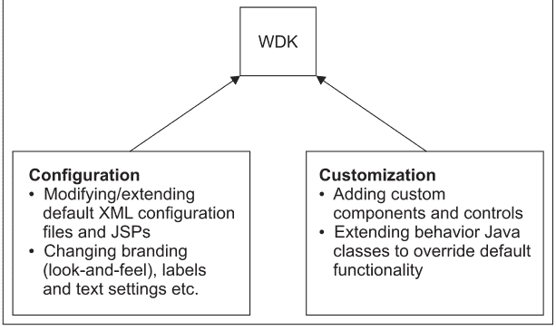

### Documentum WDK 5.3 更新：

- WDK 支持三种内容传输模式：HTTP、Unified Client Facilities（UCF）和 Content Transfer Applets
- 支持在集群环境中将会话故障转移到运行相同 WDK 基于应用程序的其他服务器
- 支持多个 Docbase 仓库搜索

### 24.1 WDK 目录结构

在通过示例讨论 WDK 配置和自定义之前，让我们先了解一下 WDK 目录结构及其包含的文件夹和文件。WDK 应用程序的根目录具有以下目录和文件：

- **WDK 应用程序配置文件（config.xml）：** WDK 应用程序的起始页面（index.html/default.html）以及包含嵌入式注释用于调试目的的 WDK 应用程序文件的 unstripped.jar。
- **WEB-INF：** 包含 web.xml 文件（用于 J2EE Web 应用程序）、WDK Web 应用程序 Java 类，以及其他应用程序层（如 wdk、webcomponent）的类，以及 WDK 框架和 JSP 标签库所需的 jars。
- **help：** 包含 WDK 客户端应用程序帮助文件。
- **plugins：** 包含 WDK 客户端应用程序的 JRE 插件。
- **应用程序层目录**（`wdk`、`webcomponent`、`webtop`、`dam`、`wp` 和 `custom`）：应用程序层目录包含应用程序的配置文件（`app.xml`）、应用程序组件的配置文件、外化的字符串、主题、组件 JSPs 以及应用程序所需的 JavaScript 文件。

不要被我们讨论的术语数量吓倒——WDK、Webcomponent、Webtop 等。这些只是各种 WDK 应用程序层，每一层都在层次结构中扩展其下方的层。请查看图 24.2 以了解 WDK 应用程序层层次结构链。

如果您打开每个 WDK 中间层的应用程序配置文件 app.xml，您会注意到它扩展自图 24.2 中显示在其正下方的层。

例如，Webtop 的 app.xml 将扩展 webcomponent 层的 app.xml。WDK 是层次结构中的基础层，不扩展任何其他层。

Webtop app.xml 文件中的片段：`<application extends="webcomponent/app.xml">`。

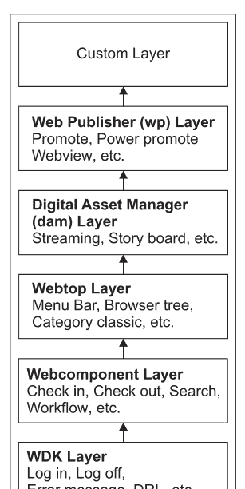

图 24.2：WDK 应用程序层次结构

请注意，每个 WDK 组件都有一个与其关联的 XML 配置文件来定义它、一个行为 Java 类、至少一个用于定义其布局的 JSP 页面，以及一个用于外化字符串的 NLS 属性文件。

**Custom 层**是一个非常有趣的概念，如果您是 Documentum WDK 的新手，一定会引起您的注意。Custom 层位于层次结构链的顶部，由 Documentum 提供以供您存放所有自定义内容。它包含任何自定义的配置 XML 文件、JSP 页面、品牌主题和外化字符串。如果您将自定义组件定义配置和其他文件放在 custom 目录中，WDK 框架将在加载 custom 层以下层的文件之前先加载它。

在将 WDK 应用程序从一个版本升级到另一个版本期间，您需要在执行升级之前备份 custom 文件夹，并在升级完成后将其恢复。这确保您的自定义文件存储在集中位置，并可根据需要轻松恢复。

### 24.2 WDK 应用程序元素

Documentum WDK 应用程序框架庞大，由组件、操作和控件等多个单元组成。在进行配置/自定义和开发自己的自定义组件之前，了解其中每一个及其相互关系至关重要。图 24.3 大致描述了各种 WDK 应用程序元素如何在 WDK 框架范围内相互交互。

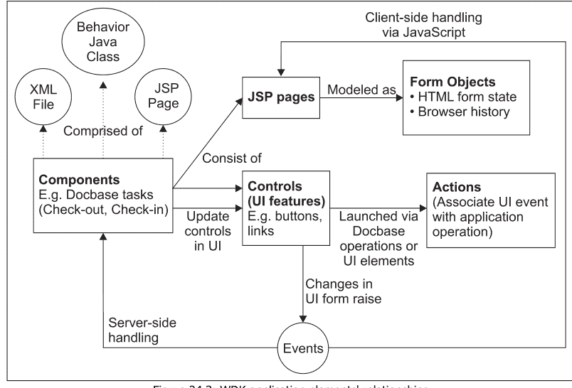

图 24.3：WDK 应用程序元素的关系


现在让我们详细讨论图 24.3：

-   **Components**：这些由 JSP 页面以及这些 JSP 页面中的控件组成。组件是 WDK 框架中的可重用单元，执行诸如检出、检入、导出等 Docbase 操作。每个 WDK 组件由一个 XML 配置文件、一个关联的行为 Java 类以及至少一个 JSP 页面组成。
-   **Controls**：这些代表 UI 功能（按钮或链接），并提供标准 Web 功能和操作，例如验证、格式化等。控件可以在多个 JSP 页面中重用，并在 UI 表单中对这些元素进行更改时引发事件。
-   **Forms (JSP pages)**：WDK 将 JSP 页面建模为服务器上的 Form 对象，以实现两个目的：
    -   维护 HTML 表单的状态
    -   维护浏览器历史记录
-   **Actions**：操作要么由 Docbase 操作（例如 check-out）触发，要么通过 UI 表单元素（例如按钮、菜单项等）触发。操作将 UI 事件与应用程序功能关联起来。
-   **Events**：每当用户操作导致 UI 表单中元素状态发生变化时，就会引发事件。事件要么通过关联 JSP 页面中的 JavaScript 在客户端处理，要么由关联组件在服务器端处理。

其中一些术语现在可能还不是很清楚。然而，您可以查阅 Documentum WDK 开发指南以获得更好的理解。随着我们在本章中继续进行示例，这些概念肯定会变得更加清晰。

## 24.3 一个简单的 WDK 配置示例

不再浪费时间，让我们从一个非常简单的 WDK 配置示例开始。

我们将覆盖 Web Publisher 中的默认新建内容（属性）屏幕，并为新闻文章模板引入新属性。

### 24.3.1 配置更改前的新建内容屏幕

如果您使用模板类别在 Web Publisher 中创建新内容，则会向您显示新建内容（属性）屏幕以提供内容的属性（元数据）信息，例如：

-   内容名称（属性：`object_name`）
-   描述性名称（属性：`title`）
-   主题（属性：`subject`）
-   生效日期（属性：`a_effective_date`）
-   到期日期（属性：`a_expiration_date`）

图 24.4 展示了该默认屏幕在 Web Publisher 中的外观。

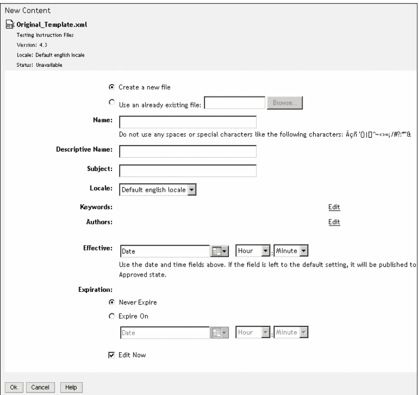

图 24.4：Web Publisher 中的默认新建内容屏幕

### 24.3.2 配置更改后的修改新建内容屏幕

图 24.5 显示了新闻文章模板的同一新建内容屏幕，其中包含新添加的属性。

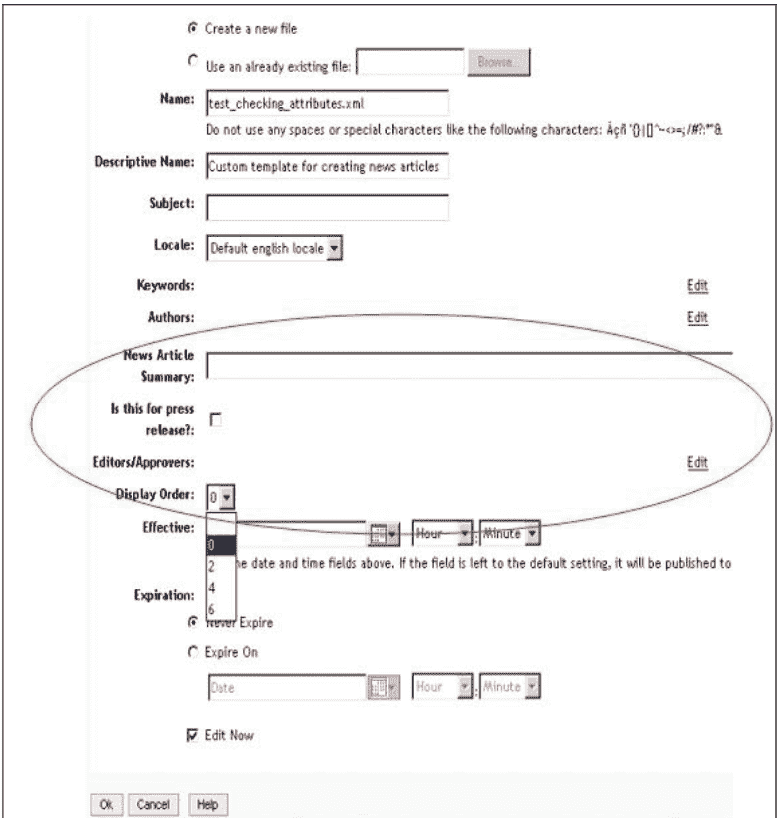

图 24.5：为新闻文章新增属性后的修改新建内容屏幕

以下步骤将解释如何使用 WDK 框架在 Documentum 中实现此简单配置。

1.  从 Web Publisher 服务器中的以下位置复制新建内容组件的 XML 配置文件（newcontent_component.xml）：
    `\wp\config\library\newcontent.`
    请注意，本章所有示例中，我们将假设 Web Publisher 应用程序的名称为 wp。
    在 Web Publisher 服务器中 custom 文件夹内的 config 文件夹中创建以下目录：
    `\library\newcontent.`
    将复制的 newcontent_component.xml 放置在以下位置：
    `\wp\custom\config\library\newcontent.`
    我们将在下面的步骤中查看对复制的 newcontent_component.xml 文件需要做的更改。
2.  从 Web Publisher 服务器中的以下位置复制新建内容 JSP 文件（newContent.jsp）：`\wp\library\newcontent.`
    在 Web Publisher 服务器中 custom 文件夹内创建以下目录：
    `\library\newcontent.`
    将复制的 newContent.jsp 重命名为（例如）custom_newContent.jsp 并将其放置在以下位置：
    `\wp\custom\library\newcontent.`
    我们将在下面的步骤中查看对 custom_newContent.jsp 文件需要做的更改。
3.  按如下所示修改 `\wp\custom\config\library\newcontent` 下的 newcontent_component.xml 文件：
    ```xml
    <?xml version="1.0" encoding="UTF-8" standalone="no"?>
    <!------------------------------------------------------------------------------>
    <config version='1.0'>
        <scope wpcontext="wpview">
            <!-- the document list component definition -->
            <!-- <component id="newcontent"> -->
            <component id="newcontent"
            extends="newcontent:wp/config/library/newcontent/
                    newcontent_component.xml">
                <!-- Component Contract -->
                <params>
                    <param name="objectId" required="false"/>
    ```
    
    ```
    </params>
    <!-- Component Layout -->
    <pages>
    <!--<start>/wp/library/newcontent/newContent.jsp</start>-->
    <start>/custom/library/newcontent/custom_newContent.jsp</start>
    <return>/wp/library/componentReturn.jsp</return>
    </pages>
    
    <!-- Component Behavior -->
    <class>com.documentum.wp.library.newcontent.NewContent</class>
    <nlsbundle>com.documentum.wp.library.newcontent.NewContentNlsProp</nlsbundle>
    
    <!-- Component specific Configuration -->
    <!-- Allow the user to import a file from file system. Default is true. -->
    <allow_import>true</allow_import>
    
    <enable_full_text_index>true</enable_full_text_index>
    
    <!-- Component specific Configuration -->
    <helpcontextid>newcontent</helpcontextid>
    </component>
    </scope>
    </config>
    ```

    该 XML 文件的结构如下所示：

    ```
    <?xml version="1.0" encoding="UTF-8" standalone="no"?>
    ```

    这是标准的 XML 声明

    ```
    <config version='1.0'>
    ```

    这是 XML 配置文件的根元素。

    ```
    <scope wpcontext="wpview">
    ```

    这是配置文件的范围，定义了此配置定义有效的上下文。

    在标签 <scope wpcontext="wpview"> 中，wpcontext 是限定符名称，wpview 是限定符值。上下文匹配针对限定符值进行。限定符在相应 WDK 应用程序层的 app.xml 文件中指定。

    以下是 WDK、Webtop、Web Publisher 等各种 WDK 应用程序层提供的一些限定符：

    -   Docbase 名称
    -   Docbase 类型
    -   权限
    -   应用程序
    -   Web Publisher 上下文
    -   Web Publisher 角色

    如有必要，您甚至可以在 WDK 应用程序中引入自定义限定符。Documentum 根据限定符在应用程序的 app.xml 文件中指定的顺序解析范围。

    ```
    <component id="newcontent"
    ```

    这是 XML 配置文件中的主要元素。除了 component 之外，其他有效元素可以是 action（Action 组件）和 application（app.xml 文件）。id 属性使用应用程序中的唯一标识符标记组件/操作名称。您可以通过在主要元素中使用 extends 属性来扩展其他组件/操作/应用程序。

    ```
    <params>
        <param name="objectId" required="false"/>
    ```

    这些行定义从配置传递到关联行为类的参数。

    ```
    <pages>
    ```

    <pages> 定义了问题组件布局的关联 JSP 页面（页）。您可以看到我们已注释掉默认 newContent.jsp 的路径，而是提供了我们自定义 JSP 文件 custom_newContent.jsp 的路径。

    ```
    <class>com.documentum.wp.library.newcontent.NewContent</class>
    ```

    该行定义组件的关联行为 Java 类。在此特定配置示例中，由于我们只是修改新建内容组件的 xml 配置文件和 JSP 文件，因此我们没有扩展默认的 NewContent.class。

    ```
    <nlsbundle>com.documentum.wp.library.newcontent.NewContentNlsProp</nlsbundle>
    ```

    该行定义用于本地化组件字符串的关联 NLS 属性文件。请注意，在 WDK 框架中，从另一个组件扩展的组件会继承为基组件的 NLS 属性文件定义的字符串。

    其他 XML 元素所示的代码特定于 newcontent 组件，不适用于所有 XML 配置文件。

4.  按如下代码片段所示修改 \wp\custom\library\newcontent 下的 custom_newContent.jsp 文件。

    请注意，在 JSP 文件中，我们为新闻文章对象类型（cust_newsarticle）的以下自定义属性添加了第 137-151 行：cust_news_summary、cust_news_is_press_rel、cust_news_edit_approvers 和 cust_news_display_order。

    这些是 Docbase 属性，其行为由 WDK 框架默认处理。我们在 JSP 中引入这些新属性的方式与下面所示的 keywords 和 authors 等属性的默认实现类似（请参阅突出显示的行）。

    ```
    <dmfx:docbaseattribute object="<%=NewContent.CONTENT_OBJECT%>"
    attribute="keywords"
    pre="<tr><td align='right' valign='top'><b>"
    col1=":</b></td><td>&nbsp;</td><td>"/>
    <tr><td colspan='4' height='5'></td></tr>
    ```


```
<dmfx:docbaseattribute object="%=NewContent.CONTENT_OBJECT%."
attribute="authors"
pre="<tr><td align='right' valign='top'><b>"
col1=":</b></td><td>&nbsp;</td><td>"/>
<tr><td colspan='4' height='5'></td></tr>
%>-- To add more attributes, make a copy of the following two
lines and enter the attribute name.
Or you can use the data-dictionary.
<dmfx:docbaseattribute object="%=NewContent.CONTENT_OBJECT%"
attribute="attribute_name"
pre="<tr><td align='right' valign='top'><b>"
col1=":</b></td><td>&nbsp;</td><td>"/>
<tr><td colspan='4' height='5'></td></tr>
--%>
<!-- Added by Gaurav for configuration: begins -->
<tr><td colspan='4' height='5'></td></tr>
<dmfx:docbaseattribute object="%=NewContent.CONTENT_OBJECT%."
attribute="cust_news_summary"
pre="<tr><td align='right' valign='top'><b>"
col1=":</b></td><td>&nbsp;</td><td>"/>

<tr><td colspan='4' height='5'></td></tr>
<dmfx:docbaseattribute object="%=NewContent.CONTENT_OBJECT%."
attribute="cust_news_is_press_rel"
pre="<tr><td align='right' valign='top'><b>"
col1=":</b></td><td>&nbsp;</td><td>"/>

<tr><td colspan='4' height='5'></td></tr>
<dmfx:docbaseattribute object="%=NewContent.CONTENT_OBJECT%."
attribute="cust_news_edit_approvers"
pre="<tr><td align='right' valign='top'><b>"
col1=":</b></td><td>&nbsp;</td><td>"/>

<tr><td colspan='4' height='5'></td></tr>
<dmfx:docbaseattribute object="%=NewContent.CONTENT_OBJECT%."
attribute="cust_news_display_order"
pre="<tr><td align='right' valign='top'><b>"
col1=":</b></td><td>&nbsp;</td><td>"/>

<!-- Added by Gaurav for configuration: ends -->
<tr>
<td align='right' valign='top'>
<b><dmf:label nlsid="MSG_EFFECTIVE"
cssclass="defaultDocbaseAttributeStyle"/>:</b>
</td>
```

- 5. 你现在需要停止并重新启动 Web Publisher 应用服务器，以查看新添加的自定义文件的效果。一旦你在 Web Publisher 中创建新的新闻文章内容，修改后的新建内容屏幕（如图 24.5 所示）就会显示给你。

## 24.4 一个简单的 WDK 自定义示例

在 WDK 中看到一个非常简单的配置示例后，我们现在将更进一步，在 WDK 中开发我们自己的自定义组件。我们将在 Web Publisher 中创建一个新的菜单选项，点击它将带我们进入用于创建新闻文章内容的自定义屏幕。

图 24.6 显示在菜单选项 File | New 下新增的自定义菜单选项 Create New News Article。

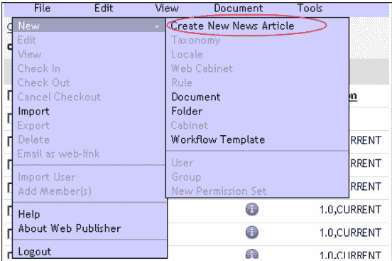

图 24.6：用于创建新闻文章内容的新的菜单选项

当你点击菜单选项 Create New News Article 时，会显示一个用于创建新闻文章内容的自定义屏幕，如图 24.7 所示。

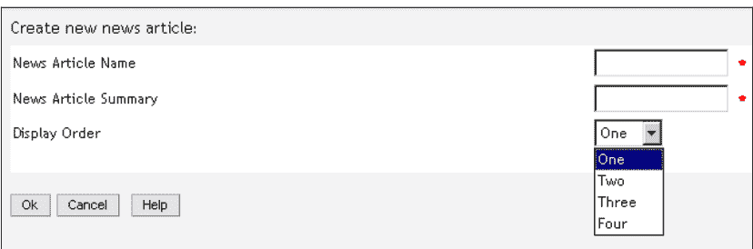

图 24.7：用于创建新闻文章内容的自定义屏幕

让我们现在逐步[content]

```
<dmfx:docbaseattribute object="%=NewContent.CONTENT_OBJECT%."
attribute="authors"
pre="<tr><td align='right' valign='top'><b>"
col1=":</b></td><td>&nbsp;</td><td>"/>
<tr><td colspan='4' height='5'></td></tr>
%>-- To add more attributes, make a copy of the following two
lines and enter the attribute name.
Or you can use the data-dictionary.
<dmfx:docbaseattribute object="%=NewContent.CONTENT_OBJECT%"
attribute="attribute_name"
pre="<tr><td align='right' valign='top'><b>"
col1=":</b></td><td>&nbsp;</td><td>"/>
<tr><td colspan='4' height='5'></td></tr>
--%>
<!-- Added by Gaurav for configuration: begins -->
<tr><td colspan='4' height='5'></td></tr>
<dmfx:docbaseattribute object="%=NewContent.CONTENT_OBJECT%."
attribute="cust_news_summary"
pre="<tr><td align='right' valign='top'><b>"
col1=":</b></td><td>&nbsp;</td><td>"/>

<tr><td colspan='4' height='5'></td></tr>
<dmfx:docbaseattribute object="%=NewContent.CONTENT_OBJECT%."
attribute="cust_news_is_press_rel"
pre="<tr><td align='right' valign='top'><b>"
col1=":</b></td><td>&nbsp;</td><td>"/>

<tr><td colspan='4' height='5'></td></tr>
<dmfx:docbaseattribute object="%=NewContent.CONTENT_OBJECT%."
attribute="cust_news_edit_approvers"
pre="<tr><td align='right' valign='top'><b>"
col1=":</b></td><td>&nbsp;</td><td>"/>

<tr><td colspan='4' height='5'></td></tr>
<dmfx:docbaseattribute object="%=NewContent.CONTENT_OBJECT%."
attribute="cust_news_display_order"
pre="<tr><td align='right' valign='top'><b>"
col1=":</b></td><td>&nbsp;</td><td>"/>

<!-- Added by Gaurav for configuration: ends -->
<tr>
<td align='right' valign='top'>
<b><dmf:label nlsid="MSG_EFFECTIVE"
cssclass="defaultDocbaseAttributeStyle"/>:</b>
</td>
```

- 5. 你现在需要停止并重新启动 Web Publisher 应用服务器，以查看新添加的自定义文件的效果。一旦你在 Web Publisher 中创建新的新闻文章内容，修改后的新建内容屏幕（如图 24.5 所示）就会显示给你。

## 24.4 一个简单的 WDK 自定义示例

在 WDK 中看到一个非常简单的配置示例后，我们现在将更进一步，在 WDK 中开发我们自己的自定义组件。我们将在 Web Publisher 中创建一个新的菜单选项，点击它将带我们进入用于创建新闻文章内容的自定义屏幕。

图 24.6 显示在菜单选项 File | New 下新增的自定义菜单选项 Create New News Article。


图 24.6：用于创建新闻文章内容的新的菜单选项

当你点击菜单选项 Create New News Article 时，会显示一个用于创建新闻文章内容的自定义屏幕，如图 24.7 所示。


图 24.7：用于创建新闻文章内容的自定义屏幕

让我们现在逐步[content]

```
<dmfx:docbaseattribute object="%=NewContent.CONTENT_OBJECT%."
attribute="authors"
pre="<tr><td align='right' valign='top'><b>"
col1=":</b></td><td>&nbsp;</td><td>"/>
<tr><td colspan='4' height='5'></td></tr>
%>-- To add more attributes, make a copy of the following two
lines and enter the attribute name.
Or you can use the data-dictionary.
<dmfx:docbaseattribute object="%=NewContent.CONTENT_OBJECT%"
attribute="attribute_name"
pre="<tr><td align='right' valign='top'><b>"
col1=":</b></td><td>&nbsp;</td><td>"/>
<tr><td colspan='4' height='5'></td></tr>
--%>
<!-- Added by Gaurav for configuration: begins -->
<tr><td colspan='4' height='5'></td></tr>
<dmfx:docbaseattribute object="%=NewContent.CONTENT_OBJECT%."
attribute="cust_news_summary"
pre="<tr><td align='right' valign='top'><b>"
col1=":</b></td><td>&nbsp;</td><td>"/>

<tr><td colspan='4' height='5'></td></tr>
<dmfx:docbaseattribute object="%=NewContent.CONTENT_OBJECT%."
attribute="cust_news_is_press_rel"
pre="<tr><td align='right' valign='top'><b>"
col1=":</b></td><td>&nbsp;</td><td>"/>

<tr><td colspan='4' height='5'></td></tr>
<dmfx:docbaseattribute object="%=NewContent.CONTENT_OBJECT%."
attribute="cust_news_edit_approvers"
pre="<tr><td align='right' valign='top'><b>"
col1=":</b></td><td>&nbsp;</td><td>"/>

<tr><td colspan='4' height='5'></td></tr>
<dmfx:docbaseattribute object="%=NewContent.CONTENT_OBJECT%."
attribute="cust_news_display_order"
pre="<tr><td align='right' valign='top'><b>"
col1=":</b></td><td>&nbsp;</td><td>"/>

<!-- Added by Gaurav for configuration: ends -->
<tr>
<td align='right' valign='top'>
<b><dmf:label nlsid="MSG_EFFECTIVE"
cssclass="defaultDocbaseAttributeStyle"/>:</b>
</td>
```

- 5. 你现在需要停止并重新启动 Web Publisher 应用服务器，以查看新添加的自定义文件的效果。一旦你在 Web Publisher 中创建新的新闻文章内容，修改后的新建内容屏幕（如图 24.5 所示）就会显示给你。

## 24.4 一个简单的 WDK 自定义示例

在 WDK 中看到一个非常简单的配置示例后，我们现在将更进一步，在 WDK 中开发我们自己的自定义组件。我们将在 Web Publisher 中创建一个新的菜单选项，点击它将带我们进入用于创建新闻文章内容的自定义屏幕。

图 24.6 显示在菜单选项 File | New 下新增的自定义菜单选项 Create New News Article。


图 24.6：用于创建新闻文章内容的新的菜单选项

当你点击菜单选项 Create New News Article 时，会显示一个用于创建新闻文章内容的自定义屏幕，如图 24.7 所示。


图 24.7：用于创建新闻文章内容的自定义屏幕

让我们现在逐步[content]

```
<dmfx:docbaseattribute object="%=NewContent.CONTENT_OBJECT%."
attribute="authors"
pre="<tr><td align='right' valign='top'><b>"
col1=":</b></td><td>&nbsp;</td><td>"/>
<tr><td colspan='4' height='5'></td></tr>
%>-- To add more attributes, make a copy of the following two
lines and enter the attribute name.
Or you can use the data-dictionary.
<dmfx:docbaseattribute object="%=NewContent.CONTENT_OBJECT%"
attribute="attribute_name"
pre="<tr><td align='right' valign='top'><b>"
col1=":</b></td><td>&nbsp;</td><td>"/>
<tr><td colspan='4' height='5'></td></tr>
--%>
<!-- Added by Gaurav for configuration: begins -->
<tr><td colspan='4' height='5'></td></tr>
<dmfx:docbaseattribute object="%=NewContent.CONTENT_OBJECT%."
attribute="cust_news_summary"
pre="<tr><td align='right' valign='top'><b>"
col1=":</b></td><td>&nbsp;</td><td>"/>

<tr><td colspan='4' height='5'></td></tr>
<dmfx:docbaseattribute object="%=NewContent.CONTENT_OBJECT%."
attribute="cust_news_is_press_rel"
pre="<tr><td align='right' valign='top'><b>"
col1=":</b></td><td>&nbsp;</td><td>"/>

<tr><td colspan='4' height='5'></td></tr>
<dmfx:docbaseattribute object="%=NewContent.CONTENT_OBJECT%."
attribute="cust_news_edit_approvers"
pre="<tr><td align='right' valign='top'><b>"
col1=":</b></td><td>&nbsp;</td><td>"/>

<tr><td colspan='4' height='5'></td></tr>
<dmfx:docbaseattribute object="%=NewContent.CONTENT_OBJECT%."
attribute="cust_news_display_order"
pre="<tr><td align='right' valign='top'><b>"
col1=":</b></td><td>&nbsp;</td><td>"/>

<!-- Added by Gaurav for configuration: ends -->
<tr>
<td align='right' valign='top'>
<b><dmf:label nlsid="MSG_EFFECTIVE"
cssclass="defaultDocbaseAttributeStyle"/>:</b>
</td>
```

- 5. 你现在需要停止并重新启动 Web Publisher 应用服务器，以查看新添加的自定义文件的效果。一旦你在 Web Publisher 中创建新的新闻文章内容，修改后的新建内容屏幕（如图 24.5 所示）就会显示给你。

## 24.4 一个简单的 WDK 自定义示例

在 WDK 中看到一个非常简单的配置示例后，我们现在将更进一步，在 WDK 中开发我们自己的自定义组件。我们将在 Web Publisher 中创建一个新的菜单选项，点击它将带我们进入用于创建新闻文章内容的自定义屏幕。

图 24.6 显示在菜单选项 File | New 下新增的自定义菜单选项 Create New News Article。


图 24.6：用于创建新闻文章内容的新的菜单选项

当你点击菜单选项 Create New News Article 时，会显示一个用于创建新闻文章内容的自定义屏幕，如图 24.7 所示。


图 24.7：用于创建新闻文章内容的自定义屏幕

让我们现在逐步[content]

```
<dmfx:docbaseattribute object="%=NewContent.CONTENT_OBJECT%."
attribute="authors"
pre="<tr><td align='right' valign='top'><b>"
col1=":</b></td><td>&nbsp;</td><td>"/>
<tr><td colspan='4' height='5'></td></tr>
%>-- To add more attributes, make a copy of the following two
lines and enter the attribute name.
Or you can use the data-dictionary.
<dmfx:docbaseattribute object="%=NewContent.CONTENT_OBJECT%"
attribute="attribute_name"
pre="<tr><td align='right' valign='top'><b>"
col1=":</b></td><td>&nbsp;</td><td>"/>
<tr><td colspan='4' height='5'></td></tr>
--%>
<!-- Added by Gaurav for configuration: begins -->
<tr><td colspan='4' height='5'></td></tr>
<dmfx:docbaseattribute object="%=NewContent.CONTENT_OBJECT%."
attribute="cust_news_summary"
pre="<tr><td align='right' valign='top'><b>"
col1=":</b></td><td>&nbsp;</td><td>"/>

<tr><td colspan='4' height='5'></td></tr>
<dmfx:docbaseattribute object="%=NewContent.CONTENT_OBJECT%."
attribute="cust_news_is_press_rel"
pre="<tr><td align='right' valign='top'><b>"
col1=":</b></td><td>&nbsp;</td><td>"/>

<tr><td colspan='4' height='5'></td></tr>
<dmfx:docbaseattribute object="%=NewContent.CONTENT_OBJECT%."
attribute="cust_news_edit_approvers"
pre="<tr><td align='right' valign='top'><b>"
col1=":</b></td><td>&nbsp;</td><td>"/>

<tr><td colspan='4' height='5'></td></tr>
<dmfx:docbaseattribute object="%=NewContent.CONTENT_OBJECT%."
attribute="cust_news_display_order"
pre="<tr><td align='right' valign='top'><b>"
col1=":</b></td><td>&nbsp;</td><td>"/>

<!-- Added by Gaurav for configuration: ends -->
<tr>
<td align='right' valign='top'>
<b><dmf:label nlsid="MSG_EFFECTIVE"
cssclass="defaultDocbaseAttributeStyle"/>:</b>
</td>
```

- 5. 你现在需要停止并重新启动 Web Publisher 应用服务器，以查看新添加的自定义文件的效果。一旦你在 Web Publisher 中创建新的新闻文章内容，修改后的新建内容屏幕（如图 24.5 所示）就会显示给你。

## 24.4 一个简单的 WDK 自定义示例

在 WDK 中看到一个非常简单的配置示例后，我们现在将更进一步，在 WDK 中开发我们自己的自定义组件。我们将在 Web Publisher 中创建一个新的菜单选项，点击它将带我们进入用于创建新闻文章内容的自定义屏幕。

图 24.6 显示在菜单选项 File | New 下新增的自定义菜单选项 Create New News Article。


图 24.6：用于创建新闻文章内容的新的菜单选项

当你点击菜单选项 Create New News Article 时，会显示一个用于创建新闻文章内容的自定义屏幕，如图 24.7 所示。


图 24.7：用于创建新闻文章内容的自定义屏幕

让我们现在逐步通过这个示例来理解如何使用 WDK 框架创建我们自己的自定义组件：

- 1. 将 \wp\wp\config\app 中的 menubar_component.xml 复制到 Web Publisher 服务器上的以下位置：\wp\custom\config\app。
  （毋庸置疑，在复制 XML 文件之前，你需要在 custom 文件夹内创建适当的文件夹结构。）

修改 custom 文件夹中的 menubar_component.xml 文件，如下所示：

```
<?xml version="1.0" encoding="UTF-8" standalone="no"?>

<!--**************************************************************-->
<!-- Component xml file for menubar Component                     -->
<!--**************************************************************-->
<!-- File            menubar_component.xml                        -->
<!-- Author          Gaurav Kathuria                               -->
<!-- Description     Extends the menubar component to display the  -->
<!--                 the new custom menu option                    -->
<!-- Created on      Nov 28, 2005                                  -->
<!--****************************************************************-->

<config version='1.0'>
    <scope>
        <desc>
            menubar component : Extends the menubar component to display the
            new custom menu option
        </desc>
        <!-- Component Contract -->
        <!-- <component id="menubar"
            extends="menubar:webtop/config/menubar_component.xml"> -->
        <component id="menubar"
            extends="menubar:wp/config/app/menubar_component.xml">

        <!-- Component Layout -->
        <pages>
            <start>/custom/app/custom_menubar.jsp</start>
        </pages>

        <!-- NLS properties file -->
        <nlsbundle>com.newsarticle.app.wpMenuBarNlsProp</nlsbundle>
    </component>
    </scope>
</config>
```

请注意，在 <component> XML 元素内，我们已从 wp/config/app/menubar_component.xml 扩展而来，并且根据突出显示的行，指向了我们的自定义 JSP 页面：custom_menubar.jsp。

除了指向自定义 JSP 页面外，我们还创建了自定义 NLS 属性文件，用于在 wpMenuBarNlsProp.property 文件中存储菜单选项标签的自定义字符串。

- 2. 将 \wp\wp\app 中的 menubar.jsp 复制并重命名为 custom_menubar.jsp，然后复制到 Web Publisher 服务器上的以下位置：\wp\custom\app。

修改 custom 文件夹中的 custom_menubar.jsp 文件，如下所示：

```
<dmf:menu name='file_menu' nlsid='MSG_FILE' width='50'>
<dmf:menu name='file_new_menu' nlsid='MSG_NEW'>
<dmf:actionmenuitem dynamic='genericnoselect'
name='file_new_webhtml_template'
nlsid='MSG_NEW_WEBHTML_TEMPLATE' action='createwebhtmltemplate'
showifinvalid='false' showifdisabled='false'/>
<dmf:actionmenuitem dynamic='generic' name='file_newcontent'
nlsid='MSG_NEW_CONTENT'
```

```
action='newcontent' showifinvalid='false' showifdisabled='true'/>

<!-- Customized to add a new menu option -->
<dmfx:actionmenuitem dynamic='generic' name='custom_new_news'
nlsid='NLS_NEW_NEWS_MENU'
action='newnewsarticlelink' showifinvalid='false' showifdisabled='true'/>

<dmfx:actionmenuitem dynamic='generic' name='create_changeset'
nlsid='MSG_NEW_CHANGESET'
action='newchangeset' showifinvalid='false' showifdisabled='false'/>
```

请注意，前两行对应于菜单选项 File 和 New。我们需要在该菜单选项下引入新的菜单项 Create New News Article。

```
<dmfx:actionmenuitem dynamic='generic' name='custom_new_news'
nlsid='NLS_NEW_NEWS_MENU'
action='newnewsarticlelink' showifinvalid='false' showifdisabled='true'/>
```

我们以与其他菜单选项在 JSP 中添加的方式类似引入这些行。

nlsid NLS_NEW_NEWS_MENU 是新引入菜单选项的属性字符串名称。该属性字符串的实际值将在 wpMenuBarNlsProp.properties 文件中提供。

当用户选择此新菜单选项时要启动的操作在 action 属性中指定为 newnewsarticlelink。这是 WDK 框架启动的操作配置的 ID。我们将在本章后面为 ID newnewsarticlelink 创建一个 Action 配置 XML 文件。

- 3. 将 \wp\strings\com\documentum\wp\app 中的 wpMenuBarNlsProp.properties 复制到 Web Publisher 服务器上的以下位置：\wp\custom\strings\com\newsarticle\app

修改 custom 文件夹中的 wpMenuBarNlsProp.properties 文件，如下所示：

```
##################################################
#
# Author      Gaurav Kathuria
# Description WebPublisher menu NLS Properties File
# Date        Nov 28th, 2005
#
##################################################
NLS_INCLUDES=com.documentum.wp.app.wpMenuBarNlsProp

# Generic Action Name

# File menu
NLS_NEW_NEWS_MENU=Create New News Article
##################################################
#$
#
##################################################
```

我们在修改后的菜单栏 NLS 属性文件中使用字符串 NLS_INCLUDES 来包含来自所包含 NLS 属性文件的所有键值对：

```
com.documentum.wp.app.wpMenuBarNlsProp
```

这有两个目的：

- 在整个 WDK 应用程序中保持字符串值的一致性
- 减少属性文件中大量 NLS 字符串的单独包含

- 4. 在 Web Publisher 服务器上 \wp\custom\config\newsarticle 的以下位置创建一个新的 Action 配置 XML 文件 custom_news_article_action.xml。

新创建的 Action 配置文件的详细信息如下所示：

```
<?xml version="1.0" encoding="UTF-8" standalone="no"?>

<!--**************************************************-->
<!---->
<!-- Action xml file for creating new news article Action -->
<!---->
<!--**************************************************-->
<!-- File custom_news_article_action.xml -->
<!-- Author Gaurav Kathuria -->
<!-- Description This Action launches custom new news -->
<!-- article creation screen -->
<!---->
<!-- Created on Nov 28, 2005 -->
<!---->
<!--**************************************************-->

<config version='1.0'>
 <scope>
  <action id="newnewsarticlelink">
   <desc>
     New news article Action : Check the condition to create
     the news article Link
   </desc>
   <!-- Component Contract -->
   <params>
    <param name="objectId" required="true"></param>
    <param name="folderPath" required="true"></param>
   </params>

   <!-- Precondition class -->
   <preconditions>
    <precondition class="com.documentum.web.formext.action.RolePrecondition">
     <role>administrator</role>
    </precondition>
   </preconditions>

   <!-- Component Name -->
   <execution class="com.documentum.web.formext.action.LaunchComponent">
    <arguments>
     <argument name="component" value="new_news_article"></argument>
    </arguments>
    <container>dialogcontainer</container>
   </execution>
  </action>
 </scope>
</config>
```

Note that the ID provided to this action configuration newnewsarticlelink is the same as we had provided for the attribute action in the custom_menubar.jsp file.

```
<precondition
class="com.documentum.web.formext.action.RolePrecondition">
```

Here we have designated that only a user with administrator role has access to this particular action. This is termed as a precondition in WDK terminology and is implemented by the default com.documentum.web.formext.action.RolePrecondition class.

On clicking the menu option Create New News Article, this action needs to launch a particular component that will correspond to the custom screen we discussed for creating new news articles.

```
<argument name="component" value="new_news_article"></argument>
```

This line designates the component ID of the launched component as new_news_article. The subsequent step will talk about creating this component configuration XML file and associated JSP, Java, and property files.

- 5. Create a new component configuration XML file custom_news_article_component.xml at the following location in Web Publisher server: \wp\custom\config\newsarticle.

The details of the newly created component configuration file are shown below:

```
<?xml version="1.0" encoding="ISO-8859-1" standalone="no"?>

<!------------------------------------------------------------------------------->
<!----------------------------------------------------------------------------->
<!-- Component xml file for New Navigation Link Component                     -->
<!----------------------------------------------------------------------------->
<!------------------------------------------------------------------------------->
<!----------------------------------------------------------------------------->
<!-- File              custom_news_article_component.xml                     -->
<!-- Author            Gaurav Kathuria                                        -->
<!-- Description       New News Article Component                            -->
<!--                    allows creating new news article                      -->
<!--                    and properties file.                                  -->
<!-- Created on        Nov 28, 2005                                           -->
<!----------------------------------------------------------------------------->
<!------------------------------------------------------------------------------->

<config version='1.0'>
    <scope>
        <component id="new_news_article">
            <desc>
                New News Article Component: Provides UI for creating new news
                articles
            </desc>
            <!-- Component Contract -->
            <params>
                <param name="objectId" required="true"></param>
                <param name="folderPath" required="true"></param>
            </params>
```

```
<!-- Component Layout -->
<pages>
<start>/custom/library/newsarticle/custom_newnewsarticle.jsp</start>
</pages>

<!-- Component Behaviour -->
<class>com.newsarticle.content.NewNewsArticle</class>

<!-- NLS properties file -->
<nlsbundle>com.newsarticle.content.NewNewsArticleNlsProp</nlsbundle>
</component>
</scope>
</config>
```

We have provided the ID for this component as new_news_article as we discussed in the last step for launching via Action configuration.

```
<start>/custom/library/newsarticle/custom_newnewsarticle.jsp</start>
```

In this line, we have specified the custom JSP for this component as custom_newnewsarticle.jsp, the details of which we will cover later in the chapter.

```
<class>com.newsarticle.content.NewNewsArticle</class>
<!-- NLS properties file -->
<nlsbundle>com.newsarticle.content.NewNewsArticleNlsProp</nlsbundle>
```

Here we specify the component behavior class as com.newsarticle.content.NewNewsArticle and mention the associated NLS property file as com.newsarticle.content.NewNewsArticleNlsProp.property.

We will look into the details of each of these custom files in the subsequent steps.

- 6. Create a new JSP file custom_newnewsarticle.jsp at the following location in Web Publisher server: \wp\custom\library\newsarticle.

The details of the newly created custom JSP file are shown in two parts below.

```
<%--
Author : Gaurav Kathuria
Date : 29-11-2005
Description : Jsp to Add New News Article.
--%>
```

```
<%@ page contentType="text/html; charset=UTF-8" %>
<%@ page errorPage="/wdk/errorhandler.jsp" %>
<%@ taglib uri="/WEB-INF/tlds/dmform_1_0.tld" prefix="dmf" %>
<%@ taglib uri="/WEB-INF/tlds/dmformext_1_0.tld" prefix="dmfx" %>
<%@ page import="com.documentum.web.common.ArgumentList" %>
<%@ page import="com.documentum.web.form.Form" %>
<%@ page import="com.documentum.web.form.control.Link" %>
<%@ page import="com.documentum.web.form.control.databound.Datagrid" %>
<%@ page import="com.documentum.web.form.control.databound.DataDropDownList"%>
<%@ page import="com.documentum.web.form.control.databound.DataListBox" %>
<%@ page import="com.documentum.web.form.control.validator.InputMaskValidator" %>
```

```
<html>
<head>
<dmf:webform/>
</head>
<body class='contentBackground'>
<dmf:form>
<table border="0" cellpadding="2" cellspacing="0" width="100%">
<tr>
<td>
<dmf:label name="lbl_news_article_name"
nlsid="MSG_LBL_NEWS_ARTICLE_NAME" />
</td>
<td>
<%--
Text field where user fill the name of the News Article.
--%>
<dmf:text name="txt_news_article_name" />
<%--
Documentum provider validator which checks that the News
Article
name is a mandatory field.
-->
<dmf:requiredfieldvalidator
name="txt_news_article_name_validator"
controltovalidate="txt_news_article_name"
nlsid='MSG_LBL_NEWS_ARTICLE_NAME_REQUIRED' />
</td>
</tr>
```

The anatomy of this code snippet follows:

```
<%@ taglib uri="/WEB-INF/tlds/dmform_1_0.tld" prefix="dmf" %>
<%@ taglib uri="/WEB-INF/tlds/dmformext_1_0.tld" prefix="dmfx" %>
```

In these lines, the necessary tag libraries are specified.

```
<%@ page import="com.documentum.web.common.ArgumentList" %>
<%@ page import="com.documentum.web.form.Form" %>
<%@ page import="com.documentum.web.form.control.Link" %>
<%@ page import="com.documentum.web.form.control.databound.Datagrid" %>
<%@ page import="com.documentum.web.form.control.databound.DataDropDownList"%>
<%@ page import="com.documentum.web.form.control.databound.DataListBox" %>
<%@ page import="com.documentum.web.form.control.validator.InputMaskValidator" %>
```

Here the required WDK framework implementation classes are imported in the JSP.

The <dmf:webform/> tag is required for initiating form processing.

The <dmf:form> tag is the HTML form that generates form elements.

The <dmf:label> and <dmf:text> tags are required for generating label and textbox fields in the form. The implementation classes for these are com.documentum.web.form.control.LabelTag and com.documentum.web.form.control.TextTag respectively as can be seen in the dmform_1_0.tld library.

<dmf:requiredfieldvalidator> is a WDK validator tag used for performing a mandatory check on the specified field (in the attribute controltovalidate). In our case the HTML form field txt_news_article_name is being checked by the validator. If the user does not provide a name for the news article, the WDK framework throws a message, the property string for which is specified in the nlsid key MSG_LBL_NEWS_ARTICLE_NAME_REQUIRED.

The string value for this property string is specified in the associated NLS property file NewNewsArticleNlsProp.property. We will discuss this in the subsequent steps.

```
<tr>
    <td>
        <dmf:label name="lbl_news_summary" nlsid="MSG_LBL_NEWS_SUMMARY" />
    </td>
    <td>
        <%--Text field where user fill the value of the News Article summary.--%>
        <dmf:text name="txt_news_summary" />
        <%--Documentum provider validator which checks that the News Article summary is a mandatory field.--%>
        <dmf:requiredfieldvalidator name="txt_news_summary_validator"
            controltovalidate="txt_news_summary"
            nlsid='MSG_LBL_NEWS_SUMMARY_REQUIRED' />
    </td>
</tr>
<tr>
    <td>
        <dmf:label name="lbl_display_order"
            nlsid="MSG_LBL_DISPLAY_ORDER" />
    </td>
    <td>
        <%--DataDropDownList showing display order of news articles.--%>
        <dmf:datadropdownlist name="txt_display_order">
            <dmf:dataoptionlist>
                <dmf:option datafield="DISPLAY_ORDER_ID"
                    labeldatafield="DISPLAY_ORDER_VALUE"/>
            </dmf:dataoptionlist>
        </dmf:datadropdownlist>
    </td>
</tr>
</table>
</dmf:form>
</body>
</html>
```

The <dmf:datadropdownlist> tag depicts a data dropdown control that translates into a dropdown in the form, showing the designated values in the list.


<dmf:option> 标签指定 datafield 属性值将存储 Docbase 属性中的实际值，而 labeldatafield 将仅用于向用户显示列表值的用户友好标签。例如，我们将在下拉列表中向用户显示字符串 One、Two、Three、Four 等，而这些选项在 Docbase 属性中持久化的实际值将分别为 1、2、3 或 4。

7. 在 Web Publisher 服务器的以下位置创建一个新的 NLS 属性文件 NewNewsArticleNlsProp.properties：
\wp\custom\strings\com\newsarticle\content.

新创建的自定义 NLS 属性文件的详细信息如下所示。

```
#************************************************************************
#
# Author      Gaurav Kathuria
# Description New News Article Component NLS Properties File
# Date        Nov 28, 2005
#
#************************************************************************
MSG_TITLE=Create new news article
MSG_LBL_NEWS_ARTICLE_NAME=News Article Name
MSG_LBL_NEWS_SUMMARY=News Article Summary
MSG_LBL_DISPLAY_ORDER=Display Order

MSG_OK=Ok
MSG_CANCEL=Cancel
MSG_CLOSE=Cancel

//error messages
MSG_LBL_NEWS_ARTICLE_NAME_REQUIRED=Please enter a name for the news article
MSG_LBL_NEWS_SUMMARY_REQUIRED=Please enter a summary for the news article
MSG_ERROR_SAVE_OPERATION=Error in saving news article
MSG_ERROR_ORDER_DROPDOWN_POPULATION=Error in populating display order dropdown
```

此 NLS 属性文件中已指定新闻文章创建屏幕所需的各种标签、字符串和消息。

8. 创建一个新的 Java 文件 NewNewsArticle.java；编译并将类文件放置在 Web Publisher 服务器的以下位置：
\wp\WEB-INF\classes\com\newsarticle\content.

以下代码片段按部分展示了新创建的自定义行为类的详细信息。

强烈建议从 Documentum 网站下载并浏览 Documentum WDK/Webcomponent/Webtop/Web Publisher Javadocs，以便了解以下示例中使用的各种方法。

我们已将自定义 New Article 类扩展自 WDK 基类 Component。请参阅图 24.8 以了解 WDK 组件层次结构堆栈。

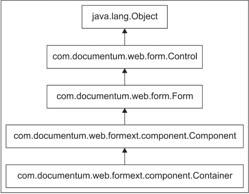

图 24.8：WDK 组件层次结构

```java
package com.newsarticle.content;

import com.documentum.fc.client.*;
import com.documentum.fc.common.DfException;
import com.documentum.fc.common.DfId;
import com.documentum.web.common.ArgumentList;
import com.documentum.web.common.ErrorMessageService;
import com.documentum.web.common.LocaleService;
import com.documentum.web.form.Control;
import com.documentum.web.form.Form;
import com.documentum.web.form.IControlListener;
import com.documentum.web.form.control.*;
import com.documentum.web.form.control.databound.DataDropDownList;
import com.documentum.web.form.control.databound.DataListBox;
import com.documentum.web.form.control.databound.TableResultSet;
import com.documentum.web.form.control.databound.DataOptionList;
import com.documentum.web.formext.component.Component;
import com.documentum.web.formext.control.docbase.DocbaseAttribute;
import com.documentum.web.formext.control.docbase.DocbaseAttributeValue;
import com.documentum.web.formext.control.docbase.DocbaseObject;
import com.documentum.wp.app.wcmHttpAppContext;
import com.documentum.wp.app.wpStatusUtil;
import com.documentum.wp.nls.NlsResourceBundle;

import java.util.*;

/**
 * This class is a behaviour class for News Article component.
 * @author : Gaurav Kathuria
 * @version : 1.0, 29/11/2005
 *
 */
public class NewNewsArticle extends Component
{

```

```
private String m_strObjectId;
private String m_strObjectType;

private Text txt_news_article_name;
private Text txt_news_summary;
private DataDropDownList txt_display_order;

// Constructor
public NewNewsArticle()
{
    m_strObjectId = null;
    txt_news_article_name = null;
    txt_news_summary = null;
    txt_display_order = null;
}
```

让我们详细讨论这段代码。

```
import com.documentum.fc.client.*;
import com.documentum.fc.common.DfException;
import com.documentum.fc.common.DfId;
import com.documentum.web.common.ArgumentList;
import com.documentum.web.common.ErrorMessageService;
import com.documentum.web.common.LocaleService;
import com.documentum.web.common.Control;
import com.documentum.web.form.Form;
import com.documentum.web.form.IControlListener;
import com.documentum.web.form.control.*;
import com.documentum.web.form.control.databound.DataDropDownList;
import com.documentum.web.form.control.databound.DataListBox;
import com.documentum.web.form.control.databound.TableResultsSet;
import com.documentum.web.form.control.databound.DataOptionList;
import com.documentum.web.formext.component.Component;
import com.documentum.web.formext.control.docbase.DocbaseAttribute;
import com.documentum.web.formext.control.docbase.DocbaseAttributeValue;
import com.documentum.web.formext.control.docbase.DocbaseObject;
import com.documentum.wp.app.WcmHttpAppContext;
import com.documentum.wp.app.WpStatusUtil;
import com.documentum.nls.NlsResourceBundle;
```

这里导入了必要的 WDK 和 DFC 类。

```
private String m_strObjectId;
private String m_strObjectType;

private Text txt_news_article_name;
private Text txt_news_summary;
private DataDropDownList txt_display_order;
```

这里我们声明了表单控件的私有引用以及通过此屏幕将创建的文档的对象 ID。请参考 custom_newnewsarticle.jsp 文件以了解各种表单控件的名称。

```
/**
 * News Article component initializer method
 *
 * @param argumentlist : ArgumentList
 */
public void onInit(ArgumentList argumentlist)
{
```

```
super.onInit(argumentlist);
m_strObjectId = argumentlist.get("objectId");
initControls();
}
```

```
/**
 * Method for initializing controls
 */
private void initControls()
{
    txt_news_article_name = (Text) getControl("txt_news_article_name",
        com.documentum.web.form.control.Text.class);
    txt_news_summary = (Text) getControl
        ("txt_news_summary",
        com.documentum.web.form.control.Text.class);
    txt_display_order = (DataDropDownList) getControl("txt_display_order",
        com.documentum.web.form.control.databound.DataDropDownList.class);
    initializeOrderDropdown();
}
```

WDK 控件会经过确定的生命周期阶段，并且在生命周期的每个阶段，它们可能具有不同的功能和状态。请注意，表单处理器会调用与每个生命周期阶段相关联的各种生命周期方法。

- onInit(): 每当组件或 JSP 页面首次被请求时，就会调用此方法。
- onRender(): 每次通过 URL 向表单发出请求时，在 JSP 表单处理发生之前就会调用此方法。
- onRefreshData(): 当表单数据被修改时调用。
- onRenderEnd(): 在每次请求的所有表单处理完成后，作为清理操作被调用。
- onExit(): 每当向另一个表单或组件发出请求时调用。

```
m_strObjectId = argumentlist.get("objectId");
```

文档对象 ID 的引用是通过 com.documentum.web.common.ArgumentList 类获取的。该类包含传递给表单或由控件的 onInit() 事件处理程序接收的参数。

```
txt_news_article_name = (Text) getControl("txt_news_article_name",
    com.documentum.web.form.control.Text.class);
```

getControl() 方法返回对命名控件的引用。请注意，我们已根据它是文本字段还是数据下拉列表将其强制转换为适当的控件。

```
/**
 * Method for initializing display order dropdown
 */
private void initializeOrderDropdown()
{
    String strId = "", strLabel = "";
```

```
IDfCollection idfcollection = null;
IDfQuery dfquery = new DfQuery();
IDfSession dfSession = null;

TableResultSet tableresultset = new TableResultSet
    (new String[]{"DISPLAY_ORDER_ID", "DISPLAY_ORDER_VALUE"});

try
{
    dfSession = getDfSession();
    dfquery.setDQL("select col1,col2 from dm_dbo.table1");
    idfcollection = dfquery.execute
        (dfSession, IDfQuery.DF_READ_QUERY);

    while (idfcollection.next())
    {
        strId = idfcollection.getString("col1");
        strLabel = idfcollection.getString("col2");
        tableresultset.add(new String[]{strId, strLabel});
    }

}
catch (DfException dfe)
{
    ErrorMessageService.getService().setNonFatalError
        (this,"MSG_ERROR_ORDER_DROPDOWN_POPULATION", dfe);
    System.out.println("Exception caught!!");
    setReturnError("MSG_ERROR_ORDER_DROPDOWN_POPULATION", null, dfe);
    return;
}
finally
{
    try
    {
        if (idfcollection != null &&
            idfcollection.getState() != IDfCollection.DF_CLOSED_STATE)
            idfcollection.close();
    }
    catch (DfException dfexception1)
    {
        //logMessage.warn(dfexception1.getMessage(),
            dfexception1;
    }
}

txt_display_order.getDataProvider().setResultSet
    (tableresultset,  null);
}
```

让我们详细讨论此代码片段中的某些行：

```
private void initializeOrderDropdown()
```

我们已在 initializeOrderDropdown 方法中初始化了显示顺序下拉列表中的值。

```
TableResultSet tableresultset = new TableResultSet
    (new String[]{"DISPLAY_ORDER_ID", "DISPLAY_ORDER_VALUE"});
```


我们使用了 WDK 的 com.documentum.web.form.control.databound.TableResultSet 类来存储下拉实体的 ID 和实际值。

```
dfquery.setDQL("select col1,col2 from dm_dbo.table1");
```

发起一个 DFC 查询以从 Docbase 中注册的表 table1 中选择 ID 和描述性标签。请参阅上一章中关于 IDfquery 接口的讨论以获取更多详细信息。

图 24.9 显示了 Docbase 中注册表 table1 的结构/数据：

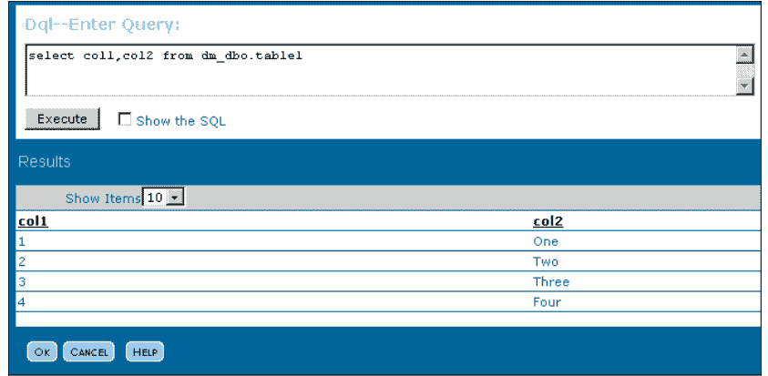

图 24.9：Docbase 注册表 table1 中的数据。

```
tableresultset.add(new String[]{strId, strLabel});
```

DQL 查询返回的每一行结果都作为单独的一行添加到 TableResultSet 中。

```
txt_display_order.getDataProvider().setResultSet
(tableresultset, null);
```

在数据下拉列表控件上调用 getDataProvider() 方法以返回该控件的数据提供程序的句柄。这返回对 com.documentum.web.form.control.databound.DataProvider 类的引用。

在 DataProvider 类上调用 setResultSet() 方法以将数据绑定到控件。

```
ErrorMessageService.getService().setNonFatalError
(this, "MSG_ERROR_ORDER_DROPDOWN_POPULATION", dfe);
```

com.documentum.web.common.ErrorMessageService 是一个单例类，其 getService() 方法会查看应用程序 app.xml 文件中的 <errormessageservice> XML 元素，以确定要实例化的错误消息服务类。

```java
/**
 * This Function is executed when user wants to commit changes by
 * clicking on OK button
 */
public boolean onCommitChanges()
{
try
{
IDfSession sessionObj = getDfSession();
IDfSysObject idfsysobject = (IDfSysObject)
    sessionObj.newObject("cust_newsarticle");

String newsArticleNameValue = txt_news_article_name.getValue();

    if (newsArticleNameValue != null)
    {
        idfsysobject.setString
            ("object_name", newsArticleNameValue);
    }

String newsSummaryValue = txt_news_summary.getValue();

    if (newsSummaryValue != null)
    {
        idfsysobject.setString
            ("cust_news_summary", newsSummaryValue);
    }

//Get the link level from the data dropdown list.
DataDropDownList displayOrderControl =
    (DataDropDownList) getControl("txt_display_order",
DataDropDownList.class);
String displayOrderID = displayOrderControl.getValue();

    if (displayOrderID != null)
    {
        idfsysobject.setString
            ("cust_news_display_order", displayOrderID);
    }

    if (idfsysobject.isDirty()) // Checking if object is not updated
    if (idfsysobject.isCheckedOut()) // If object has been checkout
    {
        idfsysobject.saveLock(); // Retains the lock on the object
    }
    else
    {
        idfsysobject.save(); // Saves changes. If object not checked
                            // out.
    }

        return true;
}
catch (DfException dfe)
{
    ErrorMessageService.getService().
        setNonFatalError(this, "MSG_ERROR_SAVE_OPERATION", dfe);
    setReturnError("MSG_ERROR_SAVE_OPERATION", null, dfe);
    return false;
}

}
```

让我们详细讨论代码片段中的某些行：

```
public boolean onCommitChanges()
```

最后，调用 onCommitChanges() 方法将表单中用户提供的数据持久化到 Docbase 属性中。当用户在屏幕上点击 OK 时会调用此方法。

```
IDfSysObject idfsysobject = (IDfSysObject)
    sessionObj.newObject("cust_newsarticle");
```

为 Docbase 对象类型 cust_newsarticle（新闻文章）实例化了一个新对象。请注意，新闻文章内容对象（object_name 属性）的名称及其新闻摘要（cust_news_summary 属性）分别在第 152 行和第 159 行中是如何设置的。

Text、TextArea、Tab、DateInput、DropDownList 等都是 com.documentum.web.form.control.StringInputControl 类的子类。此类中的 getValue() 方法返回控件中包含的值。示例可见于第 148、155 和 165 行。

- 9. 停止并启动 Web Publisher 应用服务器以使更改生效。当您以管理员身份登录时，自定义菜单选项将可访问，并且一旦您点击“创建新新闻文章”菜单选项，“创建新新闻文章”屏幕将如图 24.7 所示启动。通过为其提供名称和摘要并从下拉列表中选择显示顺序值来创建新的新闻文章。点击 OK 后，新闻文章对象将在 Docbase 中创建。Voilà！我们刚刚使用 WDK 框架创建了自定义组件并进行了测试。不过，建议您阅读 Documentum WDK 手册和参考指南，以全面了解 WDK 提供的丰富功能。

## 24.5 摘要

Web Development Kit（简称 WDK）是由 Documentum 提供的框架，由可重用组件组成，用于构建和部署可连接 Documentum Content Server 的 J2EE Web 应用程序。

在本章开始时，我们讨论了 WDK 允许对 WDK 框架组件执行简单配置和自定义。

配置涉及对 XML 配置文件和 JSP 页面的更改，以更改标签/文本并执行其他简单配置更改。

另一方面，自定义涉及对行为 Java 类的更改，以覆盖和扩展 WDK 框架提供的默认功能。

我们随后简要查看了 WDK 目录结构，以了解其包含的文件夹和文件。

我们还看到了 WDK 应用层级链，其中每个应用层都从层级中上层的应用层扩展而来。链条如下——WDK、Webcomponent、Webtop、Digital Asset Manager、Web Publisher 和 Custom 层。

我们随后看到了各种 WDK 实体（如组件、操作、表单对象、控件和事件）在 WDK 架构中如何相互关联。

在本章后半部分，我们讨论了一个简单的 WDK 配置和一个简单的 WDK 自定义示例。

在 WDK 配置示例中，我们看到了通过为新闻文章模板添加新属性来更改 Web Publisher 中“新建内容（属性）”屏幕的详细步骤。

在 WDK 自定义示例中，我们讨论了创建用于在 Web Publisher 中创建新闻文章内容的自定义组件（和屏幕）的详尽步骤。

## 25 Documentum 部署

## Documentum 部署

在任何定义良好的软件生命周期中，您都在开发环境中开发应用程序，并在完全独立的测试环境中进行 QA（或系统测试）。我们所说的环境是指由服务器和程序套件组成的完整硬件和软件设置，开发的应用程序需要这些设置才能正常运行。随后，经过系统测试的应用程序会发布到 staging 环境，然后最终发布到生产服务器。虽然环境不断从开发到系统测试再到生产发生变化，但保持不变的是共同的部署策略。该策略应规划周全，由涉及最少人工干预的步骤组成，以确保可以重复执行以将我们的应用程序迁移到各种环境。

在 Documentum 中，典型的应用程序将具有以下需要在各种环境中迁移的组件或实体：

- Docbase 对象，例如对象类型、生命周期、工作流、别名集、模板、演示文件以及构成应用程序基础的其他对象
- Docbase 中由模板创建或导入的文件、图像等在 Docbase 中的内容
- Web Publisher 代码和自定义文件
- 任何需要在目标环境中执行的部署后脚本（如用于创建站点发布配置的脚本）

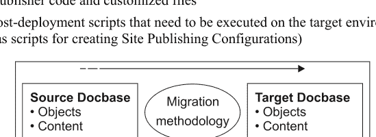

图 25.1：从源环境到目标环境的部署

有许多部署方法可供选择，可帮助我们将对象和内容从一个环境迁移到另一个环境。每种方法都有其自身的优缺点，应在对特定需求进行适当评估后选择。


图 25.2 将为您快速提供在何种情况下以及在何种条件下应采用何种方法论的思路。此外，您还将了解每种方法论的一些优点和缺点，以便为您的自定义应用程序做出更好的决策。

请注意，此表不应被视为一份全面的清单。有关多种部署方法详细评估，请查阅 Documentum 手册和白皮书。

| 待迁移的实体 | 方法论 | 优点 | 缺点 |
|---|---|---|---|
| Docbase 对象 | DocApp 迁移 | 可用于有选择地迁移 Docbase 中的对象。 | 需要细致地设置安装选项，以避免目标 Docbase 损坏/受损。 |
| Docbase 对象 | Dump & Load 脚本 | 可用于迁移整个 Docbase。 | 如果 Docbase 规模巨大，则过程耗时。 |
| Docbase 对象 | 自定义脚本 | 如果应用程序无法通过现有方法论迁移，则很有用。 | 需要强大的脚本知识以及对 Documentum 架构/对象的理解。 |
| Docbase 内容 | DocApp 迁移 | 可用于有选择地迁移 Docbase 中的内容。 | 内容的工作流状态/任务在目标 Docbase 上迁移不正确。此外，源 Docbase 中对象的创建和修改日期在目标 Docbase 上会丢失。 |
| Docbase 内容 | Dump & Load 脚本 | 可用于迁移整个 Docbase。 | 如果 Docbase 规模巨大，则过程耗时。 |
| Docbase 内容 | 自定义脚本 | 如果应用程序无法通过现有方法论迁移，则很有用。 | 需要强大的脚本知识以及对 Documentum 架构/对象的理解。 |
| Docbase 内容 | Documentum FTP 服务 | 可用于将大量内容迁移到 Docbase。 | 需要手动拖放将文件导入 Docbase。 |
| Web Publisher 代码和自定义/处理脚本 | 手动部署 | 无。 | 由于需要人工干预且耗时，因此容易出错。 |
| Web Publisher 代码和自定义/处理脚本 | 使用 ANT 的自动化构建脚本 | 系统化地编译和打包代码的方式。 | 需要良好的 ANT 脚本知识。 |

图 25.2：部署方法

本章我们将讨论 DocApp 迁移作为有选择地迁移 Docbase 对象和内容的方法论，以及使用 ANT 脚本迁移 Web Publisher 代码和自定义脚本。

## 25.1 DocApp 迁移

使用 Documentum Application Builder，您可以创建并将所有对象打包到 DocApp 中（请参阅第 2 章）。在我们的例子中，我们创建了一个名为 TestDocApp 的 DocApp 来包含我们的自定义 Documentum 对象。一旦所有对象都打包在 DocApp 中，您就可以使用 Documentum Application Builder 创建 DocApp 归档文件。DocApp 归档文件本质上只是包含对象及其相关对象以专有格式打包的 ZIP 文件，可由 Documentum Application Installer 读取并发布到目标 Docbase。然而，使用 Application Builder 和 Application Installer 进行迁移并非看起来那么简单。您需要牢记一些事项以确保迁移顺利进行。下面提到的先决条件列出了一些基本要点，如果您使用 DocApps 在不同环境之间迁移 Docbase 对象和内容，则需要予以注意。

需要为所有需要归档并安装到目标 Docbase 的对象正确设置安装选项。我们将在本章后面详细介绍这一点。

确保将需要迁移到目标 Docbase 的所有对象都包含在您的 DocApp 中。Documentum 不会自动包含相关对象。例如，如果您在 DocApp 中包含 Web Publisher 模板文件，Documentum 不会自动将其关联的规则和演示文件包含在 DocApp 中。

在选择 DocApp 归档文件时，删除对源 Docbase 中已删除对象的任何引用。例如，如果别名集引用了某个特定组名，而该组在源 Docbase 中不再存在，则在创建 DocApp 归档文件之前，请先从别名集中删除其引用。

如果目标 Docbase 上已有部分对象，并且您需要对其进行增量更新，请确保在创建 DocApp 归档文件时不要更改源 Docbase 上的其名称（object_name 属性）。这是因为 DocApp 归档和安装会查看 object_name 属性以定位并识别目标 Docbase 中已存在的对象。

现在让我们逐步了解将对象包含到 DocApp 中并在源 Docbase 中设置其安装选项的一些简单步骤。然后，我们将对该 DocApp 进行归档，并使用 Documentum Application Installer 将归档文件安装到目标 Docbase。

## 25.2 配置 DocApp 对象并创建/安装 DocApp 归档文件

本节将详细介绍为 DocApp 对象设置安装选项的步骤，并解释如何创建和安装 DocApp 归档文件。

- 1. 检出 DocApp 并选择菜单选项 Insert | Object from Docbase | Object Type（例如）以将对象类型包含到您的 DocApp 中。相应地，Application Builder 中也有选项可用于插入其他对象，例如工作流模板、别名集等。

所有对象类型都存储在与 Docbase 名称对应的系统柜中（在我们的例子中为 dev_doc）。选择要包含在 DocApp 中的对象类型并单击插入按钮（请参阅图 25.3）。

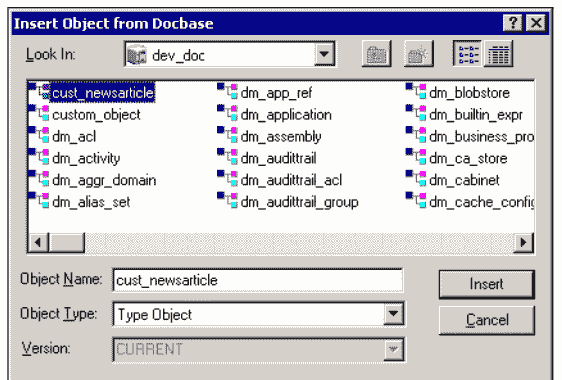

图 25.3：从 Docbase 向 DocApp 插入对象类型

通过菜单选项 Insert | Object from the Docbase 将所有其他要部署到目标 Docbase 的对象包含在内，如图 25.4 所示：

| 对象 | 菜单选项 |
|---|---|
| 对象类型 | 对象类型 |
| 文档生命周期 | 文档生命周期 |
| 工作流模板 | 工作流模板 |
| 权限集模板 | 权限集模板 |
| 别名集 | 别名集 |
| 格式 | 格式 |
| XML 应用程序 | XML 应用程序 |
| **数据对象** |  |
| 自定义文件夹 (Custom_Fld) | 文件夹 |
| 演示文件文件夹 (Custom_Presentations) | 文件夹（如果需要有选择地包含演示文件，请选择菜单选项 Document。） |
| 规则文件文件夹 (Custom_Rules) | 文件夹（如果需要有选择地包含规则文件，请选择菜单选项 Document。） |
| 模板文件文件夹 (News_Articles) | 文件夹（如果需要有选择地包含模板文件，请选择菜单选项 Document。） |
| 文件夹映射 | 文档 |
| Web 柜 (Test_WebCabinet) | 柜 |

图 25.4：用于将对象包含到 DocApp 中的菜单选项

在您包含所有需要迁移的对象后，Application Builder 的左侧窗格将如下图 25.5 所示出现：

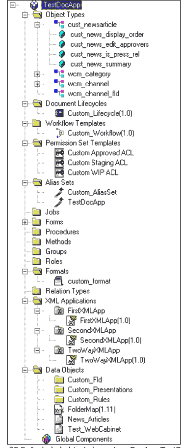

图 25.5：包含在自定义 DocApp TestDocApp 中的对象

请注意，我们已包含默认的 Web Publisher 对象类型，例如 wcm_category、wcm_channel 和 wcm_channel_fld，因为我们需要从源 Docbase 将模板类别、内容和 Web 柜（频道）文件夹迁移到目标 Docbase。

### Documentum 5.3 更新

Documentum 版本 5.3 在 Documentum Application Builder 中引入了名为 **Modules** 的新功能。Modules 只是可执行代码的元素，在 Docbase 仓库中表示为 `dmc_module` 文件夹对象类型。例如，Documentum 中的业务对象可以被视为一种模块。这允许您将业务对象类和支持文件（以 JAR 文件形式）打包到 DocApp 中，并可通过 Documentum Application Installer 在目标环境中安装。

- 2. 在您将对象包含到 DocApp 后，在左侧窗格中选择单个对象并选择菜单选项 DocApp | Set Installation Options 以设置其安装选项。

设置安装选项非常重要，因为通过这样做，您可以为 Application Installer 提供大量重要指令，用于在目标 Docbase 中安装对象，例如：

- **升级选项**：如果 DocApp Installer 找到与源 Docbase 中同名的对象，则可以指示其执行以下其中一项操作：
  - 用源 Docbase 中存在的版本覆盖目标 Docbase 中对应的对象。
  - 更新并在目标 Docbase 中创建对象的新版本，同时保留原始版本不变。
  - 不覆盖目标 Docbase 中的对象。
- **数据对象传输**：此选项适用于 XML 应用程序、文件夹和柜，且指示安装程序按以下方式包含或排除对象：
  - **全部内容**：安装程序将安装指定的柜、文件夹和子文件夹以及其中包含的所有对象。
  - **顶层内容**：安装程序将安装指定的 XML 应用程序文件夹或文件夹以及其中包含的对象。
  - **层次结构**：安装程序仅安装指定的柜、文件夹和子文件夹，但不包含对象。
  - **仅对象**：安装程序仅安装指定的 XML 应用程序文件夹、柜或文件夹。

让我们以自定义生命周期对象 `Custom_Lifecycle` 为例并设置其安装选项。


3. 从左侧窗格中选择 Custom_Lifecycle 对象，并选择菜单选项 DocApp | Set Installation Options 以设置自定义生命周期对象的安装选项（参见图 25.6）。

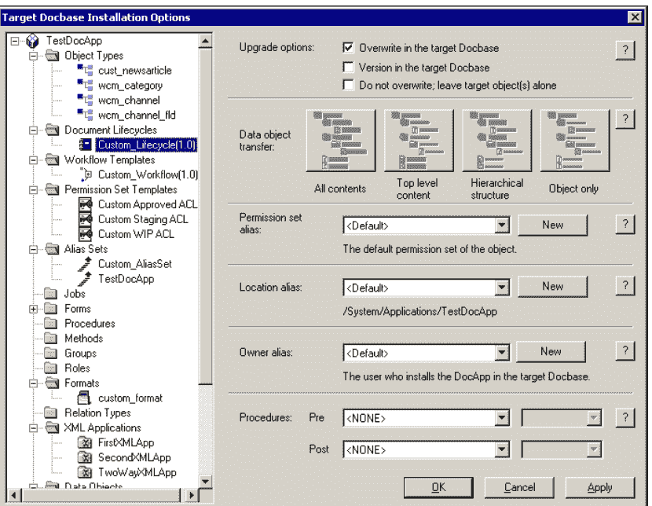

图 25.6：为 Custom_Lifecycle 对象设置安装选项

如图 25.6 所示，选择 Upgrade options 复选框以在目标 Docbase 中已存在的情况下覆盖 Custom_Lifecycle 对象。

生命周期对象安装到目标 Docbase 后，Documentum 会为其分配一个系统生成的 ACL（安装 DocApp 的用户的权限集）。然而，您可以通过为其定义权限集来指示系统为目标 Docbase 中的生命周期分配特定的 ACL。

这可以通过点击 Permission set alias 字段旁显示的 New 按钮来完成，这将打开一个 Alias Object Dialog 屏幕。

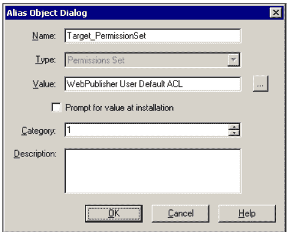

图 25.7：使用 Alias Object Dialog 屏幕为目标 Docbase 中的生命周期对象指定 ACL

如图 25.7 所示的 Alias Object Dialog 屏幕中，填写以下字段：

- **Name:** 为权限集别名提供一个自解释的名称。
- **Value:** 指定系统在生命周期对象安装到目标 Docbase 后需要分配给它的实际 ACL。我们已分配 WebPublisher User Default ACL，如图 25.7 所示。
- **Category:** 这只是一个可用于对系统中的各种别名进行分类的应用程序特定标志。Documentum 内部不使用此标志。
- **Description:** 为别名设置提供简要的说明性描述。

图 25.8 显示了 WebPublisher User Default ACL 中各种 Web Publisher 组可用的访问权限（权限）。

请注意，您甚至可以让 Value 字段保持空白，并选择复选框，以便系统在您通过 Documentum Application Installer 工具在目标 Docbase 中安装 DocApp 时在运行时提示您指定 ACL。

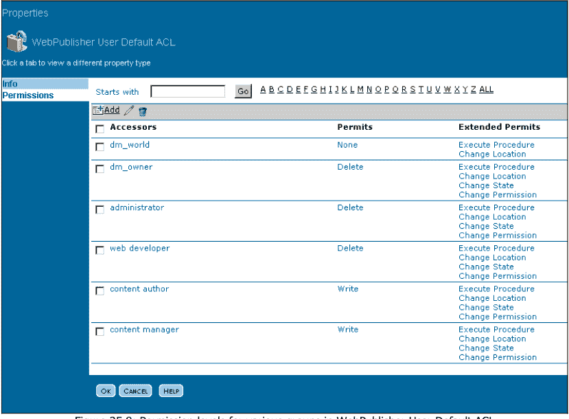

图 25.8：WebPublisher User Default ACL 中各组的权限级别

填写完各种字段后，单击 OK。

与您为目标 Docbase 中的对象指定权限集的方式类似，您可以指定以下内容：

- **Location alias**: 对象应在其中安装的目标 Docbase 中的柜/文件夹路径
- **Owner alias**: 安装后应成为此对象所有者的目标 Docbase 中的用户或组。
- **Pre- and post-installation procedures**: Application Installer 在开始 DocApp 安装之前和完成安装之后需要执行的程序。例如，您可以编写自定义程序（并将其包含在您的 DocApp 中）以在目标 Docbase 中创建一些应用程序特定的组，并将其作为预安装脚本执行。这将确保系统在安装其他 DocApp 对象之前先在目标 Docbase 中创建指定的组。

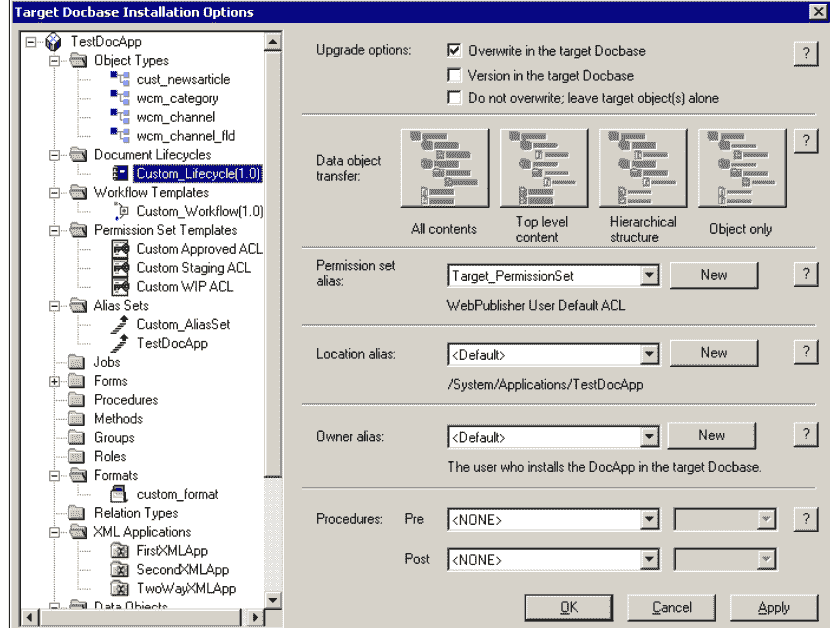

图 25.9：为 Custom_Lifecycle 对象设置的安装选项

参见图 25.9；在指定安装选项后，单击 Apply 和 OK。图 25.10 列出了包含在您的自定义 DocApp 中的其他对象的正确 Location Alias 安装选项。如果需要，您还可以为其中每个对象指定特定的 Permission set alias 和 Owner alias 值。

在为自定义 DocApp 中包含的所有对象完成安装选项设置后，不要忘记签入 DocApp。

| Object | Location Alias |
|---|---|
| Object Types | N/A |
| Document Lifecycles | /System/Applications/TestDocApp |
| Workflow Templates | /System/Applications/TestDocApp |
| Permission Set Templates | N/A |
| Alias Sets | N/A |
| Formats | N/A |
| XML Applications | /System/Applications/TestDocApp |
| Data Objects |  |
| Custom Folder | /Custom_Cabinet |
| Presentation Files | /webPublisher Configuration/Supporting Templates/Editor Presentations |
| Rules Files | /webPublisher Configuration/Supporting Templates/Editor Rules |
| Template Files | /webPublisher Configuration/Content Templates |
| Folder Map | /webPublisher Configuration/Common |
| Web Cabinet | / |

图 25.10：DocApp 对象的 Location Aliases

4. 选择菜单选项 DocApp | Create DocApp Archive 以便由系统创建 DocApp 归档。系统将提示您指定本地机器驱动器上的文件夹位置（参见图 25.11），DocApp 归档将在该位置创建。

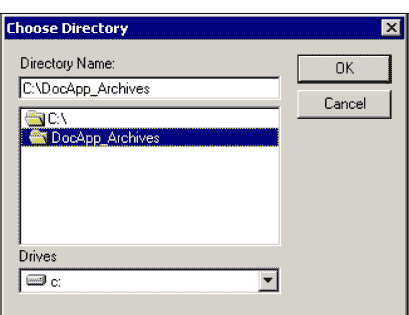

图 25.11：指定 DocApp 归档创建的文件夹位置

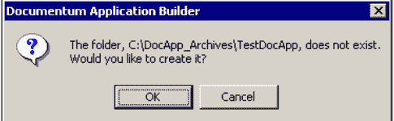

图 25.12：开始 DocApp 归档创建过程的系统提示

参见图 25.12；单击 OK，允许系统在指定的文件夹位置创建自定义 DocApp 的归档。通常归档创建过程需要几分钟，但如果 DocApp 中包含的对象数量非常大，则可能有很大差异。对于包含约 1000 个对象的 DocApp，归档时间甚至可能长达 5 小时。

DocApp 归档创建完成后，浏览到机器上的指定位置并打开归档日志文件（<Your DocApp name>_ArchiveLog.html）以查找任何系统错误/警告。建议查找包含关键字 unable to find 的警告以发现任何严重故障。

一旦您拥有源 Docbase 的 DocApp 归档，您就可以通过 Documentum Application Installer 将其安装到目标 Docbase。在安装归档之前，您可能希望清理目标 Docbase 并执行特定于您应用程序的任何预安装步骤。

在安装 DocApp 归档之前，最好在目标 Docbase 中设置 Cabinets、Folders、Web Cabinets、Users/Groups 等。如果您想避免此类手动操作，您可以编写预安装程序并将其包含在 DocApp 中，如我们在第 3 步中看到的那样。

5. 目标 Docbase 就绪后，您就可以在其上安装源 Docbase DocApp 归档。设置 dmcl.ini 文件以指向目标 Docbase 的正确 DocBroker 主机。

从您的机器启动 Documentum Application Installer 并从 Docbase 下拉列表中选择目标 Docbase 名称（本例中为 PN6549 Docbase）。

提供 Docbase 用户凭据用于登录身份验证目的并单击 OK（参见图 25.13）。

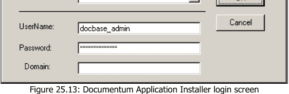

图 25.13：Documentum Application Installer 登录屏幕

6. 在 Select DocApp Archive 屏幕中（参见图 25.14），单击 Browse... 按钮并从本地机器中选择 DocApp 归档（在第 4 步中创建）。您可以选择提供在 DocApp 归档安装过程中创建的日志文件的路径和文件名。默认 DocApp 安装日志文件名及其文件夹路径如图 25.14 所示。

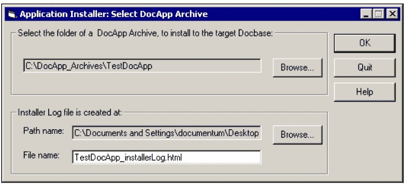

图 25.14：为目标 Docbase 安装选择 DocApp 归档

单击 OK。

7. 目标 Docbase 名称、安装用户名以及 DocApp 归档的名称和路径如图 25.15 所示。单击 Start Installation 按钮开始 DocApp 安装。

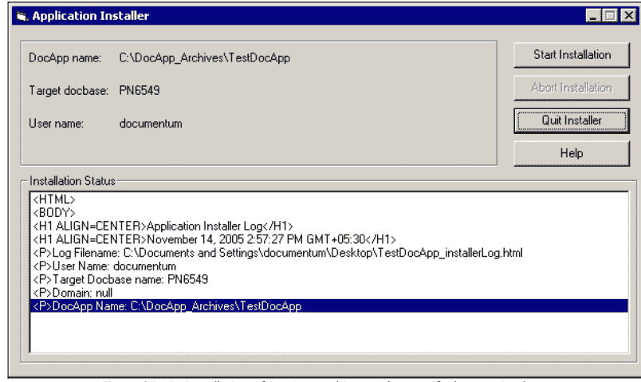

图 25.15：在指定的目标 Docbase 上安装 DocApp 归档

如果有用户连接到目标 Docbase，系统将提示您一条消息说明这一点。单击 Yes 按钮继续 DocApp 安装过程。

在 DocApp 安装过程进行期间避免在目标 Docbase 上进行任何活动。这只是为了确保系统在覆盖现有对象或在目标 Docbase 中创建新对象时不会出现不一致。

8. DocApp 安装过程需要几分钟时间，就像我们在 DocApp 归档创建过程中看到的那样。据观察，对于 1000 个对象，安装过程可能需要一个多小时！

安装完成后，单击 Quit Installer 按钮退出 DocApp Installer 应用程序。打开安装日志文件以检查安装过程中出现的错误或警告。

9. 完成！DocApp 已安装在目标 Docbase 上，这意味着源 Docbase 中的指定对象已迁移到目标 Docbase。现在您需要执行特定于 Web Publisher 的任务以使您的应用程序正常工作。例如，您可能希望在目标 Docbase 中创建 Site Publishing Configurations 或通过 Web Publisher 菜单选项 Administration | Web Publisher Admin | Workflow Templates 使迁移的工作流可用。

## 25.3 Web Publisher 代码和自定义脚本的部署

DocApp 安装只是迁移的一部分。它只是处理 Docbase 对象；那么您为应用程序编写的 WDK/DFC/其他自定义代码或为业务需求定制的任何脚本呢？这些如何迁移？

通常脚本/代码文件驻留在两个 Documentum 主机上：

- **Content Server:**
  驻留在 `%DM_HOME%\bin` 目录中的脚本
  Windows 机器上的示例：`C:\Documentum\product\5.2\bin`
  或
  驻留在 `%DOCUMENTUM%\dba\java_methods` 中的 Java 方法代码
  Windows 机器上的示例：`C:\Documentum\dba\java_methods`
- **Web Publisher 主机:**
  驻留在以下目录中的自定义文件：
  `\wp\custom`
  `\wp\WEB-INF\classes`
  `\wp\WEB-INF\tlds`

请注意，wp 是默认 Web Publisher Web 应用程序的名称，如果您在安装 Web Publisher 时提供了不同的名称，则可能不同。

您既可以将自定义文件打包成 ZIP 并复制到目标主机上的相应目录，也可以通过 ANT 准备编译后的代码并将其复制到正确的目录来自动化此过程。

ANT 是 Apache 提供的一个基于 Java 的构建工具（请访问 http://ant.apache.org/），它提供易于编写的基于 XML 的配置文件来自动化构建过程。

我们将采用 ANT 方法，并查看一个用于准备构建的示例 ANT 脚本。

- 1. 从以下位置下载 Apache ANT：http://ant.apache.org/bindownload.cgi，并根据用户手册（请参阅 http://ant.apache.org/manual/index.html）进行安装/配置。
- 本章中的以下示例是在 ANT 版本 1.6.5 上执行的。
- 2. 创建 build.properties 文件，如下面的代码片段所示。以下名称-值对已在属性文件中定义：
- base_loc：需要编译的源代码的位置
- documentum_jar_location：编译源代码所需的 Documentum JAR 文件所在的位置
- build_dir：应创建编译后类的位置
- compiled_zip_file_name：包含已创建编译后类的 ZIP 文件的名称
- zip_file_loc：包含编译后类的 ZIP 文件将形成的位置

```
# base_loc --> Defines the location where code resides
base_loc=C:/Documentum_Source/DFC
documentum_jar_location=C:/Program Files/Documentum/Shared
build_dir=C:/Documentum_Build
compiled_zip_file_name=DCTM_code_build.zip
zip_file_loc=C:/Documentum_Build
```

按如下所示创建 build.xml 文件，提及 ANT 构建过程的各个目标（或任务方向）。

对 build.xml 文件和 ANT 的详细讨论超出了本书的范围。您可能希望浏览 Apache ANT 主页（http://ant.apache.org/）以了解有关 ANT 的更多信息、其使用方法以及其优点和缺点。

```
<!-- Build file Testing Purposes -->
<project name="BuildDCTMCode" default="all_targets">
    <!-- Machine specific settings -->
    <property file="build.properties"/>
    <!-- Source paths-->
    <property name="base_loc_java" value="${base_loc}/src"/>
    <!-- Destination paths-->
    <property name="build_class" value="${build_dir}/Compiled"/>
<!-- classpaths-->
<property name="dfcbase_jar"
    value="${documentum_jar_location}\dfcbase.jar"/>
<property name="dfc_jar" value="${documentum_jar_location}\dfc.jar"/>

<path id="totalClassPath">
    <pathelement location="${dfcbase_jar}"/>
    <pathelement location="${dfc_jar}"/>
</path>

<target name="all_targets" depends="init, compile_code,
            copyFolders, createZip"/>

<target name="init">
    <echo message = "Starting init" />
    <mkdir dir="${build_dir}"/>
    <mkdir dir="${build_class}"/>
    <echo message = "Finishing init" />
</target>

<target name="compile_code" depends="init">
    <echo message = "Starting to compile code" />
    <javac srcdir="${base_loc_java}" destdir="${build_class}">
        <classpath refid="totalClassPath"/>
    </javac>
    <echo message = "Finishing compilation of code" />
</target>

<target name="copyFolders" depends="compile_code">
    <echo message = "Starting to copy Folders" />
    <copy todir="${build_dir}/Compiled_Code" overwrite="yes">
        <fileset dir="${build_class}"/>
    </copy>
    <echo message = "Finishing copy Folders" />
</target>

<target name="createZip" depends="compile_code">
    <echo message = "Starting to create Zip" />
    <zip basedir="${build_class}"
    destfile="${zip_file_loc}/${compiled_zip_file_name}"/>
    <echo message = "Finishing creation of Zip" />
</target>

</project>
```

将源代码 Java 文件复制到以下位置：
C:/Documentum_Source/DFC/src

编译后类将由 ANT 在以下位置形成：
C:/Documentum_Build/Compiled

dfc.jar 和 dfcbase.jar 文件由 ANT 从以下位置读取：
C:/Program Files/Documentum/Shared

ANT 按所示顺序执行以下任务：

- **初始化** (`<target name="init">`)：构建目录和编译类目录由 ANT 创建。
- **编译代码** (`<target name="compile_code" depends="init">`)：调用 javac 从源目录编译 Java 源代码并将编译后的类复制到编译目录。
- **复制文件夹** (`<target name="copyFolders" depends="compile_code">`)：将编译目录中的编译类复制到以下位置：
  `C:/Documentum_Build/Compiled_Code.`
- **创建 ZIP 文件** (`<target name="createZip" depends="compile_code">`)：在以下位置从编译目录创建编译类的 ZIP：`C:/Documentum_Build.`
- 3. 将 build.properties 和 build.xml 文件复制到您机器上文件夹中的同一位置。通过从命令行运行命令 ant 执行 ANT，如图 25.16 所示。

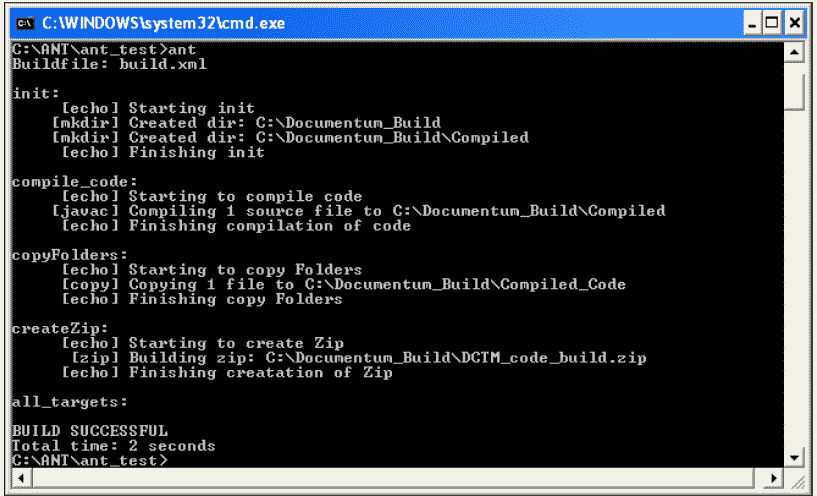

图 25.16：从命令行运行 ANT

请注意 ANT 执行 build.xml 文件中提到的各种任务时在控制台中显示的 echo 消息。这些 echo 消息可作为调试 ANT 脚本的良好机制。

这结束了我们关于迁移的讨论。Documentum 还提供其他迁移机制，例如 Dump and Load、Docbase 复制、FTP 服务（以前称为 FtpIntegrator）等。这里值得提及的另一个工具是由 Blue Fish Group 开发的 DIXI（Documentum Import eXport Interface）。这是一个基于 XML 的系统，有助于在 Documentum 仓库中移动内容。然而，在本书的范围内不可能讨论其中每一个。

## 25.4 摘要

Documentum 应用程序与其他软件应用程序一样，需要在开发环境中开发，部署在单独的测试环境中用于系统测试目的，并最终部署到生产环境。

在 Documentum 中，以下实体需要在一个环境和另一个环境之间迁移（部署）——DocApp 中的 Docbase 对象、现有内容、Web Publisher 或任何其他客户端应用程序代码/自定义文件，以及目标环境的任何部署脚本。

在本章中，我们简要讨论了 Documentum 中以下现有的迁移方法、其优点和缺点——DocApp 迁移、Dump and Load 脚本、Documentum FTP 服务、自定义脚本、手动部署以及通过 ANT 脚本的自动化机制。

使用 Documentum Application Builder 和 Documentum Application Installer 工具，我们详细讨论了如何通过设置正确的安装选项将 DocApps 从一个环境迁移到另一个环境。

此外，我们还简要讨论了一个使用 Apache ANT 自动迁移 Web Publisher/DFC/自定义代码文件到目标服务器的示例。

## 26 使用 DQL 和 API 命令
## 使用 DQL 和 API 命令

在阅读完本书的大部分章节后，您现在应该对 Documentum 系统、Content Server 以及 Documentum WCM 架构中的关键组件有良好的理解。作为一名经验丰富的开发人员，您应该对一些基本的 Documentum DQL（Document Query Language）查询和 API 命令有良好的理解，以便进行系统故障排除和管理/监控目的。

DQL 查询和 API 命令是非常方便的工具，当您需要检查 Documentum 系统、其包含的对象类型及其属性时。DQL 和 API 最终服务于相同的目的，即查询和修改 Docbase 中的对象，但它们各有其优点和局限性。

虽然 API 命令一次只能处理一个对象，但 DQL 查询可以在一次运行中针对多个对象发出。本章将讨论每个 Documentum 专业人员都应了解的一些重要 API 命令和 DQL 查询，以便有效地使用系统。

在本章中，我们将通过 Documentum Administrator 提供的用户界面执行 DQL 查询和 API 命令。

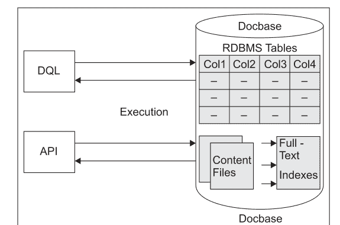

图 26.1：针对 Docbase 执行 DQL 查询和 API 命令


## 26.1 DQL

对于熟悉 SQL（结构化查询语言）的人来说，DQL 是 Documentum 中的一种类似的查询语言。

### 26.1.1 Uses of DQL

DQL 用于以下用途：

- 在 Docbase 中创建新对象
- 从 Docbase 中检索对象
- 更新 Docbase 中的对象
- 从 Docbase 中删除对象
- 访问已注册的表
- 在 Docbase 中搜索内容

### 26.1.2 Command Tools

DQL 查询可以通过以下方式执行：

- IDQL 实用工具
- 如 Documentum Administrator 或 Web Publisher 等 Web 客户端

IDQL 是一个用于对 Docbase 运行 DQL 查询的交互式实用工具。安装 Content Server 后即可使用 IDQL，可执行文件 idql32.exe 在 Windows 机器上的以下位置可以找到：

```
%DM_HOME%\bin, e.g. C:\Documentum\product\5.2\bin
```

您可以直接从命令提示符调用可执行文件，如图 26.2 所示，或单击 Documentum Server Manager 窗口中显示的 IDQL 按钮（参见图 26.3）。在这两种情况下，在开始发出 DQL 查询之前，您需要提供 Docbase 名称和用户/密码等详细信息。

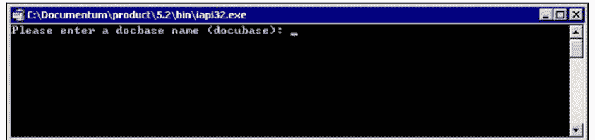

图 26.2：从命令提示符调用的 IDQL 实用工具

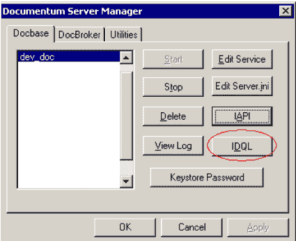

图 26.3：Documentum Server Manager 中显示的 IDQL 按钮

DQL 查询也可以在 Documentum Administrator 中执行，方法是单击工具栏右上角显示的 DQL 按钮。这将打开如图 26.4 所示的 DQL -- 输入查询屏幕。

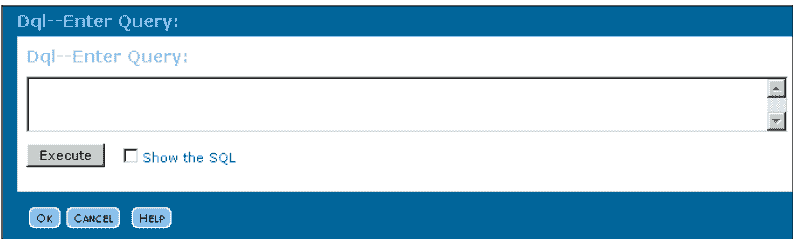

图 26.4：Documentum Administrator 中的 DQL 查询编辑器

### 26.1.3 DQL Examples

让我们以一个简单的示例来说明创建文档对象、设置其属性值、将其链接到 Docbase 中的柜子并最终保存它。我们随后将从 Docbase 中检索该文档对象并删除它。在处理这个简单示例时，您会遇到多个 DQL 查询。

### 26.1.3.1 Creating a Document Object

以管理员身份登录 Documentum Administrator 并打开 DQL 编辑器屏幕。

参见图 26.5；在 DQL 文本框中输入以下查询并单击执行按钮：

```
DQL> create dm_document object set object_name = 'TestDocumentCreated_via_DQL',
    setfile 'C:\Test\testing_dql.xml' with content_format = 'xml'
```

create ... object DQL 查询在指定的对象类型（本例中为 dm_document）的 Docbase 中创建对象。我们在同一个 create ... object 查询中将文档对象的 object_name 属性设置为 TestDocumentCreated_via_DQL。

请特别注意上述查询中使用的 setfile 关键字。它将内容文件与文档对象关联起来。前提是您需要在发出 DQL 之前创建有效的内容文件（本例中为 testing_dql.xml）并将其放置在 Content Server 主机上的合适位置。with content_format 子句为与文档对象关联的内容文件设置有效格式。

请注意，指定的格式应为 Content Server 所理解和识别的格式。

如果指定的格式（如 xyz）无效且不被 Content Server 识别，则执行查询时会出现以下错误消息：

Error occurred during query execution :[DM_QUERY_F_UP_SAVE]fatal: "UPDATE: An error has occurred during a save operation." [DM_SYSOBJECT_E_INVALID_FORMAT]error: "The specified format (xyz) is invalid."

create ... object 语句在 DQL 成功运行后返回新创建对象的对象 ID。在我们的例子中，运行上述 DQL 查询返回的文档对象的对象 ID 为 090015558000c972，如图 26.5 所示。

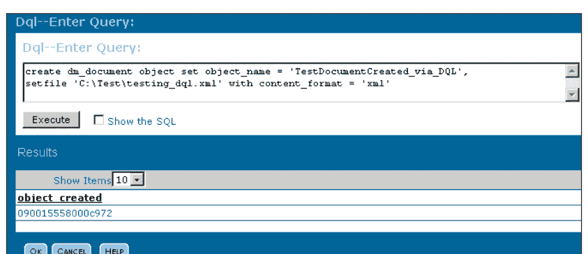

图 26.5：运行 DQL 查询以创建对象

### 26.1.3.2 Updating Attributes of a Document Object

现有对象的属性可以通过发出 update ... object DQL 查询进行修改。在本例中，我们将通过设置其 title 和 keywords 属性来更新新创建的文档对象，如下所示：

```
DQL> update dm_document object set title = 'File created via DQL' ,
    set keywords = 'first' where object_name = 'TestDocumentCreated_via_DQL'
```

请注意 where 子句用作限定条件，以找出需要修改的确切文档对象。我们使用了文档对象的 object_name 属性作为限定条件。

服务器在运行 update ... object DQL 查询时返回更新对象的总数。在我们的例子中，由于 Docbase 中仅存在一个文档对象 TestDocumentCreated_via_DQL，因此 update 查询更新的对象数为一个。

### 26.1.3.3 Appending a Value in a Repeating Attribute

重复属性中的值存储在索引位置。例如，如果 keywords 重复属性的第一个和第二个值分别为 abc 和 xyz，则 Content Server 将其存储为：

```
keywords[0] = abc
keywords[1] = xyz
```

您可以在 update DQL 查询中使用 append 子句将特定值追加到重复属性的现有值中。以下 DQL 查询将值 second 追加到我们创建的文档对象的 keywords 属性的现有值中。

```
DQL> update dm_document object append keywords = 'second'
     where object_name = 'TestDocumentCreated_via_DQL'
```

服务器在重复属性的值末尾添加指定的值。

### 26.1.3.4 Inserting a Value into a Repeating Attribute

使用 update DQL 查询中的 insert 子句，您可以在重复属性的特定索引位置插入特定值。以下 DQL 查询在文档对象的 keywords 重复属性的现有值中，将值 middle 插入到第二个位置（索引 '1'）。

```
DQL> update dm_document object insert keywords[1] = 'middle'
     where object_name = 'TestDocumentCreated_via_DQL'
```

### Caution

如果在使用 insert 子句时未指定重复属性的索引位置，服务器将指定的值插入到索引位置零。

### 26.1.3.5 Associating a Document Object with a Cabinet

文档对象可以与 Docbase 中柜子内的柜子或文件夹关联。使用 DQL 查询中的 link 子句并指定柜子或文件夹路径，可以按如下方式实现：

```
DQL> update dm_document object link '/Testing_API_DQL'
     where object_name = 'TestDocumentCreated_via_DQL'
```

此 DQL 将文档对象 TestDocumentCreated_via_DQL 与 Docbase 中的柜子 Testing_API_DQL 关联起来。但是，作为前提条件，请在发出此 DQL 查询之前在 Web Publisher 中创建一个自定义柜子，例如 Testing_API_DQL。

如果在 link 子句中指定了错误的柜子/文件夹路径，或指定了 Docbase 中不存在的柜子/文件夹名称（如 abcdef），则在运行上述 DQL 查询时服务器会抛出以下错误：

Error occurred during query execution :[DM_QUERY_E_UP_BAD_FOLDER]error: "You have specified an invalid folder path, /abcdef, in your LINK or MOVE TO clause."

一旦您将文档对象与柜子关联起来，您可以通过登录 Web Publisher 并浏览到 Testing_API_DQL 柜子来查看它。图 26.6 显示了文档对象在 Web Publisher 中的外观。

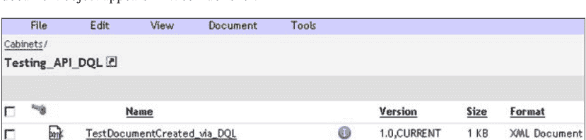

图 26.6：在 Web Publisher 中看到的新创建的文档对象

如果您选中文档对象旁边的复选框并选择菜单选项 File | View，您将能够查看关联的内容文件 testing_dql.xml。

要查看文档对象的属性，您可以单击 Info 图标 ⓘ，或选中文档对象旁边的复选框并选择 View | Properties | Info。图 26.7 显示了我们在此示例中使用 DQL 查询设置文档对象的各种属性。请特别注意图 26.7 中显示的 Name、Title 和 Keywords 字段，这些字段是我们使用 DQL 查询设置的。


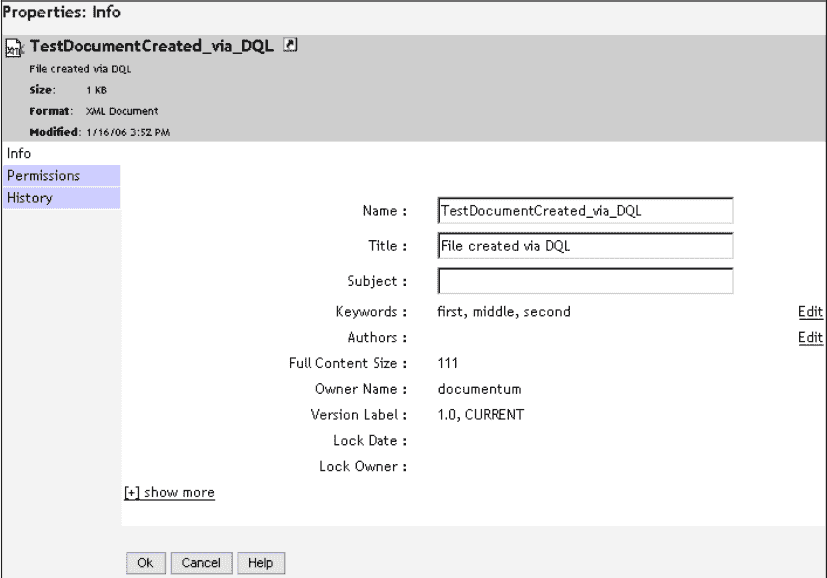

图 26.7：Web Publisher 中显示的文档对象属性

## 26.1.3.6 从 Docbase 中检索文档对象

DQL 可用于高效地从 Docbase 中搜索和检索对象。例如，假设您想了解我们在示例中创建的文档对象的 title 属性的值。可以使用以下查询来实现此目的：

```
DQL> select title from dm_document where object_name = 'TestDocumentCreated_via_DQL'
```

请注意，我们在对象类型 dm_document 上使用 select 查询，以查找名称为 TestDocumentCreated_via_DQL 的对象的 title 属性。where 子句用于指定限定条件。

为了从多个属性中检索值，请用逗号分隔属性名称。例如，运行以下 DQL 查询以查找名称为 TestDocumentCreated_via_DQL 的文档对象的对象 ID（r_object_id 属性）、名称（object_name 属性）和版本标签（r_version_label 属性）的值：

```
DQL> select r_object_id, object_name, r_version_label from dm_document
where object_name = 'TestDocumentCreated_via_DQL'
```

## 使用 DQL 和 API 命令

结果仅显示一条记录（文档的当前版本）匹配限定条件，如图 26.8 所示：

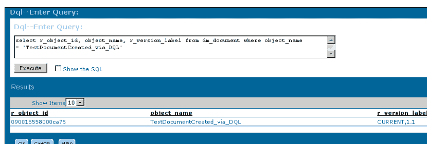

图 26.8：使用 select 查询从多个属性中获取值

为了检索匹配相同限定条件的所有文档对象版本，请通过包含 all 关键字修改 DQL 查询，如下所示：

```
DQL> select r_object_id, object_name, r_version_label from dm_document (all)
    where object_name = 'TestDocumentCreated_via_DQL'
```

如图 26.9 所示，结果显示了匹配指定条件的文档对象的所有版本。

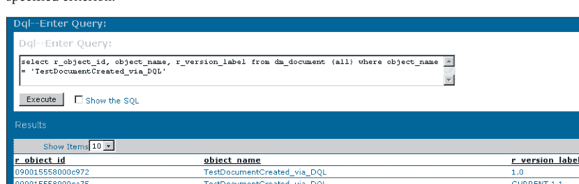

图 26.9：获取对象所有版本的属性值

通配符搜索也可以与 where 子句一起使用，以检索满足指定限定条件的对象。以下查询用于检索名称匹配模式 via 的文档对象的 title 属性：

```
DQL> select object_name,title from dm_document where object_name like '%via%'
```

请注意，like 子句使用百分号（%）作为 Documentum 用于通配符搜索的模式匹配字符。%via% 搜索所有在 title 属性中包含字符串 via 的对象，而不考虑属性值中在字符串 via 之前或之后有多少字符。

同样，Documentum 在通配符搜索中使用下划线（_）进行模式匹配，其中下划线严格匹配一个字符。例如，以下查询查找 title 属性值在字符串 TestDocumentCreated_via_DQ 之后只有一个字符的对象：

```
DQL> select object_name, title from dm_document
    where object_name like 'TestDocumentCreated_via_DQ_'
```

您可以通过在 DQL 查询的 where 子句中使用 and 关键字来组合限定条件。例如，以下查询用于检索名称为 TestDocumentCreated_via_DQL 且 title 为 File created via DQL 的文档对象：

```
DQL> select object_name, title from dm_document
    where object_name = 'TestDocumentCreated_via_DQL'
    and title =  'File created via DQL'
```

同样，如果满足任一指定的限定条件，您可以使用 or 关键字检索结果。

对于搜索重复属性，请在 DQL 查询的 where 子句中使用 any 关键字，如下所示：

```
DQL> select object_name,title from dm_document where any keywords = middle
```

此 DQL 查询检索 keywords 重复属性包含 middle 作为其值之一的文档对象。

## 26.1.3.7 从 Docbase 中删除文档对象

您可以通过运行以下 delete object DQL 查询从 Docbase 中删除文档对象：

```
DQL> delete dm_document object where object_name = 'TestDocumentCreated_via_DQL'
```

服务器在运行 delete object DQL 查询时返回已删除对象的总数。在我们的例子中，由于 Docbase 中仅存在一个文档对象 TestDocumentCreated_via_DQL，因此 delete 查询删除的对象数为一个。

> 最佳做法是在发出 delete 查询之前先运行 select 查询并检索匹配指定限定条件的对象。这可以确保您不会无意中销毁您不希望从 Docbase 中删除的对象。

## 26.2 API

API 命令，也称为 Server API，是客户端通过 DMCL 发送到 Content Server 的指令或命令。

### 26.2.1 命令工具

API 命令可以通过以下方式执行：

- IAPI 实用程序
- Web 客户端，例如 Documentum Administrator API Tester 或 Web Publisher

## 使用 DQL 和 API 命令

IAPI 是 **交互式 API 实用程序** 的缩写，在安装 Content Server 后即可使用。在 Content Server 主机上，您可以在 Windows 机器上的以下位置找到可执行文件 `iapi32.exe`：

```
%DM_HOME%\bin, e.g. C:\Documentum\product\5.2\bin (for example)
```

您可以直接从命令提示符调用可执行文件，如图 26.10 所示，或者您可以单击 Documentum Server Manager 窗口中显示的 IAPI 按钮（参见图 26.11）。在这两种情况下，在开始发出 API 命令之前，您需要提供 Docbase 名称和用户/密码等详细信息。

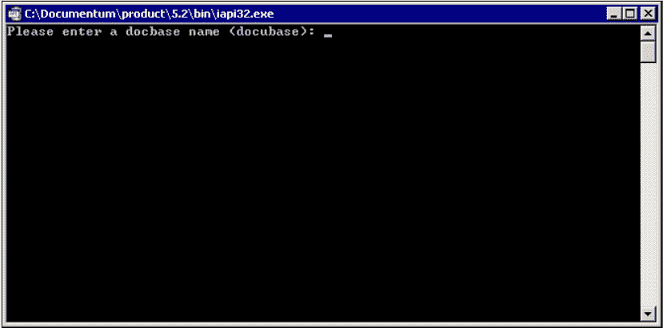

图 26.10：IAPI 窗口

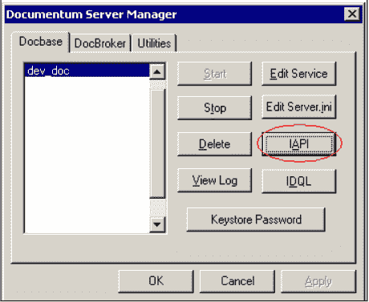

图 26.11：Documentum Server Manager 中显示的 IAPI 按钮

可以通过单击工具栏右上角显示的 API 按钮在 Documentum Administrator 中执行 API 命令。这将打开 Api Tester 屏幕，如图 26.12 所示。

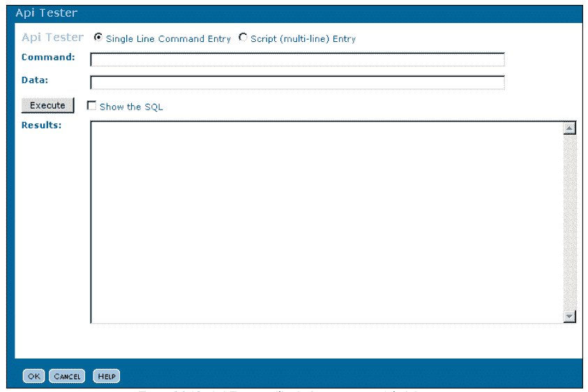

图 26.12：Documentum Administrator 中的 Api Tester 实用程序

### 26.2.2 API 命令

Server API 命令遵循定义的模式。您需要输入确切的方法名称，后跟作为连续字符串的参数，以逗号作为分隔符分隔各个部分。以下是示例 API 命令：

```
API> create,c,dm_document
```

让我们分解此命令并解释每个术语：

- create: 用于创建指定对象类型的对象实例的 API 方法名称。
- c: 在其中执行 API 命令的当前会话的别名。
- dm_document: create 方法的参数。在本例中，它是通过此 API 命令需要创建的对象的对象类型。

请记住，所有 API 方法的参数都是位置参数。这意味着即使参数是可选的，API 命令中也为所有参数提供了占位符。

例如，如果 API 命令 api_command 有四个可选参数 first、second、third 和 fourth，如下所示：api_command,c,first,second,third,fourth，那么要仅使用一个参数 fourth 执行此 API 命令，命令需要按如下方式执行：

```
API>api_command,c,,, <value of fourth argument>
```

请注意，即使我们未为这些参数指定任何值，也为参数 first、second 和 third 放置了占位符逗号。

### 26.2.3 API 方法分类

根据其具体性质和用途，Server API 方法可以归为不同的类别。图 26.13 所示的表格根据其性质显示了一些方法和类别。

| Category | API method | Use |
|---|---|---|
| 对象管理 | attach | 将对象附加到生命周期。 |
|  | checkout | 从 Docbase 中签出对象并对其放置显式锁定。 |
|  | checkin | 移除已签出对象的锁定并将其作为新版本保存到 Docbase。 |
|  | promote | 将 SysObject 从其当前正常生命周期状态提升到下一个正常状态。 |
| 服务器通信 | connect | 创建与 Docbase 的会话。 |
|  | disconnect | 断开 Docbase 会话。 |
|  | begintran | 开始数据库事务。 |
|  | commit | 提交数据库事务期间所做的更改并关闭事务。 |
| 获取和设置属性 | get | 获取对象的指定属性的值。 |
|  | set | 设置对象的指定属性的值。 |
| 系统管理 | apply | 运行管理功能。 |
|  | audit | 允许对特定事件进行审计。 |
|  | authenticate | 用户名和密码验证。 |
| Docbase 搜索 | id | 返回满足指定条件的对象的对象 ID |
|  | readquery | 运行在处理查询结果时不需要数据库访问的 DQL 查询。 |
| 内容处理 | getfile | 以指定格式返回内容文件。 |
|  | setfile | 将内容文件设置为对象。 |
| 生命周期管理 | install | 安装已验证的生命周期。 |
|  | validate | 确定生命周期是否有效。 |
|  | uninstall | 卸载当前已安装的生命周期。 |
| 工作流管理 | execute | 启动指定的工作流。 |
|  | abort | 终止指定的工作流。 |
|  | queue | 向指定的工作流发布事件。 |

图 26.13：Server API 方法的分类


## 26.2.4 API 方法示例

如同我们对 DQL 所做的那样，让我们以创建文档对象、设置其属性值、将其链接到 Docbase 中的柜子并最终保存它为例。我们随后将从 Docbase 中检索该文档对象并删除它。在处理这个简单示例时，你将会遇到多种 API 方法。

### 26.2.4.1 创建文档对象

以管理员身份登录 Documentum Administrator 并打开 Api Tester 屏幕。

参见图 26.14；在 Api Tester 屏幕中，在 Command 框中输入字符串 create,c,dm_document，然后点击 Execute 按钮运行 create API 命令。

请确保在命令字符串中任何位置都不输入空白字符。

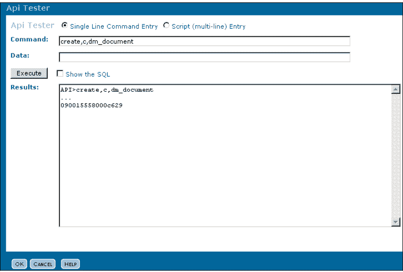

图 26.14：使用 Documentum Administrator 运行 API 命令 create

create API 方法创建指定对象类型（本例中为 dm_document）的对象并返回新创建对象的对象 ID。如图 26.14 所示，新创建文档对象的对象 ID 为 090015558000c629。

请注意，新创建的对象在你发出明确的 save API 命令之前不会提交到 Docbase，正如我们在本示例后面将看到的那样。

### 26.2.4.2 设置对象的属性

set API 方法可用于为对象的单个属性以及重复属性设置特定值。按图 26.15 所示设置新创建文档对象的 object_name 属性。

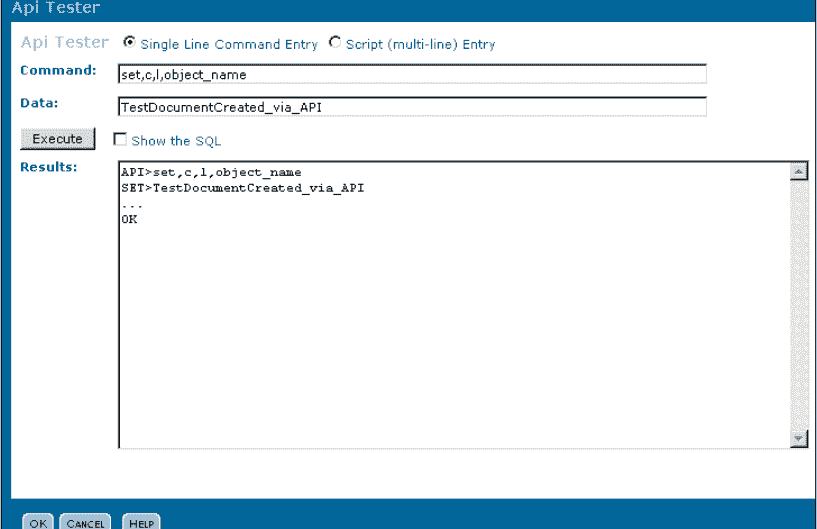

图 26.15：通过 API 命令设置属性值

请注意，方法命令和参数在 Command 文本框中输入，而参数值则在 Data 框中指定，如图 26.15 所示。你一定注意到了命令字符串中使用的特殊字母 l：set,c,l,object_name。

这是最后创建、检索、签入/签出或获取的对象 ID 的别名。如果你不想使用别名 l，可以改为运行以下命令：

```
set,c,090015558000c629,object_name
```

这里的 090015558000c629 是我们示例中新创建文档对象的对象 ID。

文档对象的其他属性，例如 title，可以按如下方式相应设置：

```
API>set,c,l,title
Data: File created via API commands
...
OK
```

你可以按如下方式设置重复属性（例如 keywords）：

```
API>set,c,l,keywords[0]
Data: document
...
OK
API>set,c,l,keywords[1]
Data: api
...
OK
```

这将 document 和 api 分别设置为文档对象在第一和第二索引位置的两个关键字。

### 26.2.4.3 将内容文件与文档对象关联

setfile API 方法可用于将内容文件与对象关联。其前提是内容文件应存在于执行 setfile 命令的机器（客户端）上。请注意，由于在我们的情况下我们是从 Documentum Administrator 主机作为客户端执行 API 命令，因此要设置的内容文件应本地存在于安装了 Documentum Administrator 的机器上。

创建一个内容 XML 文件（例如 testing_api.xml）并将其放置在 Documentum Administrator 主机的方便位置，例如：C:\Test。

发出以下 setfile 命令：

```
API>setfile,c,l,C:\Test\testing_api.xml,xml
...
OK
```

注意在 setfile 命令中紧跟内容文件完整路径后指定的附加参数（xml）。这是内容文件的有效格式名称，应被 Content Server 识别。

大多数人将内容文件放置在通过浏览器访问 Documentum Administrator URL 的机器上本地放置，而不是将其放置在 Documentum Administrator 机器上。在这种情况下，当你发出 setfile API 命令时，Content Server 会抛出以下错误：

[DM_SYSOBJECT_E_CANT_ACCESS_FILE]error: "Cannot access file C:\Test\testing_api.xml due to Operating System error: The system cannot find the file specified."; ERRORCODE: 100; NEXT: null

### 26.2.4.4 将文档对象与柜子关联

一旦你创建了文档对象并设置了其属性和内容文件，下一步就是将其与柜子或位于柜子内的文件夹关联。我们将在示例中使用 link API 命令将新创建的文档对象与自定义柜子关联。

作为先决条件，在 Web Publisher 中创建一个自定义柜子 Testing_API_DQL，然后发出以下 link 命令：

```
API>link,c,l,'/Testing_API_DQL'
...
OK
```

你可以使用文件夹路径将对象与柜子或文件夹链接，如我们在示例中所见，也可以通过引用柜子或文件夹的对象 ID 来链接。例如，如果 Testing_API_DQL 柜子的对象 ID 为 0c0015558000c62a，你可以按如下方式将文档对象链接到此柜子：API>link,c,l,0c0015558000c62a

### 26.2.4.5 在 Docbase 中保存文档对象

除非你明确发出 save API 命令，否则新创建的文档对象不会保存在 Docbase 中。以下是使用 save API 的示例：

```
API>save,c,l
...
OK
```

保存文档对象后，你可以通过登录 Web Publisher 并浏览到 Testing_API_DQL 柜子来查看它。图 26.16 显示了文档对象在 Web Publisher 中的外观。

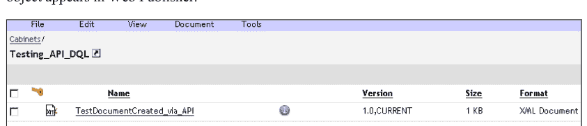

图 26.16：在 Web Publisher 中看到的新创建的文档对象

如果你选中文档对象旁边的复选框并选择菜单选项 File | View，你将能够查看关联的内容文件 testing_api.xml。

为了查看文档对象的属性，你可以点击 Info 图标 ⓘ，也可以选中文档对象旁边的复选框并选择菜单选项 View | Properties | Info。图 26.17 显示了我们在本示例中使用 API 命令设置的文档对象的各种属性。请特别注意图 26.17 中使用 API 命令 set 设置的 Name、Title 和 Keywords 字段。

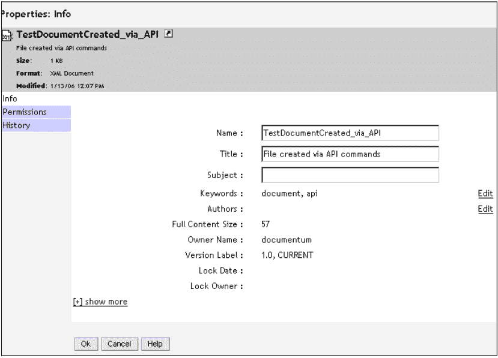

图 26.17：文档对象的属性

### 26.2.4.6 在 Docbase 中获取文档对象的引用

你可以发出 id API 命令来获取满足特定限定条件的对象的对象 ID。例如，我们按如下方式发出 id API 命令，限定条件为“名称为 TestDocumentCreated_via_API 的 dm_document 对象”：

```
API>id,c,dm_document where object_name = 'TestDocumentCreated_via_API'
090015558000c629
```

服务器返回文档对象 TestDocumentCreated_via_API 的对象 ID 090015558000c629。

请注意，你无需输入从 select 开始并指定 from 子句的完整搜索限定条件。只需输入 from 关键字之后开始的子句即可。

### 26.2.4.7 设置特定属性信息

一旦你获得了文档对象的对象 ID，获取其各种属性的值就非常简单。你需要做的只是发出 get API 命令，指定需要查找值的属性。

例如，为了查找检索到的文档对象的第二个 keywords 属性的值，请按如下方式运行 get API 命令：

```
API>get,c,l,keywords[1]
api
```

服务器返回的值 api 为 keywords 属性中第二个位置包含的值。在这种情况下我们使用了索引位置 [1]，因为 keywords 是一个重复属性，其值从索引位置 0 开始存储。对于单值属性，你无需使用任何方括号。例如，要查找 title 属性的值，请按如下方式运行命令：

```
API>get,c,l,title
```

### 26.2.4.8 查看对象的全部属性和值

为了查看 Docbase 中特定对象的全部属性及其值，请使用 dump API 命令。按如下方式运行 dump API 命令：

```
API>dump,c,090015558000c629
...
```

我们已在 dump API 命令中将文档对象的对象 ID（090015558000c629）指定为参数。图 26.18 显示了我们所创建文档对象的各种属性值转储的快照。


API>dump,c,l
...
用户属性
object_name          : TestDocumentCreated_via_API
title                : 通过 API 命令创建的文件
subject              : 
authors              [ ] : <none>
keywords             [0] : document
                      [1] : api
resolution_label     : 
owner_name           : documentum
owner_permit         : 7
group_name           : docu
group_permit         : 5
world_permit         : 3
log_entry            : 
acl_domain           : documentum
acl_name             : dm_450015580000102
language_code        : 
系统属性
r_object_id          : 090015558000C629
r_object_type        : dm_document
r_creation_date      : 1/13/2006 12:02:33
r_modify_date        : 1/13/2006 12:07:48
r_modifier           : documentum
r_access_date        : 1/13/2006 12:03:34
r_composite_id       [ ] : <none>
r_composite_label    [ ] : <none>
r_component_label    [ ] : <none>
r_order_no           [ ] : <none>
r_link_cnt           : 0
r_link_high_cnt      : 0
r_link_id_from_id    : 0000000000000000
r_frzm_assembly_cnt  : 0
r_has_frzm_assembly  : F
r_is_virtual_doc     : 0
r_page_cnt           : 1
r_content_size       : 57
r_lock_owner         : 
r_lock_date          : nulldate
r_lock_machine       : 
r_version_label      [0] : 1.0
                      [1] : CURRENT
r_immutable_flag     : F
r_frozen_flag        : F
r_has_events         : F
r_creator_name       : documentum
r_is_public          : 0
r_policy_id          : 0000000000000000
r_resume_state       : 0
r_current_state      : 0
r_alias_set_id       : 0000000000000000
r_full_content_size  : 57
应用程序属性
a_application_type   : 
a_status             : 
a_is_hidden          : F
a_retention_date     : nulldate
a_archive            : F
a_compound_architecture : 
a_link_resolved      : F
a_content_type       : xml
a_full_text          : T
a_storage_type       : filestore_01
a_special_app        : 
a_effective_date     [ ] : <none>
a_expiration_date    [ ] : <none>
a_publish_formats    [ ] : <none>
a_effective_label    [ ] : <none>
a_effective_flag     [ ] : <none>
a_category           : 
a_is_template        : F
a_controlling_app    : 
a_extended_properties[ ] : <none>
a_is_signed          : F
a_last_review_date   : nulldate
内部属性
i_is_deleted         : F

图 26.18：文档对象转储的快照

请注意，服务器返回的对象属性按各种类别组织，例如 用户属性、系统属性、应用程序属性 和 内部属性。

## 26.2.4.9 从 Docbase 中删除对象
你需要发出 destroy API 命令以从 Docbase 中移除特定对象。运行以下 API 命令以删除我们在示例中创建的文档对象：

```
API>destroy,c,090015558000c629
OK
```

如果对象已被检出（因此被锁定），运行 destroy API 命令会抛出以下错误：

```
Error processing command:DfException:: THREAD: http8080-Processor8; MSG: [DM_SYSOBJECT_E_CANT_DELETE_LOCKED]error: "Cannot delete sysobject TestDocumentCreated_via_API since it's locked by user documentum."; ERRORCODE: 100;
```

为了移除对象上的锁定，可以通过运行 API 命令检入对象：`checkin,c,090015558000c629`，或按如下方式解锁对象：`unlock,c,090015558000c629`。

我们在本章中涵盖了多个示例，展示了 Documentum 中 DQL 查询和 Server API 命令的强大功能。为了完整且详尽地了解 DQL 和 API，建议分别阅读 Content Server DQL 和 API 参考手册。

## 26.3 摘要
本章介绍了 DQL（Document Query Language）查询和 Server API 命令作为检查 Documentum Docbase 的极其方便的工具。DQL 查询和 API 命令可分别从 IDQL 和 IAPI 实用程序发出，或从 Documentum Administrator 和 Web Publisher 等 Web 客户端发出。

使用 DQL 查询和 API 命令，我们看到了创建文档对象、设置其属性、关联内容文件、将其链接到柜子，最后从 Docbase 中检索和删除它的示例。

虽然 API 命令一次发出一个，并且一次只能处理一个对象，但 DQL 查询可以在一次执行中影响多个对象。

## A
## 常见问题和答案
以下问答基于本书涵盖的章节，在阅读完各章节后可作为良好的复习。此外，Documentum 开发者（无论是业余还是专业）经常在面试或日常工作中遇到此类问题。

### 什么构成了 Documentum 系统的核心，提供诸如管理对象和版本控制等基本服务？
Content Server.

### 构成 Docbase 存储库的逻辑实体是什么？
Docbase 可以被视为 Documentum 中的一个集中式存储库，由内容、其关联的属性（或元数据）以及全文索引组成。

### DocBroker 在 Documentum 系统架构中起什么作用？
当客户端应用程序需要与 Content Server 建立连接时，DocBroker 充当中间人。

### 在 Documentum 中，每个对象类型是否必须从现有超类型扩展？
不可以。可能存在没有超类型的对象类型。

### Documentum 中生命周期定义和工作流模板的对象类型名称是什么？
- 生命周期：dm_policy
- 工作流模板（流程定义）：dm_process

### Documentum 内部持久对象类型的属性是什么？
r_object_id、i_is_replica 和 i_vstamp

### 如何从对象的对象 ID 推断其对象类型？
16 字符对象 ID 字符串的前两个字符称为类型标识符，表示对象的对象类型。例如，对象 ID 为 0b0004578000c8b1 的对象是文件夹对象，因为前两个字符 0b 在 Documentum 中表示文件夹的类型标识符。因此此类对象的对象类型为 folder（dm_folder）。

### 什么是计算属性？
与 Documentum 中持久对象的属性不同，计算属性不会存储在 Docbase 中。它们由 Content Server 在运行时生成。示例为 _alias_set 和 _policy_name。

### Documentum 5.3 版本中引入的 FTDQL 查询是什么？
FTDQL 查询与 SELECT 查询的区别如下：SELECT 查询针对 Docbase 存储库执行，而 FTDQL 查询针对全文索引运行，从而带来显著的性能提升。

### 什么是 IAPI？
IAPI 是 Content Server 提供的交互式实用程序，可帮助您针对 Docbase 执行 Server API 命令。

### dm_cabinet 是否是 Documentum 中 dm_folder 对象类型的超类型？
不。恰恰相反；dm_cabinet 是 dm_folder 对象类型的子类型。

### Content Server 管理的两种版本标签是什么？
数字（或隐式）标签和符号标签。数字标签由服务器生成，例如：1.0、2.1、3.0 等。符号标签可以是系统定义的或用户定义的。例如：WIP、CURRENT、Staging 等。

### SysObject 的对象 ID（r_object_id）与编年史 ID（i_chronicle_id）之间有什么关系？
特定 SysObject 的各个版本由 Content Server 分配不同的对象 ID（r_object_id）。然而，这些不同版本共享相同的编年史 ID（i_chronicle_id）。编年史 ID 存储对象根（原始）版本的对象 ID 的值。

### 生命周期和工作流有什么区别？
生命周期定义了对象的各个阶段，例如创建、编写、审查和批准。另一方面，工作流与生命周期一起工作，并在各个生命周期状态中路由对象。它定义了对象如何通过各个状态、参与的用户和组是谁，以及在此流程中需要执行哪些活动。

### DMCL 与 DFC 之间有什么关系？
DFC 是 Documentum Foundation Classes 的缩写，是一组 Java 接口和类，用于访问和扩展 Content Server 的功能。DMCL 是 Documentum Client Library，由 C API 库组成，并充当客户端与 Content Server 之间的通信层。


DFC 可被视为在 DMCL 之上编写的包装器，具有诸如数据验证等附加功能。

## 在 Documentum 业务对象框架 (BOF) 中可用的两种业务对象类型是什么？
基于类型的业务对象（简称为 TBO）和基于服务的业务对象（简称为 SBO）。

TBO 与特定对象类型绑定并扩展/覆盖其功能，而 SBO 与对象类型无关，并在系统中提供通用服务。在 5.3 版本中，TBO 同时绑定到对象类型和 Docbase 仓库。

## 请列举 Documentum WDK 框架提供的一些服务。
WDK 框架提供多种基本服务，例如错误处理、消息传递、内容传输和历史管理。

## 参照 ACL，请列出 Documentum 中所有可用的扩展权限。
Documentum 中可用的扩展权限有：Change State、Change Permission、Change Ownership、Change Location 和 Execute Procedure。在 5.3 版本中，Documentum 提供了用于删除对象的额外扩展权限。

此新的扩展权限与基本的 Delete 权限不同，因为它不提供分层的 Browse、Read、Relate、Version 或 Write 访问权限。

## 在 Alias Set 中可以为哪些类型或实体定义别名？
可以在 Alias Set 中为以下实体定义别名：user、group、user or group、cabinet path、folder path、permission set 以及 unknown（适用于没有实体匹配的情况）。

## 在 Documentum 中创建用户（dm_user 对象）所需的三个强制属性是什么？
为了在 Documentum 中创建用户，需要提供其用户名（user_name）、用户 OS 名称（user_os_name）和电子邮件地址（user_address）。

## 公共组和私有组之间有什么区别？
公共组是由 Documentum 中的 sysadmin 或 superuser 创建的组，而私有组是由具有创建组权限的任何用户创建的组。

## Registered Tables 在 Documentum 中有什么作用？
Registered Tables（dm_registered 对象）是 Documentum 系统外部的 RDBMS 表，不是 Content Server 的一部分，但需要在 Documentum 系统内访问。

## 请列出可以执行 Documentum 方法的执行代理。
Content Server（默认执行代理）、Method Server 和 Java Method Server。

## 哪个 Documentum 进程执行作业？
Content Server 中的 Documentum agent exec 进程执行作业。

## Web Publisher 如何能够连接到托管在 Content Server 上的 Docbases？
Web Publisher 主机中的 dmcl.ini 文件包含 DocBroker 名称和端口号的条目。Content Server 将其连接信息广播到该 DocBroker，然后可以建立连接。

## 请列举使用 Documentum Administrator 可以执行的一些系统管理任务。
Documentum Administrator 可用于创建和维护用户和组、对象类型和属性、管理审计跟踪、设置作业和方法，以及执行 DQL 查询和 Server API 命令。

## 哪个 Documentum 工具可用于在 Docbase 中创建文档的衍生件（替代格式）？
Content Rendition Services（CRS）。请注意，在 Documentum 5.3 版本中，Content Rendition Services 已拆分为两个产品：Document Transformation Services（DTS）和 Advanced Document Transformation Services（ADTS）。

## 通过 Site Caching Services（SCS）从 Docbase 发布时，哪些对象类型的子类型可以单独发布？
只有 dm_sysobject 对象类型的子类型才能由 SCS 从 Docbase 发布。

## Site Caching Services 中的两个主要组件是什么？
Site Caching Services（SCS）有两个主要组件：SCS Source 和 SCS Target。

## Site Deployment Services（SDS）通常用于什么目的？
SDS 通常用于将网站内容从 SCS 目标服务器部署并同步到多个本地或远程服务器。

## 是否可以在单个 Windows 主机上安装两个 Content Server？
不可以。只有在 UNIX 和 Linux 环境中才可能实现。

## 安装所有者和 Docbase 所有者之间有什么区别？
安装所有者是指其登录账户用于安装 Content Server 的用户。另一方面，Docbase 所有者是具有访问 Docbase 中底层 RDBMS 表权限的数据库用户账户。

## 在为 Docbase 提供 Docbase ID 时需要注意哪些限制？
如果特定 Content Server 上存在多个 Docbase，Docbase ID 应唯一，不应以零（0）开头，且应为 1 到 16777215 范围内的数字。

## Web Publisher Server Files 是否安装在 Content Server 主机上而不是 Web Publisher 应用服务器主机上？
是的。Web Publisher Server Files 包含一些由 Documentum Java Method Server 在 Content Server 上运行的 Java 方法 JAR。因此，这些需要安装在 Content Server 主机上，而不是 Web Publisher 应用服务器主机上。

## dmcl.ini 文件中用于启用连接池的键是什么？
connect_pooling_enabled。默认情况下为 false。

## 哪个文件存储 Content Server 所需的服务器信息？
位于 (Windows) Content Server 主机上的 server.ini 文件：
$DOCUMENTUM\dba\config\<Docbase name>

## 用于部署 Documentum Application Builder 创建的 DocApps 的工具是什么？
Documentum Application Installer（DAI）。

## Web Publisher Template、Rules 和 Presentation 文件是什么？
Web Publisher Template 是一个扁平的 XML 文件，其中包含内容作者需要填写的字段的 XML 元素。

Rules 文件是另一个 XML 文件，用于控制每个模板字段的行为和验证。

Presentation 文件是一个 XSL 样式表，用于设置模板内容文件的样式并以指定格式生成输出。

## 什么是 DocApp？
DocApp 是 Docbase 的打包单元，用于容纳各种 Docbase 对象，如对象类型、生命周期、工作流模板、权限集、别名集等。DocApp 中的对象可以使用 Documentum Application Installer（DAI）迁移/部署到其他 Docbase。

## 请列举 sysobject（dm_sysobject 对象类型）的一些子类型。
sysobject 的一些子类型有：job（dm_job）、method（dm_method）、document（dm_document）、policy（dm_policy）、process（dm_process）等。

## 自定义对象类型可以命名为 SELECT 或 DELETED 吗？
不可以。这些是 DQL（Document Query Language）中的保留关键字，不应用作对象类型的名称。

## Documentum 中对象类型属性可用的数据类型有哪些？
属性可用的数据类型有：Boolean、double、id、integer、string 和 time。

## 属性的输入掩码字符 # 表示什么？
哈希掩码字符（#）仅允许相关属性为数字值（0 到 9）。

## Value Assistance 是什么意思？
Value Assistance 用于显示特定属性的预定义值列表。用户可以从 Value Assistance 中显示的属性值集合中进行选择。请注意，此功能不适用于 Boolean 数据类型的属性。

## 参照 Registered Tables，引用 RDBMS 表的 Docbase 所有者时使用的别名是什么？
dm_dbo 是引用 Docbase 所有者时使用的别名。

## Documentum 用于解析别名的各种作用域有哪些？
Documentum 用于解析别名的各种作用域有：lifecycle scope、workflow scope、session scope、user scope 和 system scope。

## 在权限集的上下文中，Documentum 用于引用对象的当前所有者以及 Docbase 中所有用户的保留别名是什么？
dm_owner 是对象的当前所有者的别名，dm_world 是所有 Docbase 用户的别名。

## 生命周期策略对象在使用前有哪些不同状态？
生命周期策略对象的各种状态有：Draft（生命周期已创建或修改但尚未验证时）、Validated（生命周期已通过所有系统验证测试时）、Uninstalled 和 Installed（已验证并准备好供应用程序使用时）。

## 在生命周期状态图中可以创建哪两种类型的状态？
Normal 和 Exception 状态。Normal 状态用于对象的正常线性流程，而 Exception 状态表示异常流程或线性流程中的偏离。

## 请列举系统在生命周期状态中可以执行的一些标准操作。
系统在生命周期状态中可以执行的一些标准操作有：添加或移除版本标签、设置所有者、设置权限集、请求衍生件等。

## 是否可以在生命周期 Entry Criteria、Actions、PostChange 以及验证中指定 Java 类作为过程？
是的，在 Documentum 5.3 版本中可以实现。

## 请列举将对象通过生命周期各状态提升的几种机制。
将对象通过生命周期状态提升的几种机制有：Web Publisher Promote 菜单选项、工作流、promote server API 命令以及 BATCH_PROMOTE 管理方法。


## Monitor_Lifecycles 作业在 Documentum 系统中的作用是什么？
Documentum 中的 Monitor_Lifecycles 作业按周期性间隔运行，如果其生效日期与当前系统日期匹配，则将 Approved 对象转为 Active，并如果其过期日期与当前系统日期匹配，则使 Active 对象过期。

## 哪个系统属性有助于区分模板文件和内容文件？
a_is_template 属性：该属性的值对于模板文件为 1，对于使用该模板创建的内容文件为 0。

## Web Publisher 编辑器中有哪些各种小部件类型？
Web Publisher 编辑器中可用的各种小部件有：textline、content、choice、textselector、graphic、checkbox、xselector 和 repeating blocks。

## Web Publisher 编辑器中的 Repeating Block 小部件是什么？
Web Publisher 编辑器中的 Repeating Block 小部件允许内容作者在 Web Publisher 编辑器运行时创建并随后处理封闭小部件（例如 textline、content 等）的多个实例。

## 可以将多个 Rules 文件与单个 Web Publisher 模板文件关联吗？
可以，系统允许您将多个 Rules 文件与单个 Web Publisher 模板文件关联。

## Textselector 小部件在 Web Publisher 编辑器中有什么用途？
Web Publisher 编辑器中的 textselector 小部件允许从已上传到 Docbase 的文件中选择一段文本。

## Web Publisher 中演示文件的两种类型是什么？
Web Publisher 中的演示文件有两种类型：Editor Presentation 文件（XSL 样式表）和 External Presentation 文件（HTML 包装器）。

Editor Presentation 文件用于格式化/设置 Web Publisher 编辑器 XML 内容文件的样式，并存储在 Web Publisher 的 Site Manager | Presentations | Editor 文件夹下。

另一方面，External Presentation 文件为嵌入在 HTML 内容文件 <body></body> 标签中的内容提供标准框架和包装器。它们存储在 Site Manager | Presentations | External 文件夹下。

## Web Publisher 中的 Reapply presentation 功能提供什么好处？
Web Publisher 中的 Reapply presentation 功能允许您根据修改后的演示文件更新 Docbase 中现有内容的呈现版本。

## 什么是 XDQL？
XDQL 是 eXtensible Document Query language 的缩写，是 Documentum 中的一种机制，允许您在 XML 内执行 DQL 查询并通过 XML 处理查询结果。

## Web Publisher Create_Dynamic_Content 作业的用途是什么？
Web Publisher Create_Dynamic_Content 作业可以设置为按周期性间隔运行，以转换处于 Active 状态且其模板的 Content Refresh 标志设置为 true 的内容文件。该作业对 Active 内容文件重新应用演示文件，从而确保正确的 XDQL 查询结果保存到转换后的输出 Web 呈现中。

## 什么是 Web Publisher Folder Map？
Web Publisher Folder Map 是一个扁平的 XML 文件，其中包含定义 Docbase 属性（属性）属性匹配条件的规则，基于这些规则，内容可以在 Web Cabinets 中的指定文件夹位置下创建。

例如，Folder Map 可以定义一条规则，规定所有 title 属性不为空的内容都应创建在 Web Cabinet 频道文件夹 TitledContents_Fld（假设）下。

## Folder Map 能否配置为基于指定的匹配属性条件将相同内容创建在两个不同的文件夹位置下？
可以。您可以在 <path> 标签中为给定的属性匹配条件指定两个文件夹位置。

## 如果在 Folder Map 中指定的文件夹位置或 Web Cabinet 名称在 Docbase 中不存在会怎样？
如果指定的 Web Cabinet 在 Docbase 中不存在，Folder Map 会抛出错误。但是，如果指定的文件夹（在现有 Web Cabinet 内）不存在，则 Folder Map 会自动创建它们。

## 什么是动态文件夹映射？
Folder Map 可用于使用 $(...) 记法根据指定的属性值在运行时自动创建名称基于这些值的文件夹。例如，您可以配置 Folder Map，以便在运行时在新创建的文件夹内创建内容，该文件夹的名称取自内容 title 属性提供的值。

例如：为 title 属性指定的值：Dummy Title

Folder Map 中指定的文件夹路径：/<web Cabinet name>/${title}

在运行时，系统会在指定的 Web Cabinet 下创建一个名为 Dummy Title 的文件夹。

## Instruction Files 在 Web Publisher 中的用途是什么？
Web Publisher 中创建的 Instruction Files 是扁平的 XML 文件，可用于根据模板文件的更新结构自动创建或更新现有内容 XML 文件的结构，而无需手动更新现有内容。

## 请列出 Web Publisher 中 Instruction Files 可以执行的几个 XML 操作。
Web Publisher 中的 Instruction Files 可以通过插入新的 XML 元素、删除现有 XML 元素、向 XML 元素插入属性、从 XML 元素删除属性以及许多其他类似操作来操作 XML 内容文件。

## 相对路径（XML 路径语言（XPath）//（双斜杠））在 Instruction Files 的情况下是否有效？
不，这不起作用，并且是 Instruction Files 的一个已知限制。

## Web Publisher 中的 Automatic Property Extraction (APE) 功能是什么意思？
Web Publisher 中的 Automatic Property Extraction (APE) 是一项功能，允许您根据为内容属性提供的值自动设置内容 XML 文件中指定 XML 元素的值，反之亦然。

## Automatic Property Extraction 在 Web Publisher 中适用于哪些特定小部件？
Web Publisher 中受 Automatic Property Extraction (APE) 支持的小部件如下：Textline、checkbox 和 Choice。

## Documentum 用于管理 Automatic Property Extraction (APE) 的对象类型有哪些？
Documentum 在 Web Publisher 中使用以下对象类型来管理 Automatic Property Extraction (APE)：dm_xml_application（dm_folder 的子类型）和 dm_xml_config（dm_document 的子类型）。

## Documentum 中 Workflow 流程模板和 Workflow 有什么区别？
Workflow 流程模板（dm_process 对象）包含工作流流程的定义，其中包含有关各种活动及其执行者、工作流流程中执行的操作等方面的规范，等等。

另一方面，Workflows（dm_workflow 对象）是从 Workflow 流程模板创建的用于路由内容的运行时实例。

## Documentum Workflows 中的 flows 是什么？
Flows 连接工作流模板中的各个活动，可以将路由对象向前（在批准的情况下）或向后（在拒绝的情况下）传递。

## 请说明 Workflow 活动的两种类型。
Workflows 中的活动有两种类型：Manual 和 Automatic。

Manual 活动由指定的组或用户手动执行，而 Automatic 活动由服务器自动执行。

## 关于 Workflows，packages 是什么？
Packages 添加到连接工作流模板中各个活动的 flows 中。这些进而路由工作流中的对象。

## 请说明 Site Caching Services (SCS) 中的不同类型发布操作。
Site Caching Services (SCS) 中的不同类型发布操作有：full refresh、incremental refresh、force refresh 和 single object publish。

## SCS 的各种发布参数（如要发布的对象、源发布文件夹、导出目录、目标主机等）在何处指定？
SCS 的各种发布参数在 Site Publishing Configuration 中指定，可使用 Documentum Administrator 轻松创建。

## Documentum 用于内部管理在 Documentum Administrator 中创建的 Site Publishing Configuration 的对象有哪些？
为了内部管理在 Documentum Administrator 中创建的 Site Publishing Configuration，Documentum 使用以下对象：dm_webc_config（用于源参数）和 dm_webc_target（用于目标参数）。

## 可以使用 Site Publishing Configuration 为已发布文档中的对象属性添加 HTML 元标签吗？
可以。您可以通过在 Site Publishing Configuration 的 Advanced 选项卡中选择 Add properties as HTML metatags 复选框，为已发布文档中的对象属性添加 HTML 元标签。

## 当数据发布到目标数据库时，SCS 创建了哪些表？
SCS 在发布操作期间在目标数据库上创建以下表：

_s 表（用于存储单值属性）、_r 表（用于存储多值属性）、_l 表（用于存储关系对象的相关信息（如果指定））和 _m 表（用于存储已发布文档的状态信息）。

## Site Publishing Configuration 中为 SCS 指定的 Export Directory 是什么？
Site Publishing Configuration 中指定的 Export Directory 是 Content Server 主机上的一个目录，Documentum SCS 将可发布文档连同其属性分别以内容文件和 properties.xml 文件（包含属性信息）的形式导出到该目录。

## 关于 SCS 发布操作，Online Synchronization 是什么意思？
Online Synchronization 在网站以周期性间隔进行批量发布而不是单项发布的情况下很有用。

对于正在运行的网站，批量发布可能会导致网站出现损坏的部分/链接。

使用 Online Synchronization，您需要在 Site Publishing Configuration 中在目标主机上指定一个 Online Synchronization 目录。

SCS 导出数据集（即已发布的内容文件 + 属性）首先放置在目标主机上的在线同步目录中，然后切换到目标根目录（webroot）。实际上，webroot 目录和在线同步目录会被重命名以进行同步。这对正在运行的网站的影响最小，并在很大程度上减少了不一致性。

## Site Publishing Configuration 中指定的 pre- 和 post-synch 脚本是什么？
可以编写并在 Site Publishing Configuration 中指定 pre- 和 post-synch 脚本，以便在 SCS 发布更新网站之前或之后执行自定义任务。请注意，这些脚本分别在 SCS 更新网站之前和之后执行。


## Site Publishing Configuration 中指定的 Transfer User 是什么？

Site Publishing Configuration 中指定的 Transfer User 是 SCS 用于连接到目标服务器（Web 服务器机器）的用户账户。

## 解锁被锁定的 SCS 发布操作有哪些可用机制？

可以使用以下方法来解锁被锁定的 SCS 发布操作：停止并启动 SCS Source 服务、执行位于 SCS Source 主机上的 unlockConfig.bat 脚本，或将 webc_lock 对象中的 holder 属性设为空。

## 如何以最简单的方式监控 SCS Source 发布操作的状态，例如发布操作的总数、按完全刷新和增量发布操作划分的情况等？

监控 SCS Source 发布操作状态最简单的方法是通过浏览器调用以下 URL：

```
http://<SCS Source host name>:<SCS Source port number>/webcache/state
```

这将返回一个扁平的 XML 文件，显示您所需的各种发布操作详情。

## Web Publisher 中可用的 Web View 功能是什么？

Web View 功能允许您在最终发布到生产网站之前，预览 Web 服务器上的内容文件以进行测试。

## 如果您在 Microsoft COM（组件对象模型）环境中工作，如何访问 DFC Java 接口？

DFC 包含 Documentum Java-COM 桥（DJCB），用于在 Microsoft COM（组件对象模型）环境中访问 DFC Java 接口。

## DFC 中 IDfDocument 接口的继承层次是什么？

在 DFC 中，IDfDocument 接口继承自 IDfSysObject 接口，后者继承自 IDfPersistentObject 接口，而后者又继承自 IDfTypedObject 接口。

## com.documentum.fc.client 包在 DFC 中的用途是什么？

DFC 中的 com.documentum.fc.client 包包含用于创建/管理 Docbase 会话以及在 Docbase 中进行通用数据操作的类和接口。

## IDfClient 接口在 DFC 中有何用途？

DFC 中的 IDfClient 接口充当 IDfSessionManager 对象的工厂，后者有助于创建会话以建立与服务器的连接。

## 列举 DFC 中 IDfSysObject 接口提供的一些方法。

DFC 中 IDfSysObject 接口提供的一些方法有：checkout() 用于签出对象并对其加锁，getACL() 用于获取与对象关联的 ACL，getTitle() 用于检索对象的 title 属性，setObjectName() 用于设置对象的 object_name 属性。

## 什么是 WDK 配置和定制？

Documentum WDK 配置涉及简单的配置更改，例如引入新的菜单选项、修改屏幕中的标签和文本、更改外观如按钮控件关联的图像，以及在各种屏幕中隐藏/显示属性/字段。这是通过修改 XML 配置文件和 JSP 页面实现的。另一方面，WDK 定制则需要修改 Java 行为类，以便添加新的操作或组件、扩展框架行为并引入自定义逻辑和功能。

## Documentum WDK 5.3 版本支持哪三种内容传输模式？

Documentum WDK 5.3 版本支持的内容传输模式为：HTTP、Unified Client Facilities（UCF）和 Content Transfer Applets。

## 指定 WDK 应用层的扩展层次结构。

WDK 应用层的扩展层次结构如下（从最低层到最高层）：WDK、Webcomponent、Webtop、Digital Asset Manager、Web Publisher 和 Custom Layer。

## 什么是 WDK 控件？

WDK 控件是 UI 功能（按钮、链接和菜单），它们会在 UI 表单中对这些元素进行任何更改时触发事件。这些事件随后在客户端或服务器端进行处理。

## WDK Actions 指什么？

WDK Actions 将 UI 事件与应用程序功能关联起来，可由 Docbase 操作（如 check-out、check-in 等）或通过 UI 表单元素（如按钮、链接或菜单项）启动。

## 列举 XML 配置文件中定义的一些作用域类型。

XML 配置文件中定义的一些作用域类型有：Docbase type、Application、Docbase name 等。

## 如何将特定 NLS 属性文件中定义的所有字符串包含到需要使用这些字符串的另一个 NLS 属性文件中？

这可以通过在父 NLS 属性文件中使用字符串 NLS_INCLUDES 定义被包含 NLS 属性文件的完整路径来实现。

## 描述 WDK 控件的生命周期阶段。

WDK 控件的各种生命周期阶段如下：

onInit(): 例如，控件因其名称以及在表单或组件的 onInit() 方法中的引用而处于预创建状态。每当组件或 JSP 页面首次被请求时，就会调用此方法。

onRender(): 每次通过 URL 对表单发出请求时，在 JSP 表单处理发生之前就会调用此方法。

onRefreshData(): 在表单数据被修改时调用。

onRenderEnd(): 在每次请求的表单处理全部完成后作为清理操作被调用。

onExit(): 每当请求转到另一个表单或组件时就会被调用。

## 在从一个 Docbase 迁移到另一个 Docbase 的选择性对象迁移时，哪种迁移方法最方便？

可以通过 Documentum Application 安装程序进行 DocApp 迁移，以从一个 Docbase 迁移选择性对象到另一个 Docbase。

## 在将 DocApps 迁移到另一个 Docbase 之前，为什么需要在 Documentum Application Builder 中设置安装选项？

在将 DocApps 迁移到另一个 Docbase 之前，必须在 Documentum Application Builder 中设置安装选项，以便 Documentum Application Installer（DAI）获得在目标 Docbase 上安装对象的适当指示。通过安装选项，DAI 知道诸如：是否覆盖目标 Docbase 中的对象或创建新版本、是否安装文件夹中包含的所有对象等重要信息。

## 提及 DQL 查询和 Server API 命令执行模式之间一个显著的区别。

DQL 查询一旦执行即可在一次运行中作用于多个对象，而 Server API 命令在单次执行中仅影响一个对象。

## 对 Docbase 运行 DQL 查询有哪些用途？

DQL 查询可用于创建、更新、检索和删除 Docbase 中的对象、搜索内容以及访问注册表。

## 编写一个 DQL 查询，用于在文档对象的 authors 重复属性的第三个索引位置插入值。

在这种情况下，更新 DQL 查询将为：

```
update dm_document object insert authors[2] = '<specified value>'
```

## DQL 查询中的 link 子句有什么作用？

DQL 查询中的 link 子句将对象与 Docbase 中的柜或文件夹关联起来。

## any 关键字在 DQL 查询中的用途是什么？

any 关键字用于在 DQL 查询中搜索重复属性中的特定值。

## 什么是 IAPI？

IAPI 是安装 Content Server 后可用的交互式 API 工具。可用于向 Docbase 发出 Server API 命令。

## 执行 Server API 命令时，符号 c 究竟代表什么？

符号 c 是正在执行 Server API 命令的当前会话的别名。

## 列举在 Docbase 中用于生命周期管理的两个 Server API 方法示例。

用于 Docbase 生命周期管理的 Server API 方法示例有两个：`install` 和 `uninstall`。

## get API 方法做什么？

get API 方法检索对象的指定属性的值。

## 编写一个 Server API 命令，将对象链接到 Docbase 中位于 cabinet xyz 内的 folder abc。

在这种情况下，Server API 命令为：`link,c,<object ID>,'/xyz/abc'`

## 哪个 Server API 命令显示对象中包含的所有属性及其各自的值？

Server API 命令 dump 显示有关对象的全部属性及其各自的值。用法：`dump,c,<object ID>`

## destroy Server API 方法能否用于删除当前已签出（因此被锁定）的 Docbase 中的对象？

不能。在 Docbase 中，对于被锁定的对象，运行 destroy API 方法会抛出错误。


## B
## 新功能和增强功能（Release 5.3）

Most of the features added or enhanced by Documentum in its 5.3 release have been clearly mentioned under the appropriate sections of this book.
Documentum 在其 5.3 版本中添加或增强的大多数功能已在本書的相应章节中明确提及。

Additionally, this chapter categorizes and consolidates these features under one umbrella for a quick reference. The various changes made by Documentum in its WCM architecture, participating entities, and product suite as part of release 5.3 are mentioned in this chapter. However, please note that a detailed explanation of each of these enhancements is not within the scope of this book.
此外，本章将这些功能归类并整合在同一框架下，以便快速参考。Documentum 在 5.3 版本中对其 WCM 架构、参与实体和产品套件所做的各种更改在本章中有所提及。但是请注意，对这些增强功能中每一个的详细解释并不在本書的范围之内。

### B.1 Content Server Changes
### B.1 内容服务器更改

A few of the changes/enhancements made to Content Server in release 5.3 are:
在 5.3 版本中对内容服务器所做的一些更改/增强如下：

- Documentum has replaced Verity with Fast Search & Transfer™ (FAST™) as its new search infrastructure.
Documentum 已用 Fast Search & Transfer™ (FAST™) 取代 Verity 作为其新的搜索基础设施。
- A separate index agent and an index server are required in 5.3 for handling full-text indexing. While an index agent exports and prepares the documents in a Docbase repository for full-text indexing, the index server creates and maintains the full-text indexes and provides responses to Content Server full-text queries.
在 5.3 中处理全文索引需要单独的索引代理和索引服务器。虽然索引代理导出并准备 Docbase 仓库中的文档以进行全文索引，但索引服务器创建并维护全文索引，并对内容服务器的全文查询提供响应。
- Each repository requires its own index agent and index server.
每个仓库都需要自己的索引代理和索引服务器。
- In the new full-text indexing environment, all attributes of SysObjects and their custom subtypes are indexed. The content files associated with all the SysObjects are indexed as well and case-sensitive searching is not supported by Documentum in 5.3.
在新的全文索引环境中，SysObjects 及其自定义子类型的所有属性都被索引。与所有 SysObjects 关联的内容文件也被索引，并且 Documentum 在 5.3 中不支持区分大小写的搜索。
- In order to improve query performance, Documentum has introduced a new querying ability: FTDQL SELECT with syntax that is a subset of a SELECT statement. Using an FTDQL SELECT statement ensures that the query is executed against the full-text index rather than Docbase repository to achieve performance gains.
为了提高查询性能，Documentum 引入了一种新的查询功能：FTDQL SELECT，其语法是 SELECT 语句的子集。使用 FTDQL SELECT 语句可确保查询针对全文索引执行而不是 Docbase 仓库执行，从而获得性能提升。

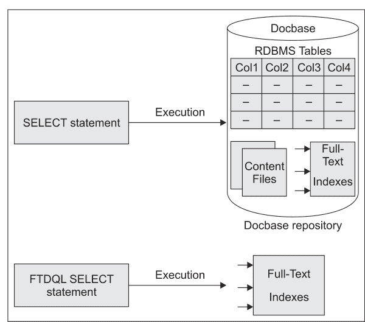

Figure B.1: Execution of FTDQL and ordinary SELECT statements
图 B.1：FTDQL 和普通 SELECT 语句的执行

- A Trusted Content Services license is not required in order to control SSL communication between Content Server and client libraries. This feature is available in the standard Content Server package.
为了控制内容服务器与客户端库之间的 SSL 通信，不需要 Trusted Content Services 许可证。此功能在标准内容服务器包中可用。
- Enhancements have been made to ACLs (Access Control Lists) to provide better object-level permissions.
已对 ACL（访问控制列表）进行了增强，以提供更好的对象级权限。
- Apart from the five extended permissions shown in the table in figure 3.4 of Chapter 3, Documentum has provided an additional extended permission for deleting an object.
除了第 3 章图 3.4 表格中显示的五个扩展权限外，Documentum 还提供了用于删除对象的额外扩展权限。
- This new extended permission is different from the basic Delete permission in that it does not provide hierarchical Browse, Read, Relate, Version, or Write access.
该新的扩展权限与基本的 Delete 权限不同之处在于它不提供分层 Browse、Read、Relate、Version 或 Write 访问。

Apart from specifying the access permissions for basic and extended permissions, Documentum provides an ability to restrict these permissions as well in 5.3. There are two Access Restriction entries: AccessRestriction for restricting certain basic permissions and ExtendedRestriction for restricting certain extended permissions.
除了指定基本权限和扩展权限的访问权限外，Documentum 在 5.3 中还提供了限制这些权限的能力。有两个访问限制条目：AccessRestriction 用于限制某些基本权限，ExtendedRestriction 用于限制某些扩展权限。

The following example of an ACL on a document belonging to the HR department in an organization explains the utility of this feature:
以下示例说明了此功能的用途，该示例为组织中人力资源部门的文档上的 ACL：

### HR_ACL
### HR_ACL

```
Group name: HR_Department
    Permit Type: AccessPermit
    Permission Level: Delete

Group name: HR_Department_subgroup
    Permit Type: AccessRestriction
    Permission Level: write
```

This ACL generically provides delete access to the HR department group, but does not allow a particular subgroup within this HR department to update or delete the document. By using AccessRestriction, the system allows this sub-group to only browse, read, relate (annotate), and version the document.
此 ACL 通常为人力资源部门组提供删除访问权限，但不允许该人力资源部门内的特定子组更新或删除文档。通过使用 AccessRestriction，系统仅允许此子组浏览、读取、关联（注释）和版本化文档。

- **Flexibility to create groups as Dynamic Groups**: A Dynamic Group allows your application to find out whether the users specified in the group's membership list are considered members of this group or not by default when they establish a connection with the Docbase repository.
**将组创建为动态组的灵活性**：动态组允许您的应用程序在用户建立与 Docbase 仓库的连接时，默认情况下确定组成员列表中指定的用户是否被视为该组的成员。
  Say for example you assign a group abc as a Dynamic Group, setting its default membership behavior to treat its users as not members of this group. In the event of a user accessing the Docbase repository from a secure application, your application could add this user to the group but if the access is from a non-secure application, this user is not added to the group. Thus, using Dynamic Groups can assist you in setting up a group (or a role-based) security.
例如，假设您将组 abc 指定为动态组，将其默认成员行为设置为将其用户视为非该组成员。如果用户通过安全应用程序访问 Docbase 仓库，您的应用程序可以将其添加到该组，但如果访问来自非安全应用程序，则不会将该用户添加到该组。因此，使用动态组可以帮助您设置基于组（或基于角色）的安全性。
- Java programs have been supported in lifecycle Entry Criteria, Actions, Post Change, and for validation purposes.
Java 程序已在生命周期 Entry Criteria、Actions、Post Change 中得到支持，并用于验证目的。
- Improvements in workflows, such as support for work queues and a workflow timer for automatically resuming the suspended activities.
工作流的改进，例如支持工作队列和用于自动恢复挂起活动的工作流计时器。
- Support for Global Login Tickets.
支持全局登录票据。
- Login Tickets are ASCII-encoded strings used by applications in place of a user's password while establishing a connection with the Docbase repository. A Global Login Ticket is an extension to this; it is a Login Ticket that can be accepted by any server of a trusted Docbase repository.
登录票据是应用程序在建立与 Docbase 仓库的连接时用作用户密码的 ASCII 编码字符串。全局登录票据是此的扩展；它是可被受信任 Docbase 仓库的任何服务器接受的登录票据。
- The verity_locale key in server.ini file has become obsolete and the verity_location attribute in dm_server_config object type has been deprecated in the 5.3 release.
server.ini 文件中的 verity_locale 键已过时，并且 dm_server_config 对象类型中的 verity_location 属性在 5.3 版本中已被弃用。
- Introduction of Privileged Groups in the system: Members of these system groups have special privileges for performing specific operations that they do not individually have.
系统中引入了特权组：这些系统组的成员具有执行特定操作的特殊权限，而他们个人并不拥有这些权限。

Example: Members of the dm_browse_all group have the privilege to browse all the objects in the Docbase repository.
示例：dm_browse_all 组的成员有权浏览 Docbase 仓库中的所有对象。

### B.2 Object Types Changes
### B.2 对象类型更改

A few of the newly introduced object types in release 5.3 are:
在 5.3 版本中引入的一些新对象类型如下：

- dmc_jar: This is a subtype of dm_sysobject object type and represents a JAR file that is stored in the Docbase repository.
dmc_jar：这是 dm_sysobject 对象类型的子类型，表示存储在 Docbase 仓库中的 JAR 文件。
- dm_job_sequence: This is a subtype of dm_sysobject object type and stores details about a job that belongs to a set of jobs that have been scheduled to run in a specified sequence.
dm_job_sequence：这是 dm_sysobject 对象类型的子类型，存储属于已安排按指定顺序运行的一组作业的作业的详细信息。
- dmc_module: This object type represents a business module. Modules are covered later in the appendix.
dmc_module：此对象类型表示业务模块。模块将在附录后面介绍。
- The permanent_link attribute in the dm_relation object type has been deprecated and instead the new permanent_link and copy_child attributes of the dm_relation_type object type should be used.
dm_relation 对象类型中的 permanent_link 属性已被弃用，而应使用 dm_relation_type 对象类型的新 permanent_link 和 copy_child 属性。

### B.3 API and DQL Changes
### B.3 API 和 DQL 更改

A few of the enhanced Server API methods in release 5.3 are:
在 5.3 版本中增强的服务器 API 方法如下：

- connect and getLogin: Support Global login Tickets.
connect 和 getLogin：支持全局登录票据。
- grant and revoke: Support the enhancements made to Access Control Lists (ACLs).
grant 和 revoke：支持对访问控制列表（ACL）所做的增强。
- queue: Allows queuing of an event to a work item.
queue：允许将事件排队到工作项。

A few of the changes made to DQL in release 5.3 are:
在 5.3 版本中对 DQL 所做的一些更改如下：

- The SEARCH TOPIC clause has been deprecated and the FT_OPTIMIZER clause has been removed from the SELECT statement syntax.
SEARCH TOPIC 子句已被弃用，并且 FT_OPTIMIZER 子句已从 SELECT 语句语法中删除。
- A new DQL hint: UNCOMMITTED_READ has been added for MS SQL Server, DB2, and Sybase databases, for read-only queries for retrieving query results fast even if the tables in question are locked by another database session.
新增了一个 DQL 提示：UNCOMMITTED_READ，适用于 MS SQL Server、DB2 和 Sybase 数据库，用于只读查询，即使相关表被另一个数据库会话锁定也能快速检索查询结果。
- Introduction of the FTDQL SELECT statement described earlier in the appendix.
引入了附录前面描述的 FTDQL SELECT 语句。

### B.4 DFC Changes
### B.4 DFC 更改

A few of the changes made to DFC in release 5.3 are:
在 5.3 版本中对 DFC 所做的一些更改如下：

- Deeper integration with .NET.
与 .NET 的更深集成。
- Support for accessing Documentum Business Objects using Web Services.
支持使用 Web 服务访问 Documentum 业务对象。
- Support for lightweight Unified Client Facilities (UCF), providing content transfer functionality to clients based on the WDK framework, thus removing any impositions of having DFC available on the clients. It provides support for some of the basic content library services such as check-in/check-out, view/edit and import/export.
支持轻量级统一客户端设施（UCF），为基于 WDK 框架的客户端提供内容传输功能，从而消除了客户端必须提供 DFC 的限制。它支持一些基本的内容库服务，例如签入/签出、查看/编辑和导入/导出。
- The existing BOF deployment model using DBOR (Documentum business object registry) on each client machine has been deprecated.
使用每个客户端机器上的 DBOR（Documentum 业务对象注册表）的现有 BOF 部署模型已被弃用。
- Introduction of a ClassCastException that is thrown if one tries to cast a persistent object to a concrete class rather than its corresponding interface.
引入了 ClassCastException，如果尝试将持久对象强制转换为具体类而不是其对应的接口，则会抛出该异常。
- For example, casting to DfDocument (instead of IDfDocument) will throw a ClassCastException.
例如，将对象强制转换为 DfDocument（而不是 IDfDocument）将抛出 ClassCastException。

### B.5 BOF Changes
### B.5 BOF 更改

Following are a few of the changes made to BOF in release 5.3:
以下是 5.3 版本中对 BOF 所做的一些更改：

- TBOs (Type-based business objects) are associated with not just a type but also a Docbase repository. Thus, this does not necessitate having the same implementation of a TBO for all Docbase repositories.
TBO（基于类型的业务对象）不仅与类型相关联，还与 Docbase 仓库相关联。因此，这不需要为所有 Docbase 仓库使用相同的 TBO 实现。
- Support for dynamic deployment of an SBO (Service-based business object) from a central repository to multiple clients.
支持从中央仓库向多个客户端动态部署 SBO（基于服务的业务对象）。
- In order to implement TBOs in pre-5.3 releases, one needed to override multiple methods to perform the same task, such as: overriding save(), saveLock(), checkinEx(), etc. to customize check-in behavior.
为了在 5.3 之前的版本中实现 TBO，需要重写多个方法来执行相同的任务，例如：重写 save()、saveLock()、checkinEx() 等以自定义签入行为。
- In release 5.3, Documentum instead provides a set of supported do methods of DfSysObject such as doSave(), doCheckin(), etc. to achieve overriding. Additionally, Documentum provides a set of supported do methods in the DfPersistentObject and DfTypedObject classes for overriding purposes as well.
在 5.3 版本中，Documentum 改为提供 DfSysObject 的一组受支持的 do 方法，如 doSave()、doCheckin() 等来实现重写。此外，Documentum 还在 DfPersistentObject 和 DfTypedObject 类中提供了一组受支持的 do 方法用于重写目的。

### B.6 Application Builder and Application Installer Changes
### B.6 Application Builder 和 Application Installer 更改

A few of the enhancements made to Application Builder in release 5.3 are:
在 5.3 版本中对 Application Builder 所做的一些增强如下：

- Support for creating and managing Modules. Modules are units of executable code in a Docbase repository. An example could be Documentum business objects.
支持创建和管理模块。模块是 Docbase 仓库中的可执行代码单元。例如可以是 Documentum 业务对象。
- Support for procedures written as Java classes in the various lifecycle states.
支持在各种生命周期状态下以 Java 类编写的流程。
- Support for inserting user profiles and doc profiles, as well as work queues.
支持插入用户配置文件和文档配置文件，以及工作队列。

A few of the enhancements made to Application Installer in release 5.3 are:
在 5.3 版本中对 Application Installer 所做的一些增强如下：

- Support for installation of Modules.
支持模块的安装。
- Support for installation of lifecycles having procedures written as Java classes in the various lifecycle states.
支持安装具有在各种生命周期状态下以 Java 类编写的流程的生命周期。
- Support for installation of user profiles and doc profiles, as well as work queues.
支持用户配置文件和文档配置文件的安装，以及工作队列。


## B.7 WDK 更改

以下是 WDK 在 5.3 版本中进行的几项更改：

- 支持三种内容传输机制：HTTP、UCF（统一客户端设施）和内容传输小程序。
- 支持在集群环境中将会话故障转移到运行相同 WDK 应用程序的其他服务器上。这是通过持久化用户可用的会话数据并发送最后的 HTTP 请求来实现的。
- 支持在基于 WDK 框架的应用程序中集成诸如注释、线程、讨论、房间等功能。
- 支持联邦环境中用户的统一收件箱功能。
- 支持多存储库搜索。搜索方面的其他增强包括：支持搜索外部源（如 Google）、支持在多存储库搜索情况下保存搜索偏好，以及支持在 Docbase 存储库中指定文件夹内进行搜索。
- 支持借助应用程序连接器（AppConnectors）使 Docbase 存储库在 Microsoft Excel、Word 和 PowerPoint 等创作应用程序中可用。
- 支持允许用户选择的 Docbase 存储库出现在用户界面（UI）中，并允许所选列出现在收件箱、我的文件、文件夹列表等功能中。
- 在使用 Internet Explorer 时支持从个人桌面拖放至系统文件夹。
- 支持保存用户登录凭据。

## B.8 Documentum Administrator 更改

Documentum Administrator 在 5.3 版本中进行的几项增强包括：

- **支持作业排序**：一系列作业被指定在规定间隔内以规定方式运行。这些作业可以位于任意数量的 Docbase 5.3 存储库中，并且应至少有一个作业被指定为首先运行，且没有前置作业。

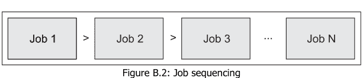

- 支持限制用户访问存储库中的某些文件夹。
- 支持全局登录票据。
- 支持在权限集中添加额外条目。

## B.9 Web Publisher 更改

以下是 Web Publisher 在 5.3 版本中进行的几项更改：

- Web Publisher 编辑器在富文本编辑功能和查询能力方面进行了增强。
- 支持深度文件夹导入。
- 支持在 Web Publisher `<content>` 元素中进行链接管理。
- 在使用 Internet Explorer 时支持从个人桌面拖放至 Web Publisher 中的系统文件夹和项目。
- 支持多个文件夹映射。
- 与业务流程服务（BPS）集成，允许 Docbase 存储库外部的用户使用外部工作流审查内容。
- 支持使用高级搜索功能进行多存储库搜索。
- 支持包含来自多个 Docbase 存储库任务的单个收件箱。
- 借助新的搜索算法，搜索功能得到增强，从而实现更快的搜索。
- 支持讨论线程。
- 用户界面（UI）改进，例如可见的 Docbase 存储库、用户选择的列、布局增强等。
- 以下方法已更新为作为 Java 方法执行：`wcmObjectBagMethod`、`wcmCreateTransformation` 和 `wcmLifecycleMonitor`。
- 新引入的方法 `wcmVersionInfo` 和 `wcmAddEdition` 以及新引入的作业 `Add_Edition_Job`。

Documentum 5.3 版本中引入或增强的功能不仅限于本章各标题下所列出的功能。Documentum 在其庞大的产品套件中改进并引入了许多其他功能。尽管我们讨论了 Documentum 在 5.3 版本中引入的几项更改，但可以通过阅读 Documentum 5.3 系统迁移指南获得这些功能的详细说明。
