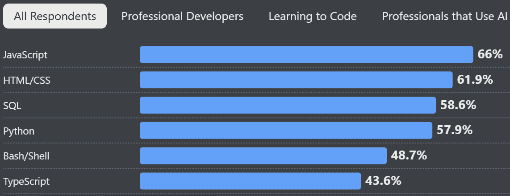
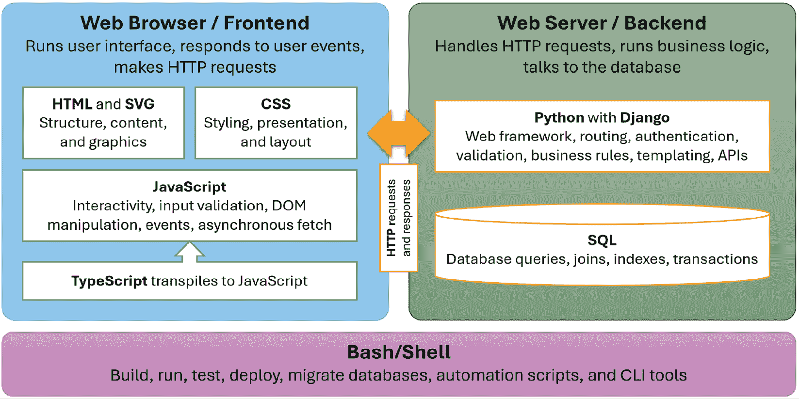
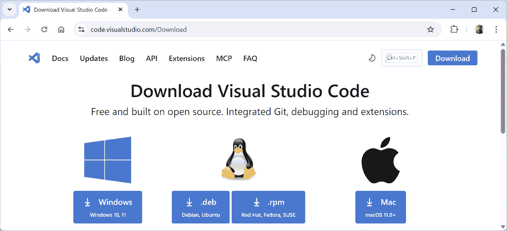
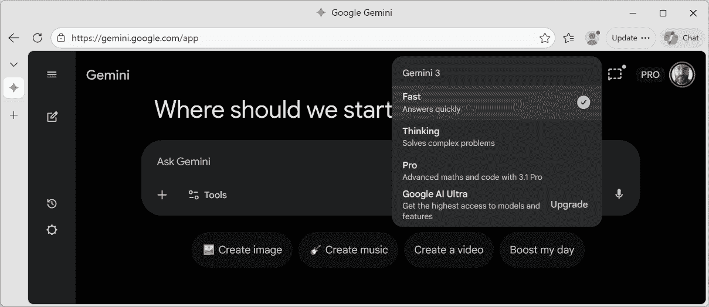
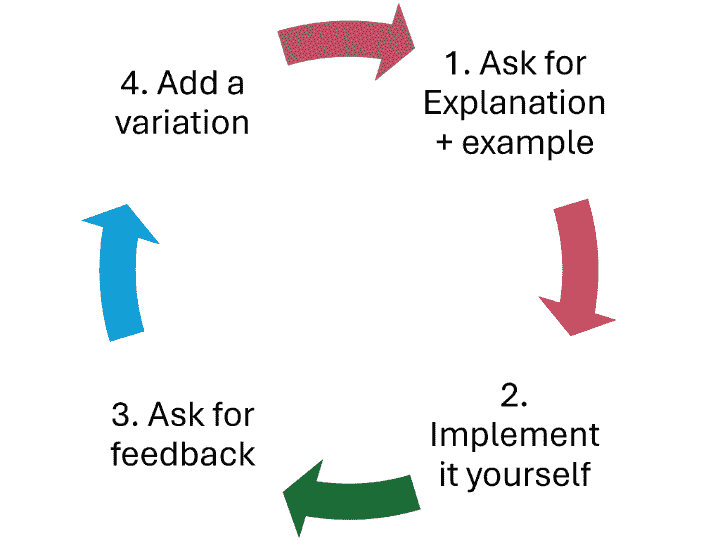

# 与 AI 副驾驶一起进行 Web 开发简介

本章解释如何使用本书并设置你的 AI 辅助学习环境。你将了解与 AI 伙伴学习的概念。我将指导你选择和配置 AI 工具，分享有效提示的技巧（如要求 AI 先解释再编码），并概述本书的结构。

读完本章，你将知道如何使用 AI 工具学习，并拥有尝试示例的实用设置。

在本章中，我们将涵盖以下主题：

* 拆解本书章节
* 设置 Web 开发环境
* 以 AI 聊天机器人为教练学习
* 以 AI 助手为同事编码
* AI 工具的优缺点

**你的购买包含免费 PDF 副本 + 独家额外内容**

你的购买包含本书的无 DRM PDF 副本、Packt+ 图书馆 7 天试用（无需信用卡）以及额外的独家福利。请参阅*前言*中的*随书赠送的免费福利*部分，立即解锁并最大化你的学习效果。

## 拆解本书章节

让我们从拆解你将在本书其余章节学到的内容开始。在第一章之后，本书分为三大部分：

1. **前端 Web 开发**：学习用于开发用户在 Web 浏览器中体验的技术：HTML、CSS、SVG、JavaScript 和 TypeScript。

2. **后端 Web 开发**：学习用于开发在 Web 服务器上运行的网站部分的技术：SQL 数据库、Python、Django 和 Bash（即用于自动化开发任务的 Shell 脚本）。

3. **调查项目**：构建并可选择部署一个完整的网站，用于创建、参与和分析调查与投票。

### 前端 Web 开发


# 前端 Web 开发

## 第 2 章：HTML – 构建您的网页

涵盖 HTML（超文本标记语言）的基础知识。您将使用 AI 生成一个简单的页面，并在此过程中了解元素、标签和属性。您将了解 HTML 在定义网页内容结构（从标题到链接和图片）中的作用。您将创建一个联系表单，引入表单元素。

## 第 3 章：CSS – 为网页设置样式

展示如何控制表现和布局。您将让 AI 解释选择器、属性和值。您将把样式应用到来自第 2 章：HTML – 构建您的网页的网页上。您将学习响应式设计，并使用 CSS 媒体查询制作适合移动设备的网页。

## 第 4 章：SVG – 绘制可缩放图形

介绍 SVG 作为一种使用代码生成图形的方式，这将用于绘制调查结果图表。AI 将解释 SVG 是一种基于 XML 的二维图形标记语言，以及它与 canvas/位图的区别。通过 AI 引导的示例，您将在 SVG 中创建基本形状（圆、矩形、线条）并将它们嵌入 HTML。

## 第 5 章：JavaScript – 让网页具有交互性

涵盖变量、函数、事件和 DOM 等基本 JavaScript 概念。我们首先描述什么是 JavaScript（一种在浏览器中运行的轻量级解释型语言）以及在 HTML 中哪里放置 `<script>` 块。

## 第 6 章：TypeScript – 更安全的 JavaScript

介绍 TypeScript 作为 JavaScript 的超集，它增加了静态类型并解释了为什么它们很有用。

# 后端 Web 开发

## 第 7 章：SQL – 管理数据

揭开 SQL 的神秘面纱（使用 SQLite 和一个简单的数据库进行练习）。AI 解释什么是数据库以及如何使用 SQL 查询数据。您将通过 AI 提示练习基本 SQL 命令：`SELECT` 语句、过滤（`WHERE`）和排序（`ORDER BY`）。AI 可以生成示例数据集（如 `users` 表）并用查询挑战您（“如何获取本月注册的所有用户？”）。

## 第 8 章：Python – 后端编程

涵盖基本的 Python 语法和概念，为读者进行后端 Web 开发做准备。您将安装 Python，然后学习变量、循环和函数等 Python 基础编码。您将请求 AI 逐行解释代码，以加深理解。

## 第 9 章：Django – 后端 Web 开发

专注于 Django，这是 Python 最常用的 Web 框架。您的 AI 将解释 Django 如何通过其 `MVT`（模型-视图-模板）模式工作，该模式与传统的 `MVC`（模型-视图-控制器）模式相关但有所不同，以及为什么它被用于快速 Web 开发。在 AI 的指导下，您将启动一个 Django 项目（本书提供分步说明，AI 可以帮助排查故障）。您将创建一个新的 Django 项目，为本书 *调查项目* 部分的完整项目奠定基础。AI 帮助您编写一个简单的视图和模板。您将了解 Django 如何提供 HTML 以及如何使用模板变量。

## 第 10 章：Bash/Shell – 开发者的命令行技能

简要离开 Web 编程来教授 Bash/Shell 的使用，因为许多开发任务涉及命令行，尤其是自动化部署。您将通过让 AI 描述每个命令的作用并在终端或模拟器中尝试，来练习常用命令（`ls`、`cd`、`mkdir`、`rm` 等）。AI 将引导您创建一个小的 Bash/Shell 脚本来自动化任务，如备份文件或启动您的 Django 服务器。

# 调查项目

## 第 11 章：设置项目环境

启动 TallyApp 调查项目并配置工具。您将看到您将构建的调查应用及其功能的概览，如创建调查、参与调查和查看结果。提供了设置 `VS Code` 与 `GitHub Copilot` 的分步说明（包含屏幕截图或代码片段）。您将了解基于 `Docker` 的开发环境，以及如何使用 `Git` 将代码置于版本控制之下。

## 第 12 章：单元、集成和端到端测试

教您如何为 TallyApp 设计和实施分层测试策略，在 Django 中编写有意义的单元测试和集成测试，使用 `Playwright` 自动化真实浏览器交互进行端到端测试，并使用 AI 工具自动生成测试。

## 第 13 章：规范与构建初始项目

为 TallyApp 定义清晰的项目简介，将其转化为可执行的开发计划，指导您搭建带有适当应用和模型的 `Django 6` 项目，并实现核心身份验证和调查功能。

## 第 14 章：使用规范驱动开发添加项目功能

涵盖如何实施结构化的功能规范，使用 AI 编码助手在现有 Django 项目中实现它，并验证实现是否满足明确定义的验收标准。

## 第 15 章：部署到公共服务器

回顾将 TallyApp 部署到连接广域网的服务器的选项，以便公众可以使用该网站。您将把 TallyApp 部署到公共可访问的服务器，了解请求如何通过生产 Django 技术栈流转，知道如何在部署之间保存和备份用户数据，以及随着流量和期望的增加需要改变什么。

## 后记

回顾您 Web 开发学习旅程的下一步。

## 附录

包含每章末尾问题的答案。

# 为什么选择这些语言和技能？

您可能会想知道为什么我选择涵盖这些特定的语言、框架和技能。一个主要原因是 `Stack Overflow` 每年都会对数千名开发者进行调查，其中一个问题是：*在过去一年中，您在哪些编程、脚本和标记语言中进行了大量开发工作？*

2025 年调查中对此问题的 31,771 份回复显示，开发者报告在过去一年中大量使用的前六种语言是 JavaScript、HTML/CSS、SQL、Python、Bash/Shell 和 TypeScript，如 *图 1.1* 所示：



*图 1.1：2025 年最广泛使用的编程语言调查*

您可以在以下链接的调查中看到这些结果：[`survey.stackoverflow.co/2025/technology#most-popular-technologies-language`](https://survey.stackoverflow.co/2025/technology#most-popular-technologies-language)

当您意识到所有这些语言都是 Web 开发所需的，而且如今大多数编程工作都是 Web 开发时，这些结果就讲得通了。前六名中缺少用于绘制可缩放矢量图形的 SVG，以及 Python 最流行的 Web 开发框架 Django。我甚至一度考虑将书命名为 *Top Six Programming Languages*，但最终决定 Web 开发是涵盖所有这些语言的书籍更好的连接主题。

您可以在 *图 1.2* 中看到每种语言和框架在 Web 开发中所扮演角色的摘要：




图 1.2：Web 开发中语言、框架和工具的角色

## 如何使用本书

技术书籍并非旨在以严格线性的方式阅读。与小说不同，您可以根据自己的兴趣、目标和现有经验自由跳转阅读。一些读者会立刻产生构建完整项目的冲动，可能会想直接跳到后面的章节，那里会将这些工作整合在一起。

这种直觉是可以理解的，我鼓励您去探索。然而，如果您这样做，会很快遇到一个现实：Web 开发依赖于多层知识。在前几章中可能显得缓慢或孤立的概念，在真实应用中结合使用时变得至关重要。本书的结构反映了这一进阶过程。

正如您在章节细分中所见，本书的前两部分专注于逐个学习各项技术。这是刻意为之。每种语言、框架和工具都单独介绍，以便您在没有不必要的复杂性干扰下理解其角色、优势及行为方式。试图一次性学完所有内容往往会导致困惑和浅层理解。逐个学习工具能让后续的项目实践少一些困惑。

本书的最后一部分将这些要素汇聚成一个完整的项目。这是前期投入收获回报的时刻。您不再是毫无上下文地复制粘贴代码，而更有可能理解自己在构建什么，以及为什么它会以那种方式工作。

同样重要的是要认识到，书籍只是学习过程的一部分。真正的进步源于阅读、动手实践、实验以及接触不同观点的结合。不可能写出一本涵盖 Web 开发所有知识的书。而且大多数读者通过多种教学技巧能学得更透彻。视频、文档和社区讨论都发挥着作用。最重要的是，您自己的坚持和好奇心将决定您能走多远。

学习构建软件是一项长期的工程。它需要时间、重复和耐心。本书旨在为您提供结构，以便您的时间花得值得。您不再需要拼凑几十个免费但零散的教程和文章，而是遵循一条连贯的路径，每一章都建立在上一章的基础之上。

以适合您的方式学习材料，但要理解本书为何这样组织。如果您花时间打下坚实的基础，后续阶段会让您感到更有成就感，也少很多挫败感。

本书代码文件可在本书的 GitHub 仓库中获取：[`github.com/markjprice/web-dev-ai/tree/main/Code`](https://links.uk.defend.egress.com/Warning?crId=6a06d4338e5d5f5540437bbb&Domain=packt.com&Threat=eNpzrShJLcpLzAEADmkDRA%3D%3D&Lang=en&Base64Url=eNoNyckRgCAQBMCIcP5-jYRjChYKodYF09f-djGbzwlksbLCEUdH99rqVInEy-ASt_MCU_IvuXGNxA89oBRA&@OriginalLink=github.com)。如果您对本书有意见，请在亚马逊上写差评前先联系我。作者无法回复亚马逊评论，因此我无法直接联系您以解决问题并提供帮助，也无法倾听您的反馈并在下一版中改进。请在本书的 Discord 频道提问：https://discord.gg/rdEsrVbbC，或在本书的 GitHub 仓库提出问题：[`github.com/markjprice/web-dev-ai/issues`](https://links.uk.defend.egress.com/Warning?crId=6a06d4338e5d5f5540437bbb&Domain=packt.com&Threat=eNpzrShJLcpLzAEADmkDRA%3D%3D&Lang=en&Base64Url=eNoFwksOABAMBcAT8fZu49NQ0hAtri8zzWxpACpbO8nnKZC4R1-bM-FRcoWuiwxWPaQfplIRrg%3D%3D&@OriginalLink=github.com)。

### 善用本书的 GitHub 仓库

我为本书创建了一个 GitHub 仓库，用于以下用途：

* 存放本书的解决方案代码，以便在印刷出版后继续维护
* 提供扩展书籍内容的额外材料，如勘误修正、小幅改进、有用链接列表，以及因篇幅限制无法收录印刷书中的可选章节
* 为读者提供一个就书籍相关问题联系我的场所
* 为了方便在命令提示符或终端输入命令，我列出了所有可轻松复制粘贴的命令：https://github.com/markjprice/web-dev-ai/blob/main/docs/commandlines.md

在尝试任何编码任务之前，我强烈建议您查看勘误、改进、出版后变更和常见错误页面。您可以在以下链接找到它们：[`github.com/markjprice/web-dev-ai/blob/main/docs/errata/README.md`](https://github.com/markjprice/web-dev-ai/blob/main/docs/errata/README.md)。

### 反馈书籍问题

如果您在遵循本书说明时遇到困难，或发现文本或解决方案代码中有错误，请在 GitHub 仓库中提出 Issue：

1. 使用您常用的浏览器访问以下链接：[`github.com/markjprice/web-dev-ai/issues`](https://links.uk.defend.egress.com/Warning?crId=6a06d4338e5d5f5540437bbb&Domain=packt.com&Threat=eNpzrShJLcpLzAEADmkDRA%3D%3D&Lang=en&Base64Url=eNrLKCkpKLbS10_PLMkoTdJLzs_Vz00sys4qKMpMTtUHAK67C0I%3D&@OriginalLink=github.com)。

2. 点击 `New Issue`。

3. 输入尽可能多的细节以帮助我诊断问题。例如：

* 具体的章节标题、页码和步骤编号
* 您认为相关且必要的代码和配置
* 预期行为和实际行为的描述
* 截图（您可以将图片文件拖放到 Issue 框中）

我无法总是立即回复 Issue。但我希望所有读者都能通过我的书获得成功，所以如果我能在不太麻烦的情况下帮助您（和其他人），我会乐意提供帮助。

### 给我反馈

如果您想给我关于本书的更多一般性反馈，请发邮件至 markjprice@gmail.com 或在 Discord 的书籍频道提问。您可以匿名提供反馈，如果您希望得到我的回复，可以提供电子邮件地址。我仅会使用该邮箱地址回复您的反馈。

请使用此邀请加入我和其他读者的 Discord：https://discord.gg/rdEsrVbbC。我喜欢听取读者对本书的喜爱之处、改进建议，以及他们如何与 AI 助手协作，所以请别害羞。请与我联系！

提前感谢您深思熟虑且具有建设性的反馈。了解如何写好问题或提出 Issue：[`github.com/markjprice/markjprice/blob/main/articles/issues.md`](https://links.uk.defend.egress.com/Warning?crId=6a06d4338e5d5f5540437bbb&Domain=packt.com&Threat=eNpzrShJLcpLzAEADmkDRA%3D%3D&Lang=en&Base64Url=eNpNx0ESgCAIBdAbyb7bCDFJSjp8vH8t273XMhcOosuybS4ynbxGv1eY6J88Jn-3h2qkyVCQAVtR_HwBle8aXA%3D%3D&@OriginalLink=github.com)。

### 我所有书籍共享的内容

我使用个人 GitHub 仓库存储与我所有书籍相关的共享内容。有用的章节包括以下内容：

* 常见问题解答：[`github.com/markjprice/markjprice/blob/main/FAQs.md`](https://links.uk.defend.egress.com/Warning?crId=6a06d4338e5d5f5540437bbb&Domain=packt.com&Threat=eNpzrShJLcpLzAEADmkDRA%3D%3D&Lang=en&Base64Url=eNrLKCkpKLbS10_PLMkoTdJLzs_Vz00sys4qKMpMTkVmJuXkJwH5mXn6bo6BxXq5KQCGAxWF&@OriginalLink=github.com)


文章：[`github.com/markjprice/markjprice/blob/main/articles/README.md`](https://links.uk.defend.egress.com/Warning?crId=6a06d4338e5d5f5540437bbb&Domain=packt.com&Threat=eNpzrShJLcpLzAEADmkDRA%3D%3D&Lang=en&Base64Url=eNpNxzEOgCAMBdAb8Xc3ExldvAGtRKpUSKn319HtveLexwQc4uWhwE2hya6zm3D-k2qj73IjmQvXPLDFeVlj0P0Fj_wZbg%3D%3D&@OriginalLink=github.com)

既然您已经了解本书其余章节的内容安排，让我们来搭建您的开发环境。虽然我们要等到本书的*调查项目*部分才会开始构建完整项目，但在所有语言学习章节中，您都会想要编写代码片段并亲眼看到它们运行。

# 搭建您的 Web 开发环境

在开始编程之前，您需要一个支持多种语言（包括 HTML、CSS、JavaScript、TypeScript、SQL 和 Python）的代码编辑器，无论是来自 Microsoft 还是第三方。我推荐 VS Code，因为它支持所有常见语言的扩展，且可在 Windows、Mac 和 Linux 上跨平台运行。

VS Code 是所有开发者中最受欢迎的代码编辑器或 IDE，在 Stack Overflow 2025 年调查中，超过 75% 的专业开发者选择了它，您可以通过以下链接阅读该调查：[`survey.stackoverflow.co/2025/technology/#1-dev-id-es`](https://survey.stackoverflow.co/2025/technology/#1-dev-id-es)。

## 下载并安装 VS Code

现在让我们下载并安装 VS Code 以及一些有用的扩展：

1. 从以下链接下载并安装 VS Code 的稳定版或预览版：[`code.visualstudio.com/download`](https://code.visualstudio.com/download)，如*图 1.3*所示：

如果您需要更多关于安装 VS Code 的帮助，可以阅读以下链接的官方安装指南：[`code.visualstudio.com/docs/setup/setup-overview`](https://code.visualstudio.com/docs/setup/setup-overview)。



图 1.3：适用于 Windows、Linux 和 Mac 的 VS Code 下载网页

1. 要通过用户界面安装 VS Code 扩展，您必须首先启动 VS Code 应用程序。
2. 在 VS Code 中，单击**扩展**图标或导航至**视图** | **扩展**。
3. 在搜索框中输入 `Live Preview`。
4. 选择 **Live Preview** 扩展并确认它是正确的，如*图 1.4*所示：

    * **标识符**：`ms-vscode.live-server`
    * **版本**：0.4.16 或更高
    * **发布者**：Microsoft
    * **下载量**：超过 1100 万


图 1.4：安装由 Microsoft 发布的 Live Preview 扩展

5. 单击**安装**并等待其下载和安装完成。

VS Code 内置了对 HTML、CSS、JavaScript 和 TypeScript 编辑的支持，但可以通过安装更多扩展来支持其他语言。

## 安装其他扩展

在本书后续章节中，您将使用更多 VS Code 扩展。如果您想现在就安装它们，我们将使用的所有扩展都列在*表 1.1*中：

| **扩展名称和标识符** | **描述** |
| --- | --- |
| **Live Preview** `ms-vscode.live-server` | 在您的工作区中托管一个本地服务器，以便您预览网页。 |
| **Markdown All in One** `yzhang.markdown-all-in-one` | Markdown 所需的一切（键盘快捷键、目录、自动预览等）。 |
| **SQLite** `alexcvzz.vscode-sqlite` | 浏览和查询 SQLite 数据库。 |
| **Python** `ms-python.python` | 为 Python 语言提供丰富支持（适用于所有活跃支持的 Python 版本），为扩展提供接入点，以支持 IntelliSense (Pylance)、调试 (Python Debugger)、格式化、代码检查、代码导航、重构等。 |
| **Django** `batisteo.vscode-django` | 为有截止日期的完美主义者提供优美的语法和作用域代码片段。 |
| **GitHub Copilot** `github.copilot` | AI 结对编程工具，帮助您更快、更聪明地编写代码。 |
| **Claude Code for VS Code** `anthropic.claude-code` | Claude 自主探索您的代码库，读写代码，并在您许可下运行终端命令。 |
| **Gemini Code Assist** `google.geminicodeassist` | 由 Gemini 提供支持的 AI 辅助开发。 |
| **Playwright Test for VSCode** `ms-playwright.playwright` | 在 VS Code 中运行 Playwright Test 测试。 |

表 1.1：用于 Web 开发的 VS Code 扩展

您可以在命令提示符或终端中安装 VS Code 扩展，如*表 1.2*所示：

| **命令** | **描述** |
| --- | --- |
| `code --list-extensions` | 列出已安装的扩展 |
| `code --install-extension <extension-id>` | 安装指定的扩展 |
| `code --uninstall-extension <extension-id>` | 卸载指定的扩展 |

表 1.2：在命令提示符下管理 VS Code 扩展

例如，要安装 **Live Preview** 扩展，请在命令提示符中输入以下内容：

```
code --install-extension ms-vscode.live-server
```

我创建了 PowerShell 脚本来安装和卸载前表中的 VS Code 扩展。您可以在以下链接找到它们：[`github.com/markjprice/web-dev-ai/tree/main/scripts/extension-scripts/`](https://github.com/markjprice/web-dev-ai/tree/main/scripts/extension-scripts/)。PowerShell 脚本是跨平台的，您可以在以下链接了解详情：[`learn.microsoft.com/en-us/powershell/scripting/overview`](https://learn.microsoft.com/en-us/powershell/scripting/overview)。

## 了解 VS Code 版本

Microsoft 几乎每月发布一个新的 VS Code 功能版本，并更频繁地发布错误修复版本。例如：

* 版本 1.109.0，2026 年 1 月功能发布
* 版本 1.109.1，2026 年 1 月错误修复发布

本书使用的版本是 1.112.0，即 2026 年 4 月的功能发布版，但 VS Code 的版本不如您安装的扩展版本重要。请确保所有扩展都保持最新。

## VS Code 键盘快捷键

如果您想自定义 VS Code 的键盘快捷键，可以参考以下链接：[`code.visualstudio.com/docs/getstarted/keybindings`](https://code.visualstudio.com/docs/getstarted/keybindings)。

我建议您从以下列表中下载适用于您操作系统的 VS Code 键盘快捷键 PDF：

* Windows：[`code.visualstudio.com/shortcuts/keyboard-shortcuts-windows.pdf`](https://code.visualstudio.com/shortcuts/keyboard-shortcuts-windows.pdf)
* macOS：[`code.visualstudio.com/shortcuts/keyboard-shortcuts-macos.pdf`](https://code.visualstudio.com/shortcuts/keyboard-shortcuts-macos.pdf)
* Linux：[`code.visualstudio.com/shortcuts/keyboard-shortcuts-linux.pdf`](https://code.visualstudio.com/shortcuts/keyboard-shortcuts-linux.pdf)

现在您已经搭建好开发环境，让我们深入了解如何充分利用 AI 聊天机器人，让它成为您学习 Web 开发的教练。

# 让 AI 聊天机器人做您的教练进行学习

如果善加利用，像 ChatGPT 这样的 AI 聊天机器人可以成为有用的学习工具。

本节将比较三种常用于学习 Web 开发的聊天机器人。

**良好实践**：如果您是 Web 开发新手，或不确定选择哪些工具，请使用以下设置。这是本书中最简单的路径，也是示例所假设的环境：

* **聊天机器人**：ChatGPT（免费版或每月 20 美元的 Plus 版）


*   **代码编辑器或 IDE**：VS Code（免费）
*   **IDE 集成编码助手**：GitHub Copilot（个人计划如 Copilot Free 和 Copilot Pro 包含 GitHub AI Credits 额度，因计划而异）
*   **命令行编码助手**：OpenAI Codex（因为它目前包含在 ChatGPT Plus 中）

你可以仅使用这些工具完成本书的所有内容。其他选项如 Claude 或 Gemini 也很优秀，鼓励你稍后探索。但过早切换工具会让人不知所措，拖慢学习进度。从简单入手，建立信心，再进行实验。

现在让我们对比三大聊天机器人：OpenAI 的 ChatGPT、Anthropic 的 Claude 和 Google 的 Gemini。

## OpenAI 的 ChatGPT

ChatGPT 在解释、调试帮助以及学习过程中的反复交互方面特别有用。当你在 HTML 语义、 JavaScript 怪癖或 Django 数据模型逻辑上卡住时，一个结构良好的提示词通常能产生有用的解释。

### 免费版与付费订阅

*   **免费版**：免费版非常适合对话式学习，但不包含 Codex 编码代理的访问权限。
*   **Go 版（8 美元/月）**：扩展访问权限，更多消息、上传、图像创建和更长的记忆。
*   **Plus 版（20 美元/月）**：访问先进的 GPT 系列模型，通常在推理、代码生成和长会话上下文保持方面表现更好。可访问 Codex 编码代理、项目和自定义 GPT。如果你想要更强能力但不想承担高昂月费，这是我的推荐。
*   **Pro 版（100 美元/月）**：比 Plus 版多 5 倍用量，拥有 Frontier Pro 模型，最大程度访问 Codex 和深度研究，以及无限且更快的图像创建。
*   **商业版（20 美元/月/席位）/ 企业版**：最适合企业团队，因为需要 2 个以上席位按年计费。OpenAI 承诺你的数据绝不会用于训练其模型。

ChatGPT 定价信息请见：[`chatgpt.com/pricing/`](https://chatgpt.com/pricing/)

所有主要 AI 提供商都提供一系列模型，在速度、成本与能力之间权衡。虽然名称不同，但模式一致。OpenAI 将其更快、思考较少的模型命名为 `mini`。例如 `GPT-5 mini`。Google 将其 Gemini 更快、思考较少的模型命名为 Flash，将其深度思考模型命名为……这使其在结构上比主要基于用户反馈训练的模型更谨慎。你可以通过以下链接阅读更多关于 Claude 这方面的内容：[`deeperinsights.com/ai-review/claude-ai-features-uses-comparison-to-chatgpt/`](https://deeperinsights.com/ai-review/claude-ai-features-uses-comparison-to-chatgpt/)

*   代码输出不错，但在原型设计时比 ChatGPT 更谨慎、增量式
*   如果你偏好更稳健、解释性强的风格，Claude 是个好选择

Anthropic 提供几个版本的 Claude，通常称为 `Haiku`、`Sonnet` 和 `Opus`。这些不是完全不同的系统；它们是在速度、成本和能力之间的不同权衡。

简单理解它们：

*   `Haiku` 追求速度
*   `Sonnet` 适合日常工作
*   `Opus` 解决最难问题

大多数初学者应从 `Sonnet` 开始，仅在有明确理由时切换。如果任务简单或重复，尝试 `Haiku`。如果任务复杂、不明确或屡试不爽，升级到 `Opus`。

不要把模型选择视为永久决定。选择适合工作的模型。

你可以通过以下链接注册 Claude：[`claude.ai/`](https://claude.ai/)

## Google 的 Gemini

自首次发布以来 Gemini 已有改进，现在在许多 Web 开发任务上与 ChatGPT 和 Claude 具有竞争力。

### 为什么人们喜欢它

*   强大的多模态支持。文本、图像、文档、截图
*   良好的 JavaScript 和 Web 相关回答

### 缺点

*   回答有时感觉比较泛泛
*   在深度后端或特定框架问题上仍不均衡

你可以通过以下链接注册 Gemini：[`gemini.google.com/`](https://gemini.google.com/)

## 选择哪个聊天机器人？

如果你想选择心仪的聊天机器人，我建议各试用一个月，看哪个最合你心意。每个都有独特的个性，适合不同的人。

现在我们已回顾了三大聊天机器人，你可以决定更倾向于用哪一个来学习本书 `Frontend Web Development` 和 `Backend Web Development` 部分涵盖的所有语言。你甚至可以选择我未涵盖的其他聊天机器人，或同时使用多个并对比结果。这是一种有用的学习方式，看看每个聊天机器人在回答中选择包含什么信息。如果多个聊天机器人强调相同信息，你可以更放心地认为它们给出了准确回答。

学习早期，一致性比优化更重要。使用一个简单、广泛支持的设置能帮你专注于概念而非工具。不要浪费第一周比较工具。选定一套开始学习。工具变得快，但你思考系统和代码的方式将长存。无论你选择哪个聊天机器人作为学习教练，现在让我们看看一些适用于所有 AI 聊天机器人的重要要点。

## 充分利用本书建议的提示词

全书中你会看到建议的提示词，可复制粘贴到 ChatGPT、Gemini、Claude 等聊天机器人中。这些提示词旨在为你深入探索主题提供起点，但如何使用它们与提示词本身同等重要。

例如，这是本章的第一个建议提示词：


**提示：** 请给我一份清单，用于评估 AI 回复是否真正帮助我学习了 Web 开发。

在本书的 GitHub 仓库中，我为每一章创建了包含所有建议提示词的页面。例如，您可以通过以下链接找到本章的建议提示词：

[`github.com/markjprice/web-dev-ai/blob/main/prompts/ch01-intro/readme.md`](https://github.com/markjprice/web-dev-ai/blob/main/prompts/ch01-intro/readme.md)

在 2026 年春季撰写本书时，我使用了拥有 Pro 订阅的 Gemini 及其**快速**模型来回答每一个可选提示词，如*图 1.5*所示：



图 1.5：配置 Gemini Pro 以使用快速响应

虽然您可以在本书的 GitHub 仓库中查看那些 Gemini Pro 的回复，但我强烈建议您将相同（或类似）的提示词输入到您首选的 AI 聊天机器人中。模型在不断改进，观察基于定价、模型不同而产生的回复差异会很有趣，从 AI 那里，您能立即理解：

*   `<main>` 存在的原因
*   `<article>` 与 `<section>` 区别的重要性
*   错误出在哪里

您将在几秒钟内纠正 AI 犯下的任何错误。

但如果您不理解语义，AI 会乐意生成看起来正确但结构错误的内容。您不会注意到缺失的地标、损坏的无障碍访问或标题的误用。您交付的是脆弱的标记，却永远不知道为什么稍后会觉得事情不对劲。AI 不是导致此问题的原因，但它确实放大了这个问题。

如果您复制 AI 生成的 CSS 直到看起来正确，您最终得到的样式仅是碰巧生效。更糟的是，AI 会让您更快地达到这种损坏状态。

在调试时，如果您已经阅读错误消息、形成假设并隔离变量，那么 AI 就成了调试伙伴。您可以说：

```
Here's the error message. What's the most likely cause and how do I confirm it?
```

您学得更快，因为您看到了推理过程。

但如果您还不具备基本的调试技能，AI 就会让您通过一次性更改五件事来更快地盲目尝试，您最终会盲目粘贴修复程序，甚至制造新 Bug！您感觉很忙碌，但并没有在学习。

**提示：** 请对比有 AI 与无 AI 学习 Web 开发的区别。哪些技能会提升，哪些技能会退化？

## 您的学习风格

如果您天生会问：

*   为什么用这种模式？
*   为什么不用另一种？
*   如果我改这里会坏什么？

AI 可以充当随时可用、耐心解答的伙伴，随时准备回答您的下一个问题。

但如果您的本能是，*直接给我答案*，AI 会欣然照办，但您会在不理解项目的情况下完成它们。不要让工具替您思考。

您需要将 AI 用作解释者、审查者、决策陪练或调试器，而不是主要作者、架构师或决策者。

在与 AI 的聊天中，以下是一些值得经常使用的好短语：

*   请给我展示最简示例。
*   有哪两种替代方案？
*   我做了哪些假设？

**提示：** 请结合 Web 开发中的具体例子，解释为什么说 AI 是现有技能的乘数。

## 配置 AI 聊天机器人用于学习

如果您希望免费的 AI 聊天机器人真正帮助您学习 Web 开发（而不是仅仅吐出您看不懂的代码），您需要通过三种方式对其进行配置：

*   如何开始每次对话（您的学习契约）
*   如何提问（提示词模式）
*   如何验证和练习（以免被自信的胡言乱语欺骗）

以下是一种在 ChatGPT、Gemini 和 Claude 中效果良好的设置。

### 创建可复用的学习契约消息

在新聊天开始时，粘贴类似以下的学习契约并根据您的喜好进行调整。

学习契约（粘贴在聊天顶部）：

```
You are my web dev tutor for HTML, CSS, JavaScript, SQL, Python and Django. Teach me like a beginner who wants to become competent, not like someone who wants a quick copy-paste. Prefer short steps with checkpoints.
When giving code, also explain:
- what the code does
- why this approach is used
- common mistakes
Ask me 1–3 quick questions if needed (but do not stall). Always provide a tiny exercise after explaining a concept.
When I paste an error, help me debug by:
- explaining likely causes
- telling me exactly what to check
- giving the minimal fix first
```


如果你的聊天机器人支持 `custom instructions` 或 `memory`，请将相同内容放在那里，这样你就不必重复输入。如果不支持，请将其保存在笔记中，并在每次新对话时粘贴进去。

## 选择一个学习路径，让机器人连贯地教学

免费聊天机器人可能很棒，但除非你设定结构，否则它们会随意跳跃。选择一个学习路径并坚持几个会话：

- HTML 语义与结构
- CSS 布局与样式
- JavaScript 基础
- 使用 SQLite 的 SQL 基础
- Django 基础
- 部署概念与 Bash 脚本编写

告诉聊天机器人：

```
Use this track. If I ask something beyond the scope of my current track, briefly answer but then guide me back to the track.
```

## 使用提示模板强制真实学习

促使模型解释而不是向你倾倒代码的提示模式如 `表 1.3` 所示：

| Template | Example |
| --- | --- |
| `Explain, then quiz me` | 像教新手一样教我 `topic`。使用一个简单的例子。每节结束后，问我一个快速问题以检查理解。直到我回答前不要继续。 |
| `Socratic debugging` | 我在 `language/framework` 中遇到这个错误。请先问我最重要的问题，一次一个，并解释每个答案意味着什么。这是堆栈跟踪：`traceback`。 |
| `Minimal code with "why"` | 展示处理 `functionality` 的 `feature` 的最小可能示例。解释每一行。然后给我一个小的更改来实现。 |
| `Make me practice` | 给我一个 20 分钟的练习：`task`。只提供需求和提示。除非我要求，不要给出解决方案。例如，构建一个 Django 页面，列出来自 SQLite 的产品，带有使用 `GET` 参数的搜索框。 |
| `Compare options` | 解释使用 `feature` 构建 `language/framework` 项目的三种方式。给出优缺点及何时选择每种。例如，函数视图与类视图，应用布局。 |

表 1.3：学习提示模板

## 让机器人在你的实际项目中工作

如果你提供正确的上下文，你会获得显著更好的帮助。一旦我们使用集成到代码编辑器或 IDE 中的 AI 工具，这会变得更容易，但即使使用单独的 AI 聊天机器人，你也可以手动提供上下文。

尝试提供：

- 你的目标（“我想要一个列出博客文章的页面”）
- 你当前的代码（最小相关片段）
- 错误消息/堆栈跟踪
- 你的文件名及代码所在位置（`views.py`、`urls.py`、模板路径）

这可以防止聊天机器人猜测你的设置。

## 为代码生成设置护栏

许多读者跳过这一步，但它确实能产生实际差异。

将这些规则添加到你的聊天中：

```
You must follow these rules when your response includes code:
- Do not generate more than about 40 lines of code at once unless I ask.
- Prefer incremental changes with diffs.
- If you propose a change, show it as: what to delete, what to add.
- Tell me the one most likely issue first.
```

这能保持体验的互动性，并减少你最终得到一个“弗兰肯斯坦项目”的可能性。

## 将 AI 用作导师，而非编译器

AI 不应被用作替代你自己实现工作的工具。一个扎实的常规应该成为你的习惯，即使用如 `图 1.6` 所示的四步学习循环：

1. 请求解释 + 微小示例
2. 自己实现（即使很慢）
3. 粘贴你的尝试并请求反馈
4. 做一个小变体（“现在添加验证”、“现在添加搜索”等）



图 1.6：AI 学习循环

明确告诉聊天机器人：

```
Don't write the final solution. Coach me through implementing it.
```

## 验证习惯

聊天机器人（尤其是免费的）有时会出错，因此你可以用以下提示鼓励 AI 自我检查：

- `列出你对我的项目结构所做的假设。`
- `这有哪 3 种可能失败的方式，我该如何检测每一种？`
- `最简单的替代方法是什么？`

如果你想要额外的安全性，可以通过向第二个聊天机器人提出相同问题来交叉验证棘手的答案。当它们意见不一致时，那就是你需要仔细测试的信号。

你现在已经挑选了一个或多个 AI 聊天机器人作为学习教练，并了解了如何从它们那里获得最佳指导体验。现在让我们把注意力转移到主动编码上，而不是学习概念。

# 与 AI 助手作为同事一起编码

虽然聊天机器人非常适合学习，但在构建完整的 Web 开发项目时，你需要一个更专业的工具，它能在你的代码编辑器或 IDE 内部工作，并能帮助处理多步骤编码任务（即“代理式”，一个我希望快速过时的可怕营销词）。本节的目标是了解各种与你的编码工具集成的 AI 工具的优缺点。

**良好实践**：如果你在本书中只遵循一种带有集成编码助手的代码编辑器或 IDE 设置，请使用 `VS Code` 搭配 `GitHub Copilot`。这种组合广泛使用，能与我们将构建的工作流干净地集成，并为初学者提供最小的摩擦。

在查看具体工具之前，有一个关于它们与 AI 模型关系的重要因素需要考虑。

## 理解工具-模型关系

当你开始使用 AI 编码助手时，很容易将每个工具视为单一、固定的系统。例如，你可能会认为 `GitHub Copilot` 是一个 AI，就像 `ChatGPT` 或 `Claude` 给人的感觉是单一产品一样。

实际上，像 `Copilot` 这样的工具最好理解为通往多个底层模型的接口。

这意味着当你在像 `VS Code` 这样的代码编辑器或 IDE 中使用像 `GitHub Copilot` 这样的工具时，你并不总是在与一个特定的 AI 系统对话。相反，该工具可以根据任务、你使用的功能或你的订阅级别，将你的请求路由到不同的模型。

AI 工具是分层构建的：

- 编辑器或界面（例如，带有 `Copilot` 的 `VS Code`）
- 将你的编辑器连接到 AI 服务的集成层
- 实际生成响应的一个或多个底层模型

在某些情况下，这包括来自不同提供商的模型。

例如，在 `Copilot` 内部，你可能会：

- 从一个模型获得内联代码补全
- 使用由另一个模型驱动的聊天功能
- 选择或被路由到诸如 `OpenAI` 的 `GPT-5.5` 或 `Anthropic` 的 `Claude Sonnet` 等模型

因此，即使你在使用 `Copilot`，响应背后的实际智能可能来自完全不同的系统。

这影响你选择工具的方式：

1. 首先，工具选择和模型选择不是一回事。你可能更喜欢在 `Copilot` 中工作，因为它与你的编辑器集成，但仍希望针对特定任务使用像 `Claude Opus` 这样的特定模型。
2. 其次，即使在同一工具内，结果也可能不同。如果 `Copilot` 切换模型或你更改设置，你可能会看到不同风格的响应、详细程度或编码方法。
3. 第三，你可以结合优势。例如：
   - 编码时使用 `Copilot` 获取快速内联建议
   - 使用由 `Claude` 驱动的聊天进行更深入的解释
   - 使用更强的模型进行复杂调试或设计决策

不要考虑“我应该使用哪个单一 AI”。相反，要考虑：

- 哪个工具适合你的工作流（例如，带有 `Copilot` 的 `VS Code`）？


哪个模型最适合当前任务（例如，Claude Opus 具有高智商推理能力）会影响响应速度与更聪明推理之间的平衡
* 您的工具链对于完成工作至关重要

编码助手最大的改进来自工具链，而非模型。总之，工具链是围绕 AI 模型的系统，它赋予模型工具、记忆和工作流，将其从文本生成器转变为能够完成实际任务的系统。

现在让我们回顾一些最流行的编码助手，它们可以与您首选的代码编辑器或 IDE（以及模型）集成。

## GitHub Copilot

对于实践学习，GitHub Copilot 是我建议从中开始的选择，因为它位于您的代码编辑器或 IDE（VS Code、Visual Studio、JetBrains 等）中，并在您输入时代码补全、模板和整个函数。

GitHub Copilot 与集成到 Windows、Office 以及如今每个其他微软产品中的“Copilots”截然不同。请不要因其品牌而却步。

Copilot 最适合通过编码学习，而非聊天。Copilot 不会取代您首选的聊天机器人。它减少了反复搜索常见代码模式的需求。开发者广泛使用它，因为它在您输入时工作，并能访问您的整个项目上下文。

优势：

* 出色的代码自动补全
* 在您的代码编辑器或 IDE 内工作
* 利用您的项目上下文改进建议

劣势：

* 除非搭配聊天机器人，否则不利于概念学习

免费与付费计划：

* **免费** / **学生**：每月包含 IDE 中最多 2,000 次内联建议和最多 50 次高级请求，让您有限度体验 Copilot 的功能。学生可在 IDE 中获得无限补全和每月最多 300 次高级请求。
* **付费**：Copilot Pro（每月 1,000 个 AI 积分，10 美元） / Pro+（每月 3,900 个 AI 积分，39 美元），解锁更多补全和集成。
* **商业版** / **企业版**：每用户每月 19 美元（可选择以每请求 0.04 美元购买额外高级请求），每用户每月 39 美元（仅限 GitHub Enterprise Cloud）。

您可以通过以下链接了解 GitHub Copilot 的基于使用量的计费：[`docs.github.com/en/copilot/concepts/billing/usage-based-billing-for-individuals`](https://docs.github.com/en/copilot/concepts/billing/usage-based-billing-for-individuals)

通过以下链接注册 GitHub Copilot：[`github.com/features/copilot`](https://github.com/features/copilot)

如何设置以取得成功：

* 在编辑器中安装 Copilot 插件
* 从编写最少量代码开始，让 Copilot 建议 HTML 布局、JavaScript 函数和 Django REST 视图等片段
* 当有建议时，在 Copilot Chat 中问“为什么用这种模式？”这能让您从复制粘贴猴子转变为拥有更深层理解

## Google 的 Gemini Code Assist

Google 提供了一款 AI 编码助手，提供慷慨的免费额度（每月大量补全），并与 VS Code 等主流编辑器集成。它可用于原型设计 HTML 和 JavaScript 或调试 Django 视图，因为机器人理解您更改的上下文并建议更大的代码块，而不仅仅是单行。

Gemini Code Assist 是您在熟悉使用 VS Code 和 GitHub Copilot 的基本概念后可能想探索的工具。

免费与付费：

* 免费：个人层级每月提供大量补全
* 付费/标准版：增加更深度的集成和指标

如何设置以取得成功：

* 在您选择的编辑器中安装 Gemini Code Assist 扩展
* 编码时使用自然语言提示（“用 HTML + CSS + JavaScript 创建一个响应式导航栏”）
* 对于 Django，在 Shell 中工作并交互式地请求模型定义、迁移和管理后台自定义

您可以通过以下链接注册 Gemini Code Assist：[`codeassist.google/`](https://codeassist.google/)

## AI 编码工具的成本与能力

到 2026 年上半年，AI 编码工具已成为许多开发者工作流的常规部分，但其成本、限制和可靠性仍在演变。

在 *The Pragmatic Engineer* 2026 年 3 月的调查中，95% 的受访者表示每周至少使用一次 AI 工具，55% 表示定期使用 AI 代理，Claude Code 是该调查中使用最多且最受喜爱的工具。

Jellyfish 最新的工程研究称，其数据集中超过一半的公司持续使用 AI 编码工具，64% 的公司在 AI 协助下生成大部分代码，高采用率团队的**拉取请求**（**PR**）吞吐量约为低采用率团队的 2 倍。

您可以通过以下链接阅读更多关于这些研究和调查的信息：https://newsletter.pragmaticengineer.com/p/ai-tooling-2026 和 https://jellyfish.co/newsroom/jellyfish-reveals-ais-real-impact-on-engineering-teams/

但这并不意味着开发者对此感到平静。Reddit、Hacker News 和其他公共渠道上的情绪更像是：*这难以置信地有用，略微让人上瘾，如果使用不当，会不断威胁浪费时间或金钱*。


# AI 编码工具：用法、成本与工作流

开发者们认为 Claude Code、Codex 和 Copilot 适用于端到端的功能实现、全仓库重构、规划、代码审查，以及同时运行多个竞争代理以对比输出。

路透社于 2026 年 3 月下旬报道，Codex 现拥有超过 200 万周活跃用户，这是在 2026 年第一季度用户数增长 3 倍、使用量增长 5 倍之后的结果：[`www.reuters.com/technology/openai-buy-python-toolmaker-astral-take-anthropic-2026-03-19/`](https://www.reuters.com/technology/openai-buy-python-toolmaker-astral-take-anthropic-2026-03-19/)

## Token 与配额消耗

常见的抱怨是成本和使用限制不明确，尤其是 token 消耗和配额消耗。在 `r/codex` 上，2026 年 3 月的多个帖子抱怨每周使用量消失得比预期快得多，人们报告诸如“每个任务消耗 10% 的周限额”、“仅用了 3 天就消耗了 75% 的周限额”，以及截图显示在正常工作仅几天内限额几乎耗尽。其他帖子称 token 消耗在 3 月中旬突然激增，且没有明显的流程变化。

GitHub Copilot 用户也在以另一种形式抱怨同样的问题。由于 Copilot 将无限制补全与有上限的高级请求混合在一起，争论的焦点不那么在于原始 token，而更多在于哪些模型消耗高级额度过快。在 2026 年 3 月的讨论中，用户抱怨 Copilot 中的 Claude Opus 消耗高级请求的速度远超预期，还有人报告近期更新后 token 使用量增加。

**提示**：请用简单的术语解释 token 用法，并结合真实的编码会话举例。什么导致 AI 编码工具中 token 使用量高，以及如何减少它？

## Token 使用的实用方法

一种实用的方法是采用分层策略，而不是挑选“最聪明”的模型并将其用于所有事情。对广泛探索、样板代码和重复性编辑使用更便宜或有上限的工具。仅在架构设计、棘手的调试或大规模重构时才升级使用昂贵的前沿模型。

你可以在公开讨论中直接看到这种模式。一位 Reddit 用户说他们“最初用 Claude 规划，再用 Codex 审查”，其他人建议日常工作坚持使用 Sonnet 或 Haiku，将 Opus 留给更艰巨的任务，Copilot 用户则谈论使用更便宜的模型进行迭代式来回交互，因为高级模型消耗配额太快。

**良好实践**：使用廉价模型进行搜索、总结、代码检查、脚手架搭建和重写。使用高级模型进行困难推理。使用单独的审查模型来检查主模型的工作。在成本上“翻车”的开发者，往往是那些在本应先由廉价模型处理的任务上，却让前沿模型以 `xhigh` 思考等级运行的人。

**提示**：请为初学者设计一个使用免费和付费 AI 工具的低成本工作流。

## 定价与方案选择

公众讨论显示出大致的模式：新手和学生主要使用免费层级和教育权益；职业个人开发者倾向于 10 到 20 美元区间的方案；而 100 到 200 美元的方案主要由重度用户证明合理，他们每天进行数小时的代理式编码，并相信获得的价值远超标价。

你可以在以下链接阅读关于 AI 订阅最佳性价比组合的典型讨论：[`www.reddit.com/r/ClaudeCode/comments/1rp294g/the_best_value_for_money_combination_of_ai/`](https://www.reddit.com/r/ClaudeCode/comments/1rp294g/the_best_value_for_money_combination_of_ai/)

## 对比开发者对 AI 工具的看法

Anthropic 的 Claude Code 被许多高级用户誉为最强的纯编码代理体验，尤其是在小团队中，而我之前链接的 *The Pragmatic Engineer* 调查称它目前是最受喜爱的工具。

OpenAI 的 Codex 因感觉更直接、更面向工程而受到赞誉，但 2026 年 4 月的 `r/codex` 充满了对不可预测的配额消耗的焦虑。OpenAI 自身的定位是 Codex 包含在付费 ChatGPT 层级中，这使其对已身处该生态系统的人具有吸引力。

GitHub Copilot 仍然是编码助手的安全默认选择。对个人而言，它比大多数付费竞争对手更便宜，深度集成于主流 IDE，且更适合企业采购。*The Pragmatic Engineer* 调查显示大型企业仍倾向于 Copilot，所以如果你在公司工作，它极有可能是你被期望使用的工具。但它的缺点是不再像 Claude Code 那样让人感觉前沿或深受高级用户喜爱。

**良好实践**：如果供应商以用户讨厌的方式更改限制、价格或默认设置，开发者往往会迅速切换工具。因此，在很多方面，对初学者来说，选哪个工具入门并不太重要，因为你可能在几个月内多次在供应商之间切换！所以，选择一个可以按月付费且随时取消的方案。

## 混合模型与提示风格

一些开发者对同一任务使用多个模型，用一个模型规划、另一个实现，或保留一个廉价通用助手加一个高级编码专家。有效使用取决于知道何时停止、何时通过裁剪上下文来简化、何时切换工具，而不是取决于使用基准测试最好的模型的人。

一些开发者还会调整他们提示和与模型交互的方式，甚至到了应用通常只用于人类同类的心理学程度，如以下链接所示：[`news.ycombinator.com/item?id=47357042`](https://news.ycombinator.com/item?id=47357042)

我建议你从一个简单、低成本的工具和一个高级专家工具开始，而不是订阅五个。Copilot Free 或 Pro 作为入口，搭配带有 Codex 的 ChatGPT Plus 或 Claude Pro。只有当你明显每周都遇到限制并能指出实际吞吐量提升时，200 美元方案才说得通。高成本方案通常只对高强度日常使用值得，但初学者直接跳到那里通常是在为困惑买单。

# AI 代理与多代理工作流

你已经看到 AI 助手如何帮助你编写代码、解释概念和指导学习。AI 代理建立在该理念之上，但区别在于 AI 代理不是响应单个提示。它试图在多个步骤中完成任务，且代理采取更多主动性。它不等待你的下一个提示，而是可能：

- 将任务分解为更小的步骤
- 修改多个文件
- 运行命令或测试
- 根据发生的情况修正其方法

当涉及多个代理时，事情变得更有趣。

一些工具使用协调代理来管理一组较小的专用代理。这些子代理各自专注于特定类型的工作。

例如，一个系统可能包括：

- 一个决定需要做什么的规划代理
- 一个编写或编辑代码的编码代理
- 一个运行测试并报告失败的测试代理
- 一个检查错误或改进的审查代理

协调代理将任务分配给这些子代理，收集它们的结果，并决定下一步做什么。这创造了一种更接近小团队而非单一助手的常规流程。


这种方法可能非常有效。不同的智能体可以专注于它们最擅长的领域，系统可以跨多个步骤更快地迭代。智能体通常具有不同的能力或思维层级，甚至可能来自不同的公司。例如，一些资深开发者发现，OpenAI 的 Codex 在极高思维层级下最适合规划，然后他们将实现工作移交给 Claude Code Sonnet，或像 Qwen3-Coder-Next 或 DeepSeek Coder 这样的本地模型。在 * 第 11 章 * * 搭建项目环境 * 中，我将更详细地介绍本地模型。

## 为什么智能体很重要

乍一看，多智能体系统听起来像是一个明显的升级。在许多情况下，确实如此。它们可以处理更大、更复杂的任务，跨项目的多个文件和层级工作，并通过内置的审查或测试步骤更早地发现问题。

但有一个容易被忽视的成本。

每当智能体执行一个步骤时，它都会发送和接收数据。在多智能体系统中，每个任务会发生多次这种情况，且通常在多个智能体之间发生。这直接影响 Token 使用量。如果多个智能体相互通信，相同的上下文可能会被传递多次。即使对于看似微小的任务，这也会迅速增加 Token 使用量。

这就是为什么开发者经常发现基于智能体的工具感觉更昂贵，或比简单的聊天工具消耗配额更快。

对于学习来说，带着一定的自律使用这些工具很重要。

如果你依赖多智能体系统从零构建大型功能，它可能会产出可用的代码，但你可能会为大量并不真正帮助你学习的计算买单。

更好的方法是：

*   使用较小、聚焦的任务，而不是大而宽泛的目标
*   限制智能体一次被允许做的事情
*   审查每一步，而不是自动接受所有内容
*   意识到更多的自动化通常意味着更高的 Token 使用量

随着经验积累，你可以开始利用多智能体工作流处理更复杂的任务。届时，速度、成本和理解之间的权衡将变得更清晰。

当我们在本书第三部分构建真实项目时，将更详细地探讨 AI 智能体。现在，让我们回顾一些与 AI 协作的实用技巧。

**提示词**：何时应该从聊天机器人切换到 IDE 集成助手？

## 与任何 AI 协作的实用技巧

以下是让这些工具成为真正的老师，而非美其名曰的代码生成器的方法。

*   **明确陈述学习目标**：不要说“帮我写个 Django 视图”，而要问“教我 Django 视图如何处理 GET 与 POST，并给出示例。”这迫使 AI 进行解释，而不仅仅是产出结果。
*   **要求分步解释**：始终包含“逐行解释及其重要性”之类的措辞。
*   **用小提示词迭代**：不要提巨大的请求，而是将其分解为更小的步骤。想深入时，随时可以用“现在展开讲讲”这类追问。
*   **利用编辑器集成练习**：像 Copilot、Gemini 和 DeepSeek 这样集成在编辑器中的聊天机器人，能结合当前活跃项目及其代码文件，让学习具有上下文。你不只是在学抽象理论；聊天机器人正将其应用于你的当前代码。
*   **用多源验证**。针对棘手概念，问两个助手（如 ChatGPT 和 Claude）并对比答案。差异往往能揭示你原本会错过的细微之处。

一个有用的提示词如下：

```
扮演战略顾问。根据下面的目标，推荐**唯一最佳选项**并解释为何优于替代方案。然后，列出两个备选方案，并明确指出在何种情况下应选择它们。我的目标是 [在此处插入你的目标]
```

Anthropic 官网提供了实用的提示词指南，也适用于大多数模型，链接如下：[`platform.claude.com/docs/en/build-with-claude/prompt-engineering/claude-prompting-best-practices`](https://platform.claude.com/docs/en/build-with-claude/prompt-engineering/claude-prompting-best-practices)

现在让我们回顾一些关于使用 AI 工具的关键信息，以及 AI 如何改变了软件开发者的角色。

# AI 工具的优缺点

许多人声称人类开发者很快将过时，因为 AI 将自主编写软件，使程序员变得多余。但我并不认为我们已进入任何类似“后开发者时代”的阶段。

## 公司越来越多地使用 AI 工具

确实，公司越来越多地采用 AI 工具。例如，《福布斯》一篇文章报道，Google 提交的代码中已有 25% 以上由 AI 编写。但人类开发者仍深度参与其中，指导 AI、审查其输出、编辑代码，并将其塑造成连贯的产品。AI 是受人类控制的工具，而非人类的替代品。

## 人类 + AI = 成功

虽然 GitHub Copilot 等 AI 工具在明确定义的任务中能产出令人印象深刻的结果，但它们仍需要人类掌舵。打个比方，在开发中使用 AI 就像开着定速巡航的飞机：飞机朝你指的方向飞，但如果没有熟练飞行员的持续指导和修正，它可能会偏离航线，而降落和起飞等关键阶段必须完全由人类控制。

作为使用 AI 工具的软件开发者，如果你不理解生成的代码，就不会知道何时或如何修正它。这一局限性正是“我们正进入后人类程序员时代”这一观点被夸大的核心原因。

## AI 的局限性

目前的大语言模型在许多任务上仍表现吃力。一些最受吹捧的工具在实际测试中失败了。你可能会发现，你的 AI 工具只能令人满意地完成部分任务，最终你花在绕过其错误上的时间，比自己写代码还多。

这些结果表明，当前形式的 AI 擅长界定清晰、重复性的任务，但在没有大量人工干预的情况下，不擅长开放式或复杂的开发问题。

近期也有有趣的研究，指出 AI 辅助带来的感知生产力提升与实际提升之间存在差距。非营利研究组织 **METR**（**模型评估与威胁研究**）2025 年的一项随机对照试验报告称，使用 AI 工具的开发者完成任务实际耗时更长，即使他们感觉自己更快了。这反映了 AI 承诺的心理诱惑与真实工程工作的混乱现实之间的张力。

研究人员发现，开发者花费额外时间提示 AI、审查建议、修正错误、整合生成的代码。

换句话说：少打字，多验证。开发者不得不验证和修正 AI 的建议，这些建议往往只是大体准确。

关键论文是 METR 研究人员撰写的 *Measuring the Impact of Early-2025 AI on Experienced Open-Source Developer Productivity*（衡量 2025 年早期 AI 对经验丰富的开源开发者生产力的影响）。主要发现是：使用 AI 工具的开发者完成任务比未使用者多花 19% 的时间。然而他们相信 AI 让自己快了约 20–24%。详情见：[`metr.org/blog/2025-07-10-early-2025-ai-experienced-os-dev-study/`](https://metr.org/blog/2025-07-10-early-2025-ai-experienced-os-dev-study/)

这项研究*并不*意味着 AI 总是拖慢开发者。它主要适用于熟悉代码库、处理复杂真实任务的经验丰富的开发者。

其他研究显示相反结果。


例如，在受控实验中，GitHub Copilot 用户完成任务的速度提高了 55.8%。你可以通过以下链接阅读论文 *AI 对开发者生产力的影响：来自 GitHub Copilot 的证据*：[`arxiv.org/abs/2302.06590`](https://arxiv.org/abs/2302.06590)

在一项企业试验中，Google 工程师的速度提升了约 21%，详情可阅读以下链接：[`arxiv.org/abs/2410.12944`](https://arxiv.org/abs/2410.12944)

因此，当前时代 AI 辅助编程的现状是混乱的。

## AI 对初级和高级开发者的不同影响

这是关于 AI 和软件开发最令人深省的现象之一。乍看之下这似乎自相矛盾，但一旦你深入剖析初级和高级开发者的思维方式，就会发现这完全合乎逻辑。

核心观点可以用一句话概括：AI 往往对初级开发者最有帮助，因为它降低了编写代码的门槛，并有助于弥补常见的知识缺口。然而，对于高级开发者来说，收益可能不那么稳定，因为 AI 有时会打断你所掌控的更深层、专家级的思维过程。你不再是提出通用问题并基于模型的广泛训练获取答案，而是上传你自己的材料，如书籍章节、文档或笔记，AI 仅在该上下文中工作。这使得 NotebookLM 成为学习的利器，因为你可以把它当作特定主题的专属导师。

一个实用的流程是上传一章内容或一组笔记，然后提问，例如：*总结这一节*，*用更简单的术语解释这个概念*，或 *测测我对核心观点的掌握情况*。

你还可以让它对比章节、生成示例，或找出你理解上的盲点。因为每个回答都追溯到你的源材料，这降低了无关或错误解释的风险，并有助于巩固你真正想学的内容，而不是把你引向无关的话题。

## 检验你的理解

回答以下关于本章涵盖主题的问题：

1. 说 AI 是乘数而非替代品是什么意思？
2. 为什么让 AI 解释而不仅仅是写代码很重要？
3. 什么是学习契约，它为什么有帮助？


# 附录 A：问题与资源

## 复习问题

4. 说出两种能改善学习效果的提示词模式
5. 为什么要限制 AI 一次性生成的代码量？
6. 过度依赖 AI 生成代码的主要风险是什么？
7. 描述聊天机器人与 IDE 集成 AI 工具的区别
8. 什么是 Token 或配额使用量，为什么它很重要？
9. 使用廉价与高级 AI 模型的推荐方法是什么？
10. 为什么 AI 有时会拖慢经验丰富的开发者？

答案见本书的 GitHub 仓库：  
<https://github.com/markjprice/web-dev-ai/blob/main/docs/Appendix-A.pdf>

## 相关链接

### 提示工程与 AI 学习指南

* Anthropic 提示工程指南：<https://docs.anthropic.com/en/docs/build-with-claude/prompt-engineering/overview>
* OpenAI 提示工程指南：<https://platform.openai.com/docs/guides/prompt-engineering>
* Learn Prompting：<https://learnprompting.org/>

### Reddit 开发者社区

* OpenAI Codex：<https://www.reddit.com/r/codex/>
* Anthropic Claude：<https://www.reddit.com/r/ClaudeAI/>
* GitHub Copilot：<https://www.reddit.com/r/GithubCopilot/>

## 本章小结

在本章中，你学习了以下内容：

* AI 工具能显著加速学习，但前提是将其作为**导师**而非**代码生成器**使用
* 高效的 AI 学习取决于**请求解释**，而非仅仅索取解决方案
* 结构化方法（如学习循环）能带来更深层的理解
* 提示词质量直接影响学习效果
* 聊天机器人最适合解释和学习，而 Copilot 等工具最适合实际编码
* AI 会放大好习惯和坏习惯，因此当人类与 AI 协作时，扎实的 Web 开发基础至关重要
* 如果没有刻意的流程，Token 使用量和成本会迅速成为问题，因此分层方法——简单任务用廉价模型，复杂推理用高级模型——最高效
* 开发者通常组合使用多种 AI 工具，而非依赖单一工具
* 人类判断依然关键，因为 AI 不能取代开发者判断；它只是将角色从**编写代码**转移到**评估和优化代码**

下一章你将学习 HTML，这是一种用于为网页内容提供结构的标记语言。

## Discord 社区

加入本书的 Discord 社区——你可以在此分享反馈、向作者提问、获取新版本通知：  
<https://discord.gg/rdEsrVbbC>


