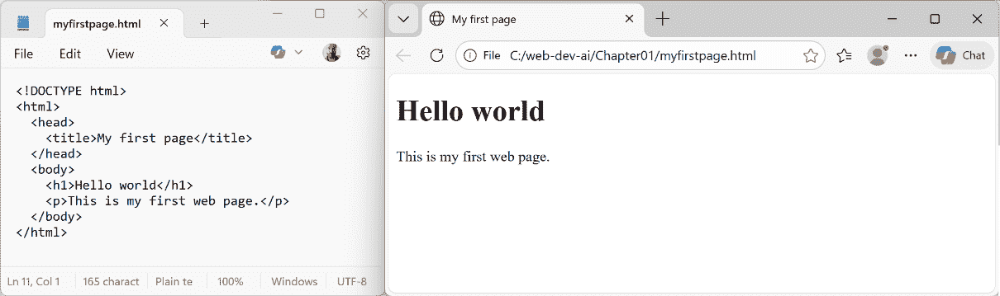
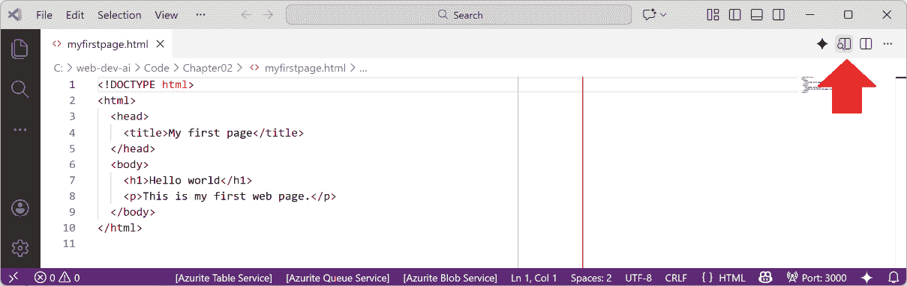
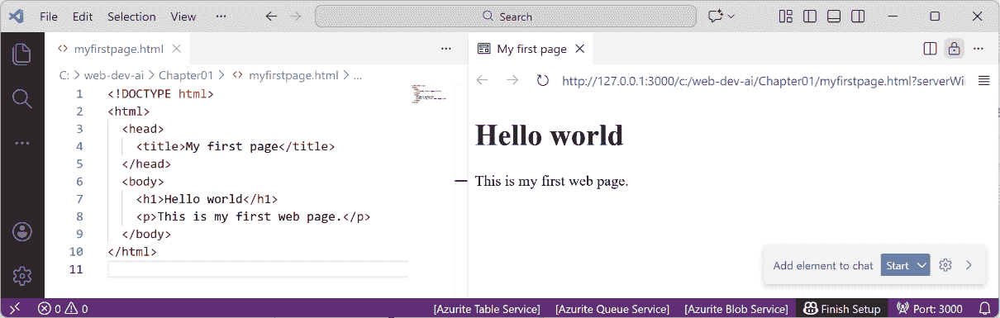
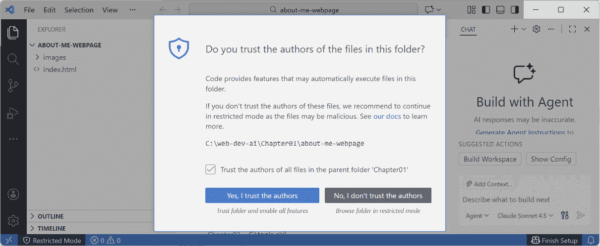
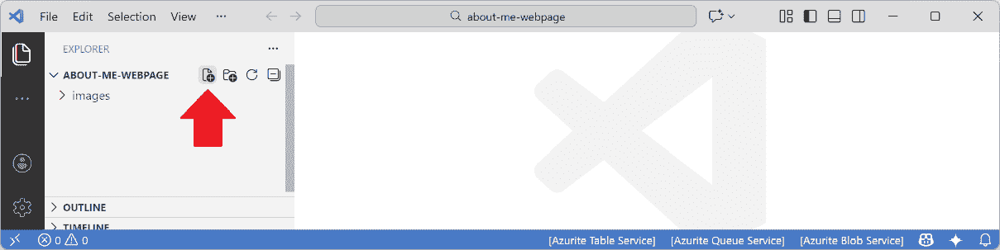
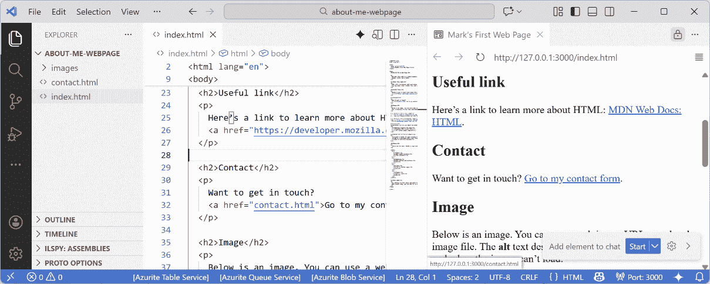
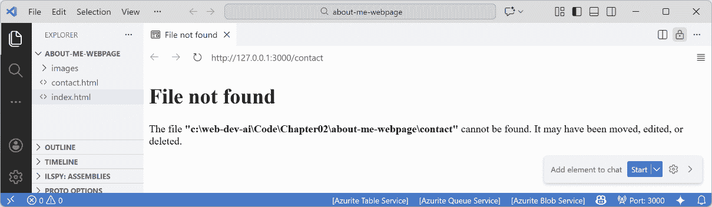

## 第 2 章：HTML —— 构建你的网页结构

本章介绍 **HTML**（**HyperText Markup Language**，超文本标记语言）的基础知识。你将学习 HTML 的核心概念，然后借助 AI 生成一个简单页面，在此过程中了解元素、标签和属性。

读完本章，你将能够阅读、编写和理解 HTML 作为网页的结构化描述，并自信地构建简单、有意义的页面，为后续内容打下坚实基础。

本章涵盖以下主题：

* 什么是 HTML？
* 构建基础网页
* 使用表单与输入
* AI 练习
* 其他标记语言

本章的建议聊天机器人提示词及示例回复见：  
<https://github.com/markjprice/web-dev-ai/blob/main/prompts/ch02-html/readme.md>

## 什么是 HTML？

HTML 代表 **HyperText Markup Language**（超文本标记语言）。听起来很吓人，但概念很简单。

HTML **不是**编程语言：

* 它不做决策
* 它不运行逻辑
* 它不计算任何东西

HTML **描述**网页上内容的结构和含义。

HTML 是页面的**结构**。它定义：

* 哪些文本是标题
* 哪些文本是段落
* 什么算作列表
* 链接指向何处
* 哪些图片属于该页面
* 表格数据如何组织

CSS 负责让页面**好看**。你将在 第 3 章 *CSS —— 为你的网页添加样式* 中学习 CSS。本章请忽略外观，专注于内容**是什么**以及**如何结构化**。

JavaScript 负责让页面**具有交互性**。本章创建的网页将是静态的。在 第 5 章 *JavaScript —— 让网页具有交互性* 中，你将编写 JavaScript 代码让它们“活”起来。

HTML 决定**事物是什么**。没有 HTML，Web 就只是一堆非结构化的文本流。

### HTML 由元素组成

HTML 通过 **标签** 形成 **元素**。标签是包裹在尖括号中的实际标记语法，例如 `<p>` 或 `</p>`，告诉浏览器如何解析内容。而元素则是包含开始标签、内容和结束标签的完整结构。

例如，`<p>Hello</p>` 是一个段落元素，由开始标签 `<p>`、文本 `Hello` 和结束标签 `</p>` 组成。标签是构建块，元素是由这些标签创建的完整结构。

大多数元素长这样：

```html
<p>This is a paragraph.</p>
```

* `<p>` 表示 **开始一个新段落**
* `</p>` 表示 **段落结束**
* 中间的所有内容都是段落的内容

在 HTML 中，**属性** 为元素提供额外信息，放在开始标签内。它们通常以键值对形式出现，如 `class="intro"` 或 `href="https://example.com"`，用于修改元素的行为或显示方式。

例如，在 `<a href="https://example.com">Visit</a>` 中，`href` 属性告诉浏览器链接指向何处。元素定义结构和含义，属性则细化或配置该元素的行为。


### HTML 基础

## 核心概念

### id 和 class 属性

HTML 中两个属性频繁出现：`id` 和 `class`。`id` 标识页面上唯一的一个元素。`class` 将一个或多个元素标记为属于同一组。稍后，CSS 和 JavaScript 将大量使用它们。目前，重要的 `id` 概念很简单：`id` 用于一个特定元素，而 `class` 可以共享。

### 空元素和容器元素

一些元素是**空元素**，如 `` 或 `<br>`，它们没有闭合标签或内部内容。其他是**容器元素**，如 `<div>` 或 `<section>`，它们包裹内容并可以在内部包含其他元素。

### div 元素

`<div>` 是一个通用的容器元素，没有固有含义。它适用于为样式分组内容，但当 `<section>`、`<nav>` 或 `<p>` 等语义元素更合适时，不应用它来替代它们。

### 元素嵌套

同样重要的是要知道元素可以嵌套，即一个元素可以位于另一个元素内部以创建层级。正确的嵌套很重要，因为不正确的结构可能导致意外的渲染或无障碍问题。

### 无障碍

**良好实践**：Web 开发中的无障碍意味着设计和构建内容，使其可被所有人使用，包括有视觉、听觉、运动或认知障碍的人。这包括使用正确的 HTML 结构、有意义的文本替代（如图像的 `alt` 属性）以及清晰的导航，以便屏幕阅读器等辅助技术能正确解析页面。

### 块级元素与内联元素

另一个关键概念是**块级元素**和**内联元素**的区别。块级元素（如 `<p>` 和 `<h1>`）通常另起一行并占据全部可用宽度，而内联元素（如 `<span>` 或 `<a>`）在文本中流动而不破坏布局。

### 语义化 HTML

现代 HTML 强调语义化元素，如 `<article>`、`<nav>` 和 `<footer>`，它们描述内容的含义而非仅仅是外观。正确使用这些元素可提高无障碍性、搜索引擎理解能力和整体代码清晰度。

你将在本章中反复用到这些概念。

> **提示**：请结合实际例子解释语义化 HTML 与非语义化 HTML 的区别，以及为什么这对无障碍很重要。

## HTML 注释

HTML 注释允许你在源代码中留下不在页面上显示的备注。它们如下所示：

```
<!-- This is a comment -->
```

注释可用于提醒、临时备注或解释教学代码中的示例。它们不是隐藏敏感信息的方式，因为任何人仍可查看页面源代码。

## 网页的基本结构

每个 HTML 页面都遵循相同的整体模式：

```
<!DOCTYPE html>
<html>
  <head>
    <title>My first page</title>
  </head>
  <body>
    <h1>Hello world</h1>
    <p>This is my first web page.</p>
  </body>
</html>
```

每个部分都有不同的作用：

* `<!DOCTYPE html>` 告诉浏览器*这是现代 HTML*，即基于标准的 HTML，具体为 HTML5。如果省略它，浏览器可能会回退到**怪异模式**，该模式模拟早期 Web 的遗留行为，以保持与非常旧的页面兼容。这可能导致布局不一致，尤其是在 CSS 方面。
* `<html>` 包裹整个文档。
* `<head>` 包含元数据，如标题、字符编码和用于应用样式的 CSS 链接。
* `<body>` 包含用户可见的所有内容。

页面上可见的任何内容都不在 `<body>` 之外。页面标题在 `<head>` 中定义，通常显示在浏览器标签页中。

> **提示**：请展示良好和不良 HTML 结构的示例，并解释是什么让其中一个更好。

## 亲自试一试！

使用你喜欢的文本编辑器创建一个名为 `myfirstpage.html` 的文件。将前面的 HTML 复制到文件中并保存。然后在你喜欢的 Web 浏览器中打开该文件。并排比较文本编辑器和浏览器中的文件，如*图 2.1* 所示：



图 2.1：使用记事本和 Windows 上的 Microsoft Edge 对比网页源代码与其视觉外观

除了纯文本编辑器和 Web 浏览器，你也可以使用 VS Code 及其 Live Preview 扩展来试运行你的工作，如*图 2.2* 和*图 2.3* 所示：



图 2.2：点击“显示预览”按钮查看网页的实时预览



图 2.3：使用 VS Code 对比网页源代码与其视觉外观

在本书的其余部分，我建议使用带有 Live Preview 的 VS Code，因为它能在你工作时提供即时反馈，且符合后续章节使用的工作流。

> **提示**：请展示一个基本网页的 HTML，包含标题、段落和列表的示例，以便我了解网页的结构，并解释所有元素。

## 标题赋予内容层级

标题定义文档结构。它们的视觉大小是样式决定。每个标题级别的字体系列和字号稍后将使用 CSS 应用，不必与级别编号匹配！

HTML 有六个标题级别：

```
<h1>Main page title</h1>
<h2>Section title</h2>
<h3>Subsection title</h3>
<h4>Sub-subsection title</h4>
<h5>Sub-sub-subsection title</h5>
<h6>Sub-sub-sub-subsection title</h6>
```

初学者关键规则：

* `<h1>` 是页面上最重要的标题
* `<h2>` 是该页面内的一个节
* `<h3>` 是 `<h2>` 内的一个小节

将标题视为页面大纲的一部分，而不是选择更大字体的方式。

搜索引擎、屏幕阅读器和无障碍工具高度依赖正确的标题结构。仅为视觉效果使用标题是最常见的初学者错误之一。

## 段落承载可读文本

普通文本属于段落：

```
<p>This is a paragraph of text.</p>
```

浏览器会自动在段落之间添加间距。

你不像在 Word 中那样反复按*回车键*。事实上，渲染 HTML 时，浏览器会忽略额外的空白字符，如回车符、制表符和空格！

HTML 关乎含义，而非布局。

## 链接连接网络

链接将页面连接成网络：

```
<a href="https://example.com">Visit Example Website</a>
```

其中：

* `<a>` 代表 *anchor*（锚点）
* `href` 是目标地址
* 标签之间的文本是用户点击的内容

链接可以指向：

* 其他网站
* 同一站点上的其他页面
* 同一页面内的章节

没有链接，HTML 页面只是孤立的文档。

## 图像添加视觉内容

图像使用 `` 元素嵌入：

```

```

注意前面代码的以下几点：

* `` 没有闭合标签
* `src` 是图像文件位置
* `alt` 用文字描述图像

`` 是一个空元素，这意味着它没有闭合标签，因为它不包裹任何其他内容，也不包含嵌套元素。你将遇到的其他空元素包括 `<br>`（换行）、`<hr>`（水平线）和用于表单的 `<input>`。虽然 `` 不需要闭合标签，但它确实需要某些属性才算结构良好且无障碍，如 `src` 和 `alt`。

`alt` 文本很重要，因为当图像无法显示时它承载含义。屏幕阅读器依赖它。搜索引擎读取它。如果图像加载失败，文本仍能传达含义。


### HTML 基础

## 简介

HTML 将图像视为内容，而非装饰。装饰性图像（如在列表中使用表情符号作为自定义项目符号）通常由 CSS 处理。

**提示：** 请展示如何为图像、链接和表单编写无障碍 HTML。

## 列表对相关项目进行分组

HTML 支持两种主要的列表类型。

**无序列表** 使用 `<ul>` 标签：

```
<ul>
  <li>牛奶</li>
  <li>面包</li>
  <li>鸡蛋</li>
</ul>
```

这表示一个顺序不重要的列表。

**有序列表** 使用 `<ol>` 标签：

```
<ol>
  <li>预热烤箱</li>
  <li>混合配料</li>
  <li>烘烤 30 分钟</li>
</ol>
```

这表示 *按特定顺序排列的步骤*。

每个 **列表项** 位于 `<li>` 内部。

## 表格用于构建数据结构，而非布局

表格用于数据，而非页面布局：

```
<table>
  <tr>
    <th>姓名</th>
    <th>年龄</th>
  </tr>
  <tr>
    <td>Alex</td>
    <td>32</td>
  </tr>
</table>
```

概念上：

- `<table>` 包裹数据
- `<tr>` 是 **表格行**
- `<th>` 是 **表头** 单元格
- `<td>` 是 **表格数据** 单元格

表格最适合展示：

- 价格
- 时间表
- 统计数据
- 对比

使用表格定位内容以实现布局是过时的做法，且会导致无障碍问题。

## HTML 元素相互嵌套

HTML 元素形成树形结构。

示例：

```
<body>
  <section>
    <h2>关于我</h2>
    <p>我写书。</p>
  </section>
</body>
```

此处：

- `<section>` 位于 `<body>` 内部
- `<h2>` 和 `<p>` 位于 `<section>` 内部

这种嵌套关系是浏览器理解内容间关系的方式。

**提示：** 请给出错误嵌套 HTML 的示例并解释它们为何会导致问题。

## 使用 `<div>` 作为通用容器

有时你需要将多个内容片段组合在一起，而不赋予它们特定的语义。这正是 `<div>` 元素的用途。

`<div>` 是一个通用的块级容器。它不会告诉浏览器或屏幕阅读器内容的含义。它只是将内容组合在一起。

例如：

```
<div>
  <h2>关于本书</h2>
  <p>本书教你如何与 AI 协作学习 Web 开发。</p>
</div>
```

当你想稍后使用 CSS 或 JavaScript 对一组元素进行样式设置或脚本编写时，这很有用。

但当语义元素更合适时，`<div>` 不应是你的首选。如果内容是页面的一个区域，请使用 `<section>`。如果是导航，请使用 `<nav>`。如果是段落，请使用 `<p>`。如果是页面页脚，请使用 `<footer>`。

一个好的初学者原则是：当你需要容器时使用 `<div>`，而不是当你需要语义时。一个充满 `<div>` 元素的页面仍然可以工作，但它向人类和工具传达的内容结构信息要少得多。语义元素使你的 HTML 更易读、更易维护，且更无障碍。

**提示：** 请展示三个适合使用 `<div>` 的示例和三个语义元素更合适的示例。

## HTML 描述含义，而非外观

对初学者来说，这种区别使 Web 技术栈的其余部分更易理解。

HTML 回答诸如以下的问题：

- 这是标题吗？
- 这是段落吗？
- 这是导航吗？
- 这是项目列表吗？
- 这是表格数据吗？

HTML 不回答：

- 这应该是蓝色的吗？
- 这应该居中吗？
- 这应该有动画吗？

这种分离是刻意的。它使 Web 保持灵活、无障碍且设备无关。

**良好实践：** 不要试图记住每个 HTML 标签。首先询问每个内容片段是什么。是主标题？段落？导航链接？步骤列表？数据表格？一旦你能回答这些问题，标签选择就会变得更容易，AI 生成的 HTML 也更易于审查。

**提示：** 什么是 ARIA 属性，初学者何时应该关注它们？

## 良好结构带来的优势

当 HTML 编写正确时：

- 浏览器可以在任何屏幕尺寸上正确显示它
- 搜索引擎理解内容
- 屏幕阅读器可以浏览页面
- CSS 和 JavaScript 稍后更容易应用

页面在浏览器中看起来可能正常，但仍可能结构不良或无障碍性差。

结构良好的 HTML 更易维护。糟糕的 HTML 几乎立即就会造成维护问题。

**提示：** 搜索引擎如何利用 HTML 结构来理解页面？

## HTML DOM（文档对象模型）

HTML **DOM**（**文档对象模型**）是浏览器在加载 HTML 页面后在内部表示该页面的方式。浏览器不会将你的页面视为纯文本，而是将其转换为它可以理解、操作和渲染的对象树。

让我们通过一个简单的 HTML 示例来看看它是如何工作的：

```
<!DOCTYPE html>
<html>
  <head>
    <title>My Page</title>
  </head>
  <body>
    <h1>Hello</h1>
    <p>This is a paragraph.</p>
  </body>
</html>
```

当浏览器读取前面的代码时，它不会将其作为原始文本保留。它解析 HTML 并构建树形结构，其中每个元素成为一个节点：

```
Document
 └── html
      ├── head
      │    └── title
      │         └── "My Page"
      └── body
           ├── h1
           │    └── "Hello"
           └── p
                └── "This is a paragraph."
```

以下是理解此结构的方式：

- `Document` 是所有内容的根节点
- 每个 HTML 元素成为树中的一个节点
- 元素可以有子节点（如 `<body>` 包含 `<h1>` 和 `<p>`）
- 元素内的文本也成为节点

此结构反映了你在 HTML 中编写的嵌套关系。如果你错误地嵌套元素，DOM 也会不正确，这可能导致令人困惑的行为。

浏览器实际执行的操作（分步）：

1. 下载 HTML 文件
2. 从上到下读取文件
3. 解析每个标签并创建节点
4. 在内存中构建 DOM 树
5. 使用该树渲染页面

DOM 不仅用于显示。CSS 使用 DOM 确定样式对象，JavaScript 使用 DOM 在页面初始渲染后动态读取和更改页面。例如，JavaScript 可以执行以下操作：

- 更改 `<h1>` 内的文本
- 添加新元素
- 移除元素
- 响应用户操作

HTML 是源文档。DOM 是浏览器基于该文档构建的实时树。页面加载后，浏览器使用的是 DOM，而不是你的原始 HTML 文件。DOM 是浏览器将你的 HTML 表示为对象树的内部表现形式。如果你的 HTML 结构清晰且合乎逻辑，DOM 将易于操作。这就是为什么对结构的逻辑思考比单纯的打字速度更重要。

## 初学者核心收获

如果你只记住本章的一点内容，那应该是：

HTML 关注内容是什么，而不是内容长什么样。

一旦理解了这一区别，HTML、CSS 和 JavaScript 作为独立工具就更讲得通了。

**提示：** 请展示 10 个常见的初学者 HTML 错误及其修复方法。

理论够了，让我们做些实用的东西，构建一个更完整的网页。

### 构建基础网页

在本节中，你将制作一个微小的 *关于我* 页面，然后观察它在你编辑时即时更新。

## 在 VS Code 中构建网页并实时预览

创建项目文件夹：

1. 在电脑上创建一个名为 `about-me-webpage` 的新文件夹
2. 在其中创建另一个名为 `images` 的文件夹

你的文件夹结构将如下所示：

```
about-me-webpage/
  images/
```

在 VS Code 中打开 `about-me-webpage` 文件夹：


# 创建“关于我”网页

###### 步骤

1. 打开 VS Code。

2. 选择 **File** | **Open Folder...**

3. 选择 `about-me-webpage` 文件夹。

    > 打开文件夹（而非单个文件）很重要，因为当 VS Code 知道项目根目录时，实时预览工具的表现会更好。

4. 如果看到关于信任此文件夹中文件作者的警告，请勾选复选框并点击 **Yes, I trust the authors** 按钮，如图 2.4 所示：

    

    **图 2.4：** 在 VS Code 中信任此文件夹中的文件作者

5. 在 VS Code 资源管理器（左侧）中，点击 **New File**，并将其命名为 `index.html`，如图 2.5 所示：

    

    **图 2.5：** VS Code 资源管理器及其 New File 按钮

6. 将以下 HTML 添加到空文件中（此示例包含您所学的所有内容，重要元素已高亮显示）。粘贴到 `index.html` 中：

    此 HTML 文件可从以下链接获取：[`github.com/markjprice/web-dev-ai/blob/main/Code/Chapter02/about-me-webpage/index.html`](https://github.com/markjprice/web-dev-ai/blob/main/Code/Chapter02/about-me-webpage/index.html)

    ```html
    <!DOCTYPE html>
    <html lang="en">
      <head>
        <meta charset="utf-8">
        <meta name="viewport" 
              content="width=device-width, initial-scale=1.0">
        <title>Mark's First Web Page</title>
      </head>
      <body>
        <h1>Mark's First Web Page</h1>
        <p>
          Welcome! This page is a simple example of HTML structure: headings, paragraphs, links, images, lists, and a table.
        </p>
        <h2>About this page</h2>
        <p>
          HTML tells the browser what each piece of content <em>is</em>.
          Styling comes later (that's CSS), and interactivity comes later (that's JavaScript).
        </p>
        <h2>Useful link</h2>
        <p>
          Here's a link to learn more about HTML:
          <a href="https://developer.mozilla.org/en-US/docs/Web/HTML">MDN Web Docs: HTML</a>.
        </p>
        <h2>Image</h2>
        <p>
          Below is an image. You can use a web image URL, or a local image file.
          The <strong>alt</strong> text describes the image for screen readers and when the image can't load.
        </p>
        <!-- Option A: Use a local image -->
        <!-- Save an image as images/profile.jpg and use this: -->
        <!--  -->
        <!-- Option B: Use a placeholder image from the web -->
        
        <h2>Lists</h2>
        <p>Unordered list (a list where the order doesn't matter):</p>
        <ul>
          <li>Headings organize the page</li>
          <li>Paragraphs hold normal text</li>
          <li>Links connect pages together</li>
        </ul>
        <p>Ordered list (a list of steps):</p>
        <ol>
          <li>Create a folder for your project</li>
          <li>Add an <code>index.html</code> file</li>
          <li>Open it with Live Preview</li>
        </ol>
        <h2>Table</h2>
        <p>
          Tables are for data. Here's a tiny "learning plan" table:
        </p>
        <table>
          <thead>
            <tr>
              <th>Topic</th>
              <th>What you'll practice</th>
              <th>Time (minutes)</th>
            </tr>
          </thead>
          <tbody>
            <tr>
              <td>Headings</td>
              <td>Page outline and sections</td>
              <td>10</td>
            </tr>
            <tr>
              <td>Links</td>
              <td>Link to another page</td>
              <td>10</td>
            </tr>
            <tr>
              <td>Images</td>
              <td>Add alt text</td>
              <td>10</td>
            </tr>
          </tbody>
        </table>
        <h2>Next idea</h2>
        <p>
          Try editing the text above and watch the preview update instantly.
          When you're ready, you can add CSS to make it look nicer.
        </p>
      </body>
    </html>
    ```

## 代码说明

请注意前面代码中的以下内容：

- 文档结构：`<!DOCTYPE html>`、`<html>`、`<head>`、`<title>`、`<body>`
- 标题：`<h1>`、`<h2>`
- 段落：`<p>`
- 链接：`<a href="...">`
- 图片：``

如果看到损坏的图片图标而不是图片，可能是因为外部图片服务暂时不可用。您的 HTML 仍然是正确的。尝试切换到选项 A，通过将任意图片保存到正确的路径和文件名 `images/profile.jpg` 并取消注释本地 `` 元素来使用本地图片文件。

- 列表：`<ul>` + `<li>`，以及 `<ol>` + `<li>`
- 表格：`<table>`、`<thead>`、`<tbody>`、`<tr>`、`<th>`、`<td>`

**最佳实践**：视口 `meta` 标签被视为任何 HTML 文档的标准组成部分，对于页面在移动设备上正确渲染至关重要。没有它，移动浏览器将按桌面宽度视口渲染页面然后缩小，导致文本难以阅读。表格应分为标题行（一个带有 `<tr>` 元素和嵌套 `<th>` 表头单元格元素的 `<thead>`）和数据行（一个带有一个或多个 `<tr>` 元素和嵌套 `<td>` 数据单元格元素的 `<tbody>`）。

# 为网页生成位图图像

到目前为止，您一直在使用已存在的图片文件。在实际项目中，您通常需要在拥有设计师、照片库或最终素材之前就需要图片。

图像生成工具为此目的非常有用，特别是作为占位符。诸如 Google 的 Nano Banana 和 ChatGPT Images 等工具可以从文本描述生成位图图像。您可以使用它们来创建：

- 构建布局时的占位图片
- 登录页面的 Hero 图片
- 博客文章或产品页面的插图
- 简单的图标或视觉点缀

这使您在最终美术素材存在之前就有东西可以围绕其进行设计。

2026 年 4 月 21 日，OpenAI 宣布了 ChatGPT Images 2.0，带来了许多改进：[`openai.com/index/introducing-chatgpt-images-2-0/`](https://openai.com/index/introducing-chatgpt-images-2-0/)

这些工具生成的图像通常是位图图像，意味着它们由像素组成。

常见的位图格式包括：

- JPEG 适合照片
- PNG 适合透明度和锐利边缘
- WebP 是一种压缩效果好的格式

构建页面布局时，您通常只需要一些看起来合理的东西。

例如，您可能会用以下提示词提示图像生成器：

```
Please create a simple hero image with a soft blue gradient background, abstract shapes, clean and minimal, suitable for a tech website.
```

结果不需要完美。它只需要填充空间，给页面视觉结构，并帮助您思考布局和间距。这比留下空白空间或使用损坏的图片链接要好得多。

Hero 图片是页面顶部的大型视觉元素。它为后面的所有内容设定基调。

例如，对于一个调查应用登录页面，您可能会生成类似这样的内容：

```
Please create a web app hero image showing a dashboard with charts and polls, clean UI, light background, friendly colors, no text.
```

Hero 图片的一些实用技巧：

- 避免在图片本身中放置重要文本；改用真正的 HTML 文本
- 保持构图简单，以便在不同屏幕尺寸下工作
- Hero 部分首选宽幅、横向图片

生成的图片很有用，但请记住，生成的图片有时可能包含视觉伪影或奇怪的细节。使用前请仔细检查。

位图图片并不总是最佳选择。对于图表、图标以及任何需要干净缩放或动画的内容，矢量图形通常更好。


在*第 4 章*、*绘制可缩放图形*中，您将了解 SVG，它比位图更适合用于图表、图标、动画以及随数据变化的动态图形。在本书的调查项目中，SVG 对于渲染图表和可视化结果将特别有用。

使用生成的图像来支持页面，而不是分散注意力。有用的图像应符合页面的内容、布局和目的。

## 尝试这些快速编辑以证明它是实时的

当预览打开时：

* 将 `<h1>` 和 `<title>` 文本更改为其他内容
* 添加新列表项：`<li>I can preview changes instantly</li>`
* 通过将时间值从 10 改为 15 来编辑表格

您已创建一个基本网页并使用了许多不同的 HTML 元素。您可以创建一个包含只读内容的完整网站，但它将是静态的。使网站具有交互性的最常见方法之一是提供表单供访问者填写并提交。这些可以是用于验证访问者的登录表单，或用于创建或编辑数据的表单。

让我们看看如何创建包含表单和各种输入元素的网页。

### 使用表单和输入元素

到目前为止，您的页面一直是*只读*的。表单是用户在页面中输入信息并将其发送到某处的方式，例如联系表单、登录屏幕、新闻通讯注册、结账等。

其核心是 `<form>` 元素，它包裹您的输入控件（文本框、下拉菜单、按钮）并定义浏览器应如何提交数据。

在本节中，您将：

1. 创建一个名为 `contact.html` 的新页面，包含联系表单
2. 从您的 `index.html` **About Me** 页面链接到它

## 创建 contact.html

在 VS Code 中，在与 `index.html` 相同的文件夹中创建一个新文件：`contact.html`。

粘贴以下内容：

此 HTML 文件可从以下链接获取：[`github.com/markjprice/web-dev-ai/blob/main/Code/Chapter02/about-me-webpage/contact.html`](https://github.com/markjprice/web-dev-ai/blob/main/Code/Chapter02/about-me-webpage/contact.html)

```
<!DOCTYPE html>
<html lang="en">
  <head>
    <meta charset="utf-8">
    <title>Contact Me</title>
  </head>
  <body>
    <h1>Contact Me</h1>
    <p>
      Use this form to send me a message. For now, it doesn't actually send email.
      It demonstrates how forms collect data and submit it to a server.
    </p>
    <form action="/contact" method="post">
      <h2>Your details</h2>
      <p>
        <label for="fullName">Full name</label><br>
        <input type="text" id="fullName" name="fullName" required>
      </p>
      <p>
        <label for="email">Email address</label><br>
        <input type="email" id="email" name="email" required>
      </p>
      <p>
        <label for="phone">Phone (optional)</label><br>
        <input type="tel" id="phone" name="phone">
      </p>
      <h2>Your message</h2>
      <p>
        <label for="topic">Topic</label><br>
        <select id="topic" name="topic">
          <option value="question">Question</option>
          <option value="feedback">Feedback</option>
          <option value="business">Business inquiry</option>
        </select>
      </p>
      <p>
        <label for="message">Message</label><br>
        <textarea id="message" name="message" rows="6" cols="40" required></textarea>
      </p>
      <h2>Preferences</h2>
      <p>
        Preferred contact method:
        <br>
        <input type="radio" id="contactEmail" name="preferredContact" value="email" checked>
        <label for="contactEmail">Email</label>
        <br>
        <input type="radio" id="contactPhone" name="preferredContact" value="phone">
        <label for="contactPhone">Phone</label>
      </p>
      <p>
        <input type="checkbox" id="newsletter" name="newsletter" value="yes">
        <label for="newsletter">Send me occasional updates</label>
      </p>
      <p>
        <button type="submit">Send message</button>
        <button type="reset">Clear form</button>
      </p>
    </form>
    <p>
      <a href="index.html">Back to About Me</a>
    </p>
  </body>
</html>
```

有几点需要注意：

* `<form>` 具有 `action="/contact"` 和 `method="post"`
  * `action` 是浏览器发送表单数据的 URL
  * `method="post"` 在请求体中发送数据；`get`（默认）将数据附加到 `?` 后的 URL
* 每个应提交的控件都有一个 `name="..."`。如果您忘记 name，该值将不会包含在提交的数据中。
* 每个文本字段都使用 `<label for="...">` 进行标记，该标记与输入框的 `id` 匹配。这提高了可用性和可访问性。

## 从 index.html 链接到联系表单

打开您现有的 `index.html` 并在合适的地方添加链接，例如在 `Useful link` 部分下方或靠近底部。

例如：

```
<h2>Contact</h2>
<p>
  Want to get in touch?
  <a href="contact.html">Go to my contact form</a>.
</p>
```

因为 `contact.html` 与 `index.html` 在同一文件夹中，所以简单的**相对链接**（如仅 HTML 文件名）即可工作。或者，您可以使用完整 URL 指定**绝对链接**：`https://example.com/contact.html`。

绝对链接是资源（如网页）的完整地址，无论当前页面位置如何均可工作。相对链接是基于当前页面位置的较短地址。如果我在阿拉斯加，想给苏格兰的人寄信，我需要使用他们的完整（即绝对）地址。如果我想给我街上的人寄信，我可以交给邻居，让他们转交给“23 号的 Bob”。这是相对于同一街道上另一个地址的地址。要寄给同城市的人，我们可能还需要街道名。要寄给同州的人，我们还需要城市名。网页等资源有一个绝对地址，但根据您距离其位置的远近，有许多相对地址。

## 在实时预览中尝试

现在我们可以在实时预览中看到结果：

1. 打开 `index.html` 并启动 `Live Preview`，如*图 2.6*所示：

图 2.6：联系表单链接的实时预览

1. 点击**转到我的联系表单**链接
2. 填写表单并点击**发送消息**

您现在可能会看到：

* 如果您留空必填字段，浏览器将阻止提交并提示您。（这是 HTML 的内置验证。）
* 如果确实提交了，您可能会收到 `Cannot POST /contact` 样式的消息、 `404` 或某些 `not found` 响应，如*图 2.7*所示：

图 2.7：没有服务器处理表单时出现的文件未找到消息

出现此错误是因为您的浏览器尝试将表单数据发送到 `/contact` 服务器，但目前尚无服务器运行来接收它。这在此时是预期的，因为您仅构建了 HTML 页面，而非处理表单的服务器。

您刚刚触及了前端（HTML）和后端（服务器代码）Web 开发的界限。您将在*第 9 章*、*Django – 后端 Web 开发*中学习如何处理表单提交。

## 常见表单元素快速实用表

学习时可随身携带的速查表如*表 2.1*所示：

| **元素** || **示例** || **用途** |
| --- | --- | --- |


| 标签 | 示例 | 说明 |
|------|------|------|
| `<form>` | `<form action="/contact" method="post">` | 包裹输入控件并定义数据提交的位置和方式。`action` 和 `method` 控制提交行为。 |
| `<label>` | `<label for="email">Email</label>` | 为表单控件提供可读标签。最佳实践是将 `for` 与输入框的 `id` 匹配。 |
| `<input type="text">` | `<input type="text" name="fullName">` | 单行文本输入。包含 `name` 以便提交。 |
| `<input type="email">` | `<input type="email" name="email">` | 邮箱格式输入，许多浏览器提供基础验证。 |
| `<input type="tel">` | `<input type="tel" name="phone">` | 电话号码输入（移动端常显示电话键盘）。 |
| `<textarea>` | `<textarea name="message"></textarea>` | 多行文本输入（适合留言）。 |
| `<select> + <option>` | `<select><option value="...">...</option>...</select>` | 下拉选项列表。每个选项包含文本和可选的 `value`。 |
| `<input type="radio">` | `<input type="radio" name="preferredContact" value="email">` | 从一组中选择一项。通过共享相同的 `name` 进行分组。 |
| `<input type="checkbox">` | `<input type="checkbox" name="newsletter" value="yes">` | 开/关选项（选中或未选中）。 |
| `<button type="submit">` | `<button type="submit">Send</button>` | 提交表单。 |
| `<button type="reset">` | `<button type="reset">Clear</button>` | 将字段重置为初始值。 |

**表 2.1：常见表单元素**

你会看到更多输入类型，但如果初学者熟悉这组元素，就能构建大多数基础表单。

## “向 Web 服务器回发”意味着什么

当用户点击 `Send` 按钮时，浏览器会获取所有带有 `name` 属性的表单控件，并将它们作为 HTTP 请求发送到 `action` 指定的 URL。

提交数据有两种常见方式：

*   `GET`（默认）：表单数据追加在 URL 的 `?` 之后。适合搜索和筛选，方便分享链接。
*   `POST`：表单数据在请求体中发送。常用于联系表单、登录或任何改变服务器状态的操作，如编辑客户或订单数据的表单。

在服务端（稍后你将使用 Django 实现），Web 应用会：

1.  在类似 `/contact` 的路径接收请求
2.  读取提交的字段（名称/值对）
3.  验证它们（真正的验证，而非仅浏览器验证）
4.  做有用的事：
    *   存入数据库
    *   发送邮件
    *   创建支持工单
5.  返回响应页面（如 `Thanks, message received!`）

此阶段你仅构建 HTML 用户界面。服务端处理稍后介绍。

**提示**：请展示浏览器提交表单数据时的样子，包括 `GET` 和 `POST` 的区别，并给出真实的 HTTP 示例。

让我们利用 AI 教练探索 HTML 历史，然后通过测验和构建更多网页来练习所学。

### AI 练习

现在让我们使用你喜欢的聊天机器人深入学习 HTML，先了解 HTML 历史，再测验 HTML 语法。

## HTML 历史

HTML 经历了多个版本，当前版本是 HTML5。让我们了解一下 HTML 的历史：

**提示**：请展示 HTML 版本及其发布时间的表格。然后描述 HTML5 并列出它引入的新标签及其用途。

## HTML 章节测验

尽量不回看章节内容回答以下问题。

此测验检查你是否理解 HTML 的用途，而非能否凭记忆敲出标签。

答案在 *附录 A* 中，可从本书的 GitHub 仓库下载：[`github.com/markjprice/web-dev-ai/blob/main/docs/Appendix-A.pdf`](https://github.com/markjprice/web-dev-ai/blob/main/docs/Appendix-A.pdf)

### 第 1 部分：单选题

**1. HTML 的主要目的是什么？**

A. 控制网页外观  
B. 添加动画和交互  
C. 描述网页内容的结构和含义  
D. 在服务端处理数据

**2. 页面最重要的标题应使用哪个标签？**

A. `<h6>`  
B. `<heading>`  
C. `<title>`  
D. `<h1>`

**3. 哪个元素创建指向其他页面的可点击链接？**

A. `<link>`  
B. `<a>`  
C. `<href>`  
D. `<url>`

**4. 图片 `alt` 属性的用途是什么？**

A. 改变图片大小  
B. 在图片下添加标题  
C. 用文本描述图片  
D. 将图片链接到其他页面

**5. 哪个 HTML 元素最适合显示价格或日程等表格数据？**

A. `<div>`  
B. `<section>`  
C. `<table>`  
D. `<list>`

### 第 2 部分：判断题

**6. HTML 决定文本大小和页面显示颜色。**

**7. HTML 页面可以在没有 `<body>` 元素的情况下工作。**

**8. 每个应提交的表单输入必须有 `name` 属性。**

**9. 单选按钮用于用户可选择多个选项的情况。**

### 第 3 部分：找出错误

**10. 这段 HTML 有什么问题？**

```

```

**11. 这个标题结构有什么问题？**

```
<h1>My Website</h1>
<h4>About Me</h4>
```

**12. 这个表单输入有什么问题？**

```
<input type="text" id="username">
```

### 第 4 部分：简答题

**13. 用自己的话解释 HTML 和 CSS 的区别。**

**14. `<form>` 元素的作用是什么？**

**15. 当表单使用 `method="post"` 提交时会发生什么？**

### 第 5 部分：实践思考（无需代码）

**16. 你会为以下每项使用哪些 HTML 元素？**

a) 页面标题  
b) 一段文本  
c) 导航链接  
d) 食谱步骤列表  
e) 联系留言框

### 自我评分指南

**14–16 正确**：你真正理解了 HTML 结构。继续前进。  
**10–13 正确**：理解扎实，但再浏览一遍章节。  
**10 以下**：慢读。专注于含义而非语法，HTML 自然会通顺。

## 创建自定义测验

**提示**：请测验我关于 HTML5 引入的新标签。重点考察概念理解而非精确语法记忆。

## 迷你挑战：构建“研讨会报名”网站

你正在为一个名为 *Web 开发入门* 的一天研讨会创建小型网站。网站包含两页：

*   **研讨会信息** 页：介绍活动
*   **报名** 页：用户登记兴趣

仅允许使用 HTML。无 CSS，无 JavaScript。专注于结构和语义。

### 第 1 页：workshop.html（研讨会信息）

创建名为 `workshop.html` 的文件，包含文档结构：

*   `<!DOCTYPE html>`
*   `<html>`、`<head>`、`<body>`
*   与页面用途匹配的 `<title>`

页面内容要求：

*   主标题：使用一个 `<h1>` 显示研讨会标题。
*   简介段落：用纯文本描述研讨会内容。
*   图片：添加研讨会横幅图片。包含有意义的 alt 文本。可使用占位图片 URL。
*   日程部分：使用 `<h2>` 标题。


### 研讨会挑战

## 第 1 页：workshop.html

创建一个名为 `workshop.html` 的文件，其中包含：

*   一个研讨会会话的有序列表（至少四项）。
*   **您将学到的内容** 部分：使用 `<h2>` 标题。包含一个技能或主题的无序列表。
*   **日程安排** 表格：使用 `<h2>` 标题。包含一个 `<table>`，列为：时间、主题、形式（讲座、实操、休息）。
*   添加一个指向报名页面的链接：`<a href="signup.html">报名参加研讨会</a>`。

## 第 2 页：signup.html（研讨会报名）

创建一个名为 `signup.html` 的文件，包含文档结构：

*   正确的 `<head>` 和 `<body>`
*   清晰的页面 `<title>`

表单的要求如下：

*   您的页面必须包含一个带有 `method="post"` 和真实的 `action` 值（例如 `/signup`）的 `<form>` 元素。
*   在表单内，包含：
    *   个人详细信息，如全名（文本输入，必填）和电子邮件地址（邮箱输入，必填）。
    *   经验水平作为一组单选按钮：初级、有一定经验、高级。（所有单选按钮必须共享相同的 `name` 以形成一组。）
    *   至少三个复选框的感兴趣主题（例如 HTML、CSS、Python、JavaScript）。
    *   用于评论或问题的 `<textarea>` 作为附加说明。
    *   提交按钮。
*   导航，包含一个返回 `workshop.html` 的链接。

## 挑战规则

*   每个应被提交的输入框必须有 `name` 属性。
*   每个表单控件必须有 `<label>` 元素。
*   标题必须遵循逻辑顺序。
*   表格仅用于数据。
*   不要使用 `<div>` 来替代您已学过的有语义的元素。

如果您想更进一步：

*   为合适的输入框添加 `required` 属性。
*   为 **您是如何得知本研讨会的？** 添加一个 `<select>` 下拉菜单。
*   为文本输入框添加占位符文本。

尝试在 `Live Preview` 中提交表单并观察发生了什么。

如果满足以下条件，即表示您已成功完成挑战：

*   两个页面均可在 `Live Preview` 中正确打开。
*   从 `workshop.html` 到 `signup.html` 的链接有效。
*   表单强制要求必填字段。
*   提交表单会产生浏览器响应（即使报错）。

本迷你挑战的解决方案可在本书的 GitHub 仓库中找到，链接如下：[`github.com/markjprice/web-dev-ai/blob/main/code/chapter02/workshop-challenge/`](https://github.com/markjprice/web-dev-ai/blob/main/code/chapter02/workshop-challenge/)

## 本挑战考察的内容

本练习证明您理解：

*   HTML 定义结构，而非样式。
*   页面通过链接连接。
*   表单收集并提交数据。
*   表格传达结构化信息。

虽然 HTML 专注于网页内容，但它只是几种标记语言中的一种，了解 XML 和 SVG 等相关技术有助于全面理解结构化数据和图形如何在网络上表示。接下来让我们学习这些语言。

### 其他标记语言

HTML 是与 Web 联系最紧密的标记语言，但它属于一个更广泛的语言家族，这些语言使用标签来描述内容。了解这个家族将帮助您认识到 HTML 并非随意或神奇的产物。它是从更长的历史中演变出的一个实用解决方案。

## “标记语言”的含义

**标记语言** 是一种向文本添加注释的系统，以便计算机能够理解该文本不同部分的含义。换句话说，标记回答了诸如以下的问题：

*   这段文本是标题还是段落？
*   这是列表项还是表格单元格？
*   此内容是数据、结构还是元数据？

标记语言不执行逻辑。它们描述结构和含义。这使得 `HTML` 与 `XAML` 和 `SVG` 等语言处于同一概念范畴。

`HTML` 是一种领域特定的标记语言，专为一项工作而设计：描述旨在 Web 浏览器中查看的文档。

`HTML` 故意设计得宽容。即使标记不完美，浏览器也会极力尝试显示合理的内容。这一设计选择是 Web 迅速普及的原因之一。

**XML**（**可扩展标记语言**）出现得较晚，采取了不同的方法。`HTML` 是有主见且宽容的，而 `XML` 对语法严格、可扩展（您可自定义标签），且专注于数据而非表现。

以下代码展示了一个 `XML` 示例：

```
<book>
  <title>Python Programming</title>
  <author>Mark</author>
  <pages>320</pages>
</book>
```

`XML` 和 `HTML` 之间有一些关键区别：

*   每个标签必须关闭，要么使用结束标签（`<book>...</book>`），要么作为自闭合标签（`<br />`），因为与允许未关闭空元素的 `HTML5` 不同，`XML` 不允许它们存在。
*   标签必须正确嵌套。
*   没有预定义的标签集。
*   `XML` 不定义事物应如何显示。

`XML` 通常用于配置文件、数据交换、文档格式和 API（尤其是历史上）。

**提示**：请解释为什么 HTML 宽容但 XML 严格，并举例说明。

## SVG：用于图形的标记

**SVG**（**可缩放矢量图形**）是另一种标记语言，但用于图形而非文档。`SVG` 使用标签来描述形状、路径、文本和变换，如以下代码所示：

```
<svg width="100" height="100">
  <circle cx="50" cy="50" r="40" />
</svg>
```

关于 `SVG` 有几个重要的理解点：

*   它基于 `XML`。
*   它描述*图形是什么*，而非如何绘制像素。
*   它在任何分辨率下都能清晰缩放。

`SVG` 可以直接嵌入 `HTML` 文档中，这就是为什么学习 `HTML` 结构会让以后理解 `SVG` 变得更容易。您将在 *第 4 章* *SVG – 绘制可缩放图形* 中学习 `SVG`。

## 标记语言简史

HTML 并非第一种标记语言：

1.  基于 **标准通用标记语言** (**SGML**) 的早期文档系统，在 Web 出现很久以前就启发了结构化标记。它是大多数标记语言（包括 `HTML`、`XML` 及其衍生语言）的鼻祖。`SGML` 是一种元语言，而非日常意义上的标记语言。这意味着 `SGML` 不定义一组固定的标签。相反，它定义了创建您自己的标记语言的规则。
2.  `HTML` 被创建用于描述带有链接的科学文档。随着浏览器变得更强大，并成为商业和工业的重要工具，`HTML` 增加了功能。`HTML` 是一种 `SGML` 应用。
3.  `XML` 应运而生，旨在提供一种严格的、通用的标记格式。`XML` 是 `SGML` 的简化后代。
4.  `SVG` 应运而生，旨在以分辨率无关的方式描述图形。`SVG` 通过 `XML` 继承了 `SGML` 的思想。
5.  **XAML**（**可扩展应用程序标记语言**）是由 Microsoft 创建的标记语言，用于定义桌面和跨平台应用程序中的用户界面，而非网页。`XAML` 最常与 **WPF** (**Windows Presentation Foundation**)、`WinUI`、`.NET MAUI` 和 `Avalonia` 一起使用。

它们不是竞争对手。它们是同一个理念的变体：带有含义的结构化标记，应用于不同的领域。

**提示**：XHTML 在标记语言历史中处于什么位置？

## 为什么初学者应该关心

`HTML` 之所以独特，并非因为它使用标签。它独特是因为它使用标记来描述面向 Web 的文档。其他标记语言服务于其他工作。

`HTML` 只是恰好成为将 Web 连接在一起的那一个。

`SGML` 不是供您学习使用的东西。它是供您了解的东西。它是标记语言家族树的根源。一旦您知道它的来历，其他一切就更讲得通了。


### 参考资料与资源

让我们回顾一下官方 HTML 文档和参考资料。

## MDN Web 文档（初学者应从此处开始）

MDN Web 文档是互联网上最好的 HTML 文档，适合学习和日常参考。它由 Mozilla 维护，浏览器厂商和 Web 社区共同贡献。

* 主页：[`developer.mozilla.org/`](https://developer.mozilla.org/)
* HTML 概览：[`developer.mozilla.org/en-US/docs/Web/HTML`](https://developer.mozilla.org/en-US/docs/Web/HTML)
* HTML 元素参考：[`developer.mozilla.org/en-US/docs/Web/HTML/Element`](https://developer.mozilla.org/en-US/docs/Web/HTML/Element)
* 表单和输入元素：[`developer.mozilla.org/en-US/docs/Learn/Forms`](https://developer.mozilla.org/en-US/docs/Learn/Forms)、[`developer.mozilla.org/en-US/docs/Web/HTML/Element/form`](https://developer.mozilla.org/en-US/docs/Web/HTML/Element/form) 和 [`developer.mozilla.org/en-US/docs/Web/HTML/Element/input`](https://developer.mozilla.org/en-US/docs/Web/HTML/Element/input)

MDN 之所以出色，是因为它是为人类而非律师编写的，示例简单明了，且解释了“为什么”而不仅仅是“是什么”。它与真实的浏览器行为保持同步。

**最佳实践**：如果初学者在学习 HTML 时只使用一个文档网站，那应该是 MDN。

## W3C HTML 规范（官方但不适合初学者）

**万维网联盟**（**W3C**）发布官方 HTML 规范。这是 HTML 在标准层面如何工作的正式定义。

* HTML 规范登录页面：[`www.w3.org/TR/html/`](https://www.w3.org/TR/html/)
* HTML 生活标准（WHATWG，见下文）：[`html.spec.whatwg.org/`](https://html.spec.whatwg.org/)

规范是为浏览器实现者编写的，如微软、谷歌和苹果的程序员，他们构建渲染引擎。它不是为了教授 HTML 而编写的。它晦涩、精确且不留情面。

这是参考资料，而非学习资料。你不会从头读到尾。只有在需要确切行为时才会查阅。

## WHATWG HTML 生活标准

现在大多数浏览器都遵循 WHATWG HTML 生活标准，它持续演进，而不是冻结在版本中。

HTML 生活标准：[`html.spec.whatwg.org/`](https://html.spec.whatwg.org/)

对于当前的浏览器行为，这是主要需要检查的规范。

同样，这不是给初学者读的。它用于检查边缘情况、消除歧义，以及理解浏览器实际如何行为。

## 初学者应如何实际使用这些资源

一种实用的方法是从 MDN 开始，构建一个小示例，仅在需要时查阅规范：

* 概念
* 示例
* 最佳实践

然后动手构建一些东西：

* 犯错
* 捣乱
* 修复它们

只有在那时，如果：

* 浏览器行为似乎古怪
* 你需要绝对精确
* 你好奇机制如何运作

才去浏览官方规范。

学习 HTML，请使用 MDN Web 文档。它以人类思维的方式解释 HTML。

W3C 和 WHATWG 规范定义了浏览器如何工作，但它们不是教学材料。请将它们视为参考手册，而非教程。

## 总结

在本章中，你学习了以下内容：

* HTML 描述内容的结构和含义，而非外观
* HTML 文档由元素构建，元素由标签和内容组成
* 属性提供配置元素行为的额外信息
* 标题创建页面的逻辑大纲，应反映含义而非外观
* 段落、列表、链接、图片和表格代表不同类型的内容
* 元素可以嵌套形成浏览器解释为树的层级结构
* 块级元素构建布局，而内联元素在文本中流动
* 语义化 HTML 提高了可访问性、搜索引擎理解和可维护性
* 表单允许用户输入数据并使用 `GET` 或 `POST` 提交到服务器
* 每个表单控件必须有名称才能包含在提交的数据中
* HTML 宽容且专为文档设计，不像 XML 等更严格的标记语言
* SVG 使用标记描述可缩放图形，可嵌入 HTML
* 良好的 HTML 为 CSS 样式和 JavaScript 交互创造了坚实的起点

在下一章中，你将学习 CSS，一种用于为网页内容提供样式和布局的语言。

## 获取本书的 PDF 版本和更多内容

扫描二维码（或访问 packtpub.com/unlock）。按名称搜索本书，确认版本，然后按照页面上的步骤操作。


*注意：请保留发票。直接从 Packt 购买不需要发票。*

#### 3
