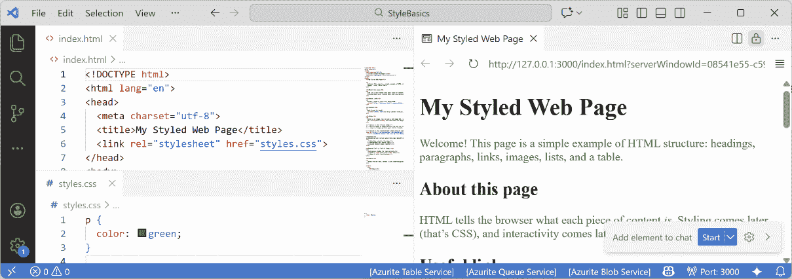
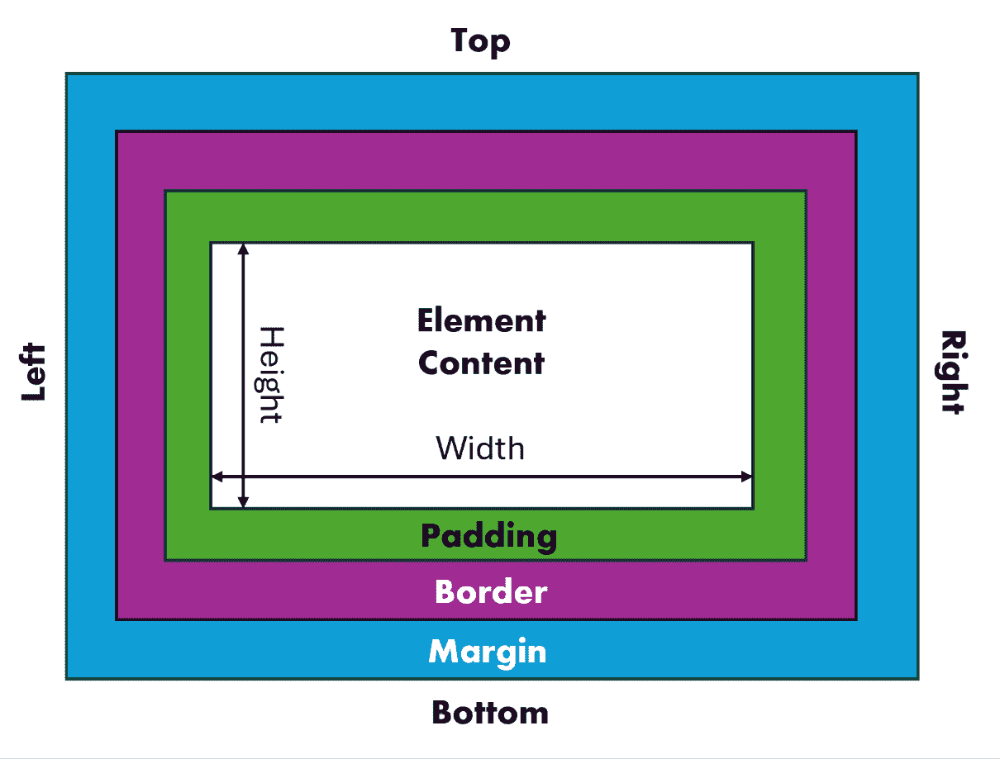

## CSS – 为你的网页设置样式

使用 `层叠样式表 (CSS)` 让你的页面变得美观。本章展示 CSS 如何控制表现和布局。

在本章结束时，你将把一个普通的 HTML 文档转变为一个视觉上吸引人、可读且响应式的网页。你将理解样式如何应用，如何控制颜色和排版，元素如何在页面上定位，以及网站如何适应不同的屏幕尺寸。你还将学习如何发现和修复常见的 CSS 错误，包括使用 AI 工具帮助调试布局和样式问题，当事情看起来不如预期时。

在本章中，我们将涵盖以下主题：

* CSS 基础
* 颜色、字体和布局
* 响应式设计
* AI 挑战 – CSS 调试
* 变换和动画

本章建议的聊天机器人提示词及示例响应可在以下链接找到：[`github.com/markjprice/web-dev-ai/blob/main/prompts/ch03-css/readme.md`](https://github.com/markjprice/web-dev-ai/blob/main/prompts/ch03-css/readme.md)

## CSS 基础

CSS 存在的目的是控制表现：HTML 描述内容是什么，CSS 描述内容应该是什么样子。将这些关注点分离使网页更易于维护、重设样式和扩展。

在 *第 2 章* *HTML – 构建你的网页* 中，你使用标题、段落、链接、图片、列表、表格和表单创建了页面。此时，浏览器决定所有内容的外观。字体遵循浏览器默认值，间距基本，所有内容垂直堆叠。CSS 就是让你从浏览器手中夺回控制权，做出有意识的设计选择。

CSS 通过定义规则工作。每条规则说“选择这些元素”并“将这些样式应用到它们上”。一旦你理解了这句话，你就理解了 CSS 的核心。

## 向网页添加 CSS

有三种方法将 CSS 应用到 HTML。你在实际项目中会看到所有三种，但只有一种推荐用于大多数网站。它们是：

* **内联 CSS**：在元素级别定义样式。
* **内部 CSS**：在页面级别定义样式。
* **外部 CSS**：在网站级别定义样式。

让我们看看每种的例子。

**内联 CSS** 直接写在 HTML 元素上：

```
<p style="color: red;">This text is red.</p>
```

这行得通，但很乱。样式分散在你的 HTML 中，难以复用，维护痛苦。

**最佳实践**：除非在实验，否则避免使用内联 CSS。

**内部 CSS** 写在页面 `<head>` 部分的 `<style>` 标签内：


### CSS 样式概述

## 内部和外部 CSS

```html
<!DOCTYPE html>
<html lang="en">
<head>
  <meta charset="UTF-8">
  <title>My First CSS</title>
  <style>
    p {
      color: blue;
    }
  </style>
</head>
<body>
  <p>This paragraph is blue.</p>
</body>
</html>
```

内部 CSS 比内联 CSS 更易于维护，但它仍然将样式定义绑定到单个 HTML 文件，因此如果你需要在多个网页中使用相同的样式，就必须复制它们。

良好实践：学习时应默认使用外部 CSS，因为它将结构和表现分离。稍后你可能会看到少量内部样式用于性能优化，特别是首屏 CSS，但不要从一开始就这么做。这是因为样式随网页一起下载并在 `<head>` 中定义，因此在内容渲染时样式会立即应用。

外部 CSS 编写在单独的 `.css` 文件中并链接到 HTML。下载网页后，浏览器会下载 CSS 文件并将其样式应用到内容。

让我们看一个示例：

1. 创建一个名为 `Chapter03` 的新文件夹。
2. 在 `Chapter03` 文件夹中，创建一个名为 `StyleBasics` 的新文件夹。
3. 在 `StyleBasics` 文件夹中，从以下链接下载名为 `index.html` 的文件：[`github.com/markjprice/web-dev-ai/blob/main/Code/Chapter03/StyleBasics/index.html`](https://github.com/markjprice/web-dev-ai/blob/main/Code/Chapter03/StyleBasics/index.html)
4. 在 VS Code 中，打开 `StyleBasics` 文件夹。
5. 在 `StyleBasics` 文件夹中，创建一个名为 `styles.css` 的新文件并添加样式定义：

```css
p {
  color: green;
}
```

6. 在 `index.html` 的 `<head>` 元素中，添加指向 CSS 文件的链接：

```html
<link rel="stylesheet" href="styles.css">
```

7. 实时预览页面。段落现在应该是绿色的，如图 3.1 所示：



图 3.1：外部 CSS 文件将段落颜色更改为绿色

如果没有变化，请检查文件名、检查路径，并确保 `<link>` 标签位于 `<head>` 内部。

从现在开始，除非另有明确说明，否则假设所有 CSS 都位于外部样式表中。

良好实践：外部 CSS 是你应该默认使用的。它允许你一次性定义样式并在网站的所有网页中重复使用。

## 选择器和规则

CSS 规则包含两个主要部分：选择器和声明块：

```css
p {
  color: navy;
  font-size: 18px;
}
```

在前面的代码中：

* `p` 是选择器。它告诉浏览器要定位哪些元素。
* 花括号 `{ }` 内的所有内容都是声明块。
* 每个声明都是一个属性（如 `color` 或 `font-size`）和一个值（如 `navy` 或 `18px`），由冒号分隔并以分号结尾。
* 此规则将深蓝色和 18px 字体大小应用于页面上的所有 `<p>` 元素。

尝试将这些规则添加到你的样式表文件中：

```css
h1 {
  color: darkslateblue;
}
p {
  color: green;
  font-size: 18px;
  line-height: 1.8;
}
```

前面的代码展示了元素选择器的示例。这些选择器选择相同标签类型的所有元素。在这些示例中，规则应用于所有 `<h1>` 元素和所有 `<p>` 元素。但如果你只想选择一部分标题和段落怎么办？我们可以使用另外两种类型的选择器来实现。

## 类和 ID

定位每个段落或标题通常是不够的。你经常希望以不同的方式设置特定元素的样式。CSS 类可以在多个元素中重复使用。你可以将此示例添加到你的网页和样式表文件中。

要添加的 HTML：

```html
<h2>Example of a class selector</h2>
<p class="intro">This will be bold and 14px.</p>
<p>This is regular content.</p>
```

要添加的 CSS 如下代码所示：

```css
.intro {
  font-size: 14px;
  font-weight: bold;
}
```

类选择器总是以点开头，如前面代码中的 `.intro`。

类或 ID 名称是一个标识符。关键规则如下：

* 不得包含空格。
* 可以包含字母、数字、连字符和下划线。
* 不得以数字开头。
* 可以以字母或连字符开头。
* 区分大小写，但依赖大小写差异是个坏主意。

还有实用的命名约定：

* 仅使用小写，因为混合大小写会增加认知负担并引发错误。
* 使用连字符而非下划线，因为连字符是 CSS 中的主流约定，且与属性命名（如 `font-size` 和 `background-color`）一致。
* 按用途命名，而非外观。例如，`.red-text` 不好，`.error-message` 好。此准则能避免后续麻烦。

元素的 ID 在页面内应唯一。因此 ID 选择器应仅选择页面上的那个唯一元素并将其样式应用于它。

要添加的 HTML 在下面的代码中高亮显示：

```html
<h1 id="main-title">My Styled Web Page</h1>
```

要添加的 CSS 如下代码所示：

```css
#main-title {
  text-transform: uppercase;
}
```

ID 选择器以井号开头，如前面代码中的 `#main-title`。谨慎使用 ID。类的扩展性更好，也更易于重用。

良好实践：避免使用 ID 进行样式设置，因为它们只能应用于一个元素。即使你目前只有一个元素需要某种样式，你也可能想改用类来应用。这样，如果稍后添加另一个需要相同样式的元素，你可以轻松应用。

## 层叠和具体性

CSS 代表层叠样式表，层叠很重要。当多条规则针对同一元素时，浏览器必须决定哪一条生效。

考虑以下 CSS：

```css
p {
  color: black;
}
.intro {
  color: darkgreen;
}
```

以及此 HTML：

```html
<p class="intro">Hello world</p>
```

元素选择器将段落设为 `black`。类选择器规则规定将带有 `.intro` 类的任何元素着色为 `darkgreen`。哪一个生效？

段落将呈深绿色而非黑色，因为类选择器比标签选择器更具体。

> **提示**：请用真实示例解释 CSS 层叠，展示元素、类和 ID 选择器之间的冲突。展示 CSS 规则冲突的示例并解释为何一条规则胜过另一条。

具体性规则非常复杂，让我们简化它们：

* 元素选择器最弱
* 类选择器覆盖元素选择器
* ID 选择器覆盖两者
* 内联样式覆盖其他所有

```
Element < Class < ID < Inline
```

顺序也很重要。如果两条规则的具体性相等，样式表中靠后编写的那条生效。例如，以下 CSS 有两条类规则：

```css
.intro {
  color: darkgreen;
}
.branding {
  color: darkred;
}
```

如果我们有一个同时应用了这两个类的元素：

```html
<p class="intro branding">Hello world</p>
```

然后先应用 `.intro` 样式，接着应用 `.branding` 样式，使文本颜色变为 `darkred`。

要对同一元素应用多个类，请用空格分隔。class 属性中类名的顺序无关紧要。`class="intro branding"` 和 `class="branding intro"` 效果相同。

具体性解释了许多“为什么我的 CSS 不生效？”的时刻。

> **提示**：什么是 CSS 具体性，如何逐步计算它？

## 盒模型

网页上的每个元素都是一个矩形框。如果你想要行为可预测的布局，理解这一点很重要。


### CSS 盒模型与布局

如图 3.2 所示，每个盒子由以下部分组成：

- **元素内容**：文本或图像本身
- **内边距**：元素内部、内容周围的空间
- **边框**：围绕内边距的*线条*
- **外边距**：元素外部的空间，将其与周围的其他元素分隔开



图 3.2：CSS 盒模型

尝试以下示例 CSS：

```css
.card {
  width: 300px;
  padding: 16px;
  border: 5px dashed #333;
  margin: 20px;
}
```

一个重要细节：`width: 300px;` 设置的是内容区域的宽度，而非盒子的总可见宽度。因为该卡片左右两侧各有 `padding: 16px;` 和 `5px` 的边框，完整渲染宽度为 `300` + `16` + `16` + `5` + `5` = `342px`，再加上任何外部外边距。这是默认的 CSS 盒模型，也是初学者最容易踩坑的地方之一。

本章后面你将看到 `box-sizing: border-box;` 如何改变这种行为，使声明的宽度包含内边距和边框。

以下是要添加的 HTML：

```html
<h2>Box model example</h2>
<div class="card">
  <h3>Card Title</h3>
  <p>This is a simple content card. This is a simple content card. This is a simple content card. This is a simple content card. This is a simple content card.</p>
</div>
```

尝试修改内边距和外边距的数值。观察元素内部和外部空间如何变化。你将在本章及后续的布局工作中反复用到这个概念。

`margin: 0 auto;` 之所以能让元素水平居中，是因为当元素具有限定宽度时，浏览器会按特定方式计算外边距。这是以下代码的简写：

```css
margin-top: 0;
margin-bottom: 0;
margin-left: auto;
margin-right: auto;
```

垂直外边距固定为零，而水平外边距设为 `auto`。这仅在元素满足以下条件时生效：

- 是块级元素，且
- 宽度小于可用空间

如果元素已经填满了其容器的整个宽度，就没有多余空间可供分配，也就无法居中。当左右外边距设为 `auto` 时，浏览器会计算扣除元素宽度后剩余的水平空间。

`margin: 0 auto;` 无法实现垂直居中，因为垂直外边距不参与相同的自动空间分配逻辑。在正常文档流中，外边距没有“分配剩余高度”的概念。

你可以把 `margin: 0 auto;` 理解为告诉浏览器将剩余的水平空间均匀分配到该盒子的两侧。

如果没有空间可分，则不会发生移动。这解释了大多数常见情况。

**提示**：请结合可视化示例和常见错误，解释外边距、内边距和边框的区别。

请逐步添加以下 CSS。不要一次性全部粘贴。添加一条规则，刷新，观察，重复：

```css
body {
  font-family: Arial, Helvetica, sans-serif;
  background-color: #f5f5f5;
  color: #222;
}
div.container {
  max-width: 800px;
  margin: 0 auto;
  padding: 20px;
  background-color: white;
}
a {
  text-decoration: none;
  color: #0066cc;
}
a:hover {
  text-decoration: underline;
}
```

请注意上述代码的以下几点：

- `body` 选择器作用于整个页面。`font-family` 设置默认字体栈。浏览器会先尝试 `Arial`，然后是 `Helvetica`，最后是任何通用的 `sans-serif` 字体。这是一个适合简单易读文本的常用字体栈。`background-color: #f5f5f5;` 给整个页面一个非常浅的灰色背景。`color: #222;` 将默认文本颜色设为非常深的灰色而非纯黑色，这样对眼睛更友好。
- `div.container` 选择器针对 `<div class="container">`。`max-width: 800px;` 将内容宽度限制在 800 像素，即使在大屏幕上也是如此，这通过防止过长的行来提高可读性。`margin: 0 auto;` 表示无上下外边距，浏览器均匀分配空间使容器水平居中。`padding: 20px;` 在容器内部添加空间，使内容不贴边。`background-color: white;` 在浅灰色页面背景上创建白色卡片效果。
- `a` 选择器（用于超链接）移除链接的默认下划线并设置自定义蓝色。`a:hover` 选择器在鼠标指针悬停在链接上时生效，恢复下划线，给用户一个视觉提示，表明该文本可交互。

**良好实践**：默认移除链接下划线并在悬停时动态添加，意味着链接在非悬停状态下仅靠颜色识别。这会让色觉缺陷用户更难识别链接。更无障碍的做法是在默认状态下保留下划线（或添加除颜色外的其他视觉区分，如字重或 `border-bottom`，或确保链接颜色与周围文本有足够对比度）。

你还没学完这段 CSS 中的所有内容，这没关系。这里你学到的是一个可复用的调试过程，而不是死记硬背修复方法。你现在应该能看到 CSS 如何将普通 HTML 转变为具有更清晰间距、颜色和排版的页面。

**提示**：选择器 `a:hover` 的作用是什么？

## 四边模型

在 CSS 中，许多属性作用于盒子的四个边。CSS 没有发明四个互不相关的属性，而是采用基于上、右、下、左的方向系统。一旦理解了这种模式，大量 CSS 突然变得可预测，而非随意。

大多数与布局相关的 CSS 属性作用于相同的四个边：上、右、下、左。这些方向始终遵循相同的顺时针顺序，这在使用简写语法时很重要。

### 支持方向变体的属性

最常见的具有 `-top`、`-right`、`-bottom` 和 `-left` 形式的属性是间距属性，如 `margin` 和 `padding`。

每个属性都有：

- `margin-top`、`margin-right`、`margin-bottom`、`margin-left`
- `padding-top`、`padding-right`、`padding-bottom`、`padding-left`
- `border-top`、`border-right`、`border-bottom`、`border-left`

边框还有子属性：

- `border-top-width`、`border-top-style`、`border-top-color`
- 以及其他边的对应属性

定位偏移量（当 `position` 不为 `static` 时）：`top`、`right`、`bottom`、`left`。

注意圆角的命名模式：

- `border-top-left-radius`
- `border-top-right-radius`
- `border-bottom-right-radius`
- `border-bottom-left-radius`

### 简写与全写

这些属性大多同时支持简写和全写。

以 margin 为典型示例。要将四边都设为 `20px`：

```css
margin: 20px;
```

要将上下设为 `10px`，左右设为 `20px`：

```css
margin: 10px 20px;
```

要将上设为 10px，左右设为 `20px`，下设为 `30px`：

```css
margin: 10px 20px 30px;
```

要将上设为 `10px`，右设为 `20px`，下设为 `30px`，左设为 `40px`：

```css
margin: 10px 20px 30px 40px;
```

顺序始终是：上 → 右 → 下 → 左。

一个实用的记忆法是*从上开始顺时针*。

相同规则适用于 `padding`、`border-width` 和 `border-radius`（圆角有一些特殊情况）。


### CSS 盒模型与布局概念

之存在这个模型，是因为 CSS 盒模型具有方向性。内容位于 `padding` 内部，`padding` 位于 `borders` 内部，而 `borders` 通过 `margins` 与其他元素分隔。这些层中的每一个在每一侧都可以不同。

CSS 选择了可预测性而非冗长性。需要时你可以显式声明，不需要时可以简洁书写。

## 何时使用长手写法与简写属性名

在以下情况下使用长手写法属性名：

*   仅需调整单侧
*   稍后想覆盖特定侧边
*   修复 Bug 需要精确控制

```
margin-bottom: 24px;
```

在以下情况下使用简写属性名：

*   数值对称
*   想要视觉上的分组
*   想让代码表明这些侧边属于一组

```
padding: 16px 24px;
```

这比四行单独的声明能更好地传达布局意图。这比重写整个简写声明更清晰。

## 什么是 box-sizing 以及为何使用 border-box？

默认情况下，CSS 使用 content-box 模型来计算元素尺寸。这意味着当你设置 `width` 或 `height` 时，仅定义了内容区域的大小。`padding` 和 `borders` 会在其基础上叠加，从而增加元素的总尺寸：

```
.card {
  width: 300px;
  padding: 20px;
  border: 5px solid #333;
}
```

在上述示例中，实际渲染宽度并非 300px。它变为：

*   300px（内容）
*   40px（左侧和右侧 `padding`）
*   10px（左侧和右侧 `border`）
*   总宽度 = 350px

这常让初学者感到意外，也是布局 Bug 的常见来源，尤其是当元素溢出其容器时。

### border-box 替代方案

`box-sizing` 属性改变了浏览器计算元素尺寸的方式。当设置为 `border-box` 时，`width` 和 `height` 包含内容、 `padding` 和 `border`：

```
.card {
  box-sizing: border-box;
  width: 300px;
  padding: 20px;
  border: 5px solid #333;
}
```

现在总宽度精确保持 300px，内容区域会收缩以腾出空间给 `padding` 和 `border`。

如今大多数开发者使用 `box-sizing: border-box`，因为它符合人们对布局的自然认知：

*   设为 300px 宽的盒子实际显示为 300px 宽
*   `padding` 和 `borders` 不会意外增加尺寸
*   布局更易理解和维护
*   减少了由元素溢出引起的 Bug

这在响应式设计中尤为重要，因为元素必须适应不同屏幕尺寸而不破坏布局。

开发者通常全局应用 `box-sizing`，而非在单个元素上设置：

```
*,
*::before,
*::after {
  box-sizing: border-box;
}
```

上述代码确保所有元素（包括伪元素）使用相同的尺寸模型。

对大多数项目而言，从一开始就使用 `box-sizing: border-box` 能让 CSS 表现得更直观、更可靠。

## 如何编写 CSS 注释

CSS 仅使用块注释：

```
/* This is a CSS comment */
```

CSS 中不存在单行注释语法。`/* */` 之外的任何内容均视为代码。注释可出现在样式表的几乎任何位置：

```
body {
  color: #222; /* Main text color */
  background-color: #fff;
}
```

注释应解释意图，而非重述代码已有的含义。以下是无意义注释的示例：

```
/* Set the color to blue */
color: blue;
```

以下是有用注释的示例：

```
/* Primary link color chosen for contrast on light backgrounds */
color: #0066cc;
```

该注释解释了值存在的原因，而非语法的作用。

### 注释真正有用的场景

使用注释将样式表划分为逻辑区块：

```
/* =========================
   Base styles
   ========================= */
```

随着文件增长，这极为有用。

为非显而易见的决策添加注释。若数值看似任意，请解释它：

```
/* Extra padding prevents text from touching rounded corners */
padding: 18px 22px;
```

为变通方法和 Hack 添加注释。若你曾与浏览器抗争，请记录下来：

```
/* Safari rounding bug: prevents 1px overflow on flex items */
overflow: hidden;
```

未来的你会感谢过去的你。

不要注释显而易见的规则：

```
/* Center the content */
margin: 0 auto;
```

CSS 注释会被浏览器忽略，不影响渲染。生产构建时，工具常自动移除它们。这意味着注释是给人看的，而非机器。

**良好实践**：若注释无法减少其他开发者理解规则存在原因所需的时间，则不应存在。这包括未来的你。

## 继承与非继承属性

CSS 初看让人感到不可预测的原因之一，是并非所有属性行为一致。某些属性从父元素继承，而另一些则不。

继承属性会自动从父元素传递给子元素。这些通常与文本和可读性相关。例如，若你在 CSS 文件中为 `<body>` 元素设置 `font-family` 或 `color`：

```
body {
  font-family: Arial, Helvetica, sans-serif;
  color: #222;
}
```

则其内部大多数元素将使用这些值，除非在页面上显式覆盖，如 `<p>` 和 `<div>` 元素：

```
<p>This text inherits the font and color.</p>
<div>
  <p>This paragraph also inherits the same styles.</p>
</div>
```

此例中，两个段落均从 `<body>` 元素继承了 `font-family` 和 `color`。

常见继承属性包括 `color`、`font-family`、`font-size`、`line-height` 和 `text-align`。

非继承属性不会自动向下传递。这些通常与布局和间距相关。每个元素若需要则必须显式定义。例如，若你在 CSS 文件中为 `<body>` 元素设置 `margin` 或 `border`：

```
body {
  margin: 20px;
  border: 5px solid red;
}
```

则其内部大多数元素在页面上不会使用这些值：

```
<div>
  <p>This paragraph does not inherit the margin or border.</p>
</div>
```

即使 `<body>` 拥有 `margin` 和 `border`，内部的 `<div>` 和 `<p>` 也不会继承这些值。

常见非继承属性包括 `margin`、`padding`、`border`、`width`、`height` 和 `background-color`。

如有需要，可使用 `inherit` 值强制继承：

```
p {
  border: inherit;
}
```

这告知段落显式采用与其父元素相同的 `border`。

理解哪些属性继承、哪些不继承，有助于解释许多令人困惑的 CSS 行为。当某样式未生效时，问题往往在于你依赖继承来应用一个默认不继承的属性。

**提示**：请解释 CSS 中的继承机制及默认继承的属性有哪些。

## Web 内容无障碍指南 (WCAG)

编写 CSS 时，不仅要考虑网站外观，还要考虑如何让尽可能多的人使用。**Web 内容无障碍指南** (**WCAG**) 是一套国际公认的建议，旨在使 Web 内容更易访问，特别是针对残障人士。

WCAG 围绕四大核心原则构建。内容应**可感知**，即用户能看见或听到。应**可操作**，即用户能通过多种输入方式（包括键盘）与其交互。应**可理解**，具有清晰且可预测的行为。最后应**健壮**，即能在不同浏览器、设备和辅助技术上工作。


### 无障碍与 CSS

CSS 在无障碍方面发挥着重要作用。例如，在文本和背景之间选择足够的色彩对比度有助于视力受损的用户。避免使用固定字号可让用户更轻松地缩放文本。确保焦点状态（如链接和按钮上的轮廓）可见，可支持键盘导航。

无障碍不是可选的额外项，也不是最后一步。它应从设计和开发过程的一开始就予以考虑。遵循 WCAG 指南能打造出更具包容性、更易用且整体设计往往更优秀的网站。

以下链接将帮助你学习 WCAG：

* **在深入规则之前解释无障碍的*原因*：** [`www.w3.org/WAI/fundamentals/accessibility-intro/`](https://www.w3.org/WAI/fundamentals/accessibility-intro/)
* **快速参考：** [`www.w3.org/WAI/WCAG22/quickref/`](https://www.w3.org/WAI/WCAG22/quickref/)
* **当前 WCAG 完整规范（2.0、2.1、2.2）及支持文档和解释：** [`www.w3.org/WAI/standards-guidelines/wcag/`](https://www.w3.org/WAI/standards-guidelines/wcag/)

在下一节中，我们将深入探讨色彩、字体和布局，并开始做出设计选择，而不是依赖浏览器默认值。

### 色彩、字体与布局

在初学者项目中，简单的设计选择通常比增加更多装饰效果更好。好的设计主要在于克制。CSS 赋予了你巨大的能力，最难的部分在于知道何时停手。

## 使用色彩

CSS 中色彩的语法很简单，但选好色彩却更难。你设置一个值，浏览器绘制像素。难点不在于语法，而在于一致性和对比度。

CSS 支持多种色彩格式，但你应重点关注两种：像 `red` 或 `darkblue` 这样的命名色彩，以及十六进制值：

```
color: red;
color: #336699;
```

`red` 和 `blue` 等命名色彩主要用于快速实验。真实项目使用十六进制值，因为它们精确且可预测。

十六进制色彩写作 `#RRGGBB`，其中每一对控制红、绿、蓝的强度。

```
body {
  background-color: #f5f5f5;
  color: #222222;
}
```

与纯黑配纯白相比，这种组合已经提高了可读性，纯黑配纯白对眼睛刺激太强。

你也可以使用色彩函数：

```
color: rgb(255, 99, 71);
color: rgba(255, 99, 71, 0.5);
color: hsl(120, 60%, 50%);
color: hsla(120, 60%, 50%, 0.7);
```

**提示：** 请解释色彩函数 `rgb`、`rgba`、`hsl` 和 `hsla`，特别是如何设置 alpha 或透明度。

几条能让你远离丑陋页面的铁律：

* 不要使用过多色彩。两三种核心色彩对大多数初学者项目足矣。
* 确保文本对比度足够高。WCAG 2.1 AA 要求普通文本的最小对比度为 4.5:1，大号文本（18pt+ 或 14pt 粗体）为 3:1。白底浅灰字看似时尚，实则阅读体验极差。
* 用色彩传达含义，而非装饰。链接、错误、警告和高亮应有意义且一致地使用色彩。

**提示：** 如何检查我的色彩对比度是否符合 WCAG 标准？除了色彩对比度，有哪些 CSS 技术能提升无障碍性？

## 字体与排版

排版对可读性的影响往往大于色彩。糟糕的字体选择比几乎任何其他因素都能更快地让网站显得不专业。

从简单入手。系统字体是你的朋友：

```
body {
  font-family: Arial, Helvetica, sans-serif;
}
```

这告诉浏览器：若有 `Arial` 则用 `Arial`，否则用 `Helvetica`，再否则用任意通用无衬线字体。它加载即时，在各平台上都显示整洁。

浏览器使用合理的默认字号（通常为 16px），用户可为可读性调整此值。与其用固定像素值覆盖，不如优先使用百分比或 `rem`（根 `em`，稍后解释）等相对单位，以尊重用户偏好。你通常应信任浏览器默认字号并在其基础上构建，而非覆盖它。例如，将其设为 `100%`，或为营销类网站的主页设置稍大的字号：

```
html {
  font-size: 112.5%; /* ~18px 等效值 */
}
```

**良好实践：** 在 `body` 上设置 `font-size` 会影响大多数文本，因为字号默认会被继承，且大多数元素都在 `<body>` 内。你会在许多代码示例中看到这种做法，LLM 也常遵循这一旧习惯。但 `<body>` 不定义根字号，因此它不控制 `rem` 单位。要控制 `rem` 和默认 `font-size`，请使用 `html` 选择器。

行高与字号同等重要。过密的文本让人感到压抑。稍微宽松的间距则让人感觉平静且易读：

```
body {
  line-height: 1.6;
}
```

标题应与正文形成清晰对比，但不必喧宾夺主：

```
h1, h2, h3 {
  line-height: 1.3;
}
h1 {
  font-size: 2rem;
}
h2 {
  font-size: 1.5rem;
}
```

**良好实践：** 避免将所有内容设为粗体或大写。大多数初学者网站看起来很糟，是因为它们试图用字体制造戏剧效果，而不是追求可读性。可读性为王。

**提示：** 请结合实际例子解释 `px` 与 `%`、`em`、`rem` 的区别及各自的使用场景。`rem` 和 `em` 在嵌套元素中的表现有何不同？请包含一个示例展示 `em` 如何复合而 `rem` 不会。

## 布局基础

HTML 默认垂直堆叠元素。CSS 布局关乎控制宽度、间距和对齐，使页面具有清晰的结构。

首先限制主要内容区块的内容宽度：

```
main {
  max-width: 800px;
  margin: 0 auto;
  padding: 20px;
}
```

这一条规则能起到多重作用：

* 防止文本行过宽
* 使内容水平居中
* 在内容周围添加呼吸空间

这种模式几乎出现在所有专业网站中。

间距比边框和背景更重要。如果你将主要内容分为多个区块，则在每个区块底部添加额外的外边距：

```
section {
  margin-bottom: 40px;
}
```

留白不是浪费的空间。它是眼睛理解结构的方式。留白帮助读者区分板块、层级和分组。当你需要多列时，抵制用外边距强行实现的冲动。使用专为该任务设计的布局工具。

例如，定义一个类样式：

```
.layout {
  display: flex;
  gap: 20px;
}
```

然后将该类样式应用到 `<div>` 等元素上：

```
<div class="layout">
  <aside>侧边栏内容</aside>
  <main>主要内容</main>
</div>
```

你稍后将正式学习 Flexbox，但即使现在你也能看到它如何在无需 Hack 的情况下生成整洁、可预测的布局。

`gap` 属性控制布局容器中项目间的间距，最常用于 Flexbox 和 Grid。它的存在是为了解决 CSS 中一个由来已久且恼人的问题：在无需 Hack 的情况下均匀间隔元素。

当容器使用 Flexbox 时，`gap` 定义的是 flex 项目之间的间距，而非容器外部的间距。例如，使用以下 CSS：

```
.container {
  display: flex;
  gap: 20px;
}
```

在以下 HTML 中，每个项目将精确地由 20 像素分隔。你不需要给子元素设置外边距，也不需要为最后一个项目编写特殊规则：

```
<div class="container">
  <div>One</div>
  <div>Two</div>
  <div>Three</div>
</div>
```

使用 Flexbox，你可以为行间距和列间距设置不同的值：

```
gap: 10px 20px;
```


这首先设置行间距，然后设置列间距。使用 Grid，你可以显式设置 `row-gap` 和 `column-gap`。

### 提示
请解释 `display: flex` 的工作原理，以及 `flex-direction`、`justify-content` 和 `align-items` 的作用，包括 `gap` 和 `margin` 的区别。

你现在拥有足够的 CSS 来控制基本的表现和布局。现在让我们看看每个网页都必须处理的主题：适应不同的设备，从大型台式机到手机和平板电脑的小屏幕。

### 响应式设计

到目前为止，你设计的所有样式都假设有一个舒适的桌面屏幕。如今，这种假设错误的时候比正确的时候更多。网站在手机、平板电脑、笔记本电脑、超宽显示器、电视以及两者之间的各种设备上查看。响应式设计就是让一个网站在不破坏布局、不强迫用户缩放和横向滚动的情况下进行适应。响应式设计主要是应用了灵活的尺寸和布局决策的标准 CSS。

## 响应式设计的真正含义

响应式设计并不意味着*先为移动端设计*，然后拉伸以适应桌面端。它意味着创建能够响应可用空间的布局。

一个响应式页面：

*   根据屏幕宽度调整布局
*   在所有尺寸下保持文本可读
*   避免横向滚动
*   不到处依赖固定像素宽度

如果你的布局只在一种屏幕尺寸下工作，它就是脆弱的。

## 视口及其重要性

每个响应式网页都从 `<head>` 部分的这一行开始：

```
<meta name="viewport" content="width=device-width, initial-scale=1.0">
```

没有它，移动端浏览器会假装它们比实际宽得多，然后将页面缩小。结果看起来又小又破碎。

有了它，CSS 像素会更接近实际屏幕尺寸映射。你只需添加一次，但忘记它会破坏后续的一切。

## 尝试一下：在浏览器中模拟移动设备

你不需要实体手机来测试响应式布局。在 Chrome 中，打开 `Developer Tools` (`F12`)，然后点击设备工具栏图标或按 `Ctrl` + `Shift` + `M`。

选择像 `iPhone` 或 `Pixel` 这样的设备，然后调整视口大小。观察随着媒体查询生效，你的布局如何变化。

这是调试响应式 CSS 最快的方法。

## 灵活布局代替固定宽度

破坏响应式最快的方法是在到处硬编码宽度。

例如，设置固定宽度是不良实践：

```
main {
  width: 1200px;
}
```

最好设置最大宽度，让宽度随可用宽度缩放，配合自动外边距和合理的固定内边距用于内容元素内部间距：

```
main {
  max-width: 1200px;
  margin: 0 auto;
  padding: 20px;
}
```

前面的布局：

*   在小屏幕上收缩
*   在超大屏幕上停止增长
*   保持居中且可读

百分比和灵活单位自然适应：

```
.container {
  width: 90%;
}
```

这允许内容自由呼吸，而不将其钉死在特定设备尺寸上。

### 提示
哪些常见错误会破坏响应式布局？

## 响应式排版

文本应随屏幕缩放，但不要剧烈变化。

不要将所有东西绑定到像素，在适当的地方使用相对单位。

你可以为页面的根元素 (`<html>`) 设置字体大小作为起点：

```
html {
    font-size: 100%;
}
```

然后使用相对大小设置其他页面元素的大小：

```
h1 {
  font-size: 2rem;
}
```

`rem` 代表 *root em*。它相对于根元素的字体大小，在大多数浏览器中默认为 `16px`。所以在默认大小下 `2rem` 为 `32px`。如果你更改根字体大小，所有 `rem` 值会按比例缩放。

还有 `em`，它相对于父元素的字体大小，而非根元素。`rem` 通常更受青睐，因为它更可预测，因为它始终引用相同的基准，无论嵌套如何。这提高了可访问性并保持比例一致。

行长比字体大小更重要。过长的行难以阅读，尤其是在宽屏上。这就是为什么限制内容宽度是响应式设计的一部分。

## 使用 clamp() 实现流体字体大小

到目前为止，字体大小都是相对于基础值固定的。在响应式设计中，你也可以让文本在尺寸之间平滑缩放，而不是在断点处跳变。

CSS 提供了 `clamp()` 函数用于此目的：

```
h1 {
  font-size: clamp(1.5rem, 2.5vw, 2.5rem);
}
```

这意味着：

*   字体永远不会小于 `1.5rem`
*   它将基于视口宽度缩放 (`2.5vw`)
*   它永远不会大于 `2.5rem`

随着屏幕变宽，文本逐渐变大。在较小屏幕上，它会缩小，但保持可读。这种方法避免了在媒体查询断点处字体大小的突然跳变，能产生更平滑、更自然的排版。

将 `clamp()` 视为设置边界：在限制内灵活。作为初学者你还不需要使用 `clamp()`，但你会在 CSS 中看到它，因为它结合了灵活性与控制。

## 媒体查询

媒体查询让你仅在特定条件为真时应用 CSS。最常见的是屏幕宽度：

```
@media (max-width: 768px) {
  body {
    background-color: #ffffff;
  }
}
```

此规则仅在视口宽度为 768 像素或更小时应用，大致对应平板和手机领域。

一个基于你之前布局的实际例子：

```
.layout {
  display: flex;
  gap: 20px;
}
@media (max-width: 768px) {
  .layout {
    flex-direction: column;
  }
}
```

在较大屏幕上，内容并排显示。在较小屏幕上，垂直堆叠。相同的 HTML。相同的 CSS 文件。基于空间的不同行为。

### 提示
请解释带有多个断点的媒体查询并给出真实示例。

## 移动端优先思维

一个常见的新手错误是先为桌面端设计，然后试图用几十个覆盖来*修复*移动端。

更好的方法是移动端优先设计：

*   编写在小屏幕上工作的简单样式
*   为较大屏幕添加增强

这通常看起来像这样：

```
.layout {
    display: flex;
    flex-direction: column;
    gap: 20px;
}
@media (min-width: 768px) {
    .layout {
        flex-direction: row;
    }
}
```

默认样式到处都工作。较大屏幕获得更复杂的布局。这种方法产生更整洁的 CSS 和更少的意外。

### 提示
什么是移动端优先设计？为什么它比桌面端优先更好？

## 图片与响应式

图片是布局破坏的常见来源。

至少，每张图片都应被约束：

```
img {
  max-width: 100%;
  height: auto;
}
```

这防止图片溢出其容器，在小屏幕上炸裂布局。

在下一节中，你将故意破坏一个响应式布局，然后使用 AI 辅助调试来修复它。这个练习比记忆语法更重要，因为响应式 Bug 不可避免，知道如何理解它们才是真正的技能。

### AI 挑战 – CSS 调试

本节故意使用有问题的 CSS。你将使用有问题的、令人困惑的、略微错误的 CSS。这不是意外。编写 CSS 很容易。理解为什么 CSS 没有按你预期的方式工作才是真正的技能。

这里的目标不是记忆修复方法，而是学习一个可重复的调试过程，并将 AI 作为问题和解释的来源，而不是替代你自己检查浏览器。


这是软件开发领域一场更大规模转变的一部分。编写代码很重要，但其重要性不如过去。更重要的是理解系统如何运作、布局为何损坏、浏览器在做什么，以及你实际想要什么结果。换句话说，开发者的价值正从编写 CSS 规则转移到至少能指出以下这些问题：

1. 固定宽度（`width: 800px`）破坏响应式布局
2. 媒体查询使用了 `flex-direction: row`，而这已经是默认值
3. 整体布局没有间距或宽度约束

如果 AI 在不加解释的情况下直接给出修正后的 CSS，请要求澄清。你应该是在学习，而不是在抄答案。

## 步骤 4：增量应用修复

现在逐个问题修复 CSS。

首先，移除刚性宽度：

```
.sidebar {
  max-width: 300px;
  width: 100%;
}
```

接下来，修正媒体查询，在宽度小于 768 像素时使用列布局而非行布局：

```
@media (max-width: 768px) {
  .layout {
    flex-direction: column;
  }
}
```

然后改进间距和包含：

```
.layout {
  display: flex;
  gap: 20px;
  max-width: 1200px;
  margin: 0 auto;
  padding: 20px;
}
```

每次更改后重新加载页面。观察改进了什么以及为什么。

## 步骤 5：问“还可能出什么问题？”

现在再次挑战 AI。

尝试类似以下的提示词：

* `What accessibility issues might this layout still have?`
* `What happens if the menu text becomes much longer?`
* `How would this behave on a very wide screen?`

AI 擅长指出你尚未学会预见的边缘情况。

## 使用浏览器开发者工具调试 CSS

当 CSS 的表现不符合预期时，最快的理解方法是使用浏览器的开发者工具。每个浏览器都内置了工具，让你能够检查元素、查看应用的样式，并实时尝试更改。

你可以通过右键点击元素并选择 `Inspect`（检查），或者在大多数浏览器中按 `F12` 或 `Ctrl` + `Shift` + `I` 来打开开发者工具。

### 检查元素和样式

对 CSS 最有用的面板是 `Elements`（元素）（或 `Inspector`（检查器））面板。当你选择一个元素时，一边会显示 HTML 结构，另一边会显示应用于该元素的所有 CSS 规则。

每条规则显示：

* 应用它的选择器
* 它来自哪个文件
* 它是否被覆盖（显示为删除线）

如果规则显示删除线，意味着另一条具有更高优先级或靠后顺序的规则正在覆盖它。

DevTools 允许你直接在浏览器中编辑 CSS：

* 更改值（例如，`padding: 20px` → `40px`）
* 切换属性的启用/禁用
* 添加新规则

这些更改是临时的，但它们让你能即时尝试，无需切换回代码编辑器。

### 盒模型图

最有用的调试工具之一是盒模型图，通常显示在 `Styles`（样式）或 `Layout`（布局）面板中。它以可视化方式表示：

* 内容（中心）
* 内边距（内部空间）
* 边框（轮廓）
* 外边距（外部空间）

你可以看到每一边（上、右、下、左）的确切数值，通常用颜色编码区分。

这对于诊断布局问题极其有帮助，例如意外的间距、比预期大的元素和错位的布局。你甚至可以将鼠标悬停在图表的各部分上，以在页面上高亮显示它们，从而清楚地知道空间来自哪里。

DevTools 将 CSS 从猜测游戏变成了调查过程。你不再需要更改随机值并碰运气，而是可以准确地看到浏览器在做什么，并有信心地调整样式。这是 Web 开发转变的一个好例子：技能不在于更快地输入 CSS，而在于理解浏览器如何解读你所写的代码。

## 本练习教会你什么

你刚刚练习了几个专业习惯：

* 将观察与行动分离
* 在更改代码前理解布局意图
* 将 AI 用作审查员和解释者，而非权威答案
* 通过调查修复 CSS，而非试错法

如果你只依赖生成的 CSS 而不理解它，你的进步会更慢。使用 AI 解释损坏 CSS 的开发者进步得很快。这些调查行为的习惯比单纯的打字速度更有价值。

## 你的收获

当 CSS 损坏时，浏览器并非在随机发挥。它正在遵循你误解或遗忘的规则。你的工作是放慢脚步，思考层叠和布局，并使用工具（包括 AI）来揭示实际发生的情况。

这种心态将比你在本章记忆的任何特定属性都更重要。


We have covered the basics of styling web pages with CSS, specifically colors, fonts, and layout, learned responsive design, and practiced debugging common issues. Let's finish this chapter with one of the most fun parts of CSS, which many beginners don't even realize is possible: transforms and animations.

### Transforms and Animations

`Transforms` and `animation` take CSS from layout into motion design. Used with restraint, they add clarity and feedback. Overused, they make pages feel jittery and exhausting. The goal here is control, not spectacle.

This section covers the core concepts without turning your site into a carnival.

## CSS Transforms

Transforms let you visually change an element without affecting the layout around it. This matters more than it sounds.

A transformed element:

*   Moves, rotates, or scales visually
*   Still occupies its original space in document flow

That is why transforms are better than `margin` or `position` for visual effects.

The most common transform functions are shown in Table 3.1:

| Transform Function | Description |
| --- | --- |
| `translate()` | Moves an element |
| `scale()` | Resizes an element |
| `rotate()` | Rotates an element |
| `skew()` | Distorts an element |

Table 3.1: Transform functions and what they do

Let's look at a code example:

```css
.card {
  transform: translateX(20px);
}
```

This shifts any element with the `.card` class 20 pixels to the right, but other elements behave as if nothing moved.

You can combine transforms:

```css
.card {
  transform: translateY(-4px) scale(1.02);
}
```

Order matters. Functions apply left to right.

Transforms are especially cool when paired with interaction, like a button on hover:

```css
.button {
  transition: transform 0.2s ease;
}
.button:hover {
  transform: translateY(-2px);
}
```

This creates a subtle "lift" on hover with no layout shift and no side effects.

**Good practice**: If an interaction causes the page to jump or reflow, you probably used the wrong tool.

**Think about it**: Why are transforms better than `margin` or `position` for animation?

## The `transition` Property

Transitions control how CSS changes happen over time. Without them, state changes are instant:

```css
.card {
  transition: background-color 0.3s ease;
}
```

Now when the background color changes, it animates smoothly.

You can transition multiple properties:

```css
transition: transform 0.2s ease, box-shadow 0.2s ease;
```

**Good practice**: Not every property transitions well. The best candidates: `transform`, `opacity`, `box-shadow`, `background-color`. Avoid animating layout properties like `width`, `height`, `top`, or `left` unless you know why.

**Think about it**: Which CSS properties are safe to animate for performance, and why?

## Keyframe Animations

Transitions react to state changes. Animations run on their own timeline:

```css
@keyframes fade-in {
  from {
    opacity: 0;
  }
  to {
    opacity: 1;
  }
}
```

Apply it like this:

```css
.modal {
  animation: fade-in 0.3s ease;
}
```

This runs once when the element appears.

Animations can loop, reverse, pause, and change speed curves. For example:

```css
.spinner {
  animation: spin 1s linear infinite;
}
@keyframes spin {
  to {
    transform: rotate(360deg);
  }
}
```

That is a complete loading spinner in four lines of CSS.

## Timing Functions and Realism

Timing functions shape the feel of motion.

Common values: `linear` for constant speed, `ease` for slow start and end, `ease-in` for slow start only, `ease-out` for slow end only.

Most UI interactions should use `ease` or `ease-out`. `linear` feels robotic. If motion feels off, it is usually the timing, not the distance.

## Reduced Motion and Accessibility

Some users prefer less motion. CSS lets you respect that:

```css
@media (prefers-reduced-motion: reduce) {
  * {
    animation: none;
    transition: none;
  }
}
```

Guidelines for using animation well:

*   Use animation to explain change. If something appears, disappears, or moves, animation makes it feel intentional.
*   Keep durations short. Most UI animations should be between 150ms and 300ms.
*   Animate less. One moving element draws attention. Five is noise.
*   Never animate without purpose. If removing the animation would not make the interface worse, it probably should not be there.

Animation should help users understand what just happened. If it only exists because it looks cool, it ages fast.

### Exercises, References, and Resources

In this section, you will be tested on what you have learned in this chapter and get links to useful references and resources.

## Check Your Understanding

Answer the following questions about the topics covered in this chapter:

1.  What are the three ways to apply CSS? Which is preferred?
2.  What are the two parts of a CSS rule?
3.  What is the difference between a class selector and an ID selector?
4.  What happens when two CSS rules have the same specificity?
5.  What are the four parts of the CSS box model?
6.  Why might adding `padding` change an element's total size?
7.  Why is `max-width` preferred over `width` for responsive layouts?
8.  What is the difference between `px` and `rem`?
9.  What is a media query?
10. What is the difference between `transition` and `animation`?

Answers can be found in the book's GitHub repository, linked here:

<https://github.com/markjprice/web-dev-ai/blob/main/docs/Appendix-A.pdf>

## Links

Use MDN for learning, examples, and daily reference. Use W3C specs to clarify edge cases, settle disagreements, and understand why CSS behaves the way it does.

### MDN CSS Reference

This is the authoritative source for practical properties, values, and syntax:

<https://developer.mozilla.org/en-US/docs/Web/CSS/Reference>

This is the page you will return to again and again. Every CSS property links to formal syntax, supported values, examples, and browser compatibility, plus direct links to the relevant W3C spec sections.

If you bookmark one CSS page, bookmark this one.

### Core MDN CSS Guides

Beginner-friendly explanations of CSS fundamentals:

<https://developer.mozilla.org/en-US/docs/Learn/CSS>

For understanding the box model, cascade and specificity, layout basics, and responsive design.

These materials follow current CSS standards, not old browser quirks.

### W3C Specifications

These are the formal specifications for CSS. MDN is usually better for learning. Specs are better for precise reference. You do not usually learn CSS from specs, but they are essential for clarity and edge cases. W3C CSS Snapshot for the current state of CSS: <https://www.w3.org/TR/CSS/>

## Summary

In this chapter, we learned the following:

*   CSS separates presentation from structure and applies styles using rules made of selectors and declarations
*   External stylesheets are the preferred way to manage and reuse styles across pages
*   The cascade decides which styles apply based on specificity and order
*   Classes are reusable and better for styling than IDs
*   Every element follows the box model: content, padding, border, and margin
*   Shorthand properties follow a consistent top-right-bottom-left pattern


* 布局更多地依赖于间距和宽度约束，而非装饰性样式
* 诸如 `%` 和 `rem` 之类的相对单位尊重用户设置并提升可访问性
* 响应式设计使用灵活布局、媒体查询和移动优先策略；本章相关内容可在以下链接找到：[`github.com/markjprice/web-dev-ai/blob/main/prompts/ch04-svg/readme.md`](https://github.com/markjprice/web-dev-ai/blob/main/prompts/ch04-svg/readme.md)
