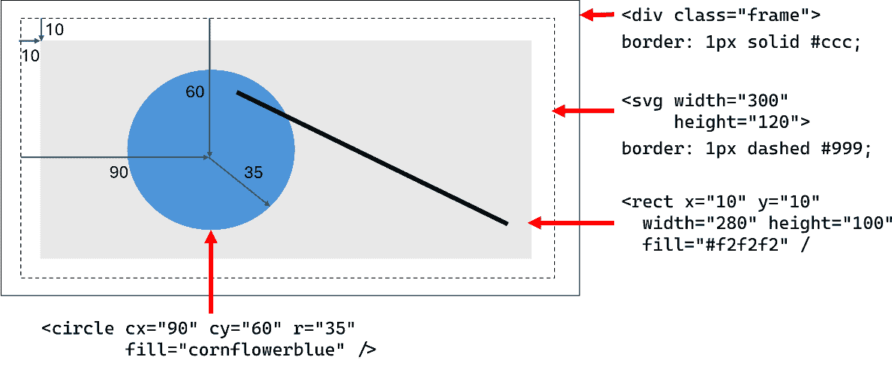
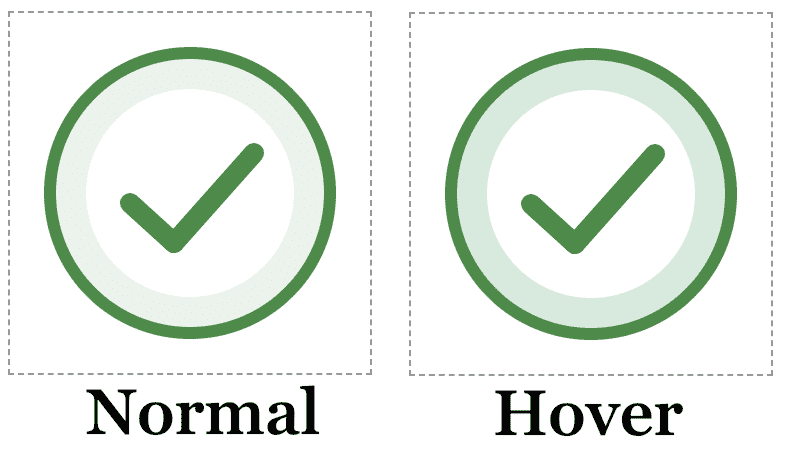
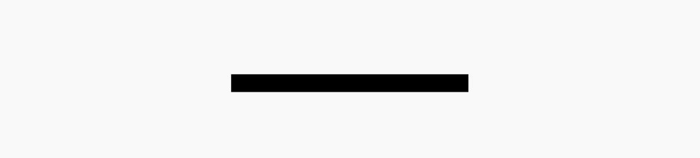
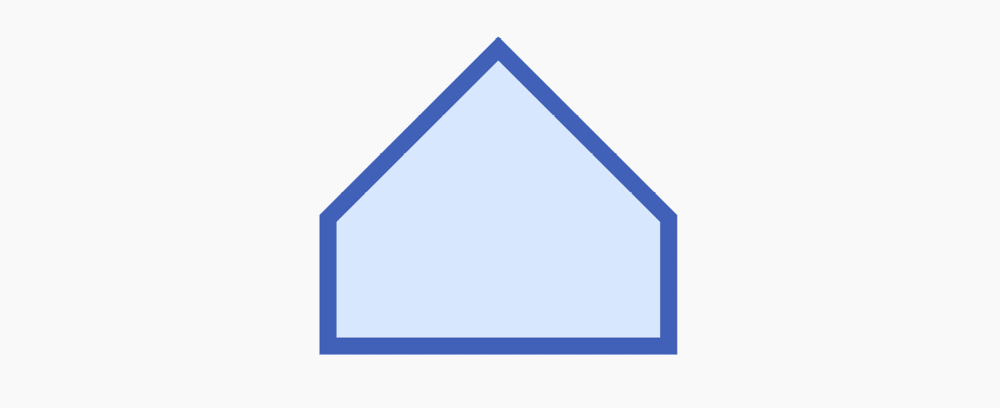
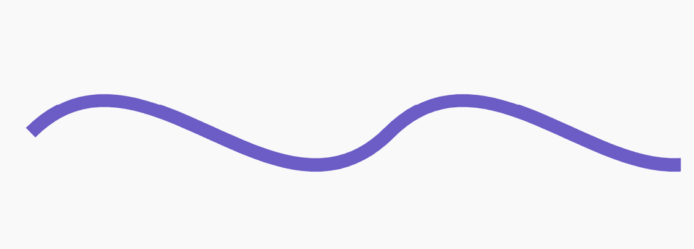
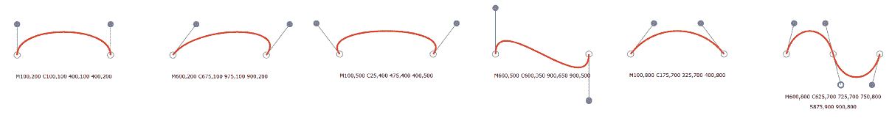
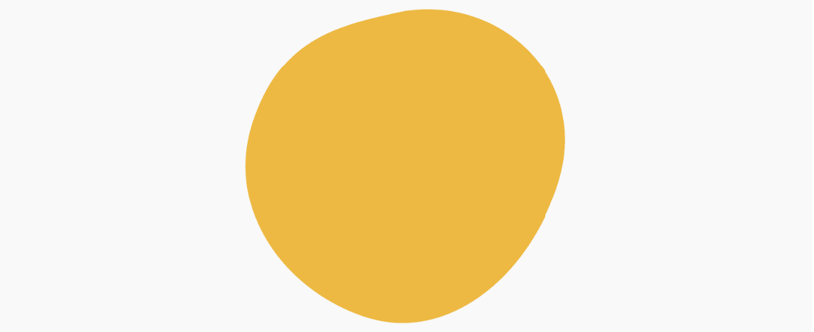
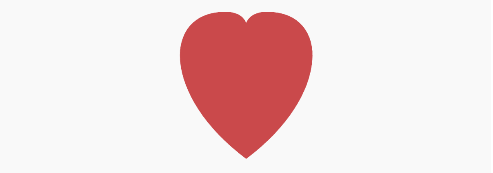
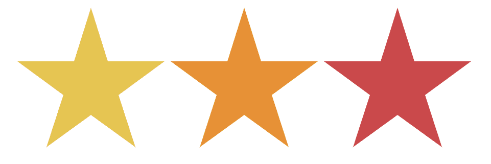
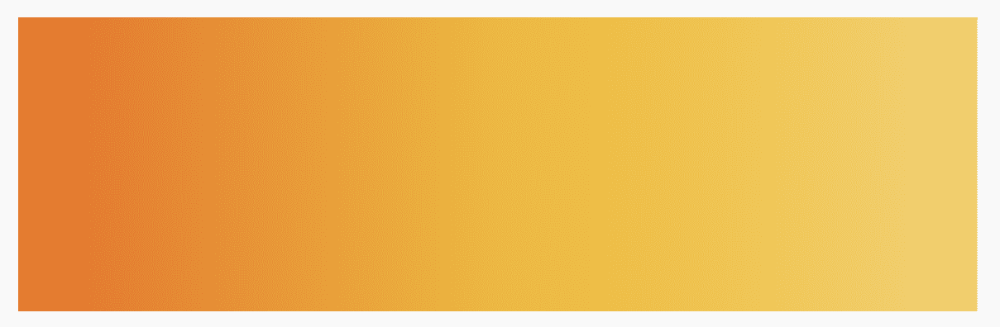

## 用于绘制形状的 SVG 基础知识

SVG 是一种对 HTML 友好的绘图格式。您可以通过五种常见方式使用它：

* **内联 SVG**：直接在 HTML 中编写 SVG 标记。这使得 CSS 和 JavaScript 能够直接访问 SVG 元素，对于交互和主题设置非常有用：

```
<svg width="120" height="120" viewBox="0 0 100 100">
  <circle cx="50" cy="50" r="40"></circle>
</svg>
```

* **外部 SVG**：链接到像 `logo.svg` 这样的外部文件：

```
<a href="logo.svg">Go to SVG file</a>
```

* **图像元素**：无法通过 CSS 或 JavaScript 与 SVG 内部进行交互。这是静态图形最简单、最安全的方式：

```

```

* **对象元素**：SVG 具有交互性，但存在于自己的文档上下文中：

```
<object data="logo.svg" type="image/svg+xml" 
        width="120" height="120">
  Your browser does not support SVG.
</object>
```

* **CSS 背景**：纯粹用于装饰，无交互或可访问性：

```
<!DOCTYPE html>
<html lang="en">
<head>
  <meta charset="UTF-8">
  <title>CSS Background SVG</title>
  <style>
    .box {
      width: 120px;
      height: 120px;
      background-image: url("logo.svg");
      background-size: cover;
      background-repeat: no-repeat;
      border: 1px solid #ccc;
    }
  </style>
</head>
<body>
<h1>CSS Background SVG Example</h1>
<div class="box"></div>
</body>
</html>
```

在本章中，我们将从内联 SVG 开始，因为它能让您最清晰地了解 SVG 构建块的工作原理。

**提示：** 请解释内联 SVG 和 `` SVG 之间的区别，包括优缺点和实际用例。

让我们从最小的有用内联 SVG 开始，如下面代码高亮所示。创建一个 `Chapter04` 文件夹，并在该文件夹中创建一个名为 `simple-svg.html` 的 HTML 页面，内容如下：

您可以在以下链接下载此文件：[`github.com/markjprice/web-dev-ai/blob/main/Code/Chapter04/simple-svg.html`](https://github.com/markjprice/web-dev-ai/blob/main/Code/Chapter04/simple-svg.html)

```
<!doctype html>
<html lang="en">
  <head>
    <meta charset="utf-8" />
    <meta name="viewport" 
          content="width=device-width, initial-scale=1" />
    <title>My First SVG</title>
    <style>
      /* Just to make the SVG area obvious on the page */
      .frame {
        width: 320px;
        padding: 12px;
        border: 1px solid #ccc;
      }
      svg {
        display: block;
        border: 1px dashed #999;
      }
    </style>
  </head>
  <body>
    <h1>SVG Playground</h1>
    <div class="frame">
      <svg width="300" height="120" 
           xmlns="http://www.w3.org/2000/svg">
        <!-- Background rectangle -->
        <rect x="10" y="10" width="280" height="100" fill="#f2f2f2" />
      </svg>
    </div>
  </body>
</html>
```

`<svg>` 元素是一个拥有自己坐标系的容器。

您看到的是一个矩形（`<rect>`）绘制在 300×120 的*画布*上，如*图 4.1*所示。矩形从 (10, 10) 开始，宽 280 像素，高 100 像素。SVG 坐标从左上角开始，x 向右增加，y 向下增加，如果您做过 CSS 布局工作，这会感觉很熟悉。



*图 4.1：使用 SVG 绘制简单形状*

**提示：** 请解释 SVG 坐标系如何工作，并与 CSS 布局进行对比，附带图表和示例。

在 SVG 中，后绘制的元素会覆盖在先绘制的元素之上。添加几个更多形状以理解层叠，如*图 4.1*所示，并在下面代码高亮显示：

```
<svg width="300" height="120" 
     xmlns="http://www.w3.org/2000/svg">
  <!-- Background rectangle -->
  <rect x="10" y="10" width="280" height="100" fill="#f2f2f2" />
  <!-- Circle on top of the background -->
  <circle cx="90" cy="60" r="35" fill="cornflowerblue" />
  <!-- A line drawn on top of both -->
  <line x1="100" y1="45" x2="280" y2="95" 
        stroke="black" stroke-width="4" />
</svg>
```

您使用的一些关键概念：

1. `<svg>` 元素定义绘图区域。
   * `width` 和 `height` 设置页面上的尺寸。
   * `xmlns="http://www.w3.org/2000/svg"` 是一个 XML 命名空间，告诉浏览器*这是 SVG 标记*。
   
   在独立的 `.svg` 文件中，此属性是必需的。然而，当 SVG 作为内联写在 HTML5 文档中（带有 `<!DOCTYPE html>`）时，`xmlns` 属性是可选的，因为 HTML5 解析器会自动处理命名空间。您在实际的内联 SVG 中经常会看到它被省略。

2. 形状是元素。
   * `<rect>` 绘制矩形。
   * `<circle>` 绘制圆形。
   * `<line>` 绘制直线。

3. 定位使用从左上角 (0, 0) 开始的简单坐标。


### SVG 形状、描边和填充

## 基本形状属性

*   对于矩形，你需要指定左上角的 `x` 和 `y`。
*   对于圆形，你需要使用 `cx` 和 `cy` 指定中心点，加上半径 `r`。
*   对于线条，你需要指定起点 (`x1`, `y1`) 和终点 (`x2`, `y2`)。

## 颜色和描边

颜色和描边感觉像 CSS，但它们是 SVG 属性。

*   `fill` 是形状的内部颜色。
*   `stroke` 是轮廓颜色。
*   `stroke-width` 是轮廓的粗细。

## 表现属性

在 SVG 中，控制形状如何绘制的属性统称为 `presentation attributes`（表现属性）。它们大多直接映射到 CSS 属性，在现代 SVG 中，你应该优先将它们视为 CSS，其次才是属性。

### 描边属性（形状的轮廓）

`stroke` 控制路径、线条、圆等轮廓的绘制方式，例如轮廓使用什么颜色或涂料。可能的值：

*   `none`
*   任何 CSS 颜色值：`black`、`red`、`#ff0000`、`rgb(255,0,0)`、`hsl(...)` 等
*   `currentColor`（从 `color` 继承）
*   `url(#id)` 引用在 `<defs>` 中定义的渐变或图案

例如：

```
stroke: #333;
```

`stroke-width` 控制描边的粗细。描边默认居中于路径上。可能的值：

*   带或不带单位的数字：`1`、`2.5`、`4px`
*   允许百分比但不常用

例如：

```
stroke-width: 4;
```

`stroke-linecap` 控制开放路径端点的绘制方式。可能的值：

*   `butt`（平直端点，默认）
*   `round`
*   `square`

例如：

```
stroke-linecap: round;
```

`stroke-linejoin` 控制线段间拐角的绘制方式。可能的值：

*   `miter`（尖角，默认）
*   `round`
*   `bevel`

例如：

```
stroke-linejoin: round;
```

`stroke-miterlimit` 限制斜接拐角可以有多尖，超过则变为斜角。仅当 `stroke-linejoin` 设为 `miter` 时适用。可能的值：

*   大于或等于 `1` 的任意数字

例如：

```
stroke-miterlimit: 4;
```

`stroke-dasharray` 创建虚线。可能的值：

*   `none`
*   一组数字：`5, 5 10, 10 5 2 5`

数字在虚线长度和间隙长度之间交替。例如：

```
stroke-dasharray: 8 4;
```

`stroke-opacity` 仅控制描边的不透明度。可能的值：

*   `0` 到 `1` 之间的数字

例如：

```
stroke-opacity: 0.6;
```

### 填充属性（形状的内部）

这些控制闭合形状如何填充。

`fill` 控制形状内部使用什么涂料。可能的值：

*   `none`
*   任何 CSS 颜色值
*   `currentColor`
*   `url(#id)`（渐变或图案）

如果未指定，默认为 `black`。

例如：

```
fill: cornflowerblue;
```

`fill-opacity` 仅设置填充的不透明度。可能的值：

*   `0` 到 `1` 之间的数字

例如：

```
fill-opacity: 0.5;
```

`fill-rule` 控制 SVG 如何判定复杂或自相交路径的*内部*。可能的值：

*   `nonzero`（默认）
*   `evenodd`

你主要会在图标中遇到此属性。示例：

```
fill-rule: evenodd;
```

### 共享绘制和可见性属性

这些同时影响 `fill` 和 `stroke`，或整体绘制行为。

`opacity` 控制元素的整体不透明度，同时影响 `fill` 和 `stroke`。可能的值：

*   `0` 到 `1` 之间的数字

例如：

```
opacity: 0.8;
```

`paint-order` 控制 `fill` 还是 `stroke` 先绘制。可能的值：

*   `normal`（先 `fill`，后 `stroke`）
*   `fill`、`stroke`、`markers` 的任意组合

例如：

```
paint-order: stroke fill;
```

当你想让描边位于填充之后时，这很有用。

### 继承和特殊值

这些并非 SVG 独有，但在 SVG 中非常重要。

`currentColor` 使用元素的 `color` 属性作为涂料值。例如：

```
svg {
  color: #0066cc;
}
path {
  stroke: currentColor;
}
```

这使 SVG 图标表现得像文本图标一样。

`inherit` 显式从父元素继承。

示例：

```
stroke: inherit;
```

`提示`：请提供嵌入 HTML 的 SVG 线帽和线连接代码示例，以便我通过对比代码与结果直观理解差异。

## 实操小任务：徽章图标

制作一个 `badge` 图标：一个圆圈内含一个较小的圆圈，外加一个勾选标记线条，如 `图 4.2` 所示：


图 4.2：用 SVG 绘制的勾选标记

在网页中，添加一个新的 `<svg>` 元素，并调整数值直到看起来满意：

```
<svg width="180" height="180" xmlns="http://www.w3.org/2000/svg">
  <!-- Outer circle -->
  <circle cx="90" cy="90" r="70" fill="#e6f4ea" 
          stroke="#1e8e3e" stroke-width="6" />
  <!-- Inner circle -->
  <circle cx="90" cy="90" r="52" fill="white" />
  <!-- Checkmark (two lines) -->
  <line x1="60" y1="95" x2="82" y2="115" 
        stroke="#1e8e3e" stroke-width="10" stroke-linecap="round" />
  <line x1="82" y1="115" x2="122" y2="70" stroke="#1e8e3e" 
        stroke-width="10" stroke-linecap="round" />
</svg>
```

如果看起来不居中或不平衡，一次只改一个数值。这是建立 SVG 坐标直觉的最佳方法之一。

在下一节，我们将介绍 `viewBox` 以便 SVG 能干净地缩放，使用 `<g>` 进行分组，以及用 CSS 类进行样式设置，这样你的 SVG 就不会变成一堆属性的墙。

### 缩放、分组和样式化图形

到目前为止，你一直使用固定像素尺寸绘制 SVG。这虽可行，但错失了 SVG 最大优势之一：可缩放性。可缩放 SVG 的关键在于将绘图的内部坐标系与其在页面上显示的尺寸分离。这正是 `viewBox` 的作用。

## 使用 viewBox 缩放

`viewBox` 属性定义了一个内部网格，你的形状就生活在这个网格中。它有四个数字：`min-x`、`min-y`、`width` 和 `height`。大多数情况下，前两个是 `0 0`。

这是前面那个 SVG 的重写版，改用 `viewBox` 而不单纯依赖 width 和 height：

```
<svg viewBox="0 0 300 120" width="100%" height="auto"
     xmlns="http://www.w3.org/2000/svg">
  <rect x="10" y="10" width="280" height="100" fill="#f2f2f2" />
  <circle cx="90" cy="60" r="35" fill="cornflowerblue" />
  <line x1="160" y1="25" x2="280" y2="95" 
        stroke="black" stroke-width="4" />
</svg>
```

概念上发生了什么变化：

*   `viewBox="0 0 300 120"` 意为*假装这个 SVG 绘制在一个 300x120 的网格上*。
*   浏览器将该网格放大或缩小，以适应 SVG 显示的任何尺寸。
*   你的坐标保持不变，但渲染尺寸会适应布局。

SVG 图标在手机、笔记本和 4K 屏幕上都保持锐利，无需多套图片资源。如果你只记住一条 SVG 规则，记住这条：大多数生产环境的 SVG 几乎总是使用 `viewBox`。

`preserveAspectRatio` 属性控制当 viewBox 宽高比与 SVG 显示尺寸不匹配时会发生什么。默认值 `xMidYMid meet` 会等比缩放图形并将其在可用空间内居中。如果你想让 SVG 拉伸填满容器（忽略宽高比），请使用 `preserveAspectRatio="none"`。对于大多数图标和插图用例，默认行为正是你想要的。这就是为什么大多数 SVG 无需额外工作即可调整大小。


**提示：** 展示 `viewBox` 与 `width` / `height` 如何通过多个调整大小的示例进行交互。

## 使用 `<g>` 对元素进行分组

当你的 SVG 包含不止几个形状时，你就会想要一种组织它们的方法。`<g>` 元素将形状组合在一起，以便你可以作为一个整体移动、设置样式或隐藏它们。

这是徽章图标的再次展示，但采用了逻辑分组：

```svg
<svg viewBox="0 0 180 180" width="180" 
     xmlns="http://www.w3.org/2000/svg">
  <!-- 徽章背景 -->
  <g class="badge-base">
    <circle cx="90" cy="90" r="70" />
    <circle cx="90" cy="90" r="52" />
  </g>
  <!-- 对勾 -->
  <g class="badge-check">
    <line x1="60" y1="95" x2="82" y2="115" />
    <line x1="82" y1="115" x2="122" y2="70" />
  </g>
</svg>
```

注意缺少了什么：颜色和描边细节，因为那些将移至 CSS。一旦你停止将样式硬编码到每个元素中，SVG 就会变得更易于维护。

## 使用 CSS 为 SVG 设置样式

内联 SVG 可以使用常规 CSS 进行样式设置。你可以将样式放在 `<style>` 块中、单独的 CSS 文件中，或与你现有的网站样式放在一起。

以下是如何使用 CSS 类为分组的徽章设置样式：

```css
<style>
  svg {
    max-width: 220px;
  }
  .badge-base circle:first-child {
    fill: #e6f4ea;
    stroke: #1e8e3e;
    stroke-width: 6;
  }
  .badge-base circle:last-child {
    fill: white;
  }
  .badge-check line {
    stroke: #1e8e3e;
    stroke-width: 10;
    stroke-linecap: round;
  }
</style>
```

如果你已经学完 CSS 章节，这应该会让你感到熟悉。选择器的工作方式相同。唯一的区别是 `fill` 和 `stroke` 等属性应用于 SVG 形状，而不是文本或盒子。

将样式移至 CSS 可带来三个优势：

* 你的 SVG 变成了可读的标记，而不是一堆属性。
* 你可以为深色模式、主题或悬停状态更改颜色。
* 设计师和开发人员可以分别更改绘图及其样式。

尝试这个小实验。为徽章添加悬停效果：

```css
svg:hover .badge-base circle:first-child {
  fill: #d2eadc;
}
```

你仅使用 CSS 就使 SVG 具有了交互性，如*图 4.3*所示：



*图 4.3：交互式正常和悬停状态*

## 对组应用变换

`<g>` 还有用的另一个原因是变换。你可以使用单个属性移动、缩放或旋转整个组，如下面代码中高亮显示的那样：

```svg
<g class="badge-check" transform="rotate(-5 90 90)">
  <line x1="60" y1="95" x2="82" y2="115" />
  <line x1="82" y1="115" x2="122" y2="70" />
</g>
```

这会围绕 SVG 中心 (90, 90) 略微旋转对勾。如果不分组，你就必须手动重新计算每个坐标，这既繁琐又容易出错。

现在你已准备好进入下一步：路径（`<path>`），这是 SVG 从组合基本形状发展到插图和图标制作的地方。

### 使用路径创建自定义形状

到目前为止，SVG 让人感觉很友好。矩形、圆形和线条能走很远，但它们无法描述任意形状。当你想要图标、波浪、斑点、箭头或任何看起来*经过设计*的东西时，你最终会使用 `<path>`。路径赋予了 SVG 灵活性，但它们通常是初学者最难的部分。

## `<path>` 元素

`<path>` 是一系列绘图命令的序列，存储在一个名为 `d` 的单一属性中。`d` 属性是一组给隐形画笔的指令：移动到这里，在那里画一条线，像这样画一条曲线，闭合形状（意味着画一条线回到起点）。

这是一个实际绘制内容的最小可能路径，一条水平线，如*图 4.4*和以下代码所示：

```svg
<svg viewBox="0 0 120 120" width="200" 
     xmlns="http://www.w3.org/2000/svg">
  <path
    d="M 20 60 L 100 60"
    stroke="black"
    stroke-width="6"
    fill="none"
  />
</svg>
```



*图 4.4：使用路径绘制的水平线*

慢慢读取该 `d` 值：

* `M 20 60` 意为*将画笔移动到 (20, 60)*
* `L 100 60` 意为*画一条线到 (100, 60)*

没有任何填充，因为我们显式指定了 `fill="none"`。如果没有它，SVG 会尝试填充形状，这对单条线来说毫无意义。

## 为什么路径乍看令人生畏

路径看起来令人生畏，因为所有逻辑都被压缩成一个字符串。没有像 `x`、`y` 或 `r` 这样的命名属性。但每个命令本身都很简单，大多数实际路径都是由几种命令类型构建的。

你最常用的命令有：

* `M` 移动到
* `L` 连线到
* `C` 三次贝塞尔曲线
* `Q` 二次贝塞尔曲线
* `Z` 闭合路径

大写命令使用绝对坐标。小写版本（`m`、`l`、`c`、`q`）使用相对坐标。对初学者来说，绝对坐标更容易理解，所以学习时坚持使用大写。

## 使用 Z 闭合形状

这是一个用直线绘制的简单房子形状，如*图 4.5*和以下代码所示：

```svg
<svg viewBox="0 0 120 120" width="200" xmlns="http://www.w3.org/2000/svg">
  <path
    d="
      M 20 70
      L 60 30
      L 100 70
      L 100 100
      L 20 100
      Z
    "
    fill="#cfe8ff"
    stroke="#1f5fbf"
    stroke-width="4"
  />
</svg>
```



*图 4.5：用路径绘制的房子*

重要的新命令是 `Z`，它通过画一条线回到起点来闭合路径。一旦路径闭合，填充突然变得合理，因为形状包围了一个区域。

**提示：** 逐步分解浏览器如何解释 SVG 路径。

## 使用路径绘制曲线

直线没问题，但曲线是路径展示优势的地方。SVG 使用贝塞尔曲线，由*拉*动曲线成形的点控制。

**提示：** 请结合代码示例解释 SVG 曲线中的控制点。

这是一个使用三次贝塞尔曲线（`C`）的平滑波浪，如*图 4.6*所示：

```svg
<svg viewBox="0 0 300 120" width="300" 
     xmlns="http://www.w3.org/2000/svg">
  <path
    d="
      M 10 60
      C 60 10, 120 110, 170 60
      C 220 10, 280 110, 330 60
    "
    fill="none"
    stroke="#6a5acd"
    stroke-width="6"
  />
</svg>
```



*图 4.6：用路径绘制的曲线*

每个 `C` 命令接受六个数字（三对坐标）：

* 第一个控制点（X 和 Y 坐标）
* 第二个控制点（X 和 Y 坐标）
* 终点（X 和 Y 坐标）

曲线从上一个命令结束的地方开始。你不需要理解数学就能有效地使用它。有用的思考方式是*控制点将曲线向自身拉拢*，如*图 4.7*所示：



*图 4.7：使用路径绘制的贝塞尔曲线*

*图 4.7* 取自 W3 网站。我不指望你只看上面的图，因为它太小了，没什么用。查看 SVG 的源代码，并将其与以下链接处的渲染曲线进行比较：[`www.w3.org/TR/SVG/images/paths/cubic02.svg`](https://www.w3.org/TR/SVG/images/paths/cubic02.svg)

**提示：** 请结合可视化图表和交互式解释，说明 SVG 中三次与二次贝塞尔曲线的区别。

## 使用路径和填充创建酷炫的斑点形状

让我们制作一个柔和的斑点形状，这种形状常用作网页中的背景点缀，如*图 4.8*所示：


<svg viewBox="0 0 300 300" width="260" xmlns="http://www.w3.org/2000/svg">
  <path
    d="
      M 150 30
      C 220 20, 280 80, 260 150
      C 240 220, 180 270, 120 250
      C 60 230, 20 170, 40 110
      C 60 50, 100 40, 150 30
      Z
    "
    fill="#ffb703"
  />
</svg>



*图 4.8：使用路径绘制的色块*

这个形状无非是拼接在一起并用 `Z` 闭合的曲线。这是构建背景形状、主视觉图形以及理解网站上抽象插图制作方式的常用方法。

## 图标即路径

你用过的几乎每一个 SVG 图标都是由路径构成的。当你从设计工具或图标库复制图标时，通常会得到一个或多个 `<path>` 元素。

这里展示了一个作为单个路径绘制的简单心形图标，如下面的代码和*图 4.9*所示：

```svg
<svg viewBox="0 0 120 120" width="160" xmlns="http://www.w3.org/2000/svg">
  <path
    d="
      M 60 100
      C 20 70, 20 30, 50 30
      C 65 30, 60 45, 60 45
      C 60 45, 55 30, 70 30
      C 100 30, 100 70, 60 100
      Z
    "
    fill="#e63946"
  />
</svg>
```



*图 4.9：使用路径绘制的心形*

这看起来很复杂，但关键在于：你几乎永远不需要手写这样的路径。

SVG 是贯穿本书主题的一个绝佳例子：敲代码不是难点。你很少需要背诵路径命令或手动输入冗长的坐标字符串。有用的技能是了解形状代表什么、它该如何缩放、如何响应 CSS 或 JavaScript，以及当设计变更时你可以安全地修改什么。

设计师在 Illustrator、Figma 或 Inkscape 等工具中绘制它们，然后你将生成的 SVG 粘贴到 HTML 中。

AI 也能帮助生成起点，但开发者仍需评估结果，在许多情况下仍需与设计师协作。你可以让聊天机器人为你创建 SVG。作为 Web 开发者，你的工作是懂得足够多，以便安全地对它们进行样式设置、缩放、动画制作和微调。

## 为路径添加样式和动画

路径响应你已知的相同 CSS 概念：

```css
.icon path {
  fill: none;
  stroke: #333;
  stroke-width: 4;
}
.icon path:hover {
  stroke: #0077cc;
}
```

你还能做一些近乎神奇的事情，比如给路径添加动画，使其看起来像是正在被绘制出来。这通过为 `stroke-dasharray` 和 `stroke-dashoffset` 添加动画来实现，这是 SVG 的拿手好戏之一。

**提示：** 请给出一个代码示例，演示如何使用 `stroke-dasharray` 和 `stroke-dashoffset` 为路径添加动画，使其看起来像是正在被绘制出来。

## 迷你任务

现在让我们通过一些快速任务来练习。

从图标网站获取一些 SVG 并进行微调：

* [`www.svgrepo.com/`](https://www.svgrepo.com/)
* [`iconbuddy.com/`](https://iconbuddy.com/)

生成一些新图标：

**提示：** 请创建适用于 Web 应用工具栏中图标的 SVG 源代码，功能包括：新建文件、打开文件、另存为、关闭、剪切、复制、粘贴。请直接在聊天中提供原始 SVG 源代码，而不是生成图片文件。

**警告！** 如今，AI 通常会通过内部图像生成工具来理解*生成图像*，这会产生高分辨率的基于像素的文件（如 PNG），而不是代码。当你需要可以复制粘贴到 HTML 文件中的实际 SVG 源代码时，确保聊天机器人提供代码的最佳方式是指明你想要 *SVG 代码* 或 *SVG 标记*，而不是 *图像*。

**提示：** 请使用 SVG 和 CSS 动画创建一个加载旋转器。

## 将形状转换为路径命令

像 `<rect>` 和 `<circle>` 这样友好、易读的元素非常适合学习和简单图形。但在实际的 SVG 中，尤其是图标和插图，几乎所有东西最终都会变成 `<path>`。

为什么？因为 `<path>` 可以描述任何形状，而 `<rect>` 和 `<circle>` 等元素功能有限。将基本形状转换为路径有助于你了解 SVG 在内部如何表示绘图。

### 将矩形转换为路径

从一个简单的矩形开始：

```svg
<rect x="20" y="20" width="100" height="60" fill="skyblue" />
```

这会绘制一个从 `(20, 20)` 开始的矩形。

现在让我们逐步将其转换为路径：

1. 移动到左上角
2. 沿边缘绘制线条
3. 闭合形状：

```svg
<path
  d="
    M 20 20
    L 120 20
    L 120 80
    L 20 80
    Z
  "
  fill="skyblue"
/>
```

这些数值是如何计算的：

* 左上角：`(20, 20)`
* 右上角：`(20 + 100, 20)` 即 `(120, 20)`
* 右下角：`(120, 80)`
* 左下角：`(20, 80)`

所以矩形就是四条线加上 `Z`。

### 圆角矩形

`<rect>` 也可以使用 `rx` 和 `ry` 来创建圆角：

```svg
<rect x="20" y="20" width="100" height="60" rx="10" fill="skyblue" />
```

要用路径复现此效果，你需要曲线。通常会使用弧线命令 (`A`)，但这里有一个简化版本来展示思路：

```svg
<path
  d="
    M 30 20
    L 110 20
    Q 120 20 120 30
    L 120 70
    Q 120 80 110 80
    L 30 80
    Q 20 80 20 70
    L 20 30
    Q 20 20 30 20
    Z
  "
  fill="skyblue"
/>
```

这使用二次贝塞尔曲线 (`Q`) 来实现圆角。代码更冗长，但灵活得多。

### 将圆形转换为路径

这是一个圆形：

```svg
<circle cx="80" cy="60" r="40" fill="tomato" />
```

要将圆形转换为路径，需使用弧线命令 (`A`)：

```svg
<path
  d="
    M 80 60
    m -40 0
    A 40 40 0 1 0 80 100
    A 40 40 0 1 0 80 20
  "
  fill="tomato"
/>
```

分解说明：

1. `M 80 60` 表示移动到中心
2. `m -40 0` 表示向左移动到圆边缘
3. 第一个 `A` 表示绘制半圆
4. 第二个 `A` 表示完成整个圆

这看起来很复杂，这正是重点所在：路径可以描述几乎任何形状，但不适合人类从头手写。

### 为什么要将形状转换为路径？

你不需要在日常工作中手动进行这样的形状转换。但理解它能给你带来几个实际优势。

正如你之前所见，设计工具导出的图标几乎总是 `<path>` 元素。了解基本形状如何映射到路径，能帮助你在不靠猜测的情况下阅读和调整它们。

路径解锁了形状不支持的功能。你可以：

* 为形状的部分添加动画
* 将一个形状变形为另一个形状
* 将形状合并为单个轮廓
* 更轻松地应用高级效果

例如，用路径为矩形边框添加动画易如反掌，但用 `<rect>` 则很别扭。

当一切都是路径时，你可以将形状合并为一个元素，应用单个描边或动画，并简化复杂的 SVG 结构。这减少了浏览器需要追踪的元素数量，也减少了你日后需要编辑的位置。

Figma、Illustrator 和 Inkscape 等工具导出的全是路径。如果你不理解路径，实际上就是在盲目复制粘贴。

**提示：** 请展示如何优化从 Figma 或 Illustrator 导出的 SVG 文件以便在 Web 上使用。

### 迷你任务

拿这个矩形：

```svg
<rect x="40" y="30" width="120" height="80" />
```

手动将其转换为 `<path>`。

然后：

* 稍微修改一个坐标
* 观察形状如何扭曲

这个小练习建立路径直觉的速度比阅读十遍解释都快。一旦你对这个概念感到得心应手，SVG 就会变得不再神秘。

## SVG 实用建议

以下是一些你可以应用到 SVG 工作中的建议：


* 首选 CSS 而非内联属性来设置 `fill` 和 `stroke`。这能保持 SVG 的可维护性。
* 尽可能对图标使用 `currentColor`。这是与页面其余部分集成最简洁的方式。当你更改页面上其他元素的颜色（尤其是文本）时，你的图标也会采用该颜色。
* 学习 `stroke-dasharray` 和 `stroke-dashoffset`。它们能让你创建出看起来比实际复杂得多的动画。

你不需要死记硬背所有这些。了解有哪些可用，需要时再查阅。或者让你的 AI 来实现你已知可行的功能。一旦理解了路径，SVG 的其余部分就不再神秘。

生成标记很少是主要难点。更难的工作是决定图形应传达什么、如何缩放，以及如何与页面其余部分契合。

**提示**：请解释如何使用 `currentColor` 和 CSS 变量使 SVG 图标具有主题感知能力。

在下一节中，我们将介绍 `<defs>`、`<use>`、渐变和图案，这正是 SVG 从静态绘图变为可复用设计系统的地方。

### SVG 作为可复用的设计系统

到目前为止，你编写的每个 SVG 都相当直白：形状只出现一次，样式直接应用，绘图大多是静态的。`<defs>` 让 SVG 的工作方式更像一个小型的可复用部件库。它允许你定义一次，多次复用。

`<defs>` 本身不渲染任何内容。它是 *定义* 的容器：形状、渐变、图案、滤镜和符号，它们可以在其他地方被引用。

## 使用 `<defs>` 和 `<use>` 定义和复用形状

`<defs>` 最简单的用法是定义一次形状，然后用 `<use>` 多次复用，如下面的代码和 *图 4.10* 所示：

```xml
<svg viewBox="0 0 300 120" width="300" 
     xmlns="http://www.w3.org/2000/svg">
  <defs>
    <path
      id="star"
      d="
        M 50 0
        L 61 35
        L 98 35
        L 68 57
        L 79 91
        L 50 70
        L 21 91
        L 32 57
        L 2 35
        L 39 35
        Z
      "
    />
  </defs>
  <use href="#star" x="20" y="15" fill="#f4c430" />
  <use href="#star" x="120" y="15" fill="#ff8c00" />
  <use href="#star" x="220" y="15" fill="#e63946" />
</svg>
```



*图 4.10：三颗颜色不同但复用同一形状的星星*

在前面的示例中：

* `star` 路径在 `<defs>` 内定义一次。
* 每个 `<use>` 都会创建该路径的一个副本。
* 你可以独立地为每个实例设置位置、填充、缩放、旋转和样式。

这对于图标、重复的 UI 元素、图表和装饰性图案很有用。

**警告！** 现代 SVG 使用 `href`，而非 `xlink:href`。你仍会在网上看到使用 `xlink` 的旧示例，以及设计工具导出的使用 `xlink` 的 SVG 文件，但你不应再复制那些代码。虽然它们能工作，但在 SVG 2 中已被废弃。

**提示**：请展示如何使用 `<symbol>` 和 `<use>` 构建可复用的 SVG 图标系统。

## 渐变：非平涂的填料

渐变在 `<defs>` 中定义，并通过 `url(#id)` 作为 `fill` 或 `stroke` 来引用。

下面是一个线性渐变填充矩形的示例，如 *图 4.11* 所示：

```xml
<svg viewBox="0 0 300 120" width="300" 
     xmlns="http://www.w3.org/2000/svg">
  <defs>
    <linearGradient id="sunset" x1="0%" y1="0%" x2="100%" y2="0%">
      <stop offset="0%" stop-color="#ff6a00" />
      <stop offset="50%" stop-color="#ffb703" />
      <stop offset="100%" stop-color="#ffd166" />
    </linearGradient>
  </defs>
  <rect x="20" y="20" width="260" height="80" fill="url(#sunset)" />
</svg>
```



*图 4.11：线性渐变填充矩形*

前面代码中的关键概念：

* 渐变是一个命名的填料。
* `stop` 元素定义颜色过渡。
* 渐变可在多个形状间复用。

下面是一个径向渐变的示例：

```xml
<defs>
  <radialGradient id="spotlight" cx="50%" cy="50%" r="50%">
    <stop offset="0%" stop-color="white" />
    <stop offset="100%" stop-color="#90dbf4" />
  </radialGradient>
</defs>
<circle cx="150" cy="60" r="45" fill="url(#spotlight)" />
```

径向渐变适合用于高光、气泡和柔和的 UI 强调效果。

## 图案：作为填料的重复设计

图案让你用重复的图形填充形状，而非颜色或渐变。SVG 图案通常比试图用背景图片或重复的 CSS 规则伪造相同效果更简洁。

```xml
<svg viewBox="0 0 300 120" width="300" 
     xmlns="http://www.w3.org/2000/svg">
  <defs>
    <pattern id="diagonal-stripes" width="10" height="10"
      patternUnits="userSpaceOnUse"
      patternTransform="rotate(45)"
    >
      <rect width="10" height="10" fill="#f1faee" />
      <line x1="0" y1="0" x2="0" y2="10" 
            stroke="#457b9d" stroke-width="4" />
    </pattern>
  </defs>
  <rect x="20" y="20" width="260" height="80" 
        fill="url(#diagonal-stripes)" />
</svg>
```

注意前面代码的以下几点：

* 图案定义一个瓦片。
* SVG 会自动重复该瓦片。
* 图案可包含任何 SVG 内容：形状、路径，甚至文本。

图案非常适合用于图表、背景、无障碍友好的填充和微妙的 UI 纹理。

## 将 `<use>` 与渐变和图案结合

一旦所有内容都在 `<defs>` 中定义好，你就可以用简短的引用来复用它们：

```xml
<use href="#star" x="40" y="20" fill="url(#sunset)" />
<use href="#star" x="140" y="20" fill="url(#diagonal-stripes)" />
```

修改一次渐变、图案或基础形状，所有引用它的地方都会随之更新。

要记住以下几点：

* `<defs>` 是你的定义库。
* ID 用于命名和引用。
* `<use>` 是形状的实例化。
* `url(#id)` 是填料的引用。

这听起来可能很高大上，但这确实是实际项目中构建 SVG 的方式。

## 使用 `<symbol>` 创建可复用图标

在构建可复用的 SVG 图形（如图标）时，`<symbol>` 通常比配合单个形状使用 `<defs>` 更好。

`<symbol>` 元素定义一个可复用的图形，类似于 `<defs>`，但有一个重要区别：它可以拥有自己的 `viewBox`。这意味着 symbol 表现得像一个独立的 SVG。

例如：

```xml
<svg style="display: none;">
  <symbol id="icon-star" viewBox="0 0 24 24">
    <path d="M12 2l3 7h7l-5.5 4.5L18 21l-6-4-6 4 1.5-7.5L2 9h7z"/>
  </symbol>
</svg>
```

然后你可以在任何地方用 `<use>` 复用它：

```xml
<svg width="24" height="24">
  <use href="#icon-star"></use>
</svg>
```

为什么 `<symbol>` 很有用：

* 它允许每个图标使用 `viewBox` 定义自己的坐标系
* 它保持图标一致且可缩放
* 它避免在页面中重复 SVG 标记

许多图标系统将 `<symbol>` 与 `<use>` 结合使用，这样就不必重复相同的图标标记。把 `<defs>` 想象成一个存储容器，而 `<symbol>` 是一个带有自己布局规则的可复用组件。

**提示**：请举例解释 SVG 滤镜（模糊、阴影、发光）是如何工作的。

### 让 SVG 无障碍

SVG 是 DOM 的一部分，这意味着它以普通图片不具备的方式参与无障碍访问。这是好事，但也意味着你需要有意识地处理。没有无障碍文本的 SVG 对屏幕阅读器用户实际上是不可见的，而标签不当的 SVG 则会嘈杂且令人困惑。

目标很简单：如果 SVG 传达含义，提供清晰的文本替代。如果它纯粹是装饰性的，则从辅助技术中隐藏它。

## 使用 `<title>` 提供文本替代


`<title>` 元素是 SVG 中 `` 标签上 `alt` 文本的等价物。它应该是 `<svg>` 内部的第一个子元素，以便辅助技术能够可靠地找到它，如下面代码高亮部分所示：

```xml
<svg viewBox="0 0 120 120" 
     role="img" aria-labelledby="icon-title"
     xmlns="http://www.w3.org/2000/svg">
  <title id="icon-title">Success checkmark</title>
  <circle cx="60" cy="60" r="50" fill="#e6f4ea" />
  <path d="M 35 60 L 55 80 L 85 40" stroke="#1e8e3e" 
        stroke-width="6" fill="none" />
</svg>
```

### 良好实践

保持 `<title>` 简短且具有描述性，类似于 `alt` 文本。描述其含义，而非形状。“成功的对勾”比“带勾的绿圈”更好。

## 使用 `<desc>` 添加更长的描述

如果 SVG 包含更复杂的信息，例如图表或示意图，请使用 `<desc>` 进行更长的解释，如下面代码高亮部分所示：

```xml
<svg viewBox="0 0 200 120"
     role="img" aria-labelledby="chart-title chart-desc"
     xmlns="http://www.w3.org/2000/svg">
  <title id="chart-title">Monthly sales</title>
  <desc id="chart-desc">
    Bar chart showing steady growth from January to June, with the highest sales in June.
  </desc>
  <!-- chart shapes here -->
</svg>
```

将 `<desc>` 视为图注或摘要的等价物。它提供了简短标签无法容纳的上下文。

## 使用 `aria-labelledby` 关联文本

只有当辅助技术被明确告知使用 `<title>` 和 `<desc>` 元素时，它们才变得有用。这正是 `aria-labelledby` 的作用：

```html
aria-labelledby="chart-title chart-desc"
```

请记住以下细节：

* 该值是一个以空格分隔的 ID 列表。
* 顺序很重要。文本将按该顺序朗读。
* 你可以只包含 `<title>`，或同时包含 `<title>` 和 `<desc>`。

## 使用 `role="img"` 将 SVG 声明为图像

默认情况下，SVG 元素并不总是被视为图像，尤其是内联 SVG。添加 `role="img"` 告诉辅助技术将 SVG 视为单个图像：

```html
<svg role="img" ...>
```

前面的属性确保：

* 屏幕阅读器将 SVG 视为单个图像。
* 来自 `aria-labelledby` 的标签被正确宣读。

## 隐藏装饰性 SVG

如果 SVG 不增加任何含义且纯粹是装饰性的，应将其对辅助技术隐藏，以避免干扰：

```xml
<svg aria-hidden="true" ...>
  <!-- decorative shapes -->
</svg>
```

用于以下场景：

* 背景装饰。
* 分隔线图形。
* 与附近文本重复的图标，例如 *Delete* 文字旁边的垃圾桶图标。

不要将 `aria-hidden="true"` 与无障碍标签结合使用。如果它被隐藏了，就应该被完全忽略。

## 内联 SVG 与 `` SVG

有一个重要的区别：

* `` 使用标准的 HTML 无障碍属性。
* 内联 `<svg>` 需要 ARIA、`<title>` 和 `<desc>`。

如果你不需要对 SVG 进行样式设置或操作，使用 `` 通常更简单且更安全。内联 SVG 更灵活，但责任也更大。

### 良好实践

如果 SVG 传达了某种含义，请清晰地标记它。如果没有，请完全隐藏它。将 `<title>` 视为 `alt`，将 `<desc>` 视为图注。

### 练习、参考资料与资源

在本节中，你将接受本章所学内容的测试，并获得有用的参考资料和资源链接。

## 检查你的理解

回答以下问题：

1. SVG 和位图图像的主要区别是什么？
2. SVG 坐标系中的原点 (0,0) 在哪里？
3. 如何定位圆形与矩形的位置？
4. `fill` 和 `stroke` 有什么区别？
5. `viewBox` 解决了什么问题？
6. 如果 `viewBox` 的宽高比与显示尺寸不匹配会发生什么？
7. 路径中的 `M` 命令有什么作用？
8. `Z` 命令的用途是什么？
9. `<use>` 如何帮助减少重复？
10. 何时应使用 `aria-hidden="true"`？

## 链接

MDN Web Docs 是面向人类的最佳 SVG 资源。它解释了事物的用途、它们在真实浏览器中的使用方式，并包含实际可运行的示例。

### SVG 教程概览

这是最佳的起点：

[`developer.mozilla.org/en-US/docs/Web/SVG/Tutorial`](https://developer.mozilla.org/en-US/docs/Web/SVG/Tutorial)

它涵盖了 SVG 是什么、理解坐标系统、基本形状、路径、分组、变换和样式。它是假设你是一名 Web 开发者而非图形学研究者来编写的。

### SVG 元素参考

这是你会不断回顾的页面。

[`developer.mozilla.org/en-US/docs/Web/SVG/Element`](https://developer.mozilla.org/en-US/docs/Web/SVG/Element)

每个 SVG 元素都按字母顺序列出，包含清晰的描述、支持的属性、使用说明和浏览器兼容性。

如果你忘记了 `<path>`、`<g>`、`<defs>` 或 `<use>` 的工作原理，请查看这里。

### SVG 属性参考

SVG 拥有许多 Web 平台其他地方不存在的属性。

[`developer.mozilla.org/en-US/docs/Web/SVG/Attribute`](https://developer.mozilla.org/en-US/docs/Web/SVG/Attribute)

此页面解释了几何属性（如 `viewBox`、`d`、`cx`、`cy`）、表现属性（如 `fill`、`stroke`、`opacity`），以及属性如何与 CSS 交互。

### SVG 与 CSS

当你使用 CSS 为内联 SVG 设置样式时，此页面很有用：

[`developer.mozilla.org/en-US/docs/Web/SVG/SVG_and_CSS`](https://developer.mozilla.org/en-US/docs/Web/SVG/SVG_and_CSS)

它解释了哪些 SVG 属性可用 CSS 设置样式、选择器在内联 SVG 中的行为方式，以及表现属性与 CSS 规则之间的区别。

MDN 的 SVG 内容由浏览器厂商和在职 Web 开发者维护，这也是它倾向于反映现实而非理论的原因。

### W3C SVG 规范

万维网联盟发布官方 SVG 规范。这些文档定义了 SVG 应该如何工作，独立于任何浏览器。这最适合精确查阅和边缘情况。

SVG 2 规范：[`www.w3.org/TR/SVG2/`](https://www.w3.org/TR/SVG2/)

这是现代 SVG 规范。它定义了 SVG DOM、几何、绘制和渲染规则，以及与 CSS、HTML 和脚本的交互。

如果某些行为表现异常且 MDN 未解释原因，该文档通常会说明。

### SVG 路径规范

如果你正在深入学习 `<path>`，这是路径命令（M、L、C、Q、A 等）、曲线和弧线的数学定义、填充规则和描边行为的权威参考。

[`www.w3.org/TR/SVG/paths.html`](https://www.w3.org/TR/SVG/paths.html)

## 总结

在本章中，我们完成了以下内容：

* 理解了 SVG 如何使用坐标系统绘制形状。
* 使用 `<rect>`、`<circle>` 和 `<line>` 创建基本形状。
* 使用表现属性和 CSS 为 SVG 设置样式。
* 学习了 `viewBox` 如何实现可缩放、与分辨率无关的图形。
* 使用 `<g>` 对元素进行分组和变换。
* 使用 `<path>` 命令创建复杂形状。
* 使用贝塞尔曲线创建平滑、富有表现力的图形。
* 使用描边虚线技术为 SVG 路径制作动画。
* 使用 `<defs>` 和 `<use>` 构建可复用的图形。
* 应用渐变和图案实现高级视觉效果。
* 使用 `<title>`、`<desc>` 和 ARIA 属性使 SVG 无障碍。


