## 第 5 章：JavaScript – 让网页具有交互性

## 在 Discord 上了解更多

要加入本书的 Discord 社区——您可以在那里分享反馈、向作者提问并了解新版本发布信息——请扫描此二维码：

[`discord.gg/rdEsrVbbC`](https://discord.gg/rdEsrVbbC)


在下一章中，您将学习 JavaScript，这是一种用于向网页添加交互性的语言。

JavaScript 让网页能够“做事”。HTML 赋予页面结构。CSS 控制其外观。JavaScript 处理行为：响应点击、读取表单输入、更新文本，以及在不重新加载页面的情况下改变用户所见的内容。

在本章中，您将通过构建小型浏览器示例，以实用的方式学习 JavaScript。您将从基础开始：变量、数据类型、函数、条件语句、循环和控制台日志记录。然后您将运用这些概念来处理事件和 DOM，这是 JavaScript 读取和写入页面的方式。

您还将在整章中使用 AI，主要用于解释、调试帮助和检查您的理解。它可以帮助解释错误、比较方法并阐明代码在做什么。它不应取代您自己的理解。不要只是粘贴 JavaScript 代码然后碰运气。要学习足够的浏览器代码知识，以便判断建议的答案是正确、错误，还是接近正确但遗漏了某些内容。

读完本章后，您应该能够熟练阅读小型 JavaScript 程序，在浏览器中运行它们，使用开发者工具进行调试，并针对用户操作进行简单的 DOM 更新。

在本章中，我们将涵盖以下主题：

- 介绍 JavaScript
- 编程基础
- DOM 操作

本章中的分步说明和屏幕截图使用的是 Windows 上的 Chrome，但所有网络浏览器都提供类似的功能。

本章的建议聊天机器人提示词及示例响应可在以下链接找到：[`github.com/markjprice/web-dev-ai/blob/main/prompts/ch05-js/readme.md`](https://github.com/markjprice/web-dev-ai/blob/main/prompts/ch05-js/readme.md)

## 介绍 JavaScript

JavaScript 是将网页从静态文档转变为能够对用户做出反应和响应的语言。HTML 赋予页面结构，CSS 控制其外观，但 JavaScript 让页面能够“做事”。

当您点击按钮并发生变化时，当表单在提交前验证您的输入时，当内容在无需完全重新加载页面的情况下更新时，都涉及 JavaScript。没有它，大多数页面仍将表现得像枯燥的静态文档。

### JavaScript 是一门完整的编程语言

尽早弄清楚一件重要的事：JavaScript 是一门真正的编程语言，而不仅仅是附加在 HTML 上的几个小把戏。它拥有变量、函数、条件语句、循环、数据结构，以及自己的规则和怪癖。

您可以编写仅响应单个按钮点击的微型脚本，也可以构建复杂度堪比桌面软件的完整应用程序。同一种语言既适用于示例，也适用于大型应用程序，这很有用，但也可能让初学者感到沮丧。

### 运行 JavaScript

JavaScript 通常在浏览器中运行，内置于 Chrome、Edge、Firefox、Safari 和其他浏览器的 JavaScript 引擎中。这很重要，因为您的代码运行在用户的机器上，而不是服务器上。

这就是为什么 JavaScript 能快速响应用户操作，以及为什么它能直接操作用户在屏幕上看到的内容。但这也意味着您必须记住，JavaScript 运行在一个*沙箱*中，该沙箱限制了其功能以保护用户的计算机。

**提示词**：在 IT 术语中什么是沙箱？该术语源自何处？它是美式英语吗？

在后续章节中，当您在服务器上使用 Python 和 Django 时，您将看到该编程模型有何不同。目前，关键思想是 JavaScript 与您的 HTML 和 CSS 共存，并能实时读取、更改和响应它们。

### JavaScript 难吗？

JavaScript 名声不佳。人们喜欢抱怨它。其中一些批评是有道理的，特别是如果您看较旧的 JavaScript 或令人困惑的边缘情况。有些是公平的。有些只是习惯性的抱怨。

**提示词**：在 Reddit 上以图片形式展示三个最常见的 JavaScript 梗图。

以清晰、现代风格编写的 JavaScript 比其名声所暗示的要容易得多。真正的危险不是语言本身，而是复制您不理解的代码。这就是 AI 在正确使用时可以提供帮助的地方。

在整章中，您将被鼓励将 AI 作为思维辅助工具。您可以请它解释错误消息、用不同方式重述概念，或展示解决同一问题的替代方案。您不应该做的是盲目粘贴答案然后继续。如果您那样做，一切看似正常，直到您遇到一个无法解释的 bug。请将 AI 视为在您尝试自己理解代码*之后*的帮助。

**提示词**：告诉我一些关于 JavaScript 历史的情况，以及它与其他语言相比有哪些不同寻常的地方。例如，它是源自 Java 吗？它的语法看起来像 C、C++、Java 和 C#，但它与这些语言有多相似？

### 使用浏览器开发者工具查找错误和 bug

重要的是要理解，错误是使用 JavaScript 时的常态。语法错误、未定义变量和逻辑 bug 经常发生，即使是经验丰富的开发者也不例外。浏览器的开发者工具是您的最佳助手。它们显示错误消息、让您检查值、并允许您在不编辑源文件的情况下尝试更改。AI 可以帮助解释错误并建议修复，但您应始终将这些解释与您的代码实际在做什么联系起来。

铺垫到此为止。让我们构建一个简单的页面并开始编写 JavaScript。

## 编程基础

JavaScript 的基础归结为一小组您将不断重用的概念。一旦这些概念融会贯通，大多数 JavaScript 代码看起来都会很熟悉，即使它在做新事情。

### 设置包含代码的网页

这是一个简单的起始页面，您可以在本节的每个代码示例中重用。它包含一些我们可以选择和更新的元素，以及用于触发逻辑的按钮和输入框。

创建一个 `Chapter05` 文件夹，在其中创建一个名为 `ProgrammingBasics` 的子文件夹，并在其中创建一个名为 `index.html` 的文件，包含以下代码：

您可以从以下链接下载此网页的源代码：[`github.com/markjprice/web-dev-ai/blob/main/Code/Chapter05/ProgrammingBasics/index.html`](https://github.com/markjprice/web-dev-ai/blob/main/Code/Chapter05/ProgrammingBasics/index.html)


```html
<!doctype html>
<html lang="en-US">
<head>
  <meta charset="utf-8" />
  <meta name="viewport" 
        content="width=device-width, initial-scale=1" />
  <title>JavaScript Basics Playground</title>
  <style>
    body { font-family: Arial, sans-serif; margin: 2rem; }
    .row { margin: 0.75rem 0; }
    .box { padding: 0.75rem; border: 1px solid #ccc; 
           border-radius: 0.5rem; }
    button { padding: 0.5rem 0.75rem; }
    input { padding: 0.5rem; width: min(360px, 100%); }
    code { background: #f6f6f6; padding: 0.1rem 0.3rem; 
           border-radius: 0.25rem; }
  </style>
</head>
<body>
  <h1>JavaScript Basics Playground</h1>
  <div class="row box">
    <p id="status">Status: Waiting for JavaScript…</p>
    <p id="message">Message: (none)</p>
    <p>Counter: <strong id="counterValue">0</strong></p>
  </div>
  <div class="row box">
    <label for="nameInput">Your name:</label><br />
    <input id="nameInput" type="text" placeholder="Type your name" />
    <button id="helloBtn" type="button">Say hello</button>
  </div>
  <div class="row box">
    <button id="incrementBtn" type="button">Increment counter</button>
    <button id="resetBtn" type="button">Reset counter</button>
  </div>
  <div class="row box">
    <p>Open Developer Tools Console to see logs.</p>
  </div>
  <!-- We'll add script files in the next few sections. -->
  <script src="code-order.js"></script>
</body>
</html>
```

关于前面的 HTML 文件，请注意以下几点：

- 它包含一个 `id` 为 `status` 的段落元素，初始内容为：`Status: Waiting for JavaScript…`。
- 它包含一个 `id` 为 `message` 的段落元素，初始内容为：`Message: (none)`。
- 它引用了一个名为 `code-order.js` 的代码文件。我们将在下一节创建该文件。

下面的每一节都是一个独立的示例。对于每一节，请添加一个新的 script 元素来引用你正在学习的概念对应的代码文件，然后刷新浏览器，观察页面和控制台发生了什么变化。

## 执行顺序是自上而下

第一个概念是 JavaScript 是逐步执行的，从上到下。当浏览器遇到 JavaScript 时，它会按顺序读取每条语句并立即运行，除非另有指示。这听起来显而易见，但它解释了许多初学者的困惑。如果你试图在某事物存在之前使用它，JavaScript 会报错。顺序很重要。

在与 HTML 文件相同的文件夹中创建第二个文件，命名为 `code-order.js`。

在 `code-order.js` 中，添加以下代码：

```javascript
console.log("1) Script started.");
const statusElement = document.querySelector("#status");
statusElement.textContent = "Status: JavaScript is running.";
console.log("2) Updated the status paragraph.");
const messageElement = document.querySelector("#message");
messageElement.textContent = "Message: The script ran top-to-bottom.";
console.log("3) Updated the message paragraph.");
console.log("4) Script finished.");
```

表达式 `document.querySelector("#status")` 返回对网页上 `id` 为 `status` 的元素的引用。你将在本章后面的章节中了解更多关于这以及其他操作页面 DOM 的方法。目前，你只需知道这些。

**提示**：浏览器如何渲染 DOM，以及 JavaScript 在页面加载期间何时运行？一个常见的初学者错误是在浏览器解析 DOM 元素之前尝试访问它们。

在浏览器中打开网页并查看**开发者工具**，如*图 5.1*所示：

1. 在 Chrome 工具栏中，点击三个点以打开主菜单。
2. 在菜单中，点击**更多工具**。
3. 在子菜单中，点击**开发者工具**（并注意键盘快捷键）。
4. 在**开发者工具**中，点击**控制台**标签页。

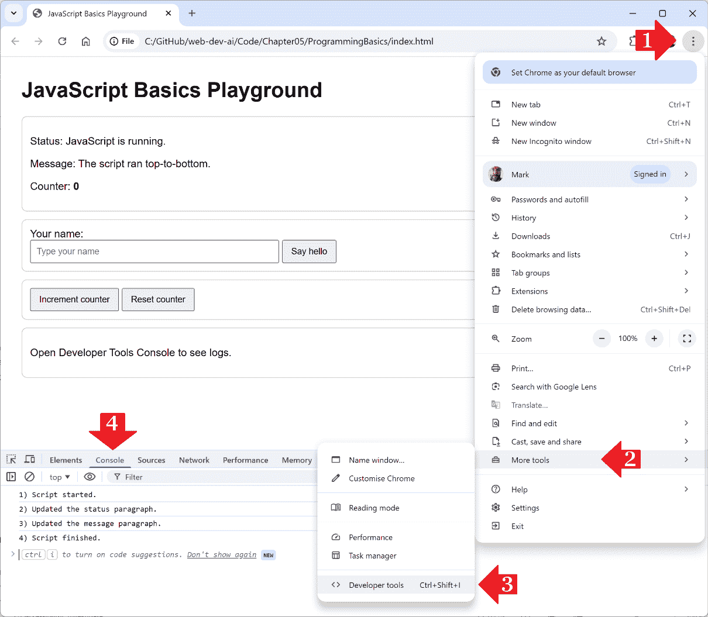

*图 5.1：在开发者工具中查看控制台输出*

**最佳实践**：与其通过菜单导航，不如学习在 Web 浏览器中切换显示**开发者工具**的键盘快捷键，因为在 Web 开发过程中你会一直用到它。对于 Windows 上的 Chrome，快捷键是 `Ctrl` + `Shift` + `I`。

这表明 JavaScript 在打开网页时立即执行，按编写顺序执行。你将看到页面上的状态和消息元素已更新，控制台日志按顺序出现。如果你在 `code-order.js` 中移动代码语句，输出会发生变化。如果你在创建 `messageElement` 之前引用它，会得到一个错误。

## 为代码添加注释文档

注释是给阅读代码的人看的，不是给浏览器看的。JavaScript 引擎会完全忽略它们。注释的存在是为了解释代码为什么存在、阐明棘手的逻辑，以及在你实验或调试时暂时禁用代码。用得好，注释有助于读者理解意图；用得不好，它们会增加杂乱，或因过时而误导读者。

JavaScript 支持两种注释。

- 单行注释以 `//` 开头。该行 `//` 之后的所有内容都会被忽略。这些最适合简短解释或快速备注。它们也常用于解释为什么以某种方式做事，这通常比解释代码做什么更有价值：

```javascript
// This is a single-line comment.
let counter = 0; // This comment might explain why the variable named counter exists and has been initialized to zero.
```

- 多行注释以 `/*` 开头，以 `*/` 结尾。内部的所有内容都会被忽略，即使跨越多行：

```javascript
/*
  This is a multi-line comment.
  It can span several lines
  and is useful for longer explanations.
*/
let total = 10;
```

多行注释常用于文件级别的解释，或在测试期间暂时注释掉一块代码，如下面的代码所示：

```javascript
/*
function calculateTotal(price, tax) {
  return price + tax;
}
*/
```

使用此技术时要小心。很容易忘记被注释掉的代码，从而留下无用的逻辑。

关于与注释相关的措辞的一点说明。你可以通过在代码语句上方或后方添加描述性文本来**添加注释**（comment code）。你可以通过在语句前或周围添加注释字符来**注释掉代码**（comment out code），使其失效。**取消注释**（Uncommenting）意味着移除注释字符。

当代码表达了*如何*做某事但没有表达*为什么*时，注释特别有用。例如，以下代码显而易见：

```javascript
counter = counter + 1;
```

解释*为什么*的注释可能实际上有帮助：

```javascript
// Increment the counter to track user clicks for analytics.
counter = counter + 1;
```

避免仅仅重复代码已有内容的注释。这会在不增加理解的情况下增加杂乱。任何能读懂 JavaScript 的人都知道该行代码在做什么。

在与 AI 助手协作时，注释也很有用。当你请求 AI 协助处理一个函数时，一个描述任务的简短注释往往能获得更好的结果：

```javascript
// Update the UI so it reflects the current counter value.
function renderCounter() {
  counterEl.textContent = String(counter);
}
```

最后，请记住注释不运行、不能修复 Bug，也不能替代清晰的命名。如果你发现自己写很长的注释来解释令人困惑的代码，这通常意味着代码本身应该被简化。好的 JavaScript 应该足够清晰，以至于注释主要解释为什么，而不是是什么或怎么做。

## 向控制台记录日志


### 浏览器控制台

浏览器控制台是你在编写 JavaScript 时应该首先求助的调试工具。将数据记录到控制台可以让你看到代码在运行时正在做什么，而不会改变页面上显示的内容。当某些行为表现异常时，控制台通常是你应该首先查看的地方。

## 使用 `console.log()` 向控制台写入

向控制台写入的最常用方法是 `console.log()`。你将值传递给它，浏览器会按照接收顺序将它们打印到控制台，如下面的代码所示：

```javascript
console.log("Hello from JavaScript");
```

当这条语句运行时，文本会出现在 **开发者工具控制台** 中。它完全不会影响页面本身。

## 记录变量

你可以记录变量以查看其当前值。当你不确定变量是否包含你预期的内容时，这非常有用：

```javascript
let age = 42;
console.log(age);
```

控制台将显示 `42`。如果没有显示，你就知道问题不在代码的后续部分。这就是你缩小 Bug 范围的方法。

## 记录多个值

你可以在一次调用中记录多个值。JavaScript 会从左到右打印它们，并用空格分隔：

```javascript
console.log(typeof age, age);
```

以下是逐步发生的情况：

1. 首先，计算 `typeof age`。`typeof` 运算符返回一个 `string`，描述存储在名为 `age` 的变量中的值的类型，例如 `"number"`、`"string"` 或 `"boolean"`。
2. 其次，计算 `age` 本身的当前值。
3. 最后，将两个结果都传递给 `console.log`，它会将它们一起打印。在控制台中，你会看到类似以下的输出：

```
number 42
```

这种向控制台记录日志的模式非常常见，因为它一次性回答了两个问题：值是什么，类型是什么？

## 组合字符串、标签与值

字符串和标签经常与值结合使用，以使日志更易于阅读，如下面的代码所示：

```javascript
console.log("Age:", age);
console.log("Type of age:", typeof age);
```

当你有很多日志并需要快速浏览输出时，这特别有帮助。

## 其他控制台方法

还有其他相关的控制台方法值得了解，即使你主要使用 `console.log`，如下面的代码所示：

```javascript
console.warn("This is a warning");
console.error("This is an error");
```

警告和错误在控制台中具有不同的样式，使它们更加突出。这在浏览大量输出时会有所帮助。

一个实用的经验法则是在学习时早记录、多记录，一旦代码正常工作就移除或减少日志。记录日志不是软弱或缺乏经验的表现。它是让不可见的程序状态变得可见的方法。

### 提示

除了 `console.log` 之外，最有用的控制台方法有哪些？

## 使用模板字面量自定义输出

模板字面量允许你将变量和表达式直接嵌入 `string` 中，而不必手动拼接各个片段。

在模板字面量中，任何写为 `${...}` 的内容都会作为 JavaScript 进行求值。结果会被转换为 `string` 并插入该位置。例如，下面的代码：

```javascript
let message = `Message: Title is "${pageTitle}", clicks = ${clicks}.`;
```

前面的代码语句通过将变量值插入字符串来构建一条可读的消息。让我们分解一下该语句：

* 文本包裹在反引号中，而不是引号中。反引号定义了一个模板字面量。
* `Message: Title is "` 只是字面文本。
* `${pageTitle}` 会被替换为存储在 `pageTitle` 变量中的当前值。
* `", clicks = "` 是更多的字面文本。
* `${clicks}` 会被替换为存储在 `clicks` 变量中的当前值。
* `.` 是最后一个字面字符。

如果 `pageTitle` 是 `"Playground"` 而 `clicks` 是 `1`，JavaScript 生成的最终 `string` 为：

```
Message: Title is "Playground", clicks = 1.
```

## 用于存储数据的变量

变量是你存储信息以便稍后使用的方式。在最新的 JavaScript 中，你主要会看到用 `let` 和 `const` 声明的变量。变量是你计算机内存中一个命名的位置，你的程序在其中存储一个值。该值可能是一个数字、一些文本、一个 `true` 或 `false` 值，或者是更复杂的东西，如对象。

### 最佳实践：`var` 与 `let`/`const`

你会在较旧的 JavaScript 代码和 AI 生成的片段中遇到 `var`。`var` 是声明变量的原始方式，但它具有令人困惑的作用域行为，因为用 `var` 声明的变量是函数作用域的，而不是块作用域的，这意味着它们可以从 `if` 块和循环中“泄漏”出来。现代 JavaScript 改用 `let` 和 `const`。如果你看到 `var`，在脑海中用 `let` 替换它。

### 提示

请解释 JavaScript 作用域以及全局、函数和块作用域的区别，并附带示例。

例如，你可能会存储用户的名字或一个计数器，用于跟踪按钮被点击了多少次。`let` 用于值预期会改变的情况。`const` 用于变量应始终指向同一值的情况。

### 最佳实践：选择 `let` 还是 `const`

一个常见的初学者错误是到处使用 `const`，然后惊讶地发现 JavaScript 拒绝让值改变。经验法则很简单。如果值会改变，使用 `let`。如果不应该改变，使用 `const`。

此示例展示了重新赋值如何工作，以及为什么 `const` 变量不能被重新赋值为新值。

在 `index.html` 中，在现有的 `<script>` 元素之后，添加一个新的 `<script>` 元素来引用一个名为 `variables.js` 的新代码文件，如下面代码中高亮显示的部分：

```html
<script src="code-order.js"></script>
<script src="variables.js"></script>
```

在与 HTML 文件相同的文件夹中，创建名为 `variables.js` 的代码文件，并输入以下代码：

```javascript
statusElement.textContent = "Status: Demonstrating variables.";
let clicks = 0; // This value can change.
const pageTitle = "Playground"; // This value will never change.
messageElement.textContent = `Message: Title is "${pageTitle}", clicks = ${clicks}.`;
clicks = clicks + 1;
console.log("After increment, clicks =", clicks);
messageElement.textContent = `Message: Title is "${pageTitle}", clicks = ${clicks}.`;
// Try uncommenting the next line to see the error.
// pageTitle = "New Title";
```

请注意，`variables.js` 使用了 `statusElement` 和 `messageElement`，即使它们是在 `code-order.js` 中声明的。这之所以有效，是因为所有 `<script>` 标签共享同一个全局作用域。就好像所有代码都在一个巨大的文件中一样。目前，你可以把它想象成一个共享的全局作用域。这对学习很方便，但在大型项目中会变得麻烦。在后续章节中，你将学习 JavaScript 模块，它为每个文件提供自己的私有作用域。

刷新网页并注意以下几点：

* 名为 `clicks` 的变量从 `0` 变为 `1`。
* 名为 `pageTitle` 的变量不会改变。你仍然可以在 DOM 中更改页面标题，但变量 `pageTitle` 不能被重新赋值。
* 如果你取消注释最后一条语句并刷新页面，你将在 **控制台** 中看到一条错误消息，如 *图 5.2* 所示：

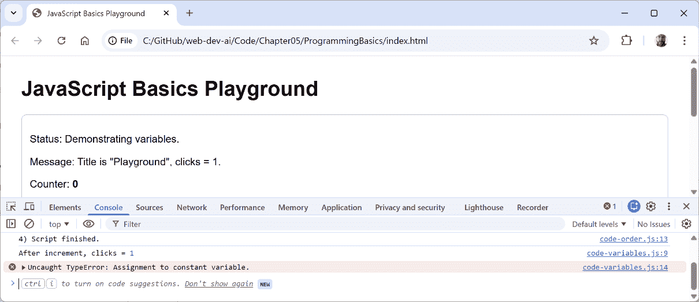

注释掉最后一条语句以移除错误。

## 作用域：变量的生存空间

作用域描述了变量可以在代码的哪些地方被访问。换句话说，它回答了这样一个问题：这个变量存在于哪里，谁可以使用它？


## 理解作用域

理解作用域有助于避免变量意外丢失、被覆盖或共享范围超出预期的 Bug。

在本章中，你将遇到 JavaScript 中三种主要的作用域类型。

### 全局作用域

位于**全局作用域**中的变量可以在脚本的任何位置访问。

在前面的示例中，`statusElement` 和 `messageElement` 等变量在一个文件中声明，然后在另一个文件中使用：

```javascript
const statusElement = document.querySelector("#status");
```

因为两个 `<script>` 元素运行在同一个页面上，它们共享同一个全局作用域。这就是为什么 `variables.js` 可以使用 `code-order.js` 中声明的变量。

这对小型示例很方便，但在大型应用中会变得有风险，因为任何脚本都可以更改这些值。

### 函数作用域

在函数内部声明的变量仅存在于该函数内部：

```javascript
function makeGreeting(name) {
  const message = `Hello, ${name}!`;
  return message;
}
```

在前面的代码中，`message` 仅存在于 `makeGreeting` 内部。如果你尝试在函数外部使用它，JavaScript 会抛出错误。这很有用，因为它将临时值限制在内部，防止意外干扰代码的其他部分。

### 块作用域

**块作用域**适用于使用 `let` 和 `const` 在花括号 `{}` 内声明的变量，例如在 `if` 语句或循环中：

```javascript
if (true) {
  const secret = "hidden value";
  console.log(secret); // Works here
}
console.log(secret); // Error: secret is not defined
```

`secret` 变量仅存在于 `if` 代码块内部。

这是 `let` 和 `const` 优于 `var` 的原因之一。较旧的 `var` 关键字会忽略块边界，可能导致令人困惑的 Bug。

### 作用域与事件处理程序

事件处理程序引入了另一层作用域：

```javascript
let counter = 0;
incrementBtn.addEventListener("click", () => {
  counter = counter + 1;
});
```

在前面的代码示例中：

* `counter` 位于外部（全局）作用域
* `() => {}` 箭头函数创建了自己的作用域
* 该函数仍可访问 `counter`，因为它是在外部定义的

这种行为称为**闭包**。你目前不需要掌握该术语，但它解释了为什么事件处理程序能记住先前定义的变量。

将变量保持在最小的合理作用域内：

* 对于临时值，使用块作用域（`let` 或 `const`）。
* 使用函数作用域来组织逻辑。
* 尽量少用全局作用域，尤其是在程序变大时。

如果一个变量到处可访问，它就可能从任何地方被更改。这就是微妙 Bug 开始出现的地方。

你很快会看到，某些操作（如 `document.querySelector()`）在未找到内容时会返回一个名为 `null` 的特殊值。掌握作用域有助于你理解值的来源，而理解 `null` 等值有助于你处理缺失的情况。

## 数据类型：数字、字符串、布尔值、数组和对象

JavaScript 有几种核心数据类型，你将一直用到它们：

* **数字** 用于计数和计算。
* **字符串** 用于文本，写在引号内。
* **布尔值** 为 `true` 或 `false`，用于决策。
* **数组** 是有序的值列表。
* **对象** 将相关值按命名属性分组。

本节展示常见数据类型及其行为。

在 `index.html` 中，在现有的 `<script>` 元素之后，添加一个新的 `<script>` 元素来引用名为 `data-types.js` 的新代码文件，如下面的代码所示：

```html
<script src="data-types.js"></script>
```

在与 HTML 文件相同的文件夹中，创建名为 `data-types.js` 的代码文件，并输入以下代码：

```javascript
statusElement.textContent = "Status: Demonstrating data types.";
const age = 54;                       // number
const firstName = "Mark";             // string
const isMember = true;                // boolean
messageElement.textContent = `Message: ${firstName} is ${age} years old. Member: ${isMember}.`;
console.log(typeof age, age);
console.log(typeof firstName, firstName);
console.log(typeof isMember, isMember);
// Two types you'll use constantly:
const favoriteShows = ["Andor", "Heated Rivalry"]; // array (list)
const user = { name: "Mark", age: 42 }; // object (grouped properties)
console.log("Array example:", favoriteShows);
console.log("Object example:", user);
```

刷新网页，注意浏览器允许你在控制台中展开这些对象以检查其属性。这比尝试手动打印所有内容要信息量大得多，如*图 5.3*所示：

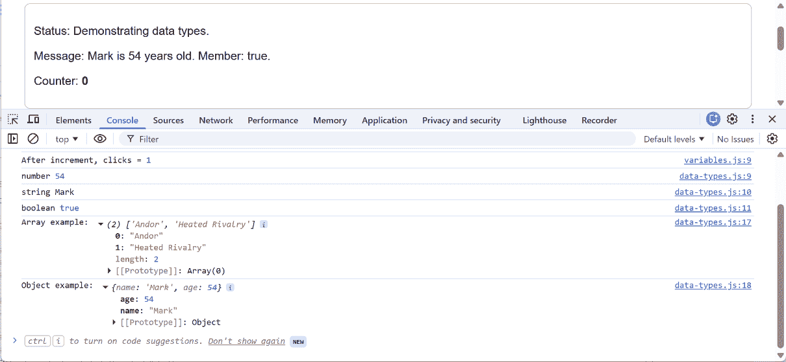

**图 5.3：** 将不同数据类型的变量记录到控制台

当你开始使用 DOM 和 API 时，数组和对象会不断出现，因此熟悉如何将它们记录到控制台以进行调试尤为重要。

**提示：** 如何分步使用 Chrome DevTools 调试 JavaScript？展示如何在 JavaScript 中使用断点以及它们为何有用。

## 函数：可复用代码、参数、返回值

**函数** 是执行特定任务的可复用代码块。你定义一次函数，然后在需要时随时调用。这使代码保持可读并避免重复。函数让 JavaScript 具有可复用性。

函数可以接受输入（称为参数），并可以返回结果。即使 JavaScript 代码看起来很复杂，通常也只是函数调用其他函数。

此示例将定义函数、调用它们，然后使用返回值更新页面。

在 `index.html` 中，在现有的 `<script>` 元素之后，添加一个新的 `<script>` 元素来引用名为 `functions.js` 的新代码文件，如下面的代码所示：

```html
<script src="functions.js"></script>
```

在与 HTML 文件相同的文件夹中，创建名为 `functions.js` 的代码文件，并输入以下代码：

```javascript
statusElement.textContent = "Status: Demonstrating functions.";
function makeGreeting(personName) {
  return `Hello, ${personName}!`;
}
function showMessage(text) {
  messageElement.textContent = `Message: ${text}`;
}
const greeting = makeGreeting("Captain Picard");
console.log("Greeting returned from function:", greeting);
showMessage(greeting);
```

注意前面代码的以下几点：

* `makeGreeting()` 返回一个 `string` 值。
* `showMessage()` 执行一个动作。

刷新网页，注意使用函数返回的 `string` 值的消息显示在网页和控制台中，如*图 5.4*所示：

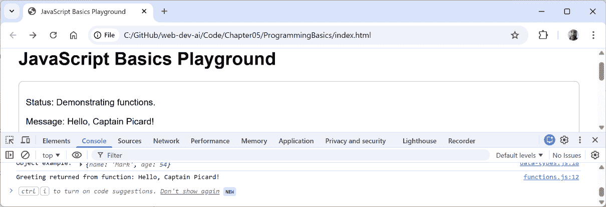

**图 5.4：** 调用函数以返回字符串值

保持函数简短清晰，会让后续的 DOM 代码更易于理解和调试。

**提示：** JavaScript 中的调用栈是什么，它与函数执行有何关系？

## 连接事件处理程序

`addEventListener()` 是 DOM 元素上可用的方法。它让你监听特定事件，并在事件发生时注册一个要运行的函数。你不是现在运行该函数，而是将其交给浏览器，以便稍后运行。

例如：

```javascript
incrementBtn.addEventListener("click", () => {
  counter = counter + 1;
  renderCounter();
});
```

第一个参数 `"click"` 是事件类型。它告诉浏览器你关心哪种事件。在本例中，它是鼠标或触摸点击按钮。


### 事件处理程序和箭头函数

第二个参数是一个函数。这个函数被称为 `event handler`（事件处理程序）：

```
() => {
  counter = counter + 1;
  renderCounter();
}
```

这是一个 `arrow function`（箭头函数）。它定义了一个小型的、无参数的匿名函数。你不会自己调用它。浏览器会在每次点击按钮时自动调用它。

`counter` 是一个存在于函数外部的变量。每次点击都会将其值加一。因为函数在每次点击时都会再次运行，所以该值会随时间持续增加。

通常，`renderCounter` 会读取 `counter` 的当前值并将其写入 DOM，以便用户看到新的数字。

这里有一个细节很重要：时机。箭头函数内部的代码在用户点击按钮之前都不会运行。JavaScript 完成页面加载，设置好事件监听器，然后等待。当点击发生时，浏览器会在正确的时刻调用处理程序函数。

用通俗的英语来说，这段代码的意思是：*当点击增加按钮时，将计数器加一，然后更新显示以匹配新值。*

`Prompt`：什么是 JavaScript 中的事件冒泡和捕获？展示一个简单的可视化解释。

### 条件语句：带有布尔值和比较的 if / else

JavaScript 中的决策是通过 `conditional statements`（条件语句）来实现的。最常见的是 `if` 语句。它允许你的代码根据某事是 `true`（真）还是 `false`（假）来选择不同的路径。

例如，你可能会在允许提交之前检查表单字段是否为空。这就是 JavaScript 如何选择一条路径，而不是每次都运行相同的代码。

本节使用输入字段并检查用户是否输入了任何内容。它还以适合初学者的方式引入了比较和真值。

在 `index.html` 中，在现有的 `<script>` 元素之后，添加一个新的 `<script>` 元素来引用一个名为 `conditionals.js` 的新代码文件，如下面的代码所示：

```
<script src="conditionals.js"></script>
```

在与 HTML 文件相同的文件夹中，创建一个名为 `conditionals.js` 的代码文件，并输入以下代码：

```
const nameInput = document.querySelector("#nameInput");
const helloBtn = document.querySelector("#helloBtn");
statusElement.textContent = "Status: Demonstrating conditionals.";
helloBtn.addEventListener("click", () => {
  const typedName = nameInput.value; // string (possibly empty)
  if (typedName.trim() === "") {
    messageElement.textContent = 
      "Message: Please type your name first.";
  } else {
    messageElement.textContent = 
      `Message: Hello, ${typedName}!`;
  }
});
```

关于前面代码的注意事项：

* `trim()` 会移除前导或尾随空白字符，因此 `" "` 会被视为空。
* `===` 检查相等性而不进行类型强制转换，这避免了许多令人困惑的 bug。

`Good practice`（良好实践）：类型强制转换是 JavaScript 自动将值从一种类型转换为另一种类型的习惯，当它认为可以使操作 `work`（生效）时就会发生。这通常在没有错误或警告的情况下悄悄发生，这也是为什么它会给初学者带来如此多困惑的原因。宽松相等运算符 `==` 允许类型强制转换。如果两个值的类型不同，JavaScript 会尝试在比较之前转换其中一个或两个。这原本是为了方便，但它制造了难以发现的意外和 bug。严格相等运算符 `===` 不允许类型强制转换。类型和值必须完全匹配，比较结果才为 `true`。除非你有非常充分的理由，否则请对比较使用严格相等运算符。

刷新网页，点击 `Say hello` 按钮，并观察响应。然后输入你的名字，点击 `Say hello` 按钮，并观察响应，如 `Figure 5.5` 所示：

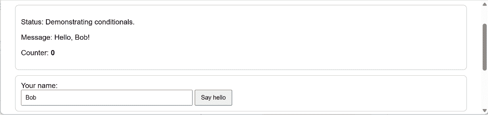

Figure 5.5: 在向 Bob 说 Hello 之前进行条件检查

我们尚未添加任何代码来更改 `Counter: 0`。

### 循环：重复工作和遍历数组

循环允许你多次重复一个动作。你不必一次又一次地编写同一行代码，而是告诉 JavaScript 运行多少次，或者一直运行直到条件发生变化。在处理数组或页面上的元素组时，循环特别有用。

本节多次更新消息并记录日志，然后遍历一个数组。

在 `index.html` 中，在现有的 `<script>` 元素之后，添加一个新的 `<script>` 元素来引用一个名为 `loops.js` 的新代码文件，如下面的代码所示：

```
<script src="loops.js"></script>
```

在与 HTML 文件相同的文件夹中，创建一个名为 `loops.js` 的代码文件，并输入以下代码：

```
statusElement.textContent = "Status: Demonstrating loops.";
// 一个简单的 for 循环从 1 计数到 5。
let output = "Counting: ";
for (let i = 1; i <= 5; i++) {
  output += i + " ";
  console.log("i is", i);
}
messageElement.textContent = "Message: " + output.trim();
// 遍历数组（列表）
const languages = ["HTML", "CSS", "JavaScript", "Python"];
for (let i = 0; i < languages.length; i += 1) {
  console.log(`Language ${i}:`, languages[i]);
}
```

关于前面代码的注意事项：

* `for` 循环有三个部分：开始 (`let i = 1`)、条件 (`i <= 5`) 和步进即增量 (`i++`)。
* 数组使用 `length`，索引从 `0` 开始。

刷新网页，注意到 `for` 循环从 1 增加到 5，并且数组被遍历了所有项目，如 `Figure 5.6` 所示：

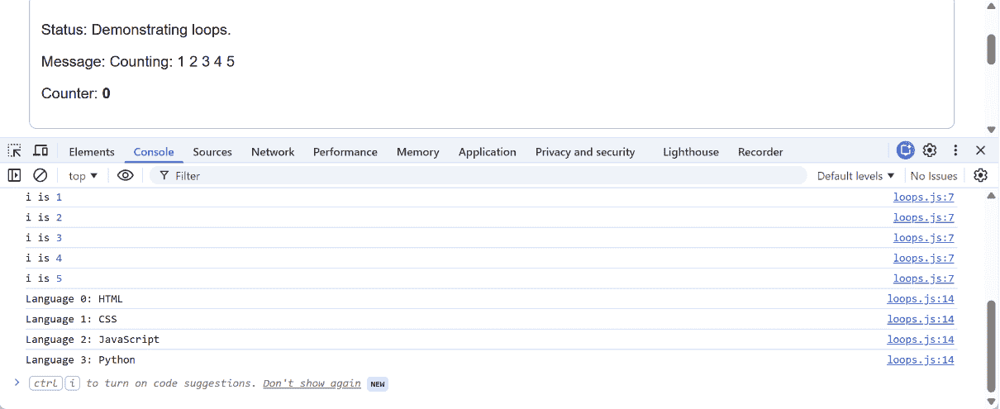

Figure 5.6: 循环

`Prompt`：请总结 JavaScript 中所有的条件语句和循环语句，并为每一个包含代码示例。

### 错误处理

错误是编写 JavaScript 的正常组成部分。你在学习过程中会不断看到它们，在生产代码中仍然会看到它们。

到目前为止，你一直依赖浏览器控制台来显示错误。这很有用，但有时你也希望在代码中处理错误，以便你的程序能够优雅地失败，而不是崩溃。JavaScript 使用 `try` 和 `catch` 提供了一种内置的方法来实现这一点。

`try` 块包含可能失败的代码。如果发生错误，JavaScript 会停止运行该块并跳转到 `catch` 块：

```
try {
  const result = riskyOperation();
  console.log(result);
} catch (error) {
  console.error("Something went wrong:", error);
}
```

前面的代码意味着：尝试运行 `riskyOperation()` 函数并记录结果，但如果出现问题，捕获错误并进行处理。

作为另一个例子，你可能尝试查找一个名为 `status` 的元素并更改其文本内容以向用户显示消息：

```
const element = document.querySelector("#status");
try {
  element.textContent = "Updated safely";
} catch (error) {
  console.error("Failed to update element:", error);
}
```

在前面的代码中，如果 `element` 为 `null`，尝试访问 `textContent` 通常会抛出错误并停止执行。有了 `try` 和 `catch`，你可以处理这种情况，而不是让它静默或不可预测地崩溃。

也就是说，在这种情况下，简单的 `if (element)` 检查通常更好。当你无法轻松预测或防止错误时，请使用 `try` 和 `catch`。

## 抛出你自己的错误

你也可以使用 `throw` 故意创建错误。当你检测到无效情况时，这很有用：

```
function greet(name) {
  if (!name) {
    throw new Error("Name is required");
  }
  return `Hello, ${name}!`;
}
```

然后在使用该函数的地方处理它：


```javascript
try {
  const message = greet("");
  console.log(message);
} catch (error) {
  console.error(error.message);
}
```

这种模式能清楚地表明何时出错，并让你能做出适当的响应。

你也可以添加一个 `finally` 代码块。无论是否发生错误，它都会运行：

```javascript
try {
  console.log("Trying something...");
} catch (error) {
  console.error("It failed:", error);
} finally {
  console.log("This always runs");
}
```

使用 `finally` 执行清理任务，例如重置 UI 状态或停止加载指示器。

## 何时使用错误处理

初学者常犯的一个错误是过度使用 `try` 和 `catch`。

在以下情况下使用它：

- 你调用的代码可能会不可预测地失败
- 你想防止整个程序停止运行
- 你需要恢复执行或显示用户友好的消息

在以下情况下避免使用它：

- 简单的条件检查就能防止错误
- 你用它来隐藏 bug 而不是修复它们

例如，这样做更好：

```javascript
if (element) {
  element.textContent = "Updated";
}
```

而不是这样：

```javascript
try {
  element.textContent = "Updated";
} catch {}
```

第二种版本是隐藏问题而非解决问题。

**良好实践**：将错误处理视为安全网，而非主要的控制流工具。

大多数情况下，你应该：

- 编写避免错误的代码（通过检查值）
- 出问题时使用控制台进行调试
- 在需要优雅处理意外失败时添加 `try`/`catch`

随着程序规模增长，错误会变得更隐蔽。有些来自用户输入，有些来自缺失的元素、时序问题或意外的数据。

能够捕获并处理错误，意味着你的代码能智能响应，而不是以令人困惑的方式中断。这也让 AI 生成的代码测试更安全，因为你可以隔离可能失败的部分并检查实际错误。

## 结合事件综合实践

本节将基础知识串联起来，暂不深入 DOM。它用到了变量、函数、条件判断和事件处理器。

在 `index.html` 中，在现有的 `<script>` 元素之后，添加一个新的 `<script>` 元素来引用一个名为 `events.js` 的新代码文件，如下所示：

```html
<script src="events.js"></script>
```

在与 HTML 文件相同的文件夹中，创建名为 `events.js` 的代码文件，并输入以下代码：

```javascript
const counterElement = document.querySelector("#counterValue");
const incrementBtn = document.querySelector("#incrementBtn");
const resetBtn = document.querySelector("#resetBtn");
statusElement.textContent = "Status: Putting it together.";
let counter = 0;
function renderCounter() {
  counterElement.textContent = String(counter);
  messageElement.textContent = `Message: Counter is now ${counter}.`;
}
incrementBtn.addEventListener("click", () => {
  counter = counter + 1;
  renderCounter();
});
resetBtn.addEventListener("click", () => {
  counter = 0;
  renderCounter();
});
// Initial render so the UI matches the variable.
renderCounter();
```

刷新网页，注意每次点击 **Increment counter** 按钮，计数器都会加一。点击三次后，输出为 **Counter: 3**，如 *图 5.7* 所示：

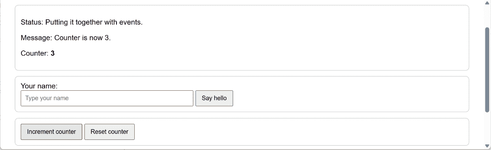

图 5.7：通过按钮点击事件递增计数器

这是大多数交互式 Web 代码的形态。状态存在于像 `counter` 这样的变量中，行为存在于像 `renderCounter` 这样的函数中，网页上的用户操作触发事件。

AI 可以快速生成 JavaScript。这不是难点。难点在于决定当用户点击、输入、提交或更改某些内容时应该发生什么。在计数器示例中，你需要知道数字存储在哪里、哪个按钮会改变它、以及页面的哪部分必须在之后更新。这就是要练习的技能：跟踪移动的部件，然后判断代码是否符合你想要的行为。

既然你已经了解了 JavaScript 和语言的主要组成部分，让我们通过一个小练习来测试你所学的内容。

### 小练习与测验

使用同一个页面，进行一些小修改和添加：

- 将计数器步长改为每次加 5
- 添加一个“递减”按钮
- 将问候语改为始终使用大写

**提示**：请测试我关于 JavaScript 基础知识的掌握情况，比如声明变量和编写简单函数。例如，“`const` 和 `let` 有什么区别？”

在下一节中，我们将通过查看 DOM 将这些基础知识与浏览器本身联系起来。那是变量、函数和事件汇聚在一起、改变用户在页面上所见所交互内容的地方。

### DOM 操作

在 `Chapter05` 文件夹中，创建一个名为 `DomManipulation` 的文件夹，并在其中创建一个名为 `index.html` 的文件，包含以下代码：

你可以从以下链接下载此网页的源代码：[`github.com/markjprice/web-dev-ai/blob/main/Code/Chapter05/DomManipulation/index.html`](https://github.com/markjprice/web-dev-ai/blob/main/Code/Chapter05/DomManipulation/index.html)


### DOM 操作演练场

## HTML 结构

```html
<!doctype html>
<html lang="en-US">
<head>
  <meta charset="utf-8" />
  <meta name="viewport" content="width=device-width, initial-scale=1" />
  <title>DOM Manipulation Playground</title>
  <link rel="stylesheet" href="styles.css" />
</head>
<body>
  <h1>DOM Manipulation Playground</h1>
  <p class="muted">Open Developer Tools Console. Reference one script example at a time at the bottom.</p>
  <div class="grid">
    <section class="card" aria-labelledby="card-status">
      <h2 id="card-status">1) Status panel</h2>
      <p id="statusText">Status: Waiting…</p>
      <div class="row">
        <button id="btnSetStatus" type="button">Set status</button>
        <button id="btnClearStatus" type="button">Clear status</button>
      </div>
    </section>
    <section class="card" aria-labelledby="card-profile">
      <h2 id="card-profile">2) Profile editor</h2>
      <div class="row">
        <input id="nameInput" type="text" placeholder="Name" />
        <select id="moodSelect">
          <option value="neutral">Neutral</option>
          <option value="productive">Productive</option>
          <option value="sleepy">Sleepy</option>
          <option value="chaotic">Chaotic</option>
        </select>
        <button id="btnApplyProfile" type="button">Apply</button>
      </div>
      <p>Preview: <strong id="profilePreview">Anonymous (neutral)</strong></p>
    </section>
    <section class="card" aria-labelledby="card-todo">
      <h2 id="card-todo">3) Quick to-do list</h2>
      <div class="row">
        <input id="todoInput" type="text" placeholder="Add a task (e.g., 'Refactor CSS')" />
        <button id="btnAddTodo" type="button">Add</button>
        <button id="btnClearDone" type="button">Clear done</button>
      </div>
      <ul id="todoList" class="muted">
        <li class="pill" data-done="false">
          <input type="checkbox" aria-label="Mark done" />
          <span>Write the first DOM example</span>
          <button type="button" data-action="remove">Remove</button>
        </li>
      </ul>
      <p class="muted" id="todoCount">0 items</p>
    </section>
    <section class="card" aria-labelledby="card-theme">
      <h2 id="card-theme">4) Theme + visibility</h2>
      <div class="row">
        <button id="btnToggleTheme" type="button">Toggle theme</button>
        <button id="btnToggleTodo" type="button">Show/Hide to-do card</button>
      </div>
      <p class="muted">This section is perfect for practicing class toggling and attribute changes.</p>
    </section>
  </div>
  <script src="example1.js"></script>
</body>
</html>
```

## CSS 样式表

创建一个名为 `styles.css` 的文件。为了节省这本印刷书的空间，您可以从以下链接下载此网页的源代码：[`github.com/markjprice/web-dev-ai/blob/main/Code/Chapter05/DomManipulation/styles.css`](https://github.com/markjprice/web-dev-ai/blob/main/Code/Chapter05/DomManipulation/styles.css)

## DOM 操作示例

现在让我们看看一些酷炫且实用的 DOM 操作示例，它们可以插入到该页面中。一次只使用一个示例：将一段代码块粘贴到 `<script>` 标签中，刷新，尝试一下，然后用下一个代码块替换它。

## 示例 1：选择元素并更改文本

### 本示例教授的内容

* 使用 `querySelector` 选择 DOM 元素
* 使用 `textContent` 编写 UI
* 响应按钮点击

### 代码：`example1.js`

将以下代码添加到名为 `example1.js` 的文件中，该文件由网页底部的 `<script>` 元素引用：

```javascript
const statusText = document.querySelector("#statusText");
const btnSetStatus = document.querySelector("#btnSetStatus");
const btnClearStatus = document.querySelector("#btnClearStatus");
btnSetStatus.addEventListener("click", () => {
  const now = new Date();
  statusText.textContent = `Status: Updated at ${now.toLocaleTimeString("en-GB")}`;
});
btnClearStatus.addEventListener("click", () => {
  statusText.textContent = "Status: Waiting…";
});
```

### 良好实践

使用 `textContent`（而非 `innerHTML`）在 DOM 中设置文本。`textContent` 将所有内容视为纯文本，这很安全。`innerHTML` 将字符串解释为 HTML，因此如果该字符串来自用户输入，攻击者可能会注入恶意代码。仅当您完全控制内容并了解风险时，才使用 `innerHTML`。

### 提示

请结合示例和安全影响，解释 `textContent`、`innerText` 和 `innerHTML` 之间的区别。

### 测试示例

刷新网页，在 1) 状态面板 框中，点击“设置状态”和“清除状态”按钮，并注意每次点击时更新的文本。例如，点击“设置状态”后，您将看到当前时间，如图 5.8 所示：

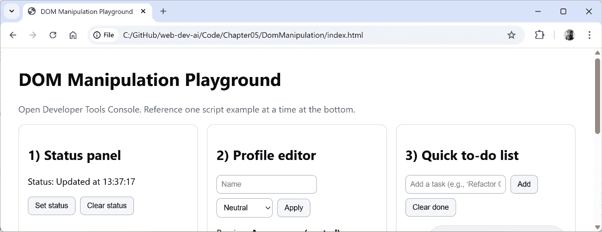

图 5.8：使用 DOM 更新文本

## 处理缺失值：`null` 和 `undefined`

当您开始使用 DOM 时，偶尔会遇到值缺失的情况。JavaScript 使用两个特殊值来表示这种情况：`null` 和 `undefined`。

它们看起来相似，但含义略有不同。

### DOM 中的 `null`

在 DOM 上下文中，`null` 表示未找到任何内容。`null` 是一个显式的“无值”结果。当某事物不存在时，API 通常会返回它。

例如：

```javascript
const element = document.querySelector("#doesNotExist");
console.log(element); // null
```

在这种情况下，浏览器在页面中搜索具有该 ID 的元素，但未找到，因此返回了 `null`。如果您尝试将该结果当作真实元素使用，代码将会失败：

```javascript
element.textContent = "Hello"; // Error
```

初学者经常犯这个 DOM 错误。

一种安全的模式是在使用值之前检查 `null`：

```javascript
if (element !== null) {
  element.textContent = "Hello";
}
```

或者更简洁地：

```javascript
if (element) {
  element.textContent = "Hello";
}
```

### JavaScript 中的 `undefined`

`undefined` 表示未分配值。因此 `undefined` 意味着变量存在，但未分配给它任何值：

```javascript
let message;
console.log(message); // undefined
```

当您访问不存在的事物时，也会出现它：

```javascript
const user = { name: "Mark" };
console.log(user.age); // undefined
```

这里，`user` 对象存在，但 `age` 属性不存在，因此 JavaScript 返回 `undefined`。

### 关键区别

区别很微妙但很有用：

* `null` 通常来自 API 或函数，表示“未找到任何内容”。
* `undefined` 通常意味着“此值从未设置”或“不存在”。

在日常代码中，您通常以相同的方式对待它们：作为某些内容缺失的信号。

### 使用 DOM 时的良好实践

当您从页面选择元素时：

* 假设 `querySelector` 可能返回 `null`
* 如果有任何疑问，在使用结果前进行检查

例如：

```javascript
const btn = document.querySelector("#myButton");
if (!btn) {
  console.warn("Button not found");
} else {
  btn.addEventListener("click", () => {
    console.log("Clicked");
  });
}
```

随着页面的增长和 JavaScript 与更多动态内容交互，这种防御性检查变得更加重要。

当 JavaScript 中出现莫名其妙的故障时，通常是因为值为 `null` 或 `undefined`，而您的代码仍尝试使用它。一旦您识别出这两个值，这些错误就更容易发现和修复。

介绍完 `null` 和 `undefined` 后，接下来的示例可以专注于安全地更改页面。

## 示例 2：读取用户输入并更新 DOM

### 本示例教授的内容

* 从输入控件读取值
* `trim()` 函数
* 条件语句
* 更新单个元素


# DOM 操作示例

## 示例 2：个人资料编辑器

将以下代码块添加到名为 `example2.js` 的文件中，该文件由网页底部的 `<script>` 元素引用：

```javascript
const nameInput = document.querySelector("#nameInput");
const moodSelect = document.querySelector("#moodSelect");
const btnApplyProfile = document.querySelector("#btnApplyProfile");
const profilePreview = document.querySelector("#profilePreview");
btnApplyProfile.addEventListener("click", () => {
  const name = nameInput.value.trim();
  const mood = moodSelect.value;
  const displayName = name === "" ? "Anonymous" : name;
  profilePreview.textContent = `${displayName} (${mood})`;
});
```

刷新网页，在 **2) Profile editor（个人资料编辑器）** 框中，输入一个包含姓名前后额外空格的姓名，从下拉列表中选择一个心情选项，点击 **Apply（应用）** 按钮，注意表单编辑的摘要会出现在 **Preview（预览）** 标签之后，如 *Figure 5.9（图 5.9）* 所示：

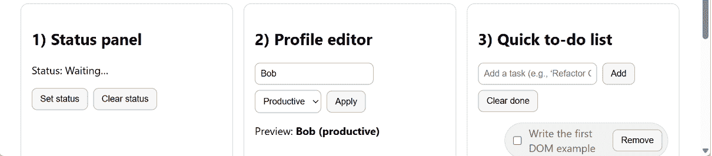

Figure 5.9: Selecting form options using the DOM

## 示例 3：添加、移除和计数列表项

本节介绍如何以编程方式创建 DOM 元素。内容包括：

* 使用 `createElement` 创建新的 HTML 元素
* 使用 `append` 将 HTML 元素添加到现有父元素中
* 使用 `dataset` 存储自定义数据
* 简单的 UI 账务管理

将以下代码块添加到名为 `example3.js` 的文件中，该文件由网页底部的 `<script>` 元素引用：

```javascript
const todoInput = document.querySelector("#todoInput");
const btnAddTodo = document.querySelector("#btnAddTodo");
const todoList = document.querySelector("#todoList");
const todoCount = document.querySelector("#todoCount");
function updateCount() {
  const items = todoList.querySelectorAll("li");
  todoCount.textContent = 
    `${items.length} item${items.length === 1 ? "" : "s"}`;
}
function makeTodoItem(text) {
  const li = document.createElement("li");
  li.className = "pill";
  li.dataset.done = "false";
  const checkbox = document.createElement("input");
  checkbox.type = "checkbox";
  checkbox.setAttribute("aria-label", "Mark done");
  const span = document.createElement("span");
  span.textContent = text;
  const removeBtn = document.createElement("button");
  removeBtn.type = "button";
  removeBtn.textContent = "Remove";
  removeBtn.dataset.action = "remove";
  li.append(checkbox, span, removeBtn);
  return li;
}
btnAddTodo.addEventListener("click", () => {
  const text = todoInput.value.trim();
  if (text === "") return;
  todoList.append(makeTodoItem(text));
  todoInput.value = "";
  todoInput.focus();
  updateCount();
});
updateCount();
```

刷新网页，在 **3) Quick to-do list（快速待办事项列表）** 框中，输入任务描述（如 `Comment my code`），点击 **Add（添加）** 按钮，注意一个新项目会动态添加到项目列表中，如 *Figure 5.10（图 5.10）* 所示：

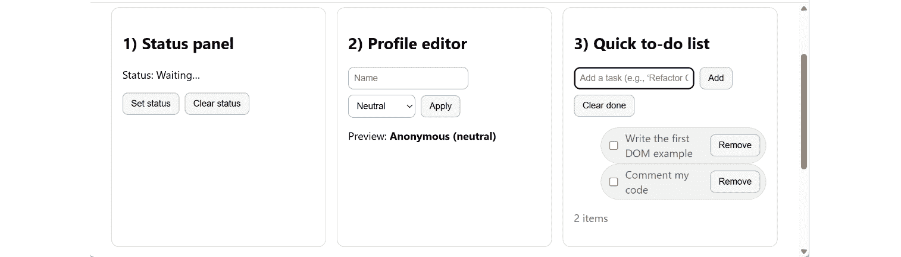

Figure 5.10: Adding items to a to-do list using the DOM

**Remove（移除）** 和 **Clear done（清除已完成）** 按钮尚未实现！你将在下一个示例中实现它们。

## 示例 4：事件委托

事件委托意味着为整个列表设置一个事件处理程序。

这是一种常见的实用技术。你不需要为每个移除按钮和复选框附加监听器，而是将一个监听器附加到父级无序列表元素（`<ul>`）上，并检查点击了什么。

本代码示例教授：

* 事件冒泡的概念
* 使用 `event.target` 识别事件的目标
* 使用 `closest`
* 通过 `classList` 进行类操作

将以下代码块添加到名为 `example4.js` 的文件中，该文件由网页底部的 `<script>` 元素引用：

```javascript
const btnClearDone = document.querySelector("#btnClearDone");
function updateCount() {
  const items = todoList.querySelectorAll("li");
  todoCount.textContent = 
    `${items.length} item${items.length === 1 ? "" : "s"}`;
}
function syncDoneStyles(li) {
  const done = li.dataset.done === "true";
  li.classList.toggle("success", done);
}
todoList.addEventListener("click", (event) => {
  const target = event.target;
  if (target instanceof HTMLInputElement
    && target.type === "checkbox") {
    const li = target.closest("li");
    if (!li) return;
    li.dataset.done = String(target.checked);
    syncDoneStyles(li);
    return;
  }
  if (target instanceof HTMLButtonElement
    && target.dataset.action === "remove") {
    const li = target.closest("li");
    if (!li) return;
    li.remove();
    updateCount();
  }
});
btnClearDone.addEventListener("click", () => {
  const doneItems = todoList.querySelectorAll('li[data-done="true"]');
  for (const li of doneItems) {
    li.remove();
  }
  updateCount();
});
// Initialize styles for the starter item (if any)
for (const li of todoList.querySelectorAll("li")) {
  syncDoneStyles(li);
}
updateCount();
```

刷新网页，在 **3) Quick to-do list（快速待办事项列表）** 框中，移除初始项目，然后添加三个新项目：`alpha`、`beta` 和 `gamma`。然后选中 **alpha** 和 **beta** 以显示它们为 *done（已完成）*，并点击 **Clear done（清除已完成）** 按钮，如 *Figure 5.11（图 5.11）* 所示：

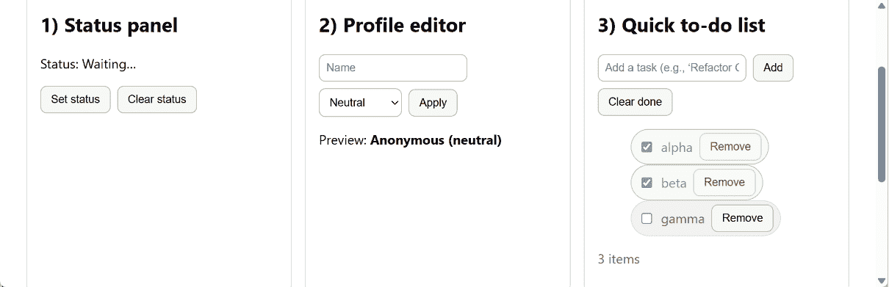

Figure 5.11: Selecting items as done in a to-do list using the DOM

注意两个 *done（已完成）* 项目被移除了。

在 gamma 项目旁边，点击 **Remove（移除）**，注意该项目被移除了。

**Prompt（提示）**：何时应该使用事件委托，而不是添加单独的事件监听器？

## 示例 5：切换类和隐藏区域

本代码示例教授：

* 使用 `classList.toggle` 切换 CSS 类的开启与关闭
* 如何通过 CSS 显示或隐藏元素

将以下代码块添加到名为 `example5.js` 的文件中，该文件由网页底部的 `<script>` 元素引用：

```javascript
const btnToggleTheme = document.querySelector("#btnToggleTheme");
const btnToggleTodo = document.querySelector("#btnToggleTodo");
const todoCard = document.querySelector("#card-todo").closest(".card");
btnToggleTheme.addEventListener("click", () => {
  document.body.classList.toggle("dark");
});
btnToggleTodo.addEventListener("click", () => {
  if (!todoCard) return;
  todoCard.classList.toggle("hidden");
});
```

刷新网页，在 **4) Theme + visibility（主题 + 可见性）** 框中，点击 **Show/Hide the to-do list（显示/隐藏待办事项列表）** 按钮，注意它消失了。然后点击 **Toggle theme（切换主题）** 按钮，注意整个页面在普通主题和深色主题之间切换，如 *Figure 5.12（图 5.12）* 所示：

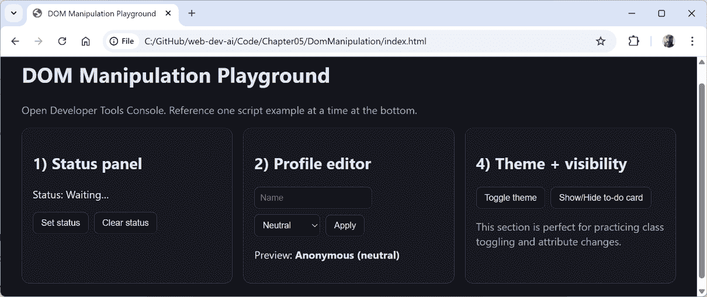

Figure 5.12: Selecting items as done in a to-do list using the DOM

深色主题在 `styles.css` 文件中使用名为 `.dark` 的类定义。JavaScript 所要做的就是在 `<body>` 元素上设置该类，如以下代码所示：`document.body.classList.toggle("dark")`。

## DOM 命令摘要

这是一个简明的参考，总结了 DOM 操作示例中使用的 DOM 方法、属性和相关 API：

* `document.querySelector(selector)`：返回匹配 CSS 选择器的第一个元素，如果未找到则返回 `null`：

```javascript
document.querySelector("#statusText")
```

* `element.querySelector(selector)`：仅在该元素的后代中搜索匹配项：

```javascript
todoList.querySelectorAll("li")
```

* `element.querySelectorAll(selector)`：返回所有匹配元素的静态列表：

```javascript
todoList.querySelectorAll('li[data-done="true"]')
```

* `element.textContent`：获取或设置元素内的纯文本：

```javascript
statusText.textContent = "Status: Waiting…"
```


## DOM API 参考

- `element.value`：获取或设置输入框或选择框的当前值，例如在 `<form>` 元素中。
- `element.addEventListener(event, handler)`：注册一个在事件发生时运行的函数：
```
btnAddTodo.addEventListener("click", handler)
```
- `event.target`：最初触发事件的元素。
- `element.closest(selector)`：查找匹配选择器的最近祖先元素（或自身）：
```
target.closest("li")
```
- `document.createElement(tagName)`：在内存中创建一个新元素（尚未在 DOM 中）：
```
document.createElement("li")
```
- `element.append(...nodes)`：将一个或多个节点作为子节点追加。
- `element.remove()`：从 DOM 中移除该元素。
- `element.classList`：元素上的 CSS 类的只读列表。
- `classList.toggle(className)`：根据当前状态添加或移除类：
```
document.body.classList.toggle("dark")
```
- `element.dataset`：将 `data-*` 属性作为 JavaScript 对象访问，例如 `<li data-done="true">`：
```
li.dataset.done = "true"
```
- `element.style.property`：直接在元素上设置内联 CSS 样式：
```
li.style.opacity = "0.75"
```
- `element.type`：指示输入元素的类型：
```
target.type === "checkbox"
```
- `element.checked`：布尔值，指示复选框是否被选中。
- `element.setAttribute(name, value)`：在元素上设置 HTML 属性：
```
checkbox.setAttribute("aria-label", "Mark done")
```
- `element.focus()`：将键盘焦点移至该元素。
- `element.length`：返回列表或数组中的项目数量。
- `instanceof`：检查值是否为给定类的实例：
```
target instanceof HTMLButtonElement
```

一个值得记住的实用技巧是，几乎所有的 DOM 操作都遵循相同的模式：选择某元素，读取或更改属性，并响应事件。一旦你理解了这一模式，上面的列表就变成了查阅手册，而不是需要死记硬背的内容。

## 提示词

请生成一段包含错误的 JavaScript 代码片段供我调试。我该如何使用 AI 工具调试 JavaScript 错误，而不至于产生依赖？

### 练习、参考资料与资源

## 检查你的理解

回答以下问题：

1. 如果你尝试在变量声明前使用它，会发生什么？
2. `let` 和 `const` 有什么区别？
3. `console.log(typeof age, age);` 告诉你什么？
4. 什么是函数？为什么它们有用？
5. 为什么事件处理程序内的代码不会立即运行？
6. `===` 相比 `==` 解决了什么问题？
7. DOM 操作的三个常见步骤是什么？
8. 为什么 `textContent` 比 `innerHTML` 更安全？
9. 什么是事件委托？为什么它有用？
10. `document.querySelector("#id")` 返回什么？

## 链接

以下是你应该了解的最权威、最广泛接受的 JavaScript 参考资料。这些不是博客或观点文章。它们是定义 JavaScript 实际工作方式的源头。

### MDN JavaScript 指南

MDN Web Docs 是 Web 上 JavaScript 的事实标准文档。它由 Mozilla 维护，浏览器厂商和更广泛的 Web 社区贡献内容。

[`developer.mozilla.org/en-US/docs/Web/JavaScript/Guide`](https://developer.mozilla.org/en-US/docs/Web/JavaScript/Guide)

这是学习者的最佳起点。它循序渐进地解释 JavaScript 概念，配有示例和清晰的语言。它在变量、函数、作用域、对象和 DOM 等基础知识方面尤为出色。

### MDN JavaScript 参考手册

这是百科全书式的参考手册。每个全局对象、方法、运算符和语法形式都在这里。当你想确切了解某个东西的作用时，你最终会来到这里。

[`developer.mozilla.org/en-US/docs/Web/JavaScript/Reference`](https://developer.mozilla.org/en-US/docs/Web/JavaScript/Reference)

### ECMAScript 语言规范

ECMAScript 是定义 JavaScript 的正式标准。它由 Ecma International 维护，具体由**技术委员会 39**（**TC39**）负责。浏览器实现这一规范。

[`tc39.es/ecma262/`](https://tc39.es/ecma262/)

该文档精确、详尽，并非为初学者编写。你不必从头读到尾。当你想了解边缘情况、确切语义，或 JavaScript 在奇怪情况下为何如此表现时，可以查阅它。

对于好奇但不想自虐的读者，MDN 通常会直接链接到规范的相关部分，并用人类可理解的语言进行解释。这是接触它的最健康方式。

### MDN JavaScript 最佳实践

本指南专注于编写可读、可维护的 JavaScript，而非花哨的代码。它涵盖命名、结构、避免常见错误，以及编写经得起时间考验的代码。

[`developer.mozilla.org/en-US/docs/Learn/JavaScript/Best_practices`](https://developer.mozilla.org/en-US/docs/Learn/JavaScript/Best_practices)

### MDN 使用严格模式

严格模式移除了 JavaScript 中一些最糟糕的历史陷阱，并让错误大声报错而不是静默失败。即使你尚未正式引入它，此页也能解释 JavaScript 为何会有这种行为。

[`developer.mozilla.org/en-US/docs/Web/JavaScript/Reference/Strict_mode`](https://developer.mozilla.org/en-US/docs/Web/JavaScript/Reference/Strict_mode)

### Airbnb JavaScript 风格指南

这是业内最常被引用的 JavaScript 风格指南之一。你不必同意每一条规则，但它强烈提倡一致性、清晰度和避免易错模式。许多 linter 和工具都围绕它构建。虽然它不是官方标准机构，但因大型团队实际在使用而具有影响力。

[`github.com/airbnb/javascript`](https://github.com/airbnb/javascript)

### Google JavaScript 风格指南

另一个保守、面向生产的指南，强调可读性和长期可维护性，而非花哨技巧。

[`google.github.io/styleguide/jsguide.html`](https://google.github.io/styleguide/jsguide.html)

# 总结

在本章中，你学习了：

- JavaScript 是什么，以及为什么它是让网页具有交互性而非静态的关键部分
- 如何使用 `let` 和 `const` 声明和使用变量，以及 JavaScript 数据类型的行为
- 如何编写和调用函数以构建代码结构并避免重复
- 如何使用 `if` 语句做决策，以及如何使用循环重复工作和处理数据列表
- 如何使用浏览器控制台和 `console.log` 检查值和调试代码
- 如何通过 `addEventListener` 挂载事件处理程序来响应用户操作
- 如何选择元素、更改文本、读取输入值并实时更新 UI
- 如何动态创建、插入、移除和修改元素
- 如何使用类和 `data-*` 属性将 JavaScript 逻辑与 CSS 样式关联
- 事件冒泡和事件委托如何简化交互式代码


JavaScript 给了你极大的灵活性。你可以快速编写代码，轻松修改它，并且只需极少的设置就能构建交互式体验。但这种灵活性是有代价的。随着代码增长，更容易引入微妙的 bug、传递错误的数据，或者在不知不觉中破坏某些东西。到目前为止，你通过小心谨慎和检查工作避免了这些问题。在下一章中，你将看到使用 TypeScript 的另一种方法。

TypeScript 构建在你所学的 JavaScript 知识之上，但增加了一套用于描述数据并在代码运行前捕获错误的系统。你不再在浏览器中发现错误，而是在编写代码时就能发现它们。

## 获取本书的 PDF 版本及更多内容

扫描二维码（或访问 `packtpub.com/unlock`）。按名称搜索本书，确认版本，然后按照页面上的步骤操作。


> **注意：** 请保留好发票。直接从 Packt 购买的产品不需要发票。
