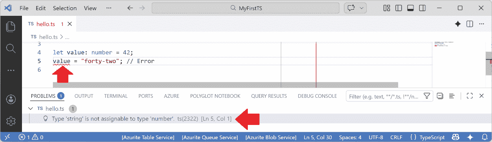
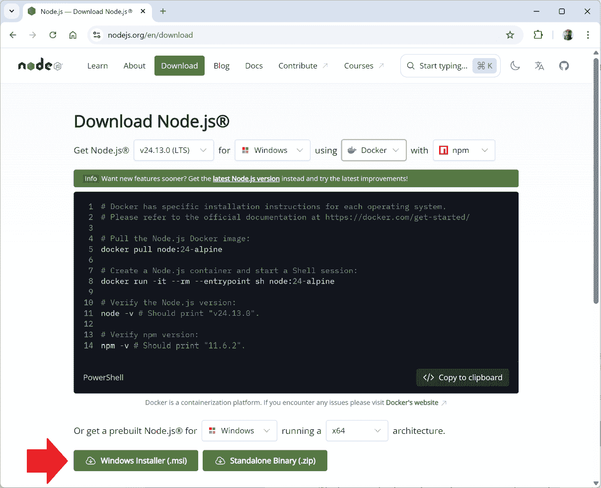
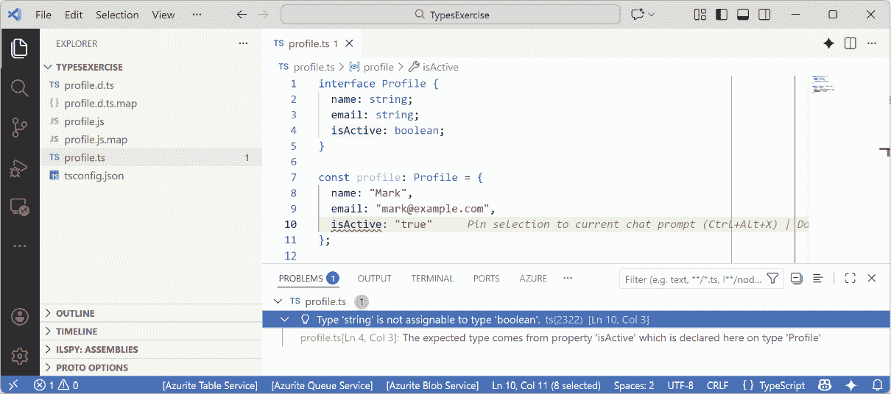
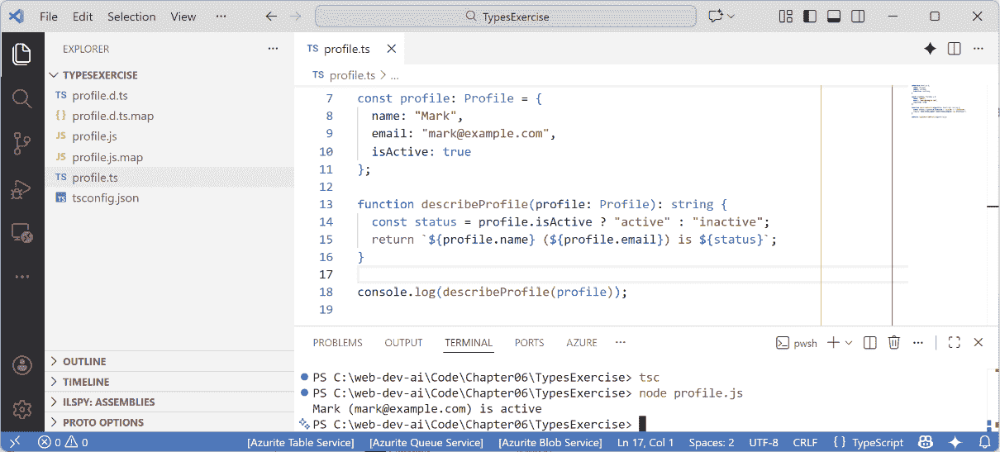
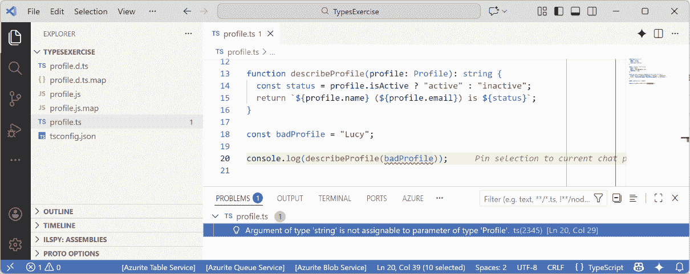

## TypeScript – 更安全的 JavaScript

TypeScript 是一种在 JavaScript 基础上通过添加静态类型系统而构建的编程语言。TypeScript 允许你描述变量、函数参数和返回值应具有的数据类型，并在代码运行前检查代码是否遵循这些规则。

最重要的一点是：**TypeScript 不是 JavaScript 的替代品**。它是构建在 JavaScript 之上的一个层。你编写 TypeScript，编译器将其转换为浏览器可运行的普通 JavaScript。浏览器永远不会看到 TypeScript，它只运行 JavaScript。

那么为什么要费心使用 TypeScript 呢？因为一旦 JavaScript 项目变大，就更容易传递错误的数据、拼错属性名，或者做出一个在没有警告的情况下破坏其他地方东西的更改。TypeScript 通过使你的假设变得显式来提供帮助。它让你的编辑器和编译器在你编写代码时捕获更多错误，防止这些错误变成运行时 bug。

读完本章后，你将清楚地理解 TypeScript 存在的原因以及何时值得使用它。你将搭建一个基本的 TypeScript 环境，编写并编译一些 TypeScript 代码，并使用常见的类型和接口。你还将看到类型如何使 JavaScript 代码在项目增长时更容易安全地修改。

不要试图死记硬背每一条语法。专注于类型为什么有用、它们能保护你免受什么伤害以及不能保护什么，以及它们如何描述程序中流动的数据。

在本章中，我们将涵盖以下主题：

* 为什么选择 TypeScript？
* 设置 TypeScript
* 基本类型和接口
* 实践练习：让 TypeScript 为你所用

本章建议的聊天机器人提示词及示例回答可在以下链接找到：[`github.com/markjprice/web-dev-ai/blob/main/prompts/ch06-ts/readme.md`](https://github.com/markjprice/web-dev-ai/blob/main/prompts/ch06-ts/readme.md)

## 为什么选择 TypeScript？

TypeScript 之所以存在，是因为大型 JavaScript 代码库难以令人信任。

### 对比 JavaScript 与 TypeScript

JavaScript 是动态类型的。这意味着变量可以保存任何类型的值，且其类型可以随时间改变：

```
let value = 42;
value = "forty-two";
value = true;
```

前面的代码是完全有效的 JavaScript。有时这种灵活性很方便。但更多时候，尤其是在大型代码库中，它会成为 bug 的来源。你向函数传递了错误的值、拼错了属性名，或者误解了变量包含的内容，而错误只会在运行时显现，可能就在用户的浏览器中。

TypeScript 通过让你在变量名后加上冒号 `:` 和数据类型（如 `number`）来提前声明意图，从而解决了这个问题：

```
let value: number = 42;
value = "forty-two"; // Error
```

现在错误会立即被你的代码编辑器或构建过程捕获，如图 6.1 和以下输出所示：

```
Type 'string' is not assignable to type 'number'.
```



图 6.1：VS Code 显示使用 TypeScript 的类型错误

你在编写代码时就能看到错误，而不是稍后点击应用时才发现。

### TypeScript 工具链

TypeScript 流行的另一个原因是工具支持良好。因为类型描述了期望的值，编辑器能提供更好的自动补全、内联文档和重构支持。

一个较新的重要原因是它与 AI 编码工具配合得很好。随着开发者越来越多地依赖 AI 生成代码，TypeScript 充当了安全网，能尽早捕获错误的假设、类型不匹配和不完整的逻辑。AI 生成的代码在你注意到那些微小但危险的错误之前往往看起来是正确的。TypeScript 在你仍在编辑代码时就标记出许多此类错误。

如果你严重依赖 AI 却跳过 TypeScript，就是在给自己找麻烦。TypeScript 不能消除这种风险，但能大幅降低糟糕的 AI 输出被忽视的几率。

当你在 TypeScript 中调用函数时，编辑器可以告诉你：

* 哪些参数是必需的
* 哪些是可选的
* 每个参数期望什么类型
* 函数返回什么

在普通 JavaScript 中，编辑器往往只能猜测数据类型。而在 TypeScript 中，它是知道的。

TypeScript 在阅读他人代码时特别有帮助。JavaScript 项目严重依赖库和框架。有了 TypeScript，这些库附带的类型定义能精确描述其 API。你只需输入代码并阅读提示就能探索事物如何工作，而不必不断查阅文档或示例。

**提示**：处理 API 返回的 JSON 数据时，TypeScript 有何帮助？

### TypeScript 有必要吗？

严格来说，它并非必要。你可以仅使用 JavaScript 构建整个网站和应用程序，许多人也确实如此。然而，一旦项目超过一定规模，缺乏类型就会开始造成伤害。Bug 变得更难追踪。重构变得冒险。修改代码感觉像在拆弹。

**重构**是在不改变代码功能的前提下，改进现有代码结构和可读性的过程。其目标不是添加新功能或修复 bug，而是让代码更易理解、维护和扩展。这可能包括为清晰度重命名变量、将大函数拆分为小函数、消除重复代码或重新组织文件。良好的重构在保持行为不变的同时改进设计。实际上，这意味着你应该始终拥有测试或一种验证代码在更改后仍能工作的方法。TypeScript 和代码编辑器等工具通过高亮显示需要更改的位置并尽早捕获错误，使重构更安全。

TypeScript 改变了这种平衡。它使大型代码库的修改更安全、更易理解。它将许多运行时错误转变为编译时错误。这种权衡正是大多数前端框架和许多后端 JavaScript 项目现在默认使用 TypeScript 的原因。

对初学者的一个重要提醒：你不需要在第一天就精通 TypeScript。扎实的 JavaScript 基础仍然更重要。TypeScript 让 JavaScript 更严格、更显式，但它不能替代对语言工作原理的理解。


这是你在 `JavaScript` 章节中看到的同一主题。AI 工具可以快速生成代码，但它们不会自动知道哪些值是允许的、哪些情况缺失了，或者哪个更改可能会破坏程序的另一部分。当你已经清楚代码应该接受和返回什么数据时，`TypeScript` 就能派上用场。类型给了这个想法一种书面形式。如果你的理解模糊不清，`TypeScript` 无法修复它。它只会给你更多错误让你阅读。

一个简单的对比：`JavaScript` 让值自由流动；`TypeScript` 要求你在传递这些值之前先描述它们。当你把 `TypeScript` 看作 `JavaScript` 周围工具链的一部分，而不仅仅是额外的语法时，它会更讲得通。

> **提示**：为什么 `TypeScript` 不能保护我免受所有运行时错误的影响？

# TypeScript 如何融入 JavaScript 工具链

`TypeScript` 为你的工作流增加了一个编译步骤。你编写 ` .ts ` 文件，`TypeScript` 编译器（ ` tsc `）检查类型并输出 ` .js ` 文件。这些输出文件才是实际在浏览器或服务器上运行的内容：

```
TypeScript (.ts/.tsx) → TypeScript compiler or build tool → JavaScript (.js) → Browser runs JavaScript
```

乍一看这像是额外的工作，但一旦设置完成，Web 开发工具通常会隐藏大部分细节。

> **提示**：为什么一些开发者在谈到 `TypeScript` 时使用 ` transpile `（转译）这个术语？

# 哪些工具与 TypeScript 配合效果最好

`VS Code` 由微软构建，内部使用 `TypeScript`，并且开箱即用地提供了一流的 `TypeScript` 支持。你无需任何配置即可获得即时类型检查、自动补全、内联错误提示和重构工具。这并非偶然。`VS Code` 和 `TypeScript` 是共同演进的。

JetBrains IDE（如 ` WebStorm `）也拥有出色的 `TypeScript` 支持，特别是在大型代码库中的重构和导航方面。它们往往占用更多资源，但其导航和重构工具很强大。

与纯 `JavaScript` 相比，代码检查和格式化工具在 `TypeScript` 中更为重要。` ESLint ` 常与 `TypeScript` 搭配使用，以强制统一编码风格并捕捉那些不严格属于类型错误的逻辑问题。例如，如果你声明了变量却从未使用、在 ` switch ` 语句中遗漏了某个 case、或意外使用了 ` == ` 而非 ` === `，它会发出警告。它还能强制执行一致的模式，比如当值不变时始终使用 ` const ` 而不是 ` let `。

` Prettier ` 通常与它搭配使用，以保持格式一致，坦白说，是为了让格式变得“无聊”。例如，自动修复缩进、间距和换行，使所有代码看起来都一样，无论谁编写的。

> **提示**：`TypeScript` 如何处理项目中现有的 `JavaScript` 文件？

# 为什么团队长期坚持使用 TypeScript

`TypeScript` 的回报随着时间的推移最为明显。前几个文件可能会让人觉得更啰嗦。几周或几个月后，团队会注意到实实在在的好处：更安全的重构、更清晰的 API、更少的运行时意外，以及新开发者更容易上手。类型充当了永远不会与代码脱节的活文档。

这就是为什么 `TypeScript` 在许多专业 `JavaScript` 工作中从可选变成了常态。并非因为 `JavaScript` 不好，而是因为大型系统需要比 `JavaScript` 单独设计所能提供的更多保障。

`JavaScript` 是运行在 Web 上的语言。`TypeScript` 是团队让大型 `JavaScript` 代码库更安全地进行更改的主要方式之一。

> **提示**：专业团队如何逐步将 `TypeScript` 引入现有的 `JavaScript` 代码库？

现在让我们在你的电脑上设置 `TypeScript`。

# 哪些框架和库使用 TypeScript

`TypeScript` 现在在 Web 开发领域很常见。一些框架默认使用它，另一些则强烈推荐它。

` Angular ` 是最典型的例子。`Angular` 由 `TypeScript` 编写，并期望应用代码也用 `TypeScript` 编写。该框架的设计、装饰器和工具都假设类型是存在的。

` React ` 更灵活。`React` 本身是用 `JavaScript` 编写的，但 `TypeScript` 现在是严肃 `React` 项目的主流选择。`React` 生态系统拥有优秀的类型定义，大多数教程、模板和专业代码库都使用 `React` 配合 `TypeScript`，而不是纯 `JavaScript`。

` Vue ` 处于中间位置。`Vue.js` 最初是一个 `JavaScript` 优先的框架，但 `Vue` 拥有一流的 `TypeScript` 支持，且核心库本身现在是用 `TypeScript` 编写的。对于超出小型演示的任何项目，`TypeScript` 正日益成为常态。

在后端，`TypeScript` 与 ` Node.js ` 框架（如 ` NestJS `）结合使用非常普遍，也广泛用于 ` Express ` 。尽管 `Node.js` 运行的是 `JavaScript`，但许多团队更倾向于编写 `TypeScript` 并在部署前编译它。

实际上，面向大型团队和大型代码库的框架通常期望使用 `TypeScript` 或强烈推荐它。

# 声明文件与第三方库

`TypeScript` 在实际项目中表现如此出色的原因之一是它对声明文件的支持。声明文件描述现有 `JavaScript` 代码的结构，以便 `TypeScript` 能对其进行类型检查，即使那些代码从未用 `TypeScript` 编写。

声明文件使用 ` .d.ts ` 扩展名。它仅包含类型信息，内部没有可执行代码。在运行时，`JavaScript` 仍然运行完全相同的代码。声明文件纯粹是为了帮助 `TypeScript` 理解有哪些函数、对象和类可用，以及它们打算如何使用。

例如，一个 `JavaScript` 库可能在运行时暴露如下函数：

```
export function formatDate(date, format) {
  // implementation
}
```

对应的声明文件可能这样描述它：

```
export function formatDate(date: Date, format: string): string;
```

有了该声明，当你从 `TypeScript` 使用该库时，编辑器现在可以提供准确的自动补全、参数提示和错误消息。

大多数流行的 `JavaScript` 库已经自带声明文件，或者可以通过 DefinitelyTyped 仓库获得，并通过以 ` @types/ ` 开头的 ` npm ` 包自动安装。当你安装一个库而 `TypeScript` * 就知道 * 如何使用它时，声明文件就是原因。

这也解释了 `TypeScript` 的一个重要设计决策：类型与实现分离。你可以在现有 `JavaScript` 之上添加强类型，而无需重写它。这就是为什么 `TypeScript` 能在 `JavaScript` 生态系统中迅速普及，而不需要与过去彻底决裂。

声明文件将动态 `JavaScript` 库连接到 `TypeScript` 的静态检查。它们让 `TypeScript` 为那些从未考虑过类型的库带来安全性、工具支持和清晰度，这正是 `TypeScript` 能如此顺畅地融入 `JavaScript` 开发的原因。

# 谁创建了 TypeScript 以及为什么

`TypeScript` 由微软创建，于 2012 年首次发布。首席架构师是 ` Anders Hejlsberg ` ，一位编程语言设计专家。在 `TypeScript` 之前，他是 ` Turbo Pascal ` 、 ` Delphi ` 和后来的 ` C# ` 的首席设计师。`TypeScript` 从像 `C#` 这样的静态类型语言借鉴了许多思想，同时仍然尊重 `JavaScript` 的运行时模型。

微软的动机是务实的。他们在构建非常大型的 `JavaScript` 应用程序，包括复杂的 Web 工具，并发现 `JavaScript` 的动态特性使得重构充满风险且容易引入 Bug。`TypeScript` 的设计目的是让 `JavaScript` 更好地扩展，同时不破坏与 Web 的兼容性。


# 为什么未来的 TypeScript 版本可能会破坏你的代码

TypeScript 历史上一直非常注重向后兼容性。大多数升级都很平滑，旧代码通常能继续工作。

这种情况开始发生变化。

最近的版本，特别是 5.9 和 6.0，为 7.0 及更高版本中更具破坏性的变更奠定了基础。微软和 TypeScript 团队对此异常直白：他们正在积极警告开发者做好准备。

未来的变更旨在清理遗留问题并收紧规则。

你可以这样理解最近和即将发布的版本：

*   `TypeScript 5.9`：仍属于稳定熟悉的 TypeScript 时代。改进侧重于性能、推断和工具链。
*   `TypeScript 6.0`：一个过渡版本。引入弃用警告和更严格的默认值。其主要目的是为即将到来的破坏性变更准备你的代码库。
*   `TypeScript 7.0`：一次重大转变。预计将移除已弃用的功能并引入更深层的变更，包括为性能而用 Go 重写的新编译器实现。

直白地说：6.0 是警告，7.0 是强制执行。

7.0 即将到来的重大变化是 TypeScript 变得不再宽容。多年来，TypeScript 试图适应各种 JavaScript 模式，包括旧式和松散结构的代码。这种灵活性降低了采用门槛，但也造成了不一致和边缘情况。

未来的方向是：

*   移除遗留选项
*   强制执行更严格的默认值
*   减少模块解析和配置中的歧义
*   推动开发者采用现代 JavaScript 模式

例如：

*   像 `baseUrl` 这样的配置选项已被弃用，并计划在 TypeScript 7.0 中移除
*   较旧的模块系统和目标（如 `AMD` 或 `ES5`）正在逐步淘汰
*   编译器默认值变得更严格，有时无需显式选择即可生效

这反映了一个深思熟虑的决定：TypeScript 现在优先考虑正确性和一致性，而非向后兼容性。

## 为 TypeScript 7 的未来做准备

TypeScript 团队给出早期警告，是因为这些变更可能会破坏真实项目。如果你从旧设置盲目升级到 7.0 版本，构建可能会因弃用选项而失败。导入可能不再按原方式解析，之前能工作的代码现在可能会产生错误。

为了缓和过渡，TypeScript 引入了如下机制：

```
{
  "ignoreDeprecations": "6.0"
}
```

这允许你暂时抑制警告，但这只是短期的逃生舱。

旧版 TypeScript 往往试图让事情跑通，但新版本更倾向于指出这是模棱两可或不安全的。这种转变体现在几个方面：

*   更严格的类型检查成为默认行为
*   更少的隐式行为
*   对过时配置的容忍度降低

TypeScript 变得更严格，是因为当前的 JavaScript 系统更大、更复杂，且越来越多地由 AI 生成的代码辅助。语言正在转变以适应这一现实。

这直接关联到开发领域的更广泛变化：

*   即使是最弱的 AI 也能生成能运行的代码。
*   更难的技能是在项目变更时保持行为的正确性。

无论你喜欢与否，TypeScript 的新版本都在推动你朝这个方向发展。

**提示**：在将项目升级到最新 TypeScript 版本之前，我应该检查哪些弃用或破坏性变更？

# 设置 TypeScript

浏览器无法直接运行 TypeScript，因此设置它实际上是准备你的开发机器来编写 TypeScript、检查它，并将其转换为 JavaScript。一旦这条流水线建立，其他一切都建立在其之上。

## 前置条件：Node.js

TypeScript 作为命令行工具分发，运行在 `Node.js` 上。即使你的最终代码运行在浏览器中，`Node.js` 也会在开发期间使用。

在 Windows 上，从官方 Node.js 网站下载 LTS（长期支持）版本：[`nodejs.org/en/download`](https://nodejs.org/en/download)，如*图 6.2*所示：



图 6.2：下载 node.js LTS

运行 `Node.js` 的 Windows 安装程序。接受默认设置。这将同时安装 `node` 和 `npm`（**Node 包管理器**），你将持续使用它们。

在 macOS 上，你可以下载相同的安装程序，或通过 Homebrew 安装 Node。在 Linux 上，大多数发行版通过其包管理器提供 Node。具体命令因发行版而异，但目标相同：获取一个最近的 LTS 版本。

要在任何平台上确认安装，打开终端或命令提示符并运行：

```
node --version
npm --version
```

如果两条命令都打印出版本号，你就可以继续了，如 2026 年 2 月 1 日的输出所示：

```
v24.13.0
11.6.2
```

撰写时（2026 年 4 月）最新的 LTS 版本是 v24.14.1。最新的 Current 版本是 v25.9.0。此处确切版本不重要。任何最近的 LTS 版本都可以。

## 安装 TypeScript 编译器

TypeScript 通过 `npm` 安装。你可以全局安装它，使 `tsc` 命令在任何地方可用：

```
npm install -g typescript
```

**警告！** 如果 `npm --version` 打印出有效数字，但任何其他 `npm` 命令（包括 `npm install`）都因错误 `Class extends value undefined…` 而崩溃，这表明 `npm` 在加载其自身依赖时崩溃。这通常发生在 `npm` 的安装文件与 Node 运行时不一致或部分损坏时。通过删除残留的 Node/`npm` 文件并重新安装 Node LTS 可解决此类错误。

在 macOS 和 Linux 上，根据 Node 的安装方式，你可能需要在前面加上 `sudo`。

验证安装：

```
tsc --version
```

2026 年 2 月 1 日的输出：

```
Version 5.9.3
```

此时，你已安装 TypeScript 编译器。仅此而已，就足以编写和编译 TypeScript。

## 编辑器支持

TypeScript 的真正优势体现在代码编辑器内部。

如果你使用 VS Code，已经拥有出色的 TypeScript 支持。无需安装任何东西。一旦打开 `.ts` 文件，你就能获得内联错误、自动补全和类型提示。

如果你使用 JetBrains IDE（如 WebStorm 或 Rider），TypeScript 支持也是内置且非常强大的。

## 你的第一个 TypeScript 项目

创建一个名为 `Chapter06` 的新文件夹，以及一个名为 `MyFirstTS` 的子文件夹。然后切换到 `MyFirstTS` 目录：

```
cd MyFirstTS
```

在 `MyFirstTS` 目录中，创建一个名为 `hello.ts` 的文件：

```
let message: string = "Hello, TypeScript";
console.log(message);
```

现在编译 TypeScript 文件：

```
tsc hello.ts
```

你应该会看到一个新文件出现：`hello.js`。打开它，你会注意到一件重要的事。类型消失了：

```
var message = "Hello, TypeScript";
console.log(message);
```

这是要牢记的关键概念。TypeScript 是一个开发时工具。输出是纯 JavaScript。

**良好实践**：注意输出使用 `var` 而不是 `let`。这是因为 TypeScript 编译器将 TypeScript 转换为更多浏览器能运行的旧版 JavaScript。如果你知道不需要支持旧浏览器，则可以在 `tsconfig.json` 文件中将 TypeScript 编译器配置为目标 `ES2020` 或更高版本，输出的 JavaScript 将使用 `let` 和 `const`。你将在本章后面看到如何操作。

你现在可以用 Node 运行该 JavaScript 文件：

```
node hello.js
```


# TypeScript 设置与基础类型

## 验证工具链

输出应为：

```
Hello, TypeScript
```

如果正常工作，说明你的工具链运行正常。

在浏览器中调用 `console.log` 时，它会写入 **开发者工具** 中的 `Console` 标签页。在 Node.js 运行的代码中调用 `console.log` 时，它会写入标准输出，如命令提示符或终端窗口。

## 引入 tsconfig.json

对于超出玩具示例范围的项目，你不想每次都向 `tsc` 传递选项。取而代之的是，在项目根目录创建一个名为 `tsconfig.json` 的配置文件。

在 `MyFirstTS` 文件夹中，生成一个初始配置：

```
tsc --init
```

这会创建一个包含许多注释选项的文件：

```
{
  // Visit https://aka.ms/tsconfig to read more about this file
  "compilerOptions": {
    // File Layout
    // "rootDir": "./src",
    // "outDir": "./dist",
    // Environment Settings
    // See also https://aka.ms/tsconfig/module
    "module": "nodenext",
    "target": "esnext",
    "types": [],
    // For nodejs:
    // "lib": ["esnext"],
    // "types": ["node"],
    // and npm install -D @types/node
    // Other Outputs
    "sourceMap": true,
    "declaration": true,
    "declarationMap": true,
    // Stricter Typechecking Options
    "noUncheckedIndexedAccess": true,
    "exactOptionalPropertyTypes": true,
    // Style Options
    // "noImplicitReturns": true,
    // "noImplicitOverride": true,
    // "noUnusedLocals": true,
    // "noUnusedParameters": true,
    // "noFallthroughCasesInSwitch": true,
    // "noPropertyAccessFromIndexSignature": true,
    // Recommended Options
    "strict": true,
    "jsx": "react-jsx",
    "verbatimModuleSyntax": true,
    "isolatedModules": true,
    "noUncheckedSideEffectImports": true,
    "moduleDetection": "force",
    "skipLibCheck": true,
  }
}
```

你目前不需要理解所有选项。只需掌握基础即可：

- `compilerOptions` 控制 TypeScript 的严格程度及其生成的 JavaScript 类型
- `target` 控制输出中允许使用哪些 JavaScript 特性
- `strict` 启用更安全的类型检查规则
- `jsx` 用于 React 项目，本书不涉及，可忽略或移除此选项

**提示**：TypeScript 严格模式在底层实际启用了哪些检查？即使启用了严格模式，TypeScript 仍无法捕获哪些类型的 Bug？

一个适合初学者的简单配置如下：

```
{
  "compilerOptions": {
    "target": "ES2020",
    "strict": true,
    "outDir": "dist"
  }
}
```

现在，无需编译单个文件，直接运行即可：

```
tsc
```

TypeScript 会编译项目中所有 `.ts` 文件，并将输出的 JavaScript 放入 `dist` 文件夹。

`target` 设置控制 TypeScript 编译代码时生成的 JavaScript 版本。这影响允许使用的语言特性以及语法转换方式。常见选项包括：

- `ES3`：早期 TypeScript 版本的历史默认值，当时仍需支持极旧的浏览器（如 Internet Explorer 8）。实际上，几乎没有当前项目应依赖此默认值。ES3 缺乏对许多标准 JavaScript 特性的支持，TypeScript 会激进地转换代码，往往产生冗长且难以阅读的输出。
- `ES5`：非常古老的 JavaScript，几乎所有浏览器均支持。仅适用于遗留环境。
- `ES2015` (`ES6`)：引入类、箭头函数和模块。适合作为较旧但仍广泛支持环境的基准。
- `ES2017` / `ES2018` / `ES2019`：渐进式改进，如 async/await (`ES2017`) 及其他现代特性。常用于面向稍旧版本的 Node.js 或浏览器。
- `ES2020`：流行的基准。支持可选链和空值合并等特性，仅需最少转换。
- `ES2022` 及更高版本 (`ESNext`)：非常新的 JavaScript，几乎无需降级转换。最适合当前 Node.js 版本或现代浏览器。

**最佳实践**：始终自行设置 `target` 为 `ES2020` 或更高版本。默认值仅为向后兼容而存在，并非当今的良好选择。

**提示**：请解释对初学者最重要的 `tsconfig.json` 选项，以及哪些选项初期可以安全忽略。

## 平台说明（Windows 与 macOS 与 Linux）

从 TypeScript 角度来看，平台差异极少。值得注意的点：

- TypeScript 编译器在所有平台行为一致
- `.ts` 文件可在所有操作系统间移植
- 输出的 `.js` 文件在浏览器中运行方式相同

主要差异在于：

- 安装 Node 或全局包的命令行语法
- Linux 和 macOS 上的文件系统大小写敏感性
- 路径分隔符 (`\` 与 `/`)，工具通常会自动处理

只要避免硬编码路径并依赖标准工具，你的设置将在各平台上同等工作。

## 设置总结

此时，你应理解设置 TypeScript 实质上意味着三件事：

1. 安装 Node.js
2. 安装 TypeScript 编译器
3. 创建带有配置文件的基础项目

其他一切——框架、打包工具、高级构建工具——均构建在此基础之上。完成此设置后，你已准备好开始学习类型与接口。

# 基础类型与接口

这是 TypeScript 开始证明其存在价值的地方。你已懂得如何编写 JavaScript。TypeScript 新增的是以精确、可检查的方式描述数据的能力。一旦理解一小组基础类型及接口的工作原理，语言的其余部分将变得容易得多。

## 基础类型

TypeScript 从你在 JavaScript 中已使用的相同原始值开始，但允许你显式声明它们。

变量可通过 **类型注解** 赋予类型。注解位于变量名后，以冒号分隔：

```
let count: number = 0;
let title: string = "Dashboard";
let isLoggedIn: boolean = false;
```

上述代码中 TypeScript 所做的：

- `count` 必须始终持有数字
- `title` 必须始终持有字符串
- `isLoggedIn` 必须始终持有布尔值

若稍后尝试赋值不兼容的值，TypeScript 会立即标记错误：

```
count = "zero";       // Error
isLoggedIn = "yes";   // Error
```

这些错误会在你输入时直接显示在编辑器中。代码可能仍能编译（取决于设置），但你能在运行时前尽早收到警告。

**提示**：TypeScript 如何决定即使存在类型错误代码仍能编译成功？

字符串值得特别一提。TypeScript 完全支持 JavaScript 模板字面量并正确推断其类型：

```
let userName: string = "Mark";
let message: string = `Hello, ${userName}`;
```

**提示**：`never` 类型是什么？它在实际代码中何种情况下出现？

## 类型推断

你不总需要编写类型注解。TypeScript 常能从初始值推断类型：

```
let total = 100;       // 推断为 number
let label = "Total";   // 推断为 string
```

从此刻起，`total` 行为如同你写了 `: number`。若稍后尝试赋值 `string`，TypeScript 会报错。

**最佳实践**：让 TypeScript 推断简单的局部变量，但在程序边界（如函数参数和返回值）处显式声明。

## 数组


## 数组

数组通过描述其元素的类型，后跟一对方括号来指示它是一个数组进行类型标注，例如 `number[]` 表示 `number` 值的数组：

```
let scores: number[] = [10, 20, 30];
let names: string[] = ["Alice", "Bob", "Charlie"];
```

这意味着 `scores` 中的每个元素都必须是 `number`，并且在调用 `push()` 方法添加新项时，它也必须是 `number` 值，而不是 `string` 等其他类型：

```
scores.push(40);    // OK
scores.push("40");  // Error
```

数组在 DOM 和 API 代码中无处不在，因此这条单一规则很快就能发挥作用。

## 对象和内联类型

你可以直接描述对象的形状：

```
let user: { name: string; age: number } = {
  name: "Mark",
  age: 42
};
```

这对于小型的、一次性对象来说没问题，但很快就会变得嘈杂且重复。这时接口就派上用场了。

## 接口

`interface`（接口）是对象形状的命名描述。它在运行时不存在。它纯粹用于 TypeScript 的类型系统：

```
interface User {
  name: string;
  age: number;
}
```

现在你可以在任何需要 `User` 的地方使用此接口：

```
let user: User = {
  name: "Mark",
  age: 42
};
```

如果你忘记了某个属性或添加了不属于该接口的属性，TypeScript 会捕获它：

```
let user: User = {
  name: "Mark"
  // Error: age is missing
};
```

接口在与函数参数一起使用时非常出色：

```
function formatUser(user: User): string {
  return `${user.name} (${user.age})`;
}
```

> **提示**：请解释 TypeScript 中的函数重载，并展示一个能提高清晰度的实际示例。

现在该函数清楚地记录了它期望的内容（一个 `User` 对象）和返回的内容（一个 `string` 值）。如果你传递了错误的形状，错误会出现在调用函数的那一行，而不是函数内部深处。

> **提示**：TypeScript 中接口和类型别名有什么区别，何时应该优先使用其中一个而不是另一个？

## type 关键字

`type` 关键字创建一个类型别名，即为任何类型表达式命名。虽然 `interface` 描述对象的形状，但 `type` 可以为任何类型命名，包括联合类型、交叉类型和基本类型：

```
type Role = "admin" | "editor" | "viewer";
type ID = number | string;
```

大多数 TypeScript 项目遵循以下约定：对象形状使用 `interface`，其他所有情况使用 `type`。

## 结构类型 vs 名义类型

TypeScript 使用结构类型系统。这意味着类型之间的兼容性基于它们的形状，而非名称。如果两个值具有相同的结构，TypeScript 认为它们兼容，即使它们来自不同的接口或类型声明。

例如：

```
interface User {
  name: string;
  age: number;
}
interface Person {
  name: string;
  age: number;
}
const u: User = { name: "Mark", age: 42 };
const p: Person = u; // OK
```

在前面的代码中，尽管 `User` 和 `Person` 是不同的接口，但它们描述了相同的形状。TypeScript 允许该赋值，因为所需的属性及其类型匹配。

这不同于 Java 和 C# 等语言使用的名义类型系统。在名义类型系统中，类型的名称很重要。具有相同结构的两个类型仍被视为不同，除非它们之间存在显式关系，如继承或接口实现。

结构类型与 JavaScript 自然契合，在 JavaScript 中对象由其拥有的属性定义，而非显式的类声明。它还使 TypeScript 在处理普通对象、JSON 数据和 API 返回的值时更加灵活。

然而，这种灵活性有时会令人惊讶。因为只有形状很重要，TypeScript 不关心对象来自哪里，只关心它是否具有正确的属性：

```
function printUser(user: User) {
  console.log(user.name);
}
printUser({ name: "Alice", age: 30 }); // OK
```

传入 `printUser` 函数的对象从未被显式声明为 `User`，但它匹配所需的形状，因此 TypeScript 接受它。

实际要点是，TypeScript 中的接口描述值必须长什么样，而不是它叫什么名字。这一设计选择使 TypeScript 保持轻量且与 JavaScript 互操作，同时仍提供关于数据如何使用的有力保证。

## 字面量类型

到目前为止，我们使用 `string`、`number` 和 `boolean` 等类型来描述广泛的值类别。有时，这仍然太宽泛。在实际应用中，变量可能只允许保存一小组固定的特定值之一。这就是字面量类型发挥作用的地方。

字面量类型不仅表示“这是一个字符串”，而是表示“这是这个特定的字符串”。

例如：

```
let status: "active" | "inactive";
status = "active";     // OK
status = "inactive";   // OK
status = "pending";    // Error
```

在这里，`status` 在运行时仍然是字符串，但在开发时 TypeScript 强制它只能是两个允许值之一。任何拼写错误或意外值都会被编辑器或编译器立即捕获。

字面量类型在建模状态、角色或模式时特别有用。例如：

```
type Role = "admin" | "editor" | "viewer";
interface User {
  name: string;
  role: Role;
}
```

现在 `role` 属性只能是那三个值之一。这消除了由拼写错误或不一致的约定（如 `"Admin"`、`"administrator"` 或 `"user"`）引起的一整类 bug。

字面量类型也适用于数字和布尔值，尽管字符串字面量在日常代码中最常见。以下是如何限制可能的值来表示骰子的点数：

```
type DieRoll = 1 | 2 | 3 | 4 | 5 | 6;
```

理解字面量类型的一个有用方式是，它们介于自由形式的值和枚举之间。它们在不引入额外运行时结构的情况下，提供强有力的保证和出色的编辑器支持。与接口一样，字面量类型仅存在于开发时。当你的代码运行时，它们会消失，留下纯粹的 JavaScript。

TypeScript 有 `enum` 关键字，它是一种定义一组命名常量的结构。然而，TypeScript 项目通常更倾向于使用字面量联合类型，因为它们更简单且不增加运行时代码。你可能会在旧代码库和 Angular 等框架中看到枚举的使用。

当值必须来自一个短列表时，使用字面量联合类型。它能捕获拼写错误并使允许的值显而易见。

> **提示**：请解释 TypeScript 中的多余属性检查，以及为什么对象字面量与变量的处理方式不同。

## 联合类型

有时值不限于单一类型，但仍限于一组已知的可能性。联合类型让你能准确表达这一点。它表示一个值可以是几种类型之一，但不能是其他任何类型。

你使用管道字符 `|` 定义联合类型，可以将其读作“或”：

```
let id: number | string;
id = 42;        // OK
id = "42";      // OK
id = true;      // Error
```

在前面的代码示例中，`id` 允许是 `number` 或 `string`，但不允许其他类型。在处理 API、用户输入或可能以不同形式出现的数据库标识符时，这种模式非常常见。

当与控制流结合时，联合类型变得更加有用。TypeScript 根据你在代码中执行的检查来缩小类型：


# TypeScript 类型系统核心概念

## 联合类型

```typescript
function formatId(id: number | string): string {
  if (typeof id === "number") {
    return id.toFixed(0);
  }
  return id.toUpperCase();
}
```

在每个分支内部，TypeScript 都能准确理解你正在处理哪种类型，并仅允许相应的操作。如果你忘记处理其中一种情况，编译器会发出警告。

联合类型也常与字面量类型结合使用，以描述固定的值集合：

```typescript
type Status = "active" | "inactive" | "pending";
```

这创建了一个字符串字面量类型的联合，非常适合在应用程序中对状态和模式进行建模。

一个便于记忆的方法：

- **基础类型** 描述值的类别
- **字面量类型** 描述确切的值
- **联合类型** 描述它们之间的受控选择。

与 TypeScript 中的接口和其他类型一样，联合类型仅在开发期间存在。它们不影响运行时行为，但在你编写和修改代码时能显著减少歧义。

当一个值合法地可能是多种类型之一时，联合类型让你能显式地表达这一点，而无需退而求其次使用过于宽松的类型（如 `any`）。

## 可选属性

并非每个对象在任何时候都拥有所有属性。接口通过 `?` 支持可选属性：

```typescript
interface User {
  name: string;
  age?: number;
}
```

现在以下两种写法均有效：

```typescript
const a: User = { name: "Mark", age: 42 };
const b: User = { name: "Guest" };
```

当你使用可选属性时，TypeScript 强制你确认它可能缺失：

```typescript
function describe(user: User): string {
  if (user.age !== undefined) {
    return `${user.name} is ${user.age}`;
  }
  return `${user.name} (age unknown)`;
}
```

这能防止一大类 `cannot read property of undefined`（无法读取 undefined 的属性）错误。

> **提示**：TypeScript 中的 `readonly` 属性是什么？它们如何帮助防止 Bug？

## 使用 `null` 和 `undefined` 显式表达缺失

在 JavaScript 中，`null` 和 `undefined` 很容易被忽视，直到它们导致运行时错误。但在 TypeScript 中，它们更难被忽视，因为它们成为了更严格类型系统的一部分。这是 JavaScript 和 TypeScript 之间最大的实际差异之一。

启用严格类型检查后（你应该始终启用），`null` 和 `undefined` 不会被自动允许。你必须显式声明值何时可以缺失（`undefined`）。

例如：

```typescript
let name: string = "Mark";
name = undefined; // 报错
```

如果值确实可能缺失，你必须这么说：

```typescript
let name: string | undefined;
```

现在 TypeScript 理解 `name` 可能存在，也可能不存在。

你已经在可选属性中见过 `?` 语法：

```typescript
interface User {
  name: string;
  age?: number;
}
```

现在我可以解释 `?` 不仅仅意味着可选。它实际上意味着：

```typescript
age: number | undefined
```

这就是为什么 TypeScript 强制你进行检查：

```typescript
if (user.age !== undefined) {
  console.log(user.age);
}
```

这是 TypeScript 强制你面对现实：值可能不存在。

TypeScript 中 `null` 与 `undefined` 的区别依然存在：

- `undefined` 通常意味着“未提供”或“未设置”
- `null` 通常意味着“显式为空”

但在实践中，许多团队会标准化使用其中一种（通常是 `undefined`）以减少困惑。

如果你想同时允许两者，必须显式声明：

```typescript
let value: string | null | undefined;
```

最常见的 JavaScript 运行时错误长这样：

```
Cannot read property 'x' of undefined
```

TypeScript 将这些问题前置。代码不是在运行时失败，而是在编写时得到错误：

```
"Object is possibly undefined"
"Type 'undefined' is not assignable to type 'string'"
```

这迫使你停止假设值存在，转而显式处理缺失的情况。

> **最佳实践**：如果值可能缺失，在类型中声明它。如果值必须存在，不要包含 `undefined` 或 `null`。显式处理缺失情况，而不是指望它们永远不会发生。

## 可选参数与默认参数值

TypeScript 支持两种相关但不同的方式来处理并非总是提供的函数参数：可选参数和默认参数值。它们解决相似的问题，但传达的含义略有不同。

可选参数用问号标记：

```typescript
function greet(name?: string): string {
  if (name) {
    return `Hello, ${name}`;
  }
  return "Hello, guest";
}
```

在上述代码中，调用函数时可以省略 `name`。从 TypeScript 的角度来看，可选参数被视为与 `undefined` 的联合类型。换句话说，`name` 的类型是 `string | undefined`。这就是为什么 TypeScript 强制你在将其作为字符串使用前检查它是否存在。

默认参数值看起来相似，但行为不同：

```typescript
function greet(name: string = "guest"): string {
  return `Hello, ${name}`;
}
```

在这种情况下，从类型系统的角度来看，`name` **不是**可选的。它在函数体内始终是一个字符串。如果调用者省略参数，JavaScript 会在运行时提供默认值，TypeScript 会在其类型中反映这一行为。

编写函数逻辑时，这种差异很重要。使用可选参数时，你必须显式处理缺失情况。使用默认值时，TypeScript 知道参数在函数内永远不会是 `undefined`。

调用端也存在差异。以下两种调用在两种情况下均有效：

```typescript
greet();
greet("Mark");
```

但默认值让意图更清晰。可选参数表示 `此值可能不存在`。默认参数表示 `此值始终存在，但可能回退到标准值`。

> **最佳实践**：当值的缺失具有意义且必须显式处理时，使用可选参数。当存在合理的回退值，且你希望函数其余部分使用有保证的、定义良好的类型时，使用默认参数值。

## 预防错误而非捕获错误

在 JavaScript 中，错误处理通常意味着事后使用 `try` 和 `catch` 进行反应。TypeScript 改变了这种平衡。许多错误在编译时就被预防了，在代码运行之前。

考虑这个 JavaScript 示例：

```javascript
function formatName(user) {
  return user.name.toUpperCase();
}
```

如果 `user` 为 `null` 或缺少 `name` 属性，这会在运行时失败。

在 TypeScript 中，你会这样写：

```typescript
function formatName(user: { name: string }): string {
  return user.name.toUpperCase();
}
```

现在问题会更早暴露：

- 如果你传入了错误的结构，TypeScript 会立即报错
- 错误出现在调用函数时，而非函数内部深处

这是 TypeScript 相比 JavaScript 在错误处理上的主要改进：你**预防**了错误，而不是稍后**捕获**它。

TypeScript 鼓励你设计函数，使无效状态更难被表达。

例如：

```typescript
function greet(name: string | undefined): string {
  if (!name) {
    return "Hello, guest";
  }
  return `Hello, ${name}`;
}
```

类型强制你处理缺失情况。没有 TypeScript，很容易忘记这个检查。

但 TypeScript 并不能完全消除运行时错误。你仍然需要 `try` 和 `catch` 来处理：

- 网络请求
- 文件访问
- JSON 解析
- 第三方库

示例：

```typescript
try {
  const data = JSON.parse(input);
  console.log(data);
} catch (error) {
  console.error("Invalid JSON:", error);
}
```


TypeScript 无法保证输入是有效的 JSON。这是一个运行时问题。

总结错误处理：

* 在 JavaScript 中，你编写代码、运行它，但随后必须在错误发生时处理它们。
* 在 TypeScript 中，你在类型中描述假设，许多错误在运行任何代码前就被捕获，但你仍需在运行时处理真正不可预测的故障。

**良好实践**：使用类型防止可预测的错误。对不可预测的错误使用 `try` 和 `catch`。不要用 `try` 和 `catch` 来掩盖类型问题。

例如，这是一个不良模式：

```typescript
try {
  user.name.toUpperCase();
} catch {}
```

更好的修复是正确设计类型：

```typescript
if (user && user.name) {
  user.name.toUpperCase();
}
```

甚至更好：

```typescript
function formatUser(user: { name: string }) {
  return user.name.toUpperCase();
}
```

TypeScript 并不能让你的代码完全没有错误。它改变了错误出现的时间和方式：

* 可预测的错误通过类型在早期被捕获。
* 不可预测的错误必须在运行时处理。

## 接口与 DOM

接口在处理结构化数据时特别有用，例如表单状态或 API 响应：

```typescript
interface TodoItem {
  id: number;
  text: string;
  done: boolean;
}
const todos: TodoItem[] = [];
```

从这一点开始，你的编辑器就确切知道待办事项的样子。自动补全变得准确，错误也更难犯。

## 基础类型与接口总结

在这个阶段，目标不是记住每一种可能的类型。而是理解这种思维模式：

* 类型描述意图。
* 接口描述结构。
* 错误在时间上前移。

TypeScript 不会改变代码的运行方式。它改变的是你修改代码时的信心程度。一旦你内化了这一点，类型和接口就会在你编辑代码时成为有用的检查。

**提示**：请用简单的真实案例解释 TypeScript 中的联合类型和交叉类型。

既然你已经了解了基础类型以及如何为自定义类型定义接口，让我们通过一些练习来实践所学内容。

# 实操练习：让 TypeScript 为你所用

这个练习规模很小，以便你能看到类型和接口如何在你编辑时指引你。

## 步骤 1：初始化 TypeScript 项目

在 `Chapter06` 文件夹中，创建一个名为 `TypesExercise` 的新文件夹。在该文件夹中初始化一个 TypeScript 项目，如以下命令所示：

```bash
tsc --init
```

## 步骤 2：创建一个新的 TypeScript 文件

在 `Chapter06` 文件夹中的 `TypesExercise` 文件夹里，创建一个名为 `profile.ts` 的文件。

我们将从一个描述用户配置文件的简单接口开始：

```typescript
interface Profile {
  name: string;
  email: string;
  isActive: boolean;
}
```

这个接口就是你的契约。该文件中的其他所有内容都将围绕它展开。

## 步骤 3：创建一个必须匹配接口的值

在接口下方添加以下内容：

```typescript
const profile: Profile = {
  name: "Mark",
  email: "mark@example.com",
  isActive: true
};
```

现在故意破坏它。例如，将 `isActive` 属性的值改为字符串 `"true"`。你的编辑器应该会立即报错，如 *图 6.3* 所示：



*图 6.3：VS Code 中的 TypeScript 发现类型错误*

修复错误并继续。

TypeScript 在代码运行前就强制约束数据的结构。

## 步骤 4：添加一个带有类型参数和返回值的函数

现在编写一个处理 `Profile` 的函数：

```typescript
function describeProfile(profile: Profile): string {
  const status = profile.isActive ? "active" : "inactive";
  return `${profile.name} (${profile.email}) is ${status}`;
}
```

调用该函数并记录结果：

```typescript
console.log(describeProfile(profile));
```

编译项目，然后使用 Node.js 运行它，如 *图 6.4* 和以下命令所示：

```bash
tsc
node profile.js
```



*图 6.4：成功运行 profile 项目*

打开 `profile.js` 并确认你看到的内容。接口没了。类型没了。只剩下 JavaScript。

**良好实践**：记住这一点：接口存在是为了帮助你编写正确的代码，而不是改变运行时行为。

尝试向 `describeProfile` 传入一个不匹配接口的变量，例如一个字符串。观察错误出现的位置，如 *图 6.5* 所示：



*图 6.5：向函数传递错误数据类型时的错误*

## 步骤 5：引入可选属性

扩展接口以支持可选的最后登录日期，如以下代码高亮所示：

```typescript
interface Profile {
  name: string;
  email: string;
  isActive: boolean;
  lastLogin?: Date;
}
```

更新你的数据，如以下代码高亮所示：

```typescript
const profile: Profile = {
  name: "Mark",
  email: "mark@example.com",
  isActive: true,
  lastLogin: new Date()
};
```

现在更新函数以处理这两种情况，如以下代码高亮所示：

```typescript
function describeProfile(profile: Profile): string {
  const status = profile.isActive ? "active" : "inactive";
  if (profile.lastLogin) {
    return `${profile.name} (${profile.email}) is ${status}. Last login: ${profile.lastLogin.toDateString()}`;
  }
  return `${profile.name} (${profile.email}) is ${status}. Last login unknown.`;
}
```

**警告！** TypeScript 强制你通过检查可选属性是否存在来显式处理缺失的情况。

重新编译项目并用 Node 重新运行。

## 步骤 6：处理类型化对象数组

现在引入一个配置文件列表，然后遍历列表并记录描述：

```typescript
const profiles: Profile[] = [
  {
    name: "Ilya",
    email: "ilya@boston-raiders.com",
    isActive: true
  },
  {
    name: "Shane",
    email: "shane@montreal-voyageurs.com",
    isActive: false
  }
];
for (const p of profiles) {
  console.log(describeProfile(p));
}
```

尝试向数组中推入一个无效对象，看看会发生什么。

## 可选挑战

如果你想更进一步，这里有一两个 profile 项目的小扩展：

* 添加一个 `role` 字段，仅允许 `admin`、`editor` 或 `viewer`。
* 编写一个函数，仅筛选活跃的配置文件。
* 将 `email` 改为可选，并相应地更新函数。

每个任务都让你使用类型系统更仔细地描述数据。如果卡住了，先让 AI 教练解释错误，再让它修复代码。

完成本练习后，你已经：

* 定义并使用了基础类型。
* 创建并强制执行了一个接口。
* 处理了可选属性。
* 使用了带类型的函数和数组。
* 亲眼看到 TypeScript 编译为 JavaScript 时究竟消失了什么。

到此，TypeScript 应该看起来不那么抽象了，因为你已经看到它捕捉到了真实的错误。

**提示**：初学者初次使用 TypeScript 时常犯哪些错误？

# 练习、参考资料与资源

在本节中，你将接受本章所学内容的测试，并获得有用的参考资料和资源链接。

## 检查你的理解

回答以下问题：

1. TypeScript 解决了 JavaScript 无法解决的什么问题？
2. TypeScript 是开发时工具意味着什么？
3. 为什么在处理 AI 生成的代码时 TypeScript 特别有用？
4. 什么是类型推断，何时应该依赖它？
5. 为什么建议对函数参数和返回类型显式标注？
6. 接口描述数据的形状意味着什么？


# 复习问题

1. 什么是结构化类型，它与名义类型有何不同？
2. 为什么在现代 TypeScript 中，字面量联合类型通常比枚举更受青睐？
3. `tsconfig.json` 中的 `target` 选项控制什么，为什么应避免依赖默认目标？
4. 使用第三方库时，声明文件 (`.d.ts`) 为什么很重要？

# 官方 TypeScript 资源

以下是您应该了解的官方权威 TypeScript 资源。这些资源由 Microsoft 和 TypeScript 团队维护，因此请先从这些资源入手，然后再参考博客文章或论坛解答。

## TypeScript 手册

这是主要的学习资源。它结构清晰、循序渐进，由 TypeScript 团队编写。手册不仅解释语法，还阐述功能存在的原因及其预期用法。对大多数读者而言，在阅读完本章后，这里应是首选去处。

[`www.typescriptlang.org/docs/handbook/intro.html`](https://www.typescriptlang.org/docs/handbook/intro.html)

## TypeScript 文档

这是所有官方 TypeScript 文档的入口。从此处可访问手册、配置选项、编译器详情以及不同环境的指南。

[`www.typescriptlang.org/docs/`](https://www.typescriptlang.org/docs/)

## TypeScript Playground（在线练习场）

这是一个交互式的基于浏览器的编辑器，让您无需安装任何东西即可试验 TypeScript。左侧显示 TypeScript 代码，右侧显示生成的 JavaScript，这非常有助于强化“类型在运行时消失”的概念。

[`www.typescriptlang.org/play`](https://www.typescriptlang.org/play)

## TypeScript 编译器选项

此页面记录了 `tsconfig.json` 中的每一个编译器选项。您可能不立即需要它，但一旦您想在实际项目中收紧或放宽规则，它就变得极其宝贵。

[`www.typescriptlang.org/tsconfig`](https://www.typescriptlang.org/tsconfig)

## TypeScript GitHub 仓库

这是语言本身的事实来源。问题、发行说明、设计讨论和破坏性变更均首发于此。高级读者若想了解设计决策或跟踪即将推出的功能，最终都会来到这里。

[`github.com/microsoft/TypeScript`](https://github.com/microsoft/TypeScript)

## 发行说明（按 TypeScript 版本）

这有助于理解语言的演进。TypeScript 更新迅速，此页面帮助您查看变更内容及原因。

[`www.typescriptlang.org/docs/handbook/release-notes/overview.html`](https://www.typescriptlang.org/docs/handbook/release-notes/overview.html)

# 总结

在本章中，您学习了以下内容：

- TypeScript 是什么，以及它如何基于 JavaScript 构建而非取代它
- 浏览器从不直接运行 TypeScript，只会执行生成的 JavaScript
- 如何使用 Node.js 和 TypeScript 编译器设置基本的 TypeScript 环境
- TypeScript 编译器如何在开发时检查代码，然后移除所有类型
- 类型推断如何工作，以及何时依赖它与何时显式标注
- 接口如何描述对象的形状并在代码中充当契约
- 可选属性如何工作，以及它们如何强制更安全地处理缺失数据
- 类型化函数和数组如何减少整类运行时错误

在下一章中，您将从类型和工具链转向 SQL——关系型数据库的语言。这是一个很好的下一步，因为 TypeScript 部分旨在使数据形状显式化，而 SQL 则旨在干净地存储和查询结构化数据。

# 获取本书的 PDF 版本

扫描二维码（或访问 packtpub.com/unlock）。按名称搜索本书，确认版本，然后按照页面上的步骤操作。


> **注意：** 请保留好发票。直接从 Packt 购买的不需要发票。
