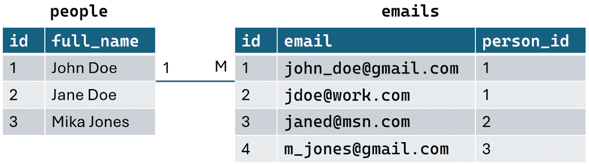
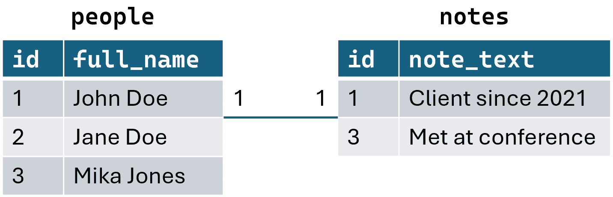
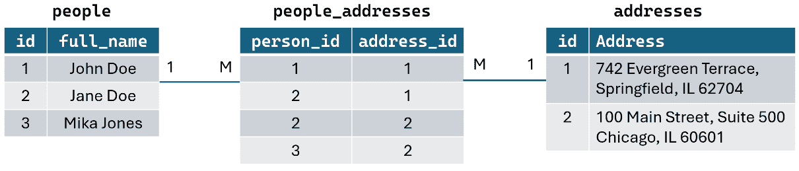
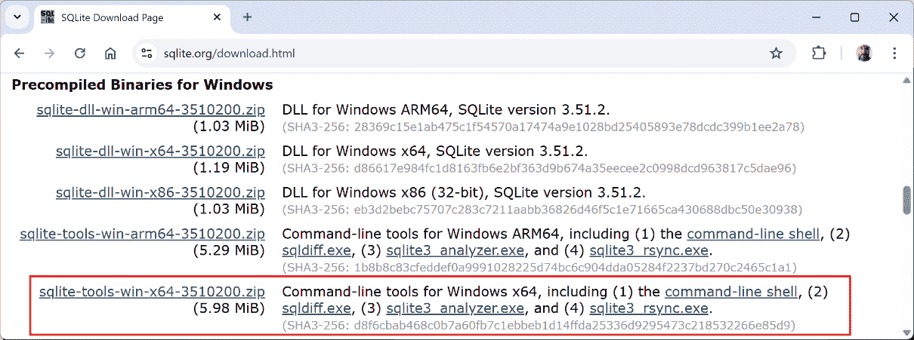
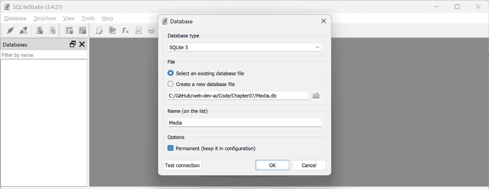
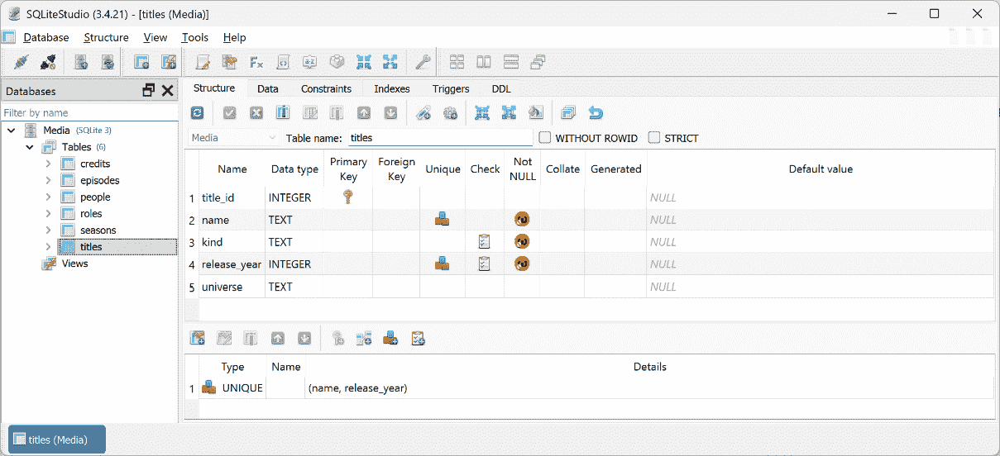
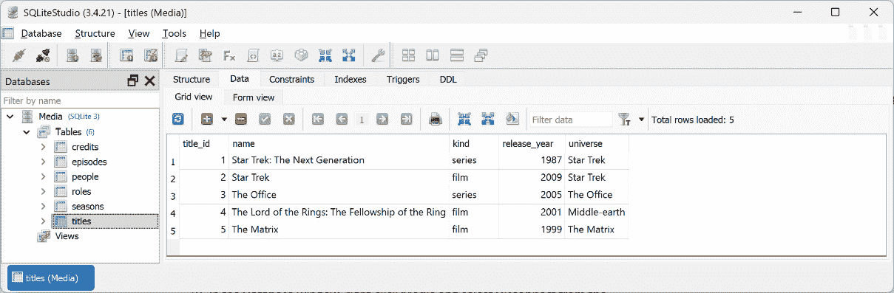
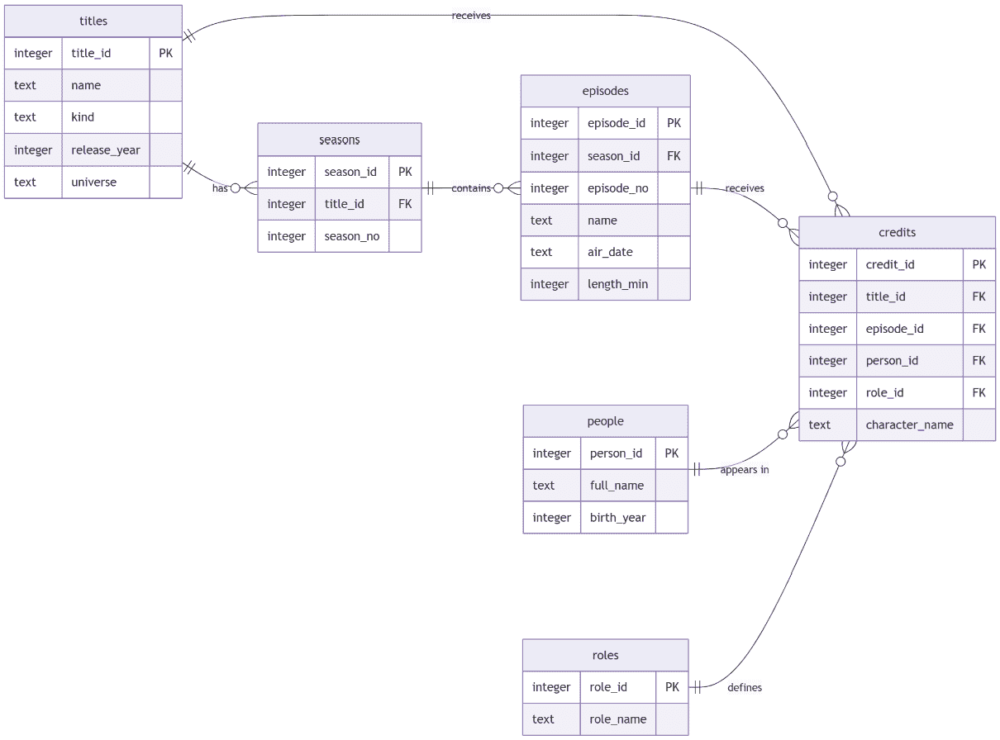
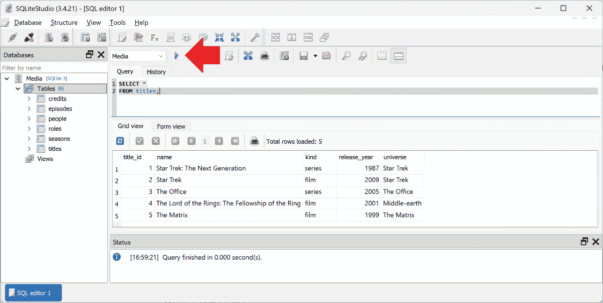
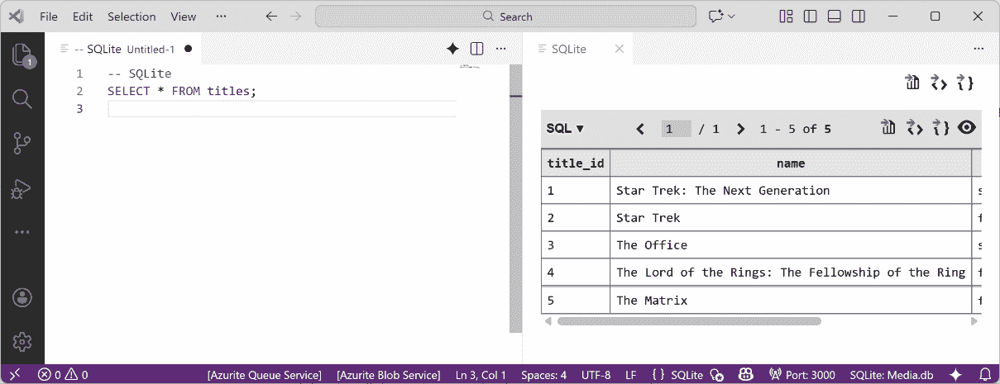

## 第 7 章：SQL – 管理数据

网页可以容忍一点丑陋。数据模型则不那么宽容。一旦数据重复、不一致或关联不当，整个应用程序就会开始为此买单。

本章使用 SQLite 和一个小型示例数据库介绍 SQL 和关系型数据库。目标不是将您培养成数据库管理员，而是帮助您理解结构化数据如何存储、关联、查询和修改。

您将从关系型数据库的基本概念入手：表、行、列、键、关系、`NULL` 和约束。然后您将设置 SQLite，检查示例数据库，并使用 `SELECT`、`WHERE`、`ORDER BY`、`JOIN`、`GROUP BY` 和 `HAVING` 编写真实查询。之后，您将使用 `INSERT`、`UPDATE` 和 `DELETE` 修改数据，了解事务，最后通过索引和性能的实用介绍结束本章。

读完本章后，您应该理解关系型数据库如何存储和关联相关事实。学习 SQL 语法很重要，但更大的技能是学会对数据提出精确的问题：什么存在、各部分如何关联、什么必须始终为真，以及应用程序需要什么答案。

在本章中，我们将涵盖以下主题：

- SQL 和数据库简介
- 设置 SQLite 和示例数据库
- 编写查询和连接表
- 修改数据
- 使用索引提升性能

本章建议的聊天机器人提示词及示例响应可在以下链接找到：[`github.com/markjprice/web-dev-ai/blob/main/prompts/ch07-sql/readme.md`](https://github.com/markjprice/web-dev-ai/blob/main/prompts/ch07-sql/readme.md)

## SQL 和数据库简介

我们应该首先回答这个显而易见的问题。

### 什么是数据库？

SQLite、PostgreSQL、MySQL 和 SQL Server 是数据库引擎。SQL 是您用来与它们交互的通用语言。每个引擎都有自己的扩展和怪癖，但核心 SQL 概念是共享的。

数据库是一个用于存储数据的有组织系统，以便数据可以被检索、更新并随时间保持一致。在关系型数据库中，数据存储在表中。每个表代表一种事物。例如，电影、电视剧、演员或剧集。


# SQL 基础

## 表与关系

表由**行**和**列**组成。每一行代表一条单独的记录，例如一部电影或一个人。每一列代表该记录的单个属性，例如标题、发行年份或出生年份。每个表都有一个**主键**，它唯一标识每一行。这就是数据库在不依赖可能会变化的名称或其他值的情况下跟踪单个记录的方式。

关系型数据库建立在表之间的关系之上。表不复制数据，而是使用**外键**相互引用。例如，剧集行不会重复节目的名称和发行年份。相反，它存储对节目主键的引用。这保持了数据的一致性，并避免了同一事实存在于多个位置且值略有不同从而导致的隐蔽 Bug。

## SQL 概览

**SQL** 是一种用于请求数据并塑造结果的语言。**SQL** 代表 **Structured Query Language**（结构化查询语言），但单词 *query*（查询）略显狭隘。SQL 不仅用于读取数据，还用于插入、更新、删除数据，以及定义数据库本身的结构。SQL 的子集包括以下内容：

### SQL 的子集

* **数据定义语言 (DDL)**：用于定义或修改数据库的结构。这些命令处理的是容器（表、视图、索引），而不是它们内部的实际数据。关键命令：`CREATE`、`ALTER`、`DROP`、`TRUNCATE`。类比：在图书馆里搭建书架。

* **数据操作语言 (DML)**：这是你最常使用的子集。用于在表中添加、修改或删除实际的数据记录（行）。关键命令：`INSERT`、`UPDATE`、`DELETE`。类比：把书放上书架或更换书皮。

* **数据查询语言 (DQL)**：完全专注于检索数据。虽然有些人将 `SELECT` 归类为 DML，但严格来说它是一个独立的类别，因为它不操作数据，只获取数据。关键命令：`SELECT`。类比：从书架上取书阅读。

还有更多子语言，如**数据控制语言 (DCL)**，用于安全和权限，关键命令如 `GRANT` 和 `REVOKE`；以及**事务控制语言 (TCL)**，允许你将多个更改分组为一个要么整体成功要么整体失败的事务。TCL 的关键命令如 `COMMIT` 和 `ROLLBACK`。但我不想过早让你感到不知所措！

## 核心 SQL 特性

核心 SQL 不是通常意义上的编程语言。核心 SQL 语言没有循环，没有像 Python 或 JavaScript 那样的 `if` 语句，也没有分步控制流的概念。你不需要告诉数据库*如何*查找数据。你描述想要的结果，数据库引擎决定以最高效的方式获取它。这就是为什么 SQL 被称为声明式而非过程式。你声明结果，而非过程。你描述想要的结果，而不是获取结果的步骤。

## 良好实践

尽管 SQL 主要是一种声明式语言，但大多数现实世界的数据库系统也包含过程式扩展。过程式 SQL 之所以存在，是因为实际应用有时需要逻辑来进行批处理、数据验证、超出简单约束的强制执行，以及迁移或 ETL 过程中的复杂转换。过程式 SQL 关键字包括：`DECLARE`、`SET`、`IF` 和 `WHILE`。按预期方式使用 SQL：描述你想要的结果，让数据库引擎处理细节。过程式功能用于边缘情况，而非默认方法。

## 提示：SQL 与过程式扩展

我被告知 SQL 没有循环，没有像 Python 或 JavaScript 那样的 `if` 语句，也没有分步控制流的概念。但我看到 T-SQL 确实有那些关键字。为什么？所有 SQL 方言实际上都有流程控制语句吗？

## SQL 方言

虽然 ISO/ANSI SQL 标准为 SQL 应如何工作提供了蓝图，但几乎每家数据库公司都会添加自己的风格或方言。这些方言的存在是因为不同的数据库是为不同需求构建的。

以下是一些重要方言及其差异：

### T-SQL (Transact-SQL)

**T-SQL (Transact-SQL)** 用于 Microsoft SQL Server。T-SQL 是 SQL Server 对 SQL 的过程式扩展。它增加了变量、控制流语句、错误处理和存储过程支持，使数据库代码能包含更多类应用程序的逻辑。它专注于高性能业务逻辑和与 Windows 生态系统的深度集成。

### PL/SQL (Procedural Language/SQL)

**PL/SQL (Procedural Language/SQL)** 用于 Oracle Database。该方言被广泛认为是最复杂的。它深受 Ada 影响（一种用于国防和航空的严格编程语言）。它专为大规模、任务关键型企业系统而构建，在这些系统中数据完整性是重中之重。

### PostgreSQL (PL/pgSQL)

**PostgreSQL (PL/pgSQL)** 用于 PostgreSQL。PostgreSQL 通常受到那些关心标准和高级 SQL 功能的人的青睐。

### 提示：SQL 标准合规性

现代数据库实际上在多大程度上遵循 ISO SQL 标准？解释为什么 SQL 方言会分歧，以及为什么在实践中完全的可移植性很难实现。

为什么会有这么多 SQL 方言？这就像英语在伦敦、纽约和悉尼有不同的口音和俚语。核心词汇是相同的，但供应商也会添加使其系统更独特、可移植性更低的功能。此外，设计用于手机运行的数据库（如 SQLite）不需要像 Oracle 这样的企业级引擎那样庞大的过程式开销。而且，许多 SQL 方言是在官方 SQL 标准完全确立之前发明的。

## SQL 如何用于查询数据

### 查询数据

查询数据意味着向数据库提问。SQL 查询通常以 `SELECT` 开头。`SELECT` 语句指定：

* 你想要哪些列
* 数据来自哪个表或哪些表
* 应包含哪些行
* 结果应如何排序或分组

例如，一个简单的查询可能是说：*给我所有 2000 年后发行的电影的名称和发行年份，按年份排序。* SQL 看起来可能像下面的代码：

```sql
SELECT title, year FROM films WHERE year > 2000 ORDER BY year
```

你没有告诉数据库如何扫描表、使用哪个索引，或如何排序操作。你只是在描述结果集。

当数据库接收到 SQL 查询时，它在内部会经历几个步骤。它解析 SQL 文本，检查表和列是否存在，检查权限，然后构建查询计划。查询计划是数据库选择的回答查询的策略。两个相同的查询可能因索引、数据量和数据库引擎的不同而运行方式截然不同，但你编写的 SQL 不会改变。

### 修改数据

SQL 也用于修改数据。`INSERT` 添加新行。`UPDATE` 更改现有行。`DELETE` 删除行。这些语句遵循相同的声明式思想。你描述应影响哪些数据以及新值应是什么，数据库会安全且一致地处理机制。

例如，要删除 2000 年之前发行的所有电影，请使用以下代码：

```sql
DELETE FROM films WHERE year < 2000
```

### 为什么这种分离很重要

因为 SQL 描述的是结果而非分步过程，所以同一个查询既可以用于微小的表，也可以用于大得多的表。至于性能是否良好，则取决于模式、索引和数据库引擎的查询计划。设计不良的表会导致别扭的查询和性能问题，无论你的 SQL 看起来多么好。


# SQL 基础与数据库设计

SQL 是一个重申本书主题的好地方：输入命令只是工作的一部分。更难的部分是在查询存在之前，决定数据应该是什么样子。哪些事实属于一组？哪些事实绝不应重复？哪些值是可选的？即使应用程序出错，数据库应强制执行哪些规则？如果这些决定出错，每个查询都会变得别扭。如果决定正确，大多数 SQL 就会变得平常易懂。

数据库是存储和保护数据的系统。SQL 是你用来向该系统提问并更改其内容的语言。学习 SQL 意味着习惯用集合和关系来思考，而不是按顺序执行的代码行。

## SQL 数据类型

SQL 数据类型定义了列可以存储什么类型的值，以及数据库如何解释、比较和存储这些值。选择合适的数据类型有助于保持数据有效且查询可预测。

数据类型控制：

*   允许哪些值
*   比较和排序如何表现
*   索引如何工作
*   算术运算和函数如何应用

选择不当的数据类型可能导致令人困惑的 Bug、错误的比较，以及日后不必要的复杂性。

大多数关系型数据库将数据类型分为几大类。

### 数值类型

这些类型存储数字并允许算术运算。常见示例包括：

*   `INTEGER` 或 `INT`：整数
*   `REAL`、`FLOAT`、`DOUBLE`：近似小数
*   `NUMERIC` 或 `DECIMAL`：精确小数，常用于货币

**良好实践**：计数、ID 和年份使用整数类型。精度至关重要的值（如货币）使用精确小数类型。避免将浮点类型用于货币。

### 文本类型

这些类型存储字符串。常见示例包括：

*   `TEXT`：优先考虑灵活性
*   `VARCHAR(n)`：表达对最大长度 (`n`) 的预期
*   `CHAR(n)`：固定存储大小 (`n`)

对于大多数应用数据，`TEXT` 就足够了，除非你有强烈的理由强制限制长度。

### 日期和时间类型

这些类型存储日期和时间戳。常见示例包括：

*   `DATE`
*   `TIME`
*   `TIMESTAMP`

请使用日期和时间类型，而不是将日期存储为文本。它们允许正确的排序、比较和基于日期的计算。

### 布尔类型

这些类型存储真或假值。常见示例包括：

*   `BOOLEAN`
*   某些系统中用作 `0` 或 `1` 的 `INTEGER`

如果可用，请使用布尔类型而非整数。这能使含义明确，并避免混合 `0`、`1`、`true` 和 `false` 等不一致的约定。

### 二进制类型

这些类型存储原始二进制数据。示例包括：

*   `BLOB`
*   `BYTEA`

二进制类型用于文件、图像或不透明数据。它们很少涉及过滤或连接，通常最好存储在数据库之外，除非需要事务一致性。

### SQLite 与类型亲和性

SQLite 比大多数数据库更灵活。它使用一种称为**类型亲和性**的系统，这意味着列有一个首选类型，但数据库并不严格强制执行。

例如，声明为 `INTEGER` 的列仍然可以存储文本。SQLite 会在可能时尝试转换值，但在许多情况下不会拒绝不匹配的类型。

这种灵活性便于学习和原型设计，但这意味着开发者的自律更重要。即使 SQLite 不强制要求，使用合适的类型和约束仍然很重要。

相比之下，PostgreSQL 和 SQL Server 更严格地强制执行数据类型。

数据类型展示了什么样的数据属于某一列。它们告诉数据库和未来的模式阅读者每一列属于什么类型的数据。尽早选择清晰、合适的类型会使查询更简单，防止无效数据，并减少数据库增长时的意外情况。

规范化是下一个概念，也是许多初学者首次卡住的地方。

## 数据库模式设计

**数据库模式设计**关乎决定存储什么数据、如何构建结构，以及数据片段之间如何关联。设计良好的模式使查询更简单、数据更一致，并让应用程序随时间推移更易于更差。设计不良的模式会导致重复、Bug 和日益复杂的 SQL。

**提示**：一旦真实数据存在，如何安全地更改数据库模式？请解释迁移及其存在的原因，即使 `ALTER TABLE` 可用。请包含日后难以修复的模式设计错误示例。

### 表代表一种事物

在关系型数据库中，每个表建模单个概念。示例包括用户、电影、剧集或订单。一个表应回答一个清晰的问题：*此表中的一行是什么？* 如果你无法用一句话解释清楚，该表可能承担了过多职责。

### 行代表该事物的一个实例

每一行是一条单独的记录。一个用户、一部电影、一集剧集。行之间应相互独立。数据库不关心行顺序，你的设计也不应依赖它。每一行必须可唯一标识，这就是表拥有主键的原因。这通常是一个永不改变的整数 ID 或 GUID，即使行中的数据发生了变化。

### 列代表一个属性

列保存关于表所代表事物的单个事实。一列应包含一个类型的一个值。例如，发行年份、电子邮件地址或时长（分钟）。将多个事实混合在一列中，例如在单个文本字段中存储逗号分隔的演员列表，会使查询更难并破坏关系模型。

### 数据放在哪里

良好的模式设计始于将**实体**与**属性**分离。

如果一个值描述事物本身，它属于该事物的表。电影的标题和发行年份属于 `titles` 表。如果一个值描述两个事物之间的关系，它通常属于一个单独的表。角色名属于演员与电影之间的关系，而不单独属于演员或电影。

一个有用的经验法则是：如果一个值必须为多行重复，请停下来询问它是否应存储在别处并通过引用关联。在多行或多表中重复相同数据乍看似乎无害，尤其是在小示例中。在真实系统中，它会导致三类经典的 Bug，称为异常：

*   **插入异常**发生在你无法添加一条数据而不同时添加无关数据时。例如，如果一个表混合了电影和演员，除非演员已关联到一部电影，否则你可能无法添加新演员。
*   **更新异常**发生在相同值存储在多处且必须在所有地方更改时。如果你在一行中更新了它却漏掉了另一行，数据就会变得不一致。
*   **删除异常**发生在移除一条数据时意外删除了你想保留的其他数据。例如，删除某演员参演的最后一部电影可能会同时删除该演员的唯一记录。


# 规范化

规范化的存在主要是为了防止这些问题。规范化是一种构建表结构的系统方法，旨在减少冗余和依赖问题，通常通过将数据拆分到相关表中并使用键进行关联来实现。

您可以通过以下链接详细了解标准范式（1NF、2NF、3NF）以及它们如何消除这些异常：[`www.guru99.com/database-normalization.html`](https://www.guru99.com/database-normalization.html) 和 [`en.wikipedia.org/wiki/Database_normalization`](https://en.wikipedia.org/wiki/Database_normalization)

## 规范化：事实仅存储一次

规范化是组织数据的过程，使每个事实仅存储在一个位置，以提供单一事实来源。在实践中，这通常意味着：

* 为不同的概念创建单独的表
* 使用主键标识行
* 使用外键引用相关数据
* 移除重复或派生的值

例如，与其在每个出场的剧集中存储一个人的名字，不如将该人存储一次在 `person` 表中，并从出场表或演职员表中引用他们。如果该人的名字发生变化，只需更新一行数据。

初学者常担心将数据拆分到更多表中会使查询变得更难。实际上，随着时间的推移，情况恰恰相反。设计良好的模式会带来可预测的连接和更简单的逻辑。设计不良的模式会导致字符串解析、重复过滤和脆弱的假设。

连接的存在正是为了在查询时重组规范化的数据。这就是关系型数据库做出的权衡：干净且一致地存储数据，然后使用 SQL 重构你需要的视图。

一旦数据存在，模式设计决策就很难撤销。添加新列很容易。理清数百万行中重复的数据则不然。这就是为什么早期在表、行、列和关系上花费时间，日后会获得不成比例的回报。

良好的数据库模式设计在于尊重表、行和列的本意，并抵制为图短期方便而重复数据的诱惑。

**提示**：请用一个现实的例子解释规范化与反规范化，并展示何时反规范化是合理的。

## 主键和外键

主键和外键赋予了关系型数据库其标识和结构。它们回答了两个基本问题：*这是哪一行？* 和 *这一行如何与其他行关联？*

### 主键用于标识

主键唯一标识表中的每一行。它是数据库的标识概念。同一表中的任意两行不能共享相同的主键值，且主键不能为 `NULL`（意为*未知*或*不适用*，将在后续章节详细解释）。

在实践中，主键通常是单列，常为自增整数或 GUID。实际值对人类来说很少重要。重要的是它稳定且唯一。标题可变、名字可改、邮箱可更新，但主键保持不变。这就是为什么主键永远不应包含业务含义或逻辑。

例如，一个人的名字是糟糕的主键。名字不唯一且会变。内部 `person_id` 是个好主键，因为它仅用于标识该行。

主键也是关系的目标端。其他表指向它们，表示*这一行引用那一行*。

在 SQLite 中，将列声明为 `INTEGER PRIMARY KEY` 赋予其特殊角色。该列成为内部 `rowid` 的别名，当你插入行时未提供值，SQLite 会自动分配一个唯一整数。实际上，这表现得像自增 ID，通常每次添加新行时加一。

值得注意的是 SQLite 也支持显式的 `AUTOINCREMENT` 关键字，但这很少需要。没有它时，SQLite 通常会选取下一个最大的未使用值，这既快速又高效。使用 `AUTOINCREMENT` 时，SQLite 保证永不重用已分配的值，即使行被删除，但这会带来少量的性能和存储开销。对大多数应用，单独使用 `INTEGER PRIMARY KEY` 是更好的选择。

其他数据库系统提供类似功能，但语法和行为不同。在 MySQL 中，使用 `AUTO_INCREMENT` 属性达到相同效果。在 PostgreSQL 中，旧代码常用 `SERIAL`，现代版本推荐 `GENERATED AS IDENTITY`，它更灵活且符合标准。虽然所有系统的目标相同，即自动生成唯一数字标识符，但具体规则和保证可能略有不同，特别是在序列间隙和已删除值的重用方面。

### 外键用于关系

`外键` 是一张表中引用另一张表主键的列。它表示两个实体之间的关系。

例如，一集属于一个剧集。剧集表可能包含一个 `series_id` 列，引用 `series` 表的主键。该 `series_id` 即为外键。

外键让数据库能强制执行关于关系的规则。有了外键，数据库可以防止：

* 插入引用不存在父行的行
* 删除仍有依赖行的父行
* 创建不再合理的孤儿记录

这种强制执行是关系型数据库相对于临时数据存储的主要优势。

### 一对多关系

最常见的关系是一对多。一个剧集有多集。一个客户有多订单。一个作者有多本书。

在一对多关系中，外键位于“多”方。每一集的行存储其所属的 `series_id`。`series` 表不需要知道它有多少集。该信息随时可通过查询 `episodes` 表得出。

图 7.1 展示了 `people` 表和 `emails` 表之间经典的一对多关系。左侧，`people` 表每人存储一行，由唯一 `id` 标识。右侧，`emails` 表存储电子邮件地址。每个邮件行包含一个 `person_id`，将其链接回所属的人。核心思想是：一个人可以有多个邮箱，但每个邮箱只属于一个人：



图 7.1：一对多关系

你可以在示例数据中看到这一点：

* John Doe (id = 1) 有两个邮箱：`john_doe@gmail.com` 和 `jdoe@work.com`。`emails` 表中两行的 `person_id` 均为 1。
* Jane Doe (id = 2) 有一个邮箱：`janed@msn.com`
* Mika Jones (id = 3) 也有一个邮箱：`m_jones@gmail.com`

所以，关系如下运作：

* `people.id` 是主键
* `emails.person_id` 是外键
* 外键允许 emails 表中多行指向 people 表中同一行

图中的 `1---M` 标记强化了这一点：people 表的一行映射到 emails 表的多行。重复存在于“多”方。person_id 值在 emails 表中重复，正是这种重复建立了关系。

### 一对一关系

图 7.2 展示了 `people` 表和 `notes` 表之间的一对一关系。


## 一对一关系

每个人最多只能有一条备注，且每条备注仅属于某一个人。该关系显示为 `1---1`，意味着任意一方均无重复。



图 7.2：一对一关系

查看数据：

*   **John Doe**（id = 1）关联单条备注：“Client since 2021”（备注 id = 1）
*   **Jane Doe**（id = 2）在本例中没有备注
*   **Mika Jones**（id = 3）关联：“Met at conference”（备注 id = 3）

即使并非每个人都有备注，该规则依然成立。没有人拥有超过一条备注，且没有备注在人与人之间共享。

在实际模式中，通常通过在 `notes` 表中放置唯一外键来强制执行此规则，例如：

```
person_id INTEGER UNIQUE
```

该 `UNIQUE` 约束将一对多结构转变为真正的一对一关系。外键仍位于一方（例如 `notes` 表），但唯一性约束防止了重复，因此关系无法扩展为多对多。

## 多对多关系

有时双方均可拥有多个关联行。一部电影可以有多位演员，一位演员可以出演多部电影。这无法用单个外键表示。

取而代之的是，你需要创建一张 **连接表**，有时也称为链接表或联接表。该表至少包含两个外键，分别指向关系的双方。每一行代表一个关系实例。

例如，`credits` 表可能包含作为外键的 `film_id` 和 `person_id`，外加 `character_name` 或 `role` 等额外列。

图 7.3 展示了 `people` 与 `addresses` 之间的多对多关系，通过名为 `people_addresses` 的中间表实现。

从概念层面来看：

*   一个人可以拥有多个地址（住所、工作地等）
*   一个地址可以属于多个人（共同居住的家庭或共用的工作场所）

这意味着任一表都无法在不造成重复或破坏模型的情况下持有简单的外键。取而代之的是，通过 `people_addresses` 表来处理该关系。



图 7.3：多对多关系

数据如何关联：

*   `people.id` 标识每个人
*   `addresses.id` 标识每个地址
*   `people_addresses` 使用 ID 对将它们链接

查看示例行：

*   **John Doe**（id = 1）居住在地址 1：742 Evergreen Terrace
*   **Jane Doe**（id = 2）关联地址 1 和地址 2，因此她与 John 共享住所地址，并在地址 2（100 Main Street）工作
*   **Mika Jones**（id = 3）与 Jane 一起在地址 2 工作

多对多关系无法直接用单个外键表示。为了支持双方的“多”，你需要一张单独的表，该表：

*   存储相关行的组合
*   允许每人和每地址有多条记录
*   保持模式规范化并避免重复

中间表将一个复杂的多对多关系转化为两个简单的一对多关系：

*   `people` 关联 `people_addresses`
*   `addresses` 关联 `people_addresses`

这是在关系型数据库中建模多对多关系的标准且正确的方式。

## 引用完整性与级联规则

外键通常定义有规则，规定当被引用行发生变化时会发生什么。常见选项包括：

*   `RESTRICT` 或 `NO ACTION`：若存在关联行则阻止删除
*   `CASCADE`：自动删除或更新关联行
*   `SET NULL`：保留行但清空外键

选择这些规则是一项设计决策。级联删除虽方便，但若使用不当，也能极快地删除大量数据。

## NULL 值

`NULL` 是 SQL 中最容易被误解的概念之一，许多微妙的 Bug 都源于将其视作普通值。在 SQL 中，`NULL` 不代表零、空字符串或 false。它意味着 *unknown*（未知）或 *not applicable*（不适用）。

`NULL` 不表示存在但碰巧为空的数据。它表示值的缺失。这种区别很重要，因为 SQL 在比较或过滤数据时必须考虑到不确定性。

涉及 `NULL` 的比较行为不符合大多数程序员的预期。例如，以下表达式不为 `true`：

```
universe = NULL
```

但它也不为 `false`！它是 *unknown*（未知）。这正是 SQL 拥有检查 `NULL` 的特殊语法的原因：

```
universe IS NULL
universe IS NOT NULL
```

任何时候你想测试数据是否缺失，都必须使用 `IS NULL` 或 `IS NOT NULL`。

### 三值逻辑

SQL 使用三值逻辑，而非二值逻辑。条件求值结果可以是：`TRUE`、`FALSE` 或 `UNKNOWN`。任何涉及 `NULL` 的比较都会产生 `UNKNOWN`，而非 `TRUE` 或 `FALSE`。例如：

```
NULL = 'Star Trek'   结果为 UNKNOWN
NULL <> 'Star Trek'  结果为 UNKNOWN
NULL = NULL          结果为 UNKNOWN
```

这有一个实际后果：`WHERE` 子句仅保留条件为 `TRUE` 的行。条件为 `FALSE` 或 `UNKNOWN` 的行会被排除。这解释了为什么查询在涉及 `NULL` 值时有时会意外丢失行。

`NULL` 值也会以微妙的方式影响连接。依赖相等性的连接条件不会匹配连接键为 `NULL` 的行，因为 `NULL` 永不等于任何东西，包括另一个 `NULL`。

这也是外键列通常定义为 `NOT NULL` 的原因之一，除非有充分的建模理由允许 `NULL`。

大多数 `NULL` Bug 都源于忘记了 SQL 有三种真值状态而非两种，且 `UNKNOWN` 在过滤器中被视为 *排除该行*。

**提示**：请展示一些因误解 `NULL` 而导致的常见 Bug 及其规避方法。

## 约束

约束是由数据库强制执行的规则，用于保护数据的完整性。它们充当安全网，防止无效、不一致或无意义的值被存储。与其依赖应用程序代码 *做正确的事*，约束让数据库自身负责捍卫自身的正确性。

表 7.1 展示了常见约束：

| 约束 | 说明 |
| --- | --- |
| `NOT NULL` | 确保列必须始终有值。它防止在记录所需字段缺失数据的情况下插入或更新行。例如，标题名称、电子邮件地址或发布年份通常不能为 `NULL`。允许这些列为 `NULL` 会迫使每个查询和每个应用层不断检查缺失值。如果值真的是可选的，则允许 `NULL`。如果不是，请在模式中显式说明。 |
| `UNIQUE` | 确保没有两行在某列或某列组合中共享相同的值。它强制逻辑唯一性而非标识唯一性。这与主键不同，主键强制行标识唯一。例如，你可能只允许每个电子邮箱地址注册一个用户账户，或每季只允许一个剧集编号。在这些情况下，值必须在定义的范围内唯一。它们在多用户系统中尤为重要，因为两个请求可能几乎同时到达。 |


# 约束

## CHECK 和 FOREIGN KEY 约束

### 表 7.1：常见约束

| 约束 | 说明 |
|------|------|
| `CHECK` | 限制可存储在列中的值的范围或格式。它将简单的业务规则直接编码到数据库中。示例包括：发行年份必须大于或等于 1888，评分必须在 1 到 5 之间，状态必须是一组固定值之一。它们并非旨在替代复杂的验证逻辑，但对于保护基本不变量非常有效。 |
| `FOREIGN KEY` | 强制表之间的关系。它确保一个表中的值引用另一个表中的有效行。例如，剧集不能引用不存在的季度，演职员记录不能引用人员表中不存在的人员。外键还可以定义相关数据更改时发生的情况。常见行为包括阻止删除、级联删除或将引用设置为 `NULL`。 |

每种约束类型解决不同类别的问题，但它们组合使用效果最佳。`NOT NULL` 确保必需数据存在。`UNIQUE` 确保数据不重复。`CHECK` 确保数据合理。`FOREIGN KEY` 确保数据与其他数据正确关联。

没有约束，数据库只是一个被动的存储系统，接受任何给定的数据。有了约束，数据库会主动捍卫应用程序所依赖的假设。这减少了错误，简化了查询，并使长期维护变得容易得多。约束关乎防止坏数据。

# 数据库对象的 SQL 命名约定

坚持为数据库对象使用一致的命名约定将使维护更容易。由于大多数 SQL 方言不区分大小写但在显示时保留大小写，因此形成了一些常见约定，以确保代码在不同系统中保持可读和可移植。

最广泛推荐的约定，特别是对于 PostgreSQL、MySQL 和 SQLite，是 `lower_snake_case`。例如：

- 表名：`user_accounts`、`order_items`、`product_categories`
- 列名：`first_name`、`created_at`、`email`

为什么？许多 SQL 引擎在内部将所有内容转换为小写。使用 `lower_snake_case` 可确保代码在编辑器中的外观与在数据库日志中的外观一致。

### 表命名指南

- 表代表事物的集合，因此应使用集合名或复数名。例如，使用 `users` 表而不是 `user` 表。表是许多记录的容器。
- 避免前缀。不要将表命名为 `tbl_users`。数据库工具已经知道它是一个表。
- 要描述性强。如果表存储用户和组之间的关系，将其命名为 `user_groups` 而不是 `mapping_table_1`。
- 避免 SQL 关键字。名为 `order` 的表将与 `ORDER BY` 冲突，名为 `group` 的表将与 `GROUP BY` 冲突，而 `USER` 是 PostgreSQL 中的关键字。

**最佳实践**：选择表名时检查数据库的保留字列表。拿不准时，使用更具描述性的名称，如 `user_accounts` 或 `customer_orders`。

### 列命名指南

- 对于指定为主键（行唯一标识符）的列，有两种相互竞争的观点。你可以使用简单的 `id`，这样每个表都有一个仅名为 `id` 的列。但在连接 users 和 orders 时，你会得到两个名为 `id` 的列，这可能会令人困惑。或者你可以使用像 `user_id` 这样的前缀，使主键列名包含表名。
- 为布尔列名添加 `is_`、`has_` 或 `can_` 前缀，以明确值为 `true` 或 `false`。例如，`is_active`、`has_discount` 和 `can_post`。
- 对于日期和时间，包含后缀以指示是日期还是完整时间戳。例如，`created_at`（时间戳）、`birth_date`（仅日期）。

### 应避免的名称

- 永远不要将表命名为 `User`、`Order` 或 `Group`。这些是某些 SQL 方言中的保留关键字，将要求你在每次编写查询时使用烦人的引号如 `"User"` 或方括号如 `[User]`。
- 永远不要在表或列名中使用空格，如 `Order Date`，因为这将要求你在每次编写查询时使用额外的引号如 `"Order Date"` 或方括号如 `[Order Date]`。使用下划线如 `order_date`。
- 避免缩写如 `cust_addr_id`。使用 `customer_address_id`。空间很廉价。花在解读缩写上的时间则不廉价。

**最佳实践**：对 SQL 关键字使用 `UPPERCASE` 是业界最广泛接受的约定。虽然 SQL 不区分大小写（意味着 `select` 与 `SELECT` 效果相同），但大写关键字可提高视觉解析效率。

现在，让我们确保你已安装 SQLite，然后设置一个示例数据库。

# 设置 SQLite 和示例数据库

SQLite 是一个小巧、快速、跨平台、自包含的**关系型数据库管理系统 (RDBMS)**，属于公共领域。它是 iOS（iPhone 和 iPad）和 Android 等移动平台上最常见的 RDBMS。SQLite 是世界上使用最广泛的数据库引擎，有超过一万亿个 SQLite 数据库在活跃使用中。你可以在 [`www.sqlite.org/mostdeployed.html`](https://www.sqlite.org/mostdeployed.html) 阅读更多相关信息。

我在这里使用 SQLite 是因为它跨平台、易于安装，且足以学习核心 SQL 和数据库设计。

现在让我们在你的计算机上安装 SQLite。

## 设置 Windows 的 SQLite CLI 工具

在 Windows 上，我们需要下载 SQLite CLI 工具，并将 SQLite 的文件夹添加到系统路径中，以便在命令提示符或终端输入命令时能找到它：

1. 启动你喜欢的浏览器并导航到 [`www.sqlite.org/download.html`](https://www.sqlite.org/download.html)。
2. 向下滚动页面到 **Precompiled Binaries for Windows** 部分。
3. 点击 **sqlite-tools-win-x64-3510200.zip**（当你阅读时，文件版本号可能更高），如 *图 7.4* 所示：
   
   图 7.4：在 Intel x64 Windows 上下载 SQLite
4. 将 ZIP 文件解压到名为 `C:\Sqlite` 的文件夹中。确保包括 `sqlite3.exe` 在内的三个解压文件直接位于 `C:\Sqlite` 文件夹内，否则稍后尝试使用时将找不到可执行文件。
5. 在 Windows **开始** 菜单中，导航到 **设置**。
6. 搜索 `environment` 并选择 **编辑系统环境变量**。在非英语版本的 Windows 上，请搜索你本地语言中的对应词汇以找到该设置。
7. 点击 **环境变量** 按钮。
8. 在 **系统变量** 中，列表中选择 `Path`，然后点击 **编辑…**。
9. 如果 `C:\Sqlite` 不在路径中，则点击 **新建**，输入 `C:\Sqlite`，然后按 *Enter*。
10. 点击 **确定**，然后 **确定**，再 **确定** 一次，然后关闭 **设置**。
11. 为了确认 SQLite 路径配置正确，在任何命令提示符或终端中，输入以下命令启动 SQLite：
    ```
    sqlite3
    ```
12. 注意结果，如以下输出所示：
    ```
    SQLite version 3.51.2 2026-01-09 17:27:48
    Enter ".help" for usage hints.
    Connected to a transient in-memory database.
    Use ".open FILENAME" to reopen on a persistent database.
    sqlite>
    ```


## 退出 SQLite 命令提示符

要退出 SQLite 命令提示符，请执行以下操作：

- 在 Windows 上，按两次 `Ctrl` + `C`。
- 在 macOS 上，按 `Ctrl` + `D`。

## 在 macOS 和 Linux 上设置 SQLite

在 macOS 上，SQLite 作为名为 `sqlite3` 的命令行应用程序包含在 `/usr/bin/` 目录中。

在 Linux 上，您可以使用以下命令设置 SQLite：

```
sudo apt-get install sqlite3
```

可以从以下链接为其他操作系统下载并安装 SQLite：https://www.sqlite.org/download.html。

## 为 SQLite 创建 Media 示例数据库

现在我们可以使用 SQL 脚本为 SQLite 创建示例数据库：

1. 创建一个名为 `Chapter07` 的文件夹。
2. 从以下链接下载用于为 SQLite 创建 `Media` 数据库的脚本，并将其保存到本地 `Chapter07` 文件夹：https://github.com/markjprice/web-dev-ai/tree/main/Code/Chapter07/Media.sql。
3. 在 `Chapter07` 文件夹中启动命令提示符或终端：
   - 在 Windows 上，启动**文件资源管理器**，右键单击 `Chapter07` 文件夹，然后选择**在此处打开命令提示符**或**在终端中打开**。
   - 在 macOS 上，启动**访达**，右键单击 `Chapter07` 文件夹，然后选择**在文件夹位置新建终端**。
4. 使用 SQLite 执行 SQL 脚本以创建 `Media.db` 数据库文件，如以下命令所示：

```
sqlite3 Media.db -init Media.sql
```

**警告！** 如果出现错误 `cannot open: "Media.sql"`，则需要指定 SQL 脚本的路径或将其复制到当前目录，因为在当前目录中找不到它。

5. 工作完成后，您将看到 SQLite 命令提示符 `sqlite>`，如以下输出所示：

```
-- Loading resources from Media.sql
SQLite version 3.51.2 2026-01-09 17:27:48
Enter ".help" for usage hints.
sqlite>
```

6. 要退出 SQLite 命令提示符，请执行以下操作：
   - 在 Windows 上，按两次 `Ctrl` + `C`。
   - 在 macOS 或 Linux 上，按 `Ctrl` + `D`。
7. 您可以保持命令提示符或终端窗口打开，因为稍后还会用到它。

## 使用 SQLiteStudio 管理 SQLite 数据库

您可以使用一个名为 `SQLiteStudio` 的跨平台图形数据库管理器来轻松管理 SQLite 数据库。这在排查问题时查看数据以及测试功能时非常有用。例如，您可能想要在某些表中添加或修改一些行来测试功能。

现在让我们安装 SQLiteStudio 并使用它打开和查看示例数据库中的表：

1. 访问 https://sqlitestudio.pl，然后下载并安装该应用程序。
2. 启动 `SQLiteStudio`。
3. 导航到**数据库** | **添加数据库**。
4. 在**数据库**对话框的**文件**部分，点击黄色文件夹按钮浏览本地计算机上的现有数据库文件，选择 `Chapter07` 文件夹中的 `Media.db` 文件，然后点击**确定**，如*图 7.5* 所示：



图 7.5：将 Media.db 数据库文件添加到 SQLiteStudio

5. 如果看不到 **Media** 数据库，请导航到**视图** | **数据库**。
6. 在**数据库**窗口中，右键单击 **Media** 数据库并选择**连接到数据库**（或直接双击 **Media**）。您将看到脚本创建的六个表：`credits`、`episodes`、`people`、`roles`、`seasons` 和 `titles`。
7. 右键单击 **titles** 表并选择**编辑表**或直接双击该表。
8. 在表编辑器窗口的**结构**选项卡中，注意 **titles** 表的结构，包括：
   - 列名，如 `title_id`、`name`、`kind` 和 `release_year`
   - 数据类型，如 `INTEGER` 和 `TEXT`
   - 主键：`title_id`
   - 约束，如 `UNIQUE (name, release_year)`、`CHECK (kind IN('film', 'series'))` 和 `NOT NULL`，如*图 7.6* 所示：



图 7.6：SQLiteStudio 中的表编辑器显示 titles 表的结构

9. 在表编辑器窗口中，点击**数据**选项卡，您将看到 **titles** 表中的 5 行数据，如*图 7.7* 所示：



图 7.7：数据选项卡显示 titles 表中的 5 行数据

10. 浏览其他五个表以了解它们之间的关系，如*图 7.8* 所示：



图 7.8：Media 数据库的实体关系图

**提示**：请根据附带的 SQL 脚本，为该数据库创建一个从左向右绘制的 Mermaid 实体关系图。

请注意前图中的以下几点：

- **层级链**：存在清晰的 `titles` 到 `seasons` 再到 `episodes` 的层级结构。
- **灵活的演职人员表**：`credits` 表允许在 `title` 级别（如电影主演）或 `episode` 级别（如客串明星）为人员记录演职信息，这是通过使 `episode_id` 可为空来实现的。`credits` 表充当连接 `titles`、`people` 和 `roles` 的多对多连接表。
- **完整性规则**：脚本对所有外键使用 `ON DELETE CASCADE`，这意味着如果您删除一个标题，所有关联的季、剧集和演职信息将被自动删除。

11. 在**数据库**窗口中，右键单击 **Media** 并选择**断开数据库连接**。
12. 退出 `SQLiteStudio`。

现在我们有了一个数据库，准备好编写一些查询并学习 SQL 语法。

# 编写查询和连接表

本节重点介绍从一个或多个表中读取数据。编写查询是关于向数据库提出清晰的问题并获得可预测、有用的结果。我们将使用您已经创建的 `Media` 数据库。

## 运行查询的工具

SQLite 在每个主要平台上都有良好的工具支持，您不需要太多东西就可以开始。以下是最实用的跨平台选项、它们的擅长领域以及何时使用每一个。

### SQLite 命令行工具

`sqlite3` CLI 是随 SQLite 本身附带的参考工具。它可在 macOS、Linux 和 Windows 上运行，并且在所有平台上行为一致。

值得使用的原因包括：

- 您与 SQL 之间零抽象
- 非常适合学习、调试和脚本编写
- 适合运行架构文件和种子脚本
- 使 SQL 的行为非常清晰，没有 UI 干扰

典型用法如以下命令所示：

```
sqlite3 media.db
```

然后，在 SQLite 提示符 `sqlite>` 下，您可以输入 SQL 语句和特殊命令，如 `.tables`（列出数据库中的所有表）或 `.schema` 查看架构/结构。例如，输入以下命令：

```
.tables
```

您应该会看到六个表的列表，如以下输出所示：

```
credits   episodes  people    roles     seasons   titles
```

现在显示架构，即 `titles` 表的结构，如以下命令所示：

```
.schema titles
```

您应该会看到 `titles` 表是如何创建的，包括列名和数据类型、主键和约束，如以下输出所示：


```sql
CREATE TABLE titles (
  title_id     INTEGER PRIMARY KEY,
  name         TEXT    NOT NULL,
  kind         TEXT    NOT NULL CHECK (kind IN ('film','series')),
  release_year INTEGER NOT NULL CHECK (release_year >= 1888),
  universe     TEXT    NULL,
  UNIQUE(name, release_year)
);
```

你也可以只输入 `.schema` 而不指定表名，以查看数据库中所有表的架构。

现在输入一个简单的 SQL 查询，以返回 `titles` 表中所有行的所有列，如以下命令所示：

```sql
SELECT * FROM titles;
```

你应该会看到以下结果：

```
1|Star Trek: The Next Generation|series|1987|Star Trek
2|Star Trek|film|2009|Star Trek
3|The Office|series|2005|The Office
4|The Lord of the Rings: The Fellowship of the Ring|film|2001|Middle-earth
5|The Matrix|film|1999|The Matrix
```

**警告！** 如果你看到 SQLite 提示符变为 `...>`，则表示你尚未用分号完成 SQL 语句，因此 SQLite 期望你继续输入更多 SQL。只需输入 `;`，它就会运行！

此 CLI 使机制变得可见：SQL 是发送给数据库引擎的文本，引擎返回行或错误。对于学习而言，这种直接性很有用。

## SQLiteStudio

SQLiteStudio 是一款功能齐全的图形化数据库浏览器和编辑器。它可在所有主流平台上运行，且对初学者非常友好。它在早期阶段很有用，因为你可以在编写 SQL 时看到表、行、列和关系。

其主要缺点是如果过度使用，它会鼓励点击操作而不是编写 SQL。对于学习 SQL，你应该主要停留在查询编辑器中，而不是表格网格中。

让我们探索一些 SQLiteStudio 的功能：

1. 启动 **SQLiteStudio**。
2. 导航至 **工具** | **打开 SQL 编辑器**。
3. 在 **查询** 选项卡编辑器中，输入一个示例查询，如以下代码所示，然后在工具栏中点击 **执行查询** 按钮，如 *图 7.9* 所示：

```sql
SELECT * FROM titles;
```



图 7.9：使用 SQLiteStudio 运行 SQL 查询

SQLiteStudio 不像 SQLite CLI 那样挑剔，不要求每条 SQL 语句都必须以分号结尾。如果你忘了加分号，查询仍会运行。

## VS Code 和 SQLite 扩展

当搭配合适的扩展时，VS Code 可以作为一个轻量级的数据库客户端良好工作。流行的扩展允许你直接打开 SQLite 数据库文件、浏览表和架构、在编辑器内运行 SQL 查询，并将 SQL 文件纳入版本控制。

当 SQL 与应用程序代码、迁移脚本或练习共存时，这种方式效果很好。它也反映了开发者在实际项目中的工作方式。

其优势包括：一切在一个编辑器中，SQL 脚本作为文件保存（而非临时查询），易于重新运行和修改查询，并且如果你稍后引入 Django 或其他后端，它也很合适。

现在让我们确保你可以使用 VS Code 执行 SQL 语句：

1. 如果你尚未安装 SQLite 扩展，请启动 VS Code，导航至 **扩展**，搜索 `sqlite`，然后在 **SQLite** 扩展 (`alexcvzz.vscode-sqlite`) 上点击 **安装**。
2. 在 VS Code 中，导航至 **视图** | **命令面板...**，搜索 **Sqlite: New Query** 并选择它。
3. 在查询编辑器中，输入一个示例查询，如以下代码所示：

```sql
SELECT * FROM titles;
```

4. 在查询编辑器中右键点击，选择 **运行查询**，选择 **从文件选择数据库**，然后浏览选择 `Media.db` 文件。（你只需在第一次运行查询时执行此操作，以便连接到数据库。）
5. 结果将显示在第二个窗口面板中，如 *图 7.10* 所示：



图 7.10：使用 VS Code 的 SQLite 扩展运行 SQL 查询

接下来，我们将逐一介绍每个重要的 SQL 关键字。对于任何代码示例，请在你首选的工具中运行它们：SQLite CLI、SQLiteStudio，或 VS Code 及其 SQLite 扩展。我建议尝试混合使用这三者，以了解各自的优缺点以及你更喜欢哪一个。

## SELECT：查询的结构

每个读取查询都以 `SELECT` 开头。一条 `SELECT` 语句回答四个基本问题：

* 我想要哪些列？你可以列出想要的列名，或使用 `*` 表示所有列。
* 数据来自哪里？你必须指定要查询哪个表（或哪些表）。
* 应包含哪些行？你可以选择使用 `WHERE` 子句来筛选应包含的行。
* 结果应如何排序或分组？你可以选择使用 `ORDER BY` 子句对结果进行排序。

一个最小查询如下所示：

```sql
SELECT name, release_year
FROM titles;
```

上述代码要求数据库从 `titles` 表的每一行返回两列。除非你显式要求，否则数据库不保证行的顺序。

**良好实践**：让每个 SQL 关键字另起一行，以使查询更易于浏览和理解。

## 使用 WHERE 筛选行

大多数查询只关心部分行。`WHERE` 子句对结果集进行筛选，如以下代码所示：

```sql
SELECT name, release_year
FROM titles
WHERE kind = 'film';
```

这仅返回电影，排除电视剧。数据库会对每一行评估该条件，并仅保留匹配的行。

你可以使用 `AND` 和 `OR` 组合条件，如以下代码所示：

```sql
SELECT name, release_year
FROM titles
WHERE kind = 'film'
  AND release_year >= 2000;
```

这读起来很自然：2000 年及以后发行的电影。

## 使用 ORDER BY 对结果排序

如果你关心顺序，必须显式指定，如以下代码所示：

```sql
SELECT name, release_year
FROM titles
ORDER BY release_year;
```

默认情况下，排序为升序。你可以反转它，如以下代码所示：

```sql
SELECT name, release_year
FROM titles
ORDER BY release_year DESC;
```

你也可以按多列排序，如以下代码所示：

```sql
SELECT name, kind, release_year
FROM titles
ORDER BY kind, release_year DESC;
```

这将电影和剧集分组，并按年份对每组进行排序。

## 限制结果中的行数

在探索数据时，限制看到的行数通常很有用，如以下代码所示：

```sql
SELECT name, release_year
FROM titles
ORDER BY release_year DESC
LIMIT 3;
```

这仅返回最近的三个标题。这在大表中特别有用。

**良好实践**：如果查询使用 `LIMIT` 且结果很重要，它几乎总是应该有 `ORDER BY`，因为没有 `ORDER BY` 时，`LIMIT` 在任何有意义的意义上都不代表“前 N 行”。`LIMIT 3` 不代表 *你插入的前三个标题*，或 *最旧的*，或 *最新的*。它代表 *任意三行*。

## 选择计算值

SQL 可以返回表达式，而不仅仅是存储的列，如以下代码所示：

```sql
SELECT name,
       release_year,
       release_year + 10 AS ten_year_anniversary
FROM titles;
```

这不会修改数据。它只是塑造输出。计算列是结果集的一部分，而不是表的一部分。

## 连接表：将相关数据汇集在一起

当你合并来自多个表的数据时，SQL 变得更有用。

例如，剧集属于季，季属于标题。要列出特定剧集的剧集，你需要将这些表连接在一起，如以下代码所示：


# SQL 连接与聚合

```sql
SELECT t.name AS series_name,
       s.season_no,
       e.episode_no,
       e.name AS episode_name
FROM titles t
JOIN seasons s  ON s.title_id = t.title_id
JOIN episodes e ON e.season_id = s.season_id
WHERE t.name = 'Star Trek: The Next Generation'
ORDER BY s.season_no, e.episode_no;
```

每个 `JOIN` 关键字都使用主键和外键连接表。你不是在盲目地合并表。你是在遵循模式中定义的关系。

`titles t` 和 `seasons s` 是表别名的示例。它是一种简写，在查询期间给表一个临时名称。`t` 是 `titles` 表的别名。在查询的其余部分，`t` 和 `titles` 含义相同。

当查询涉及连接时，重复完整的表名很快会变得烦人。此外，当多个表具有同名列时，需要别名来消除歧义。

例如，`titles` 和 `seasons` 都包含 `title_id` 列。如果没有别名，数据库无法知道你指的是哪一个，如下面的代码所示：

```sql
SELECT title_id
FROM titles
JOIN seasons ON seasons.title_id = titles.title_id;
```

前述代码有歧义且会失败。

我们可以使用表别名来阐明我们的意思，如下面的代码所示：

```sql
SELECT t.title_id
FROM titles t
JOIN seasons s ON s.title_id = t.title_id;
```

现在查询不再有歧义。

## 查询多对多关系

演员和标题通过 `credits` 表具有多对多关系。该表是关系所在的位置。

要列出电影的演职员表，我们需要连接四个表（`credits`、`titles`、`people` 和 `roles`），如下面的代码所示：

```sql
SELECT t.name AS title,
       p.full_name,
       c.character_name
FROM credits c
JOIN titles  t ON t.title_id = c.title_id
JOIN people  p ON p.person_id = c.person_id
JOIN roles   r ON r.role_id = c.role_id
WHERE t.name = 'The Matrix'
  AND r.role_name = 'actor'
ORDER BY p.full_name;
```

此查询展示了连接表为何重要。角色名称属于人和标题之间的关系，而不单独属于任何一个表。

## 连接类型

连接是 SQL 重新组合存储在单独表中的相关数据的方式。每种 `JOIN` 类型回答关于两个表的行应如何匹配的略微不同的问题。这些差异很重要，因为它们控制哪些行出现在结果中，哪些被排除。

### 内连接

`INNER JOIN` 仅返回在两个表中都存在匹配的行。这是最常用的连接，通常人们只说 `JOIN` 时指的就是它。事实上，你可以只使用 `JOIN` 而不使用完整的语法 `INNER JOIN`，如下面的代码所示：

```sql
SELECT t.name, s.season_no
FROM titles t
JOIN season s ON s.title_id = t.title_id;
```

这仅返回实际拥有季度的标题。如果一个标题没有季度，它根本不会出现。将 `INNER JOIN` 视为*仅在双方都同意的地方*。

**提示**：请展示一些示例，说明将条件从 `WHERE` 移动到 `ON` 如何改变 `LEFT JOIN` 的含义。

### 左连接（左外连接）

`LEFT JOIN` 返回左表的所有行，以及右表中匹配的行。如果没有匹配，右侧列将作为 `NULL` 返回：

```sql
SELECT t.name, s.season_no
FROM titles t
LEFT JOIN seasons s ON s.title_id = t.title_id;
```

这返回每一个标题，即使是没有季度的电影或剧集。对于那些行，`season_no` 将为 `NULL`。当左表代表你关心的事物，而右表是可选时，使用 `LEFT JOIN`。

**最佳实践**：一个非常常见的错误是将右表的条件放在 `WHERE` 子句中，这会将 `LEFT JOIN` 变回 `INNER JOIN`。应用于被连接表的条件通常应该放在 `ON` 子句中。

### 右连接（右外连接）

`RIGHT JOIN` 是 `LEFT JOIN` 的镜像。它返回右表的所有行，以及左表中匹配的行：

```sql
SELECT t.name, s.season_no
FROM titles t
RIGHT JOIN seasons s ON s.title_id = t.title_id;
```

实际上，很少需要 `RIGHT JOIN`。通过交换表顺序并改用 `LEFT JOIN`，几乎总是能更清晰地表达相同的结果。许多团队为了可读性完全避免使用 `RIGHT JOIN`。

**警告！** `RIGHT JOIN` 于 2022 年在 SQLite 3.39.0 版本中添加。如果你使用的是旧版本的 SQLite 或捆绑旧版本的特定工具，`RIGHT JOIN` 可能无法工作。你可以通过交换表顺序，始终将 `RIGHT JOIN` 重写为 `LEFT JOIN`。

### 全连接（全外连接）

`FULL JOIN` 返回：

- 双方都匹配的行
- 仅存在于左表的行
- 仅存在于右表的行

当不存在匹配时，缺失一方的列为 `NULL`。

```sql
SELECT t.name, s.season_no
FROM titles t
FULL JOIN seasons s ON s.title_id = t.title_id;
```

这对于对账和比较查询很有用，例如查找存在于一个表但不存在于另一个表中的记录。

**警告！** SQLite 不直接支持 `FULL JOIN`。在 SQLite 中，必须使用 `LEFT JOIN` 和 `RIGHT JOIN` 逻辑的 `UNION` 来模拟。

### 交叉连接

`CROSS JOIN` 生成两个表的笛卡尔积。第一个表的每一行都与第二个表的每一行配对。

```sql
SELECT t.name, r.role_name
FROM titles t
CROSS JOIN roles r;
```

如果有 5 个标题和 3 个角色，结果将有 15 行。

`CROSS JOIN` 很少被意外使用，因为结果大小增长非常快。当刻意使用时，通常用于生成组合、测试数据或参考矩阵。

### 自连接

`SELF JOIN` 不是一种单独的连接类型，而是一种模式。它是指使用别名将表与其自身连接的任何连接。

```sql
SELECT t1.name, t2.name
FROM titles t1
JOIN titles t2
  ON t1.universe = t2.universe
  AND t1.title_id <> t2.title_id;
```

这比较同一表内的行。自连接在层级结构、比较和图状关系中很常见。

**提示**：请使用韦恩图直观地解释 `JOIN`，并解释这些图在哪些方面失效。

总之，`JOIN` 通过跨表对齐行来重塑现有数据。理解哪些行在连接中保留下来比记忆语法重要得多。

现在让我们看看分组和聚合，如 `COUNT` 和 `SUM`。

## 聚合：提出汇总问题

SQL 非常擅长回答关于行组的问题。一些常用函数包括以下内容：

- `COALESCE(expression1, expression2, ...)`：从表达式列表中返回第一个非 `NULL` 值。你给它两个或更多值或表达式，它会选取第一个非 `NULL` 的值。`COALESCE(universe, 'Standalone')` 意味着，*如果 universe 有值，则使用它。如果是 NULL，则改用 'Standalone'*。

- `COUNT(*)`：返回结果集或每组中的行数。它计算行数，而非值，并且即使某些列包含 `NULL` 也会包含这些行。

**提示**：请解释为什么 `COUNT(*)` 和 `COUNT(column)` 会产生不同的结果，并举例说明。

例如，每个宇宙存在多少标题？我们可以结合一些函数使用分组，如下面的代码所示：


```
SELECT COALESCE(universe, 'Standalone') AS universe,
       COUNT(*) AS title_count
FROM titles
GROUP BY COALESCE(universe, 'Standalone')
ORDER BY title_count DESC;
```

`GROUP BY` 将行收集到组中。聚合函数如 `COUNT`、`AVG`、`MIN` 和 `MAX` 在每个组上运行。

另一个例子：每个剧集有多少集？我们可以结合连接和分组，如下面的代码所示：

```
SELECT t.name,
       COUNT(e.episode_id) AS episode_count
FROM titles t
JOIN seasons s ON s.title_id = t.title_id
JOIN episodes e ON e.season_id = s.season_id
WHERE t.kind = 'series'
GROUP BY t.title_id
ORDER BY episode_count DESC;
```

要记住的规则是：当你使用 `GROUP BY` 时，每个选定的列必须要么被分组，要么被聚合。

**提示**：为什么 `NULL` 在比较和聚合中的表现与其他值不同？

## 使用 HAVING 过滤组

`WHERE` 在分组前过滤行。`HAVING` 在分组后过滤。让我们看一个同时使用两者的例子，如下面的代码所示：

```
SELECT t.name,
       COUNT(*) AS cast_size
FROM credits c
JOIN titles t ON t.title_id = c.title_id
JOIN roles r ON r.role_id = c.role_id
WHERE r.role_name = 'actor'
GROUP BY t.title_id
HAVING COUNT(*) >= 2
ORDER BY cast_size DESC;
```

这仅返回拥有两个或更多已署名演员的标题。

**提示**：请给我一些必须使用 `HAVING` 而无法使用 `WHERE` 的例子。

## 设计查询的有用顺序

编写查询时，按此顺序设计：

1. 从最关心的表及其列开始，使用 `SELECT` 和 `FROM`
2. 向外连接到其他表以引入相关数据，使用 `JOIN`
3. 使用 `WHERE` 过滤行
4. 如果需要汇总，使用 `GROUP BY` 分组
5. 使用 `HAVING` 过滤组
6. 使用 `ORDER BY` 对最终结果排序

SQL 查询自上而下阅读，但从内向外设计时最合乎逻辑。

## 语法检查：快速测验

这些问题捕捉初学者常犯的错误：

1. 哪个子句控制结果集中包含哪些行？
   - A) `SELECT`
   - B) `WHERE`
   - C) `ORDER BY`
   - D) `GROUP BY`

2. 哪个子句保证查询返回的行的顺序？
   - A) `WHERE`
   - B) `LIMIT`
   - C) `ORDER BY`
   - D) `JOIN`

3. 以下查询返回什么？
   ```
   SELECT COUNT(*)
   FROM titles
   WHERE kind = 'series';
   ```
   - A) 电视剧列表
   - B) 表中的行数
   - C) 电视剧的数量
   - D) 每部电视剧一行

4. 关于 `GROUP BY` 哪个陈述是正确的？
   - A) 它在聚合前过滤行
   - B) 它对结果集排序
   - C) 每个选定的列必须被聚合或分组
   - D) 它可以替代 `JOIN`

5. `WHERE` 和 `HAVING` 有什么区别？
   - A) `WHERE` 过滤列，`HAVING` 过滤行
   - B) `WHERE` 在 `GROUP BY` 之后运行
   - C) `WHERE` 在分组前过滤行，`HAVING` 在分组后过滤组
   - D) 它们可以互换

6. 哪种 `JOIN` 仅返回双方都有匹配值的行？
   - A) `LEFT JOIN`
   - B) `RIGHT JOIN`
   - C) `FULL JOIN`
   - D) `INNER JOIN`

7. 为什么以下查询无效？
   ```
   SELECT name, COUNT(*)
   FROM titles;
   ```
   - A) `COUNT` 不能与 `SELECT` 一起使用
   - B) `name` 必须是 `GROUP BY` 子句的一部分
   - C) `titles` 不能被计数
   - D) `COUNT(*)` 需要 `WHERE` 子句

## 查询练习：编写 SQL

对于 *表 7.2* 中的练习，你应该自己编写 SQL。解决方案应可在本章使用的 `Media` 数据库模式上运行。

| 名称 | 描述 |
| --- | --- |
| 练习 1：简单过滤 | 编写一个查询，列出所有电影的名称和发行年份，按从旧到新排序。 |
| 练习 2：限制结果 | 编写一个查询，返回最近的三个标题，无论它们是电影还是剧集。 |
| 练习 3：连接表 | 编写一个查询，列出《星际迷航：下一代》的所有剧集，显示季号、集号和剧集名称，按播放顺序排列。 |
| 练习 4：多对多关系 | 编写一个查询，列出出演《黑客帝国》的所有演员及其饰演的角色。 |
| 练习 5：聚合 | 编写一个查询，显示每个宇宙中存在多少标题。将没有宇宙的标题视为“独立”。 |
| 练习 6：分组和 HAVING | 编写一个查询，仅返回拥有两个或更多已署名演员的标题，以及演员数量。 |
| 练习 7：理解连接 | 编写一个查询，列出数据库中的所有人及其关联的标题。即使某人只有一条署名记录也要包含在内。 |
| 练习 8：集合思维 | 编写一个查询，找出出演超过一个标题的所有人。 |

表 7.2：查询练习

## 关于 SQL 注入攻击的警告

此时，你是手写 SQL 并直接针对数据库运行。这是安全的，因为你控制输入。

在实际应用中，SQL 查询通常使用用户输入构建，例如表单字段、查询字符串或 API 参数。如果你将该输入直接插入 SQL 字符串，就会产生一个严重的安全漏洞，称为 SQL 注入。

例如，这种代码是危险的：

```
SELECT * FROM users WHERE email = '<user_input>';
```

如果 `<user_input>` 未被安全处理，攻击者可以更改查询的含义。他们不再只是过滤行，而是可以绕过检查甚至修改数据。

要记住的规则很简单：

- 绝不要通过将用户输入拼接到字符串中来构建 SQL
- 始终使用参数化查询（也称为预处理语句）

你将在 *第 9 章* *Django – Web Development on the Backend* 中看到如何正确地做到这一点，在那里 SQL 由应用程序代码生成和执行。

**良好实践**：如果值来自用户，绝不能直接插入 SQL 字符串中。

既然你已经练习了读取，让我们继续进行修改。这意味着插入新行、更新现有行和删除行。

# 修改数据

本节专注于更改数据。直到现在，查询都是只读的。`INSERT`、`UPDATE` 和 `DELETE` 是修改数据库中存储内容的语句。

一个好的思考方式是：读查询是问题，写查询是决策。

首先备份 `Media.db` 的副本，以便如果你弄乱了本节可以快速重置。只需复制文件并将复制的文件命名为 `Media_backup.db` 或类似名称。（如果你忘记备份，也可以使用 `Media.sql` 脚本重新创建 `Media.db`。）

对于每个小节，运行 SQL 并在每个修改 SQL 语句之前和之后在表上运行以下查询，记录其对数据的影响，如下面的代码所示：

```
SELECT * FROM <table_name>;
```

## INSERT：添加新行

`INSERT` 在表中创建新行。至少，你必须指定表和必需列的值。允许 `NULL` 的列不必提供值。

### 插入一行

最安全且可读性最好的形式显式命名列，如下面的代码所示：

```
INSERT INTO titles (name, kind, release_year, universe)
VALUES ('Arrival', 'film', 2016, NULL);
```


## INSERT：添加行

前面的代码准确地说明了要插入的内容以及插入位置。如果表稍后增加了新列，该语句仍将正确运行。在 SQLite 中，声明为 `title_id INTEGER PRIMARY KEY` 的列是一种特殊情况，因为它会成为内部 `rowid` 的别名，如果你不提供值，SQLite 会自动生成一个。

避免依赖隐式列顺序，如以下代码所示：

```
INSERT INTO titles
VALUES ('Arrival', 'film', 2016, NULL);
```

这仅在表定义永不改变时才有效。这种假设在实际项目中很少能成立。

### 插入多行

你可以一次插入多行，如以下代码所示：

```
INSERT INTO roles (role_name)
VALUES ('producer'),
       ('composer');
```

这比发出多条单独的 `INSERT` 语句更清晰、更高效。

### 插入查询结果

`INSERT` 不必使用字面值。你可以插入查询的结果，如以下代码所示：

```
INSERT INTO credits (title_id, person_id, role_id, character_name)
SELECT t.title_id, p.person_id, r.role_id, 'Linguist'
FROM titles t, people p, roles r
WHERE t.name = 'Arrival'
  AND p.full_name = 'Amy Adams'
  AND r.role_name = 'actor';
```

当将现有数据关联在一起时，这种模式很常见。它还避免了硬编码 ID，使脚本更安全、更具可移植性。

## UPDATE：更改现有行

`UPDATE` 修改一个或多个现有行。`WHERE` 子句是 `UPDATE` 语句中最重要的部分，因为它可以防止你意外更新表中的**所有**行！

### 更新单行的单个列

例如，为了确保你只更新名为 Arrival 的影片，而不是 `titles` 表中的所有其他影片，如以下代码所示：

```
UPDATE titles
SET universe = 'Standalone Sci-Fi'
WHERE name = 'Arrival';
```

这仅更新预期的行。如果没有 `WHERE` 子句，表中的每一行都会被更新。这时你会特别庆幸自己有数据库备份！

以下是有效的 SQL，也是意外损坏的常见来源。一个好习惯是总是先写 `WHERE` 子句，然后再添加 `SET` 子句：

```
UPDATE titles
SET universe = 'Standalone Sci-Fi';
```

**良好实践**：在 `UPDATE` 和 `DELETE` 语句中始终包含 `WHERE` 子句。

### 更新多列

你可以一次更新多列，如以下代码所示：

```
UPDATE episodes
SET length_min = 45,
    air_date = '1991-09-30'
WHERE name = 'Darmok';
```

每个受影响的行都会作为单个操作进行更新。

### 使用条件和连接进行更新

某些数据库允许引用其他表的 `UPDATE` 语句。从概念上讲，你仍在更新一张表，但使用相关数据来决定如何更新。子查询是嵌套在另一个 SQL 语句内部的 `SELECT` 语句。内部查询先运行，其结果被外部查询使用。

例如，更新特定剧集的所有分集，如以下代码所示：

```
UPDATE episodes
SET length_min = 50
WHERE season_id IN (
  SELECT s.season_id
  FROM seasons s
  JOIN titles t ON t.title_id = s.title_id
  WHERE t.name = 'Star Trek: The Next Generation'
);
```

这可以理解为，*更新属于该剧集的季度的分集*。子查询找出特定剧集的所有 `season_id` 值，外部 `UPDATE` 使用这些 ID 来定位正确的分集。

## DELETE：删除行

使用 `DELETE` 语句时要格外小心。没有撤销操作。

### 仅删除你想删除的行

`DELETE` 会移除与 `WHERE` 子句匹配的表中的行，如以下代码所示：

```
DELETE FROM titles
WHERE name = 'Arrival';
```

前面的代码仅删除匹配的行。

**警告！** 以下代码会删除表中的**所有**行！表结构保留，但数据没了：`DELETE FROM titles;` 除非你将此语句包裹在事务中（你将在下一节了解事务），否则无法撤销。在运行 `DELETE` 语句前，务必三次检查是否有 `WHERE` 子句。

### 带外键删除

删除时外键约束很重要。如果其他表引用了你要删除的行，数据库可能会阻止删除、自动删除依赖行，或将外键值设为 `NULL`。

具体行为取决于外键的定义方式。这是刻意的保护，而非不便。

### 对比删除与删除表

`DELETE` 移除行但保留表结构。`DROP` 移除整个表，如以下代码所示：

```
DROP TABLE titles;
```

`DROP` 是模式更改，而非数据更改。它是不可逆的，应谨慎对待。

现在，让我们看看如何在修改数据时添加一种“撤销”功能。

## 事务

**事务**是数据库在*此更改已发生*和*此更改未发生*之间划定的一条硬性界限。它们的存在是为了防止系统在出错时陷入损坏的、半更新的状态。

真实的数据库操作很少只涉及单条语句。即使是一个简单的用户操作，也可能转化为多个 `inserts`、`updates` 或 `deletes`。如果一步成功而另一步失败，数据库可能会处于不一致状态。

想象一下添加一个新订单：

1. 插入订单
2. 插入订单项
3. 更新库存数量

如果订单已插入但更新库存失败，操作算成功吗？从用户角度来看，没有。从数据库角度来看，一半的更改已应用。

### 什么是事务

事务是一组被视为单个工作单元的数据库操作。数据库保证要么所有操作一起成功，要么没有任何操作生效。

你通过以下命令显式控制这一点：

* `BEGIN`（或 `START TRANSACTION`）
* `COMMIT`
* `ROLLBACK`

在事务提交之前，其更改是暂时的。如果出现问题，`ROLLBACK` 会将数据库恢复到事务开始前的确切状态。

**提示**：SQLite 和 PostgreSQL 在事务和锁定行为上有何不同？

### 通俗易懂的原子性

事务常用 ACID 特性来描述。对初学者最重要的一个是原子性。原子性意味着*要么全做，要么全不做*。

要么整个事务提交，要么数据库表现得就像它从未发生过。没有其他用户能看到的中间状态。

**提示**：请为初学者详细解释 ACID 特性，并使用真实世界的故障（如断电或服务器崩溃）作为代码示例。

### 为什么事务在约束面前更重要

约束和事务协同工作。如果事务内的任何语句违反了约束，数据库可以中止事务。这防止了无效数据泄漏到系统中。

例如，如果一个 `INSERT` 成功但后续的 `INSERT` 违反了外键约束，整个事务可以回滚。数据库不会留下破坏关系的部分结果。

事务还关乎多用户同时工作。没有事务，两个用户同时更新相关数据可能会以不可预测的方式相互干扰。事务定义了更改开始和结束的清晰边界，使数据库能够安全地管理锁定和隔离。


**良好实践：** 任何时候如果有多条语句必须共同成功或共同失败，你就应该使用事务。这包括在多个表中创建关联行、更新汇总或派生值、删除具有依赖行的数据，以及迁移和数据修复。

单语句操作通常是隐式事务性的，但依赖这种行为是脆弱的，且因数据库而异。

**提示：** 什么是隔离级别，为什么即使对于简单的应用程序它也很重要？请用简单的例子解释丢失更新、脏读和幻读。

既然你已经知道如何在表中插入、更新和删除行，以及如何管理多项更改使它们要么全部发生、要么完全不发生，让我们来看看如何使用索引。

# 通过索引提升性能

如果数据库没有高效的方式查找数据，你写出的 SQL 可能完全正确，却慢得令人痛苦。索引的存在就是为了解决这个问题，而查询计划则解释了数据库如何使用它们。

## 什么是索引

**索引** 是一种独立的数据结构，它允许数据库快速查找行，而无需扫描整张表。概念上，它类似于书后的索引。你不必阅读每一页来查找名字，而是直接跳转到相关页面。

在数据库中，索引将选定的列值存储在针对查找优化的结构中，并附带指向实际表行的引用。大多数关系型数据库使用 B 树的变体作为索引，这使数据保持有序，并允许快速搜索、插入和范围扫描。

一个重要的点是，索引不是表本身。它是一个必须与表数据保持同步的额外结构。

## 为什么索引能加快读取速度

没有索引，数据库别无选择，只能执行 **全表扫描**。这意味着检查每一行以查看它是否与你的查询匹配。这对于小表可以接受，但随着表的增长，速度会变得非常慢。

有了索引，数据库可以直接跳转到相关行。例如：

*   在索引列上使用 `WHERE` 进行过滤会快得多
*   在索引键上连接表的开销会变小
*   排序和分组通常可以复用索引的顺序

对于选择性查询（只有极小部分行匹配条件），索引特别有效。

**提示：** 请解释数据库如何在表扫描和索引扫描之间进行选择。

## 为什么索引会拖慢写入速度

每次你 `INSERT`、`UPDATE` 或 `DELETE` 一行时，数据库不仅要更新表，还必须更新涉及受影响列的每一个索引。

如果一张表有很多索引，每次写入操作要做的工作就更多：

*   必须创建新的索引条目
*   现有条目可能需要重新排序
*   必须从索引中移除已删除的行

这就是为什么写入密集型工作负载通常索引较少，而读取密集型工作负载往往索引较多。索引以写入速度和存储空间为代价，换取更快的读取速度。

**提示：** 请展示一些添加索引反而让查询变慢、而非变快的例子。

## 如何选择有效的索引

考虑索引的一个实用方法是从你的查询入手，而不是从表入手。问自己：

*   哪些列经常出现在 `WHERE` 子句中？
*   哪些列用于连接表？
*   哪些列用于对结果进行排序或分组？

这些是索引的主要候选对象。

还要考虑选择性。当索引能显著减少数据库需要检查的行数时，它最有用。为只有少数可能值的列（如布尔标志）建索引，往往本身提供的收益很小。

**提示：** 请解释索引选择性，以及为什么为布尔列建索引通常没用。

**复合索引** 覆盖多个列，能让特定查询快得多，但列的顺序很重要。`(kind, release_year)` 上的索引有助于按 `kind` 过滤的查询，或同时按 `kind` 和 `release_year` 过滤的查询，但对仅按 `release_year` 过滤的查询无帮助。

## 何时不应建索引

并非每个列都该建索引。索引消耗存储空间并拖慢写入。对于很小、极少查询或频繁更新的表，额外的索引可能无益。

初学者常犯的错误是“以防万一”就加索引。更好的方法是针对真实的查询和真实的性能问题来添加它们。

索引并不会让 SQL 普遍变快。它们只让特定的访问模式变快。查询计划是数据库解释它选择了哪种访问模式以及原因的方式。

**提示：** 请解释为什么 `ORDER BY` 有时可以由索引满足，有时却不能。

## 如何识别性能问题

识别 SQL 性能问题，关键在于理解时间花在哪里了、为什么。慢查询很少是由 SQL 语法本身引起的。它们通常是数据结构、涉及的数据量、以及数据库选择的访问方式导致的。

### 从症状入手，而非猜测

性能问题的常见迹象包括：

*   查询在小数据集下感觉很快，但随着数据增长速度急剧下降
*   报表或页面在负载下挂起或超时
*   查询在开发环境看似正常，但在生产环境却举步维艰

许多开发者犯的第一个错误是试图盲目优化。性能工作应始终从观察开始。

### 改动前先测量

在改动任何东西之前，先确定什么才算“慢”。在真实数据上运行查询，记录耗时、返回行数，以及耗时是稳定还是剧烈波动。

如果查询返回数千行而你预期只有几十行，问题往往是逻辑层面的，而非技术层面的。

### 使用 EXPLAIN 查看数据库在做什么

大多数数据库提供 `EXPLAIN` 或 `EXPLAIN ANALYZE` 来展示查询将如何执行。从宏观上看，要注意：

*   大表上的全表扫描
*   处理行数远超预期的连接
*   预期会用到索引的地方却未被使用
*   预估行数与实际行数的巨大差异

你不需要理解计划的每个细节。即使只是发现“表扫描”对比“索引扫描”，也足以解释许多慢查询。

### 先检查过滤和连接

性能问题常源于：

*   缺失或错误的 `WHERE` 条件
*   导致行数意外激增的连接
*   连接后过滤，而非连接前过滤

一个有用的技巧是逐个移除连接，观察查询行为如何变化。这有助于隔离行数激增的位置。

### 最后看索引，而非最先看

索引很重要，但不是灵丹妙药。在加索引前，先问：

*   查询是否在此列上过滤或连接？
*   过滤是否显著减少了行数？
*   数据类型和比较是否正确？

为弥补糟糕的查询逻辑而加索引，通常会导致更高的复杂度和更慢的写入，却解决不了真问题。

性能问题最好系统性地解决。先理解查询在做什么，检查执行计划，验证每步的行数，只有在那之后才考虑建索引或重构。

**提示：** 请一步步展示如何调试一个慢 SQL 查询。

# 练习、参考与资源

在本节中，你将接受本章所学内容的测试，并获得有用的参考资料和资源链接。

## 检查你的理解

回答以下问题：


# SQL 基础：复习题

1. SQL 作为一种声明式语言意味着什么？
2. 表、行和列有什么区别？
3. 为什么主键很重要？
4. 什么是外键，它解决了什么问题？
5. 为什么规范化在数据库设计中很重要？
6. `WHERE` 子句在 `SELECT` 查询中的作用是什么？
7. `INNER JOIN` 和 `LEFT JOIN` 有什么区别？
8. `WHERE` 和 `HAVING` 有什么区别？
9. 为什么在没有 `WHERE` 子句的情况下运行 `UPDATE` 或 `DELETE` 很危险？
10. 什么是事务，为什么它很重要？

## 链接

SQL 是标准化的，但每个数据库都有扩展和边缘情况。有疑问时，请始终查阅你实际使用的数据库的官方文档。首先信任供应商文档，其次是博客，最后才是复制粘贴的代码片段。

以下是可靠的官方 SQL 参考指南和文档站点。它们由数据库供应商或核心项目团队维护，反映实际行为，而不是像 LinkedIn 等网站上流传的迷思。

### 跨数据库和标准导向的参考资料

这些资源适合想要获得更广泛或更中立的 SQL 视角的读者。

- ISO SQL 标准概览：<https://www.iso.org/standard/76583.html>
- W3Schools SQL 参考（非官方，但易上手且可搜索）：<https://www.w3schools.com/sql/>
- MDN SQL 概览：<https://developer.mozilla.org/en-US/docs/Glossary/SQL>

### SQLite

SQLite 文档极其完善，且异常易读。

- SQLite 官方文档首页：<https://www.sqlite.org/docs.html>
- SQL 语言参考（适合了解 SQLite 特有行为和扩展）：<https://www.sqlite.org/lang.html>
- `SELECT` 语句参考：<https://www.sqlite.org/lang_select.html>
- 数据类型和类型亲和性（理解 SQLite 灵活性的关键）：<https://www.sqlite.org/datatype3.html>
- SQLite 命令行工具文档：<https://www.sqlite.org/cli.html>

### PostgreSQL

PostgreSQL 拥有目前最全面、最严谨的 SQL 文档之一。它冗长但极其精确。

- PostgreSQL 官方文档首页：<https://www.postgresql.org/docs/>
- PostgreSQL SQL 命令参考（按字母顺序）：<https://www.postgresql.org/docs/current/sql-commands.html>
- 索引和性能概念：<https://www.postgresql.org/docs/current/indexes.html>

### SQL Server (T-SQL)

Microsoft SQL Server 使用 Transact-SQL (T-SQL)，它用过程化特性扩展了标准 SQL。

- SQL Server 文档首页：<https://learn.microsoft.com/sql/sql-server/>
- T-SQL 语言参考：<https://learn.microsoft.com/sql/t-sql/language-reference>
- 事务和锁定：<https://learn.microsoft.com/sql/t-sql/language-elements/transactions-transact-sql>

## 总结

在本章中，你了解到 SQL 不主要关注巧妙的语法。它关乎描述你想要的数据，并依赖数据库引擎安全地计算出如何检索或修改数据。这就是为什么关系型数据库如此重视模式设计、键、约束和事务。良好的 SQL 始于良好的模型。

你梳理了使关系系统可用的核心要素：表、行、列、主键、外键、规范化、`NULL` 和约束。随后你在 SQLite 中将这些概念付诸实践，编写了能够筛选、排序、连接、分组和汇总数据的查询。你还看到了如何安全地修改数据，以及为什么一旦系统超越玩具规模，事务和索引就变得至关重要。

当模型错误时，数据库是无情的。混乱的模式会导致笨拙的查询、脆弱的连接和基于猜测的性能工作。合理的模式不会让每个查询都变简单，但它能消除大量不必要的困难。从数据模型入手，再编写适配它的查询。

具体来说，你学习了：

- SQL 是什么和不是什么，包括 SQL 是声明式和基于集合的，而不是逐步执行的这一概念
- 表、行和列如何建模现实世界的概念，以及为什么重复数据会导致错误和不一致
- 主键如何赋予行标识，外键如何定义和强制表之间的关系
- 诸如 `NOT NULL`、`UNIQUE`、`CHECK` 和外键等约束如何防止无效数据进入数据库
- 如何使用 SQLiteStudio、VS Code 和 SQLite 命令行工具等跨平台运行 SQL 查询
- 如何编写 `SELECT` 查询以检索数据、筛选行、排序结果并可预测地限制输出
- 如何使用不同类型的 `JOIN` 组合相关数据，以及如何判断哪些行出现在结果中
- 如何使用 `GROUP BY`、聚合函数（如 `COUNT` 和 `AVG`）以及 `HAVING` 筛选来汇总数据
- 如何使用 `INSERT`、`UPDATE` 和 `DELETE` 安全地插入新数据、更新现有数据和删除行
- 为什么事务很重要，以及它们如何防止数据库陷入“半完成”状态
- 索引是什么，它们如何加速读取同时减慢写入，以及查询计划如何解释数据库行为

在下一章中，你将学习 Python，这是一种以可读语法和庞大标准库著称的高级通用编程语言，广泛用于 Web 开发、数据分析、自动化和脚本编写。这是一个很好的过渡，因为 Python 为你提供了一种构建应用逻辑的通用语言，而本章专注于该逻辑所依赖的数据层。

## 获取本书的 PDF 版本和更多内容

扫描二维码（或访问 packtpub.com/unlock）。按名称搜索本书，确认版本，然后按照页面上的步骤操作。

 

> **注意：** 请保留好发票。直接从 Packt 购买不需要发票。
