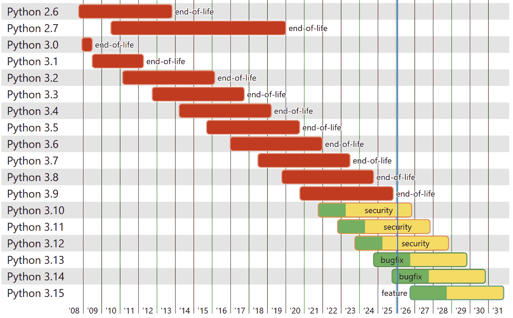
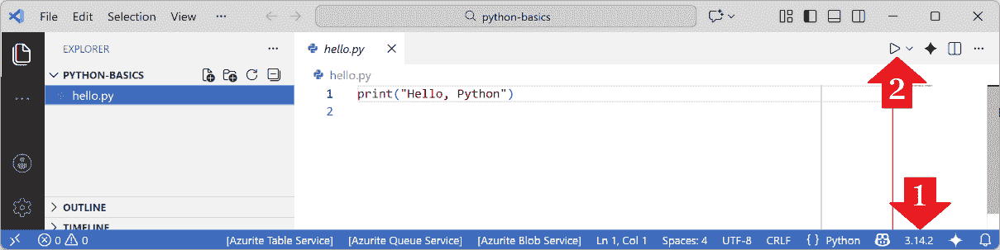
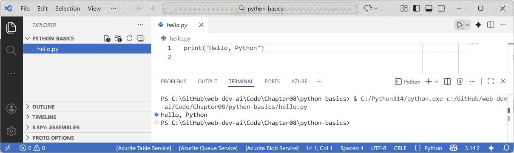
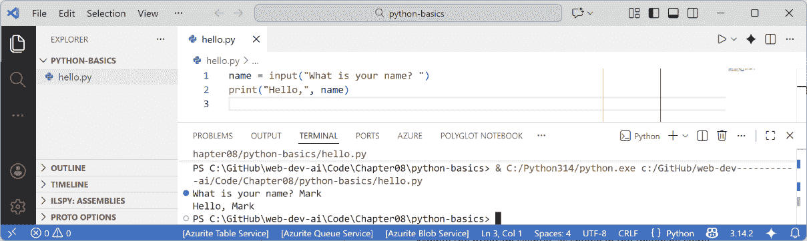

## 第 8 章：Python – 后端编程

Python 是本书后端部分将使用的语言，因此本章旨在让你熟悉实际工作中最重要的 Python 部分。本章不试图涵盖 Python 的每个角落。它提供足够的流利度，让你能够阅读 Python 代码、运行它、修改它，并理解它在做什么。

你将从安装 Python 开始，确保它能在命令行和 VS Code 中正常运行。然后你将学习基础知识：变量、值、条件、循环、函数，以及 Python 高度依赖的内置数据结构。之后，你将了解字符串、调试、异常、模块、包、虚拟环境，以及文件输入和输出 (I/O)。本章以一个小型的命令行任务追踪器结束，它将这些概念整合成一个可工作的程序。


# Python 简介

Python 语法只是起点。你还需要了解 Python 程序是如何组织的，数据如何在其中流动，它们如何失败，以及如何随着规模增长保持其可理解性。

读完本章后，你应该理解 Python 的核心语法，知道如何使用其内置数据结构，并能够编写虽小但实用的 Python 程序。

在本章中，我们将涵盖以下主题：

* Python 简介
* 语法与基础
* 数据结构
* 深入字符串
* 函数与类
* 错误与调试基础
* 模块、导入与包
* 虚拟环境
* 文件输入与输出
* 一个小型、内聚的迷你项目

本章建议的聊天机器人提示词及示例回复可在以下链接找到：[`github.com/markjprice/web-dev-ai/blob/main/prompts/ch08-python/readme.md`](https://github.com/markjprice/web-dev-ai/blob/main/prompts/ch08-python/readme.md)

## 使用缩进的简洁语法

Python 是一种通用语言，建立在一个简单的理念之上：代码应当可读。

它由 Guido van Rossum 创建，于 1991 年首次发布，这使它比 Java、JavaScript 甚至我们今天所知的 Web 还要古老。它感觉现代，因为其设计偏向清晰而非花巧。这种对可读性的关注是有意为之。Python 假定代码被阅读的频率远高于被编写的频率。

人们注意到 Python 的第一件事之一，就是它极少的视觉噪音。Python 避免过多的标点符号和样板代码。Python 不使用大括号或关键字来标记代码块，而是使用缩进。这意味着你的程序结构一目了然：

* 当某物嵌套时，它会被缩进。
* 当它结束时，缩进停止。

这强制了统一性，但也消除了初学者在其他语言中常苦恼的一整类错误。

官方的 Python 设计哲学，称为 *Python 之禅*，明确指出可读性很重要，且简单优于复杂。你可以在以下链接阅读它：[`peps.python.org/pep-0020/`](https://peps.python.org/pep-0020/)

> **提示**：为什么 Python 使用缩进而不是大括号，这种设计有什么权衡？Python 的可读性理念如何影响代码的长期维护？请从实际角度比较 Python 的设计理念与 JavaScript 和 C#。

## 专业的 Python

Python 常被描述为对初学者友好，这没错，但忽略了一个重要方面。Python 不是一种你日后会抛在脑后的入门语言。它在广泛的行业中被专业使用，包括 Web 开发、自动化、科学计算、数据分析、机器学习、游戏开发和系统管理。

Google、Netflix 和 Spotify 等公司在生产系统中大量使用 Python。这种组合解释了 Python 吸引力的很大一部分：它易于上手，却不会把你困在初学者领域。

> **提示**：什么编码习惯将初级 Python 开发者与专业人士区分开来？

## 丰富的标准库

Python 的另一个重要方面是它附带丰富的标准库。安装 Python 时，你就已经拥用了处理文件、日期时间、文本处理、网络、数学等方面的工具。这常被概括为“开箱即用”（batteries included）。

对初学者而言，这意味着你无需安装额外包就能快速做有用的事。对经验丰富的开发者而言，这意味着更少的外部依赖和更可预测的开发环境。

## Python 是解释型而非编译型

Python 也是一种解释型语言，这影响了你使用它的方式。你在纯文本文件中编写 Python 代码，Python 解释器直接执行该代码。没有单独的编译步骤将你的代码转换为独立的可执行文件，这在 C 或 C++ 等语言中运行程序前会发生。

这给你提供了快速反馈循环。你编写一小段代码，运行它，看看发生什么，然后调整。这种紧凑的循环在学习时尤为宝贵，因为实验变得低成本，错误也易于恢复。

## 庞大的生态系统

Python 拥有庞大的生态系统。全球有数百万 Python 开发者，以及海量的文档、教程、库和社区支持。如果你遇到问题，很可能别人之前已遇到并写过相关内容。这种支持很重要。学习一门语言也意味着学习去哪里查找、如何阅读文档、以及如何一次一个小修复地建立信心。Python 通常让这个学习过程更容易，因为它逐步引入复杂性。

## 安装 Python

在深入 Python 语法之前，你需要一个可用的 Python 安装。根据你的操作系统，Python 可能已安装在你的电脑上：

* 在 Windows 上，Python 默认不一定可靠安装。一些较新的 Windows 版本包含一个启动 Microsoft Store 的存根，这常使初学者困惑。最稳妥的方法是显式检查。
* 在 macOS 上，通常预装 Python，但历史上是 Python 2，现已不再支持。较新的 macOS 版本可能包含 Python 3，但你仍应验证版本。
* 在 Linux 上，几乎总是安装了 Python 3，因为许多系统工具依赖它。即便如此，检查仍然必要。

你可以在以下链接阅读 Python 2 生命周期结束通知：[`www.python.org/doc/sunset-python-2/`](https://www.python.org/doc/sunset-python-2/)

检查 Python 在命令行进行，因为它常在命令行运行。打开终端或命令提示符并运行以下命令：

```
python --version
```

如果那不行，尝试显式运行 Python 3，如下命令所示：

```
python3 --version
```

你应该看到类似以下的输出：

```
Python 3.14.2
```

如果是这样，则 Python 安装正确，你可以继续进行。

### 如果 Python 缺失怎么办？

如果你看到诸如 `command not found` 之类的错误，或提示你去 Microsoft Store 的消息，则 Python 要么缺失，要么未正确配置。

> **警告！** 本书要求 Python 3。Python 2 于 2020 年 1 月达到生命周期结束，不应用于新项目。

要手动安装 Python，对所有平台而言，官方权威来源是 Python 网站，由 Python 软件基金会维护。你可以从以下链接下载 Python：

[`www.python.org/downloads/`](https://www.python.org/downloads/)

> **警告！** 对于 Windows，从 [python.org](https://www.python.org/) 下载官方安装程序，而非 Microsoft Store，并在安装时确保勾选 `Add Python to PATH`。该复选框是初学者挫折感的最常见单一原因。如果 Python 不在 PATH 中，在命令行输入 `python` 将无法工作。

对于 macOS，从 [python.org](https://www.python.org/) 下载 macOS 安装程序是最简单的选择。高级用户可能偏好 Homebrew，但初学者不应从那里开始。

对于 Linux，通常已安装 Python 3。如果没有，则通过系统包管理器安装，如 `apt`、`dnf` 或 `pacman`，视发行版而定。

安装后，重复版本检查命令以确认成功。

### Python 发布与生命周期


## Python 发布阶段

Python 发布会经历五个阶段，如以下几点所述：

1. **早期开发（特性阶段）**：在第一个测试版之前，下一个正式版本可以接受新特性、错误修复和安全修复。
2. **预发布（测试阶段）**：第一个测试版发布后，不能再加入新特性，但会为即将到来的特性版本接受特性修复（包括对新特性的重大更改）、错误修复和安全修复。
3. **稳定维护（错误修复阶段）**：版本正式发布后，接受错误修复和安全修复。大约每两个月构建并发布新的二进制文件。此阶段也称为维护模式或稳定版本。
4. **仅安全支持**：两年后（3.13 之前的版本为 18 个月），仅接受安全修复，不再发布二进制文件。可根据需要发布仅源代码版本。
5. **生命周期结束**：发布五年后，支持结束。发布周期冻结；不再允许任何更改。

这些描述来自 Python 开发者指南中官方 Python 发布生命周期页面，链接如下：[`https://devguide.python.org/versions/`](https://devguide.python.org/versions/)

在 2026 年 4 月撰写本文时，如*图 8.1*所示，并按以下几点解释：

* Python 2.6 到 3.9 版本均已达到生命周期结束，因此不再受支持
* Python 3.10 到 3.12 版本均处于安全阶段，意味着虽然它们受支持，但仅获得安全修复
* Python 3.13 和 3.14 版本处于错误修复阶段，意味着它们积极受支持，每两个月可下载安装新的二进制文件



图 8.1：Python 版本及其支持阶段

**良好实践**：在日历中设置双月提醒，检查最新的 Python 版本并保持安装更新。

## 尝试 Python 交互式 Shell

作为快速的完整性检查，让我们尝试一下 Python 交互式 Shell。

在命令提示符或终端中，输入以下命令：

```
python
```

或者：

```
python3
```

你应该会看到 `>>>` 提示符，这意味着 Python 正在运行并已就绪。尝试执行一个简单的计算，如以下命令和输出所示：

```
>>> 2+2
4
```

要退出 Python 交互式 Shell，请输入以下命令：

```
>>> exit()
```

你也可以在 macOS 和 Linux 上按 *Ctrl* + *D*，或在 Windows 上按 *Ctrl* + *Z* 然后按 *Enter*。

一个可用的 Python 安装是你需要的第一样东西。一旦 Python 能从命令行可靠运行，本章其余部分就可以专注于学习语言本身，而不是与环境作斗争。

在本章其余部分，你将从理解 Python 是什么转变为实际使用它。你将从定义 Python 代码如何工作的基本规则和语法开始，然后探索 Python 的核心数据结构。

# 语法和基础

Python 的语法是有意设计得简洁的。需要记忆的规则比大多数语言少，但现有的规则非常重要。本节重点介绍你在几乎每个 Python 程序中都会用到的核心构建块：缩进、语句、变量、基本类型、表达式、注释以及简单的输入和输出。

## 编写 Python 代码文件并运行它们

Python 代码通常写在扩展名为 `.py` 的纯文本文件中。每个文件都是一个 Python 程序，也称为脚本。VS Code 只是一个编辑器，但 Python 扩展将其连接到系统上安装的 Python 解释器。

创建一个 `Chapter08` 文件夹，其中包含一个名为 `python-basics` 的子文件夹。使用 **文件** | **打开文件夹** 在 VS Code 中打开 `python-basics` 文件夹。

打开文件夹而不是单个文件很重要，因为 VS Code 将文件夹用作运行代码和管理设置的工作上下文。

接下来，在 `python-basics` 文件夹中创建一个名为 `hello.py` 的新文件。

**良好实践**：文件名应为小写，使用下划线代替空格，并避免特殊字符。Python 并不强制此约定，但广泛遵循，可防止日后出现微妙问题。

在 `hello.py` 中编写最简单的 Python 脚本，如*图 8.2*和以下代码所示：

```
print("Hello, Python")
```



图 8.2：在 VS Code 中编写 Python 代码文件

你可以 (1) 通过点击状态栏选择 Python 解释器版本，(2) 通过点击代码编辑器右上角的 **运行 Python 文件** 按钮来运行代码文件，如*图 8.2*所示。

此文件不是项目或应用程序。它只是一个简单的脚本。Python 将从上到下执行的一系列指令。

在 VS Code 中，通过 **终端** | **新建终端** 打开终端。此终端将在你之前选择的文件夹中打开。这很重要，因为 Python 会在当前目录中查找文件。

在 **终端** 中，输入以下命令：

```
python hello.py
```

如果不行，请使用：

```
python3 hello.py
```

区别取决于 Python 的安装方式，两者都正常。结果应立即出现在终端中，如以下输出所示：

```
Hello, Python
```



图 8.3：在 VS Code 终端中查看运行 Python 代码文件的输出

VS Code 本身并不运行 Python。它请求操作系统运行 Python 解释器，传递文件名，并显示输出。记住这一链路将有助于日后调试。

## 使用 UI 运行 Python 文件

当打开一个 Python 文件时，代码编辑器右上角会有一个 ▶ 按钮。点击它会使用选定的 Python 解释器运行当前文件，并在终端中显示输出。该按钮执行的操作与手动输入命令相同。它不是一种不同的执行模式。如果在这里失败，在终端中也会失败。

在 VS Code 右下角，状态栏中显示 Python 版本。点击它，可以在同时安装多个版本时选择使用哪个 Python 解释器。

Python 在保存时不会自动重新运行代码。循环始终是：

1. 编辑代码文件
2. 保存代码文件更改
3. 再次运行代码文件

稍微修改程序，如以下代码所示：

```
name = input("What is your name? ")
print("Hello,", name)
```

再次运行它，展示输入如何通过终端流动，如*图 8.4*所示：



图 8.4：获取用户输入

错误是正常且预期的。如果 Python 遇到无法理解的内容，它会停止并打印回溯信息。目前，最重要的技能是阅读错误消息的最后一行，它通常解释了出错的原因和行号。

你现在已经学会了如何在 `.py` 文件中编写 Python 代码的基础知识，如何在 VS Code 中编辑这些文件，以及如何通过终端或 **运行 Python 文件** 按钮使用 Python 解释器运行它们。

现在让我们更仔细地看看 Python 代码是如何编写的。

## 缩进的重要性


# 缩进

首先要理解的最重要规则是**缩进**。在 Python 中，缩进不是为了美观。它定义了结构。属于同一逻辑的代码块缩进量相同，通常为四个空格。没有大括号来标记块的开始或结束。当缩进级别增加时，你进入了一个块。当它减少时，你离开了该块。

例如，缩进决定了语句是否在块内，如下面的代码所示：

```
if True:
    print("This line is inside the block")
    print("So is this one")
print("This line is outside the block")
```

`if` 行末尾的冒号告诉 Python 后面跟着一个块。缩进告诉 Python 哪些行属于该块。混合使用制表符和空格是常见的新手错误。

**良好实践**：尽早采纳的规则很简单：始终使用空格，且始终使用相同数量的空格。对于 JavaScript 或 C# 等语言的大多数代码示例，我使用两个空格以节省印刷书籍的横向空间。在本书的 Python 示例中，我使用传统的四个空格，因为缩进至关重要。

## Python 注释

Python 支持**注释**，这是给人类看的备注，Python 会忽略它们。注释以 `#` 开头，如下面的代码所示：

```
# This is a comment
count = 10  # This comment is inline
```

注释适用于解释*为什么*要这样做，而不是解释代码已经清楚表达的*做了什么*。如果没有注释代码就难以解释，那通常是代码本身应该简化的信号。

## Python 语句和变量

Python 程序由**语句**组成。语句是 Python 可以执行的完整指令。一些语句执行动作，如调用函数。另一些定义事物，如变量或函数。与某些语言不同，Python 通常每行一条语句，这使代码更易于阅读和理解。

接下来是**变量**。变量是指向值的名称。在 Python 中，你不显式声明变量的类型。类型从你赋的值推断得出，如下面的代码所示：

```
age = 42
name = "Mark"
pi = 3.14159
```

在前面的代码中，`age` 指向一个整数，`name` 指向一个字符串，`pi` 指向一个浮点数。像 JavaScript 一样，Python 是**动态类型**的，这意味着同一个变量名稍后可以指向不同类型的值。这种灵活性很有用，但它使得清晰的命名和一致的用法变得更加重要。

> **提示**：请结合示例解释 Python 中的动态类型，包括其优势和陷阱。

## Python 数据类型

Python 有一小组内置基本类型，你会经常用到它们。最常见的是整数（`int`）、浮点数（`float`）、字符串（`str`）和布尔值（`bool`），如下面的代码所示：

```
count = 10        # int
price = 9.99      # float
title = "Python"  # str
is_active = True  # bool
```

Python 中的字符串用单引号或双引号括起来。两者等价。选择一种风格并保持一致。字符串可以使用 `+` 运算符拼接，使用 `*` 运算符重复，如下面的代码所示：

```
greeting = "Hello"
name = "World"
message = greeting + " " + name
print(message * 3)       # prints Hello WorldHello WorldHello World
```

## Python 表达式

Python 支持**表达式**，它们是产生结果的值和运算符的组合。算术表达式的行为大多符合预期，如下面的代码所示：

```
total = 10 + 3
difference = 10 - 3
product = 10 * 3
quotient = 10 / 3
modulus = 10 % 3
print(total, difference, product, quotient, modulus)
```

`/` 运算符总是产生浮点结果。如果你想要整数除法，请使用 `//`，如下面的代码所示：

```
result = 7 // 2   # result is 3
```

## Python 比较

**比较**产生布尔值。这些在决策中大量使用，如下面的代码所示：

```
x = 5
x > 3      # True
x == 5     # True
x != 10    # True
```

注意 `==` 检查相等性。单个 `=` 仅用于赋值。混淆这两者是典型的新手错误。

## 条件语句

为了做决策，Python 使用**条件语句**，最常见的是 `if`、`elif` 和 `else`，如下面的代码所示：

```
temperature = 18
if temperature > 20:
    print("It's warm")
elif temperature > 10:
    print("It's mild")
else:
    print("It's cold")
```

只有一个分支会运行。第一个评估为 `True` 的条件生效。这种结构自上而下阅读，非常接近人们用自然语言解释决策的方式。

### 比较和逻辑运算符

条件使用比较运算符构建，如：

- `==` 等于
- `!=` 不等于
- `<`、`<=`、`>`、`>=`

逻辑运算符组合条件：

- `and` 要求两个条件都为 `true`
- `or` 要求至少一个条件为 `true`
- `not` 否定条件

```
if rating >= 8 and rating <= 10:
    print("Positive")
```

### Python 中的真值

Python 允许在条件中使用非布尔值。这称为真值。例如：

- 空列表、空字符串和零评估为 `false`
- 非空集合和非零数字评估为 `true`
- `None` 评估为 `false`

```
if titles:
    print("There are titles to process")
```

这检查名为 `titles` 的列表是否非空，而无需显式比较长度。

### 使用 match 进行结构化模式匹配

自 Python 3.10 起，Python 拥有**结构化模式匹配**，通过 `match` 语句引入。这在 JavaScript 中扮演 `switch` 语句的角色，但更灵活。

例如：

```
status = 404
match status:
    case 200:
        print("OK")
    case 404:
        print("Not found")
    case 500:
        print("Server error")
    case _:
        print("Unknown status")
```

在这种最简单的形式下，`match` 的行为非常类似于传统的 `switch`。下划线（`_`）是默认情况。

Python 的 `match` 比简单的 `switch` 更灵活，因为它基于模式匹配，而不仅仅是值匹配。它可以匹配字面值、数据结构、对象属性、类型模式，以及带有守卫的模式组合。例如：

```
command = ("play", "Arrival")
match command:
    case ("play", title):
        print(f"Playing {title}")
    case ("stop", _):
        print("Stopping playback")
```

这比经典的 `switch` 语句更灵活。

`("play", "Arrival")` 是元组的一个例子。你将在下一节 *Data Structures* 中学习元组。

现在让我们继续学习循环。

## 循环语句

**循环语句**让 Python 程序高效地重复工作，而不必一遍遍编写相同的代码。Python 的循环模型很简单，但它建立在一个简单的想法之上：你通常遍历事物，而不是数字索引。

### for 循环

`for` 循环是 Python 中最常用的循环。它遍历一个可迭代对象，如列表、元组、字符串、字典、`range`，或任何可以一次产生一个值的对象：

```
titles = ["Arrival", "The Matrix", "Star Trek"]
for title in titles:
    print(title)
```


# Python 基础

## 控制流

### `for` 循环

这读起来很自然：`for each title in titles`（对于 titles 中的每个 title）。你不需要管理计数器或索引。Python 会为你处理迭代。

### 使用 `range` 循环

当你确实需要一串数字时，`range` 可以提供：

```
for i in range(3):
    print(i)
```

这会产生 `0`、`1` 和 `2`。`range` 通常用于重复执行固定次数的操作，或在使用索引时。

### `while` 循环

只要条件保持为 `true`，`while` 循环就会重复执行：

```
count = 0
while count < 3:
    print(count)
    count += 1
```

与 `for` 不同，`while` 循环要求你显式地管理状态。当你预先不知道需要多少次迭代时，它们很有用，但如果条件永远不会变为 `false`，它们更容易被误用。

### 使用 `break` 和 `continue` 控制循环

`break` 会立即退出循环：

```
for title in titles:
    if title == "The Matrix":
        break
    print(title)
```

`continue` 跳过当前迭代的剩余部分，直接进入下一次迭代：

```
for title in titles:
    if title.startswith("The"):
        continue
    print(title)
```

两者都应谨慎使用。如果一个循环需要大量的 `break` 和 `continue`，通常表明逻辑应该被简化或移入函数中。

Python 循环的设计初衷是简单。其强大之处在于迭代有意义的值，而不是底层的机制，这使得代码在程序增长时依然保持可读性。

**提示**：请结合实际例子解释 `enumerate`、`range` 和 `zip`。

## 输入与输出

最后，让我们回顾一下基本的输入和输出，它们让程序能与外部世界交互。最常用的输出函数是 `print`，如下面的代码所示：

```
print("Hello, Python")
```

要从用户获取输入，Python 提供了 `input` 函数。它总是返回一个字符串，如下面的代码所示：

```
name = input("What is your name? ")
print("Hello,", name)
```

如果你需要一个数字（如整数），则必须使用 `int` 或 `float` 函数显式转换输入，如下面的代码所示：

```
age = int(input("How old are you? "))
```

这种显式性是有意为之。Python 倾向于清晰明了，而不是猜测你的意图。

此时，你应该理解 Python 代码是如何构建的，值如何存储在变量中，基本类型如何工作，以及简单的逻辑和交互是如何表达的。这些基础知识将出现在后续的每一个示例中。

在下一节中，数据结构将直接基于这些概念，展示 Python 如何处理信息集合，而非单个值。这些数据结构让你能直接在代码中建模现实世界的信息，而不是一次次地摆弄孤立的值。

# 数据结构

到目前为止，你一直在处理存储在变量中的单个值。这很有用，但实际程序几乎总是要处理数据集合：名字列表、选项集合、用户名到邮箱地址的映射，或随时间变化的值序列。

Python 的内置数据结构是该语言让人迅速感到高效的主要原因之一。它们让你能直接建模现实世界的信息，无需繁文缛节。

Python 的核心内置数据结构有 `list`、`tuple`、`dict` 和 `set`。你会经常使用 `list` 和 `dict`，偶尔使用 `tuple`，在问题适用时使用 `set`。

我们将从 `list` 开始，因为它们最熟悉、也最灵活。

## `list`

`list` 是值的有序集合。你可以使用方括号创建 `list`，项之间用逗号分隔，如下面的代码所示：

```
numbers = [1, 2, 3, 4, 5]
names = ["Alice", "Bob", "Charlie"]
```

`list` 可以容纳不同类型的值，虽然如果没有充分理由混合类型通常是个坏主意，如下面的代码所示：

```
mixed = [1, "two", 3.0]
```

**良好实践**：Python 设计上允许 `list` 中混合类型，但这样做会让代码更难理解、更容易出错、且因失去可预测性而更难维护。当 `list` 包含单一、一致的类型时，你可以假设哪些操作是有效的。例如，如果 `list` 只包含整数，你可以安全地对它们进行加法、比较或排序，而无需额外检查。对于大多数入门级和生产代码，一个简单的规则是 `list` 应包含同类项，即使 Python 不强制要求。

你可以使用索引访问 `list` 中的项。Python 使用零基索引，意味着第一个项位于位置 0：

```
names[0]   # "Alice"
names[1]   # "Bob"
```

你也可以使用负索引从末尾开始计数：

```
names[-1]  # "Charlie"
```

`list` 是可变的，这意味着创建后可以修改它们。你可以替换项、添加新项或移除现有项，如下面的代码所示：

```
names.append("Diana")
names[1] = "Robert"
```

这种可变性是 `list` 常用于表示随时间增长、收缩或变化的事物的原因。

## `tuple`

`tuple` 看起来像 `list`，但它使用圆括号而不是方括号，如下面的代码所示：

```
coordinates = (51.5074, -0.1278)
```

`tuple` 像 `list` 一样是有序集合，但它们是不可变的。一旦创建，就无法更改其内容。这使得 `tuple` 适用于不应改变的数据，如坐标、配置值或固定记录。

要从 `tuple` 读取项，你可以使用与 `list` 相同的语法，如下面的代码所示：

```
coordinates[0]  # 51.5074
```

如果你尝试赋新值，Python 会报错。这是一个特性，而非限制。它让你能清晰地表达代码的意图。

**提示**：既然 `list` 已经好用，为什么还需要 `tuple`？

## `dict`

Python 中最重要且最独特的数据结构是 `dict`。`dict` 存储键值对，如 `"age": 42`，如下面的代码所示：

```
user = {
    "name": "Mark",
    "age": 42,
    "is_admin": True
}
```

你不是通过位置，而是通过键来访问值。键通常是字符串，值可以是任何东西。你可以使用键名检索值，如下面的代码所示：

```
user["name"]      # "Mark"
user["age"]       # 42
```

你可以通过赋值来添加或更新条目，如下面的代码所示：

```
user["email"] = "mark@example.com"
user["age"] = 43
```

`dict` 很有用，因为它自然地映射了我们对结构化数据的思维方式。JSON 广泛用于 Web，几乎直接映射到 Python 的 `dict` 和 `list`。如果你精通 `dict`，许多 Web 和数据任务突然会变得容易得多。

**提示**：在实际程序中，何时应该选择 `list` 而不是 `dict`？

## `set`

然后是 `set`。`set` 是唯一值的无序集合。你可以使用花括号创建 `set`，类似于 `dict` 但没有键值对，如下面的代码所示：

```
tags = {"python", "web", "data"}
```

`set` 会自动移除重复项，如下面的代码所示：

```
numbers = {1, 2, 2, 3}
# numbers is {1, 2, 3}
```

当你关心成员资格而非顺序时，`set` 很有用。例如，使用 `set` 检查值是否存在于集合中既快速又直观，如下面的代码所示：

```
"python" in tags   # True
```

在所有这些数据结构中，你经常会使用循环逐个处理项。Python 中最常用的循环是 `for` 循环，如下面的代码所示：


```
for name in names:
    print(name)
```

这读起来几乎像英语。Python 在内部处理索引，这减少了错误并使代码更清晰。

提示：请解释 Python 的 `for` 循环在内部是如何工作的，并将其与基于索引的循环进行比较。

在处理集合时，你也经常需要检查条件，如下面的代码所示：

```
if "email" in user:
    print("Email is set")
```

提示：请解释集合的实际用例，而不仅仅是去重。

## 集合总结

在这个阶段，你不需要背下每一个方法或操作。请关注每种结构所扮演的角色：

* 列表是有序且可变的
* 元组是有序且固定的
* 字典将键映射到值
* 集合存储唯一项，无保证顺序

这四种结构涵盖了日常编程中绝大多数的需求。随着程序的增长，你将自由地组合它们：字典列表、包含列表的字典、从列表派生的集合，等等。

提示：请展示一些将列表和字典嵌套在一起的实际例子。

在后续章节中，你将看到这些相同的数据结构无处不在：处理表单数据、处理文件、操作数据库以及与 Web API 交换数据。如果你在这里对它们感到得心应手，后面的一切都会变得更容易理解。

提示：请解释初学者在可变列表和字典上常犯的错误。

现在我们已经了解了集合，让我们更深入地探讨 `string` 值。

# 深入字符串

字符串无处不在 Python 程序中。用户输入、文件内容、URL、JSON 数据、HTML、错误消息和配置值全都是字符串。因为它们太常见了，Python 提供了一套丰富的功能来处理它们。深入理解字符串能立竿见影地提高效率，尤其是在 Web 和数据相关的代码中。

Python 中的 `string` 是一个不可变的字符序列。不可变意味着一旦创建了字符串，就不能在原地修改它。任何看似修改字符串的操作实际上都是在创建一个新字符串，如下面的代码所示：

```
text = "hello"
text.upper()
print(text)
```

这会打印 `hello`，而不是 `HELLO`，因为 `upper()` 返回一个新字符串，而原字符串保持不变。要改变原始文本，你必须将调用 `upper()` 函数的结果赋值给 `text` 变量，如下面的代码所示：

```
text = text.upper()
print(text)
```

现在 `text` 指向新字符串。这种不可变性是一种设计选择，它使字符串更安全、更可预测。

## 创建字符串

Python 提供了多种创建字符串的方式。你已经见过单引号和双引号字符串，如下面的代码所示：

```
name = "Alice"
city = 'London'
```

两种形式是等价的。使用哪种取决于哪种让字符串更易读，特别是当字符串包含引号时。

对于多行文本，Python 支持 `triple-quoted strings`（三引号字符串），如下面的代码所示：

```
message = """Hello,
This is a multi-line string.
Goodbye."""
```

这些对于长消息、文档或嵌入文本块很有用。

## F-strings

Python 最重要的特性之一是 `f-strings`。F-strings 提供了一种清晰易读的方式，将值直接嵌入字符串中，如下面的代码所示：

```
name = "Alice"
age = 30
message = f"{name} is {age} years old"
print(message)
```

`f` 前缀告诉 Python 计算花括号内的表达式。这种方法比字符串拼接更清晰、更不易出错，尤其是当字符串变得更复杂时。

F-strings 可以包含表达式，而不仅仅是变量名，如下面的代码所示：

```
price = 9.99
quantity = 3
total = f"Total: {price * quantity}"
```

## 字符串方法

Python 字符串附带许多用于常见任务的内置方法。你不需要全部记住，但有几个值得尽早学习。

`lower()` 和 `upper()` 方法改变大小写：

```
text = "Python"
text.lower()   # "python"
text.upper()   # "PYTHON"
```

`strip()` 方法移除字符串开头和结尾的空白字符：

```
raw = "  hello  "
clean = raw.strip()
```

处理用户输入时这特别有用。

`split()` 方法将字符串拆分为子字符串列表：

```
csv = "red,green,blue"
colors = csv.split(",")
```

相反的操作是 `join()`，它将字符串列表合并为单个字符串，如下面的代码所示：

```
colors = ["red", "green", "blue"]
result = ",".join(colors)
```

## 字符串索引与切片

字符串可以像列表一样进行索引和切片：

```
word = "Python"
word[0]      # "P"
word[1:4]    # "yth"
word[-1]     # "n"
```

切片会创建新字符串，绝不修改原字符串。

## 子串

另一个常见任务是检查字符串是否包含某个值，或者是否以特定方式开始或结束，如下面的代码所示：

```
email = "user@example.com"
"@" in email
email.startswith("user")
email.endswith(".com")
```

这些操作读起来很清晰，避免了脆弱的手动解析。

## 用户输入始于字符串

同样重要的是要理解，来自用户的输入总是以字符串开始：

```
age = input("How old are you? ")
```

如果你需要数字，必须显式转换，如下面的代码所示：

```
age = int(age)
```

未能这样做是最常见的初学者错误之一，也是 `TypeError` 和 `ValueError` 异常的频繁来源。

## 字符串是不可变的

此时，你应该把字符串视为不可变的构建块。你创建它们、转换它们、组合它们、传递它们，但永远不会在原地修改它们。Python 的字符串工具旨在使这些转换既可读又安全。

当你进入文件处理、Web 开发和 API 领域时，字符串将主导你的代码。熟练掌握 f-strings 和少数核心字符串方法会让这些工作变得简单直接，而不是繁琐易错。

现在我们已经深入了解了如何处理字符串值，让我们看看如何将一个大型复杂的项目分解为小的功能单元。这使得管理大量代码变得更容易，也使测试和调试变得更容易。

# 函数与类

随着程序增长到几行之外，反复重复相同的逻辑很快会变得痛苦。函数解决了这个问题。`function`（函数）是一个执行特定任务的命名代码块。一旦定义，你可以随意多次调用它。这使程序更易读、更易修改。

提示：函数如何帮助程序扩展到几百行之外？请解释为什么小函数更易于测试和调试。

## 定义函数

在 Python 中，使用 `def` 关键字定义函数，后跟函数名、一对括号和一个冒号。函数体缩进，像任何其他代码块一样，如下面的代码所示：

```
def greet():
    print("Hello, Python")
```

这段代码定义了一个名为 `greet` 的函数。目前什么也不会发生。定义函数不会运行它。要执行函数内的代码，必须按名称调用它，如下面的代码所示：

```
greet()
```

当 Python 到达这一行时，它会跳入函数，运行缩进块，然后返回到离开的地方。

## 函数参数


# 大多数有用的函数都接受参数

大多数有用的函数都接受**参数**。参数是从调用者接收值的变量。它们让函数每次被调用时都能处理不同的数据，如下面的代码所示：

```
def greet(name):
    print("Hello,", name)
greet("Alice")
greet("Bob")
```

在前面的代码中，`name` 是一个参数。当你调用 `greet("Alice")` 时，值 `"Alice"` 被传入函数并赋值给 `name`。

## 从函数返回值

函数也可以使用 `return` 语句返回值。返回值将数据发送回调用者并立即结束函数，如下面的代码所示：

```
def add(a, b):
    return a + b
result = add(3, 4)
print(result)
```

函数不仅仅执行动作。它们可以计算结果并将其交还给调用者。

一个函数可以有多个 `return` 语句，但每次调用只会执行其中一个，如下面的代码所示：

```
def check_age(age):
    if age >= 18:
        return "Adult"
    else:
        return "Minor"
```

一旦执行 `return`，函数就会退出。

## 局部变量和作用域

在函数内部定义的变量是该函数的局部变量。这意味着它们只在函数运行时存在，并且无法从外部访问，如下面的代码所示：

```
def example():
    x = 10
    print(x)
example()
# print(x)  # This would cause an error
```

这个概念称为**作用域**。局部变量有助于防止程序不同部分之间的意外干扰。如果所有变量都是全局的，即使是小程序也会变得非常脆弱。

函数可以调用其他函数，包括你自己编写的函数，如下面的代码所示：

```
def square(n):
    return n * n
def print_square(n):
    result = square(n)
    print(result)
print_square(5)
```

这种组合在 Python 中很常见。只做一件事且做好的小函数比试图一次做所有事情的大函数更容易测试，也更容易复用。

## 默认参数值

还值得注意的是，Python 允许**默认参数值**，如下面的代码所示：

```
def greet(name, greeting="Hello"):
    print(greeting, name)
greet("Alice")
greet("Bob", "Hi")
```

默认值使函数灵活而不复杂。

# 使用类将数据和行为组合在一起

到目前为止，你的 Python 代码一直围绕变量和函数组织。

这对小脚本效果很好。但随着程序增长，你通常需要一种方法将相关的数据和行为组合在一起。这就是类的用途。

一个**类**让你定义一种新的对象，它具有：

- **数据**（称为属性）
- **行为**（称为方法）

这是一个基本的类：

```
class Task:
    def __init__(self, title):
        self.title = title
        self.completed = False
    def mark_complete(self):
        self.completed = True
```

这个类是创建任务对象的模板。

现在你可以创建并使用一个任务：

```
task = Task("Write Chapter 8")
print(task.title)        # Write Chapter 8
print(task.completed)    # False
task.mark_complete()
print(task.completed)    # True
```

### `__init__` 方法

`__init__` 方法在你创建新对象时运行：

```
task = Task("Write Chapter 8")
```

它用于设置对象的初始状态：

- `self` 指代当前对象
- `self.title` 和 `self.completed` 是存储在该对象上的属性

`__init__` 方法定义了类的每个实例初始拥有什么数据。`self` 是你正在操作的对象。

当你写：

```
task.mark_complete()
```

Python 将其转换为：

```
Task.mark_complete(task)
```

所以 `self` 是被传入的实例。你不必将其命名为 `self`，但你应该这么做。这是一个强约定，每个 Python 开发者都期望如此。

### 使对象可打印

默认情况下，打印对象不是很有帮助：

```
print(task)
```

你可能会看到类似这样的内容：

```
<__main__.Task object at 0x...>
```

你可以通过定义一个特殊方法来改进这一点：

```
def __str__(self) -> str:
    status = "✓" if self.completed else "✗"
    return f"{status} {self.title}"
```

现在：

```
print(task)
```

输出：

```
✗ Write Chapter 8
```

让我们分解一下这个方法：

- `__str__` 是一个特殊的方法名，当 Python 需要将对象转换为字符串时会调用它
- `self` 是实例
- `-> str` 是一个类型提示，表示该方法返回一个字符串

因此，每当你在类中看到 `def __str__(self) -> str:` 时，它的意思是：*当 Python 需要该对象的字符串表示时，调用此方法并期望返回一个字符串*。

你会在真实的 Python 代码中经常看到这种模式，特别是在 Django 等框架中。

### 方法是类内部的函数

方法是在类内部定义的函数：

```
def mark_complete(self):
    self.completed = True
```

唯一的区别是它作用于一个实例（`self`）。

这意味着你学到的关于函数的一切仍然适用，包括参数、返回值和控制流。区别在于方法通常处理对象的内部数据。

### 添加更多结构

你可以自然地扩展类：

```
class Task:
    def __init__(self, title, priority="medium"):
        self.title = title
        self.completed = False
        self.priority = priority
    def mark_complete(self):
        self.completed = True
    def is_high_priority(self):
        return self.priority == "high"
    def __str__(self) -> str:
        status = "✓" if self.completed else "✗"
        return f"{status} [{self.priority}] {self.title}"
```

现在对象拥有多个属性、多个方法和清晰的字符串表示。

### 为什么类对 Django 很重要

简单的脚本不需要类。

但 Django 到处都在使用类。

例如：

- 数据库模型是类
- 视图通常是类
- 表单是类

一个 Django 模型可能如下所示：

```
class Task(models.Model):
    title = models.CharField(max_length=200)
    completed = models.BooleanField(default=False)
    def __str__(self):
        return self.title
```

如果你理解属性、方法、`__init__` 和 `__str__`，这段代码就不神秘也不吓人了。它只是一个带有一些框架特定行为的类。

**良好实践**：当你要建模具有状态的事物（如任务、用户或订单）、想要将相关数据和行为分组、或想要同类对象的多个实例时，使用类。当简单的函数或字典足够时，或添加类会使代码更难理解时，避免使用类。

# Python 的可选类型提示

**类型提示**是可选的注解，用于描述变量、参数和返回值的预期类型。它们有助于提高清晰度和工具支持，但不会改变 Python 的运行方式。

类型提示让你直接在代码中记录意图：

```
def total_runtime(minutes: list[int]) -> int:
    return sum(minutes)
```

前面的代码表示：

- `minutes` 参数预期是一个整数列表
- `total_runtime` 函数预期返回一个整数

无论有没有提示，代码运行完全相同。Python 在运行时不强制执行它们。它们是给人类和工具看的，不是给解释器的。

添加类型提示是为了解决大型 Python 代码库中的实际问题。带有类型提示的函数签名告诉读者如何使用它，而无需阅读实现。

像 VS Code 这样的代码编辑器可以利用类型提示来：


# 类型提示

* 提供更准确的自动补全
* 在运行代码前高亮潜在错误
* 改进导航和重构

静态类型检查器可以分析你的代码，并警告那些原本只会在运行时才出现的类型不匹配问题。

类型提示不会将 Python 变成静态类型语言。它们是可选的、渐进的，且默认不强制执行。你可以只在有帮助的地方添加类型提示，自由混合带类型和不带类型的代码，甚至完全忽略它们。

这被称为 `gradual typing`（渐进式类型）。它允许团队随着时间的推移逐步添加类型信息，而无需重写所有代码。

类型提示在边界处最有价值：

* 函数参数和返回值
* 公共 API
* 复杂数据结构
* 被他人复用的代码

对于小函数内部生命周期短、类型显而易见的变量，类型提示用处较小。

学习 Python 不需要类型提示。初学者可以在没有它们的情况下编写整洁、正确的代码。不过，了解它们是什么以及为什么存在，能让读者为现代 Python 代码库、文档和像 Django 这样的 Web 开发框架做好准备。

**提示**：请展示一些类型提示在不改变运行时行为的情况下防止 bug 的例子。

# 装饰器

迟早你会看到这样的 Python 代码：

```
@something
def my_function():
    ...
```

那个 `@something` 语法就是 `decorator`（装饰器）。

装饰器乍看可能很奇怪，但核心思想很简单：装饰器是一种用另一个函数包装函数的方式。这让你能在不更改原函数体的情况下添加行为。

换句话说，装饰器的意思是：*在这个函数运行前或运行后，做一些额外的工作*。

这很重要，因为 Python 将函数视为值。函数可以被传入另一个函数、从函数返回，或被另一个函数替换。

这是一个尚未使用 `@` 语法的极简示例：

```
def say_hello():
    print("Hello")
def wrapper(func):
    def inner():
        print("Before the function runs")
        func()
        print("After the function runs")
    return inner
say_hello = wrapper(say_hello)
say_hello()
```

这将输出：

```
Before the function runs
Hello
After the function runs
```

发生了什么？

1. `wrapper` 接受一个函数作为输入
2. 它定义了一个名为 `inner` 的新函数
3. `inner` 运行一些额外代码，然后调用原函数
4. `wrapper` 返回这个新函数
5. `say_hello` 被替换为那个包装后的版本

这就是装饰器的本质。

## @ 语法

Python 提供了一种更简洁的方式来编写相同的逻辑：

```
def wrapper(func):
    def inner():
        print("Before the function runs")
        func()
        print("After the function runs")
    return inner
@wrapper
def say_hello():
    print("Hello")
say_hello()
```

这与以下代码效果相同：

```
say_hello = wrapper(say_hello)
```

`@wrapper` 这一行是一个更具可读性的快捷方式。

## 装饰器为何存在

当你想以一致的方式为许多函数添加行为时，装饰器很有用。常见用途包括日志记录、计时、访问控制、缓存和验证。

例如，与其在十个不同的函数里都加上“打印日志消息”，你可以写一个装饰器并应用到这十个函数上。这能让核心函数专注于它真正的工作。

这是一个在函数被调用时记录日志的简单装饰器：

```
def log_call(func):
    def inner():
        print(f"Calling {func.__name__}")
        func()
    return inner
@log_call
def greet():
    print("Hi")
greet()
```

这将输出：

```
Calling greet
Hi
```

函数 `greet` 仍然完成自己的工作。装饰器在其周围添加了额外行为。

## 装饰器与函数参数

一个复杂点是真实函数通常接受参数。装饰器通常也必须接受这些参数。

这是一个能处理任意位置参数和关键字参数的版本：

```
def log_call(func):
    def inner(*args, **kwargs):
        print(f"Calling {func.__name__}")
        return func(*args, **kwargs)
    return inner
@log_call
def greet(name):
    print(f"Hello, {name}")
greet("Alice")
```

你目前不需要掌握 `*args` 和 `**kwargs`。暂时只需知道它们允许包装器传递原函数期望的任何参数。

## 初学者为何应关注

日常的初学者 Python 脚本不需要装饰器。

但你需要能认出它们，因为它们在真实的 Python 代码库和 Web 框架中频繁出现。Django 使用装饰器处理诸如要求登录或限制 HTTP 方法等任务。其他库用它们做缓存、验证和配置。

在这个阶段，不要急着写装饰器。确保你能认出它们是做什么的。

* 装饰器包装一个函数
* `@name` 语法是简写
* 装饰器在不更改原函数体的情况下添加行为

**良好实践**：初学 Python 时，少用装饰器。多读装饰器代码，认清其作用，仅在收益明显时才编写自己的装饰器。

如果装饰器隐藏了用正常方式编写会更清晰的简单逻辑，它很可能是在让代码变差，而非变好。

这很自然地引出了编写函数的其他指导原则。

# 编写函数的指导原则

在这个阶段，你应专注于编写清晰、简单的函数：

* 给它们起描述性的名字
* 让它们只做一件事
* 使用参数传入数据
* 使用返回值获取结果

函数是 Python 代码开始规模化的关键点。你接下来做的几乎所有事情——处理文件、处理用户输入、处理数据、构建 Web 应用——都将严重依赖函数。

但在深入之前，让我们先了解错误处理和调试问题的策略。

# 错误与调试基础

错误是编写代码的常态。无论经验如何，每个程序员都会不断看到错误消息。初学者和经验丰富的开发者的区别不在于错误发生的频率，而在于他们理解和修复错误的速度。本节旨在尽早培养这项技能。

当 Python 遇到无法恢复的问题时，它会停止执行你的程序，并在终端打印错误消息。该消息通常包含 `traceback`（回溯）。回溯是错误发生时 Python 正在执行什么的报告。

这是一个简单的例子：

```
print(message)
```

如果 `message` 未定义，Python 将响应类似如下内容：

```
Traceback (most recent call last):
  File "example.py", line 1, in <module>
    print(message)
NameError: name 'message' is not defined
```

前面的输出可能看起来吓人，但它遵循可预测的结构。最重要的规则是：*先读最后一行*。最后一行告诉你错误类型，通常用通俗语言解释问题。在这个例子中，Python 告诉你尝试使用了一个不存在的变量。

最后一行上面的行显示错误发生的位置。它们包含文件名和行号。在小程序中，这通常足以立即定位并修复问题。

## 常见错误

有几种错误类型是初学者常遇到的。尽早学会识别它们能节省大量时间。

`SyntaxError`（语法错误）意味着 Python 无法理解你的代码结构。这通常是因为缺少冒号、括号不匹配或缩进错误，如下面的代码所示：

```
if x > 5
    print("Too big")
```


此处，`if` 语句末尾缺少冒号，导致在程序运行前就出现语法错误。

`IndentationError`（缩进错误）是 Python 特有的，当缩进不一致或无效时会发生，如下面的代码所示：

```
if True:
print("Hello")
```

Python 期望冒号后有缩进的代码块。复制粘贴代码或混合使用制表符和空格时，这类错误很常见。

当你以不适合其类型的方式使用值时，会发生 `TypeError`（类型错误），如下面的代码所示：

```
age = "30"
age + 5
```

Python 无法将字符串和整数相加，因此会引发 `TypeError`。错误消息通常会准确说明涉及的类型。

当值的类型正确但值无效时，会发生 `ValueError`（值错误）：

```
age = int("thirty")
```

这里，Python 知道如何将字符串转换为整数，但 "thirty" 不是一个有效的数字。

但如果你的代码运行时没有抛出错误，却给出了你意想不到的结果怎么办？这就是调试技能变得至关重要的地方。

## 调试

**调试**始于形成一个简单的假设：我期望发生什么，实际发生了什么？然后你通过检查程序状态来测试该假设。

最简单且最有效的调试工具之一仍然是 `print` 函数，如下面的代码所示：

```
print(age)
print(type(age))
```

在程序的关键点打印值，有助于你确认变量是否包含你认为的内容。这种方法不够优雅，但诚实有效，特别适合初学者。

## 进行增量更改

另一个重要的习惯是进行小幅更改并频繁重新运行程序。如果你一次更改十处内容且出现故障，你就不知道是哪处更改导致的问题。如果你只更改一处并重新运行，原因就显而易见了。

VS Code 还通过断点和变量检查提供基本的调试支持，但你目前不需要精通调试器。理解错误消息并使用简单的打印语句，会让你走得比想象中更远。

**提示**：请创建一个包含需要调试问题的 Python 代码文件，以便我练习调试技能。

最后要内化的一个理念是，错误消息是 Python 文档的一部分。它们由人编写，旨在被阅读。当 Python 提示某内容未定义、不兼容或无效时，它几乎总是在说真话。你的工作是将该消息与你编写的代码联系起来。

AI 编码助手在调试时也能提供帮助。你可以粘贴错误消息或回溯信息，并请求解释或建议的修复。这在你卡住时特别有用。不过，请将 AI 视为向导而非权威。始终先自己阅读错误并尝试理解它在告诉你什么，然后再依赖生成的解释。

如果你能保持冷静，阅读最后一行，检查行号，并测试小幅更改，调试就会变成一个可重复的过程，而不是挫折的来源。这项技能将比记忆语法规则对你更有长远帮助。

## 安全处理运行时错误

`try` / `except` 块是 Python 安全处理运行时错误的方式。它们让你保护可能失败的程序部分，并决定出错时该发生什么，而不是让程序崩溃。

`try` 块包含可能失败的代码。出现问题时，Python 不会继续执行。它会引发异常，这意味着它停止正常执行并发出错误发生的信号。

如果发生异常，Python 会立即停止执行 `try` 块，并寻找匹配的 `except` 块来处理问题：

```
try:
    age = int(input("How old are you? "))
except ValueError:
    print("Please enter a number.")
```

在前面的代码中，如果年龄转换成功，将跳过 `except` 块。如果因用户输入无法转换为数字的内容而失败，且 `int` 函数引发 `ValueError`，程序将打印一条友好的消息，而不是崩溃。

用户输入是最常见的错误来源之一。用户输入意外的值、按下 `Enter` 键或粘贴乱码。我们可以轻松处理这一常见问题：

```
try:
    quantity = int(input("Quantity: "))
    price = float(input("Price: "))
    total = quantity * price
    print(f"Total: {total}")
except ValueError:
    print("Invalid input. Please enter numbers only.")
```

这里，两次转换都受到保护。如果任一转换失败，程序都能优雅地处理。

文件操作会因超出你控制的原因而失败：文件缺失、权限问题或磁盘故障。同样，我们可以处理这些情况：

```
try:
    with open("config.txt", "r", encoding="utf-8") as file:
        text = file.read()
except OSError:
    print("Could not read configuration file.")
```

如果没有 `try` / `except`，程序即使因非致命错误也会崩溃。

捕获特定的异常类型很重要。这避免了隐藏无关的 bug。好的做法是指定你预期的错误类型：

```
try:
    result = 10 / value
except ZeroDivisionError:
    print("Cannot divide by zero.")
```

其他错误仍会停止程序。特定异常使错误处理更清晰、更安全。

良好的错误处理能预判可能出错的地方，只捕获它理解的错误，并让其他所有错误保持可见，以便妥善修复问题。

**提示**：我该如何决定是捕获异常还是让程序崩溃？

现在我们将继续学习构建代码结构，这在你处理大型 Python 项目时尤为重要。

# 模块、导入和包

随着程序增长，将所有代码放在单个文件中很快就会变得难以管理。Python 通过**模块**解决此问题。模块就是一个 Python 文件。任何 `.py` 文件都可用作模块，模块让你能组织代码并在多个程序中复用。

## 导入标准模块

在最基本的层面上，你通过*导入模块*使模块在当前代码文件中可用，如下面的代码所示：

```
import math
```

前面的代码告诉 Python 加载另一个模块，并使其内容可供你的程序使用。在本例中，`math` 是 Python 标准库的一部分，这意味着它随 Python 自带。

导入后，你可以使用点号表示法访问模块内的名称，如下面的代码所示：

```
import math
result = math.sqrt(16)
print(result)
```

这里，`math.sqrt` 指的是 `math` 模块中定义的 `sqrt` 函数。这种显式命名是有意为之。它避免了对函数来源的混淆，并使代码更易读。

Python 还允许你从模块导入特定名称：

```
from math import sqrt
result = sqrt(16)
```

这更简短，但有取舍。当你直接导入名称时，可能更难判断它们的来源，尤其是在大型程序中。对于初学者，使用 `import module_name` 和点号表示法通常更清晰。

## 定义你自己的模块

模块不限于标准库。你也可以导入自己的 Python 文件。假设同一文件夹中有两个文件：

这是一个名为 `helpers.py` 的文件：

```
def greet(name):
    print("Hello,", name)
```

这是一个名为 `main.py` 的文件：

```
import helpers
helpers.greet("Alice")
```


# Python 模块与包

## Python 如何导入模块

当 Python 运行 `main.py` 时，它会在同一目录下查找名为 `helpers.py` 的文件并将其作为模块加载。这使你无需任何特殊配置即可将相关代码分离为逻辑单元。

重要的是要理解，当导入模块时，Python 会执行该文件顶层的代码一次。如果模块包含立即运行的代码，这可能会导致意外行为。

例如：

```
print("Loading helpers module")
```

如果此行位于 `helpers.py` 的顶层，它将在模块被导入时立即运行。这就是为什么模块通常只包含函数定义和常量，而不包含任何可执行逻辑。

> **提示**：请解释 Python 导入模块时如何决定查找位置。

## 防止模块中的代码执行

有一种常见的 Python 模式可控制此行为：

```
if __name__ == "__main__":
    print("This file is being run directly")
```

当文件被直接运行时，`__name__` 被设置为 `"__main__"`。当被导入时，`__name__` 被设置为模块名称。这使文件既可作为脚本运行，也可作为可导入的模块。

> **提示**：为什么 Python 在导入时执行模块级代码？请结合实际例子深入解释 `__name__ == '__main__'`。

## 初学者需要了解的模块核心概念

在此阶段，你无需记忆 Python 完整的导入系统。关键在于理解：

* 模块是一个 `.py` 文件
* 导入模块会使其函数和常量可用
* Python 在首次导入时执行模块一次
* 供复用的代码应放在函数内部

模块是 Python 从小型脚本扩展到真实应用的方式。它们也是访问标准库以及后续第三方包的途径。

> **提示**：请展示一些循环导入的常见错误及避免方法。

## 包及其与模块的关系

迟早你会想要使用 Python 自带之外的代码。Python 通过**包**解决此问题。理解什么是包、如何安装包以及包与模块的关系，将消除 Python 开发中的许多疑惑：

* **模块**是单个 Python 文件。若你有个名为 `utils.py` 的文件，包含工具函数定义，该文件即为模块。
* **包**是一个或多个模块的集合，通常组织在文件夹中。包常提供一组内聚的相关功能。例如，一个包可能包含 HTTP 请求、数据解析和错误处理的模块，全部归于同一名称下。

从开发者角度看，模块和包均通过 `import` 访问。Python 不关心你导入的名称来自单个文件还是整个目录结构。

例如，你可能从标准库导入两个模块：

```
import math
import json
```

第三方包安装后，导入方式相同。

## 安装包

Python 包使用 `pip` 安装，全称 **Python 包安装器**。`pip` 从 Python 包索引（PyPI，社区维护的 Python 包中央仓库）下载包。

安装包在命令行进行，通常在激活的虚拟环境中：

```
pip install requests
```

此命令下载 `requests` 包并将其安装到活动的 Python 环境中。稍后你将学习虚拟环境，其优势之一是包仅安装在该环境中，避免污染系统。

安装后，可像标准库模块一样导入使用：

```
import requests
response = requests.get("https://example.com")
print(response.status_code)
```

安装包不会神奇地改变 Python 语法或行为，只是使额外模块可供导入。

## 包的工作原理

幕后，Python 在 `sys.path` 目录列表中搜索模块和包。使用 `pip` 安装包时，它将文件放入环境中的这些目录之一。当你写 `import requests` 时，Python 遍历这些位置直到找到匹配的包。

此阶段无需检查 `sys.path` 或理解完整的导入算法。核心思想是：安装影响可用性，导入才是实际使用代码的方式。

## 包版本

常需安装特定版本的包：

```
pip install requests==2.31.0
```

这很重要，因为包会演进。针对某版本编写的代码在另一版本下可能表现不同。虚拟环境很大程度上就是为了管理这一现实。

项目增长时，开发者通常在 `requirements.txt` 记录已安装包：

```
requests==2.31.0
```

此文件无魔法，只是包和版本的列表。可一次性安装列表中的所有包：

```
pip install -r requirements.txt
```

该命令让 `pip` 安装列表中的所有内容，便于在另一台机器或部署系统中复现相同环境。

> **提示**：请解释 `requirements.txt` 与 pip-tools 或 poetry 等工具的区别。

最后一点常让初学者绊倒：安装包和导入包是两个独立步骤。若尝试导入当前环境未安装的包，Python 将抛出 `ModuleNotFoundError`。此时修复方法几乎总是将包安装到当前使用的环境中。

若本节只记住一条规则，请记住这条：

* `pip` 将包安装到环境中
* `import` 在代码中使用已安装的包

一旦这一区别清晰，Python 的包管理将变得不再困惑、更可预测。

我们在讨论包时多次提到虚拟环境。接下来看看它们。

# 虚拟环境

迟早每个 Python 开发者都会遇到困惑：一个项目正常，另一个突然崩溃，错误信息提及你不记得安装的包版本。

## 问题

**虚拟环境**正是为防止此问题而存在。它们非高级特性，但你应尽早在概念上理解，即使暂不大量使用。

默认情况下，安装 Python 包时，它被安装到与 Python 解释器关联的共享位置。若所有项目共享同一解释器和已安装包，极易产生冲突。一个项目可能需要库的 1 版本，另一个需要 2 版本，只能二选一。这非假设，在实际 Python 工作中频繁发生。

> **提示**：请解释系统 Python 与虚拟环境的区别。

## 解决方案

**虚拟环境**是位于项目内的独立 Python 环境。它拥有自己的 Python 解释器和已安装包集合，与系统其余部分隔离。激活虚拟环境后，Python 命令和包安装仅作用于该环境。


# 虚拟环境

基本规则很简单：

* 一个项目对应一个虚拟环境
* 每个环境拥有自己的依赖
* 项目之间互不干扰

Python 通过 `venv` 模块内置了对虚拟环境的支持，因此无需额外工具。

**提示**：请展示当多个项目共享一个环境时会出什么问题。

## 创建虚拟环境

创建虚拟环境通常在项目文件夹内通过命令行完成，如以下命令所示：

```
python -m venv .venv
```

这会创建一个名为 `.venv` 的文件夹，其中包含 Python 解释器的副本和支持文件。名称 `.venv` 是一种约定。前导点使文件夹在视觉上不那么杂乱，且许多工具能自动识别它。

**良好实践**：文件夹名称的点前缀是一种约定。你可以给文件夹起任何名字。使用 `venv` 是较旧但仍非常通用的约定。许多教程和官方示例使用 `venv`，因此它与大多数学习材料保持一致。缺点是该文件夹会按字母顺序出现在源代码旁边，一些人觉得这在视觉上很杂乱，尤其是在大型项目中。

使用 `.venv` 遵循了 Unix 约定，即以点开头的目录在 macOS 和 Linux 上默认隐藏。这使项目根目录在视觉上更整洁，并强化了虚拟环境是实现细节而非应用代码这一概念。VS Code、Poetry 以及一些 Python 代码检查器和格式化工具会显式查找 `.venv` 并自动检测它，无需额外配置。权衡在于隐藏目录可能会让初学者感到困惑。对于专业项目，尤其是那些使用 Python 工具链并追求整洁项目根目录的项目，`.venv` 正变得越来越流行。

创建后，必须激活环境。激活环境的方式取决于你的操作系统：

* 在 Windows 上，输入以下命令：
```
.venv\Scripts\activate
```

* 在 macOS 和 Linux 上，输入以下命令：
```
source .venv/bin/activate
```

激活后，终端提示符通常会改变以显示环境名称。这是环境处于激活状态的视觉提示。从这一点起，运行 `python` 或 `pip` 指的是虚拟环境，而非系统级 Python。

当你在激活的环境中安装包时，它们会被隔离在该项目中：

```
pip install requests
```

另一个拥有不同环境的项目将看不到该包，除非它显式安装。

## VS Code 与虚拟环境

VS Code 与虚拟环境集成良好。当存在 `.venv` 文件夹时，Python 扩展通常会检测到它并主动提议使用。你也可以通过编辑器右下角的 Python 解释器选择器手动选择它。一旦选中，从 VS Code 运行 Python 文件将在后台使用虚拟环境的解释器。

**提示**：请解释 VS Code 如何检测和使用虚拟环境。

在此阶段，你无需了解高级功能。重要的是理解虚拟环境为何存在，以及在看到它们时能认出它们。

你经常会遇到像 `requirements.txt` 这样的文件或像以下这样的命令：

```
pip install -r requirements.txt
```

这些只是描述和复现虚拟环境中已安装包的方式。它们使得其他人或部署系统能够可靠地重建相同的设置。

**良好实践**：一旦你开始定期使用虚拟环境，请勿将项目依赖安装到系统 Python 中。混合使用这两种方法会非常快地导致混淆。

简而言之，虚拟环境允许多个项目在同一台机器上共存而不冲突。你不必为每一个微小的实验都使用它们，但对于任何重要或持续时间超过单次会话的工作，它们都是正确的默认选择。现在理解这一点将为你节省日后数小时的挫败感。

现在让我们看看如何读写文件系统。这是你的 Python 项目“记住”之前完成工作的地方。

# 文件输入与输出

到目前为止，你的大多数 Python 程序完全驻留在内存中。程序结束时，所有数据都会消失。文件输入和输出，通常简称为文件 I/O，是程序从磁盘读取数据并写回数据以便稍后重用的方式。

在最基本的层面上，处理文件涉及三个步骤：

1. 打开文件。
2. 读取或写入。
3. 关闭文件。

Python 为你隐藏了大部分这种样板代码，但底层模型仍然相同。

## 将文本写入文件

将文本写入文件最简单的方法是以*写入*模式打开它。如果文件不存在，Python 会创建它。如果存在，Python 会覆盖它。

例如，要打开或创建一个名为 `example.txt` 的新文件，并向其中写入一条简短消息，如以下代码所示：

```
with open("example.txt", "w", encoding="utf-8") as file:
    file.write("Hello, file")
```

请注意前面代码的以下几点：

* `with` 语句很重要。它确保即使出现错误，文件也能被正确关闭。你应该将 `with` 视为处理文件的默认方式。`with` 语句不仅用于文件，还用于数据库连接、网络请求以及任何上下文管理器，即任何能自动设置和拆除资源的对象。
* `"w"` 模式表示写入。还有其他模式，但这些是最常见的：
  * `"w"` 写入，替换文件
  * `"a"` 追加，添加到文件末尾
  * `"r"` 读取，这是默认模式

如果你想添加内容而不是替换它，请使用追加模式，如以下代码所示：

```
with open("example.txt", "a", encoding="utf-8") as file:
    file.write("\nAnother line")
```

## 从文件读取文本

读取的工作方式相同，但使用*读取*模式，如以下代码所示：

```
with open("example.txt", "r", encoding="utf-8") as file:
    contents = file.read()
print(contents)
```

这会将整个文件读取到一个字符串中。对于配置文件、日志或简单数据文件等小文件，这完全合理。

你也可以逐行读取，这对较大的文件很有用，如以下代码所示：

```
with open("example.txt", "r", encoding="utf-8") as file:
    for line in file:
        print(line.strip())
```

每行都包含一个尾随换行符，这就是为什么经常使用 `strip()` 的原因。

## 文件只是大字符串

一个需要内化的重要概念是文本文件只是磁盘上的字符串。当你读取文件时，你得到一个字符串。当你写入文件时，你在写入一个字符串。你在字符串部分学到的一切直接适用于此。

这就是为什么 CSV、JSON 甚至 HTML 等格式在 Python 中很容易上手。它们首先是文本，其次才是结构。

**提示**：请解释为什么在 Python 中文件被视为字符串。

## 使用 JSON 处理结构化数据

通常使用 JSON 而不是发明自己的文件格式。JSON 是一种基于文本的格式，旨在表示结构化数据，并且它干净地映射到 Python 的数据结构：

* JSON 对象映射到 Python 字典
* JSON 数组映射到 Python 列表
* 字符串、数字、布尔值和 null 自然映射

你可以使用标准库中的 `json` 模块，而不是手动将字符串写入文件，如以下代码所示：


```
import json
text = json.dumps(data, indent=2)
```

这将 Python 数据结构转换为格式化字符串。将该字符串写入磁盘属于正常的文件 I/O 操作。

读取 JSON 的过程与此相反，如下面的代码所示：

```
data = json.loads(text)
```

文件本身仍然是纯文本。JSON 只是赋予了该文本一种可预测的结构。

## 路径和文件位置

在小型脚本中，像 `tasks.json` 这样的文件名之所以有效，是因为 Python 会在当前工作目录中查找。在实际程序中，路径可能会变得更复杂。一个常用的处理路径的模块是 `pathlib`，如下面的代码所示：

```
from pathlib import Path
DATA_FILE = Path("tasks.json")
```

与手动操作字符串相比，Path 对象使文件操作更加清晰和安全，如下面的代码所示：

```
DATA_FILE.exists()
DATA_FILE.read_text(encoding="utf-8")
DATA_FILE.write_text(text, encoding="utf-8")
```

这些是建立在普通文件 I/O 之上的便捷方法。它们仍然遵循相同的规则，但减少了样板代码。

## 常见文件 I/O 错误

文件操作可能会因程序无法控制的原因而失败：

* 文件不存在。
* 文件被锁定或不可读。
* 磁盘已满。
* 内容格式不符合预期。

因此，文件 I/O 通常包裹在 `try` 和 `except` 块中，如下面的代码所示：

```
try:
    text = DATA_FILE.read_text(encoding="utf-8")
except OSError:
    print("Could not read file")
```

前面的代码防止程序崩溃，并让你决定如何恢复。

## 文件 I/O 总结

文件 I/O 赋予了编程项目持久性。没有它，任务会在程序退出时消失。有了它，你的程序可以在多次运行之间保持状态。

本节最重要的收获不是具体的函数，而是这种模式：

* 将内存中的数据转换为文本。
* 将该文本写入磁盘。
* 稍后将其读回。
* 将其转换回 Python 数据结构。

这种模式在 Python 开发中无处不在：配置文件、日志、缓存、数据库和 Web API。如果你在这个层面上理解了文件 I/O，以后关于保存和加载数据的任何内容都不会让你感到神秘。

**提示**：请展示一些常见的文件 I/O 错误以及如何避免数据丢失。

现在，让我们利用本章学到的所有知识构建一个完整的迷你项目。

# 一个小型、内聚的迷你项目

在本章的最后一节，我们将构建一个小型、内聚的迷你项目：一个命令行任务追踪器。

这个迷你项目将你迄今为止学到的所有内容串联起来：变量、条件语句、循环、数据结构、函数、模块/导入、字符串（包括 f-strings）、文件 I/O 和基本错误处理。

你将构建一个小型的命令行*任务追踪器*，它可以：

1. 添加任务
2. 列出任务
3. 将任务标记为完成
4. 删除任务
5. 从 JSON 文件保存和加载任务，使它们在运行之间持久化

你将保持数据模型简单：一个字典列表。每个任务将如下所示：

```
{"title": "Buy milk", "done": False}
```

## 编写代码

在 VS Code 中创建一个名为 `task_tracker.py` 的新文件并粘贴以下代码。先从上到下阅读一遍，然后运行它，再进行调整。

你可以从以下链接下载此完整文件：[`github.com/markjprice/web-dev-ai/blob/main/Code/Chapter08/python-basics/task_tracker.py`](https://github.com/markjprice/web-dev-ai/blob/main/Code/Chapter08/python-basics/task_tracker.py)

**良好实践**：如果你的代码使用类型提示，特别是涉及类或大型项目时，请在文件顶部添加 `from __future__ import annotations` 然后就不用再管它了。它在不增加复杂性的情况下消除了边缘情况。对于现代 Python（3.10+），如果你使用类型提示，通常建议在文件顶部包含此导入。它使注解更灵活，并避免了代码增长时出现的微妙问题。在更新的 Python 版本（3.13+）中，这种行为正成为默认行为，因此此导入最终将不再必要。

```python
from __future__ import annotations
import json
from pathlib import Path
DATA_FILE = Path("tasks.json")
def load_tasks() -> list[dict]:
    """Load tasks from disk. If the file doesn't exist yet, return an empty list."""
    if not DATA_FILE.exists():
        return []
    try:
        text = DATA_FILE.read_text(encoding="utf-8")
        data = json.loads(text)
        # Defensive check: ensure it's a list of dicts.
        if not isinstance(data, list):
            return []
        cleaned: list[dict] = []
        for item in data:
            if isinstance(item, dict) and "title" in item and "done" in item:
                cleaned.append({"title": str(item["title"]), "done": bool(item["done"])})
        return cleaned
    except (OSError, json.JSONDecodeError):
        # File can't be read or contains invalid JSON.
        return []
def save_tasks(tasks: list[dict]) -> None:
    """Save tasks to disk as JSON."""
    try:
        text = json.dumps(tasks, indent=2)
        DATA_FILE.write_text(text, encoding="utf-8")
    except OSError:
        print("Warning: could not save tasks to disk.")
def add_task(tasks: list[dict]) -> None:
    title = input("Task title: ").strip()
    if not title:
        print("Task title cannot be empty.")
        return
    tasks.append({"title": title, "done": False})
    save_tasks(tasks)
    print(f'Added: "{title}"')
def list_tasks(tasks: list[dict]) -> None:
    if not tasks:
        print("No tasks yet. Add one with: add")
        return
    for i, task in enumerate(tasks, start=1):
        status = "✓" if task["done"] else " "
        print(f"{i:>2}. [{status}] {task['title']}")
def mark_done(tasks: list[dict]) -> None:
    if not tasks:
        print("No tasks to mark as done.")
        return
    raw = input("Task number to mark done: ").strip()
    try:
        index = int(raw) - 1
    except ValueError:
        print("Please enter a valid number.")
        return
    if index < 0 or index >= len(tasks):
        print("That task number is out of range.")
        return
    tasks[index]["done"] = True
    save_tasks(tasks)
    print(f'Marked done: "{tasks[index]["title"]}"')
def delete_task(tasks: list[dict]) -> None:
    if not tasks:
        print("No tasks to delete.")
        return
    raw = input("Task number to delete: ").strip()
    try:
        index = int(raw) - 1
    except ValueError:
        print("Please enter a valid number.")
        return
    if index < 0 or index >= len(tasks):
        print("That task number is out of range.")
        return
    removed = tasks.pop(index)
    save_tasks(tasks)
    print(f'Deleted: "{removed["title"]}"')
def print_help() -> None:
    print("Commands:")
    print("  add     Add a new task")
    print("  list    List all tasks")
    print("  done    Mark a task as done")
    print("  delete  Delete a task")
    print("  help    Show this help")
    print("  quit    Exit the program")
def main() -> None:
    tasks = load_tasks()
    print("Task Tracker")
    print_help()
    while True:
        command = input("\n> ").strip().lower()
        if command == "add":
            add_task(tasks)
        elif command == "list":
            list_tasks(tasks)
        elif command == "done":
            mark_done(tasks)
        elif command == "delete":
            delete_task(tasks)
        elif command == "help":
            print_help()
        elif command in {"quit", "exit"}:
            print("Goodbye.")
            break
        elif command == "":
            continue
        else:
            print("Unknown command. Type: help")
if __name__ == "__main__":
    main()
```

## 尝试项目

运行代码文件并尝试这个快速会话：


1. `add` : “写 20 行 Python 代码”
2. `add` : “泡茶”
3. `list`
4. `done` : `2`
5. `list`
6. 退出并再次运行。你的任务应该还在，因为它们已保存到 `tasks.json`。

## 这个小项目强化的内容

这个小项目应用了以下知识：

* **数据结构**：字典列表是一种非常常见的 Python 模式
* **函数**：每个命令都实现为一个操作共享 `tasks` 列表的函数
* **模块/导入**：你使用了标准库中的 `json` 和 `pathlib`
* **字符串**：`strip()`、`lower()`、f-strings 和规范的打印
* **错误与调试**：`try` / `except` 防止程序因无效输入或损坏的 JSON 文件而崩溃

## 扩展项目的更多小挑战

如果你受到启发，尝试完成以下挑战：

1. 添加 `due_date` 字段（使用字符串即可）并在列表中显示它。
2. 添加 `clear` 命令，在确认提示后删除所有任务。
3. 添加 `search` 命令，列出包含关键字的任务（不区分大小写）。
4. 对列表排序，使未完成的任务排在前面，已完成的任务排在后面。
5. 添加 `rename` 命令以更改任务标题。

**提示**：如果这个任务追踪器使用数据库而不是 JSON 会有什么变化？将这个脚本变成 Web 应用需要什么？这个项目的哪些部分直接对应 Django 概念？

任务追踪器虽小，但它已经提出了真实程序会面临的问题。数据该放在哪里？用户输入垃圾数据会发生什么？哪些代码应该拆分成函数？如果任务从 JSON 文件迁移到数据库，需要改动什么？AI 可以帮助编写单个函数，但你仍然要决定程序要做什么，以及每个职责归属何处。

# 练习、参考资料与资源

在本节中，你将接受本章所学内容的测试，并获得有用的参考资料和资源链接。

## 检验你的理解

回答以下问题：

1. Python 中脚本和模块有什么区别？
2. 为什么 Python 使用缩进而不是大括号？
3. Python 是动态类型语言意味着什么？
4. `=` 和 `==` 有什么区别？
5. Python 在运行脚本时遇到错误会发生什么？
6. 为什么重要的是先读取回溯的最后一行？
7. 为什么在列表中混合类型通常是个坏主意？
8. 列表和元组有什么区别？
9. 参数和返回值有什么区别？
10. Python 引发异常意味着什么？
11. 为什么捕获特定异常比捕获所有异常更好？
12. 模块和包有什么区别？
13. 为什么安装包和导入包是分开的步骤？
14. 虚拟环境解决了什么问题？
15. 激活虚拟环境会改变什么？
16. 处理文件的三个基本步骤是什么？
17. 为什么处理文件时推荐使用 `with` 语句？
18. Python 中的真值是什么？举两个例子。
19. 为什么字符串是不可变的？这有什么实际影响？
20. 在任务追踪器项目中，为什么使用字典列表而不是其他结构？

## 链接

以下是你应该参考的官方 Python 文档链接，随后是一小组高质量、社区推荐、广受信任且适合初学者和专业人士的资源。

### python.org 上的官方 Python 文档

这些链接由 Python 软件基金会维护，是 Python 行为和特性的权威参考。

* Python 教程：[`docs.python.org/3/tutorial/`](https://docs.python.org/3/tutorial/)
* Python 语言参考：[`docs.python.org/3/reference/`](https://docs.python.org/3/reference/)
* Python 标准库文档：[`docs.python.org/3/library/`](https://docs.python.org/3/library/)
* 内置类型：[`docs.python.org/3/library/stdtypes.html`](https://docs.python.org/3/library/stdtypes.html)
* venv 文档：[`docs.python.org/3/library/venv.html`](https://docs.python.org/3/library/venv.html)
* Python 安装指南：[`www.python.org/downloads/`](https://www.python.org/downloads/)
* Python 常见问题：[`docs.python.org/3/faq/`](https://docs.python.org/3/faq/)
* PEP 8 – Python 风格指南：[`peps.python.org/pep-0008/`](https://peps.python.org/pep-0008/)

**提示**：如何高效阅读 Python 文档？

### 官方打包与依赖管理资源

* Python 打包用户指南：[`packaging.python.org/`](https://packaging.python.org/)
* pip 文档：[`pip.pypa.io/en/stable/`](https://pip.pypa.io/en/stable/)
* Python 包索引：[`pypi.org/`](https://pypi.org/)

### 社区学习资源

* Real Python：[`realpython.com/`](https://realpython.com/)
* Python Tutor：[`pythontutor.com/`](https://pythontutor.com/)

**提示**：为了 Web 开发，我应该先掌握 Python 的哪些部分？初学者现在应该忽略哪些 Python 特性？

## 总结

在本章中，你学习了本书其余部分所需的 Python 核心内容。你安装了 Python，在命令行和 VS Code 中运行脚本，并熟悉了 Python 的基本语法，包括缩进、变量、条件、循环和表达式。你还使用了让 Python 快速变得实用的内置数据结构：列表、元组、字典和集合。

随后你深入了解了程序稍大时重要的 Python 部分：字符串、函数、调试、异常、模块、包、虚拟环境和文件 I/O。这些主题之所以重要，是因为它们能将几行语法转化为你真正能理解、组织、运行和维护的程序。

结尾的任务追踪器是本章最重要的部分，因为它展示了这些概念如何结合在一起。程序虽小，但已具备结构、持久状态、用户输入、错误处理和职责清晰的独立函数。这正是通往下一章的真正桥梁。Django 会给你一个 Web 框架，但让 Django 代码可理解的习惯始于此，始于纯 Python。

具体来说，你学习了：

* Python 是什么、用在哪里，以及为什么可读性和简洁性是其设计的核心
* 如何安装 Python、验证其是否工作，以及如何从命令行和 VS Code 内部运行 Python 代码
* 如何使用 `.py` 文件编写和执行 Python 脚本
* Python 语法如何工作，包括缩进、语句、变量和基本表达式
* 如何使用列表、元组、字典和集合来建模和操作数据集合
* 如何编写 `if`、`elif` 和 `else` 块以在代码中做决策
* 如何编写 `for` 循环来处理集合中的项
* 如何定义和调用函数、使用参数传递数据以及返回值
* 如何阅读 Python 错误消息和回溯，以及如何调试常见的初学者错误
* 如何使用模块和导入跨多个文件组织代码
* 如何使用 `pip` 安装第三方 Python 包并理解包与模块的关系
* 什么是虚拟环境，为什么需要它们，以及它们如何防止依赖冲突


* 如何使用 f-strings 和常见字符串方法高效处理字符串
* 如何使用文件 I/O 读取和写入文件，包括使用 `with` 的安全模式
* 如何构建一个虽小但完整的命令行程序，将语法、数据结构、函数、文件 I/O 和基本错误处理结合在一起

在下一章中，您将学习 `Django`，一个用于构建数据库驱动网站的高级 Python Web 框架。`Django` 为您提供项目结构、对象关系映射器、路由、模板、表单、身份验证和管理站点，以便您将更多时间花在应用程序本身上。

## 在 Discord 上了解更多

要加入本书的 Discord 社区——您可以在其中分享反馈、向作者提问并了解新版本——请扫描此二维码：

[Discord 邀请链接](https://discord.gg/rdEsrVbbC)


