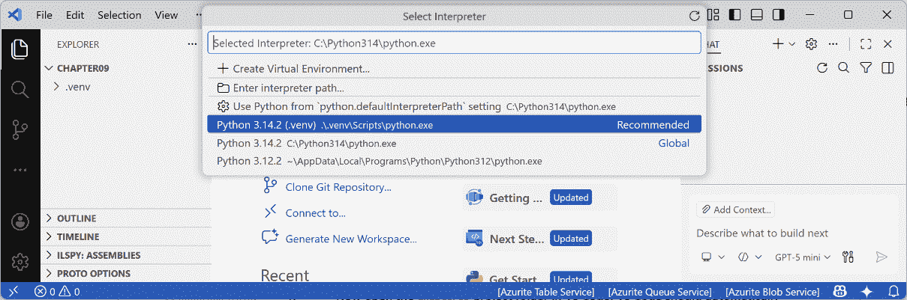
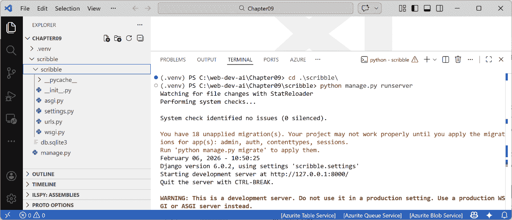
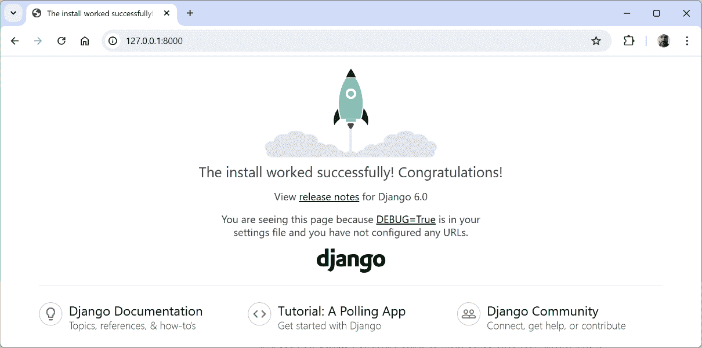
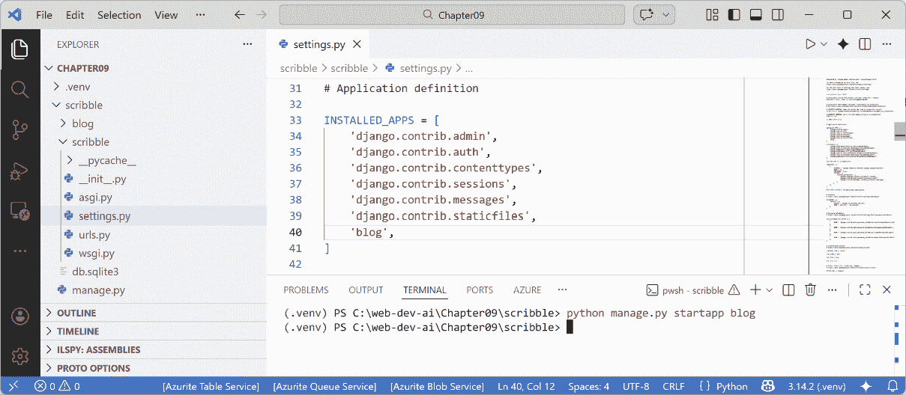
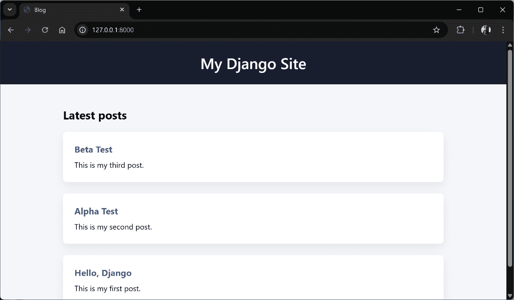
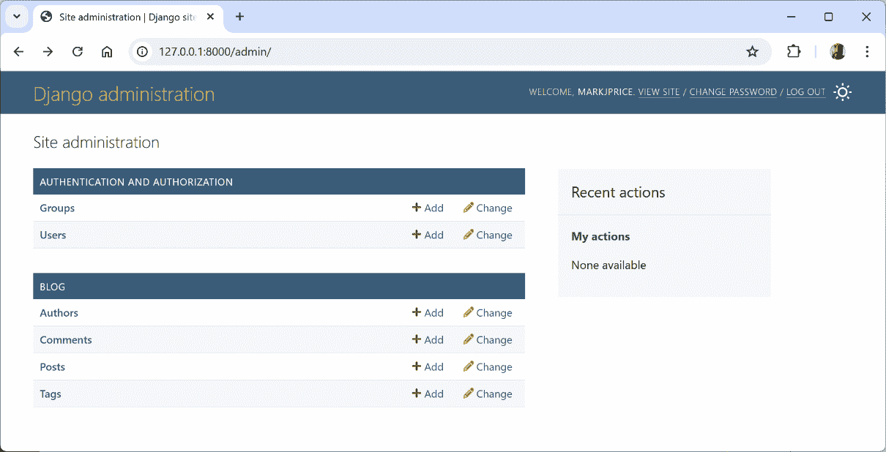
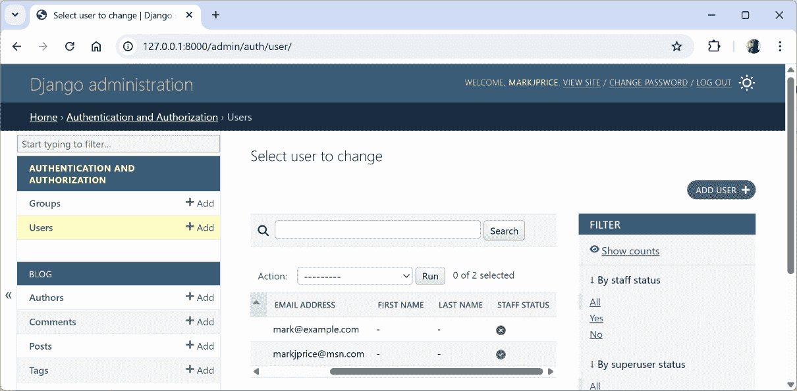
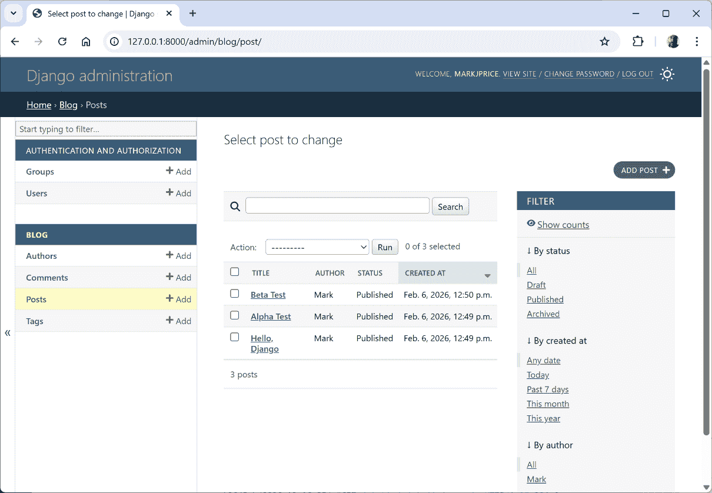
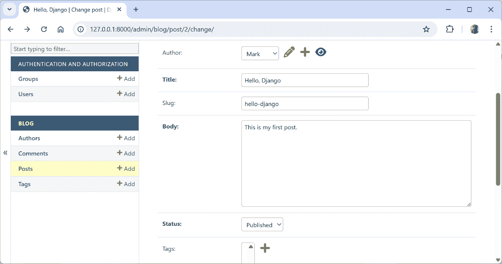

## Django – 后端 Web 开发

本章介绍 `Django`，一个实用且有主见的 Web 框架，用于构建真实应用程序，而无需亲自编写每一段路由、表单、身份验证和数据库代码。您将看到 `Django` 如何融入您已经学习的更广泛的 Web 技术栈，特别是 HTML、CSS、SQL 和 Python，以及为什么它开箱即用地包含路由、表单、身份验证、数据库迁移和管理界面等常见 Web 功能，而不是期望您自行组装它们。您不需要记住每一个 `Django` 类、函数、设置和命令。请专注于 `Django` 如何构建 Web 项目以及其约定存在的原因。

您将首先设置一个名为 `Scribble` 的最小 `Django` 项目，用于管理博客文章，并在本地运行它，然后逐步了解使 `Django` 工作的核心构建块，包括 `Model-View-Template` (`MVT`) 模式：

* `Models`（模型），用于将 Python 代码清晰地映射到关系数据库表
* `Views`（视图），用于处理请求并将数据从服务器传递到浏览器
* `Templates`（模板），用于渲染动态 HTML，而无需混乱地混合逻辑和表示层

在此过程中，您将探索 `Django` 管理界面，它演示了 `Django` 在您定义模型后免费为您提供了多少功能。

在本章结束时，您应该能够熟练浏览 `Django` 项目，并理解其主要部分如何协作形成一个工作的 Web 应用程序。您将拥有一个可工作的 `Django` 项目，清晰地理解模型、视图和模板如何结合在一起，定义数据和渲染动态页面的实践经验，以及使用 `Django` 管理界面检查和管理应用程序数据的信心。

在本章中，我们将涵盖以下主题：

* 介绍 `Django`
* 设置 `Django`
* `Django` URL 模式和路由
* `Django` 模型
* `Django` 视图和模板
* 服务静态文件
* `Django` 管理界面
* `Django` 表单
* `Django` 设置和配置
* 错误处理和调试
* 身份验证和授权

本章的建议聊天机器人提示及示例响应可在以下链接找到：[建议的聊天机器人提示及示例响应](https://github.com/markjprice/web-dev-ai/blob/main/prompts/ch09-django/readme.md)

## 介绍 Django

`Django` 是一个用于构建存储和检索数据的网站的高级 Python Web 框架。其核心思想是大多数 Web 应用程序共享相同的基本问题，因此框架应该以一致的方式一次性解决这些问题，而不是强迫每个开发人员重复造轮子。因此，`Django` 开箱即用地提供了路由、数据库访问、HTML 模板、身份验证、表单、安全防护和管理界面。

### MVT 模式

在架构上，`Django` 遵循其所谓的 `MVT 模式`：`Model`（模型）、`View`（视图）、`Template`（模板）。这与更广为人知的 `MVC 模式`：`Model`（模型）、`View`（视图）、`Controller`（控制器）密切相关，但命名略有不同，反映了 `Django` 特定的职责划分方式：

* `Django` 的 `Models` 代表数据层。它们使用 Python 类定义您的数据库模式，`Django` 负责将这些定义转换为 SQL 和数据库表。
* `Django` 的 `Templates` 负责表示层。它们通过将静态标记与动态数据相结合来生成 HTML，同时将大部分应用程序逻辑保留在模板之外。
* `Django` 的 `Views` 协调请求。视图接收 `HTTP` 请求，如果需要则与模型交互，并返回 `HTTP` 响应，通常通过渲染带有上下文数据的模板来实现。

如果您习惯了 `MVC`，`Django` 的 `View` 大致对应 `Controller`，而 `Django` 的 `URL` 配置和请求处理涵盖了某些框架会放在控制器层的工作。`URL` 配置将传入请求映射到视图函数或类，这使得请求处理显式且易于遵循。这种关注点分离使得 `Django` 应用程序随着增长更易于理解，因为模型持有数据规则，视图处理请求，模板渲染 HTML。

`Django` 的 `MVT` 和 `MVC` 模式组件的总结对比如 *表 9.1* 所示：

| 概念 | MVT | MVC |
| --- | --- | --- |
| 传入请求由以下处理： | URL 配置 | 路由 |
| 逻辑由以下执行： | View | Controller |
| 数据结构由以下定义： | Model | Model |
| Web 页面响应由以下生成： | Template | View |

**表 9.1：** 对比 `MVT` 和 `MVC` 设计模式

> **提示：** 请再次解释 `Django` 的 `MVT` 架构，但这次逐步追踪单个 `HTTP` 请求从浏览器到数据库再返回的过程。

### 有主见且约定驱动

`Django` 之所以流行，部分原因在于它能让您尽早获得工作特性。它是有主见且约定驱动的：遵循 `Django` 的结构，您只需少量设置即可获得路由、数据库访问、表单、身份验证和管理工具。

例如，定义一个模型会自动为您提供数据库表、用于查询数据的 Python API 和用于管理记录的管理界面。

表单验证、用户身份验证和针对常见安全问题的防护等常见任务已经解决，因此您可以花时间构建功能而不是基础设施。

`Django` 特别适合那些正确性、可维护性和开发速度比从第一天起优化每一个性能细节更重要的项目。其设计选择倾向于清晰和显式，这就是为什么它广泛用于内容驱动的网站、内部工具、API 和数据密集型应用程序。

> **提示：** 初学者最常试图对抗哪些 `Django` 约定，为什么通常最好遵循它们？

### Django 项目与 Django 应用

一个尽早理解的有用概念是 `Django` 项目和 `Django` 应用的区别：

* `Django project`（Django 项目）代表您正在构建的整个网站或系统。
* `Django app`（Django 应用）是该项目中一个独立的功能单元。例如，博客、用户账户系统或评论功能可以各自是单独的应用。

一个 `Django` 项目由一个或多个应用组成，即使您最初只创建一个应用。这种结构鼓励模块化设计，并使随着项目增长重用或重组功能变得更加容易。

> **提示：** 请向我展示一个简单的图表，说明 `Django` 项目和应用在真实应用程序中是如何关联的。

### “电池内置”是什么意思？


# Django 概览

Django 常被描述为“自带电池”，这句话值得深入剖析。Django 故意内置了解决常见 Web 开发问题的方案，而不是将它们作为可选的附加组件。数据库迁移、认证、表单处理、安全防护和管理界面都是核心框架的一部分。

数据库迁移是一组指令，告诉数据库如何更改其结构。你不直接编辑数据库，而是编写更改，例如添加一个名为 `date_of_birth` 的新列、重命名该列或创建一个新表。每一项更改都保存为一个小文件，通常位于你的项目中。

其他 Web 框架将这些功能留给其框架之上的额外层（如内容管理系统 CMS），而 Django 则内置了它们。

这意味着 Django 项目往往看起来彼此相似，这使得它们更易于理解、维护和移交给其他开发者。

权衡在于 Django 期望你遵循其约定，但作为回报，你只需极少的设置即可获得路由、表单、认证、迁移、静态文件处理和管理工具。

## 请求-响应生命周期

在高层级上，Django 应用遵循清晰的请求-响应生命周期：

1. 浏览器向你的 Web 服务器发送 HTTP 请求。
2. Django 根据 `path()` 定义的一组 URL 模式匹配该请求，以决定由哪个视图处理。
3. 视图运行 Python 代码，可选择通过模型（如 `Post.objects.filter()`）查询数据库，并生成 HTTP 响应。在许多情况下，该响应是通过渲染模板生成的 HTML，但也可能是 JavaScript 对象表示法 (JSON)、重定向或错误页面。
4. 此响应返回给 Web 浏览器以展示给用户，如果只是数据，则返回给发出请求的客户端应用。

牢记这一流程，更容易理解不同 Django 组件如何协作。

Django 是检验你对 Web 应用理解程度的有用标准。AI 助手可以快速编写 `path()` 调用或 `Post.objects.filter()` 查询。你仍需判断的部分是这些代码属于何处。这项检查应该放在视图、模型、表单还是中间件中？如果帖子缺失、未发布或被错误的用户请求，应该发生什么？

这就是为什么 Django 值得作为一个系统来学习，而不是作为一堆代码片段。URL 选择视图。视图做决策。模型定义并保护数据。模板渲染 HTML。中间件处理全站行为。设置描述环境。当你脑海中对这些组件有清晰认识时，生成的代码更易于审查、调试，并在其将逻辑放错位置时予以拒绝。

## 中间件

在你的视图看到请求之前，Django 会让请求经过一个中间件栈，它就像一个处理步骤的管道。每一层都有机会在请求进入时检查或修改它，在响应离开时检查或修改它。这就是 Django 处理适用于整个站点的行为而不弄乱视图代码的方式。

中间件负责适用于整个应用的事务，而不仅仅是单个页面。这包括会话处理、安全检查（如跨站请求伪造 CSRF 保护）和用户认证。例如，当你在视图中访问 `request.user` 时，该值已在管道早期由 Django 的认证中间件附加上去。

这种设计让你的视图专注于应用逻辑，而中间件处理其周围的全站行为。你在开始学习 Django 时不太可能编写自己的中间件，但理解它位于浏览器和视图之间，有助于解释 Django 如何在你的代码运行前自动提供如此多的功能。

## 适合初学者，但不只用于小项目

虽然 Django 适合初学者上手，但它不是玩具框架。它设计用于从小型个人项目扩展到大型、长期运行的应用。许多现实世界的系统最初是简单的 Django 项目，并随时间增长而无需更换框架。

Django 对显式结构、清晰的职责分离和可预测约定的强调，有助于在应用演进过程中控制复杂性。

## Django 版本发布

Django 有非常规律的发布节奏：

- 大约每八个月发布一个功能版本
- 每隔几个版本，会指定一个为长期支持 (LTS) 版本
- LTS 版本接收安全和数据丢失修复的时间比非 LTS 版本长得多

LTS 版本旨在以最好的意义做到“平淡无奇”（稳定可靠）。许多专业 Django 团队仅标准化使用 LTS 版本。如果你想以 LTS 版本为目标，出版时最新的是 Django 5.2，将支持至 2028 年 4 月。许多专业 Django 团队正是为此标准化使用 LTS 版本。

本书以 Django 6.0 为目标，这是一个非 LTS 版本。它将支持至 2027 年 4 月。当你阅读本书时，更新的版本可能已存在，但此处展示的概念和代码仍然有效。例如，你应该能以 6.1 为目标（预计 2026 年 8 月发布），或 6.2（预计 2027 年 4 月发布，预期为下一个 LTS 版本，将支持至 2030 年 4 月）。

你可以通过以下链接了解更多关于 Django 当前支持版本的信息：[`www.djangoproject.com/download/#supported-versions`](https://www.djangoproject.com/download/#supported-versions)

## Django 的替代方案

虽然我为本书选择了 Django，但它不是 Python 唯一的 Web 框架。

Flask 可能是最知名的替代方案。它比 Django 轻量得多，仅提供处理 HTTP 请求和路由的基础功能。你按需自行添加其他组件。这使 Flask 更灵活，但也意味着你需要做更多决策。你可以通过以下链接了解更多关于 Flask 的信息：[`flask.palletsprojects.com/`](https://flask.palletsprojects.com/)

FastAPI 是一个较新的框架，因构建 API 而变得非常流行。它专注于性能、现代 Python 特性（如类型提示）和自动文档生成。它广泛用于后端服务和 AI 相关应用。你可以通过以下链接了解更多关于 FastAPI 的信息：[`fastapi.tiangolo.com/`](https://fastapi.tiangolo.com/)

Pyramid 介于 Django 和 Flask 之间。它允许你从小规模开始并逐步增加复杂性，但如今比 Flask 或 FastAPI 少见。你可以通过以下链接了解更多关于 Pyramid 的信息：[`docs.pylonsproject.org/projects/pyramid/`](https://docs.pylonsproject.org/projects/pyramid/)

实际上，大多数开发者在三个主要选项中选择：

- Django 用于全功能 Web 应用
- Flask 用于简单或灵活的项目
- FastAPI 用于 API 和高性能服务

对于本书，Django 是明智的选择。它为新 Web 开发者提供了一个结构化的环境，减少了决策负担，这与你教授概念而非强迫读者从零组装技术栈的目标非常契合。

## 本章预期

本章重点在于 Django 的核心理念：定义模型、处理请求、渲染模板和使用管理界面。

Django 包含许多其他功能，如认证系统和用于构建 Web 服务的 API 工具，但那些都建立在你将在此学习的相同基础之上。


一旦你理解了这些基础知识，框架的其余部分将变得更容易上手。有了这些概念，你就可以继续创建你的第一个 Django 项目，并看到这些概念的实际应用。

# 设置 Django

在编写任何 Django 代码之前，你需要一个可用的 Python 环境和一个干净的项目设置。Django 可以在 Python 运行的任何地方运行，因此在 Windows、macOS 和 Linux 上的步骤大体相同。主要区别在于命令语法和文件路径，将在相关地方指出。

## 创建并激活虚拟环境

接下来，我们将为你的 Django 项目创建一个虚拟环境。这会将项目的依赖与系统其余部分隔离开来，避免日后出现版本冲突。

创建一个名为 `Chapter09` 的文件夹。在该文件夹内，运行虚拟环境命令：

* 在 Windows 上，运行：`python -m venv .venv`
* 在 macOS 和 Linux 上，运行：`python3 -m venv .venv`

这将创建一个包含该项目专用 Python 安装的 `.venv` 文件夹。

现在激活虚拟环境：

* 在 Windows 上，运行：`.venv\Scripts\activate`
* 在 macOS 和 Linux 上，运行：`source .venv/bin/activate`

激活成功后，终端提示符通常会改变以显示虚拟环境名称：

```
(.venv) C:\web-dev-ai\Code\Chapter09>
```

从这一点开始，你安装的任何 Python 包都将仅限于此项目。

## 安装 Django

激活虚拟环境后，使用 `pip` 安装 Django：

```
pip install django
```

这会将 Django 及其依赖下载到虚拟环境中：

```
Collecting django
  Using cached django-6.0.2-py3-none-any.whl.metadata (3.9 kB)
Collecting asgiref>=3.9.1 (from django)
  Using cached asgiref-3.11.1-py3-none-any.whl.metadata (9.3 kB)
Collecting sqlparse>=0.5.0 (from django)
  Using cached sqlparse-0.5.5-py3-none-any.whl.metadata (4.7 kB)
Collecting tzdata (from django)
  Using cached tzdata-2025.3-py2.py3-none-any.whl.metadata (1.4 kB)
Using cached django-6.0.2-py3-none-any.whl (8.3 MB)
Using cached asgiref-3.11.1-py3-none-any.whl (24 kB)
Using cached sqlparse-0.5.5-py3-none-any.whl (46 kB)
Using cached tzdata-2025.3-py2.py3-none-any.whl (348 kB)
Installing collected packages: tzdata, sqlparse, asgiref, django
Successfully installed asgiref-3.11.1 django-6.0.2 sqlparse-0.5.5 tzdata-2025.3
```

你可以通过运行 `django-admin --version` 来验证安装，它应该会打印类似 `6.0.2` 的 Django 版本号。如果成功，Django 就可以使用了。

## 在 VS Code 中使用 Django

在 VS Code 中打开 `Chapter09` 项目文件夹。VS Code 应该会自动检测到虚拟环境并提示你选择它作为解释器。

如果没有，打开**命令面板**并选择 **Python: Select Interpreter**，然后选择 `.venv` 文件夹内的解释器，如*图 9.1*所示：



*图 9.1：为 Django 虚拟环境选择 Python 解释器*

## 创建 Django 项目

在命令提示符或终端中，通过运行以下命令创建你的第一个 Django 项目并将其命名为 `scribble`：

```
django-admin startproject scribble
```

这将创建一个名为 `scribble` 的新文件夹，其中包含 `manage.py` 等 Python 文件。外层 `scribble` 文件夹只是一个容器。内层 `scribble` 文件夹包含项目配置，包括设置、URL 配置和服务器启动代码。在此阶段，不必担心记住这些文件。当它们变得相关时，你会重新审视它们。

为了确认一切正常，使用 `cd scribble` 进入外层 `scribble` 项目目录，然后使用以下命令运行开发服务器：

```
python manage.py runserver
```

Django 将启动一个本地 Web 服务器，通常在 [`127.0.0.1:8000/`](http://127.0.0.1:8000/)，如*图 9.2*所示：



*图 9.2：运行 Django 项目 Web 服务器*

在输出中，以及如*图 9.2*所示，请注意以下消息：

```
You have 18 unapplied migration(s). Your project may not work properly until you apply the migrations for app(s): admin, auth, contenttypes, sessions.
Run 'python manage.py migrate' to apply them.
```

你目前不需要运行 `python manage.py migrate` 命令。在下一节中，你将为 Scribble 项目的博客功能定义一些自定义模型，然后运行此命令。那时，前面提示中提到的系统迁移和你的自定义模型迁移都将被应用。

在浏览器中打开该地址。你可以 `Ctrl` + `Click` 输出中的链接，而不必手动输入 URL。如果你看到 Django 欢迎页面，说明设置正确，如*图 9.3*所示：



*图 9.3：Django 欢迎页面*

**警告！** 此开发服务器仅设计用于本地使用，因此会显示如*图 9.2*所示的消息：**警告：这是一个开发服务器。请勿在生产环境中使用。请改用生产级 WSGI 或 ASGI 服务器。** 当你更改代码时它会自动重新加载，并在你学习时提供有用的错误页面。WSGI 代表 Web Server Gateway Interface（Web 服务器网关接口），ASGI 代表 Asynchronous Server Gateway Interface（异步服务器网关接口）。

在终端中，按 `Ctrl` + `C` 停止 Web 服务器。

`Ctrl+Break` 是源自旧键盘和控制台环境的遗留 Windows 术语。Django 的开发服务器文档历史上曾使用它，但实际上，`Ctrl+C` 是当今所有平台上通用且正确的指令。

**良好实践**：Django 项目包含生成的文件、本地设置、缓存文件夹，有时还包含机密信息。当你使用 Git 等源代码控制系统时，应小心不要盲目将 Django 项目中的所有内容添加到仓库。例如，应排除 `.venv` 和 `__pycache__` 等目录、`db.sqlite3` 等数据库文件以及密码等机密信息。你将在*第 11 章* *设置项目环境* 中学习如何做到这一点。在本章中，我们不使用源代码控制，以便专注于学习 Django。

在接下来的章节中，你将开始向该项目添加应用、模型和视图，并了解一旦添加了实际功能，Django 的结构是如何开始变得合理的。

# Django URL 模式和路由

URL 是每个 Django 请求的入口点。在视图运行之前、模板渲染之前，Django 必须决定哪段代码应处理传入的 HTTP 请求。这一决定由 Django 的 URL 路由系统做出。

从高层来看，Django 的工作原理如下：请求带着路径（如 `/posts/hello-django/`）到达。Django 将该路径与 URL 模式列表从上到下进行比较，直到找到第一个匹配项。匹配的模式决定调用哪个视图函数或类，以及传递给它什么数据。

## URL 模式

URL 模式使用 `path()` 函数定义。一个最小示例如下：

```
from django.urls import path
from .views import post_list
urlpatterns = [
    path("", post_list, name="post_list"),
]
```

请注意前面代码的以下几点：

* 空字符串 `""` 表示该文件被包含在其下的任何 URL 前缀的根目录。
* `name` 参数比初看起来更重要。它为 URL 提供了一个稳定的标识符，你可以在其他地方引用它，而无需硬编码路径。


## 按应用拆分 URL

随着项目的增长，Django 鼓励你按应用拆分 URL。每个应用定义自己的 `urls.py`，项目级的 `urls.py` 通过调用 `include()` 函数来包含它们，如下面代码中高亮所示：

```python
from django.contrib import admin
from django.urls import path, include
urlpatterns = [
    path("admin/", admin.site.urls),
    path("", include("blog.urls")),
]
```

这使路由保持模块化，并体现了 Django “*项目包含应用*”的理念。项目路由决定应用在 URL 空间中的位置。应用路由决定该空间内发生什么。

**提示**：请展示一些 `path()` 与 `re_path()` 的示例，并解释何时需要正则表达式。

## URL 中的动态片段

URL 模式通常包含动态片段。这些片段使用尖括号中的路径转换器来定义，如下所示：`<path_converter_type:parameter_name>`。

例如，要通过 slug 显示单个博客文章：

```python
path("<slug:slug>/", post_detail, name="post_detail"),
```

这里，`<slug:slug>` 意味着*匹配一个* `slug` *格式的字符串，并将其作为名为* `slug` *的参数传递给视图。视图签名必须匹配：

```python
def post_detail(request, slug):
    ...
```

常见的路径转换器包括：

*   `str` 用于任意非空字符串
*   `int` 用于整数
*   `slug` 用于 URL 友好的字符串
*   `uuid` 用于通用唯一标识符 (UUID) 值

URL 友好的字符串是一段文本，可安全用于网址中，不会导致歧义、编码问题或可读性问题。实际上，URL 友好的字符串有几个关键特征：仅使用小写字母，按需包含数字，单词之间用连字符分隔（而非空格或下划线），并避免标点符号、符号和非 ASCII 字符。例如，如果网页标题是 *Hello, Django!*，其 slug 可能是 `hello-django`；如果标题是 *C# & .NET Basics*，其 slug 可能是 `c-net-basics`。

使用转换器可保持 URL 可读，并避免在视图中手动解析。

**提示**：slug 到底有什么用？为什么 Django 对待 slug 的方式与普通文本字段不同？在实际的博客应用中，该如何处理 slug 的唯一性和更新？

## 命名 URL

与其硬编码链接（如 `/posts/hello-django/`），模板应使用 `` 标签，传入应处理请求的视图名称及其 slug 定义的路径。`<a>` 元素的内容应为你想在链接中显示的任何文本，例如文章标题：

```html
<a href="">
    {{ post.title }}
</a>
```

此时，你无需理解上述模板语法。模板语法将在本章后面详细解释。

这做了两件重要的事。

1.  它将模板与 URL 结构解耦。稍后你可以更改 URL 模式，而无需修改每个模板。
2.  如果 URL 名称或参数不匹配，Django 会抛出错误，从而在早期捕获错误，而不是悄悄生成损坏的链接。

URL 名称在模板之外也很重要。视图中的重定向和反向查找依赖于它们：

```python
from django.shortcuts import redirect
return redirect("post_detail", slug=post.slug)
```

这就是为什么命名 URL 是一种好习惯。

**提示**：命名 URL 在大型 Django 项目中解决了什么问题？

## URL 模式中的顺序

URL 模式中的顺序很重要。Django 会在第一个匹配处停止。这意味着更具体的模式应放在更通用的模式之前。例如，如果你同时有这两个模式，如下面这个错误示例所示：

```python
path("<slug:slug>/", post_detail),
path("archive/", archive_view),
```

然后 Django 会将 `"archive"` 视为 slug，从而永远无法到达 `archive/` 视图。

要修复此问题，`"archive/"` 必须出现在 slug 模式之前，如下面这个修正示例所示：

```python
path("archive/", archive_view),
path("<slug:slug>/", post_detail),
```

**提示**：Django 的 URL 解析器内部是如何工作的？为什么 URL 顺序很重要？

## 路由与模型

URL 路由不了解也不关心模型。它只是匹配字符串，然后调用视图。验证、数据库查找和 `404 资源缺失` 处理属于视图层。这种分离使路由保持简单且可预测。

在实践中，简洁的 URL 设计很快就会见效。可读的路径、命名路由和一致的结构使模板更易编写，视图更易理解。

现在我们准备学习模型，这是 Django 最棒的部分之一，因为一旦你定义了模型类，Django 就会为你做更多事情。Django 可以创建迁移、构建数据库表、生成管理表单，并为你提供用于查询数据的 Python API。

# Django 模型

在 Django 中，模型是应用数据的单一事实来源。你将模型定义为 Python 类，Django 利用它们同时完成三项工作：

*   描述数据的结构
*   生成并演进数据库模式
*   提供高级 API 用于在数据库中创建、读取、更新和删除行

模型通常映射到一张数据库表。模型上的每个属性映射到一列。模型的每个实例映射到一行。Django 的**对象关系映射器 (ORM)** 位于你的 Python 代码和数据库之间，在后台将 Python 操作转换为 SQL。

## 创建你的第一个应用和模型

让我们创建一个带有模型来表示文章的博客应用：

1.  创建一个名为 `blog` 的应用功能：

    ```bash
    python manage.py startapp blog
    ```

2.  在 `scribble/settings.py` 中注册 `blog` 应用，如*图 9.4* 和下面的代码所示：

    ```python
    INSTALLED_APPS = [
        ...
        "blog",
    ]
    ```



**警告！** 如果你错过这一步，Scribble 项目将不知道 `blog` 应用的存在，也不会扫描 `blog` 文件夹层级来发现其所有功能和设置。许多问题都是由创建应用后忘记注册引起的。

3.  你在 `blog/models.py` 中定义模型。在注释下方添加高亮代码：

    ```python
    from django.db import models
    # Create your models here.
    class Post(models.Model):
        title = models.CharField(max_length=200)
        body = models.TextField()
        created_at = models.DateTimeField(auto_now_add=True)
        updated_at = models.DateTimeField(auto_now=True)
        is_published = models.BooleanField(default=False)
        def __str__(self) -> str:
            return self.title
    ```

请注意上述代码的以下几点：

*   `CharField` 用于短文本，需要 `max_length` 关键字参数或字段选项，因为数据库需要定义的列大小。`max_length` 在 Python 中称为**关键字参数**，在 Django 中更具体地称为**字段选项**。
*   `TextField` 用于较长的自由格式文本。
*   `DateTimeField(auto_now_add=True)` 在行创建时设置一次值。
*   `DateTimeField(auto_now=True)` 每次保存行时都会更新值。
*   `BooleanField` 存储 `true` 或 `false`，`default` 用于新行。

**良好实践**：`__str__` 方法不是必需的，但尽早添加很有价值。Django 在管理界面等地方使用它，可读的字符串比到处看到 `Post object (3)` 更利于调试。

## 应用迁移


# Django 模型与迁移

## 迁移

一旦你定义或更改了模型，就需要将该变更应用到数据库。Django 使用 `migrations`（迁移）来实现这一点。可以将 `migrations` 视为模式的版本控制。

运行以下命令以创建描述模式变更的迁移文件：

```
python manage.py makemigrations
```

注意观察以下输出：

```
Migrations for 'blog':
  blog\migrations\0001_initial.py
    + Create model Post
```

运行以下命令将这些迁移应用到数据库：

```
python manage.py migrate
```

注意观察以下输出：

```
Operations to perform:
  Apply all migrations: admin, auth, blog, contenttypes, sessions
Running migrations:
  Applying contenttypes.0001_initial... OK
  Applying auth.0001_initial... OK
  Applying admin.0001_initial... OK
  Applying admin.0002_logentry_remove_auto_add... OK
  Applying admin.0003_logentry_add_action_flag_choices... OK
  Applying contenttypes.0002_remove_content_type_name... OK
  Applying auth.0002_alter_permission_name_max_length... OK
  Applying auth.0003_alter_user_email_max_length... OK
  Applying auth.0004_alter_user_username_opts... OK
  Applying auth.0005_alter_user_last_login_null... OK
  Applying auth.0006_require_contenttypes_0002... OK
  Applying auth.0007_alter_validators_add_error_messages... OK
  Applying auth.0008_alter_user_username_max_length... OK
  Applying auth.0009_alter_user_last_name_max_length... OK
  Applying auth.0010_alter_group_name_max_length... OK
  Applying auth.0011_update_proxy_permissions... OK
  Applying auth.0012_alter_user_first_name_max_length... OK
  Applying blog.0001_initial... OK
  Applying sessions.0001_initial... OK
```

### 提示

运行 `makemigrations` 与 `migrate` 到底发生了什么？

如果你在学习过程中使用默认的 SQLite 数据库，项目文件夹中会有一个 `db.sqlite3` 文件。通过更改数据库设置，相同的模型代码稍后可以针对 PostgreSQL、SQL Server 和其他支持的数据库。

### 提示

如何将 Django 项目中使用的数据库系统从 SQLite 更改为 PostgreSQL 或 SQL Server？

## 关系

模型之间的关系是 Django 的主要优势之一。以下是三种最常见的关系类型。

### 一对多关系

`One-to-many`（一对多）使用 `ForeignKey`。例如，一位作者可以拥有多篇文章：

```
class Author(models.Model):
    name = models.CharField(max_length=100)
    def __str__(self) -> str:
        return self.name
class Post(models.Model):
    author = models.ForeignKey(Author, on_delete=models.CASCADE, related_name="posts")
    title = models.CharField(max_length=200)
    body = models.TextField()
    created_at = models.DateTimeField(auto_now_add=True)
    def __str__(self) -> str:
        return self.title
```

`on_delete=models.CASCADE` 意味着如果删除作者，其文章也会被删除。Django 强制你选择一种 `on_delete` 行为，因为数据库需要明确的规则来保证引用完整性。

### 一对一关系

`One-to-one`（一对一）使用 `OneToOneField`。这常用于配置文件式的扩展，即每个用户恰好拥有一个配置文件：

```
from django.contrib.auth.models import User
class Profile(models.Model):
    user = models.OneToOneField(User, on_delete=models.CASCADE)
    bio = models.TextField(blank=True)
```

### 多对多关系

`Many-to-many`（多对多）使用 `ManyToManyField`。例如，文章可以有多个标签，而标签可以属于多篇文章：

```
class Tag(models.Model):
    name = models.CharField(max_length=50, unique=True)
    def __str__(self) -> str:
        return self.name
class Post(models.Model):
    title = models.CharField(max_length=200)
    tags = models.ManyToManyField(Tag, blank=True, related_name="posts")
```

你可以从以下链接下载 `blog` 应用的完整 `models.py` 文件：`https://github.com/markjprice/web-dev-ai/blob/main/Code/Chapter09/scribble/blog/models.py`

重新运行这两个迁移步骤，以使用最新变更更新数据库：

```
python manage.py makemigrations
python manage.py migrate
```

## 创建、更新和删除模型数据

一旦定义了一些模型，就可以使用以下标准函数创建、更新和删除它们的实例：

* `<model_name>.objects.create(<required_parameters>)`：创建并返回指定模型的新实例（对象）
* `<model>.save()`：将字段更改保存到此模型实例
* `<model>.delete()`：删除此模型实例

可以使用以下标准函数查询模型：

* `<model_name>.objects.filter(...)`：返回包含与指定条件匹配的对象的 QuerySet
* `<model_name>.objects.order_by(...)`：返回按指定字段排序的对象的 QuerySet

`QuerySet` 是数据库 `query`（查询）的表示，而非结果本身。QuerySet 描述了你想要什么数据，而不是立即获取数据，只有在需要结果时 Django 才会运行实际的 SQL。这使你能够增量地筛选、排序和组合查询，而在需要结果时仍能生成单个高效的数据库查询。

Django `QuerySets` 是惰性的。构建 `QuerySet` 不会访问数据库，直到你实际对其求值，例如通过迭代、切片或将其转换为列表。这就是为什么你可以链式调用筛选器而无需为每一步付出代价。

对 QuerySet 求值的常见方法是将其传递给 `list` 函数：

```
list(<queryset>)
```

### 提示

Django QuerySets 惰性是什么意思，为什么这对性能很重要？

## 使用 Django Shell 管理数据

有了模型，Django 就为你提供了一种 Pythonic 的方式来处理数据。打开 Django shell：

```
python manage.py shell
```

在 `>>>` 提示符下，尝试一些基本操作：

1. 首先导入一些类：

```
from django.contrib.auth.models import User
from blog.models import Author, Post
from django.utils.text import slugify
```

2. 创建用户（`Author` 所需）：

```
user = User.objects.create_user(
    username="mark",
    email="mark@example.com",
    password="testpassword123"
)
```

3. 创建作者配置文件并关联你创建的用户：

```
author = Author.objects.create(
    user=user,
    display_name="Mark",
    bio="Author and Django enthusiast"
)
```

4. 创建博客文章并关联作者：

```
post = Post.objects.create(
    author=author,
    title="Hello, Django",
    slug=slugify("Hello, Django"),
    body="This is my first post.",
    status="published"
)
```

### 提示

Django 中 `slugify` 函数和 `slug` 类是做什么用的？

1. 显示 `post` 对象：

```
post
```

2. 查询最近的文章：

```
recent_posts = Post.objects.order_by("-created_at")[:5]
list(recent_posts) # 将 queryset 转换为列表
```

3. 查询已发布的文章：

```
published_posts = Post.objects.filter(status="published")
list(published_posts)
```

4. 显示 Django 将要运行的 SQL：

```
print(published_posts.query)
```

5. 更新现有文章：

```
post.title = "Hello, Django (Edited)"
post.slug = slugify(post.title)
post.save()
```

6. 删除文章：

```
post.delete()
```

7. 退出 shell：

```
exit()
```

`objects` 属性是 Django 的模型管理器。它提供查询构建方法，如 `create`、`get`、`filter`、`exclude` 和 `order_by`。


# 模型字段选项与 SQL 注入

## 常用字段选项（表 9.2）

*表 9.2：常用字段选项及其说明*

| **字段选项** | **说明** |
| --- | --- |
| `null=True` | 数据库列可存储 SQL `NULL`。 |
| `blank=True` | 表单和验证允许空值。 |
| `default=...` | 为新建行设置默认值。 |
| `unique=True` | 在数据库层面强制唯一性。 |
| `choices=[(...), (...)]` | 将值限制在固定集合中，适用于状态字段。 |

### 警告

一个常见的新手陷阱是混淆 `null` 和 `blank`。经验法则：`blank` 关乎验证，尤其是在填写表单时，而 `null` 关乎数据库如何存储值。对于文本字段，Django 通常倾向于使用空字符串而非 `NULL`，因此你经常会在 `CharField` 和 `TextField` 上使用 `blank=True` 而不使用 `null=True`。

### 提示

Django 的 ORM 如何将 Python QuerySet 转换为 SQL，以及它何时真正访问数据库？请展示相同的 Django ORM 查询及其生成的 SQL，并解释每一部分。

## SQL 注入及 Django 如何防范

SQL 注入是最古老且破坏性最大的 Web 应用漏洞之一。当用户输入被视为 SQL 命令的一部分而非数据时，就会发生 SQL 注入。

你已经了解 SQL 查询的工作原理。问题始于应用程序使用字符串构建这些查询时。

下面是一个使用原始 SQL 的 Python 简化示例：

```
email = request.GET.get("email")
query = f"SELECT * FROM users WHERE email = '{email}'"
cursor.execute(query)
```

这看起来无害。但从根本上说它是不安全的。

如果用户提供此值：

```
' OR 1=1 --
```

查询变为：

```
SELECT * FROM users WHERE email = '' OR 1=1 --'
```

该条件始终为 `true`。该查询现在返回数据库中的每个用户。数据库完全按照你的要求执行。问题在于你允许用户改变了查询的含义。

SQL 不区分代码（查询结构）和数据（被比较的值）。如果你使用字符串拼接构建 SQL，就会模糊这一界限。数据库无法分辨你的查询在哪里结束、用户输入从哪里开始。

你不应将值插入 SQL 字符串，而应单独传递它们：

```
cursor.execute(
    "SELECT * FROM users WHERE email = %s",
    [email]
)
```

现在 SQL 查询结构固定，值被严格视为数据。即使用户输入恶意内容，也无法改变查询的含义。

好消息是，正确使用时，Django 的 ORM 会自动保护你。

例如：

```
User.objects.filter(email=email)
```

Django 在内部生成 SQL 并安全地绑定参数。输入永远不会被视为可执行的 SQL。这是使用 ORM 的主要原因之一。它通过设计消除了一整类安全漏洞。

但即使在 Django 中，如果你超出 ORM 范围，SQL 注入仍然可能发生。

例如：

```
cursor.execute(f"SELECT * FROM users WHERE email = '{email}'")
```

或：

```
User.objects.raw(
    f"SELECT * FROM users WHERE email = '{email}'"
)
```

两者都重新引入了相同的漏洞。记住：你也需要审查 AI 编写的代码。这意味着要识别危险模式，例如由用户输入构建的原始 SQL。

### 良好实践

Django ORM 查询默认安全。原始 SQL 仅在使用参数时安全。字符串拼接始终不安全。如果你只记住一件事，请记住这点：永远不要将用户输入直接混入 SQL 字符串。

在 Web 开发中，尤其是借助 AI 编程时，快速生成可运行的代码非常容易。快速生成不安全的代码也同样容易。

SQL 注入很好地说明了“能跑通的代码”与“安全的代码”之间的区别。数据库会欣然执行接收到的任何有效 SQL。确保 SQL 不被用户操纵是你的责任。

在下一节中，你将看到视图和模板如何使用 ORM 获取模型数据并将其转化为动态页面。

# Django 视图与模板

视图和模板是数据变为用户实际可见内容的关键点。模型定义数据的样子，但视图决定请求使用哪些数据，模板决定如何将这些数据呈现为 HTML。

## 视图

Django 视图是一个接受 HTTP 请求并返回 HTTP 响应的 Python 函数或类。大多数视图遵循相同的基本模式：使用模型获取一些数据，然后返回渲染后的模板。

在你的 `blog` 应用的 `views.py` 中，导入 `Post` 模型并添加代码定义 `post_list` 函数，如下面代码高亮所示：

```
from django.shortcuts import render
from blog.models import Post
# Create your views here.
def post_list(request):
    posts = (
        Post.objects
        .filter(status="published")
        .order_by("-created_at")
    )
    return render(request, "blog/post_list.html", {"posts": posts})
```

`render` 辅助函数将三样东西合并为单个响应：传入的请求、模板名称和上下文字典。上下文字典是你将 Python 对象传递给模板的方式。

要使该视图可通过 Web 浏览器调用，你需要将其映射到 URL。在你的 `blog` 应用中，创建 `urls.py`：

```
from django.urls import path
from .views import post_list
urlpatterns = [
    path("", post_list, name="post_list"),
]
```

然后通过导入 `include` 函数并为空路径 `""` 添加条目到 `urlpatterns`，将应用的 URL 包含在项目的主 `urls.py` 中，如下面代码高亮所示：

```
from django.contrib import admin
from django.urls import path, include
urlpatterns = [
    path("admin/", admin.site.urls),
    path("", include("blog.urls")),
]
```

此时，对 `/` 的请求将调用 `post_list`，从数据库获取已发布的文章，并渲染模板。

## 通过预取关联数据提升性能

当模板访问 `post.author` 或 `post.tags` 等关联对象时，Django 可能会为每篇文章运行额外的数据库查询。随着文章数量增长，这会迅速变得低效。

`select_related()` 方法告诉 Django 使用 SQL 连接在同一数据库查询中获取关联对象（如 `author`）。`prefetch_related()` 方法通过运行第二个查询并在 Python 中合并结果来处理标签等关系。

使用这些方法可避免常见的 N+1 查询问题，即一个列表对象查询触发许多额外的关联数据查询。

`post_list(request)` 方法的改进版本会添加对这两个方法的调用，如下面代码高亮所示：

```
def post_list(request):
    posts = (
        Post.objects
        .filter(status="published")
        .select_related("author")
        .prefetch_related("tags")
        .order_by("-created_at")
    )
    return render(request, "blog/post_list.html", {"posts": posts})
```

在优化视图之前，请检查模板将访问什么内容、这如何转化为数据库查询，以及性能问题实际源自何处。AI 可以在几秒钟内生成一个可工作的 `post_list()` 函数，但它可能无法可靠地预测你将在模板中使用什么数据，或优化数据库访问的最佳方式。

你必须对行为做出判断，而不仅仅是编写代码。

## 模板


# Django 模板与视图

## 模板基础

模板位于专用目录中，通常为 `<app_name>/templates/<app_name>/`，例如 `blog/templates/blog/`。这种嵌套文件夹结构是刻意设计的。它可以避免多个应用定义同名模板文件时发生名称冲突。

你可以在一个文件中定义完整的模板，如 `post_list.html`：

```html
<!DOCTYPE html>
<html>
<head>
    <title>Blog</title>
</head>
<body>
    <h1>Latest posts</h1>
    
        <article>
            <h2>{{ post.title }}</h2>
            <p>{{ post.body|truncatewords:30 }}</p>
        </article>
    
        <p>No posts yet.</p>
    
</body>
</html>
```

Django 的模板语言是刻意受限的。你可以使用 `{{ ... }}` 进行变量插值，使用 `` 和 `` 进行简单的控制流，以及使用像 `truncatewords` 这样的过滤器。

**警告！** 你不能在模板中编写任意 Python 代码，这其实是一个特性。它强制实现了逻辑与表现的清晰分离。

**提示：** Django 为何刻意限制模板中的逻辑？这与允许完整编程逻辑的模板系统相比如何？

## 模板继承

引入继承后，模板变得更具复用性。基础模板定义共享结构（存储在 `<app_name>/templates/` 中），子模板覆盖特定区块（存储在 `<app_name>/templates/<app_name>/` 中）。

在基础模板中，你可以使用以下语法定义可替换的区块：`<default_block_content>`。例如，要定义一个名为 `title` 且默认内容为 `My Site` 的区块，请使用 `My Site`。你可以定义任意数量的具有唯一名称的可替换区块。

然后在继承的模板中，你可以使用以下语法为每个命名区块定义内容：`<block_content>`。例如，要为名为 `title` 的区块提供内容 `Blog`，请使用 `Blog`。

在 `blog` 文件夹中，创建一个名为 `templates` 的文件夹。

在 `blog/templates` 文件夹中，创建一个名为 `base.html` 的文件：

```html
<!DOCTYPE html>
<html>
<head>
    <title>My Site</title>
</head>
<body>
    <header>
        <h1>My Django Site</h1>
    </header>
    <main>
        
    </main>
</body>
</html>
```

注意 `content` 区块不提供任何默认内容，因此如果模板未提供任何内容，该区域将保持为空。

在 `blog/templates` 文件夹中，创建一个名为 `blog` 的文件夹。

在 `blog/templates/blog` 文件夹中，创建一个名为 `post_list.html` 的文件：

```html

Blog

    <h2>Latest posts</h2>
    
        <article>
            <h3>{{ post.title }}</h3>
            <p>{{ post.body|truncatewords:30 }}</p>
        </article>
    
        <p class="no-posts">No posts yet. Check back soon.</p>
    

```

这种模式可保持页面间 HTML 的一致性并减少重复，一旦网站超越单个视图的规模，这一点就变得至关重要。

**提示：** 请使用真实的多页面网站布局示例解释 Django 模板继承。

## 返回响应状态码

视图还负责返回非 HTML 响应。重定向、`404` 错误、JSON 响应和表单提交都在视图中处理。

例如，单篇文章的详情视图可能会通过 slug 查找对象，如果不存在则返回 `404 Missing resource` 状态码：

```python
from django.shortcuts import get_object_or_404, render

def post_detail(request, slug):
    post = get_object_or_404(Post, slug=slug, status="published")
    return render(request, "blog/post_detail.html", {"post": post})
```

这阐释了一个重要的设计原则：视图处理决策和错误状况，模板假设拥有有效数据并专注于渲染。

## 基于类的视图与基于函数的视图

Django 还支持基于类的视图，它们能减少列表页和详情页等常见模式的重复代码。它们功能强大，但对初学者来说较难阅读。

就学习而言，你目前所见的基于函数的视图通常更清晰，因为你可以在一处看到完整的请求-响应流程。一旦这种理解巩固，基于类的视图就会变得更有意义。

**提示：** 请展示基于函数的视图示例，并通过同一页面的两种实现方式的具体示例将其与基于类的视图进行对比。基于类的视图在何时降低复杂性，在何时使代码更难理解？

## 尝试运行你的视图和模板

现在我们可以尝试运行用于列出文章的视图和模板。

在命令提示符或终端中，输入启动 Web 服务器的命令：

```bash
python manage.py runserver
```

启动你的 Web 浏览器并访问以下链接：[`127.0.0.1:8000/`](http://127.0.0.1:8000/)

如果最新文章列表为空，请使用 shell 添加一些文章，就像你在之前的模型部分学到的那样。

你需要使用以下代码获取主键为 1 的现有作者：

```python
author = Author.objects.get(pk=1)
```

然后你可以使用以下代码添加更多文章：

```python
post = Post.objects.create(
    author=author,
    title="<type a title>",
    slug=slugify("<type a title>"),
    body="<type a body>",
    status="published"
)
```

简而言之，视图决定请求如何处理，模板决定用户看到什么，模型提供数据。保持这些职责分离是 Django 应用在增长过程中保持可理解性的原因之一。

现在让我们看看如何在网站中支持 CSS 文件和图片等静态文件。

# 服务静态文件

**静态文件** 是原样发送给浏览器的资源，无需动态生成。这包括 CSS 样式表、JavaScript 文件、图片、字体和图标。Django 对待这些文件的方式与模板截然不同，尽早理解这一区别能避免很多困惑。

模板在服务器上渲染，可包含逻辑和占位符。静态文件完全不经过渲染。Django 绝不会打开 CSS 文件进行检查或修改。它只是在被请求时将文件发送给浏览器。

## 静态文件的存放位置

Django 期望静态文件位于名为 `static` 的文件夹中。在基于应用的项目中，若应用名为 `blog`，通常的布局如下所示：

```
blog/
  static/
    blog/
      style.css
      logo.png
```

这种嵌套的 `blog` 文件夹是刻意设计的。就像模板一样，这可以避免多个应用定义同名文件（如 `style.css`）时发生名称冲突。

要在模板中使用静态文件，必须首先加载 Django 的 `static` 模板标签：

```html

```

然后你可以使用 `` 辅助工具引用静态文件，并传递相对于 `static` 文件夹的文件路径：

```html
<link rel="stylesheet" href="">

```

这一点很重要。你绝不应硬编码类似 `/static/blog/style.css` 的路径。使用 `` 允许 Django 更改静态文件的服务方式而不破坏你的模板。

## 配置静态文件文件夹

静态文件通过 `settings.py` 中的 `STATIC_URL` 进行配置：

```python
STATIC_URL = "static/"
```


在开发过程中，当 `DEBUG=True` 时，Django 会自动查找每个已安装应用的 `static` 目录中的静态文件并为你提供服务。这就是为什么你可以立即开始使用 CSS 而无需任何额外设置的原因。

在生产环境中，情况会有所不同。Django 本身不提供静态文件服务。相反，静态文件会被收集到一个单一目录中，并由 Web 服务器（如 Nginx）或 `content delivery network` (`CDN`) 提供服务。目前的关键点是，Django 的静态文件系统旨在支持这种转变，而无需更改你的模板。

CDN 是一个分布式服务器网络，它从地理位置接近用户的位置向用户分发静态内容。每个对图片、CSS、JavaScript 或视频的请求不再都回源到单一的源服务器，而是 CDN 将这些文件缓存在世界各地的许多边缘服务器上。当浏览器请求静态资源时，CDN 会从最近的可用位置提供服务，从而减少延迟、降低源服务器负载并提高可靠性。

## 静态文件的常见新手错误

一个常见的新手错误是混淆静态文件与模板。如果你把 CSS 放在 templates 目录中，Django 不会将其作为静态文件找到。如果你试图在 CSS 文件中放入模板逻辑，Django 会忽略它。模板和静态文件处于平行的世界中，服务于不同的目的。

另一个常见错误是在模板中忘记加载 `static` 标签。如果在没有 `` 的情况下使用 ``，当 `DEBUG=True` 时 Django 会抛出一个明确的错误。

从心智模型的角度来看，静态文件是你网站展示资产的一部分，而不是请求处理或数据流的一部分。模板只是引用它们。

## 添加样式表以改进文章列表页面

目前，博客文章列表功能正常，但看起来平淡无奇。让我们添加一个 CSS 样式表，使其更像一个真正的网站，同时加深对 Django 如何处理静态文件的理解。

让我们添加一个样式表来改进渲染文章列表的模板外观：

1. 在你的 `blog` 应用文件夹中，创建以下目录：

```
blog/
  static/
    blog/
```

2. 在 `blog/static/blog` 文件夹中，创建一个名为 `style.css` 的文件。

3. 向 `blog/static/blog/style.css` 添加以下 CSS，它使用中性色彩、可读的排版和卡片式文章，保持简洁：

```css
/* Base page styling */
body {
    font-family: system-ui, Helvetica, Arial, sans-serif;
    background-color: #f5f7fa;
    margin: 0;
    padding: 0;
    color: #222;
}
/* Page layout */
main {
    max-width: 800px;
    margin: 3rem auto;
    padding: 0 1rem;
}
/* Header */
header {
    background-color: #2d3748;
    color: #ffffff;
    padding: 1.5rem 1rem;
    text-align: center;
}
header h1 {
    margin: 0;
    font-weight: 600;
}
/* Blog posts */
article {
    background-color: #ffffff;
    border-radius: 8px;
    padding: 1.5rem;
    margin-bottom: 1.5rem;
    box-shadow: 0 8px 20px rgba(0, 0, 0, 0.05);
}
article h3 {
    margin-top: 0;
    margin-bottom: 0.5rem;
    color: #2b6cb0;
}
article p {
    line-height: 1.6;
    margin: 0;
}
/* Empty state */
.no-posts {
    text-align: center;
    color: #666;
    font-style: italic;
    margin-top: 3rem;
}
```

4. 在 `blog/templates/base.html` 中，添加对静态文件的支持。在文件顶部，加载 `static` 模板标签：

```

```

5. 在 `blog/templates/base.html` 的 `<head>` 部分中，链接样式表：

```
<link rel="stylesheet" href="">
```

因为 `post_list.html` 继承自 `base.html`，它将自动获取该样式表。

1. 如果开发服务器尚未运行，请启动它：

```
python manage.py runserver
```

2. 打开浏览器并访问：[`127.0.0.1:8000/`](http://127.0.0.1:8000/)。

你现在应该能看到一个整洁、带样式的博客文章列表，具有适当的布局、间距和排版，如 *Figure 9.5* 所示：



Figure 9.5: 带样式的博客文章列表页面

现在让我们看看如何使用内置的管理用户界面来管理网站中的数据。

# Django 管理界面

Django 最独特的功能之一是内置的管理界面。它是一个可工作的数据管理界面，根据你的模型自动生成。一旦你的模型存在，Django 就能为你提供一个用于创建、编辑和删除数据的可工作界面。

## 注册模型以进行管理

默认情况下，Django 只显示已显式注册的模型。要让你的博客模型出现，请打开 `blog/admin.py` 并注册它们：

```
from django.contrib import admin
from .models import Author, Post, Tag, Comment
admin.site.register(Author)
admin.site.register(Post)
admin.site.register(Tag)
admin.site.register(Comment)
```

当你自定义 Django 管理界面时，它会变得更加有用。自定义是通过定义 `ModelAdmin` 类来完成的。以下是 `Post` 模型的一个更现实的配置：

```
@admin.register(Post)
class PostAdmin(admin.ModelAdmin):
    list_display = ("title", "author", "status", "created_at")
    list_filter = ("status", "created_at", "author")
    search_fields = ("title", "body")
    prepopulated_fields = {"slug": ("title",)}
    ordering = ("-created_at",)
```

请注意前面代码中的以下内容：

* `list_display` 控制列表视图中显示哪些列
* `list_filter` 为常用字段添加过滤侧边栏
* `search_fields` 在选定字段上启用全文搜索
* `prepopulated_fields` 自动从标题生成 slug
* `ordering` 定义默认排序顺序

### 提示

使用 `admin.site.register(Post)` 与使用带有 `class PostAdmin(admin.ModelAdmin)` 和 `list_display` 等属性的 `@admin.register(Post)` 注册 Django 模型有什么区别？

你也可以内联编辑相关对象。例如，评论通常与文章一起管理，而不是单独管理：

```
class CommentInline(admin.TabularInline):
    model = Comment
    extra = 0
@admin.register(Post)
class PostAdmin(admin.ModelAdmin):
    list_display = ("title", "author", "status", "created_at")
    inlines = [CommentInline]
```

这允许编辑直接在文章编辑页面上管理评论，这符合许多编辑团队的工作方式。

管理界面遵守你在模型中定义的所有规则。字段验证、必填字段、选项、关系和权限会自动强制执行。如果你将字段标记为只读或限制谁可以编辑模型，管理界面会立即反映这一点。这种紧密集成是 Django 的优势之一。

## 以超级用户身份登录管理站点

当你创建 Django 项目时，管理站点默认启用。要使用它，你首先需要一个超级用户，也称为管理员账户。从命令行创建一个：

```
python manage.py createsuperuser
```

按照提示设置用户名、电子邮件地址和密码。

然后启动开发服务器并访问以下链接：

[`127.0.0.1:8000/admin/`](http://127.0.0.1:8000/admin/%20)

使用超级用户凭据登录。

你将看到 Django 管理仪表板，它按应用分组列出所有已注册的模型，如 *Figure 9.6* 所示：




# Django 管理界面

## Figure 9.6: Django 管理仪表板

点击某个模型会显示现有记录的列表视图。

点击 **Users**，注意通过 shell 添加的用户、作者和文章，以及通过命令行添加的超用户（**STAFF STATUS** 已启用），如 *Figure 9.7* 所示：



## Figure 9.7: Users

点击 **Posts**，注意现有文章列在一个可筛选的表格中，如 *Figure 9.8* 所示：



## Figure 9.8: Posts

点击单个博客文章记录会打开一个用于编辑的表单，如 *Figure 9.9* 所示：



## Figure 9.9: 编辑单个博客文章

理解管理界面的适用范围和局限性很重要。管理界面是为受信任的用户管理内部数据而设计的。它不打算作为面向公众的 UI，你也不应将其视为公共界面。对于编辑、审核员和内部工具，它通常已足够。对于最终用户，通常需要构建自定义视图和模板。

**提示**：Django 管理界面的局限性是什么？何时应该停止使用它并构建自定义视图？

对于学习而言，管理界面特别有用。它能即时反馈你的模型是否正确、关系是否生效、迁移是否成功运行。许多经验丰富的 Django 开发者在项目上线后仍将管理界面作为诊断工具。

**提示**：Django 管理界面如何仅从模型定义中推断出如此多的功能？

既然你已了解管理界面及其如何提供自动表单来修改模型数据，接下来让我们看看如何构建自己的表单展示给网站访问者。

# Django 表单

几乎每个交互式网站都需要接受用户输入、验证它，并将其保存到数据库或安全地处理它。Django 的表单系统使用 Python 代码端到端地解决了这个问题，避免了手写分散在视图中的验证逻辑。

从最高层来看，一个 Django 表单由一个 Python 类定义，它做三件事：定义期望的输入、验证该输入、向视图提供清洗后的可信数据。Django 将这些逻辑保持在模板之外，也很大程度上保持在视图之外。

Django 中有两种主要的表单类型，它们派生自内置类：`Form` 和 `ModelForm`。

## 普通表单

基于 `Form` 的类适用于不直接关联数据库模型的输入场景，例如联系表单或搜索框。

一个联系表单的最小示例如下：

```python
from django import forms

class ContactForm(forms.Form):
    name = forms.CharField(max_length=100)
    email = forms.EmailField()
    message = forms.CharField(widget=forms.Textarea)
```

这个单一的类定义就能给你 HTML 表单字段、验证规则和错误消息。Django 已经知道如何验证邮箱地址、必填字段和最大长度。

## 基于模型的表单

基于 `ModelForm` 的类功能更进一步。它将表单直接关联到模型，并为你处理数据保存。这是 Django 应用中最常见的模式。

例如，一个创建博客文章的表单：

```python
from django import forms
from .models import Post

class PostForm(forms.ModelForm):
    class Meta:
        model = Post
        fields = ["title", "slug", "body", "status", "tags"]
```

Django 会检查模型并自动创建具有正确类型、验证规则和控件的表单字段。如果你稍后修改了模型，表单会自动更新。

在视图中使用表单遵循一个标准模式，你会在各处的 Django 代码库中看到。视图处理两种情况：响应 `GET` 请求显示表单，以及响应 `POST` 请求处理提交的数据（当表单被填写并提交时触发）：

```python
from django.shortcuts import render, redirect
from .forms import PostForm

def create_post(request):
    if request.method == "POST":
        form = PostForm(request.POST)
        if form.is_valid():
            form.save()
            return redirect("post_list")
    else:
        form = PostForm()
    return render(request, "blog/post_form.html", {"form": form})
```

注意上述代码的以下几点：

*   `request.POST` 包含提交的表单数据
*   `is_valid()` 运行所有验证规则并返回布尔值
*   清洗后的验证数据可通过 `form.cleaned_data` 获取
*   `form.save()` 为 `ModelForm` 创建或更新数据库行

如果验证失败，Django 会自动将错误消息附加到表单。你不需要自己编写错误处理逻辑。

**提示**：为什么 Django 要将表单与模型分离，而不是直接使用 HTML 表单？

## 渲染表单

在模板中渲染表单很简单：

```html
<form method="post">
    
    {{ form.as_p }}
    <button type="submit">Save</button>
</form>
```

`` 标签是安全所必需的。Django 默认防范跨站请求伪造，而表单是这种保护最重要的地方。

**提示**：请用简单的术语解释 Django 中的 CSRF 保护，并举例说明攻击场景。

`form.as_p` 适合学习和原型开发。它将每个字段包裹在段落中渲染。实际项目中，通常单独渲染字段以便控制布局和样式：

```html
{{ form.title.label_tag }}
{{ form.title }}
{{ form.title.errors }}
```

Django 表单的一个有用特性是验证发生在视图逻辑继续之前。这意味着你的视图可以假设它们处理的是已清洗和验证的数据。你不必检查邮箱是否有效或必填字段是否缺失。Django 已经完成了这些工作。

**提示**：Django 的表单系统自动解决了哪些安全问题？

## 表单与其他 Django 组件的集成

表单也与模型、管理界面和模板干净地集成。无论数据来自公共表单还是管理界面，都适用相同的验证规则。

有必要明确表单不是什么。它们不仅仅是 HTML 生成器。它们是位于不可信用户输入和应用逻辑之间的验证和数据清洗层。这种设计是 Django 表单初看稍显繁重，但随着应用增长能节省大量时间和错误的原因。

一旦理解了表单，大量 Django 功能突然变得合理：认证视图、评论系统、管理页面、API 都构建在相同的底层思想之上。

现在让我们看看设置和配置。

# Django 设置与配置

每个 Django 项目由单个配置模块驱动，通常称为 `settings.py`。这个文件回答一个简单的问题：在这个环境中，该项目应如何表现？理解设置不在于记忆选项，而在于知道 Django 去哪里寻找答案。

当你运行 `python manage.py runserver` 时，Django 加载由 `DJANGO_SETTINGS_MODULE` 环境变量定义的设置模块。在默认项目中，这指向 `mysite.settings`。从数据库连接到已安装应用，一切皆由此文件流出。

## 调试模式

你遇到的第一个设置之一是 `DEBUG`：

```python
DEBUG = True
```

当 `DEBUG` 开启时，Django 显示详细错误页面、自动重载代码变更、并为你服务静态文件。这正是学习和开发时所需要的。


在生产环境中，`DEBUG` 必须关闭，因为那些错误页面会暴露敏感信息。即使尚未涉及部署，了解 `DEBUG` 以根本方式改变 Django 的行为也很有价值。

> **Prompt**：为什么 `DEBUG=True` 对学习 Django 如此有用，而 `DEBUG=False` 到底改变了什么？

## 已安装的应用

`INSTALLED_APPS` 是控制 Django 哪些部分处于激活状态的设置：

```
INSTALLED_APPS = [
    "django.contrib.admin",
    "django.contrib.auth",
    "django.contrib.contenttypes",
    "django.contrib.sessions",
    "django.contrib.messages",
    "django.contrib.staticfiles",
    "blog",
]
```

如果一个应用未在此列出，Django 会忽略它。模型不会被加载，管理站点注册不会运行，模板不会被发现，迁移会被跳过。许多神秘的 Django 问题最终都归结为 `INSTALLED_APPS` 中缺少条目。

## 数据库配置

数据库配置位于 `DATABASES` 中。默认情况下，Django 使用 SQLite，它是基于文件的且无需设置：

```
DATABASES = {
    "default": {
        "ENGINE": "django.db.backends.sqlite3",
        "NAME": BASE_DIR / "db.sqlite3",
    }
}
```

这非常适合学习和小型项目。重要的结论是：当你切换数据库时，模型不需要改变。你只需更新设置，运行迁移，Django 的 ORM 会处理其余部分。

## 模板配置

模板通过 `TEMPLATES` 设置进行配置：

```
TEMPLATES = [
    {
        "BACKEND": "django.template.backends.django.DjangoTemplates",
        "DIRS": [],
        "APP_DIRS": True,
        "OPTIONS": {
            "context_processors": [
                "django.template.context_processors.debug",
                "django.template.context_processors.request",
                "django.contrib.auth.context_processors.auth",
                "django.contrib.messages.context_processors.messages",
            ],
        },
    },
]
```

`APP_DIRS: True` 告诉 Django 在每个已安装应用的 `templates` 目录中查找模板。如果你稍后添加了项目级模板文件夹，请将其列在 `DIRS` 中。理解这一区别有助于避免那些原本难以捉摸的模板加载错误。

## 静态文件

静态文件的配置独立于模板：

```
STATIC_URL = "static/"
```

在开发期间，Django 会从每个应用的 `static` 目录收集静态文件并自动服务它们。在生产环境中，处理方式不同，但关键点是静态文件是通过配置发现的，而不是硬编码路径。

## 允许的主机

另一个值得尽早注意的设置是 `ALLOWED_HOSTS`。当 `DEBUG` 关闭时，Django 会拒绝为未知主机名提供服务。这是一项安全措施，可防止某些类别的攻击。虽然在开发期间这似乎无关紧要，但它解释了项目首次部署时出现的错误。

## 设置即代码

Django 中一个反复出现的主题是设置是 Python 代码，而不是像 YAML 或 JSON 那样的声明性格式。这允许你计算值、导入环境变量并共享逻辑。

例如，高级项目通常将设置拆分为多个文件，或从环境中读取密钥，而不是硬编码它们。你目前不需要那么复杂，但了解 Django 期望设置随项目增长而增长会有帮助。

设置是全局的，但不是魔法。当某些行为出乎意料时，问问自己是哪个设置控制它。一旦你知道在哪里查找，大多数配置问题都会变得简单直接。

读完本章时，你不应以背诵 `settings.py` 为目标。相反，你应该能自如地打开它，识别主要部分，并知道在需要调整 Django 行为时该修改哪些部分。

> **Prompt**：哪些设置最让初学者困惑，为什么？

设置定义了项目的行为：安装了哪些应用、使用哪个数据库、从哪里加载模板、如何应用安全检查。即便如此，事情仍会出错。URL 名称不匹配、模板在错误的文件夹中、模型字段拼写错误。下一节将展示如何阅读 Django 的错误并找到导致问题的那一行代码。

# 错误处理与调试

错误并非意味着 Django 出了问题。它们是 Django 在履行职责，精确地告诉你假设与现实的偏差。学会如何阅读和应对 Django 错误是成为高效使用该框架的最快途径之一。

## 启用调试时的详细错误消息

当 `DEBUG` 设置为 `True` 时，每当发生异常，Django 都会显示一个详细的错误页面。该页面故意设计得冗长。它包括异常类型、错误消息、堆栈跟踪、局部变量，以及通常关于 Django 当时试图执行什么操作的清晰提示。初学者往往略过这些信息，但你所需的几乎一切都已经在该页面上了。

> **Prompt**：请演示一个真实的 Django 错误页面，并解释如何从底向上阅读回溯。

## 回溯

调试页面最重要的部分是 `traceback`。它显示了导致错误的函数调用链，最近的调用在**底部**。从那里开始。那通常是你的代码出现的地方。点击进入可查看触发异常的确切行以及该时刻局部变量的值。

你在 *第 8 章* *Python – Programming on the Backend* 中更详细地学习了回溯。

> **Prompt**：为什么 Django 倾向于大声抛出错误而不是静默失败？

## 常见错误

你早期会遇到的一些常见错误：

*   `TemplateDoesNotExist` 通常意味着模板路径错误或应用不在 `INSTALLED_APPS` 中
*   `NoReverseMatch` 意味着 Django 找不到具有你指定的名称或参数的 URL。这几乎总是指向 URL 名称与 `` 用法之间的不匹配
*   `IntegrityError` 通常在更改模型后出现。它表示违反了数据库约束，例如缺少外键或唯一字段中有重复值
*   `FieldError` 通常意味着 QuerySet 中模型字段名称拼写错误

理解错误类别已能大幅缩小搜索范围。

## 开发服务器错误日志

Django 开发服务器也会将错误记录到终端。始终检查运行 `runserver` 的控制台。导入错误、语法错误和启动问题会在处理请求之前出现在那里。如果服务器无法启动，终端输出是首要排查位置。

## Shell 调试

Django shell 是一个被低估的调试工具。如果视图中某处失败，请在 shell 中逐步重现。首先启动 shell：

```
python manage.py shell
```

接下来，执行语句以识别模型问题：

```
from blog.models import Post
Post.objects.filter(status="published")
```

如果查询在 shell 中失败，问题不在视图或模板中。这能快速隔离问题，并将浏览器排除在外。

## 打印调试

打印仍然有用。在视图中策略性地放置 `print()` 语句可确认哪些代码路径正在运行以及运行时数据的样子。在开发期间，此输出直接出现在终端中。对于更复杂的项目，Python 的日志系统可与 Django 干净地集成，但 `print()` 在学习阶段完全可以接受。

## HTTP 错误


了解 Django 处理 HTTP 错误的理念也很有价值。并非所有错误都是 Bug。缺失的 Web 资源通常应返回 404，而不是导致应用崩溃。Django 提供了 `get_object_or_404()` 等辅助函数来明确这一点：

```
from django.shortcuts import get_object_or_404
post = get_object_or_404(Post, slug=slug, status="published")
```

这在内部会引发异常，但 Django 会捕获它并返回正确的 `404` 响应。这是 Django 鼓励正确错误处理而非到处进行防御性编程的一个例子。

## 良好实践：阅读错误信息

尽早养成的一个重要习惯是完整阅读错误信息。Django 的错误很少含糊不清。它们通常会准确告诉你是哪个设置、字段或文件导致了问题。不理解就跳到修复通常会导致第二个错误，而不是解决方案。

请记住，`DEBUG=True` 是开发工具，不是拐杖。它的设计目的是在出错时展示 Django 内部机制，教会你 Django 如何工作。如果你学会信任并解读这些错误页面，调试 Django 应用就会变成一个有条理的过程，而不是猜谜游戏。

一旦你熟悉了 Django 的错误信息和工具，你会发现许多问题的解决速度比轻量级框架更快，正是因为 Django 拒绝静默失败。

现在让我们通过回顾认证等安全主题来结束本章。

# 认证与授权

**认证** 是 Django “batteries included” 理念最明显的领域之一。Django 自带完整的认证系统，处理用户、密码、会话、权限和登录状态，无需第三方库或自定义数据库表。

> **提示**：请解释 Django 认证系统作为请求-响应生命周期一部分的工作原理。

## 内置 User 模型

该系统的核心是 `User` 模型，由 `django.contrib.auth` 提供。用户代表经过认证的身份，而非个人资料或扩展详情。它存储用户名、哈希密码、邮箱地址，以及用户是否激活、是否为员工、是否为超级用户等标志。你在为管理界面创建超级用户时已间接接触过此模型。

Django 中的认证回答两个相关但不同的问题：

1. **这是谁？** 这是认证。
2. **此用户被允许做什么？** 这是授权。

Django 通过会话跟踪用户是否已登录，会话是请求间存储的小段数据。用户登录时，Django 将其用户 ID 存入会话。每个新请求到来时，Django 读取会话数据并查找对应用户，然后将其附加到请求对象。因此你可以编写如下代码：

```
def some_view(request):
    if request.user.is_authenticated:
        ...
```

`request.user` 始终可用。若用户已登录，它代表该用户；若未登录，Django 提供 `AnonymousUser` 对象。它在常见检查中表现得足够像用户对象，但代表“未登录用户”。这意味着你无需检查缺失值，认证检查保持简洁一致。

## 登录与登出的内置视图

Django 包含现成的登录和登出视图。使用它们只需添加如下 URL 模式：

```
from django.contrib.auth import views as auth_views
urlpatterns = [
    path("login/", auth_views.LoginView.as_view(), name="login"),
    path("logout/", auth_views.LogoutView.as_view(), name="logout"),
]
```

然后创建 `registration/login.html` 模板，Django 处理其余工作。这是 Django 理念的典型体现：常见问题无需自定义代码，除非你想要自定义行为。

## 保护视图

保护视图很简单。若页面仅允许登录用户访问，使用 `login_required` 装饰器：

```
from django.contrib.auth.decorators import login_required
@login_required
def create_post(request):
    ...
```

若匿名用户尝试访问此视图，Django 会自动将其重定向到登录页面。这由 `LOGIN_URL` 设置控制。

## 权限与组

**权限** 和 **组** 提供了更高层级的授权系统。每个模型自动获得基本权限，如 `add`、`change`、`delete` 和 `view`。这些权限在管理界面中强制执行，也可在代码中检查：

```
if request.user.has_perm("blog.change_post"):
    ...
```

Groups 允许将权限打包并分配给用户。这是 Django 支持编辑、版主、管理员等角色的方式，无需将逻辑硬编码到视图中。

> **提示**：Django 中认证和授权有何区别？请举例说明。权限和组在底层是如何工作的？

## 用户相关数据

初学者常问的问题是用户相关数据应放在哪里。经验法则很简单：认证数据属于 `User`，领域特定数据属于别处。因此常创建与 `User` 关联的一对一 Profile 模型，正如你为追踪博客作者而创建 `Author` 所做的。这保持认证系统整洁，同时允许丰富的应用特定行为。

## 集成但可选

一个重要点是：Django 的认证系统是可选的，但管理界面、表单、权限、会话、中间件、视图和模板都懂得如何与其协作。你可以为纯公开站点完全忽略它，也可为内部工具、内容管理和基于角色的系统大量依赖它。管理界面、表单、权限和中间件都使用同一套认证语言，减少了你必须编写的胶水代码。

本章你只需掌握核心思想：认证已融入 Django 的请求生命周期。一旦认识到 `request.user` 只是流经视图和模板的另一份数据，Django 的安全方法就更易理解和扩展。

> **提示**：如果我想稍后添加评论、分页或 API，这个 Django 博客项目将如何演变？从小型个人项目迁移到大型生产系统时，Django 的哪些部分保持不变？

# 练习、参考资料与资源

本节将测试你本章所学，并提供参考资料和资源链接。

## 检验你的理解

回答以下问题：

1. Django 旨在解决什么问题？
2. Django 中的 *batteries included* 是什么意思？
3. Django 的 MVT 模式由哪三部分组成？
4. Django 的 MVT 与 MVC 有何不同？
5. Django 中的请求-响应生命周期是什么？
6. Django 项目和应用有何区别？
7. Django 中 URL 路由的作用是什么？
8. 为什么 URL 模式的顺序很重要？
9. 什么是 Django 模型？它代表什么？
10. `makemigrations` 和 `migrate` 有何区别？
11. 什么是 QuerySet？它“惰性”是什么意思？
12. Django 视图的作用是什么？
13. 为什么 Django 限制模板中的逻辑？
14. 模板和静态文件有何区别？
15. Django 管理界面的用途是什么？

## 场景题

现在回答以下深度问题：


# Django 常见问题与文档链接

## 常见 Django 问题

1. 你创建了一个新的 Django 应用，但模型未出现在 admin 中。最可能的原因是什么？
2. 你访问一个 URL 并得到 `NoReverseMatch` 错误。这通常意味着什么？
3. 像 `/archive/` 这样的 URL 被 slug 路由处理，而不是预期的视图。为什么？
4. 你在模型上定义了一个新字段但未运行任何命令。会发生什么？
5. 你在 `QuerySet` 上链式调用多个过滤器。这会多次访问数据库吗？为什么或为什么不？
6. 你尝试在模板中编写 Python 逻辑但失败了。为什么？
7. 你在模板中硬编码 `/static/style.css`，后来静态文件在生产环境中失效。为什么？
8. 表单提交发送了无效数据。在 Django 中验证应该发生在哪里？
9. 你想创建一个直接绑定到模型的表单。应该使用哪种方法？
10. 视图尝试获取一个不存在的数据库对象。正确的 Django 方法是什么？
11. 你看到一个带有回溯的详细错误页面。应该首先看哪里，为什么？
12. 你以用户身份登录，然后访问另一个页面。Django 如何知道你是谁？
13. 你想将视图限制为仅限登录用户访问。最简单的方法是什么？
14. 你正在构建一个面向公众的 UI。应该依赖 Django admin 界面吗？为什么或为什么不？
15. 你从 SQLite 切换到 PostgreSQL。是否需要重写模型？为什么？

## 文档链接

以下是本章涵盖主题的官方 Django 文档链接。这些是规范参考，由 Django 项目本身维护并保持最新。所有链接均指向官方 Django 网站上的最新稳定文档。

### 核心 Django 文档

- Django 文档首页：[`docs.djangoproject.com/`](https://docs.djangoproject.com/)
- 教程：[`docs.djangoproject.com/en/stable/intro/tutorial01/`](https://docs.djangoproject.com/en/stable/intro/tutorial01/)

### 模型与 ORM

- 模型：[`docs.djangoproject.com/en/stable/topics/db/models/`](https://docs.djangoproject.com/en/stable/topics/db/models/)
- 字段参考：[`docs.djangoproject.com/en/stable/ref/models/fields/`](https://docs.djangoproject.com/en/stable/ref/models/fields/)
- 关系：[`docs.djangoproject.com/en/stable/topics/db/examples/`](https://docs.djangoproject.com/en/stable/topics/db/examples/)
- QuerySets：[`docs.djangoproject.com/en/stable/topics/db/queries/`](https://docs.djangoproject.com/en/stable/topics/db/queries/)
- 迁移：[`docs.djangoproject.com/en/stable/topics/migrations/`](https://docs.djangoproject.com/en/stable/topics/migrations/)

### 视图、请求处理、URL 与路由

- 视图：[`docs.djangoproject.com/en/stable/topics/http/views/`](https://docs.djangoproject.com/en/stable/topics/http/views/)
- 基于类的视图：[`docs.djangoproject.com/en/stable/topics/class-based-views/`](https://docs.djangoproject.com/en/stable/topics/class-based-views/)
- 快捷方式/辅助函数：[`docs.djangoproject.com/en/stable/topics/http/shortcuts/`](https://docs.djangoproject.com/en/stable/topics/http/shortcuts/)
- URLs：[`docs.djangoproject.com/en/stable/topics/http/urls/`](https://docs.djangoproject.com/en/stable/topics/http/urls/)
- URL 解析器：[`docs.djangoproject.com/en/stable/ref/urlresolvers/`](https://docs.djangoproject.com/en/stable/ref/urlresolvers/)

### 模板与表单

- 模板：[`docs.djangoproject.com/en/stable/topics/templates/`](https://docs.djangoproject.com/en/stable/topics/templates/)
- 参考：[`docs.djangoproject.com/en/stable/ref/templates/language/`](https://docs.djangoproject.com/en/stable/ref/templates/language/)
- 内置模板标签和过滤器：[`docs.djangoproject.com/en/stable/ref/templates/builtins/`](https://docs.djangoproject.com/en/stable/ref/templates/builtins/)
- 表单：[`docs.djangoproject.com/en/stable/topics/forms/`](https://docs.djangoproject.com/en/stable/topics/forms/)
- 字段：[`docs.djangoproject.com/en/stable/ref/forms/fields/`](https://docs.djangoproject.com/en/stable/ref/forms/fields/)
- ModelForm：[`docs.djangoproject.com/en/stable/topics/forms/modelforms/`](https://docs.djangoproject.com/en/stable/topics/forms/modelforms/)

### Admin、认证与授权

- Admin：[`docs.djangoproject.com/en/stable/ref/contrib/admin/`](https://docs.djangoproject.com/en/stable/ref/contrib/admin/)
- Admin 动作与自定义：[`docs.djangoproject.com/en/stable/ref/contrib/admin/actions/`](https://docs.djangoproject.com/en/stable/ref/contrib/admin/actions/)
- 认证：[`docs.djangoproject.com/en/stable/topics/auth/`](https://docs.djangoproject.com/en/stable/topics/auth/)
- 登录和登出视图：[`docs.djangoproject.com/en/stable/topics/auth/default/`](https://docs.djangoproject.com/en/stable/topics/auth/default/)

### 设置与配置

- 设置：[`docs.djangoproject.com/en/stable/topics/settings/`](https://docs.djangoproject.com/en/stable/topics/settings/)
- 参考：[`docs.djangoproject.com/en/stable/ref/settings/`](https://docs.djangoproject.com/en/stable/ref/settings/)
- 静态文件：[`docs.djangoproject.com/en/stable/howto/static-files/`](https://docs.djangoproject.com/en/stable/howto/static-files/)
- 错误报告：[`docs.djangoproject.com/en/stable/howto/error-reporting/`](https://docs.djangoproject.com/en/stable/howto/error-reporting/)

## 总结

在本章中，我们学习了以下内容：

* Django 是什么，它如何融入 Web 技术栈，以及为什么它被设计用于快速、可维护的开发
* Django 的 MVT 架构如何与更熟悉的 MVC 模式相关联，以及模型、视图和模板之间的职责如何划分
* 如何在 Windows、macOS 或 Linux 上使用虚拟环境和 VS Code 创建和配置 Django 项目和应用
* 如何定义模型、关系和字段类型，以及 Django 的 ORM 如何将 Python 代码映射到关系数据库
* 迁移如何工作、为什么存在，以及如何随着模型变化安全地演进数据库模式
* 如何编写处理 HTTP 请求、查询数据并返回响应的视图
* 如何使用 Django 的模板语言构建模板，包括循环、过滤器和模板继承
* Django 的 URL 路由系统如何将路径映射到视图，以及为什么命名 URL 很重要
* 如何使用表单和 `ModelForm` 验证用户输入并安全地保存数据
* 如何使用和自定义 Django admin 界面来创建、编辑、过滤和搜索应用数据
* Django 的认证系统如何工作，以及用户、会话、权限和访问控制如何组合在一起
* 如何配置核心设置，如已安装的应用、数据库、模板和静态文件
* 如何解读 Django 错误消息，使用调试工具，并排查常见开发问题

Django 不仅消除了大量重复性工作，其更大的价值在于结构。一旦你知道 URLs、视图、模型、模板、表单、中间件、设置和认证各自的位置，你就能编写更好的代码，更安全地审查 AI 生成的代码，并减少猜测地调试问题。


## 第 10 章：Bash/Shell – 开发者的命令行技能

## 获取本书的 PDF 版本及更多内容

扫描二维码（或访问 `packtpub.com/unlock`）。按名称搜索本书，确认版本，然后按照页面上的步骤操作。

 

> **注意：** 请保留好发票。直接从 Packt 购买的不需要发票。

在下一章中，你将从 Django 的 Web 框架结构转向支持日常开发工作的命令行环境。你将学习 `Bash` 和其他 Shell 如何提供一种通过命令与操作系统交互的方式，让你能够运行程序、自动化重复任务，并理解 `Python`、`Git` 和 `Django` 等工具在运行命令时到底在做什么。

使用 `Bash` 或类似的 Shell 进行脚本编写似乎与 Web 开发无关，但其实从未远离。无论你是创建新项目、安装依赖、运行开发服务器、管理文件还是部署代码，你都会反复发现自己在终端中输入命令。

像 `Bourne Again Shell` (`Bash`) 和 `Z Shell` (`Zsh`) 这样的 Shell 让你能将一次性命令转化为可保存、可编辑、可再次运行的可重复步骤。

请记住，在 Stack Overflow 2025 年对 31,771 名开发者的调查中，48.7% 的人表示他们曾用 `Bash`/`Shell` 进行过大量开发工作。这使得学习 Shell 脚本变得值得，即使你主要认为自己是一名 Web 开发者。

`Bash` 是大多数 Linux 系统的默认 Shell，长期以来一直是 macOS 和服务器环境的核心。即使在 Windows 上，现代开发环境也通过 Windows Subsystem for Linux 和 `Git Bash` 等工具提供 `Bash`。因此，`Bash` 已成为跨平台的通用语言。

自 2019 年 macOS Catalina 起，Mac 的默认 Shell 是 `Zsh`，而非 `Bash`。本章的基本命令在两种 Shell 中完全相同。macOS 自带的 `Bash` 版本相当旧。要在 macOS 上安装更新的 `Bash`，请使用以下 Homebrew 命令：`brew install bash`。或者，你可以直接使用 `Zsh`，因为对于本章内容来说，差异并不重要。

本章刻意将 `Bash` 扎根于日常开发任务，而不是将其视为一种需要孤立掌握的完整编程语言。你将了解什么是 `Bash` 以及它如何融入 Shell 的更广泛概念，练习用于导航和操作文件的核心命令，然后编写一个自动化真实任务的小脚本。读完本章后，你应该能轻松阅读和调整 Shell 命令，即使你从未完全独立编写过复杂脚本。

因为命令行可能让人感到无情，我们还将探讨 AI 工具如何帮助你检查理解。善用它们可以解释陌生命令、建议更安全的替代方案，并帮助你理解失败的原因，而不仅仅是粘贴一个你不理解的修复方案。

读完本章，你将理解 `Bash` 的作用、导航文件系统、运行常用命令、编写简单的 `Bash` 脚本，并在运行前使用 AI 工具检查陌生命令。

本章将涵盖以下主题：

* 介绍 `Bash`
* 在 Windows 上设置 `Bash`
* 基本命令
* 编写简单脚本
* 自动化你的 Django 开发
* 使用 AI 获取 Shell 帮助

本章建议的聊天机器人提示词及示例回复可在以下链接找到：[`github.com/markjprice/web-dev-ai/blob/main/prompts/ch10-bash/readme.md`](https://github.com/markjprice/web-dev-ai/blob/main/prompts/ch10-bash/readme.md)

## 介绍 `Bash`

`Bash` 代表 `Bourne Again Shell`，它既是一个 Unix Shell，也是一种命令语言。简单来说，`Bash` 是位于你和操作系统之间的程序，读取你输入的命令并将其转化为行动。

当你打开终端窗口并输入类似 `python manage.py runserver` 或 `npm install` 的内容时，你并不是在直接与 `Python` 或 `Node` 对话。你是在与 `Bash` 对话，`Bash` 负责启动那些程序、向它们传递参数并处理它们的输出。

> **提示：** 请结合具体例子解释 `Bash`、Shell 和终端的区别。

### Shell 脚本编写

Shell 是操作系统的用户界面，只是不是图形化的。你不需要点击图标或菜单，而是发出文本命令。Unix 系统一直将这种基于文本的界面视为正常的工作方式，这也是为什么像 `Bash` 这样的 Shell 变得如此可编写脚本且富有表现力。随着时间的推移，`Bash` 也成了一种编程语言，拥有变量、条件判断、循环和函数。这让你能超越单个命令，开始自动化任务序列。

`Bash` 在开发中特别有用，因为许多工具都是围绕它设计的。运行本地开发服务器、启动和停止后台进程、清理构建目录，或将多个工具链接在一起，在 `Bash` 中都非常简单。

部署脚本几乎总是作为 Shell 脚本编写。持续集成系统执行 `Bash` 命令来构建、测试和部署应用程序。`Dockerfile` 严重依赖 Shell 命令来组装镜像。即使你在使用其他开发工具，`Bash` 往往也是将所有东西粘合在一起的胶水。

### 脚本可移植性

`Bash` 重要的另一个原因是可移植性。在你机器上编写的 `Bash` 脚本通常可以在云端的 Linux 服务器上原样运行。这种共享环境是云基础设施、DevOps 实践和容器化迅速普及的原因之一。当文档说“运行以下命令”时，几乎总是假设使用类 `Bash` 的 Shell，即使没有明确说明。

### 终端与 Shell

将 `Bash` 与终端本身区分开也很重要。终端只是显示文本和接受输入的窗口或应用程序。`Bash` 是运行在该终端内的程序。还有其他 Shell，如 `zsh` 或 `fish`，但 `Bash` 仍然是通用基准。即使你的系统使用不同的默认 Shell，`Bash` 通常也已安装并广泛支持，这也是为什么它仍被频繁教授和引用的原因。

最外层是终端窗口。这只是一个用户界面。在 Windows 上可能是 `Windows Terminal`，在 macOS 上是 `Terminal.app`，在 Linux 上则是众多终端模拟器之一。它的工作很简单：显示文本并发送你的按键。终端不理解命令。

运行在终端内部的是 Shell，这里是 `Bash`。`Bash` 是一个程序。它读取你输入的文本，解释它，跟踪当前目录和环境变量等状态，并决定下一步做什么。当你按下回车键，`Bash` 解析命令行、展开变量、应用引用规则，并确定要执行的内容。

当 `Bash` 识别出 `ls`、`python` 或 `docker` 等命令时，它会启动一个外部程序。这些程序是由操作系统或安装的工具提供的独立可执行文件。`Bash` 将它们作为子进程启动，传递参数，并等待它们完成。它们的输出通过 `Bash` 回流并由终端显示。

因此，流程始终是：

```
You type text → the terminal sends it to Bash → Bash interprets it → Bash runs programs → output flows back up to the terminal.
```

这个流程解释了初学者的几个常见困惑：

* 为什么更换 Shell 不会改变终端窗口


