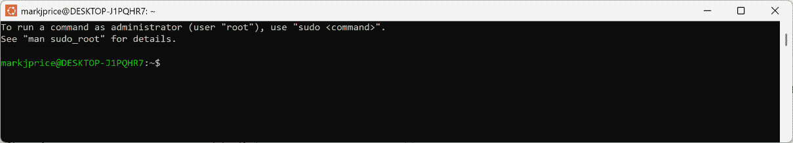
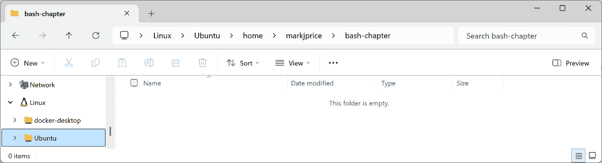

# Bash 基础

## 为什么选择 Bash？

* 为什么 Bash 脚本可以运行 `Python`、`Docker`、`Git` 或任何其他工具
* 为什么错误通常来自你启动的程序，而不是 `Bash` 本身
* 为什么相同的 `Bash` 命令在 macOS、Linux、WSL 和服务器上的行为一致

`Bash` 让你能直接、可编程地控制开发环境。你无需了解它的所有功能，但理解基础知识会让许多日常任务变得更快、更清晰、不再神秘。

## 核心概念

* **终端**：窗口（仅负责输入/输出）
* **Shell (Bash)**：解释器（理解命令）
* **程序**：实际工具（`ls`、`python`、`docker`）

**提示**：既然存在 `zsh` 和 `fish` 等替代 Shell，为什么 `Bash` 仍被广泛使用？

## 命令通用语法

`Bash` 命令通常遵循可预测的结构：**命令名**，后跟 **选项**（有时称为标志），再后跟参数。尽早理清这一点有助于你识别模式，而无需死记硬背所有内容。

例如：

```
ls -l src
```

* `ls` 是命令（用于列出文件）
* `-l` 是选项（使用长格式、详细列表）
* `src` 是参数（要列出的文件夹名称）

```
docker run -p 8000:8000 image-name
```

* `docker` 是命令（使用 Docker）
* `run` 是子命令（你想让 Docker 做什么）
* `-p` 是选项（发布端口）
* `8000:8000` 是参数（将本地端口映射到容器端口）
* `image-name` 是参数（要运行的镜像名称）

你目前不需要记住所有选项。专注于识别这种空格分隔的结构，这将使你以后更容易理解新命令。

**提示**：请解释 Bash 命令的通用结构：命令名、选项和参数。

## 有状态命令

`Bash` 是有状态的，意味着当你输入命令时，`Bash` 会维护上下文。你的当前工作目录、环境变量和命令历史都会从一个命令持久保留到下一个命令。

这就是为什么 `cd`（更改目录）很重要，为什么一个命令此刻能运行下一刻却失败，以及为什么重启终端有时能解决问题。新手开发者往往假设每个命令都在隔离环境中运行。事实并非如此。

**提示**：`Bash` 是有状态的意味着什么？这如何影响脚本？

## 命令历史与编辑

`Bash` 有状态的一个有用结果是它会记住你做过的事情。你输入的每个命令都存储在命令历史中，这意味着你很少需要重新输入冗长或复杂的命令。

### 重复之前的命令

按 ↑（上箭头）键可向后循环浏览之前的命令：

```
docker run -p 8000:8000 my-image
```

如果你刚运行过这个命令想再次运行，按 ↑ 然后按 `Enter`。这在处理长命令或实验、需要重试时特别有帮助。

### 搜索命令历史

你可以搜索命令历史，而不必逐行向后翻：

1. 按 `Ctrl` + `R`
2. 开始输入之前命令的一部分，例如 `docker`
3. `Bash` 会显示最近匹配的命令

按 `Enter` 运行它，或继续按 `Ctrl` + `R` 循环浏览匹配项。

### 运行前编辑命令

当你使用 ↑ 或 `Ctrl` + `R` 调用命令时，可以在按 `Enter` 前对其进行编辑。开发者经常这样做：

```
docker run -p 8000:8000 my-image
```

你可能只想改个端口：

```
docker run -p 5000:5000 my-image
```

这比重新输入整条命令快得多，也更不易出错。

### 为什么这有帮助

初学者往往认为需要从头输入每个命令。实际上，经验丰富的开发者严重依赖命令历史来：

* 修复错误后重试命令
* 对之前的命令做微小调整
* 更快地探索和实验

这是 `Bash` 在命令间维护状态的另一个例子。你的历史、当前目录和环境都会持久保留，这就是为什么终端用得越久越好用。

你不需要记住每个命令。专注于理解命令的作用，让 `history` 功能帮你高效复用它们。

## Tab 补全

`Tab` 补全是 Shell 提供的功能，而非终端。当你按 `Tab` 时，Shell 会尝试根据上下文自动补全你正在输入的内容：

* 文件和文件夹名称
* 命令名称
* 选项和标志（针对某些工具）

在 `Bash` 中，基本补全开箱即用（文件、文件夹、命令），但更高级的补全（如 `Git` 分支、`Docker` 选项）取决于是否安装了 `bash-completion`。

`Zsh` 默认功能丰富得多，提供更好的建议，有时是菜单式补全。`Zsh` 通常通过 Oh My Zsh 等框架进一步增强。

在 `Bash`、`Zsh` 和大多数环境中，通常可以按 `Tab` 补全文件和文件夹名称，按两次 `Tab` 显示可用选项，并根据当前目录进行补全。

## 拆分长命令为多行

有些命令包含多个选项或参数，会变得冗长且难以阅读。你可以使用反斜杠（`\`）将命令拆分为多行，而不必写在一行上。

反斜杠告诉 `Bash` 命令在下一行继续。

例如，不要写成：

```
docker run -p 8000:8000 -v $(pwd):/app -e DEBUG=true my-image
```

而要这样写：

```
docker run \
  -p 8000:8000 \
  -v $(pwd):/app \
  -e DEBUG=true \
  my-image
```

这使命令更易读、易修改，尤其是从文档复制或处理复杂设置时。

重要规则：

* 反斜杠必须是该行的**最后一个字符**
* 反斜杠后**不要**加空格
* `Bash` 将所有行视为单个连续命令

如果你忘了反斜杠，`Bash` 会尝试将每行作为单独命令运行，通常会导致错误。

许多现实世界的命令，尤其是 `Docker`、`Git` 或云 CLI 等工具，可能变得冗长且难以管理。跨行拆分有助于你：

* 理解命令的每个部分
* 编辑时避免错误
* 更安全地复制粘贴命令

你常在文档和脚本中见到这种风格。尽管看起来像多行，`Bash` 仍将其作为单条命令运行。

## 命令可组合

`Bash` 特别擅长处理文本。一切皆文本输入、文本输出。命令写入标准输出，错误输到标准错误，这些流可重定向或连接。**管道操作符** `|` 将一个命令的输出传给另一个命令的输入：

```
ls -la | grep ".py"  # 仅列出 Python 文件
cat log.txt | wc -l  # 统计文件行数
```

使用 `>` 或 `>>` 重定向可将输出发送到文件：

```
echo "Hello" > file.txt   # 写入（覆盖）
echo "World" >> file.txt  # 追加
```

这两个操作符让小命令能协同工作。

你目前不必深入学习管道和重定向，但请记住命令可以链式组合，这就是 Shell 感觉可组合而非整体的原因。

## 用别名创建快捷方式

随着你更频繁地使用命令行，你会发现反复输入相同的长命令。`Bash` 提供了一种简单方法，使用**别名**为这些命令创建快捷方式。

**别名**只是一个简短名称，会展开为更长的命令。


在 Django 项目中，你经常运行：

```
python manage.py runserver
```

你可以将其缩短为单个单词：

```
alias serve="python manage.py runserver"
```

现在你可以通过输入以下内容启动开发服务器：

```
serve
```

这与完整命令的作用相同，但输入更快且更易记忆。

当你输入命令时，Bash 首先检查：

1. 这是别名吗？
2. 如果是，则用完整命令替换它
3. 然后执行结果

因此：

```
serve
```

会在运行前变为：

```
python manage.py runserver
```

别名对于冗长或重复的命令以及你总是使用的带标志的命令最有帮助。例如：

```
alias ll="ls -la"
alias migrate="python manage.py migrate"
alias test="python manage.py test"
```

现在你的工作流变为：

```
serve
migrate
test
```

### 临时与永久别名

如果你在终端中定义别名，它仅在该会话期间有效。如果你关闭终端，它就会消失。

要使别名永久生效，请将其添加到你的 Shell 配置文件中：

*   **Bash**：`~/.bashrc` 或 `~/.bash_profile`
*   **Zsh**：`~/.zshrc`

例如，打开你的配置文件并添加：

```
alias serve="python manage.py runserver"
```

然后重新加载它：

```
source ~/.bashrc
```

现在每次打开新终端时该别名都将可用。

别名是简单的文本替换。它们非常适合快捷方式，但受限于无法轻松处理参数，因此不适合多步骤例程。它们还可能使命令对其他开发者不够直观，因为它们不是标准的。

如果快捷方式变得复杂或需要逻辑，通常最好将其转换为脚本。

别名是让命令行感觉不那么重复的最快方法之一。将别名视为快捷方式，将脚本视为可重复的过程。

## 命令无情

Bash 功能强大但不宽容。图形文件管理器通常会在删除前询问。Bash 往往会立即完全执行你所要求的操作。这一点不是为了吓唬你，只是为了鼓励你在按下 `Enter` 键前仔细阅读命令的习惯，尤其是从文档或 AI 输出复制命令时。

引入 Bash 不是为了让你成为 Shell 专家。而是为了让你能遵循说明、理解工具在做什么，并在重复变得烦人时编写小脚本。

Bash 是一个在接受 AI 生成的答案前放慢脚步的好地方。像 `rm`、`chmod` 或 `docker run` 这样的命令可以更改文件、权限、进程或网络访问。在运行之前，请检查它将触及什么以及是否取决于你的当前目录。

运行命令前，请问：我在文件系统中的什么位置？这将触及哪些文件？它是创建、删除、更改权限、启动进程还是通过网络发送数据？这种思考比从记忆中输入命令更重要。命令行奖励理解行为的开发者。

许多读者将使用 Windows，这是个问题，因为 Bash（或类似 Bash 的替代 Shell，如 Mac 上的 Zsh）不是 Windows 的标准组件。如果你使用 Windows 且没有 Bash 或类似工具，在下一节你将学习如何安装它。如果你不使用 Windows，可以跳过下一节，继续阅读“基本命令”部分。

# 在 Windows 上设置 Bash

要在 Windows 上使用 Bash，请安装 **Windows Subsystem Linux**（**WSL**）。

WSL 2 支持 Windows 11 和 Windows 10 版本 1903（内部版本 18362）或更高版本。

## 从提升的终端安装 WSL

以管理员身份打开 PowerShell，然后运行：

```
wsl --install
```

或者，要安装特定的 Linux 发行版（如 Ubuntu），请运行：`wsl --install -d Ubuntu`。要列出可用的发行版，请运行：`wsl --list --online`。

这将安装 WSL，并根据你的 Windows 版本和配置通常安装默认的 Linux 发行版（通常是 Ubuntu），如以下输出所示：

```
Downloading: Ubuntu
[==========================53.5%                           ]
```

如果你已经安装了 WSL，请检查你拥有的内容：

```
wsl -l -v
```

这将列出已安装的发行版以及每个是 WSL 1 还是 WSL 2，如以下输出所示：

```
  NAME              STATE           VERSION
* docker-desktop    Stopped         2
  Ubuntu            Running         2
```

## 启动你的 Linux 发行版并完成首次设置

打开 **开始** 菜单，运行你的发行版，例如 **Ubuntu**，并按照提示创建 Linux 用户名和密码。这独立于你的 Windows 登录。

从现在起，当你启动 **Ubuntu** 时，你应该会看到如 *图 10.1* 所示的 Bash 提示符：



图 10.1：Ubuntu Bash 提示符和终端窗口

## 在 Linux 内部更新包

在 WSL 终端中，运行：

```
sudo apt update
sudo apt upgrade -y
```

这使环境保持最新，并避免令人困惑的安装问题。

**良好实践**：`sudo` 以管理员（root）权限运行命令。当你使用它时，系统会要求输入你的 Linux 密码以确认操作。此级别的访问应谨慎使用，仅用于系统级任务，例如使用 `apt` 安装软件。对于日常开发命令，如 `pip install`、`python` 或 `npm`，你不应需要 `sudo`。如果这些工具仅在以提升的权限运行时才工作，通常意味着你的环境或权限设置不正确，应修复而不是绕过。

## 确认 Bash 正在运行

在 WSL 终端中，运行：

```
echo "$SHELL"
```

你应该会看到类似 `/bin/bash` 的路径（或类似内容）。

在 WSL 终端中，运行：

```
bash --version
```

你应该会看到版本输出（包含版权和许可证信息）：

```
GNU bash, version 5.2.21(1)-release (x86_64-pc-linux-gnu)
```

## 为本章创建练习文件夹

在 WSL 终端中，运行：

```
mkdir -p ~/bash-chapter
cd ~/bash-chapter
```

在 WSL 终端中，检查你所在的位置：

```
pwd
```

你应该会看到你位于 `home`，然后是你的用户名（如我的 `markjprice`），然后是你刚创建的新目录：

```
/home/markjprice/bash-chapter
```

在 WSL 终端中，运行：

```
ls -la
```

如果你完成了 Bash 练习，在 WSL 终端中，你可以运行：

```
exit
```

在 Windows 文件资源管理器中，你可以使用 Linux 节点查看你的 WSL 安装，如 *图 10.2* 所示：



图 10.2：Windows 文件资源管理器及其 WSL 集成

这些命令的行为与本章描述的完全一致。

现在让我们通过学习一些常见的基本命令将这些背景知识付诸实践。

# 基本命令

在编写脚本或自动化任何事情之前，你需要一小套日常命令词汇。这些是你在处理项目、遵循教程或从终端调试问题时将持续使用的命令。你不需要记住每个选项。知道每个命令的用途比知道它支持的每个标志要重要得多。

我们将在本章中使用的核心命令有：

*   `pwd` – 打印当前工作目录
*   `ls` – 列出文件和目录
*   `cd` – 更改当前目录
*   `mkdir` – 创建新目录
*   `touch` – 创建空文件
*   `cp` – 复制文件和目录
*   `mv` – 移动或重命名文件和目录
*   `rm` – 删除文件和目录
*   `cat` – 打印文件内容
*   `echo` – 向终端输出文本


## 导航命令

让我们先专注于 `pwd`、`ls` 和 `cd` 这三个命令。一旦导航变得自然，其余命令就更容易理解了。

### pwd – 打印工作目录

`pwd` 告诉你在文件系统中的位置。这很重要，因为大多数命令都是相对于当前目录运行的：

```
pwd
```

典型输出可能如下所示：

```
/Users/mark/projects/my-site
```

每当命令因*文件未找到*而失败时，`pwd` 通常是首先要检查的东西。许多问题最终被证实是因为在错误的目录中运行了命令。

### ls – 列出目录内容

`ls` 显示当前目录中存在哪些文件和文件夹。常用选项包括用于详细列表的 `-l` 和用于显示隐藏文件的 `-a`：

```
ls -la
```

**提示**：当我在终端输入像 `ls -la` 这样的命令时，会逐步发生什么？

隐藏文件通常以点开头，例如 `.git` 或 `.env`，在开发项目中很常见。

**提示**：Unix 系统中的隐藏文件是什么，为什么它们以点开头？

### cd – 更改目录

`cd` 更改你的当前工作目录。例如，要进入一个名为 `src` 的文件夹：

```
cd src
```

要上升一级，请使用：

```
cd ..
```

要返回主目录：

```
cd ~
```

熟练使用 `cd` 至关重要，因为几乎所有其他操作都取决于身处正确的位置。

**提示**：请使用目录树示例解释 Bash 中的相对路径与绝对路径。

## 创建事物

现在让我们看看创建目录或文件的两个命令。

### mkdir – 创建目录

`mkdir` 创建一个新目录：

```
mkdir scripts
```

你可以使用 `-p` 一次性创建嵌套目录：

```
mkdir -p app/static/css
```

这在设置项目结构时很常见。

### touch – 创建文件

如果文件不存在，`touch` 会创建一个空文件：

```
touch app.py
```

如果文件已存在，`touch` 只会更新其时间戳。开发人员经常用它来快速创建占位文件。

## 移动、复制和删除

你经常需要移动、复制或删除文件系统项目。

### cp – 复制文件和目录

`cp` 将文件从一个位置复制到另一个位置：

```
cp settings.example.json settings.json
```

要复制目录及其内容，请使用 `-r`（递归）选项：

```
cp -r templates templates_backup
```

### mv – 移动或重命名文件

`mv` 移动文件或目录。它也用于重命名：

```
mv old_name.py new_name.py
```

或者：

```
mv build/ dist/
```

没有单独的重命名命令。重命名只是在同一目录内的移动。

### rm – 删除文件和目录

`rm` 删除文件：

```
rm debug.log
```

要删除目录及其内部的所有内容，请使用 `-r`：

```
rm -r temp/
```

此命令不会将文件发送到回收站。一旦删除，通常就找不回来了。这是开发人员敬畏 `rm -r` 的原因之一。

**提示**：为什么 `rm` 默认不请求确认，经验丰富的开发人员如何保持安全？

## 显示文本

最后，让我们看看如何将文件或字符串输出到控制台。

### cat – 显示文件内容

`cat` 将文件内容打印到终端：

```
cat README.md
```

它适用于快速检查小型文本文件、配置文件或日志，而无需打开编辑器。

### echo – 打印文本

`echo` 将文本输出到终端：

```
echo "Hello, Bash"
```

它常用于脚本中以显示进度消息，或测试变量和命令输出。

这些命令构成了你在 Bash 中几乎所有操作的基础。一旦它们变得熟悉，阅读基于 Shell 的说明就会变得容易得多，编写简单的脚本也会开始变得自然。

## 处理 Web 资源

现在让我们看看一些网络命令。

### curl – 从服务器传输数据或向服务器传输数据

`curl` 用于从命令行发起 HTTP 请求。它常用于下载数据、测试 API 或与 Web 服务交互：

```
curl https://example.com
```

这会获取 URL 的内容并将其打印到终端。

要将响应保存到文件，请使用 `-o` 选项：

```
curl -o index.html https://example.com
```

你也可以发送数据，例如在使用 API 时：

```
curl -X POST -d "name=Mark" https://example.com/api
```

开发人员经常使用 `curl` 来调试 API、检查响应或在脚本中自动化请求。

### wget – 从 Web 下载文件

`wget` 专为从互联网下载文件而设计。它特别适合将文件直接保存到磁盘：

```
wget https://example.com/file.zip
```

这会下载文件并使用其原始名称保存。

要使用不同的名称保存，请使用 `-O`：

```
wget -O archive.zip https://example.com/file.zip
```

与 `curl` 不同，`wget` 专注于下载，并可以恢复中断的下载，这对于大文件很有用。

让我们通过编写一个简单的脚本将所有内容串联起来。

## 编写简单脚本

到目前为止，你一直在终端中一次输入一条命令。Bash 脚本只是将一系列命令保存到文件中并一起运行的一种方式。每当你发现自己一遍又一遍地重复相同的步骤，或者想要以计算机可执行的形式记录一个过程时，这很有用。

例如，假设你一直在使用 Django，并发现自己反复按顺序运行相同的三个命令：

1. 更改到项目目录：

```
cd project
```

2. 激活虚拟环境：

```
source .venv/bin/activate
```

3. 运行 Web 服务器：

```
python manage.py runserver
```

如果你创建一个名为 `run_dev.sh` 的脚本文件，其中包含这三个命令，那么三个步骤就变成了一个：

* 运行脚本：

```
./run_dev.sh
```

脚本用单个命令取代了重复的输入。

### 脚本文件

Bash 脚本只是一个纯文本文件。按照惯例，它通常具有 `.sh` 扩展名，尽管从技术上讲扩展名并非必需。让我们从一个最小示例开始。

创建一个名为 `run_dev.sh` 的新文件：

```
touch run_dev.sh
```

在 VS Code 中打开它并添加以下命令：

```
#!/usr/bin/env bash
echo "Starting development environment..."
python manage.py runserver
```

第一行称为 **shebang**（shebang 行）。它告诉操作系统应使用哪个程序来运行该文件。在本例中，它指定使用 `Bash`。`env` 形式是首选，因为它适用于 Bash 可能位于略微不同位置的不同系统。

其余行只是普通的 Bash 命令，完全就像你手动在终端中输入它们一样。

**提示**：请解释 Bash 脚本中的 shebang 行，以及为什么推荐使用 `/usr/bin/env bash`。

### 使脚本文件可执行

在运行脚本之前，你需要使其可执行：

```
chmod +x run_dev.sh
```

如果你忘记此步骤并尝试运行脚本，通常会看到如下错误：

```
$ ./run_dev.sh
bash: ./run_dev.sh: Permission denied
```

发生这种情况是因为文件存在，但操作系统没有权限将其作为程序执行。使用 `chmod +x` 添加执行权限即可解决此问题。

现在你可以这样运行它：

```
./run_dev.sh
```


`./` 路径前缀很重要。它告诉 Bash 在当前目录中查找脚本，而不是搜索同名的系统命令。

**提示**：`chmod +x` 在操作系统层面实际上改变了什么？

此时，你已经学到了重要的一点：脚本在你一直在交互式使用的同一个 shell 环境中运行。如果你的脚本失败了，其中的命令如果你手动输入也大概率会失败。这让调试变得不那么神秘了。

## 为脚本添加逻辑

你可以添加简单的逻辑使脚本更有用。例如，变量让你避免硬编码值，比如将 `PORT` 变量设为 `8000`，然后在命令中用 `$PORT` 引用它：

```
#!/usr/bin/env bash
PORT=8000
echo "Starting server on port $PORT"
python manage.py runserver "$PORT"
```

在某些系统上，你可能需要使用 `python3` 而不是 `python`。

你也可以在出错时停止脚本。下面这行告诉 Bash 如果任何命令失败则立即退出：

```
set -e
```

放在脚本顶部附近，这能防止后续命令在损坏的状态下运行，这在构建或部署脚本中特别有用。

为编写更安全的脚本，请使用完整的安全前导代码：

```
set -euo pipefail
```

注意上述命令的以下几点：

*   `-e`：如果任何命令失败则立即退出
*   `-u`：如果使用未定义的变量则退出（这能捕获拼写错误）
*   `-o pipefail`：如果管道中的任何命令失败，则管道失败

这种组合能防止整整一类微妙的 bug。请将其放在每个脚本的顶部附近。

**提示**：为什么我在使用 `set -e` 时 Bash 脚本会提前退出？

一个简单但现实的脚本可能会组合多个任务：

```
#!/usr/bin/env bash
set -e
echo "Cleaning old files..."
rm -rf dist/
echo "Running tests..."
python manage.py test
echo "Starting server..."
python manage.py runserver
```

这里没有什么复杂的，但将这些步骤放入脚本意味着它们总是以相同的顺序、以相同的方式运行，每次都是如此。这种一致性才是 shell 脚本的真正价值。

你不需要把 Bash 变成你的主要编程语言。把脚本当作胶水。它们连接工具、强制执行流程、节省脑力。

## 始终给变量加引号

Bash 中未加引号的变量可能导致 bug 和安全问题：

```
# If NAME contains spaces:
NAME="John Smith"
echo Hello, $NAME     # Bash sees: echo Hello, John Smith (3 args)
echo "Hello, $NAME"   # Bash sees: echo "Hello, John Smith" (1 arg)
```

在 Bash 中，未加引号的 `$VAR` 会进行单词拆分。如果值包含空格，Bash 会将其拆分为多个参数。好的做法是使用 `\"$VAR\"` 来防止这种情况：

```
FILE="my document.txt"
rm "$FILE"    # Correct: deletes "my document.txt"
rm $FILE      # Bug: tries to delete "my" and "document.txt"
```

这是 Bash 脚本中最常见的 bug 来源。

## 脚本参数

到目前为止，你见到的脚本都只以一种方式做一件事。当 Bash 脚本能从命令行接受输入时，它们会变得更有用。

传递给脚本的参数可作为编号变量获取。`$1` 指第一个参数，`$2` 指第二个，以此类推。

创建一个名为 `hello.sh` 的文件：

```
#!/usr/bin/env bash
NAME="$1"
echo "Hello, $NAME"
```

使其可执行并运行它：

```
chmod +x hello.sh
./hello.sh Mark
```

这种模式无处不在，从小型工具脚本到大型部署工具。它让一个脚本无需修改就能处理许多相似的任务。

## 相对路径和绝对路径

Bash 脚本中的路径工作方式与在终端中相同。相对路径从当前工作目录解析，而不是从脚本本身的位置解析。

这意味着以下脚本的行为可能因运行位置不同而异：

```
rm data/output.txt
```

如果你想要可预测的行为，请使用绝对路径，或在脚本开头显式切换目录：

```
cd /Users/mark/projects/my-site
```

尽早理解这一点能避免一类常见 bug：脚本在一个人那里能跑通，在另一个人那里却失败。

**提示**：为什么运行同一条 Bash 命令有时在一个目录下能成功，在另一个目录下却失败？

## 脚本中的注释

Bash 脚本使用 `#` 字符支持注释。一行中 `#` 后面的内容会被 Bash 忽略：

```
# Clean old build files
rm -rf dist/
```

注释解释意图，这往往比解释语法更重要。没有注释，你今天能看懂的脚本六个月后可能会让你困惑。

## Bash 作为胶水

Bash 不替代其他语言或工具。它连接它们。

一个脚本可能会依次调用 Git、Docker、Python 和 Web 服务器。Bash 不关心工具是用什么语言写的。只要能从命令行运行，Bash 就能编排它。

这就是为什么即使出现新语言和新框架，Bash 依然相关。它处于工具之间的边界，让它们协同工作。

## 安全提示

Bash 脚本可以更改或删除文件、停止服务、部署代码。它们通常严格按指示执行，不会请求确认。

在运行非自己编写的脚本前，请先阅读它。对于从网上复制或由 AI 工具生成的脚本，这一点尤为重要。对待 shell 脚本应像对待来自未知来源的可执行文件一样谨慎。

**提示**：Bash 脚本中常见的新手错误有哪些，如何发现它们？

# 自动化你的 Django 开发

到目前为止，示例都很小且聚焦。现在让我们将 Bash 直接连接到你已经做过的事情：运行 Django 项目。

在上一章中，你反复运行了一系列命令：

1.  创建或激活虚拟环境
2.  安装依赖
3.  应用数据库迁移
4.  启动开发服务器

每次都输入这些命令既重复又容易出错。这正是 Bash 脚本要简化的任务类型。

## 问题在于重复

典型的 Django 设置会话可能如下所示：

```
python -m venv .venv
source .venv/bin/activate
pip install -r requirements.txt
python manage.py migrate
python manage.py runserver
```

这里没有什么复杂的。但你运行这个序列的频率足够高，以至于它变成了阻力。

## 解决方案是 shell 脚本

在你的 Django 项目根目录下创建一个新文件：

```
touch run_dev.sh
```

在代码编辑器中打开它并添加以下内容：

```
#!/usr/bin/env bash
set -euo pipefail
echo "Setting up Django development environment..."
# Create virtual environment if it does not exist
if [ ! -d ".venv" ]; then
  echo "Creating virtual environment..."
  python -m venv .venv
fi
# Activate virtual environment
echo "Activating virtual environment..."
source .venv/bin/activate
# Install dependencies
if [ -f "requirements.txt" ]; then
  echo "Installing dependencies..."
  pip install -r requirements.txt
else
  echo "No requirements.txt found, skipping install"
fi
# Apply database migrations
echo "Running migrations..."
python manage.py migrate
# Start development server
echo "Starting Django development server..."
python manage.py runserver
```

使脚本可执行：

```
chmod +x run_dev.sh
```

现在，你不需要运行五条命令，只需运行一条：

```
./run_dev.sh
```

这个脚本没有做任何新事情。它只是让你的例行操作变得显式且可重复：

1.  它在创建前检查 `.venv` 是否存在
2.  它激活环境


3. 仅当存在 `requirements.txt` 文件时，才会安装依赖。

4. 每次都会应用迁移。

5. 启动服务器。

每一步都是你之前手动执行的操作。

## 为什么自动化脚本很重要

你编写代码不是为了代码本身。你是在捕获一个流程：
* 这就是该项目应该启动的方式。

这有几个好处：

* 你不会忘记步骤。
* 你能避免微妙的环境问题。
* 你减少了输入和细微错误。
* 你让阅读项目的其他人一目了然地了解工作流程。

如果其他人克隆你的仓库，他们不需要像“运行这五条命令”这样的说明。他们只需运行：

```
./run_dev.sh
```

## 为服务器添加可配置端口

你可以通过接受端口号让脚本更灵活一些：

```
PORT="${1:-8000}"
echo "Starting server on port $PORT..."
python manage.py runserver "$PORT"
```

现在你可以运行：

```
./run_dev.sh 5000
```

或者回退到默认值：

```
./run_dev.sh
```

这是 Bash 在项目中的典型用法：获取一个你已知的设置流程并将其保存为脚本。

**良好实践**：此脚本假设为类 Unix 环境（Linux、macOS 或 Windows 上的 WSL）。在没有 WSL 的原生 Windows 上，激活使用不同的路径（`.venv\Scripts\activate`）。在实际项目中，团队通常提供单独的脚本或使用处理跨平台差异的工具。

现在，让我们看看 AI 如何帮助你学习和使用 Shell 脚本。

# 使用 AI 获取 Shell 帮助

命令行因不友好而著称，主要是因为错误信息可能很简短，而文档往往假设读者具备先验知识。AI 工具可以让命令行更容易学习。如果使用得当，它们就像一个随需应变的解释器，而不是一个神奇的命令生成器。

结合 Bash 使用 AI 的明智方式是询问某事*为什么*有效或失败，而不仅仅是询问*输入什么*。例如，如果你在文档中看到一个不理解的命令，可以询问：

* 请逐块解释这条 Bash 命令的作用：

```
docker run -p 8000:8000 -v $(pwd):/app my-image
```

一个好的 AI 回答会将命令拆解为标志、参数和替换，帮助你建立直觉，而不是鼓励盲目复制。

## 语法方面的帮助

AI 对语法提醒也很有帮助。Bash 有许多容易忘记的小规则，例如括号周围的空格或变量如何展开。你不必翻阅手册页，而是可以提出有针对性的问题，例如：

* 如何在 Bash 中循环遍历所有 `.txt` 文件并打印其名称？
* `set -e` 在 Bash 脚本中有什么作用，何时应避免使用它？

## 错误方面的帮助

当脚本在命令提示符下失败时，粘贴错误信息和一小段相关的脚本片段通常能得到有用的解释：

* 此 Bash 脚本立即以 `permission denied` 退出。为什么？
* 这是我的脚本和错误输出。哪里出错了？

这特别有效，因为 Bash 错误往往是间接的。失败的行不一定是导致问题的行，而 AI 工具擅长发现这些模式。

如果你在 VS Code 等代码编辑器中试运行脚本，甚至不需要复制粘贴到你喜欢的聊天机器人中。GitHub Copilot Chat 会自动检查你的活动终端会话，因为终端上下文包含在对话中。它会显示每个打开终端的最后一条命令、工作目录和退出代码。

**提示**：请解释常见的 Bash 错误信息，如 `permission denied` 或 `command not found`。

## 注意 AI 的上下文有限

话虽如此，也有局限。在网页浏览器中运行的 ChatGPT 和 Gemini 等 AI 聊天机器人无法看到你的文件系统、环境变量或已安装的软件。如果建议的命令删除文件或修改系统状态，它会像人类编写的一样毫不犹豫地执行。请将 AI 的输出视为建议，而非权威。

带有 GitHub Copilot 的 VS Code、带有 AI Assistant 的 Rider，以及 Claude Code 和 OpenAI Codex 等 CLI 工具拥有大量工具来收集上下文，因此在提供动态相关帮助方面要好得多。你将在后续章节中更多地使用它们。

在运行 AI 建议的命令之前，确保你能说出它读取什么、写入什么，以及可能删除或更改什么。如果你无法解释那么多，请先让 AI 拆解该命令。

这使得 AI 作为命令解释器最有用，而不是作为盲目粘贴的命令来源。

**提示**：如何逐步安全地调试 Bash 脚本？

# 练习、参考与资源

在本节中，你将接受本章所学内容的测试，并获得有用的参考资料和资源链接。

## 检查你的理解

回答以下问题，这些问题特意设计为概念性而非死记硬背，鼓励解释而非记忆：

1. Bash 在你和操作系统之间扮演什么角色？
2. 为什么说 Bash 是有状态的，这如何影响日常命令使用？
3. 解释终端应用程序和 Bash Shell 之间的区别。
4. 为什么命令在一个目录中有效，在另一个目录中却会失败？
5. Bash 脚本解决了手动输入命令无法解决的什么问题？
6. 脚本顶部的 Shebang 行有什么作用？
7. 为什么脚本必须标记为可执行才能运行？
8. `rm -r` 有哪些风险，开发者如何降低这些风险？
9. 允许脚本接受参数如何使其更灵活？
10. 使用 AI 工具获取 Bash 帮助有哪些益处和局限？

答案见附录 A：[`github.com/markjprice/web-dev-ai/blob/main/docs/appendix_a.pdf`](https://github.com/markjprice/web-dev-ai/blob/main/docs/appendix_a.pdf)

## 实践练习

编写一个 Bash 脚本，创建一个目录，在其中创建一个文件，向文件写入一行文本，并将文件内容打印到终端。然后用你自己的话解释每一行。

解答见附录 A：[`github.com/markjprice/web-dev-ai/blob/main/docs/appendix_a.pdf`](https://github.com/markjprice/web-dev-ai/blob/main/docs/appendix_a.pdf)

## 参考资料

Bash 已有数十年历史，其文档反映了这种成熟度。一些资源侧重参考，另一些侧重教程。了解根据你是学习还是排错而该查阅哪个资源很有用。

### GNU Bash 参考手册

权威来源是 GNU Bash 参考手册。这是 Bash 的规范级文档，作为 GNU 项目的一部分进行维护。你可以在以下链接在线阅读：

[`www.gnu.org/software/bash/manual/bash.html`](https://www.gnu.org/software/bash/manual/bash.html)

这本手册详尽无遗。它用精确的术语解释了 Bash 语法、内置命令、变量、引用规则、重定向、作业控制和脚本功能。你通常不会通读它，但当你需要准确理解某事的行为时，它非常出色。

### Bash 手册页

密切相关的是 Bash `man` 页，即输入以下命令时看到的内容：

```
man bash
```

这更简洁，当你只需要关于语法或选项的提醒时，通常更快。对于特定命令的 `man` 页，输入 `man <command>`，例如：

```
man ls
man cd
man rm
```


# Bash 资源

前面的命令将为您提供关于各个命令的详细、权威信息。这些 `man` 页面并不总是友好的，但它们准确且无处不在。

## Bash 初学者指南

本指南专注于基础知识和常见模式，是参考手册的良好补充：

[`tldp.org/LDP/Bash-Beginners-Guide/html/`](https://tldp.org/LDP/Bash-Beginners-Guide/html/)

## 高级 Bash 脚本编程指南

尽管名为高级指南，但它被广泛用作实际脚本模式的参考。部分内容带有主观性，但极其详尽：

[`tldp.org/LDP/abs/html/`](https://tldp.org/LDP/abs/html/)

## Explainshell

该工具允许您粘贴一条 Shell 命令，并内联查看每个部分的解释。在阅读文档或 CI 日志中不熟悉的命令时，它特别有用：

[`explainshell.com/`](https://explainshell.com/)

## ShellCheck

ShellCheck 是一款用于 Shell 脚本的静态分析工具。它会高亮显示常见错误、不安全模式和可移植性问题。即使是经验丰富的 Shell 用户也依赖它：

[`www.shellcheck.net/`](https://www.shellcheck.net/)

## 总结

在本章中，您学习了 Bash 如何融入开发者的日常工作。具体来说：

- Bash 是什么，以及它如何作为 Unix Shell 和命令语言发挥作用
- 如何使用 `cd`、`ls` 和 `pwd` 等核心命令从命令行导航文件系统
- 如何从终端安全地创建、复制、移动和删除文件和目录
- 如何使用 `cat` 和 `echo` 等命令检查文件内容并生成输出
- 如何编写简单的 Bash 脚本来自动化一系列命令
- 如何在 Bash 脚本中使用变量和命令行参数
- 如何使用 AI 工具理解 Shell 命令并调试脚本，而不是盲目复制它们

主要教训是 Bash 为您提供了一种控制开发环境的方式。命令很重要，但更重要的是在运行它们之前知道它们会做什么。

在下一章中，您将使用这些命令行技能来设置一个完整的 Web 开发项目以及所需的工作环境。

## 获取本书的 PDF 版本及更多内容

扫描二维码（或访问 packtpub.com/unlock）。按名称搜索本书，确认版本，然后按照页面上的步骤操作。


> **注意：** 请保留好您的发票。直接从 Packt 购买的不需要发票。
