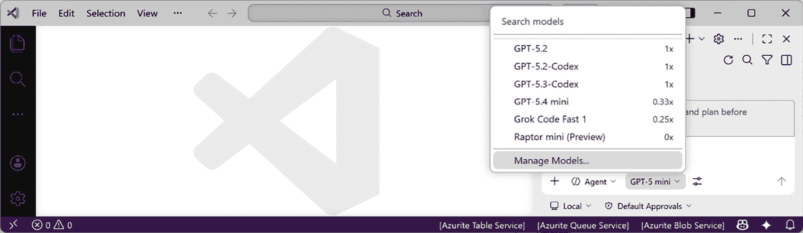
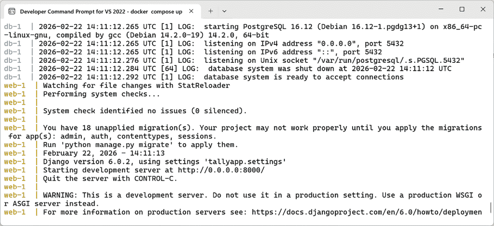
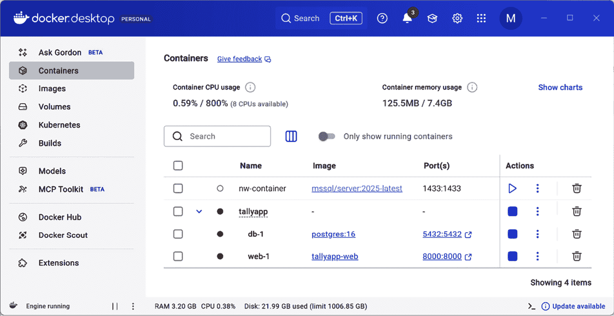
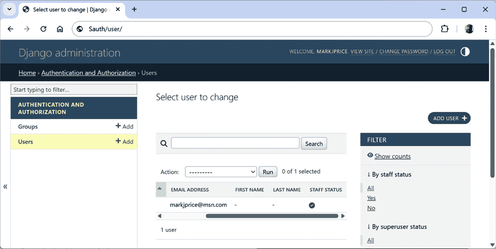
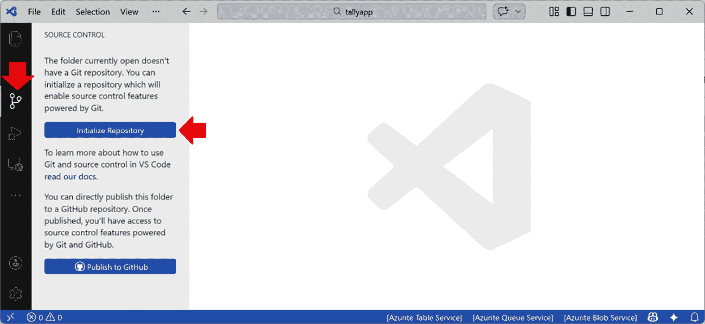
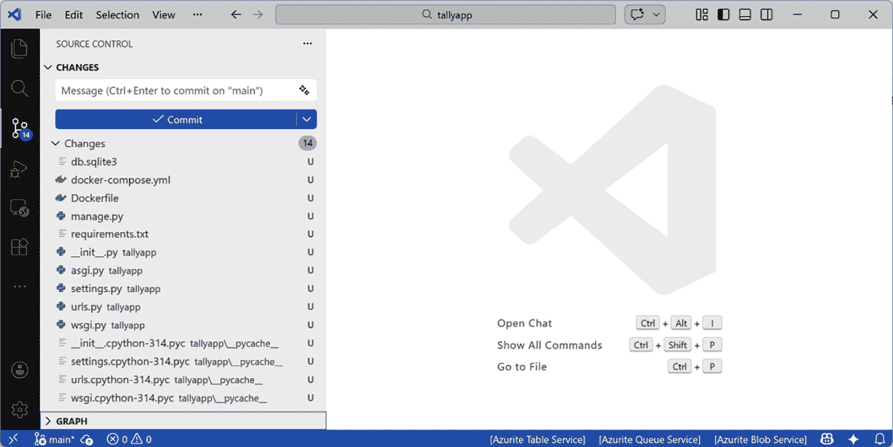
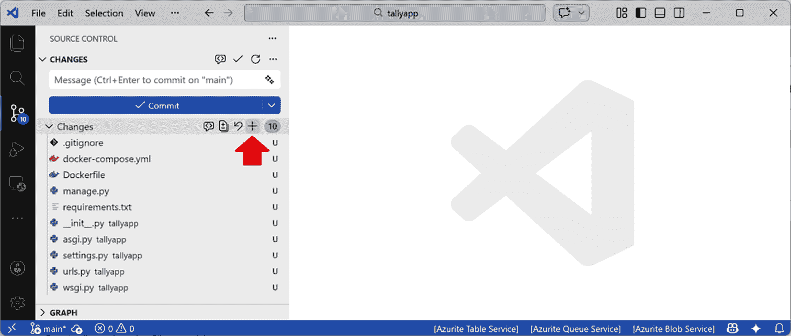
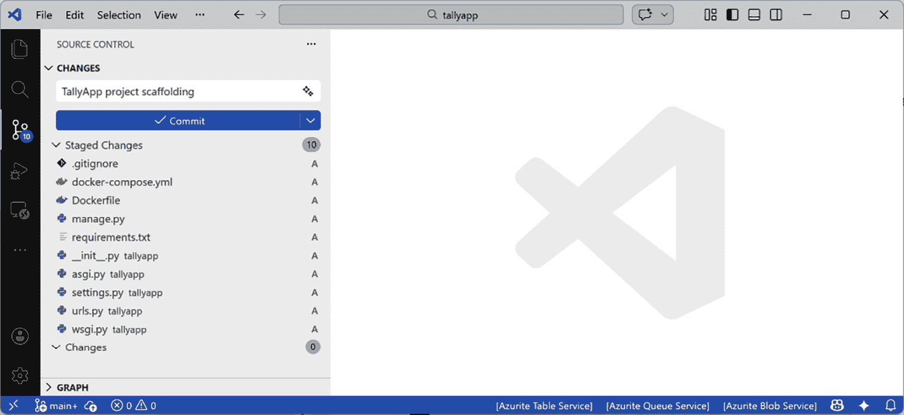
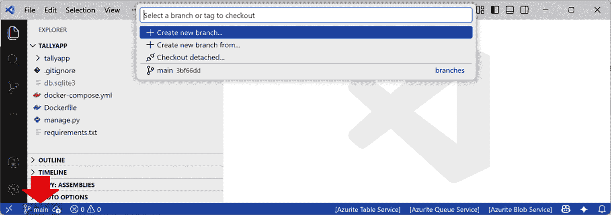
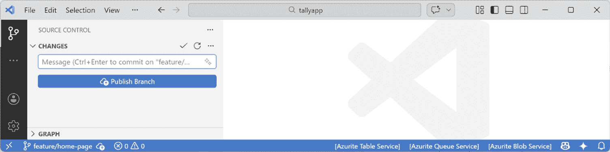

## 第 11 章：设置项目环境

本书的最后一部分从学习前端和后端 Web 开发的单个技术转向在一个实际项目中应用它们。您将设计并构建一个名为 `TallyApp` 的完整 Web 应用程序，这是一个小型的调查和投票应用程序，而不是孤立的示例。

该项目的范围被刻意限定为足够小以便端到端理解，但又足够丰富，让人感觉像是一个您可以合理扩展或部署的东西。在本章中，我们将通过安装和配置开发工具来启动 TallyApp 项目。

作为名词，*tally* 是对项目、事件或投票的持续计数或记录。它通常指通过逐步增加计数达到的总数。例如，*the final tally of votes* 意味着完成的计数。作为动词，*tally* 意为计数或将项目添加到运行总计中。它也可以意味着一致或对应。例如，*the numbers do not tally* 意味着它们不匹配。

在本章结束时，您将已配置好带有 GitHub Copilot 的开发环境，使用 Docker 设置一致且可重复的环境，并学会如何使用 Git 将代码置于版本控制之下，以便您有信心开始构建功能。

本章关注于了解哪个工具解决哪个问题。Copilot 在您编写和审查代码时提供帮助。Docker 为每个人提供相同的运行时。Git 记录项目历史，以便您可以无畏地尝试更改。在添加 TallyApp 功能之前，您将使用所有这三种工具。

在本章中，我们将涵盖以下主题：

- TallyApp 简介
- 将 GitHub Copilot 配置为您的编码助手
- 用于一致服务器设置的 Docker
- 使用 Git 进行源代码版本控制

本章的建议聊天机器人提示词及示例响应可在以下链接找到：

[`github.com/markjprice/web-dev-ai/blob/main/prompts/ch11-env/readme.md`](https://github.com/markjprice/web-dev-ai/blob/main/prompts/ch11-env/readme.md)

### TallyApp 简介

TallyApp 是一个具有三个明确功能领域的调查和投票应用程序。

1. 首先，它允许经过身份验证的用户设计和发布调查。这包括定义不同类型的问题，例如多项选择和自由文本回答，并生成可与受访者共享的公共链接。
2. 其次，它为参与调查的人提供简洁、专注的体验，他们可以点击链接、回答问题并提交回答，而无需账户。
3. 第三，它为调查创建者提供分析结果的工具，使用图表和结构化数据视图来探索趋势和个别答案。

在接下来的章节中，您将逐步使用 AI 编码助手设置开发环境，然后指定、构建和改进 TallyApp。同样重要的是，这些章节展示了真实 Web 项目是如何开发的。您将做出设计决策，重新审视早期选择，并了解后端逻辑、前端展示和数据分析如何结合在一起。

在 TallyApp 项目结束时，您不仅将学习 Web 框架和语言的个别特性。您将构建并理解一个完整、可工作的 Web 应用程序，并将处于更有利的位置来设计属于您自己的应用程序。

### 关于过度依赖 AI 的警告

Anthropic 在其文章《AI 协助如何影响编码技能的形成》中发出了警告：[`www.anthropic.com/research/AI-assistance-coding-skills`](https://www.anthropic.com/research/AI-assistance-coding-skills)。

Anthropic 研究人员进行了一项涉及 52 名软件开发人员的随机对照试验。

所有参与者都有 Python 的常规经验，但不熟悉一个名为 Trio 的特定异步库。他们被随机分配到两组：


# 研究：AI 辅助与学习成果

**AI 辅助组**：参与者可以在任务期间使用 AI 编码助手。

**对照组**：参与者没有 AI 辅助，但可以使用文档和网络搜索。

每位参与者使用 Trio 完成了两个功能构建任务。完成后，他们都参加了一个测验，旨在衡量他们刚才所用概念的掌握程度。测验涵盖了调试、代码阅读、代码编写和概念理解。

## 关键发现

* 平均而言，使用 AI 的开发者在任务后测验中的得分（约 50%）显著低于未使用 AI 编码的开发者（约 67%）。这代表了 17% 的差距，大致相当于典型学术环境中的两个等级。
* 在调试和概念理解问题上观察到的差异最大，表明 AI 使用与这些技能的较弱掌握相关。
* AI 辅助组完成编码任务仅略快一些，但这种时间差异在统计学上不显著。
* 定性分析显示，一些参与者花费大量时间编写 AI 提示词（在某些情况下高达总时间的 30%），这侵蚀了潜在的效率提升。

## 研究者结论

* 当人们习得一项新的、陌生的技能时，AI 辅助可能会削弱学习效果。依赖助手生成和调试代码似乎会减少构建深度理解所需的认知努力。
* 并非所有 AI 使用都相同。一些主要利用 AI 提出概念问题或在生成代码的同时请求解释的参与者，其表现与对照组非常接近。那些卸载了并从社交动态中拉取趋势信息的人；通常与表情包相关 |

表 11.1：各公司的 AI 聊天机器人和编码工具

像 ChatGPT、Gemini、Claude、Perplexity 或 Grok 这样的聊天机器人主要专注于自然语言交互。它们处理写作、摘要、通用研究，也可以支持编码查询，但编码辅助只是众多任务之一。它们最适合作为代码和框架学习导师使用。

像 GitHub Copilot、Codex 或 Cursor 这样的 AI 编码助手针对开发者工作流进行了优化。它们与代码编辑器和 IDE 集成，建议补全、生成特定项目的代码，并可协助调试和测试。

GitHub Copilot 允许你在多个编码 AI 模型之间选择。例如，Copilot 本身、Anthropic 的 Claude 和 OpenAI 的 Codex。这意味着你不被锁定在单一模型中；你可以选择最适合你任务的代理。

Ollama 和类似的本地 LLM 框架让你可以在本地桌面或服务器硬件上运行各种 LLM。像 `Qwen3-Coder`、`StarCode2`、`Codestral`、`Devastral` 等模型是开源的，并针对编码任务进行了优化。你可以通过 Ollama 在本地运行它们，而无需将数据发送到云端。

如果你关心数据隐私、离线使用、完全控制和避免云 API，那么你需要像 Ollama 这样的本地 LLM 框架，搭配开源编码模型。**自带密钥（BYOK）** 模型支持是一个快速发展的功能集，某些功能在聊天、内联聊天和补全之间可能有所不同。

如果你想最轻松地开始，请使用 Copilot Free（云端）。你无需配置任何密钥即可获得每月额度。

如果你想要最佳质量且不介意 API 费用，请保留 Copilot 模型用于日常编码，并可选择添加你的 OpenAI API 密钥，以便在需要时使用特定供应商的模型。

如果你想避免按请求付费并保持数据本地化，请运行 Ollama 并通过 VS Code 的模型管理选择它，以便 Copilot Chat 可以使用本地模型完成许多任务。

我写了一篇纯在线文章，详细介绍本地模型的使用：`https://github.com/markjprice/markjprice/blob/main/with-ai/local-models.md`

本地设置在特定领域表现更好：

* **隐私**：代码不离开你的机器。适用于专有或敏感工作
* **成本（长期）**：无按 Token 计费。大量使用随时间变得更便宜
* **延迟**：小模型即时响应。无网络依赖
* **控制**：你可以微调。你可以自定义行为

一个实用的设置是同时使用云端和本地模型，但用于不同的工作：

* 当你需要更强的推理能力、更大的上下文或帮助比较设计方案时，使用云端模型
* 当任务较小、私密或重复时，使用本地模型：解释语法、起草辅助函数、重构单个文件或草拟测试

**良好实践**：如果任务需要判断而不仅仅是生成，请使用云端模型。

## 配置 GitHub Copilot


# GitHub Copilot 设置与配置

在本节结束时，您将在 VS Code 中运行 GitHub Copilot，用于内联补全和聊天。您还将配置第二条路径，以便 Copilot Chat 可以使用：

* 内置 Copilot 模型（如果您符合条件，包括免费计划）
* 您自己的模型提供商，包括本地 Ollama 模型，以避免每次请求的 API 成本

VS Code 的 `BYOK` 模型支持是 Copilot Chat 能够由第三方提供商（包括用于本地模型的 Ollama）提供支持的部分方式。

## 先决条件

* 已安装 VS Code
* 一个可从 VS Code 登录的 GitHub 账户。您可以通过以下链接注册：[`docs.github.com/en/get-started/start-your-journey/creating-an-account-on-github`](https://docs.github.com/en/get-started/start-your-journey/creating-an-account-on-github)
* 选择以下选项之一：
    * GitHub Copilot 免费计划（无需 API 密钥）
    * OpenAI API 密钥或另一个受支持的提供商密钥用于 BYOK
    * 本地模型运行时，如 Ollama，用于本地推理

`警告！` GitHub Copilot 内联建议（您按 `Tab` 接受的自动补全）与 `Copilot Chat` 并非同一事物。VS Code 的 BYOK 模型系统主要是关于使用不同的模型提供商来支持聊天和编辑体验。某些 BYOK 功能可能不以相同方式适用于补全。请将本地模型支持视为以聊天为主（和以编辑为主）的路径，而非每个 Copilot 功能的保证替代品。

## 在 VS Code 中安装并登录 Copilot

1. 打开 VS Code，通过点击状态栏中的 Copilot 图标触发 Copilot 设置。
2. 使用 GitHub 登录。按照登录提示操作。如果您的 GitHub 账户已有 Copilot 访问权限，VS Code 将使用它。如果您没有订阅，VS Code 可以将您注册到 Copilot 免费计划（有每月使用限制）。
3. 验证 Copilot 处于活动状态。打开任意代码文件，输入几个字符，然后暂停。如果 Copilot 处于活动状态，您应该会看到灰色的 `ghost text` 建议，可以接受（通常是 `Tab`）。
4. 打开 `Copilot Chat` 视图并确认其响应。在 VS Code 中，Copilot Chat 使用聊天输入区域中的模型选择器，如 `图 11.1` 所示：



图 11.1：在 GitHub Copilot Chat 中选择模型

1. 确认您的计划和限制（尤其是免费计划）。如果您使用 Copilot 免费版，请预期每月上限，如内联建议限制和较少的高级请求数量（由更新或更昂贵的模型使用）。有关当前限制，请参阅以下链接的 Copilot 计划：[`github.com/features/copilot/plans`](https://github.com/features/copilot/plans)

`提示`：请解释令牌限制和上下文窗口如何影响 AI 编码助手在处理大型 Django 代码库时的表现。

# GitHub Copilot 提示

以下是一些改善您使用 GitHub Copilot 体验的提示：

* **在聊天中有意使用模型选择器。** Copilot 支持多种模型，您选择的模型会影响延迟、准确性和成本乘数（高级请求）。对于快速问答或轻量级编辑，较快的模型通常足够。对于复杂的重构或推理密集型调试，在需要时切换到更强的模型。
* **了解什么会消耗高级请求。** 在包含高级请求的计划中，最新的前沿模型通常每次请求成本更高（Copilot 将其记录为乘数）。如果您使用免费计划，请保守使用：用较便宜的模型进行探索，然后在最终的 `do it right`（做到位）阶段花费高级调用。
* **请求结构化输出以减少令牌浪费。** 当您对其进行约束时，Copilot Chat 会变得更好（且更便宜）。示例：
    * “列出三种方法并推荐一种。”
    * “为这两个文件给出补丁风格的差异。”
    * “仅更改此失败测试涉及的方法。”
* **关注 VS Code 中的隐私设置。** 如果您编写专有代码，请查看 VS Code 中的 Copilot 设置，并收紧任何您不满意的内容。

# 确保您有可用的 OpenAI API 密钥

本节适用于希望使用来自 OpenAI 或其他受支持提供商的自己的提供商密钥来在 VS Code 中支持聊天和编码体验的读者：

1. 创建并存储您的 OpenAI API 密钥。在您的 OpenAI 账户中创建 API 密钥并将其存储在密码管理器中。不要将其硬编码到源代码控制中。
2. 通过运行管理模型的命令打开 VS Code 的语言模型管理 UI。例如，在命令面板中，选择菜单项 `Chat: Manage Language Models`。
3. 添加您的提供商密钥，如 OpenAI。选择 `Bring your own language model key`。选择 `OpenAI` 或另一个提供商，然后粘贴密钥。

`警告！` VS Code 的 BYOK 不适用于 Copilot Business 或 Copilot Enterprise 账户（它适用于免费/专业版/专业版+ 等个人计划）。

1. 在 Copilot Chat 中选择提供商支持的模型。在 Copilot Chat 中，使用模型选择器选择您刚添加的模型。
2. 进行快速冒烟测试：

```
Summarize this file and suggest two refactoring steps.
```

现在您已将 VS Code 和 GitHub Copilot 配置为您的编码助手，让我们看看 Docker 如何有助于实现一致的开发设置。

# Docker 用于一致的服务器设置

Docker 是一种将应用程序及其所需的一切（包括运行时、操作系统库、依赖项和配置默认值）打包成一个称为 `image`（镜像）的可重复单元的方式。然后您将该镜像作为 `container`（容器）运行。

对 TallyApp 的实际好处是一致性：Windows、macOS 和 Linux 上的开发人员可以运行相同的 Django 技术栈，具有相同的版本和相同的行为，而无需花费数小时解决本地设置差异。

## 重要概念

以下是您需要了解的关于 Docker 的重要概念：

* **Images（镜像）**：一个构建好的、不可变的模板。您通常会为您的 Django 应用构建一个。预构建的镜像用于常见服务，如数据库引擎和管理软件。
* **Containers（容器）**：镜像的一个运行实例。容器可以轻松启动、停止和替换。
* **Dockerfile**：一个描述如何构建镜像的文本文件。它包含逐层指令，用于选择基础镜像、安装依赖项、复制代码以及如何启动进程。
* **Docker Compose**：一种通过单个命令定义和运行多容器应用程序的方式。例如，web 容器可能是您的 Django 项目，`db` 容器可能托管 PostgreSQL 数据库引擎，依此类推。
* **Volumes（卷）**：由 Docker 管理的持久化存储。这对数据库最为重要。如果您不为 PostgreSQL 使用卷，当数据库容器被替换时，您的数据将会消失。
* **Networks（网络）**：Compose 自动创建一个私有网络，以便容器可以通过服务名称相互通信。例如，Django 容器可以通过主机名 `db` 访问数据库。
* **Ports（端口）**：您暴露给宿主机的入口。您可能会将容器端口 8000 映射到宿主机端口 8000，以便在浏览器中打开站点。

`提示`：Docker 卷和绑定挂载有什么区别？请解释为什么绑定挂载适合开发但在生产环境中有风险。

## 下载和安装 Docker

即使您最初使用 SQLite 部署 TallyApp，学习使用 PostgreSQL 的 Docker 仍然很有用，因为它演示了一个现实的多服务设置。当您以后想要减少 SQLite 的并发限制时，它还为您提供了一条清晰的升级路径。


# SQLite 并发限制与 PostgreSQL 隔离级别对比

**提示**：请解释 Django 应用中 SQLite 的并发限制。PostgreSQL 使用哪些隔离级别？它们与 SQLite 相比如何？何时应该将 Django 项目从 SQLite 迁移到 PostgreSQL？

## 使用 Docker 的前提条件

要使用 Docker，你需要以下组件：

*   `Docker Desktop`（Windows 或 Mac）或 `Docker Engine`（Linux）
*   一个包含 `manage.py` 的 Django 项目

从以下链接安装适用于你操作系统的 Docker：[`www.docker.com/products/docker-desktop/`](https://www.docker.com/products/docker-desktop/)。

## 设置基础 TallyApp 项目

现在我们可以在容器化之前构建最简单的 Django 项目：

1.  创建一个名为 `Chapter11` 的文件夹。在该文件夹内，运行虚拟环境命令以创建包含该项目专用 Python 安装的 `.venv` 文件夹：
    *   Windows 上运行：`python -m venv .venv`
    *   macOS 和 Linux 上运行：`python3 -m venv .venv`

2.  激活虚拟环境：
    *   Windows 上运行：`.venv\Scripts\activate`
    *   macOS 和 Linux 上运行：`source .venv/bin/activate`

3.  激活成功后，终端提示符通常会显示虚拟环境名称：
    ```
    (.venv) C:\web-dev-ai\Chapter11>
    ```

4.  在虚拟环境激活的情况下，使用 pip 安装 Django：
    ```
    pip install django
    ```

5.  验证安装：
    ```
    django-admin --version
    ```

6.  你应该会看到类似 `6.0.2` 的 Django 版本号。如果出现，说明 Django 已准备就绪。

7.  在命令提示符或终端中，创建一个名为 `tallyapp` 的 Django 项目：
    ```
    django-admin startproject tallyapp
    ```

8.  进入 `tallyapp` 项目目录：
    ```
    cd tallyapp
    ```

9.  对本地 SQLite 数据库应用迁移：
    ```
    python manage.py migrate
    ```

10. 创建管理员账户，并根据提示设置用户名、邮箱和密码：
    ```
    python manage.py createsuperuser
    ```

11. 运行 Django 开发服务器：
    ```
    python manage.py runserver
    ```

12. 启动浏览器并访问 [`127.0.0.1:8000/`](http://127.0.0.1:8000/)。你可以 `Ctrl` + `Click` 输出中的链接，而无需手动输入 URL。如果看到 Django 欢迎页面，说明设置正确。

要查看管理站点，请访问 [`127.0.0.1:8000/admin/`](http://127.0.0.1:8000/admin/)。

## 设置 Docker 托管项目

现在我们可以创建文件，将项目配置为在 Docker 容器中运行，并连接另一个容器中的 PostgreSQL 作为数据库。

你将创建三个文件：

*   `Dockerfile`：定义如何为 Django 项目构建 Web 应用容器，关注创建过程
*   `.dockerignore`：定义构建镜像时排除的文件和文件夹
*   `docker-compose.yml`：定义如何协同运行多个容器，关注容器间协调

### 创建 Dockerfile

我们首先定义一个 `Dockerfile`，告诉 Docker 如何构建容器镜像。你可以把 `Dockerfile` 看作一个配方，它回答以下问题：

*   从什么基础系统开始？
*   安装什么依赖？
*   复制什么代码？
*   容器启动时运行什么命令？

对于 TallyApp 项目，`Dockerfile` 将：

*   从 `python:3.12-slim` 开始，因为它是一个稳定、轻量的官方 Python 基础镜像，适合 Django 6 项目，但不是最新的 Python 镜像
*   从 `requirements.txt` 安装依赖
*   将 TallyApp Django 项目复制到 `/app`
*   运行 `python manage.py runserver`

`Dockerfile` 生成一个可复用的镜像，如 `tallyapp-web-image`。该镜像是一个自包含单元，可在任何地方运行。

在 `Chapter11\tallyapp` 文件夹中，创建一个名为 `Dockerfile` 的文件，内容如下：

```dockerfile
# Use an official Python image as the base
FROM python:3.12-slim
# Prevents Python from writing .pyc files and buffers to stdout/stderr
ENV PYTHONDONTWRITEBYTECODE=1
ENV PYTHONUNBUFFERED=1
# Set a working directory inside the container
WORKDIR /app
# System deps (optional but common): build tools for some Python packages
RUN apt-get update \
    && apt-get install -y --no-install-recommends build-essential \
    && rm -rf /var/lib/apt/lists/*
# Install Python dependencies first (for better layer caching)
COPY requirements.txt /app/
RUN pip install --no-cache-dir -r requirements.txt
# Copy the rest of the project
COPY . /app/
# Default command for the container (development-friendly)
CMD ["python", "manage.py", "runserver", "0.0.0.0:8000"]
```

关于上述代码的说明：

*   我们使用 `python:3.12-slim` 作为基础镜像，以获得稳定、广泛支持的 Python 运行时和最小化的基础系统，避免 `latest` 标签的不可预测性，同时保持镜像精简且可复现。

    **提示**：`python:3.12-slim` 是 Docker 容器中最新且最好的 Python 镜像吗？

*   它从 `requirements.txt` 安装依赖。

*   它将你的代码复制到镜像中。

    **提示**：为什么 `COPY requirements.txt` 在 `COPY .` 之前执行？

*   它将 Django 开发服务器绑定到 `0.0.0.0`，使其可从容器外部访问。

    **警告**：生产环境容器必须将 `runserver` 替换为 `Gunicorn`，但目前这是一个清晰的第一步。你将在 *第 13 章* *《指定并构建初始项目》* 中学习 `Gunicorn`。

### 创建 Docker Ignore 文件

构建 Docker 镜像时，Docker 会将整个项目文件夹（称为构建上下文）发送给 Docker 守护进程。默认情况下，项目目录中的所有内容都会被包含，甚至包括你不想放入镜像的文件。这就是 `.dockerignore` 文件的作用。

就像 `.gitignore` 告诉 Git 忽略哪些文件（你将在下一节看到），`.dockerignore` 告诉 Docker 在镜像构建过程中排除哪些文件。这能让镜像更小、构建更快，并避免意外包含敏感或不必要的文件。

在 `Dockerfile` 同级目录下创建 `.dockerignore` 文件，内容如下：

```text
# .dockerignore
.venv/
__pycache__/
*.pyc
.git/
.gitignore
db.sqlite3
.env
*.sqlite3
docker-compose.yml
Dockerfile
.DS_Store
```

其好处包括：

*   **更小的镜像**：虚拟环境、缓存文件和本地数据库可能很大。排除它们可显著减小镜像体积。
*   **更快的构建**：Docker 在构建前上传构建上下文。文件越少，构建越快，尤其是项目增长时。
*   **更强的安全性**：`.env` 等文件可能包含 API 密钥或数据库密码等机密。如果包含在镜像层中，后续很难移除。
*   **更整洁的环境**：容器应仅包含运行所需内容。`.venv` 或 `.git` 等开发工件在容器内无关紧要。

即使 `Dockerfile` 使用 `COPY . /app/`，`.dockerignore` 文件也能确保排除的文件从一开始就不会被复制。这让你无需复杂的 `COPY` 规则即可保持镜像整洁。


**良好实践**：保持您的 `.dockerignore` 文件与 `.gitignore` 文件保持一致，但不要假设它们应该完全相同。Docker 关注构建上下文和镜像内容，而 Git 关注版本控制。某些文件（如 `Dockerfile` 或 `docker-compose.yml`）会被 Git 跟踪，但通常不属于最终镜像内部。

## 创建 Docker Compose 文件

接下来，我们将定义一个 `docker-compose.yml` 文件。`Dockerfile` 定义如何构建单个镜像，`.dockerignore` 文件从镜像中排除文件和文件夹，而 `docker-compose.yml` 文件定义如何将多个容器一起运行。

您可以使用 `docker run` 手动运行 Django 容器，但这很快就会变得混乱。您需要单独启动 PostgreSQL，手动链接容器，手动传递环境变量，并自行管理端口和卷。Docker Compose 使用一条命令和一个配置文件取代了所有这些工作。

`docker-compose.yml` 文件是**编排**。它解决了以下问题：

* 我们需要哪些容器？
* 它们如何连接？
* 它们使用哪些环境变量？
* 哪些端口被暴露？
* 哪些卷持久化数据？

对于我们的 TallyApp 项目，Docker Compose 将定义两个服务：

* `web` 是 Django 应用容器（由 `Dockerfile` 构建）
* `db` 是 PostgreSQL 容器

它还将：

* 通过网络连接这两个容器
* 映射端口（`8000`、`5432`）
* 为 Django 项目设置环境变量
* 创建一个用于数据库持久化的卷

运行单条命令 `docker compose up` 将启动整个系统，而不仅仅是一个容器。

在 `Chapter11\tallyapp` 文件夹中，为 Django 和 PostgreSQL 创建一个 `docker-compose.yml` 文件：

```yaml
services:
  db:
    image: postgres:16
    environment:
      POSTGRES_DB: tallyapp
      POSTGRES_USER: tallyapp
      POSTGRES_PASSWORD: tallyapp_password_change_me
    volumes:
      - tallyapp_postgres_data:/var/lib/postgresql/data
    ports:
      - "5432:5432"
    healthcheck:
      test: ["CMD-SHELL", "pg_isready -U tallyapp -d tallyapp"]
      interval: 5s
      timeout: 5s
      retries: 5
  web:
    build:
      context: .
    depends_on:
      db:
        condition: service_healthy
    environment:
      # Django will read these to build DATABASES config (you wire this up in settings.py)
      DJANGO_DB_NAME: tallyapp
      DJANGO_DB_USER: tallyapp
      DJANGO_DB_PASSWORD: tallyapp_password_change_me
      DJANGO_DB_HOST: db
      DJANGO_DB_PORT: "5432"
      DJANGO_SECRET_KEY: dev-only-change-me
      DJANGO_DEBUG: "1"
    ports:
      - "8000:8000"
    volumes:
      - .:/app
volumes:
  tallyapp_postgres_data:
```

请注意上述代码的以下几点：

* `db` 使用官方 PostgreSQL 镜像，并使用该镜像文档中记录的环境变量初始化数据库。
* `db` 有一个 `healthcheck`，而 `web` 依赖于 `db` 处于 `service_healthy` 状态，而不仅仅是已启动。
* `tallyapp_postgres_data` 卷使数据库数据在容器重启时保持持久化。
* `web` 服务从您的 `Dockerfile` 构建。
* `volumes: - .:/app` 绑定挂载意味着主机上的代码更改会立即出现在容器内部，这非常适合基于 Docker 的开发环境。
* `depends_on` 在 Web 容器之前启动数据库容器，但它本身并不能保证 PostgreSQL 已准备好接受连接。为了使启动更加可靠，我们定义了一个 PostgreSQL `healthcheck`，并将 `depends_on` 设置为等待条件：`service_healthy`。然后 Docker Compose 会等待数据库报告就绪后，再启动 Django。

## 从 SQLite 切换到 PostgreSQL

现在我们可以配置项目文件，如 Python 依赖和 Django 项目设置，以便项目使用 PostgreSQL 而不是 SQLite：

1. 在 `Chapter11\tallyapp` 文件夹中，创建一个 `requirements.txt` 文件，配置 Django 6 在 Docker 中使用 PostgreSQL：

```
Django>=6.0,<7.0
psycopg[binary]>=3.1
```

2. 在 `settings.py` 中，您可以根据环境变量切换数据库配置。一种简单的模式是：

* 如果设置了 `DJANGO_DB_HOST`，则使用 PostgreSQL
* 否则，回退到 SQLite 用于本地非 Docker 运行

```python
import os
DJANGO_DB_HOST = os.environ.get("DJANGO_DB_HOST")
if DJANGO_DB_HOST:
    # PostgreSQL configuration
    DATABASES = {
        "default": {
            "ENGINE": "django.db.backends.postgresql",
            "NAME": os.environ.get("DJANGO_DB_NAME", "tallyapp"),
            "USER": os.environ.get("DJANGO_DB_USER", "tallyapp"),
            "PASSWORD": os.environ.get("DJANGO_DB_PASSWORD", ""),
            "HOST": DJANGO_DB_HOST,
            "PORT": os.environ.get("DJANGO_DB_PORT", "5432"),
            "CONN_MAX_AGE": 60,  # persistent connections (good for production)
        }
    }
else:
    # SQLite fallback (default for local development)
    DATABASES = {
        "default": {
            "ENGINE": "django.db.backends.sqlite3",
            "NAME": BASE_DIR / "db.sqlite3",
            "OPTIONS": {
                "timeout": 20,  # helps reduce "database is locked" errors
            },
        }
    }
```

## 构建并运行 Docker 系统

现在我们可以使用 Docker Compose 构建 Docker 镜像并启动容器：

1. 构建镜像：

```
docker compose build
```

2. 启动容器：

```
docker compose up
```

3. 此时 PostgreSQL 在一个容器中运行，Django 在另一个容器中运行，暴露在 [`localhost:8000`](http://localhost:8000) 上，如 *图 11.2* 所示：



**图 11.2**：Docker Compose 中运行的两个容器

**提示**：当我运行 `docker compose up` 时，底层实际上发生了什么？

1. 在 **Docker Desktop** 中，展开 **tallyapp** 条目，查看其 PostgreSQL 数据库和 **tallyapp-web** Django 主机的两个容器，如 *图 11.3* 所示：



**图 11.3**：Docker Desktop 中运行的两个容器

2. 在新终端窗口中，在 `web` 容器内运行迁移并创建管理员用户：

```
docker compose exec web python manage.py migrate
docker compose exec web python manage.py createsuperuser
```

Docker 改变了您运行命令和查找错误的位置。您通常不会 SSH 进入服务器。您在已经包含您的应用和依赖项的容器内运行命令。您还需要阅读容器日志，因为应用就在那里运行。

3. 启动您喜欢的浏览器并导航到管理站点：[`localhost:8000/admin/`](http://localhost:8000/admin/)

4. 使用您之前创建的管理员账户登录并查看用户列表，如 *图 11.4* 所示：



**图 11.4**：管理员账户

5. 关闭浏览器。

6. 在命令提示符或终端中，停止容器：

```
docker compose down
```

要停止容器并删除卷（这会清除数据库），请使用 `-v` 开关：`docker compose down -v`。这加强了卷为何重要。没有卷，数据库容器是一次性的，其数据也是如此。

## 使用多阶段构建减小镜像大小


# 多阶段 Docker 构建

前面展示的 `Dockerfile` 简单易懂，但它包含了仅在安装期间需要的工具，例如编译器。这些工具会增加最终镜像的体积，且在应用运行时并不需要。

当前的 Docker 镜像包含编译器（`gcc`、`make`）、包管理器缓存和构建依赖。这些在运行时并不需要，但会同时增加镜像体积和潜在的攻击面。

一种称为 `multi-stage build`（多阶段构建）的更高级技术将构建环境与运行时环境分离。第一阶段安装依赖，第二阶段仅将结果复制到一个干净的镜像中。

多阶段构建分离了：

1. **构建阶段**：安装依赖，编译所需内容
2. **运行时阶段**：仅复制运行应用所需的内容

这避免了将编译器等不必要的工具打包进最终镜像。

以下是使用多阶段构建重写的 `Dockerfile` 版本：

```
# ---- 阶段 1：构建依赖 ----
FROM python:3.12-slim AS builder
WORKDIR /app
RUN apt-get update \
 && apt-get install -y --no-install-recommends build-essential \
 && rm -rf /var/lib/apt/lists/*
COPY requirements.txt .
RUN pip install --upgrade pip \
 && pip install --prefix=/install --no-cache-dir -r requirements.txt
# ---- 阶段 2：运行时镜像 ----
FROM python:3.12-slim
WORKDIR /app
ENV PYTHONDONTWRITEBYTECODE=1
ENV PYTHONUNBUFFERED=1
# 从构建阶段复制已安装的包
COPY --from=builder /install /usr/local
# 复制项目代码
COPY . /app/
CMD ["python", "manage.py", "runserver", "0.0.0.0:8000"]
```

这将生成更小的镜像、更快的下载速度和更小的攻击面。最终镜像仅包含 Python 运行时、您的依赖和您的应用。多阶段构建在生产环境设置中很常见，但对于学习项目则是可选的。

## 查看日志以调试容器问题

当基于 Docker 的设置出现问题时，首先要查看的地方是容器日志。

如果您使用以下命令运行容器：

```
docker compose up
```

您将在该终端窗口中直接看到日志。

但是，如果您在后台运行容器或打开一个新终端，可以使用以下命令查看日志：

```
docker compose logs
```

这将显示所有服务的组合输出，包括您的 Django 应用和 PostgreSQL 数据库。例如，您可能会看到 Django 启动消息、数据库连接错误、迁移警告和 Python 异常。

您可以专注于某个特定容器：

```
docker compose logs web
```

或者：

```
docker compose logs db
```

当您想将 Django 错误与数据库输出分开时，这非常有用。

要实时查看日志：

```
docker compose logs -f
```

这类似于运行 `docker compose up`，但即使容器已在后台运行也能工作。

查看日志很重要，因为 Docker 改变了您调试问题的方式。您不再直接在机器上运行所有内容。您的应用在容器内运行，因此错误会显示在那里，而不是在您的编辑器或终端历史记录中。

如果应用无法启动，或无法连接到数据库，日志通常会告诉您原因。

例如：

- "could not connect to server" 告诉您 PostgreSQL 尚未就绪
- "no such table" 告诉您数据库迁移未应用
- Python 回溯告诉您代码中有 bug

## 常见错误与快速修复

如果 Django 在 PostgreSQL 准备好接受连接之前启动，您可能会在首次启动时看到连接错误。对于学习项目，最简单的修复是重新运行 `docker compose up` 或重试迁移。在更高级的设置中，您可以添加 `wait-for-database`（等待数据库）脚本。

**提示**：请为 Django 容器展示一个 wait-for-database 脚本。

Docker 通过为每个人提供相同的 `Dockerfile` 和 Compose 服务，减少了 `works-on-my-machine`（在我的机器上能跑）问题。这就是团队使用它的原因。

在学习过程中，当在 Compose 文件中使用密钥时，请保持凭据明确标记为仅限开发使用。在真实部署中，您应该使用环境变量注入、密钥管理器或 Docker secrets，而不是提交密码。

**提示**：请解释环境变量、`.env` 文件和 Docker secrets 之间的区别。在 Docker Compose 中管理密钥的最佳实践是什么？

## 这在 TallyApp 整体部署故事中的定位

此 Docker 设置主要是一个开发环境，但它教授的模式可延伸至生产环境：不可变构建、多服务编排、通过卷持久化数据。

它还建立了简单的数据库升级路径：您可以在本地使用容器中的 PostgreSQL 进行开发，稍后部署时使用 VPS 上的 PostgreSQL 或托管 PostgreSQL，而无需更改应用逻辑，只需更改其配置。

虽然 Docker 专注于将应用打包成一致、可移植的环境，但它并不解决代码本身如何被跟踪、共享和随时间演变的问题。这正是 Git 的用武之地。如果 Docker 确保软件在任何地方以相同方式运行，Git 则确保团队（包括人类和 AI 程序员）可以协作开发该软件，而不会丢失变更记录或覆盖彼此的工作。Docker 和 Git 共同构成了 Web 开发工作流中天然的组合，但在结合它们之前，了解 Git 如何管理版本控制非常重要，以便每次变更都能被保存、审查，并在必要时撤销。

# 使用 Git 进行源代码版本控制

在为 TallyApp 添加功能之前，您需要防范自己的失误。Git 为您提供完整的项目历史，让您安全地实验，并使协作和部署变得简单直接。

本节将通过 VS Code 内置的 Git 集成，教授一个聚焦、实用的 Git 子集。您将学习如何初始化仓库、进行有意义的提交、创建分支、连接远程仓库，以及从常见错误中恢复。

## Git 的作用

Git 是一个分布式版本控制系统。它记录项目随时间变化的快照。

有几个术语很重要，如 *表 11.2* 所示：

| **术语** | **定义** |
| --- | --- |
| 仓库 | Git 跟踪的文件夹。它包含一个隐藏的 `.git` 目录，用于存储项目历史。 |
| 提交 | 项目在特定时刻的已保存快照，附带一条解释变更的消息。 |
| 工作分支 | 您当前正在编辑的文件。 |
| 暂存区 | 您打算包含在下一次提交中的变更集合。 |
| 分支 | 一条并行的开发线。您可以在分支上实验而不影响 `main`。 |
| 远程仓库 | 您仓库的托管副本，通常在 GitHub、GitLab 或 Bitbucket 上。 |

表 11.2：常见 Git 术语

Git 在您的机器上本地运行。GitHub 等服务托管远程副本，以便您备份和共享工作。

**提示**：请使用分步解释详细说明 Git 的暂存区。

## 在 VS Code 中为 TallyApp 初始化 Git

创建 TallyApp Django 项目后，立即初始化 Git：

1. 在 VS Code 中打开 `TallyApp` 文件夹。
2. 点击左侧边栏的 **源代码管理** 图标。
3. 点击 **初始化仓库**，如 *图 11.5* 所示：



图 11.5：VS Code 源代码管理视图

4. 您现在拥有了一个本地 Git 仓库，如 *图 11.6* 所示：



图 11.6：VS Code 源代码管理视图

## 为 Django 创建 .gitignore

Django 项目会生成不应提交的文件。您想要跟踪的是源代码，而非特定机器的构件或密钥。


# TallyApp 的 Git 设置与工作流

## 创建 .gitignore

在项目根目录下创建一个名为 `.gitignore` 的文件并添加：

```
.venv/
__pycache__/
*.py[cod]
*.sqlite3
.env
.DS_Store
```

这会忽略虚拟环境、Python 字节码、SQLite 数据库、环境变量文件和操作系统产生的杂项文件。

**良好实践**：如果你在开发中使用 SQLite，建议忽略 `db.sqlite3`。数据库状态应可通过迁移重现，而不应作为二进制文件提交。

你现在应该会看到要提交的文件变少了，如 *图 11.7* 所示。

**警告！** 不要忽略 `*.md` 文件。Markdown 文件常用于文档、README 文件、架构笔记，甚至 AI 提示词。在许多项目中，它们是事实来源的一部分，而非生成的输出。忽略它们意味着从仓库中丢失重要的上下文和文档。一个好的经验法则是：只忽略可以自动重新创建的文件（如虚拟环境、缓存或编译文件）。如果文件包含人工编写的知识，几乎总是应该提交。

## 进行首次提交

Git 初始化后：

1. 导航到 **源代码管理**，你将看到未跟踪文件列表。
2. 点击 **更改** 旁边的 **+** 图标以暂存所有内容，如 *图 11.7* 所示：



*图 11.7：暂存所有文件*

3. 输入提交信息，如：`Initial TallyApp project scaffolding`，然后点击 **提交**，如 *图 11.8* 所示：



*图 11.8：源代码管理面板显示 0 个更改、10 个暂存的更改和提交信息框*

**良好实践**：提交信息应描述意图，而非机制。好的信息解释了变更了什么以及为什么变更。TallyApp 示例：添加 Survey 模型和管理注册，创建 Survey CRUD 视图和模板，为 Survey 页面添加登录保护，改进 Survey 列表的样式。

## 每日 Git 工作流

在构建 TallyApp 时，遵循此循环：

1. 确保没有已更改的文件。
2. 做一个小改动。
3. 运行应用并验证其工作正常。
4. 暂存所有文件。
5. 编写清晰的提交信息。
6. 提交。

这种纪律使你的历史可读，并使后续调试更容易。

在源代码管理中：

* **更改** 下的文件已修改但未暂存。
* **暂存的更改** 下的文件将包含在下一次提交中。

你可以使用 **+** 图标暂存单个文件。

## 为功能创建分支

分支让你可以在不冒 `main` 分支风险的情况下进行实验。

创建分支：

1. 点击 VS Code 左下角的分支名称，通常是 `main`，如 *图 11.9* 所示：



*图 11.9：创建新的 Git 分支*

2. 选择 **创建新分支**，输入名称如：`feature/home-page`，然后按 *Enter*。
3. 在命令提示符或终端中，创建一个新功能：

```
python manage.py startapp homepage
```

4. 在 `tallyapp/settings.py` 中添加该应用，如下面代码高亮所示：

```
INSTALLED_APPS = [
    'django.contrib.admin',
    'django.contrib.auth',
    'django.contrib.contenttypes',
    'django.contrib.sessions',
    'django.contrib.messages',
    'django.contrib.staticfiles',
    "homepage",
]
```

5. 在 `homepage/views.py` 中添加导入语句并定义两个函数，如下面代码高亮所示：

```
from django.contrib.auth.decorators import login_required
from django.contrib.sessions.models import Session
from django.shortcuts import render
from django.utils import timezone
# Create your views here.
def _active_authenticated_user_count() -> int:
    """
    Approximation: count non-expired sessions that have an authenticated user id.
    This counts sessions, not unique users. One user on two devices counts twice.
    """
    now = timezone.now()
    active_sessions = Session.objects.filter(expire_date__gt=now)
    count = 0
    for s in active_sessions:
        data = s.get_decoded()
        if data.get("_auth_user_id"):
            count += 1
    return count
def home(request):
    context = {
        "active_user_count": _active_authenticated_user_count(),
    }
    return render(request, "homepage/home.html", context)
```

这个 *已登录用户* 数字的真正含义：它计算拥有有效、未过期会话的用户数。它不保证他们正在积极使用网站。它可能会多次计算同一个人（手机 + 笔记本电脑）。即使人们关闭浏览器，它也可能在一段时间内保持非零，因为会话通常在几小时或几天后过期。这种方法从数据库加载所有会话，对于小项目效果很好，但对于拥有数千个会话的生产站点来说会太慢。函数名 `_active_authenticated_user_count` 中的前导下划线是 Python 惯例，表示该函数是内部辅助函数，不属于公共 API。

6. 在 `homepage` 文件夹中创建 `urls.py` 文件：

```
from django.urls import path
from .views import home
urlpatterns = [
    path("", home, name="home"),
]
```

7. 在 `tallyapp/urls.py` 中添加对新功能的引用，如下面代码高亮所示：

```
from django.contrib import admin
from django.urls import path, include
urlpatterns = [
    path('admin/', admin.site.urls),
    path("", include("homepage.urls")),
]
```

8. 创建 `templates/base.html`：

```
<!DOCTYPE html>
<html>
<head>
    <title>My Django Site</title>
</head>
<body>
    <header>
        <h1>My Django Site</h1>
    </header>
    <main>
        
    </main>
</body>
</html>
```

9. 创建 `templates/homepage/home.html`：

```

Home · TallyApp

<div class="card">
  
    <p class="muted">Hi {{ user.username }}. You're signed in.</p>
  
    <p class="muted">You're not signed in yet. Log in to admin.</p>
    <div class="card-actions">
      <a class="btn primary" href="/admin">Log in</a>
    </div>
  
  <hr style="border:0;border-top:1px solid rgba(255,255,255,0.14); margin:16px 0;">
  <p class="muted">
    Signed-in users right now (approx): <strong>{{ active_user_count }}</strong>
  </p>
</div>

```

10. 现在像以前一样提交。

你在 `home-page` 功能上的工作是隔离的，你可以随意在它和 `main` 分支之间切换。

## 合并分支

合并回 `main`：

1. 切换回 `main`。
2. 打开 **命令面板** 并选择 **Git: Merge Branch**（Git: 合并分支）。
3. 选择你的功能分支。

如果不存在冲突，Git 会创建一个合并提交。

**提示**：展示一个适合小型 Django 团队的现实 Git 分支策略。

## 连接到远程 Git 服务器

远程 Git 服务器提供备份并启用协作：

1. 在 **源代码管理** 中，点击 **发布分支**，如 *图 11.10* 所示：



*图 11.10：VS Code 显示“发布分支”按钮*

2. 在提示时登录，然后选择 **public TallyApp** 仓库。
3. 发布后，你的提交将被推送到 GitHub。


**警告！** 当你发布到公共 GitHub 仓库时，任何人都可以看到文件。请小心确保 `.gitignore` 排除了密码、API 密钥和本地环境文件等机密信息。学习时也可以使用私有仓库。

从此刻起：

* 使用 `Commit` 在本地保存
* 使用 `Sync Changes` 推送到 GitHub

## 使用拉取请求和代码审查

到目前为止，你已经创建了分支并在本地合并它们。独自工作时这没问题，但大多数实际项目使用略有不同的流程。

开发者不直接合并到主分支，而是开启一个拉取请求。

`pull request`（拉取请求）是一种在合并前提出变更、审查和讨论的方式。

以下是大多数团队使用的标准流程：

1. 创建功能分支：
   ```
   git checkout -b feature/home-page
   ```

2. 进行更改并提交：
   ```
   git add .
   git commit -m "Add home page view and template"
   ```

3. 将分支推送到 GitHub：
   ```
   git push origin feature/home-page
   ```

4. 在 GitHub 中打开拉取请求：
   * 将你的分支与 `main` 进行比较
   * 添加关于变更内容和原因的描述

5. 审查变更：
   * 你（和其他人）可以对特定行发表评论
   * 你可以提出改进建议或修复

6. 如有需要，进行更新：
   ```
   git add .
   git commit -m "Fix feedback from review"
   git push
   ```

7. 批准后，将拉取请求合并到 `main`。

拉取请求不仅仅是 GitHub 中的一个按钮。它有三个重要目的：

* `Review`（审查）：代码成为主项目一部分前，有人会检查它
* `Discussion`（讨论）：设计决策可以被质疑和改进
* `History`（历史）：项目不仅记录了变更了什么，还记录了为什么变更

即使你独自工作，为自己的工作开启拉取请求也很有用。它给你一个在合并前审查变更的机会。拉取请求步骤会让你稍微慢下来，但这正是重点所在。它迫使你在代码变成永久之前进行思考。

这在使用 AI 生成的代码时尤为重要。很容易接受“看起来正确”但存在细微问题的代码。拉取请求创造了一个天然的审查检查点。AI 让快速生成代码变得更容易。拉取请求是你运用人类判断力决定代码是否真正优秀的地方。

许多团队保护 `main` 分支，使其无法直接更改。所有变更都必须经过拉取请求。这可以防止意外错误，并确保每个变更都经过审查。

## 拉取变更和处理冲突

如果你在多台机器上工作或协作，你将需要拉取变更：

1. 点击 `Sync Changes` 或运行 `Pull`。

如果发生冲突，VS Code 会打开合并编辑器。

1. 选择其中之一：`Accept Current Change`（接受当前更改）、`Accept Incoming Change`（接受传入更改）或 `Accept Both Changes`（接受两者更改）。
2. 如有必要进行编辑。编辑内容完全取决于具体的冲突场景。
3. 保存、暂存并提交解决后的文件。

冲突不意味着损坏。它意味着 Git 需要帮助来决定采用哪一个编辑。

## 撤销常见错误

在这个阶段，你只需要三个恢复工具。

* `Discard local edits`（丢弃本地编辑）：在 `Source Control`（源代码管理）中右键点击已修改的文件，选择 `Discard Changes`（丢弃更改）。
* `Unstage a file`（取消暂存文件）：右键点击已暂存的文件，选择 `Unstage Changes`（取消暂存更改）。
* `Amend the last commit`（修正最后一次提交）：如果你忘了添加文件：
  1. 暂存该文件。
  2. 打开 `Source Control` 菜单 `...`。
  3. 选择 `Commit` | `Amend Commit`（提交 | 修正提交）。

Amend 会重写最后一次提交。仅在你尚未推送时使用它。

`Prompt`：请演示如何安全地撤销一个错误的提交。

## Git 在本书项目中的定位

从这一点开始：

* 对 `TallyApp` 的每一个有意义的变更都应被提交
* 每个新功能都应位于一个分支上
* 每个章节部分都应以一次提交结束

当你部署 `TallyApp` 时，提交、分支和审查变更应该感觉像是项目的正常节奏。

`Prompt`：请解释 Docker、Git 和 AI 编码助手如何在 Web 开发工作流中协同工作。

# 练习、参考和资源

在本节中，你将接受本章所学内容的测试，并获得有用的参考资料和资源链接。

## 编程语言与人类语言

我写了一篇关于编程语言和人类语言的在线文章：

https://github.com/markjprice/markjprice/blob/main/with-ai/languages.md

## 检查你的理解

回答以下关于本章涵盖主题的问题：

1. 本章介绍的 TallyApp 项目的主要目标是什么？
2. 使用 AI 工具时，将提示词视为程序意味着什么？
3. 学习编程时过度依赖 AI 为什么有风险？
4. AI 聊天机器人和 AI 编码助手有什么区别？
5. Docker 在开发中解决了什么问题？
6. Docker 镜像和容器有什么区别？
7. 使用数据库时，为什么 Docker 卷很重要？
8. `docker-compose.yml` 的作用是什么？
9. 在像 TallyApp 这样的项目中使用 Git 的主要好处是什么？
10. 为什么在 Git 中提交小而有意义的变更很重要？

答案可在本书的 GitHub 仓库中找到，链接如下：

[`github.com/markjprice/web-dev-ai/blob/main/docs/Appendix-A.pdf`](https://github.com/markjprice/web-dev-ai/blob/main/docs/Appendix-A.pdf)

## 链接

以下是一些与本章涵盖技术相关的有用链接。

### GitHub Copilot

快速入门：[`docs.github.com/en/copilot/get-started/quickstart`](https://docs.github.com/en/copilot/get-started/quickstart)

GitHub Copilot 官方文档：[`docs.github.com/en/copilot`](https://docs.github.com/en/copilot)

GitHub Copilot 参考：[`docs.github.com/en/copilot/reference`](https://docs.github.com/en/copilot/reference)

GitHub Copilot 在 VS Code 中：[`code.visualstudio.com/docs/copilot/overview`](https://code.visualstudio.com/docs/copilot/overview)

在 VS Code 中自定义 AI：[`code.visualstudio.com/docs/copilot/customization/overview`](https://code.visualstudio.com/docs/copilot/customization/overview)

### Docker

Dockerfile 参考：[`docs.docker.com/reference/dockerfile/`](https://docs.docker.com/reference/dockerfile/)

Compose 文件参考：[`docs.docker.com/reference/compose-file/`](https://docs.docker.com/reference/compose-file/)

PostgreSQL - 官方镜像：[`hub.docker.com/_/postgres`](https://hub.docker.com/_/postgres)

Psycopg：[`www.psycopg.org/docs/`](https://www.psycopg.org/docs/)

### Git

官方 Git 文档：[`git-scm.com/docs`](https://git-scm.com/docs)

VS Code Git：[`code.visualstudio.com/docs/sourcecontrol/overview`](https://code.visualstudio.com/docs/sourcecontrol/overview)

Pro Git（免费在线书籍）：[`git-scm.com/book/en/v2`](https://git-scm.com/book/en/v2)

GitHub Git 指南：[`docs.github.com/en/get-started/using-git`](https://docs.github.com/en/get-started/using-git)

## 总结

在本章中，我们学习了以下内容：

* TallyApp 项目的总体目的和范围，包括其三个功能领域：调查创建、调查参与和结果分析


# 学习目标

* AI 工具如何改变初学者练习、复查代码的方式，以及如何避免过度卸载思考
* 学习时负责任地使用 AI 的实用指南，包括请求解释和避免完全委托思考
* 如何选择和配置 AI 编码工具，包括 VS Code 中的 GitHub Copilot、模型选择和高级请求感知、**自带密钥**（`BYOK`）模型配置，以及云托管模型与本地模型的权衡
* Docker 概念简介，如何安装 Docker Desktop，并创建容器化的 Django 开发环境
* 如何配置包含 Django 和 PostgreSQL 的 `docker-compose.yml`，并使用卷持久化数据库数据
* 如何使用环境变量在 SQLite 和 PostgreSQL 之间动态切换 Django 的数据库配置
* 核心 Git 概念，包括仓库、提交、分支、暂存区和远程仓库
* 如何在 VS Code 中初始化 Git 仓库，为 Django 项目创建合适的 `.gitignore`，进行有意义的提交，以及创建并合并特性分支
* Copilot、Docker 和 Git 如何在你开始添加应用功能之前支持 TallyApp 项目

从这一点开始，TallyApp 拥有了基础：一个 AI 编码助手、一个可复现的运行时环境和版本控制。在下一章中，你将开始利用这个基础来正确测试应用程序。你将了解多种测试类型，从单元测试小组件到通过模拟用户访问网站并与其用户界面交互来进行端到端测试。

# 获取本书的 PDF 版本和更多内容

扫描二维码（或访问 `packtpub.com/unlock`）。按名称搜索本书，确认版本，然后按照页面上的步骤操作。

 

> **注意：** 请保留发票。直接从 Packt 购买不需要发票。
