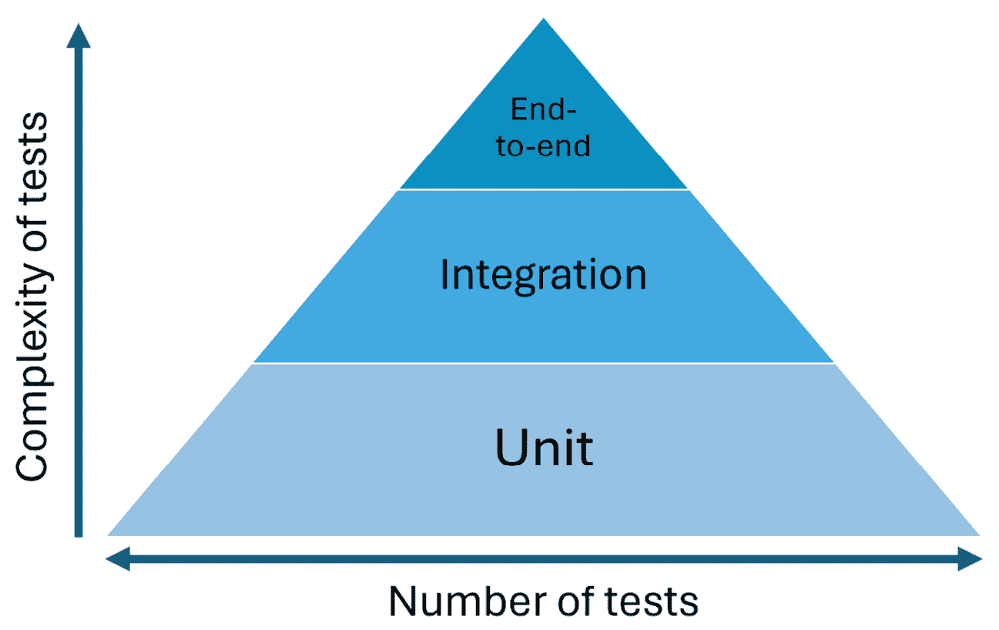
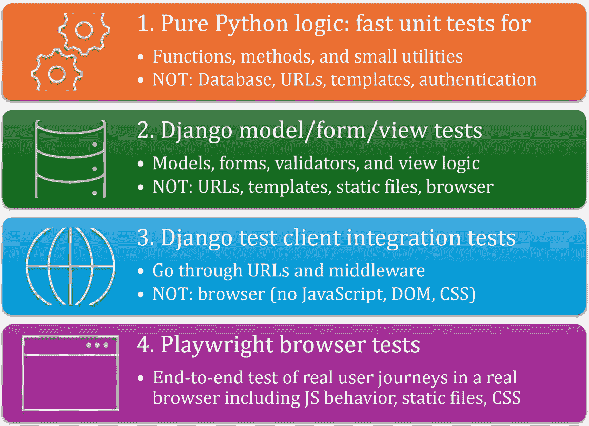
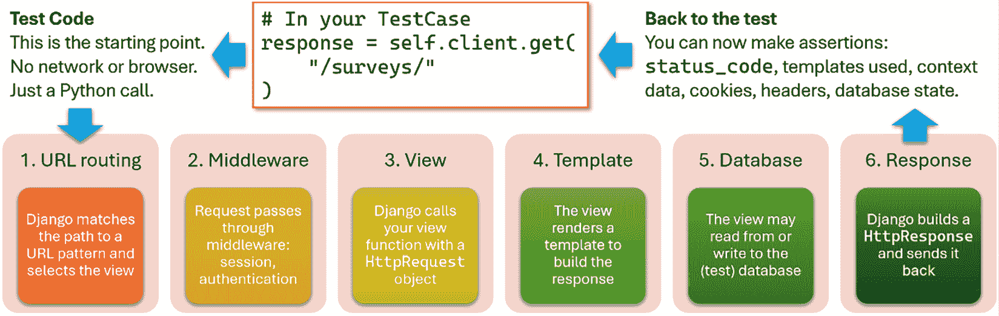

## 第 12 章：单元、集成和端到端测试

不要把测试留到最后。它是将可工作的原型转化为可靠软件的方法。在像 TallyApp 这样的真实项目中，功能相互交互，用户会做出你意想不到的事情，微小的变更会破坏看似无关的代码。良好的测试套件让你能够以更少的意外进行重构、扩展和部署。

视图可能返回错误的调查。权限检查可能允许一个用户编辑另一个用户的数据。表单可能接受无效输入。JavaScript 或模板变更可能导致按钮消失。你可能修复了一个 Bug，却意外地重新引入了一个旧 Bug。

测试是让这些风险可见的方法。良好的测试套件不能证明你的应用程序完美无缺。它能让你快重复地获得关于你最关心行为的反馈。

本章探讨三个不同层级的测试：

* 验证孤立逻辑片段的小型、快速单元测试
* 验证组件协同工作的更广泛的集成和用户界面测试
* 使用 AI 工具起草、审查和改进测试

你将看到这些层如何捕获不同类型的错误。当经过深思熟虑地结合时，它们为你提供了一张安全网，让你无需猜测项目是否仍然工作就能更改代码。

你将从小逻辑片段的单元测试开始，然后进入测试视图、统一资源定位符（`URL`）、认证、表单和数据库的 Django 集成测试。之后，你将使用 Playwright 自动化一些浏览器级用户旅程。你还将学习如何管理测试数据、在持续集成中运行测试，以及如何使用 AI 工具而不让它们生成看起来有用实则肤浅的测试。

要建立的主要习惯很简单：在询问代码是否工作之前，先询问系统应该保证什么行为。

在本章结束时，你将为 TallyApp 设计并实施分层测试策略，在 Django 中编写有意义的单元和集成测试，使用端到端测试自动化真实的浏览器交互，并学会如何使用 AI 工具加速测试创建而不放弃工程判断。

在本章中，我们将涵盖以下主题：

* 测试金字塔和测试哲学
* Python 和 Django 单元测试
* Django 应用集成测试
* 端到端 Web 用户界面测试
* 管理测试数据和固件
* 持续集成和自动化测试流水线
* 请 AI 编写测试

本章的建议聊天机器人提示词及示例响应可在以下链接找到：[`github.com/markjprice/web-dev-ai/blob/main/prompts/ch12-test/readme.md`](https://github.com/markjprice/web-dev-ai/blob/main/prompts/ch12-test/readme.md)

## 测试金字塔和测试哲学

在编写许多测试之前，了解每种测试的位置会有所帮助。该模型通常被称为测试金字塔。

### 测试金字塔

**测试金字塔**描述了健康应用程序中测试的理想分布，如图 12.1 所示，并按以下列表描述：

* 底层是单元测试
* 中层是集成测试
* 顶层是端到端或 UI 测试



图 12.1：测试金字塔

基本思想是：

* 你应该有许多快速、隔离的单元测试
* 较少的集成测试，用于测试多个组件的协同工作
* 非常少的缓慢、浏览器级测试

为什么在底层放更多测试？

* 单元测试快速、确定性强、易于调试，且大量运行成本低廉
* UI 测试较慢、更脆弱、调试更复杂

如果你的大多数测试是 UI 测试，测试套件很快会变得缓慢、脆弱且难以调试。如果你主要依赖单元测试，你会获得快速反馈，并可以在开发过程中持续运行测试。

> **提示词**：请解释测试金字塔的历史起源以及它与测试奖杯模型的区别。有哪些团队倒置测试金字塔的真实案例，他们面临了什么问题？

在本节中，我们专注于金字塔底层：Python 和 Django 中的单元测试和服务端集成测试。浏览器自动化将在下一节介绍。

### 什么算作单元？

*单元*通常是一小段**自包含的逻辑片段**：

* 一个函数
* 一个方法
* 一个类
* 一个小模块

**单元测试**验证该逻辑片段在给定输入下的行为是否符合预期。

例如：

* 计算调查统计的函数
* 判断调查是否发布的模型方法
* 拒绝空标题的表单验证规则

小而专注的测试在失败时更容易理解。

### 安排、行动、断言

大多数测试遵循以下结构：

1. **安排**：设置数据和环境。
2. **行动**：调用被测试的函数或方法。
3. **断言**：验证结果。

通俗示例：

1. **安排**：创建一个 `Survey` 对象。
2. **行动**：调用 `survey.is_open()`。
3. **断言**：确认它返回 `True`。

这种模式通过保持测试的可读性和一致性，帮助未来的你和其他测试读者快速理解测试。

> **提示词**：除了安排-行动-断言，什么造就了一个好的单元测试？给出语法正确但糟糕的测试示例。

### 确定性和隔离

好的单元测试是：

* **确定性的**：给定相同的输入，它们总是产生相同的结果


*   **隔离**：它们不依赖外部系统，例如真实数据库（除非有意测试数据库行为）、网络调用、当前时间（除非受控）或随机值。

    **良好实践**：对于测试时间相关的逻辑，可以使用 `freezegun` ([`github.com/spulec/freezegun`](https://github.com/spulec/freezegun)) 或 `time_machine` ([`github.com/adamchainz/time-machine`](https://github.com/adamchainz/time-machine)) 将时钟冻结在特定时刻。这使得测试无论何时运行都是确定性的。`freezegun` 更早且非常流行。`time_machine` 更新、更快，是许多当前 Python 项目的良好默认选择。

随机失败的测试往往比没有测试更糟糕，因为不稳定的测试会削弱信任。一旦人们不再信任测试失败，他们就不再仔细阅读失败信息。

**提示**：请解释软件测试中置信度、覆盖率和正确性的区别。

现在让我们更深入地了解 Python 和 Django 的单元测试。

# Python 和 Django 单元测试

单元测试是你在逻辑消失在视图、表单和模板内部之前，检查小块逻辑的地方。在这一层级，你关注小型的、自包含的逻辑片段，例如函数、模型方法、验证规则和权限检查，并验证它们对于特定输入是否表现正确。

在像 TallyApp 这样的 Django 项目中，这意味着测试纯 Python 工具函数以及模型行为、表单验证和自定义业务规则，使用 Django 的 `TestCase` 及其内置的测试数据库。这些测试应该是快速的、确定性的和隔离的，这样你才能在代码还留在脑海中时发现错误。当你的单元测试强健时，它们为测试套件中的其他所有内容形成了一个稳定的基础。

**提示**：Django 的测试运行器在内部是如何创建和销毁测试数据库的？

## Django 的测试基类

Django 提供了几个基础测试类，每个都针对略微不同的目的设计。选择正确的基类可以避免测试缓慢和产生误导性测试。

**表 12.1** 是最常用测试基类的简明总结：

| 测试基类 | 每个测试回滚事务 | 典型用例 |
| --- | --- | --- |
| `SimpleTestCase` | 不适用 | 不接触数据库或 Django 模型的纯逻辑测试。适用于工具函数和配合 `RequestFactory` 的简单视图逻辑。 |
| `TestCase` | 是（快速事务回滚） | 大多数模型、表单和集成测试。Django 应用的默认选择。快速且隔离。 |
| `TransactionTestCase` | 否（测试间刷新数据库） | 当你需要测试真实事务行为时，例如提交/回滚效果或需要实际提交的数据库约束。比 `TestCase` 慢。 |
| `LiveServerTestCase` | 是 | 需要真实 HTTP 服务器的端到端测试，常在集成模式下与 Selenium 或 Playwright 一起使用。启动一个实时测试服务器。 |
| `StaticLiveServerTestCase` | 是 | 同 `LiveServerTestCase`，但在测试期间也服务静态文件。适用于完整的基于浏览器的 UI 测试。 |

表 12.1：最常用的测试基类

实用指南：

*   默认使用 `TestCase`。它针对速度和隔离进行了优化，并覆盖了像 TallyApp 这样的 Django 项目中的大多数场景。
*   当不需要数据库时使用 `SimpleTestCase`。这能保持测试更快并使意图明确。
*   只有当你真正需要测试依赖已提交事务的行为时，才使用 `TransactionTestCase`。
*   当驱动真实浏览器进行端到端测试时，使用 `LiveServerTestCase` 或 `StaticLiveServerTestCase`。

在许多 Django 项目中，大多数测试将使用 `TestCase`，其他类保留给专门的场景。

## Python 单元测试基础

Python 自带一个名为 `unittest` 的内置测试框架。Django 构建在其之上。

一个最小的 `unittest` 风格测试如下所示：

```
import unittest

def add(a, b):
    return a + b

class AddTests(unittest.TestCase):
    def test_adds_two_numbers(self):
        result = add(2, 3)
        self.assertEqual(result, 5)
```

你可以通过以下方式运行测试：

```
python -m unittest
```

在 Django 项目中，你通常运行：

```
python manage.py test
```

Django 会自动发现名为 `tests.py` 的文件或 `tests/` 包内的测试。

## Django 的 TestCase 和测试数据库

Django 提供了自己的 `TestCase` 类，它扩展了 `unittest.TestCase`。

关键特性：

*   **自动测试数据库**：Django 在运行测试前创建一个临时测试数据库，并在之后销毁它。
*   **事务隔离**：每个测试在一个事务中运行，该事务会被回滚，确保状态干净。
*   **用于模拟 HTTP 请求的客户端**：Django 包含一个测试客户端，用于在没有真实浏览器的情况下发起伪造的 `GET` 和 `POST` 请求。

模型测试示例：

```
from django.test import TestCase
from .models import Survey
from django.contrib.auth.models import User

class SurveyModelTests(TestCase):
    def test_survey_string_representation(self):
        user = User.objects.create_user(
            username="mark",
            password="password123"
        )
        survey = Survey.objects.create(
            title="Favorite Sci-Fi Series",
            owner=user
        )
        self.assertEqual(str(survey), "Favorite Sci-Fi Series")
```

此测试：

*   使用测试数据库
*   创建真实的模型实例
*   验证模型行为
*   之后留下干净的数据库

这是许多 Django 测试的日常形态。

**提示**：请解释 Django 中 `TestCase`、`TransactionTestCase`、`SimpleTestCase` 和 `LiveServerTestCase` 的区别。

## 使用 Django 测试客户端测试视图

测试 Django 视图有两种有用的方法。

当你想要在隔离环境中直接调用视图时，使用 `RequestFactory`。这绕过了 URL 路由和中间件，因此它的行为更像是对视图函数本身的传统单元测试。如果视图依赖于认证、会话数据或其他中间件行为，你必须手动提供这些。Django 文档将 `RequestFactory` 描述为一种生成请求对象并像测试其他函数一样测试视图的方法。

当你想要在不启动真实浏览器的情况下测试完整的 Django 请求管道时，使用 `self.client`。这包括 URL 路由和更多框架行为，因此这些测试比隔离的单元测试范围更广，但它们仍然快速且在日常 Django 项目中非常有用。Django 将测试客户端描述为一种在视图层面模拟用户与应用程序交互的方式。

使用 `RequestFactory` 的示例：

```
from django.test import RequestFactory, TestCase
from django.contrib.auth.models import User
from surveys.views import survey_list

class SurveyViewUnitTests(TestCase):
    def setUp(self):
        self.factory = RequestFactory()
        self.user = User.objects.create_user(
            username="alice",
            password="example123"
        )

    def test_survey_list_with_authenticated_user(self):
        request = self.factory.get("/surveys/")
        request.user = self.user
        response = survey_list(request)
        self.assertEqual(response.status_code, 200)
```

使用 Django 测试客户端的示例：


```python
from django.urls import reverse
from django.test import TestCase
from django.contrib.auth.models import User

class SurveyViewTests(TestCase):
    def test_login_required_for_survey_list(self):
        response = self.client.get(reverse("survey_list"))
        self.assertEqual(response.status_code, 302)
```

这验证了：

- 匿名用户会被重定向
- URL 配置正确
- 视图强制要求认证

你也可以测试 `POST` 提交：

```python
def test_create_survey(self):
    user = User.objects.create_user(
        username="mark",
        password="password123"
    )
    self.client.login(username="mark", password="password123")
    response = self.client.post(reverse("survey_create"), {
        "title": "Best Programming Language"
    })
    self.assertEqual(response.status_code, 302)
    self.assertTrue(
        Survey.objects.filter(title="Best Programming Language").exists()
    )
```

前面的代码涵盖了表单的服务端行为，而无需打开浏览器。

## 测试模型、表单和业务逻辑

在像 TallyApp 这样的 Django 应用中，你的测试应覆盖：

- **模型逻辑**：自定义方法，如 `is_open()`、`can_edit(user)` 或计算属性
- **表单验证**：确保无效数据被拒绝且正确的错误消息出现
- **权限逻辑**：确认只有所有者可以编辑或删除他们的调查
- **工具函数**：用于计算统计数据或转换数据的纯 Python 函数

一个有用的原则是：*如果它包含逻辑，就测试它，且测试行为而非样板代码*。但如果它只是渲染静态内容的模板，单元测试通常是不必要的。

本章中的测试示例使用了一个 `Survey` 模型，你将在下一章创建它。目前，请阅读并理解这些模式，一旦模型存在，你的 AI 将实现它们。

**提示**：什么是 `pytest` 中的参数化测试，它在什么时候有用？

## 基于属性的测试与 Hypothesis

到目前为止，你见到的大多数测试都是基于示例的。你选择特定的输入，调用一个函数，并断言预期的结果。**基于属性的测试**采用了不同的方法。你不再编写许多单独的示例，而是描述一个应始终为真的通用属性，然后由工具自动生成大量输入来尝试破坏它。

在 Python 中，最流行的基于属性的测试库是 **Hypothesis**。Hypothesis 不仅测试少数精心挑选的值，还会生成几十个甚至上百个输入，包括你可能想不到的边缘情况，例如空字符串、极大数字、不寻常的 Unicode 字符或边界值。

例如，假设你在 TallyApp 中有一个简单的工具函数来计算响应百分比：

```python
def percentage(part, total):
    if total == 0:
        return 0
    return round((part / total) * 100, 2)
```

传统的测试可能如下所示：

```python
def test_percentage_basic():
    assert percentage(1, 4) == 25.0
```

这没问题，但它只测试了一个示例。使用 Hypothesis，你可以定义应对许多输入成立的属性：

```python
from hypothesis import given
from hypothesis import strategies as st

@given(
    part=st.integers(min_value=0, max_value=10_000),
    total=st.integers(min_value=0, max_value=10_000),
)
def test_percentage_is_between_0_and_100(part, total):
    result = percentage(part, total)
    assert 0 <= result <= 100
```

现在 Hypothesis 将生成许多 `part` 和 `total` 的组合，并验证结果始终落在有效范围内。如果它发现一个失败的案例，它会将输入缩减到仍能破坏该属性的最小示例，这使调试更容易。

当你运行此测试时，Hypothesis 会发现 `part > total` 的情况，导致结果超过 100%。这正是基于属性测试的意义所在，因为它发现了我们未预料到的 bug。然后你需要决定如何处理发现的 bug：函数是否应将结果限制在 100% 以内，还是属性应允许超过 100% 的值？要修复该函数，你可以使用以下代码：

```python
def percentage(part, total):
    if total == 0:
        return 0
    return min(round((part / total) * 100, 2), 100.0)
```

基于属性的测试特别适用于：

- 具有数学或逻辑不变量的纯函数
- 数据转换
- 验证逻辑
- 解析器和格式化器
- 任何在广泛输入空间中应表现一致的事物

它对于严重依赖数据库、HTTP 调用或外部系统的复杂集成测试不太有用。

有了基于属性的测试，问题从*我应该测试什么示例？*变成了*什么必须始终为真？* 对于 TallyApp 中的业务逻辑，如分数计算、调查统计或归一化规则，这种视角可以发现基于示例的测试所遗漏的边缘情况。

## 测量覆盖率

测试还关乎了解盲点在哪里。`coverage.py` 工具测量测试期间运行了多少代码。

你通常：

1. 启用覆盖率运行测试。
2. 生成 HTML 报告。
3. 检查哪些行从未被执行。

高覆盖率不保证正确性，但低覆盖率几乎可以保证存在盲点。

**提示**：100% 的代码覆盖率无法告诉你什么？分支覆盖率与行覆盖率有何区别？`coverage.py` 内部是如何工作的？

## TallyApp 的合理测试策略

对于像 TallyApp 这样的项目：

- 为模型方法和验证逻辑编写单元测试
- 使用 Django 的测试客户端进行认证和增删改查（CRUD）流程测试
- 保持测试小巧且专注
- 避免测试琐碎的 getter 或 Django 内部机制

不同类型的测试锻炼系统的不同部分。使用最轻量但仍能让你对关心的行为充满信心的工具，如 *图 12.2* 所示：



图 12.2：TallyApp 中的测试层级

从能证明行为的最廉价层级开始。如果纯 Python 单元测试能证明，就不要使用浏览器测试。它会更快、更易维护、更易调试。

目标是：

- 快速的测试运行
- 清晰的失败信息
- 重构时的信心

目标是用第 1 到第 3 层捕获大多数 bug。将第 4 层的 Playwright 测试保留给对真实用户最重要的流程。当单元测试和服务端集成测试足够强健时，UI 测试就变成了一层薄薄的安全网，而不是你唯一的防线。这能让浏览器测试保持价值，而不至于主导整个测试套件。

测试是你决定应用程序被允许做什么的地方。AI 助手可以再写一行 `assertEqual`，但它无法决定未发布的调查是否应不可见、创建者在有响应后是否仍可编辑调查、重复提交是否应保持数据库不变。这些决策属于开发者。一旦你将它们作为测试显式化，代码就有了具体的满足目标。

## pytest 和 pytest-django

许多 Django 项目使用 `pytest` 而不是 `unittest` 风格的类。但在假设你可以使用它之前，你应该验证 `pytest-django` 是否支持你的 Django 版本。你可以在以下链接查看最新的兼容性信息：[`github.com/pytest-dev/pytest-django`](https://github.com/pytest-dev/pytest-django)

开发者偏爱 `pytest` 的原因：

- 更简单的语法（普通函数而非类）
- 强大的 fixture 系统
- 更好的错误输出


## 更灵活的测试组织

`pytest` 风格的测试可能如下所示：

```python
def test_survey_str(db, django_user_model):
    user = django_user_model.objects.create_user(
        username="mark",
        password="password123"
    )
    survey = Survey.objects.create(
        title="Favorite Editor",
        owner=user
    )
    assert str(survey) == "Favorite Editor"
```

请注意上述代码的以下几点：

* `db` 是一个启用数据库访问的固件
* 断言使用普通的 `assert` 而非 `self.assertEqual`

`pytest-django` 将 `pytest` 与 Django 的设置和测试数据库集成在一起。

许多 Django 团队将 `pytest` 与 `pytest-django` 结合使用。

**提示**：为什么许多专业的 Django 团队更倾向于使用 `pytest` 而非 `unittest`？请包含同一 Django 测试分别采用 `unittest` 风格和 `pytest` 风格编写的对比。

现在让我们从单元测试转向集成测试。

# Django 应用的集成测试

**集成测试**位于测试套件的中层。它们不试图证明函数的每一个微小细节（单元测试），也不试图驱动真实的浏览器（端到端 UI 测试）。相反，它们验证多个 Django 层是否正确协作：URL 路由、视图逻辑、模板、中间件、认证、会话，以及数据库的读写操作。

Django 使这种测试风格变得相当轻松，因为内置的测试运行器会自动创建一个临时测试数据库，将每个测试包裹在一个事务中，并提供一个测试客户端，它可以在不启动浏览器的情况下对你的 Django 项目发起类似请求的调用。

## 在集成层面测试什么

一个优秀的集成测试套件能回答如下问题：

* 如果我请求一个命名 URL，是否会命中预期的视图并获得正确的 HTTP 响应？（URL + 视图）
* 如果我未登录，受保护的页面是否会将我重定向到登录页？如果我已登录，是否能获得访问权限？（认证流程）
* 中间件钩子是否真正运行，并像线上站点那样修改请求或响应？（请求/响应管道中的中间件）
* 视图是否正确地创建、更新和查询数据库行，响应是否反映了这些变化？（数据库交互）

**提示**：开发人员在编写集成测试时最常犯的错误是什么？

## TestCase 与测试客户端

Django 的 `django.test.TestCase` 为每次测试运行提供一个已设置好的数据库，并提供一个 `self.client` 属性，你可以用它来执行 `GET` 和 `POST` 等请求。当你传递 `follow=True` 时，该客户端还可以跟随重定向并记录重定向链。

典型模式如下：

1. 创建所需的数据库状态（用户、调查、问题、响应）。
2. 使用 `self.client.get(...)` 或 `self.client.post(...)` 发起 HTTP 请求。
3. 断言状态码、重定向、上下文数据和数据库效果。

当你在 Django `TestCase` 中调用 `self.client.get()` 时，Django 的测试客户端会模拟一个 HTTP 请求，并让它通过（几乎）整个 Django 栈，而无需真实浏览器，如*图 12.3* 所示：



*图 12.3：Django 集成测试请求路径*

`self.client` 让请求经历 Django 真实的请求/响应周期，包括路由、中间件、模板和数据库，且无需浏览器。

## 示例：联合测试 URL 路由与视图

此示例假设你有一个显示已发布调查的调查详情页。

在文件 `tests/test_surveys_integration.py` 中：

```python
from django.test import TestCase
from django.urls import reverse, resolve
from surveys.views import survey_detail
from surveys.models import Survey

class SurveyDetailIntegrationTests(TestCase):
    @classmethod
    def setUpTestData(cls):
        # setUpTestData 为整个类运行一次（比每个测试运行 setUp 更快）
        cls.survey = Survey.objects.create(
            title="Customer Satisfaction",
            slug="customer-satisfaction",
            is_published=True,
        )

    def test_url_resolves_to_expected_view(self):
        url = reverse("surveys:detail", kwargs={"slug": self.survey.slug})
        match = resolve(url)
        self.assertEqual(match.func, survey_detail)

    def test_detail_page_returns_200_and_includes_title(self):
        url = reverse("surveys:detail", kwargs={"slug": self.survey.slug})
        response = self.client.get(url)
        self.assertEqual(response.status_code, 200)
        self.assertContains(response, "Customer Satisfaction")
```

请注意上述代码的以下几点：

* `reverse()` 确保你测试的是命名路由而非硬编码 URL，从而使重构更安全。
* `resolve()` 验证你的 `URLconf` 指向正确的视图。
* `self.client.get()` 将 URL 路由 + 中间件栈 + 视图 + 模板渲染串联起来进行测试。

**警告！** 在 `setUpTestData` 中创建的对象会在类的所有测试间共享。如果某个测试修改并保存了该对象，后续测试将看到修改后的版本。仅对测试只读不修改的数据使用 `setUpTestData`。对于可变的测试数据，请改用 `setUp`。

## 示例：测试登录必需的视图

在 TallyApp 中，对于仅创建者可访问的页面，典型规则是：若未认证，应重定向到登录页；一旦登录，应能看到该页面。

MDN 的 Django 测试教程展示了使用 `assertRedirects` 实现*未登录则重定向*的确切模式：

```python
from django.contrib.auth import get_user_model
from django.test import TestCase
from django.urls import reverse

User = get_user_model()

class SurveyCreateAuthIntegrationTests(TestCase):
    @classmethod
    def setUpTestData(cls):
        cls.user = User.objects.create_user(
            username="mark",
            email="mark@example.com",
            password="pass12345",
        )

    def test_redirects_to_login_when_not_authenticated(self):
        url = reverse("surveys:create")
        response = self.client.get(url)
        # 如果你使用 Django 的 login_required 装饰器，这是默认行为：
        # 重定向到 settings.LOGIN_URL 并附带 ?next=<原始 _url>。
        login_url = reverse("login")
        self.assertRedirects(
            response,
            f"{login_url}?next={url}",
            fetch_redirect_response=False,  # 避免发起第二次请求
        )

    def test_returns_200_when_authenticated(self):
        self.client.force_login(self.user)
        url = reverse("surveys:create")
        response = self.client.get(url)
        self.assertEqual(response.status_code, 200)
        self.assertContains(response, "Create survey")
```

请注意上述代码的以下几点：

* `force_login` 适用于你不测试登录表单本身，仅测试认证后的访问控制和行为的场景。
* `assertRedirects` 是在 Django 测试客户端中测试重定向最直接的方法。

## 示例：测试完整的“POST 创建行”流程

现在让我们测试更接近真实行为的场景：提交一个创建调查的 POST 请求，确认重定向到新调查页面，并确认调查存在于数据库中：


# Django 使用测试客户端进行集成测试

```python
from django.contrib.auth import get_user_model
from django.test import TestCase
from django.urls import reverse
from surveys.models import Survey

User = get_user_model()

class SurveyCreatePostIntegrationTests(TestCase):
    @classmethod
    def setUpTestData(cls):
        cls.user = User.objects.create_user(
            username="creator",
            email="creator@example.com",
            password="pass12345",
        )

    def test_post_creates_survey_and_redirects(self):
        self.client.force_login(self.user)
        url = reverse("surveys:create")
        response = self.client.post(
            url,
            data={
                "title": "Conference Feedback",
                "slug": "conference-feedback",
                "is_published": False,
            },
            follow=False,
        )
        self.assertEqual(response.status_code, 302)
        created = Survey.objects.get(slug="conference-feedback")
        self.assertEqual(created.title, "Conference Feedback")
        self.assertFalse(created.is_published)
        # Optionally verify where we redirect to
        expected = reverse("surveys:detail", kwargs={"slug": created.slug})
        self.assertRedirects(
            response,
            expected,
            fetch_redirect_response=False,
        )
```

如果您想在重定向后验证最终页面内容，请传递 `follow=True` 并对最终响应进行断言。Django 文档描述了 `follow=True` 和 `redirect_chain` 属性：

```python
response = self.client.post(url, data=payload, follow=True)
self.assertEqual(response.status_code, 200)
self.assertGreaterEqual(len(response.redirect_chain), 1)
self.assertContains(response, "Conference Feedback")
```

## 实用指南

保持集成测试稳定：

* 首选命名 URL（`reverse()`）而非硬编码路径。这能减少重构时的脆弱性。
* 对于跨测试共享的昂贵设置，使用 `setUpTestData`；对于您打算修改的每个测试的状态，使用 `setUp`。
* 仅断言足以证明行为的最小集合。例如，断言重定向和数据库行存在，而不是断言整个 HTML 输出。
* 如果测试失败，按以下顺序诊断：
    1. 是否命中了正确的 URL 名称和参数？
    2. 当您期望 `200` 时是否收到了重定向（`302`）？
    3. 认证状态是否存在（`force_login` 或 `login`）？
    4. 您的数据库设置是否与视图预期的一致？

> **提示**：请解释如何在 Django 中正确测试数据库约束和唯一索引，以及竞态条件或并发问题。

## 集成测试的结束与端到端测试的开始

测试客户端永远不会运行 JavaScript，它永远不会验证按钮在真实浏览器中是否可点击，也不会发现布局问题。这是基于 Playwright 的端到端测试的工作。但对于 Django 中的大多数服务端工作流，集成测试能在耗时范围内给您最好的反馈。

现在让我们转到端到端测试，也称为用户界面测试。

# 端到端 Web 用户界面测试

单元测试和 Django 的测试客户端能给您快速反馈，但它们仍无法证明 TallyApp 在真实浏览器中能正常工作。Web UI 测试位于测试金字塔的顶端：您运行应用程序，打开真实的浏览器引擎，并自动化用户执行的相同操作，如点击链接、填写表单、提交以及验证屏幕上出现的内容。

本节使用 Playwright，这是一个快速、可靠且支持 Chromium、Firefox 和 WebKit 的浏览器自动化工具。我们将用它来测试 TallyApp 的少量重要端到端用户旅程。

## UI 测试的用途

UI 测试最适合用于绝不能中断的关键流程：

* **认证流程**：
    * 未登录用户访问受保护页面时会被重定向到登录页
    * 用户可以登录和登出
* **核心产品流程**：
    * 已登录用户可以创建调查
    * 新调查出现在调查列表中
    * 用户可以编辑和删除自己的调查
* **授权边界**：
    * 用户 A 无法编辑或删除用户 B 的调查（通过尝试直接导航来测试）

避免对所有功能都使用 UI 测试。它们比单元测试慢，且维护稳定性需要更多工作。您的目标是一套小型测试套件，从用户角度证明应用程序正常工作。

## 为什么选择 Playwright 而不是 Selenium

历史上，Selenium 一直是最流行的 Web UI 测试框架。Selenium 可以工作，但 Playwright 通常更适合现代项目，因为：

* **内置自动等待**。它会等待元素就绪，从而减少不稳定测试。
* **定位器具有弹性**。它们会重新查询并跟踪元素，而不是一次性查找然后祈祷。
* **出色的调试功能**。它可以录制屏幕截图、视频和追踪记录。
* **跨浏览器**。一个 **应用程序编程接口** (**API**) 统一驱动 Chromium、Firefox 和 WebKit。
* **更友好地支持 AI 编码代理**。Playwright **模型上下文协议** (**MCP**) 服务器 (`playwright-mcp`) 与 GitHub Copilot 集成良好。

> **提示**：请从架构和可靠性方面比较 Playwright 和 Selenium。

## 让您的 UI 易于测试

如果您养成以下两个习惯，UI 测试的可靠性将大幅提升：

* **优先使用可访问性选择器**：Playwright 可以通过角色、标签和可见文本定位元素。这鼓励编写良好的 HTML，并使测试更不易碎。
* **谨慎使用测试 ID**：为少数关键元素添加 `data-testid="..."` 属性。这可以防止样式更改破坏测试。

Django 模板中的示例：

```html
<button type="submit" data-testid="save-survey">Save</button>
```

谨慎使用此方法。大多数情况下，优先使用标签和角色。

## 为 Django 项目选择 Playwright 风格

Playwright 支持两种常见方法：

1. **Python + `pytest`**。天然适合 Django/Python 仓库。测试看起来像 Python 测试，并可与其他测试工具一起运行。
2. **TypeScript 运行器 (Playwright Test)**。如果您的团队已经大量使用 TypeScript，这非常出色。TallyApp 不需要这个。

对于这个以 Django 为主的书籍项目，Python 配合 `pytest` 是最简单且最一致的选择。

## 安装 Playwright

您需要两样东西：

* Python Playwright 包
* Playwright 使用的实际浏览器二进制文件

典型设置命令（在虚拟环境中运行）：

```bash
python -m pip install playwright pytest
python -m playwright install
```

可选但推荐，用于更好的断言和等待助手：

```bash
python -m pip install pytest-playwright
```

如果您已经对单元测试使用 `pytest`，这非常契合。如果没有，您仍可以单独运行 Playwright 测试，但 `pytest` 能让事情保持整洁。

## 在 Git 仓库中组织 UI 测试

整洁的结构是将 UI 测试与 Django 单元测试分开：

* `tests/` 用于单元测试和集成测试
* `e2e/` 用于 Web 用户界面测试

示例：

* `e2e/test_auth_flow.py`：网站认证的测试
* `e2e/test_surveys_crud.py`：调查数据库 CRUD 操作的测试

这可以避免对哪些测试需要运行中的服务器和浏览器产生混淆。

## 为 UI 测试运行 Django

UI 测试需要一个运行中的服务器。您有两种合理的方法：

1. **手动运行 Django 开发服务器**。在一个终端启动服务器，然后在另一个终端运行 Playwright 测试：

```bash
python manage.py runserver
```


此设置可行，但需要协调。服务器必须在测试开始前已在运行，如果未运行，失败信息可能会令人困惑，因为 Playwright 只会提示连接失败。在 CI 等自动化环境中，你不会依赖两个手动终端。相反，你会将启动 Django 作为测试运行的一部分，既可以使用测试服务器（如 Django 的 `LiveServerTestCase`），也可以使用能自动启动和关闭服务器的测试运行器。这引出了第二种方案。

1. 从 `pytest` 启动测试服务器。这对 CI 更整洁，但需要稍多一点设置。

对于本书，手动启动开发服务器通常更容易，随后你可以再实现自动化方法。即使在开发期间，一个简单的改进是将两个步骤编写脚本一起执行。例如，你可以使用 Shell 脚本或任务运行器启动 Django，然后在服务器就绪后运行 Playwright 测试。这消除了手动协调两个终端的需要：

```
# 示例（类 Unix 系统）
python manage.py runserver &
pytest e2e
```

这是一个适合学习的简单方法，但在实际项目中，你会使用更健壮的流程，在运行测试前等待服务器就绪。

当新手在未运行服务器的情况下运行 Playwright 测试时，他们会看到连接被拒绝错误、超时和 `page.goto failed` 消息。这些错误没有一个明确地说：“你忘了启动 Django。”

在下面的示例中，假设服务器运行在：`http://127.0.0.1:8000`。

## 第一个 Playwright 测试：登录重定向

创建 `e2e/test_auth_flow.py`：

```
import re
from playwright.sync_api import Page, expect
BASE_URL = "http://127.0.0.1:8000"
def test_protected_page_redirects_to_login(page: Page) -> None:
    page.goto(f"{BASE_URL}/surveys/")
    # 预期我们最终会到达登录页面（URL 模式因项目而异）。
    expect(page).to_have_url(re.compile(r".*/login/?(\?.*)?$"))
    # 且登录表单应可见（根据你的模板调整标签/文本）。
    expect(page.get_by_label("Username")).to_be_visible()
    expect(page.get_by_label("Password")).to_be_visible()
```

注意：

* `expect` 提供自动等待和比手动睡眠更清晰的失败信息。
* 尽可能使用标签。如果你的表单字段没有标签，请添加。这能提高可访问性和可测试性。

**提示**：什么是页面对象模型（Page Object Model），我应该在 Playwright 中使用它吗？

## 测试真实用户旅程：创建调查

UI 测试应演练用户采取的相同步骤。为此，你需要一个已知的用户账户。

你可以通过几种方式创建测试用户：

* 在开发数据库中创建一个专用用户
* 使用设置脚本/固件自动创建用户
* 使用 Django 管理后台创建一次用户

最简单的是：创建一次用户（例如 `mark` / `password123`），在早期 UI 测试中使用它，随后再演进为自动化设置。为学习目的，手动创建测试用户没问题。在实际项目中，E2E 测试应以编程方式创建自己的数据。Django 的 `StaticLiveServerTestCase` 提供了一个带有干净测试数据库的测试服务器，或者你可以编写一个设置脚本，在每次测试运行前创建所需的测试用户。

创建 `e2e/test_surveys_crud.py`：

```
import os
from playwright.sync_api import Page, expect
# 从环境变量读取基础 URL，提供默认值。
BASE_URL = os.environ.get("BASE_URL", "http://127.0.0.1:8000")
USERNAME = "mark"
PASSWORD = "password123"
def login(page: Page) -> None:
    page.goto(f"{BASE_URL}/login/")
    page.get_by_label("Username").fill(USERNAME)
    page.get_by_label("Password").fill(PASSWORD)
    page.get_by_role("button", name="Log in").click()
    expect(page).to_have_url(f"{BASE_URL}/surveys/")
def test_create_survey(page: Page) -> None:
    login(page)
    page.get_by_role("link", name="New survey").click()
    expect(page).to_have_url(f"{BASE_URL}/surveys/new/")
    page.get_by_label("Title").fill("Best Star Trek Captain")
    page.get_by_role("button", name="Save").click()
    # 回到列表页，新调查应出现。
    expect(page).to_have_url(f"{BASE_URL}/surveys/")
    expect(page.get_by_text("Best Star Trek Captain")).to_be_visible()
```

此测试证明：

* 认证工作正常
* 导航工作正常
* 表单渲染和提交工作正常
* 数据出现在 UI 中

调整链接文本、按钮文本和 URL 以匹配你的模板。

## 编辑和删除测试

一旦你有了一个工作的测试，编辑和删除遵循相同模式。保持简短：

```
def test_edit_survey_title(page: Page) -> None:
    login(page)
    page.get_by_text("Best Star Trek Captain").click()  # 或点击 "Edit" 链接
    page.get_by_label("Title").fill("Best Star Trek Series")
    page.get_by_role("button", name="Save").click()
    expect(page.get_by_text("Best Star Trek Series")).to_be_visible()
def test_delete_survey(page: Page) -> None:
    login(page)
    page.get_by_text("Best Star Trek Series").click()
    page.get_by_role("button", name="Delete").click()
    expect(page.get_by_text("Best Star Trek Series")).not_to_be_visible()
```

如果你的 UI 使用确认对话框，Playwright 可以处理它们，但对新手友好的方法是在 Django 中实现一个简单的确认页面，而不是浏览器模态框。

## 保持 UI 测试可靠

大多数不稳定的 UI 测试源于两个原因：不稳定的选择器和时机假设。

* 使用稳定的选择器：
    * 优先使用 `get_by_role`、`get_by_label` 和可见的按钮/链接名称
    * 仅对少数关键控件使用 `data-testid`
* 绝不使用睡眠：
    * 避免 `time.sleep(...)`
    * 使用 `expect(...)`，它会等待直到条件为 `true` 或超时
* 重置状态。UI 测试不应依赖之前的测试顺序。如果你的测试创建调查，可以：
    * 为每个测试创建唯一标题，或
    * 测试后清理，或
    * 在 UI 运行之间重置数据库（最适合 CI）

## 调试失败：有头模式、截图和追踪

当 UI 测试失败时，你需要证据。与单元测试不同，浏览器测试涉及时机、渲染和用户交互，因此仅从测试输出往往无法明显看出失败原因。

需要理解的最重要概念之一是无头模式和有头浏览器模式的区别：

* **无头模式（默认）**：浏览器在无可见窗口下运行。这更快，通常用于 CI 流水线和自动化运行。
* **有头模式**：浏览器窗口显示在屏幕上。你可以实时观察测试与页面的交互，这在调试时极其有用。

**良好实践**：为速度和自动化使用无头模式。当某事失败且你需要看清发生了什么时，使用有头模式。

在开发或调试测试时，以有头模式（可见浏览器）运行测试：

```
pytest -s e2e --headed
```

你也可以减慢交互速度，使其更易于跟踪：

```
pytest -s e2e --headed --slowmo 200
```

前面的代码在动作之间添加延迟（毫秒），以便你可视化地跟踪测试在做什么。

即使有了有头模式，你通常也想要一份出错记录，特别是在无屏幕可见的 CI 中。一个简单的模式是在测试失败时捕获截图：

```
def test_something(page: Page) -> None:
    try:
        # 测试步骤...
        pass
    except Exception:
        page.screenshot(path="e2e_failure.png", full_page=True)
        raise
```

对于更复杂的失败，Playwright 还支持追踪，它记录：

* 每一步的截图
* 文档对象模型（DOM）快照


## 网络活动

追踪功能让你在测试失败后能逐步重放测试过程，这通常比单张截图更有用。

## 从 VS Code 运行 UI 测试

在 VS Code 中运行 UI 测试的推荐工作流如下：

1. 打开集成终端。
2. 在一个终端中启动 Django：
   ```
   python manage.py runserver
   ```
3. 在另一个终端中运行 UI 测试：
   ```
   pytest e2e
   ```

如果你安装了 Python 扩展，也可以使用编辑器中的 `Run Test` 代码透镜来运行单个测试。

## TallyApp 的测试目标

一个合理的 TallyApp Playwright 测试套件应该是小而无聊的：

- 登录重定向
- 登录/登出
- 创建调查
- 编辑调查
- 删除调查
- 用户 A 无法编辑用户 B 的调查

这足以捕获大多数 `我把 UI 弄坏了` 的回归问题，而不会让你的测试套件变成一个缓慢、易碎的怪物。

一旦你能在浏览器中模拟真实的用户交互，下一个挑战就是控制这些测试所依赖的数据，使其保持可靠和可重复。

# 管理测试数据和固定装置

大多数易碎或痛苦的 Django 测试并非由 Django 引起。它们是由混乱的测试数据导致的。如果测试设置缓慢、令人困惑，或与无关细节紧密耦合，测试就会变得难以编写且容易破坏。良好的测试数据管理能保持测试快速、可读且独立。

目标很简单：每个测试应仅设置其所需的数据，以可预测的方式创建它，且绝不依赖其他测试创建的数据。

## 固定装置、工厂，以及为什么工厂通常胜出

Django 支持 `fixtures`（固定装置），通常是你加载到测试数据库中的 JSON/YAML/XML 文件。它们很诱人，因为你可以创建一次数据并重复使用。但在实践中，它们往往变得脆弱：固定装置文件随着时间的推移而膨胀，包含无关对象，且每当你更改模型时就会中断。Django 记录了固定装置及其通过 `loaddata` 管理命令加载的方式。例如：

```
python manage.py loaddata initial_data
```

Django 会在已知的固定装置位置查找名为 `initial_data.json`、`initial_data.yaml` 或 `initial_data.xml` 的文件。Django 搜索路径包括：

- 每个应用内部的 `fixtures/` 文件夹
- `settings.py` 中 `FIXTURE_DIRS` 列出的任何目录
- 当前工作目录

`Factories`（工厂，在代码中创建）通常是更好的默认选择。它们生成测试所需的确切对象，就在那里，测试能直接看到它们，带有合理的默认值和显式的覆盖。工厂还使重构更容易，因为模型更改往往会导致清晰的 Python 错误，而不是神秘的固定装置加载失败。

`良好实践`：大多数测试使用工厂。仅对少量、稳定的参考数据使用固定装置（例如，一个简短的国家列表，或几个静态的 `question types`），且仅当这些数据确实稳定时。

## 测试中的 Django 固定装置

Django 的 `TestCase` 可以通过在测试类上声明 `fixtures` 属性来自动加载固定装置。这很方便，但你应该保持固定装置文件小而专注。例如：

```python
from django.test import TestCase

class SurveyListFixtureTests(TestCase):
    fixtures = ["surveys_small.json"]

    def test_list_page_shows_published_surveys(self):
        response = self.client.get("/surveys/")
        self.assertEqual(response.status_code, 200)
```

你往往会遇到的固定装置问题：

- **隐性耦合**：测试依赖固定装置的 ID、顺序，或对文件内容的假设。
- **难以阅读**：数据不在断言附近，所以你必须在文件间来回跳转。
- **重构痛苦**：重命名字段或更改约束可能会一次性导致许多测试的固定装置加载中断。
- **缓慢膨胀**：一个固定装置变成了“万能固定装置”并积累无关对象。

如果你确实使用固定装置，请保持它们小巧，并以它们支持的特定场景命名。

**提示**：在大型项目中过度使用共享固定装置有哪些风险？

## 纯 Django 中的工厂

你不需要库就能使用工厂。一种简单的方法是编写辅助函数，创建带有默认值的对象，并通过参数进行覆盖。默认值应当是现实的，且应始终创建有效对象。

辅助函数示例：

```python
from django.contrib.auth import get_user_model
from surveys.models import Survey

User = get_user_model()

def make_user(**kwargs):
    defaults = {
        "username": "user1",
        "email": "user1@example.com",
        "password": "pass12345",  # 注意：create_user 会对其进行哈希
    }
    defaults.update(kwargs)
    return User.objects.create_user(
        username=defaults["username"],
        email=defaults["email"],
        password=defaults["password"],
    )

def make_survey(**kwargs):
    defaults = {
        "title": "Sample Survey",
        "slug": "sample-survey",
        "is_published": True,
    }
    defaults.update(kwargs)
    return Survey.objects.create(**defaults)
```

然后在测试中：

```python
from django.test import TestCase
from django.urls import reverse

class SurveyListFactoryTests(TestCase):
    def test_list_shows_only_published(self):
        make_survey(title="Published A", slug="a", is_published=True)
        make_survey(title="Draft B", slug="b", is_published=False)
        response = self.client.get(reverse("surveys:list"))
        self.assertContains(response, "Published A")
        self.assertNotContains(response, "Draft B")
```

## 使用 factory_boy 的工厂

如果你想要一种更具扩展性的工厂方法，最常见的 Django 友好库是 `factory_boy`，它提供声明式工厂和方便的功能，如序列和子工厂。在书籍语境下，将其作为一个选项提及是值得的，即使你保持核心示例不依赖库。

使用 `factory_boy` 的典型模式是：

- 对唯一的 slug/用户名使用 `Sequence`。
- 对关联模型使用 `SubFactory`。
- 保持默认状态有效且最小化。

**提示**：请比较 `factory_boy`、`pytest` 固定装置和 Django 固定装置的优缺点。

## Django 中的数据库事务与测试隔离

Django 的 `TestCase` 使用数据库事务隔离测试。从高层来看：

- Django 为测试运行创建一个测试数据库（或根据设置复用一个）。
- 每个 `TestCase` 在一个事务中运行并被回滚，以便下一个测试从干净状态开始。

这就是为什么你可以在一个测试中安全地创建对象，而不会泄漏到另一个测试中。

`TransactionTestCase` 是一个较低层级的基类，它不使用相同的快速事务方法包装每个测试，用于当你需要测试依赖真实事务提交的行为时。这对于典型的 Web 应用测试不太常见，但如果你测试事务钩子或某些并发行为，这很重要。

实际意义：

- 大多数集成测试和模型测试使用 `TestCase`。
- 仅当你有特定理由时才使用 `TransactionTestCase`。
- 保持测试确定性。除非你指定了排序，否则不要依赖数据库的隐式排序。

## 避免脆弱的共享状态

**脆弱共享状态** 是测试意外依赖的任何全局事物。它导致看似随机的失败，特别是在你以不同顺序运行测试或单独运行单个测试文件时。

常见的脆弱性来源及其避免方法如 *表 12.2* 所示：

| 问题 | 解决方案 |
| --- | --- |


| 依赖硬编码主键 | "假设第一个调查的 id=1。" | 检索刚创建的对象，或通过稳定字段（slug）查询，或存储返回的对象并使用其 id。 |
|------------------|---------------------------|----------------------------------------------------------------------------------|
| 依赖查询集默认排序 | "Survey.objects.all() 中的第一项是最新的。" | 在查询或模型 Meta ordering 中使用显式排序，并基于内容而非位置进行断言。 |
| 跨测试共享模块级对象 | 例如，你在测试模块导入时创建了一个 Survey。这将在测试模块被导入时运行一次，导致顺序和隔离性变得不可预测。 | 始终在 setUp、setUpTestData 或测试方法内部创建对象。 |
| 泄露外部状态：缓存、邮件、文件、时间 | 如果你的代码涉及 Django 缓存、邮件发件箱、文件存储、当前时间或环境变量，请确保测试能控制这些状态。 | |

表 12.2：测试脆弱性的常见来源及规避方法

现在让我们看看持续集成和自动化测试流水线。

# 持续集成和自动化测试流水线

只有当测试套件每次都自动运行时，它才会改变你的日常行为。这正是**持续集成**（**CI**）的作用：每当代码被推送或拉取请求被打开，CI 系统就会创建一个干净的环境，安装依赖，并运行你的测试。如果有任何失败，你会立即发现，在变更被合并或部署之前。

**GitHub Actions** 是许多 Django 项目的默认选择，因为它内置于 GitHub，支持 Linux 运行器，且易于用在 `push` 和 `pull_request` 上运行的 YAML 工作流来表达。

## 纪律是关键

CI 是由机器强制执行的团队规则。

严格的 CI 通常意味着：

* 每次推送和拉取请求都运行测试套件，而不仅仅是有人想起来时才运行。
* `main` 分支保持绿色。构建失败被视为停工事件。
* 如果 CI 失败，拉取请求不得合并。这可以通过 GitHub 中的分支保护规则来强制执行。
* 不稳定测试（flaky tests）被快速修复或移除。不稳定测试比没有测试更糟，因为它训练所有人忽略失败。
* CI 在干净环境中运行，因此能捕捉*在我机器上能跑通*的 bug。

**提示**：为什么有些团队抵制编写测试？如何向一个没有测试纪律的团队引入测试纪律？请解释自动化测试的经济论据。

## 一个使用 SQLite 的最小 Django CI 工作流

此工作流在每次推送和拉取请求时运行，设置 Python，安装依赖，并启用警告运行 Django 的测试运行器，这有助于尽早捕获弃用警告。Django 本身建议使用 `python -Wa manage.py test` 启用 Python 警告来运行测试。

你现在不需要将此工作流添加到 TallyApp，但这正是一个最小工作流的样子。

**警告！** 切勿将密钥（API 密钥、密码、密钥）直接存储在你的仓库或 `ci.yml` 中。请改用环境变量和 GitHub Actions Secrets。如果仓库是公开的，提交给它的任何内容都对所有人可见。

创建 `.github/workflows/ci.yml`：

```
name: CI
on:
  push:
    branches: [ "main" ]
  pull_request:
jobs:
  test:
    runs-on: ubuntu-latest
    strategy:
      fail-fast: false
      matrix:
        python-version: [ "3.14", "3.13", "3.12" ]
    steps:
      - name: Checkout
        uses: actions/checkout@v4
      - name: Set up Python
        uses: actions/setup-python@v5
        with:
          python-version: ${{ matrix.python-version }}
          cache: "pip"
      - name: Install dependencies
        run: |
          python -m pip install --upgrade pip
          pip install -r requirements.txt
      - name: Run tests
        env:
          DJANGO_SETTINGS_MODULE: tallyapp.settings
          # If you use environment variables in settings.py, set them here too.
          # DJANGO_SECRET_KEY: "ci-only-not-secret"
        run: |
          python -Wa manage.py test
```

关于前面代码的注意事项：

* 它在 `push` 和 `pull_request` 上运行，意味着每次变更都会自动测试。
* 它使用 `actions/setup-python` 在运行间一致地安装特定 Python 版本，并可缓存 pip 依赖以保持 CI 快速。
* 一个小的 Python 版本矩阵能尽早捕获兼容性问题，特别是当你的读者可能使用不同 Python 版本时。

本节关于 CI 的内容旨在提高你对该技术的认知，但我们不会在本书中实现它，因为当你初学时，它会使项目过度复杂化。

**提示**：持续集成、持续交付和持续部署有什么区别？

现在让我们看看 AI 如何帮助你编写测试。

# 请 AI 编写测试

AI 工具非常擅长快速生成看似合理的测试。它们不擅长判断这些测试是否有意义。如果使用得当，AI 助手可以帮你更快地起草和修改测试。如果随意使用，它将生成大量断言几乎为空的浅层测试。

区别取决于你如何提示、如何审查，以及你是将 AI 视为初级工程师还是视为权威。

使用 AI 进行测试的最佳方式是从一个良好的“走动的骨架”开始：一个已经拥有工作测试套件、合理结构以及测试金字塔各层面示例的项目。例如，如果你的项目已经有几个清晰的单元测试、少量集成测试，或许还有一个端到端测试，AI 通常能有效地扩展这些模式。没有这个基础，它更有可能生成不一致、冗余或低价值的测试。

先确立测试策略。然后使用 AI 来扩展它。

## 使用 AI 起草初始测试用例

当你提供以下内容时，AI 最有帮助：

* 模型或视图代码。
* 对预期行为的清晰描述。
* 你关心的约束和边界情况。
* 你想要的测试风格，如 Django `TestCase` 或 `pytest`。

示例提示：

```
Here is my Django model for Survey. Write unit tests that verify validation rules, default values, and any constraints. Use Django TestCase and avoid relying on primary key values.
```

输出通常会：

* 创建一个 `TestCase` 子类。
* 实例化一个模型实例。
* 调用 `full_clean()` 来测试验证。
* 断言默认值和字段行为。

这给你一个初稿。你仍需自问：这些是我会写的测试吗？还是说 AI 只是测试了对象能否保存？

**提示**：关于 AI 生成测试及其可靠性的研究发现是什么？

## 使用 AI 生成边界情况

AI 通常在头脑风暴边界情况方面比编写优雅的生产代码更擅长。这使其特别适用于负面测试和边界测试。

示例提示：

```
Given this Django form for creating a survey, list edge cases I should test. Focus on boundary values, invalid combinations, and security-related inputs.
```

一个好的回答可能会建议：

* 空标题
* 超过 `max_length` 的过长标题
* Slug 冲突
* Slug 中的无效字符
* 重复提交
* 用户未经管理员批准
* 尝试在没有必需问题的情况下发布
* 极长的文本输入

一旦你看到列表，你可以自己编写测试，或请 AI 为特定边界情况生成测试，如下示例提示所示：


```
Write a test that verifies creating a survey fails when the user is not approved. Use self.client and assert the correct redirect or error message.
```

这将 AI 从幻觉行为转变为实现你已定义的行为。

## 使用 AI 解释失败的测试

当测试在 CI 中失败时，将失败输出粘贴到 AI 助手中可能会出奇地有效。

示例提示词：

```
Here is the traceback from my Django test run. Explain what is happening and suggest likely causes. Do not rewrite my code, just diagnose.
```

AI 通常可以：

* 识别出发生了重定向，而不是返回 `200`。
* 注意到对象不存在，因为设置数据不完整。
* 发现 URL 名称与 `reverse()` 用法之间的不匹配。
* 识别出由新模型约束触发的验证错误。

这对初学者尤其有帮助，他们往往难以解读涉及中间件、URL 解析和数据库错误的多层 Django 回溯。

## 使用 AI 重构脆弱的测试

AI 对于清理过于冗长或脆弱的测试也很有用。

假设你向它展示如下测试：

* 硬编码的 URL 路径。
* 重复的用户创建样板代码。
* 手动登录逻辑。
* 多个测试中重复的模型设置。

在代码编辑器中使用代理模式时的示例提示词：

```
Refactor these Django integration tests to reduce duplication. Extract factories or helper methods. Avoid relying on hardcoded URLs.
```

AI 可以：

* 用 `reverse()` 替换字面路径。
* 引入 `make_user` 辅助函数。
* 在不测试登录视图的测试中，使用 `force_login` 代替手动 `POST` 登录。
* 将重复的设置合并到 `setUp` 或 `setUpTestData` 中。

AI 在这里很有用，因为任务是机械性的：在不改变行为的情况下减少重复。

## 浅层 AI 生成测试的风险

最大的危险不是语法错误，而是虚假的信心。

AI 生成测试的常见问题如表 12.3 所示：

| 问题 | 解释 |
| --- | --- |
| 它们仅断言 `status_code == 200`。 | 页面可能返回 `200` 但仍然是错误的。 |
| 它们断言与业务规则无关的文本存在。 | 例如，断言页面上出现了 `Survey`，而不是验证正确的调查标题出现而错误的未出现。 |
| 它们镜像实现而非测试行为。 | 如果你的视图调用 `Survey.objects.filter(is_published=True)`，AI 可能会生成一个断言完全相同查询的测试，而不是断言未发布的调查不可见。 |
| 它们忽略负面情况。 | AI 倾向于生成正向路径测试，除非你显式要求失败模式。 |
| 它们依赖脆弱的细节。 | 硬编码的主键、隐式排序，或假设 ID 从 1 开始。 |
| 它们过度拟合当前代码。 | 如果你稍后重构内部逻辑但保留行为，浅层测试可能会不必要地中断，因为它们测试的是实现细节。 |

表 12.3：AI 生成测试的常见问题

**提示词：** 请展示薄弱的 AI 生成测试示例以及如何改进它们。

## 如何批判性地审查 AI 生成的测试

将 AI 输出视为来自一位热情但缺乏经验的开发者的拉取请求。以同样的怀疑态度审查它。

问自己这些问题：

1. 这个测试证明了什么行为？
2. 如果业务规则被破坏，这个测试会失败吗？
3. 这是在断言有意义的结果，还是仅仅断言页面加载了？
4. 它是在测试实现细节而不是可观察的行为吗？
5. 它是否覆盖了成功和失败两条路径？
6. 它是否依赖关于 ID 或排序的脆弱假设？
7. 设置是否最小化且清晰？

如果你在故意破坏预期行为后测试仍然通过，那它就不是一个好测试。

一个有用的练习是：

1. 接受 AI 生成的测试。
2. 故意暂时破坏功能。
3. 运行测试。
4. 确认它因正确的原因而失败。

如果它不失败，测试就是薄弱的。

## AI 在测试中最有价值的场景

AI 最有助于：

* 生成边缘情况列表
* 起草重复的脚手架代码
* 建议你可能遗漏的额外断言
* 解释复杂的回溯
* 重构测试重复代码

它最不可靠时：

* 解释模糊需求
* 推断安全规则
* 猜测业务逻辑
* 在没有明确约束的情况下从头设计测试策略

测试是可执行的规范。AI 可以帮你更快地编写它们，但它无法决定你的系统应该保证什么。

AI 生成的测试看起来令人印象深刻，运行通过（绿色），却可能什么重要的东西都没断言。

审慎使用，AI 有帮助；懒惰使用，它只会给你更多代码去审查。区别不在于模型，而在于你，人类审查者。

**提示词：** 请解释如何设计提示词以生成更高质量的自动化测试。

# 练习、参考资料和资源

在本节中，你将接受本章所学内容的测试，并获得有用的参考资料和资源链接。

## 检查你的理解

回答以下关于本章涵盖主题的问题：

1. 测试金字塔的目的是什么？
2. 什么造就了一个好的单元测试？
3. Arrange–Act–Assert（准备-执行-断言）模式描述了什么？
4. 为什么不稳定测试被认为比没有测试更糟？
5. Django 的 `TestCase` 类的作用是什么？
6. 在 Django 中，单元测试和集成测试有什么区别？
7. 为什么 UI（端到端）测试应谨慎使用？
8. 使用工厂相对于固定装置的主要优势是什么？
9. 持续集成 (CI) 为项目做什么？
10. AI 生成测试的最大风险是什么？

答案可在本书的 GitHub 仓库中找到，链接如下：

[`github.com/markjprice/web-dev-ai/blob/main/docs/Appendix-A.pdf`](https://github.com/markjprice/web-dev-ai/blob/main/docs/Appendix-A.pdf)

## 链接

Martin Fowler – 测试金字塔。对测试金字塔以及单元、集成和 UI 测试之间权衡的现代阐述。重要的概念基础：

[`martinfowler.com/articles/practical-test-pyramid.html`](https://martinfowler.com/articles/practical-test-pyramid.html)

Google 测试博客 – 测试在厕所和测试策略。来自大规模工程团队的实用指南。对不稳定性和 CI 纪律有深刻见解：

[`testing.googleblog.com/`](https://testing.googleblog.com/)

Django 测试概览。Django 的测试文档异常强大：

[`docs.djangoproject.com/en/6.0/topics/testing/overview/`](https://docs.djangoproject.com/en/6.0/topics/testing/overview/)

`pytest` 文档：

[`docs.pytest.org/`](https://docs.pytest.org/)

`pytest-django` 文档：

[`pytest-django.readthedocs.io/`](https://pytest-django.readthedocs.io/)

Playwright 文档：

[`playwright.dev/python/docs/intro`](https://playwright.dev/python/docs/intro)

# 总结

在本章中，你为 TallyApp 构建了一个实用的测试策略。你学习了为什么测试金字塔倾向于许多快速的单元测试、较少的集成测试，以及仅有少量的浏览器级端到端测试。

你学习了以下内容：


