## 第 13 章：指定并构建初始项目

## 学习目标

- 单元测试、集成测试和端到端浏览器测试之间的实际区别，以及每种测试在 `Django` 应用中的定位
- 如何使用 `Django` 的 `TestCase` 和内置测试数据库，为 Python 函数、`Django` 模型、表单和业务逻辑编写单元测试
- 如何使用 `Playwright` 实现高价值的端到端 UI 测试，以验证真实的用户旅程，如登录、创建、编辑和删除流程
- 如何使用工厂而非脆弱的固定装置来管理测试数据，以及如何避免脆弱的共享状态和隐藏耦合
- 持续集成如何在每次推送或拉取请求时自动运行测试，强制执行规范并保持主分支稳定
- 如何使用 `AI` 工具起草测试、生成边缘情况、解释失败并重构重复的测试代码
- 如何批判性地审查 `AI` 生成的测试，以避免浅层断言和虚假自信，将测试视为可执行的规范而非装饰性代码

最重要的理念是测试是关于行为的可执行决策。`AI` 可以帮助编写代码，但你仍然必须决定应用程序必须保证什么。

在下一章中，你将学习如何指定 `TallyApp` 项目并编写一次性提示词来构建初始项目。

## 在 Discord 上了解更多

要加入本书的 Discord 社区——你可以在那里分享反馈、向作者提问并了解新版本发布——请扫描此二维码：

[`https://discord.gg/rdEsrVbbC`](https://discord.gg/rdEsrVbbC)


一个好的软件项目在任何人编写代码之前就已经开始了。它始于理解目标。你在构建什么？它是为谁服务的？它旨在解决什么问题？同样重要的是，你选择不构建什么？

在本章中，我们将从孤立的示例转向 `TallyApp` 的第一个工作版本。它足够真实，可以教授规划、结构、数据建模、权限、表单和测试，但又足够小，可以完成。

`TallyApp` 是一个调查平台。经过批准的用户可以创建和发布调查。公众成员可以匿名完成调查。调查创建者可以查看单个回复和汇总结果。这种类型的网站熟悉、实用，且规模足够大，能迫使你做出真实的设计决策，而不会让你被不必要的复杂性压垮，也不会变成一个你可能花一年时间构建的产品。

本章的提示词可在以下链接找到：[`https://github.com/markjprice/web-dev-ai/blob/main/prompts/ch13-project/readme.md`](https://github.com/markjprice/web-dev-ai/blob/main/prompts/ch13-project/readme.md)

## 定义项目范围和目标

在安装任何东西或编写代码之前，明确你要构建什么，同样重要的是，明确你不构建什么。清晰的范围使技术决策更容易，并使项目在增长过程中保持专注。

你将构建的项目是一个名为 `TallyApp` 的 Web 项目。从高层来看，`TallyApp` 允许人们创建调查、公开分享、收集回复并分析结果。这与许多现实世界的应用程序相似，给了我们大量机会去探索后端逻辑、前端展示、数据建模和可视化，而不会陷入不必要的复杂性。

### 用户旅程

`TallyApp` 支持三个主要用户旅程。

#### 用户旅程 1：创建并发布调查

经过身份验证的用户可以创建带有标题和描述的调查，添加问题，并选择不同的问题类型，如多项选择和自由文本答案。调查准备就绪后，可以发布并生成一个可与他人共享的公共链接。这部分教授数据建模、表单、验证和权限。

#### 用户旅程 2：参与调查

任何拥有公共链接的人都可以查看调查并提交回复，无需账户。界面特意设计得简单且专注于任务。受访者回答问题并提交表单，他们的回复会被可靠地存储。项目的这部分突出了 `URL` 设计、模板、表单处理，以及防止无效或重复提交。

#### 用户旅程 3：查看并分析结果

调查创建者可以查看汇总结果，如多项选择题的计数和百分比，以及自由文本问题的单个回复。结果使用表格和图表呈现，以便轻松发现模式。应用程序的这部分引入了报表查询、基本分析和数据可视化。

### 项目限制

定义边界也很重要。`TallyApp` 不是一个功能齐全的企业级调查平台。我们不构建用户计费、团队协作、高级权限或问题之间的复杂分支逻辑。这些遗漏是刻意的。它们使重点保持在学习如何设计和构建一个完整的 Web 应用程序上，而不是追求更多功能或构建可变现的产品。

### 为什么选择调查项目？

学习 Web 开发的最佳方式是从事你自己会使用的真实项目，或者至少能激起你兴趣的项目。

如果你是一个学生或专业开发人员，对实现的项目或技术没有选择权，你如何能从事一个需要你感兴趣学习的技术的真实项目？

#### 优秀学习项目的特征

为了帮助我们学习现代 Web 开发人员需要了解的各种技术，我们需要一个项目：

- 真正需要技术和技能的组合。
- 很酷、有趣且实用，因此它将从工程和创意两个角度拓展我们的技能。
- 尽可能真实，并且是我们自己会使用的。


其他人已经实现了公开的产品，我们可以从中汲取灵感，最好有一些开源示例，以便我们查看代码实现。即使没有，有功能截图的产品也能帮助我们起草产品需求文档（`PRD`）。

PRD 列出了产品的功能，以便某人了解它应该做什么。它不说明如何做。那将在更详细的功能规格说明中定义。

* 拥有足够小的`最小可行性产品 (MVP)`，使我们有一个可实现的短期目标。
* 拥有足够大的潜力，能延伸到长期更复杂的事物。

当你在与 Bug 作斗争时，你需要保持动力。保持动力的最好方法是从事一个你自己会使用的项目。正如俗话所说，吃自己的狗粮（即自己使用自己的产品）。

`Prompt`：请解释产品需求文档和功能规格说明的区别，并以 Django Web 应用为例。

## 调查和投票工具的功能

就我个人而言，我曾使用调查和投票软件来深入了解我的学生和读者。例如，最流行的调查产品可能是 Google 表单，尽管还有几十种替代品，如下列表所示：

* Google 表单：[`workspace.google.com/forms/about/`](https://workspace.google.com/forms/about/)
* Microsoft 表单：[`www.microsoft.com/en-us/microsoft-365/online-surveys-polls-quizzes`](https://www.microsoft.com/en-us/microsoft-365/online-surveys-polls-quizzes)
* Poll Everywhere：[`www.polleverywhere.com/`](https://www.polleverywhere.com/)
* TechRadar 的最佳列表：[`www.techradar.com/best/best-survey-tools`](https://www.techradar.com/best/best-survey-tools)

大多数调查工具都有免费层级，所以你可以试用它们。我们参考这些产品是为了寻找灵感，而不是试图复制它们。

在探索了定义调查和投票工具的核心功能后，下一步是更仔细地审视任何调查的构建模块：你可以提出的不同类型的问题，以及每种问题如何塑造你收集的数据。

### 问题类型

有几十种问题类型，从多项选择到通过矩阵和自由文本进行的量表选择，如图 13.1 所示：

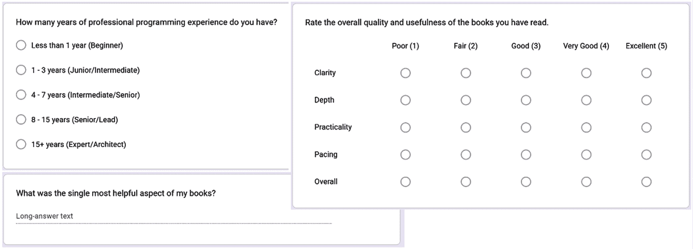

图 13.1：Google Forms 中的调查问题类型

其中一些问题类型应该很容易实现，比如纯文本回复或从多个选项中选择一个。一旦你考虑到所有潜在的可能性，其他类型可能更难实现。

### 投票和测验

调查工具与其他工具（如实时投票和测验构建器）具有相似的功能。它们都需要某种方式来构建调查、投票和测验，某种方式来参与，最后是分析结果的方法。

我经常进行现场培训课程和网络研讨会。询问听众一些关于他们自己的情况很有用，比如他们身在世界何处，他们目前的经验水平，以及他们期望从课程中获得什么。调查和实时投票的主要区别在于问题项可供回答的时长。与测验的主要区别在于正确答案的概念和最后的评分。

测验也有很多相似之处。主要区别在于问题项类型的广度。你可以想象，一个用于学习数学或物理的测验构建器可能会有一些相当复杂的组件，实现起来也很复杂。

### 分析回复

调查工具的另一个主要功能是能够分析结果，使用从基本图表到复杂的机器学习算法来发现异常模式。

## 什么是产品需求？

产品需求文档是分析业务问题的结果。它定义了一组建议功能，用于解决软件旨在解决的问题。

### 最低需求概览

调查工具的最小可行性产品将包括：

* 一个匿名参与调查的网站
* 一个查看调查结果的网站
* 用于存储调查问题项和回复的数据存储

### 最低网站要求

为了参与调查，解决方案应提供一个网站。这是为了让调查能被尽可能多的人访问。每个设备都有网页浏览器，所以网站的覆盖面最广。我们也可以使用超链接轻松分享调查。

网站应响应一个请求，以唯一值标识的调查，如下链接所示：

[`www.tallyapp.net/123456`](https://www.tallyapp.net/123456)

网站应允许匿名访问者，向他们展示问题项，并记录他们的回复。为保持简单，可以不限制多次参与调查。不需要用户注册或身份验证检查。

`Prompt`：匿名调查提交存在哪些安全风险？在调查 Web 应用中还应警惕哪些其他漏洞？

### 最低问题项类型

网站应支持以下问题类型：

* 单行纯文本
* 多行纯文本
* 评分（1-10）
* 多项选择（单选）。显示单选按钮

每种项类型都应允许纯文本问题。

### 最低数据存储要求

调查及其回复应如何存储？它需要简单。起初，人们可能会认为文档数据库更简单，因为调查看起来像一个嵌套文档：调查、问题、选项、回复。但 TallyApp 还需要权限、报告、过滤和聚合。对于本书来说，关系型数据库是更好的教学选择，因为它使这些关系变得显式。

### 最低分析应用要求

分析应用应显示所有调查及其状态的列表，例如，它们是否激活、是否完成、有多少人参与、答案详情以及结果摘要。数字结果应以表格数据和图表的形式呈现。

`Prompt`：初学者在为他们的第一个 Web 应用定义范围时会犯哪些错误？

## 扩展需求的想法

调查工具我最喜欢的方面之一是，有许多领域可以选择扩展最小产品：

* 一个访问者可以注册并跟踪他们已完成的调查的网站
* 几十种不同的问题类型
* 几十种分析结果的方法
* 多种存储问题和结果的方式，从完全规范化的数据库到基于文档的云存储
* 多种处理结果并在数据存储之上提供服务层的方式

我在线发布了更多扩展调查项目的想法。你可以在以下链接阅读：[`github.com/markjprice/web-dev-ai/blob/main/docs/extending-ideas.md`](https://github.com/markjprice/web-dev-ai/blob/main/docs/extending-ideas.md)

现在让我们创建 TallyApp 项目。

# 创建 TallyApp 项目

本节创建 TallyApp 的第一个工作版本。它特意保持精简：一个 `Survey` 模型，加上创建、编辑和删除屏幕（仅限登录用户）。还包括注册、登录和登出。UI 使用纯 CSS 进行简洁、简单的样式设计，并包含用于徽标和编辑页面上调查草图插图的 SVG 资源。

本节假设：

* Django 6
* Python 3.14
* 一个本地虚拟环境


* SQLite 数据库（稍后可替换为 PostgreSQL）

# 实用的 AI 辅助项目规划

您将在下一章学习的正式规格驱动开发可能很有用，但对于适合初学者的流程来说，它往往过于繁重。完整的规格系统涉及结构化需求文档、可追溯性、分阶段细化循环，有时还包括专用命令集或多智能体 AI 工作流。这对于构建受监管或任务关键型系统的大型团队很有价值。但对于学习如何设计和构建整洁的 Django 应用程序来说，这并非必要。

相反，您可以使用轻量级方法。思路是用 Markdown 编写一份简短、结构化的项目简报，然后使用精心设计的一次性提示词来引导 AI。

**提示词**：展示一个针对 TallyApp 的糟糕一次性提示词示例，并说明如何改进它。

例如，在构建 TallyApp 之前，创建一个名为 `project-brief.md` 的文件，其中包含明确定义的章节，如：

* 目标
* 目标用户
* 核心功能
* 非目标
* 技术约束
* 完成定义

这迫使您在编写代码前先定义范围。包含*非目标*章节可防止意外的功能蔓延，这是人主导和 AI 辅助开发中最常见的问题之一。

简报编写完成后，您可以按以下思路提示您的 AI 助手：

```
I am building a Django 6 project called TallyApp. The attached Markdown file describes the requirements. Please:
- Break the project into implementation phases.
- Propose Django models and relationships.
- Suggest URL patterns and app structure.
- Provide initial scaffolding for models, views, and templates.
- Restate the requirements in your own words before generating code and identify any ambiguities.
```

最后那条指令很重要，因为它强制 AI 在编码前复查需求。这能减少幻觉，并使假设显性化。它还体现了一个良好的职业习惯：实现前先澄清。

这就是简报重要的原因。Codex 或 Claude Code 能在几秒钟内创建 Django 文件，但除非您先做出决定，否则它们仍会做出产品决策。TallyApp 是否应允许某人提交同一份调查两次？调查发布后是否应被锁定？结果是否应存储以便日后轻松生成报表，还是仅用于当前的简单显示？这些不是编码问题。它们是设计决策。在要求 AI 构建任何东西之前，把它们写下来。简报越好，代码就越有可能变好。

**提示词**：为什么要求 AI 在生成代码前复述需求能减少幻觉？请解释结构化提示背后的心理学原理，以及为什么它能提高代码质量。

## 在运行前审查 AI 的工作

收到输出后，不要盲目地将其粘贴到编辑器中。您需要审查它。这是一份检查清单：

* 审查模型关系。
* 确认字段数据类型。
* 警惕不必要的复杂性。
* 运行数据库迁移和测试。

特别重要的是要留意安全问题：

* 每个表单模板都应包含 ``
* 受保护的视图应使用 `@login_required` 或 `LoginRequiredMixin`
* 警惕可能导致 SQL 注入攻击的原始 SQL 查询，因此代码应专门使用 Django 对象关系映射器 (ORM)
* 用户输入绝不应未经转义直接渲染，例如 `{{ variable }}` 会自动转义输出
* 确保 `SECRET_KEY` 未在任何已提交的文件中硬编码
* 调查提交视图应验证所有权和权限

AI 生成的是草稿，但您仍然是对生成的代码应用人类判断的软件工程师。

这种方法捕捉了规格驱动思维的许多优势：

* 明确的范围
* 定义的约束
* 清晰的成功标准
* 减少歧义
* 编码前的结构化规划

但它避免了正式规格框架的开销。

随着技能增长和项目变得更复杂，您可以采用更正式的规格驱动方法，正如您将在下一章看到的那样。但对于构建 TallyApp 和掌握 Web 开发基础知识，清晰的项目简报加上精心设计的提示词，是在结构与简洁之间取得的恰当平衡。

**提示词**：比较一次性提示与迭代优化提示在构建 Django 项目时的异同。

## 选择 Django 版本

虽然 Django 5.2 是唯一活跃的**长期支持 (LTS)** 版本（支持至 2028 年 4 月），但我们将以 Django 6.0 为目标，因为 6.x 系列将在 2027 年 4 月推出 LTS 版本 6.2，这在本书的预期生命周期内，如*图 13.2* 所示，详见链接：[`www.djangoproject.com/download/`](https://www.djangoproject.com/download/)

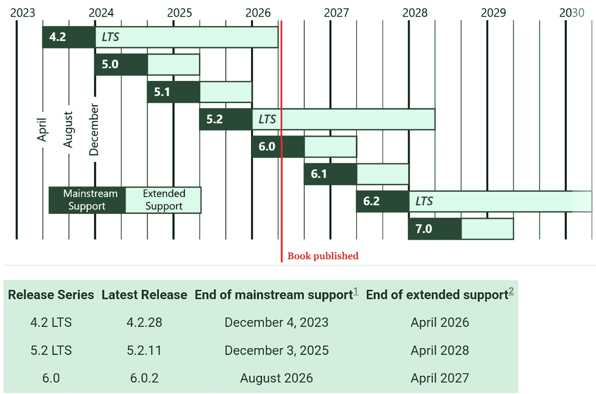

图 13.2：Django 支持的发布版本

既然我们已选择以 Django 6.0 或更高版本为目标，让我们编写项目简报。

## TallyApp 的 AI 项目简报

在项目根目录下创建一个名为 `project-brief.md` 的文件，包含以下 Markdown 代码：

此项目简报可从以下链接下载：[`github.com/markjprice/web-dev-ai/blob/main/Code/TallyProject/project-brief.md`](https://github.com/markjprice/web-dev-ai/blob/main/Code/TallyProject/project-brief.md)


# TallyApp – 项目简介

## 1. 概述

### 项目目标
TallyApp 是一个 Web 应用程序，允许经过批准的用户创建调查并公开发布。公众成员无需注册即可参与调查。调查创建者可以查看个别回复和汇总结果。

### 解决的问题
TallyApp 允许个人或组织使用多种类型的调查问题快速收集结构化反馈，而无需构建自定义软件。

---

## 2. 目标用户

### 调查创建者
- 必须使用有效的电子邮件地址注册账户。
- 必须经过管理员批准才能创建调查。
- 可以创建、发布和结束调查。
- 可以查看结果（个别和汇总）。

### 调查参与者
- 无需注册。
- 可以匿名提交回复。

### 目标用户的主页
- 描述网站功能。
- 两个大按钮用于：
    1. 创建调查（注册或登录）
    2. 参与调查

---

## 3. 核心功能（版本 1 范围）

### 认证与授权
- 定义一个名为 `SurveyCreators` 的自定义组，其成员资格授权调查创建功能。
- 调查创建者注册。
- 用户创建调查前需要管理员批准；用户获批后将被添加到 `SurveyCreators` 组。
- 登录和登出。
- 只有 `SurveyCreators` 组的成员才能创建调查。

### 调查创建
- 创建或编辑调查，包含：
  - 标题
  - 描述
  - 开始日期
  - 可选的结束日期
  - 发布状态
  - “显示在主页”标志（默认：true）
- 未发布的调查没有结果。
- 调查发布后不能编辑。
- 调查不能取消发布。
- 调查可以提前结束。此操作不可逆。
- 调查可以是开放式的（无结束日期）。
- 一旦结束，用户无法参与调查。
- 调查包含零个、一个或多个问题项，可通过调查编辑页面添加、编辑或移除。
- 每个调查都有一个唯一的公共 URL，在创建后立即显示在调查编辑页面上。
- `start_date` 在未来的已发布调查无法参与，并显示带有开始日期的警告页面。

### 问题类型
每个调查可以包含以下类型的多个问题：
1. 单选题
2. 多选题
3. 文本输入（自由形式）
4. 矩阵评分，带有评分范围，例如针对一个或多个项目的 1 到 5 分

问题/选项创作 UI 必须完全实现。
- 混合问题类型的动态表单处理。

### 公共调查访问
- 公共主页列出已发布的调查（如果“显示在主页”为真），并提供参与调查的公共 URL。
- 调查在列表视图中支持分页。
- 公共用户可以提交回复。
- 调查可能显示“截至目前”的结果。

### 结果
调查创建者可以：
- 查看汇总结果。
- 查看个别回复。
- 即使调查仍在进行中也可查看回复。
- 查看适合结果的饼图和条形图。
- 查看按电子邮件/IP/会话划分的重复提交报告。

### 图形、样式和品牌
- 用于编辑页面的徽标和调查草图插图的 `SVG` 资源。
- UI 使用 `CSS` 和 `SVG` 文件为 TallyApp 提供微妙的品牌标识：渐变标题或导航栏、彩色徽标 `SVG`、浅色调背景区域。

### 数据存储
- `SQLite` 数据库。
- 具有清晰外键关系的关系模型。

### 测试
- 基本单元测试：
  - 模型行为
  - 权限
  - 发布规则
  - 调查回复提交
- 使用 `Playwright` 进行端到端测试：
  - 每个用户故事。

---

## 4. 非目标（超出范围）
- 无支付功能。
- 无社交认证。
- 无实时更新（无 `WebSockets`）。
- 无高级分析。
- 无 `CSV` 导出。
- 无 `REST API`。
- 除管理员批准和标准用户外，无角色系统。

---

## 5. 用户故事
1. 作为用户，我想注册以便创建调查。
2. 作为管理员，我想在用户创建调查前批准他们。
3. 作为已批准用户，我想创建并发布调查。
4. 作为调查创建者，我想提前结束调查。
5. 作为公共访客，我想在不注册的情况下完成调查。
6. 作为调查创建者，我想查看汇总结果和个别回复。

---

## 6. 数据模型（高层）

### 用户
- 扩展 `Django` 的内置 `User` 模型。
- 有一个名为 `SurveyCreators` 的自定义组，其成员资格授予创建、编辑和删除调查功能的访问权限。

### 调查
- 创建者（指向 `User` 的 `ForeignKey`）
- 标题
- 描述
- 开始日期
- 可选的结束日期
- 发布标志
- 显示在主页标志
- 创建时间戳
- 提前结束标志（可选）

### 问题
- 调查（`ForeignKey`）
- 文本
- 问题类型（单选、多选、文本）
- 排序字段

### 选项
- 问题（`ForeignKey`）
- 文本
- 排序字段

### 回复
- 调查（`ForeignKey`）
- 可选的电子邮件标识符
- 提交时间戳

### 答案
- 回复（`ForeignKey`）
- 问题（`ForeignKey`）
- 选中的选项（`ManyToMany` 或中间模型，视情况而定）
- 文本答案（用于文本问题）

---

## 7. 技术约束
- `Python 3.14`
- `Django 6.x`
- `SQLite` 数据库
- 简洁、现代、移动端友好的响应式 UI
- 服务端渲染模板
- 无需 JavaScript 框架

---

## 8. 安全与权限
- 只有经过批准的用户才能创建调查。
- 只有调查创建者（和管理员）可以查看他们自己调查的结果。
- 公共用户可以提交回复。
- 调查发布后不能修改。
- 只有管理员可以批准用户创建调查。

---

## 9. 完成定义
- 用户可以注册和登录。
- 管理员可以批准用户。
- 经过批准的用户可以创建和发布调查。
- 公共用户可以提交回复。
- 调查创建者可以查看结果。
- 分页功能正常。
- 基本单元测试通过。
- 应用程序在本地使用 `SQLite` 运行无错误。

---

## 10. 未来增强（非版本 1）
- `CSV` 导出
- 图表和可视化分析
- 调查日程自动化
- 电子邮件邀请
- API 端点
- 超出基本批准的基于角色的权限

---

## 附录

### 项目简介模板
空白项目简介模板可从以下链接下载：
[项目简介模板下载链接](https://github.com/markjprice/web-dev-ai/blob/main/Code/TallyProject/project-brief-template.md)

### 回顾完整步骤
在请求 AI 生成代码之前，了解从想法到可用应用程序的完整步骤会有所帮助。提示词只是该过程中的一步，如 *图 13.3* 所示：

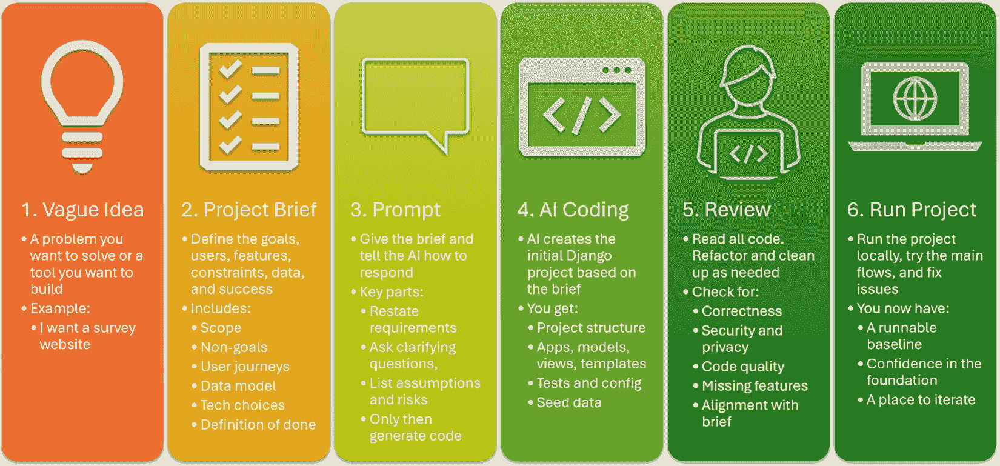

项目简介指导 AI，但人工审查和迭代才能将生成的代码转化为可用的应用程序。人工判断是关键。AI 编写代码。你决定构建什么。

总结：清晰思考 → 编写扎实的简介 → 指导 AI → 审查一切 → 修复错误 → 迭代。好的结果来自好的简介和仔细的审查，而不是魔法提示词。

### 改进你的项目简介
在请求 AI 按照你的项目简介构建新项目之前，让 AI 审查一下是个好习惯。例如：


# 阅读 project-brief.md 并作为高级工程师在实施前审查新项目

您的工作是找出所有缺失、不清晰或有风险的地方。分阶段工作：

## 第一阶段：差距分析

识别以下方面缺失或薄弱的领域：

- 需求清晰度和范围边界
- 用户旅程和边缘情况
- 数据模型假设
- 权限和安全
- 验证和错误处理
- 性能和可扩展性风险
- 测试策略
- 运维关注点（部署、配置、密钥）

暂不提出解决方案。只列出差距和歧义。

## 第二阶段：针对性访谈

向我提出聚焦问题以解决这些差距。

- 跳过显而易见或已定义明确的领域
- 优先解决高影响力的不确定性
- 一次问一个主题，而非一长串清单
- 追求具体决策，而非模糊偏好

持续直到不再有有意义的未知项。

## 第三阶段：权衡与假设

对于任何剩余的开放决策，提出 2-3 个选项并附带清晰的权衡分析。

## 第四阶段：更新简报

生成改进版文件，命名为 `project-brief-ai-enhanced.md`，要求：

- 保留所有正确的现有内容
- 澄清模糊章节
- 添加缺失的约束和边缘情况
- 使假设显性化

完整展示更新后的文件。除非明显错误，否则不要删除章节。

简洁、直接、务实。避免泛泛建议。

---

这样能增强您的项目简报，因为进行差距分析能阻止 AI 立即提出薄弱问题，例如：

- 您的用户是谁？

相反，它必须先思考，再提问。

这让 AI 放慢脚步，在跳入代码前审查简报。这更接近资深开发者在实施前审查功能需求的方式。

如果您偏好更紧凑的提示版本：

```
阅读 project-brief.md 并像高级工程师一样在实施前审查它。
1. 列出缺失或不清晰的领域（需求、边缘情况、数据模型、权限、验证、性能、测试）。
2. 通过聚焦问题访谈我以解决最重要的差距。一次问一个主题。
3. 对于未决决策，提出带权衡分析的选项。
4. 生成改进版简报，保留正确内容并使假设显性化。
跳过显而易见的点。直接且务实。
```

**提示**：盲目信任 AI 生成的脚手架代码有什么风险？

---

# 使用 design.md 引导 AI

项目简报定义了系统*应该做什么*。它仅简要定义了系统*看起来、感觉或表现如何*从用户界面角度。如果您跳过这一步，AI 将替您做这些决定。通常您需要更具体，尤其是为拥有强品牌的组织创建公共网站时。

避免此问题的简单方法是：在项目简报旁创建第二个文档：`design.md`。

该文件用通俗语言记录您的设计决策，以便您和 AI 助手遵循相同规则。

## 为什么需要单独的设计文档？

将设计与项目简报分离能保持关注点清晰：

- 项目简报定义行为、功能和约束
- 设计文档定义布局、交互和视觉一致性

这反映了真实项目的常见结构。产品和工程定义行为。设计定义行为如何呈现。

对于像 TallyApp 这样的学习项目，像素级完美设计非必要。一致性足矣。

## design.md 包含什么？

有用的 `design.md` 不必冗长；它应回答几个实际问题：

### 1. 布局与结构

描述整体页面结构：

- 带导航的页头（**首页**、**我的调查**、**登录/注册**）
- 固定宽度容器的主内容区
- 页脚（可选）

```
页面使用简单布局：顶部导航栏、居中内容列、极少干扰。避免复杂多列布局。
```

### 2. 导航与流程

解释用户如何在应用中移动：

- 登录后落地页
- 如何访问调查创建
- 如何返回上一页

```
登录后，用户重定向到"我的调查"。主要操作应无需滚动即可见。
```

### 3. 表单与交互模式

定义表单行为：

- 标签位于输入框上方
- 清晰的验证消息
- 提交按钮在底部

```
所有表单使用服务端验证，并在每个字段上方显示清晰错误消息。避免大量 JavaScript 表单逻辑。
```

### 4. 样式方法

设定样式约束：

- 使用原生 CSS
- 除非必要，避免重型框架
- 偏好简单配色方案

```
采用极简 CSS 方法。不使用 CSS 框架。保持中性色调，仅用一个强调色表示操作。
```

### 5. 组件与复用

鼓励一致性：

- 按钮到处外观一致
- 表格遵循一致结构
- 消息使用共享样式

```
为按钮、警告和表格使用可复用 CSS 类。不要为每页重新定义样式。
```

### 6. 无障碍与清晰度

即使在基础层面：

- 使用语义化 HTML
- 确保文本可读
- 避免隐藏交互

```
优先使用语义化 HTML 元素。按钮应为 `<button>`，而非可点击的 `<div>` 元素。
```

## 配合 AI 工具使用设计文件

一旦您有了 `project-brief.md` 和 `design.md`，可在提示中同时包含两者：

```
project-brief.md 文件定义功能。design.md 文件定义布局、样式和交互规则。请同时遵循两者。
```

这能减少常见问题：AI 生成的代码混合样式方法或创建不一致的 UI 模式。

一些工具开始正式化这一理念。例如，Anthropic 的 Claude Design 鼓励将设计意图与实现分离，以便模型生成更一致的用户界面。

Anthropic Labs 推出 Claude Design：[`www.anthropic.com/news/claude-design-anthropic-labs`](https://www.anthropic.com/news/claude-design-anthropic-labs)

您不需要像 Claude Design 这样的特殊工具来应用相同理念。一个简单的 `design.md` 文件即可获得大部分收益。

**良好实践**：不要将 `design.md` 变成完整的设计系统。对 TallyApp 而言，一页指南足矣。目的不是设计生产级 UI。目的是阻止 AI 臆造一个。

您越清晰地预先定义行为和设计，后期修复代码的时间就越少。

---

# 应用项目简报的一次性提示

您可以将以下内容粘贴到 AI 助手中，附上或粘贴项目简报后使用：


# TallyApp Django 项目构建提示词

我正在构建一个名为 **TallyApp** 的 Django 6 Web 应用程序。当前目录下的 `project-brief.md` 文件包含完整的项目简介，`design.md` 文件定义了布局、样式和交互规则。请遵循这两个文件。

在生成任何代码之前：

1. 用你自己的话重述项目需求。
2. 识别任何需要澄清的歧义或设计决策。
3. 列出你将做出的假设。
4. 强调潜在的复杂性风险。

然后：

5. 将实现分解为逻辑开发阶段。
6. 提出 Django 应用结构。
7. 设计带有字段和关系的数据模型。
8. 建议 URL 模式。
9. 概述视图及其职责。
10. 定义权限规则和执行策略。
11. 解释调查发布后如何变为不可变。
12. 解释多选答案的聚合逻辑。

仅在完成上述分析后，为以下内容生成适合初学者的脚手架代码：

- `models.py`
- 基础表单
- 视图
- `urls.py`
- 最小模板
- 静态文件（包括 CSS 和 SVG）
- 基础单元测试
- 使用 Playwright 的 E2E 测试

保持实现简单。除非有明确理由，避免使用高级模式。解释你为何选择特定的建模决策，特别是针对多选答案和文本响应。

---

## 如何修改 TallyApp 一次性提示词以强制执行更严格的架构约束？

**Prompt** ：How would you modify the TallyApp one-shot prompt to enforce stricter architectural constraints?

由于我们使用的是这种简单技术——一个用于规格的 Markdown 文件和一个提示词——我们不需要像 **GitHub Copilot** 那样在代码编辑器或 **集成开发环境** (**IDE**) 中的交互性。我们可以使用 AI **命令行界面** (**CLI**)，如 **Codex** 或 **Claude Code**。由于开发者通常会因模型能力波动和成本激增而在这两个主要竞争者之间切换，我们将同时考察这两个 CLI 工具。

---

### 使用 OpenAI Codex 的一次性提示词

让我们看看如何 **使用 OpenAI Codex** 进行操作：

1. 在你的 `web-dev-ai` 文件夹中，创建一个名为 `TallyProject` 的文件夹。

2. 在 `TallyProject` 文件夹中，在终端中启动 OpenAI Codex：

   ```
   codex
   ```

3. 选择 **Yes, continue** 并按 *Enter* 键，如 *图 13.4* 所示：

   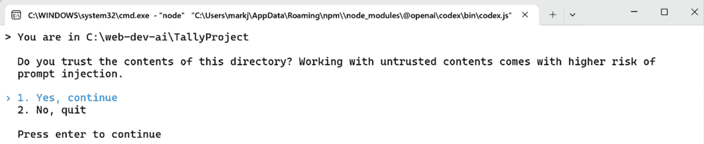

   **图 13.4：在 OpenAI Codex 中信任项目目录**

4. 请注意，你可以通过输入 `/model` 来更改模型。我将模型设置为撰写时的最新版本（`gpt-5.5-codex`），思考时间为 `medium`。注意上下文窗口还剩 100%（随着 Codex 在我们项目上工作，这会下降），如 *图 13.5* 所示：

   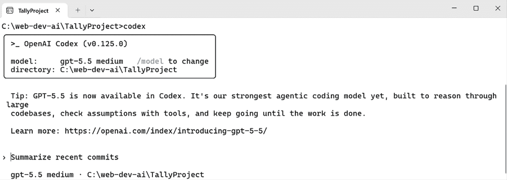

   **图 13.5：配置为使用 gpt-5.5-codex 模型且思考时间为 medium 的 OpenAI Codex**

5. 将一次性提示词复制并粘贴到提示词中。

6. 当你看到以下响应时，按 *Enter* 键接受：

   ```
   [Pasted Content 1207 chars]
   ```

7. 请注意，Codex 将开始创建文件并运行检查。让它工作，但要阅读它的输出：

   ```
   • I have the brief parsed and there's no existing code yet, so I'll scaffold a single Django app (surveys)
      with beginner-friendly function-based views, model-level safeguards, and templates/static/test files.
      Plan: (1) create models and forms that encode publish immutability + mixed-question responses, (2) wire
      views/URLs/templates for creator and public flows, (3) add CSS/SVG assets, (4) add unit + Playwright E2E
      scaffolds and summarize decisions.
   • I'm starting file creation now, beginning with models.py and forms.py so the permission, immutability, and
      answer-shape rules are encoded before wiring the UI.
   ...
   • I'm now wiring the core application flow (views.py, urls.py, templates, tests) around the models/forms
      already created, keeping everything function-based and explicit for beginner readability.
   ...
   • Core Python files are in place; next I'm adding minimal templates and static assets so the scaffold is
      runnable and visually aligned with the brief (Pico baseline + small brand overrides + SVGs).
   ...
   • I'm writing tests now (unit + Playwright scaffold) and then I'll run a quick syntax/import check; I also
      need one small template fix () before validation.
   ...
   ```

8. 你将偶尔被提示接受某些工作：

   ```
   Would you like to run the following command?
     $ Get-ChildItem -Recurse -Directory -Filter __pycache__ | Remove-Item -Recurse -Force
   ' 1. Yes, proceed (y)
     2. Yes, and don't ask again for commands that start with `Get-ChildItem -Recurse -Directory -Filter
        __pycache__ | Remove-Item -Recurse -Force` (p)
     3. No, and tell Codex what to do differently (esc)
     Press enter to confirm or esc to cancel
   ```

9. 你必须明确告诉它完成其他步骤，如 *图 13.6* 所示：

   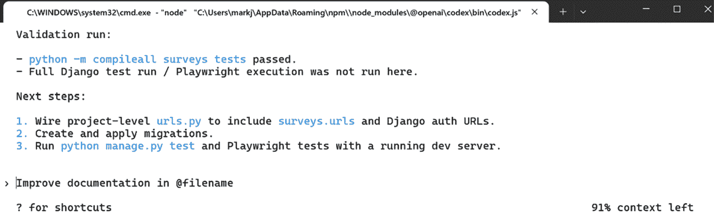

   **图 13.6：Codex 显示后续步骤**

10. 告诉它继续后续步骤：

    ```
    Please complete those three next steps.
    ```

11. 如果任何步骤需要额外权限，你将被提示同意：

    ```
    Would you like to run the following command?
      Reason: Do you want to allow running Playwright tests with unrestricted npm/network access so E2E
      dependencies can be resolved?
      $ npx playwright test
    ' 1. Yes, proceed (y)
      2. Yes, and don't ask again for commands that start with `npx playwright test` (p)
      3. No, and tell Codex what to do differently (esc)
      Press enter to confirm or esc to cancel
    ```

12. 运行数据库迁移：

    ```
    python manage.py migrate
    ```

13. 创建超级用户：

    ```
    python manage.py createsuperuser
    ```

14. 启动网站：

    ```
    python manage.py runserver
    ```

15. 启动你喜欢的浏览器并导航到托管在 [`127.0.0.1:8000`](http://127.0.0.1:8000) 的网站，如 *图 13.7* 所示：

    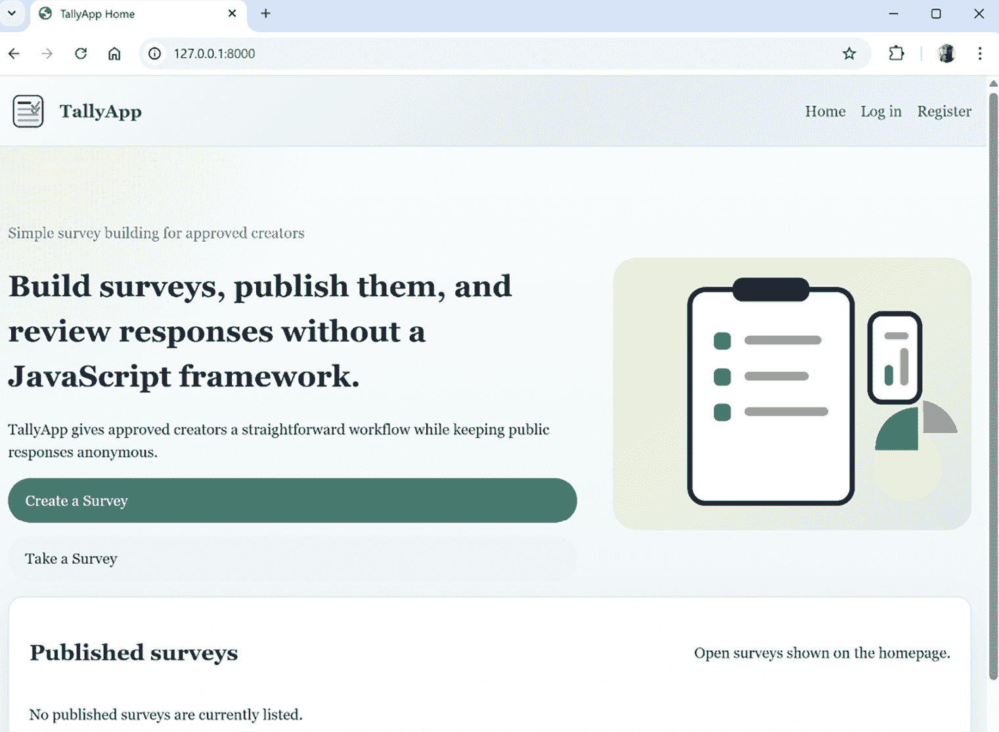

    **图 13.7：最终网站**

现在我们可以尝试网站的功能。

使用网站完成以下任务：

1. 注册为新用户
2. 作为新用户登录
3. 登出
4. 作为你创建的超级用户登录
5. 批准用户为调查创建者
6. 作为新用户登录并创建调查
7. 向调查添加问题
8. 发布调查
9. 登出，然后匿名参与调查

如果你想使用 Claude Code 构建项目，可以遵循下一节的步骤，或跳到下一节查看你的 AI 助手编写的代码。

---

### 使用 Claude Code 的一次性提示词

让我们看看如何 **使用 Claude Code** 进行操作：

1. 在你的 `web-dev-ai` 文件夹中，创建一个名为 `TallyProject-Claude` 的文件夹。

2. 在 `TallyProject-Claude` 文件夹中，在终端中启动 Claude Code：

   ```
   claude
   ```

3. 选择 **Yes, continue** 并按 *Enter* 键，如 *图 13.8* 所示：

   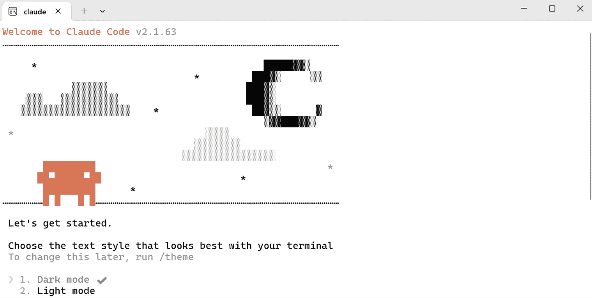

   **图 13.8：在 Claude Code 中选择文本样式**

4. 选择你想要的付费方式，如 *图 13.9* 所示：

   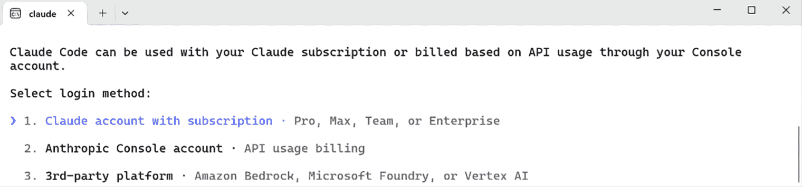

   **图 13.9：在 Claude Code 中选择计费方式**

5. 将一次性提示词复制并粘贴到提示词中。

6. 当你看到以下响应时，按 *Enter* 键接受：

   ```
   [Pasted Content 1207 chars]
   ```

7. 请注意，Claude Code 开始工作。请耐心等待并观察它的工作过程。

**Prompt** ：Please explain how AI tools like Codex and Claude Code differ in workflow philosophy.

---

## 避免 AI 使用限制


# 优化 AI 工具使用

AI 工具通常会施加使用限制，尤其是在免费或低阶套餐上。养成一些习惯可以减少浪费的提示词，并帮助你避免在任务进行到一半时用完额度。

首先，提示词要深思熟虑。不要发送多个零碎、模糊的请求，而是将它们合并为单个清晰且结构良好的提示词。这能减少来回交互，让你在一次响应中就更接近有用的结果。（在分布式架构中，这一原则被称为：*Be chunky, not chatty* [要“块状”，别“啰嗦”]。）

其次，高效迭代。不要从头开始重写，而是优化之前的提示词，或要求 AI 改进它自己的回答。基于现有上下文进行构建能减少请求次数并产出更好的结果。

再次，在处理实际任务时避免不必要的尝试。尝试多种变体很容易耗尽额度。当你有明确目标时，保持专注和直接。

最后，在适当的时候切换工具或模式。一些平台提供不同的模型、免费层级或备选方案。了解何时使用轻量级模型与何时使用更高级模型，能帮助你保持在限额之内。

核心思想是将 AI 交互视为一种资源。深思熟虑、结构良好的提示词不仅能提高质量，还能帮助你保持高效，而不会触及上限。

随着初始项目现已生成，下一步是退后一步，在进行任何更改之前，审视 AI 实际生成了什么。

# 审查 AI 创建的项目

## 在 VS Code 中打开项目

使用 VS Code 打开根项目文件夹，如*图 13.10* 所示：

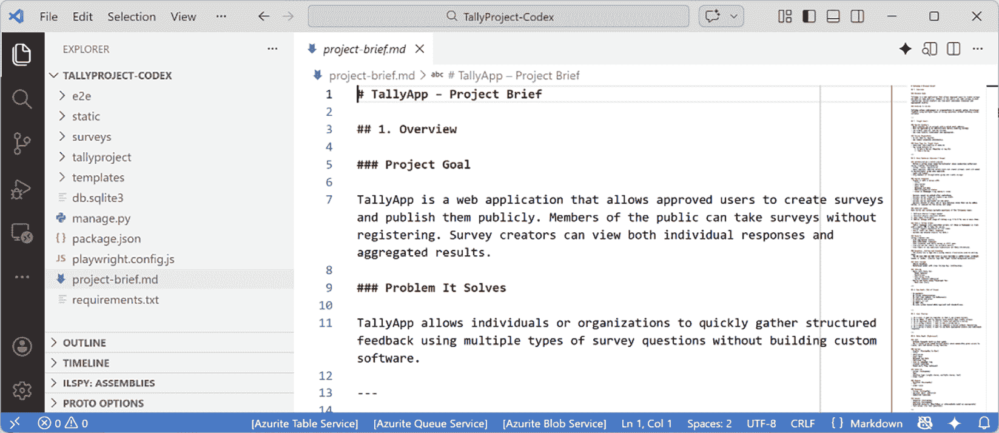

*图 13.10：显示 TallyApp 项目文件夹的 VS Code*

## 项目结构概览

浏览文件夹结构并注意以下内容：

* `tallyproject/` 是存放全局配置（如 `settings.py` 和 `urls.py`）的项目
* `surveys/` 是一个包含实际功能（如模型、视图和业务逻辑）的应用
* `templates/` 用于共享布局和基础模板
* `static/` 用于整个网站使用的 CSS、JS 和图片
* `db.sqlite3` 是项目根目录下的 SQLite 数据库
* `manage.py` 是与项目交互的主要方式，例如：

```
python manage.py runserver
python manage.py migrate
```

* `requirements.txt` 定义 Python 依赖，并允许使用以下命令重新创建项目：`pip install -r requirements.txt`
* `package.json`、`playwright.config.js` 和 `e2e` 是基于 JavaScript 的端到端 Web UI 配置和文件夹，其中 `app.spec.js` 包含实际的 Playwright 测试

## 请 AI 解释其工作

对于每个文件，查看其内容并理解其功能。如果你不理解，可以询问你的 AI 助手，方法是在 Copilot 聊天窗口中输入，或将代码复制到你偏好的基于浏览器的聊天界面中。

### 使用 Gemini

例如，我请 Gemini 解释 Playwright 测试，如*图 13.11* 所示，其回复可在以下链接阅读：[`github.com/markjprice/web-dev-ai/blob/main/docs/gemini-tests.md`](https://github.com/markjprice/web-dev-ai/blob/main/docs/gemini-tests.md)

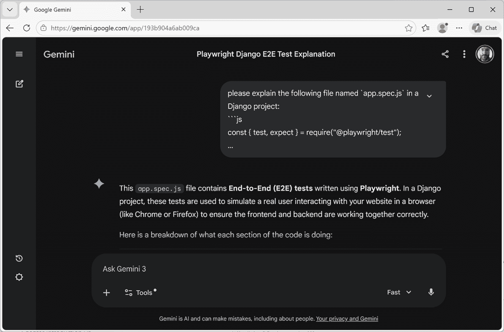

*图 13.11：请 Gemini 解释 Playwright 测试*

**提示词**：环境变量如何提高 E2E 测试的可靠性？请解释 Playwright 中 `test.skip()` 的工作原理及其使用时机。

### 在 VS Code 中使用 Copilot

我也在 VS Code 中使用了 Copilot，如*图 13.12* 所示：

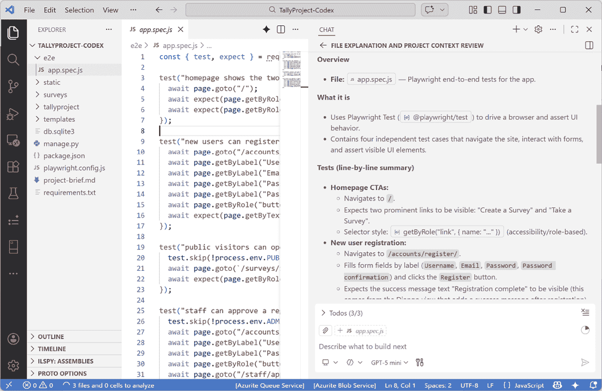

*图 13.12：在 VS Code 中请 Copilot 解释 Playwright 测试*

注意 Copilot 提供了指向 Django 文件的直接链接来解释测试，如*图 13.13* 所示：

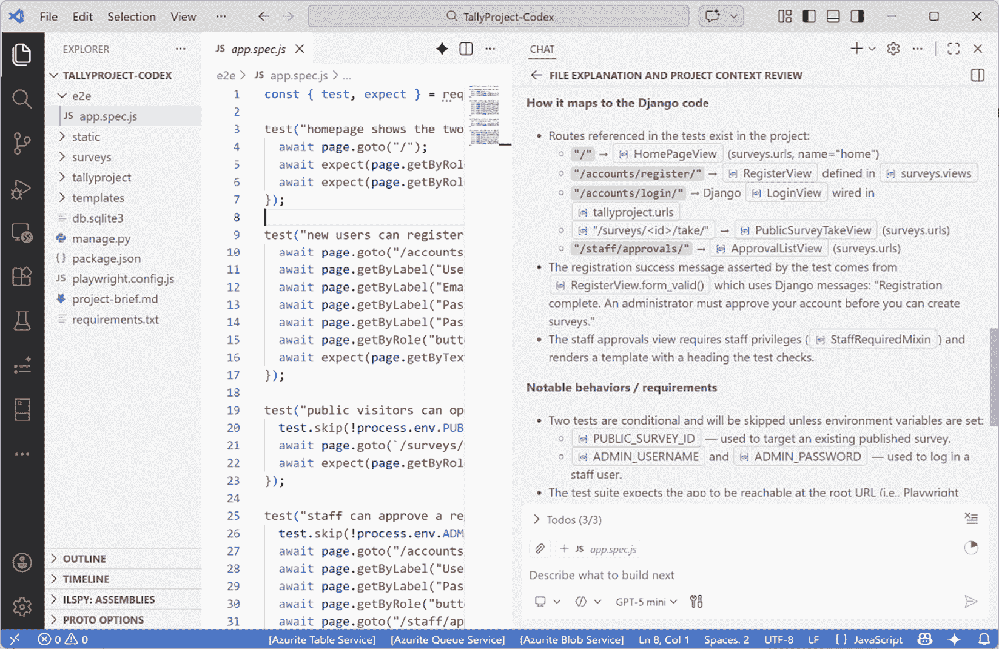

*图 13.13：带有指向 Playwright 测试的 Django 代码文件链接的 Copilot*

## 审查样式表和图形

### 静态文件：CSS 和图片

在 `static` 文件夹中，打开 `css` 和 `img` 文件夹中的文件：

* `site.css` 包含整个网站的 CSS 样式。你理解这些规则是如何工作的吗？回顾 *第 3 章* *CSS – 设置 Web 页面样式*，复习你所学的内容。请你的 AI 助手解释任何你不理解的地方。

**提示词**：当请求 AI 解释不熟悉的代码时，我该如何构建提示词？

* `logo.svg` 定义了网站的图标。当你用 VS Code 打开此文件时，默认会显示图像，但你可以右键点击文件并选择**打开方式...**，以便在**文本编辑器**中并排打开，如*图 13.14* 所示：

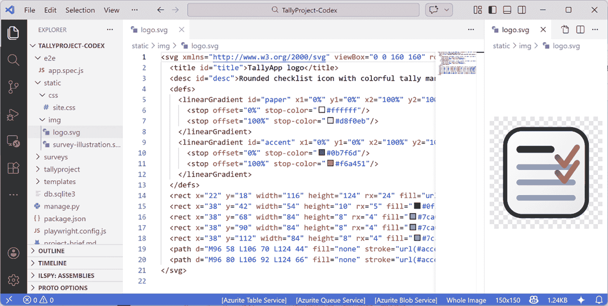

*图 13.14：在图像查看器和文本查看器中打开的 SVG 文件*

### Surveys 应用：URL 配置

`surveys` 文件夹是一个用于管理调查的应用功能，其中 `urls.py` 定义了所有 URL 模式：

```
urlpatterns = [
    path("", HomePageView.as_view(), name="home"),
    path("creator/", SurveyListView.as_view(), name="survey_list"),
    path("creator/surveys/new/", SurveyCreateView.as_view(), name="survey_create"),
    path("creator/surveys/<int:pk>/", SurveyDetailView.as_view(), name="survey_detail"),
    path("creator/surveys/<int:pk>/edit/", SurveyUpdateView.as_view(), name="survey_update"),
    path("creator/surveys/<int:pk>/publish/", SurveyPublishView.as_view(), name="survey_publish"),
    path("creator/surveys/<int:pk>/clone/", SurveyCloneView.as_view(), name="survey_clone"),
    path("creator/surveys/<int:pk>/end/", SurveyEndView.as_view(), name="survey_end"),
    path("creator/surveys/<int:pk>/results/", SurveyResultsView.as_view(), name="survey_results"),
    path("creator/surveys/<int:pk>/responses/", SurveyResponsesView.as_view(), name="survey_responses"),
    path("creator/surveys/<int:survey_pk>/questions/new/", QuestionCreateView.as_view(), name="question_create"),
    path("creator/questions/<int:pk>/edit/", QuestionUpdateView.as_view(), name="question_update"),
    path("creator/questions/<int:pk>/delete/", QuestionDeleteView.as_view(), name="question_delete"),
    path("staff/approvals/", ApprovalListView.as_view(), name="approval_list"),
    path("staff/approvals/<int:user_pk>/approve/", ApproveUserView.as_view(), name="approve_user"),
    path("surveys/<int:pk>/take/", PublicSurveyTakeView.as_view(), name="take_survey"),
]
```

### 模板：基础 HTML

`templates` 文件夹包含网站的 HTML：

* `base.html` 包含所有网页的模板。查看它并确保你理解其中使用的所有 HTML 标签。如果有不理解的地方，请询问你的 AI 助手。


# TallyApp Project Structure

## Django Base Template

```html

<!DOCTYPE html>
<html lang="en">
<head>
    <meta charset="utf-8">
    <meta name="viewport" content="width=device-width, initial-scale=1">
    <title>TallyApp</title>
    <link rel="stylesheet" href="">
</head>
<body>
    <header class="site-header">
        <div class="wrap nav-shell">
            <a href="" class="brand">
                
                <span>TallyApp</span>
            </a>
            <nav class="site-nav">
                <a href="">Home</a>
                
                    <a href="">My Surveys</a>
                    
                        <a href="">Approvals</a>
                    
                    <form method="post" action="">
                        
                        <button type="submit" class="link-button">Log out</button>
                    </form>
                
                    <a href="">Log in</a>
                    <a href="">Register</a>
                
            </nav>
        </div>
    </header>
    <main class="wrap page-shell">
        
            <ul class="messages">
                
                    <li class="message {{ message.tags }}">{{ message }}</li>
                
            </ul>
        
        
    </main>
</body>
</html>
```

## Folder Structure

- `registration` folder contains the login and registration pages.
- `surveys` folder contains pages for approving creators, managing surveys, etc.

> **Prompt**: If TallyApp grows to 1 million responses per survey, what architectural changes are needed? How to evolve TallyApp into a multi-tenant SaaS product?

# Most Interesting Design Decision in TallyApp

If there is one place in TallyApp where database design truly matters, it is how survey answers are modeled. The rest of the system is relatively straightforward.

The difficulty stems from a simple fact: not all questions are the same.

TallyApp currently supports three question types:

- Single-choice multiple choice
- Multi-choice multiple choice
- Free-text questions

At first glance, you might want a flexible `Answer` model with a few nullable fields to store everything. For example:

- `selected_choice` field for single-choice questions
- `selected_choices` many-to-many field for multi-choice questions
- `text_value` field for text questions

This works, but forces you to think carefully about data integrity. You must ensure:

- Single-choice questions never store multiple choices
- Multi-choice questions can store multiple choices
- Text questions never reference choices
- Choice-based questions never substitute free text for choices

The model must encode rules that reflect the application's business logic.

This is exactly where the relationals aren't a flat JSON blob; they are a set of structured answers, each linked to a question. This makes aggregation, filtering, and reporting much easier.
3. Third, it highlights future extensibility. If you later decide to add rating-scale questions or numeric input questions, your model already has clear extension points.

There is also an important architectural lesson here: the data model defines what is possible. If you or your AI model answer hastily, you will struggle later when implementing features like aggregation counts, filtering by question, validation rules, export functionality, and performance optimization.

In fact, many real-world systems that outgrow their capacity do so because their early data models were too simple.

> **Prompt**: Deeply explain why modeling survey answers is the most critical architectural decision in TallyApp. Show three different database designs for handling single-choice, multi-choice, and text answers, and compare trade-offs. How does a senior engineer review AI-generated Django models?

Finally in this chapter, we will learn about the Codex GUI app released for Mac in February 2026 and for Windows in March 2026.

# Interactive Development with Codex App

So far in this chapter, you have used one-shot prompts to generate a complete project scaffold. This technique is efficient but remains primarily text-based. You describe what you want, the AI generates code, and then you review it.

**Codex App** introduces a different way of working. Instead of only describing the system through text, you can interact with the running application and give feedback directly on what you see.

This becomes especially useful once TallyApp is running locally and you shift from *building structure* to *refining behavior and UI*.

You can learn more about Codex App in the official documentation: [`developers.openai.com/codex/app`](https://developers.openai.com/codex/app)

## Capabilities Added by Codex App

Codex App is a graphical interface for AI-assisted development. It runs alongside your editor and local development environment, allowing you to:

- Chat with the model about the codebase
- Run commands and inspect output
- Work with files and generated code
- Interact with a live preview of the app

The key difference from the earlier workflow in this chapter: the AI no longer works only from description. It can be guided by the actual running UI.

This reduces a common problem in AI-assisted development: vague instructions like "make it look better" or "fix the layout" often produce inconsistent results.

## Browser-Based Interaction for UI Work

One of the most useful features of Codex App is its ability to interact directly with a running web app via a built-in browser panel. This makes web UI work feel more like "point at the screen and say: change this."

Once your Django development server is running, you can connect Codex App to the local site:

1. Start a chat with your preferred model
2. Launch the Django development server (e.g., `python manage.py runserver`)
3. Open the browser panel in Codex App


## 浏览器交互

4. 导航到您的本地站点（例如，`http://127.0.0.1:8000`）

5. 使用浏览器工具检查和标注 UI

浏览器面板包含以下功能：

* 对当前页面进行截图
* 向特定 UI 元素添加标注
* 将这些带标注的截图直接发送到聊天中

当您点击按钮、表单或布局元素并附加评论时，模型会同时接收视觉上下文（截图）和与特定 UI 部分关联的指令。

例如：

```
This button is too small and blends into the background. Make it more prominent and consistent with the primary action style.
```

这比仅用文字描述问题要精确得多。

在前面的章节中，您了解了在生成代码之前定义行为和结构的重要性。UI 优化面临类似的挑战：用语言描述视觉问题往往不够精确。

浏览器交互功能从三个方面改进了这一点：

1. **共享上下文**：AI 看到的正是您所看到的，而不是从模板和 CSS 推断布局。
2. **针对性更改**：反馈附加到特定元素，而不是对页面的模糊描述。
3. **更快的迭代**：您可以快速尝试更改、审查它们，并再次优化，而无需重写冗长的提示词。

这避免了您凭记忆描述布局问题。

## TallyApp 示例步骤

TallyApp 项目在本地运行后，您可以使用以下步骤：

1. 在 Codex 浏览器面板中打开主页。
2. 点击**创建调查**按钮。
3. 添加标注，如*图 13.15*所示：

```
This should be the primary action. Increase contrast and add more padding.
```

4. 让 Codex 提出对 CSS 和模板的更改建议。
5. 在应用更改前进行审查。
6. 重新加载并重复。

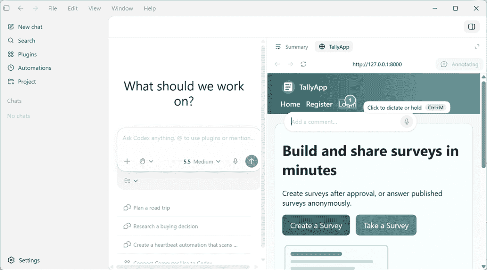

图 13.15：使用 Codex App 在 TallyApp 主页上添加评论标注

您可以遵循类似的流程处理表单布局、导航结构、错误消息、间距和对齐问题。

## 局限性与良好习惯

此功能很有用，但仍应像工作流的其他部分一样，保持同样的纪律性使用。

请记住以下几点：

* 不要盲目接受 UI 更改。始终审查生成的 CSS 和模板。
* 保持 `design.md` 与更改同步，以免陷入不一致的样式。
* 避免进行许多细小、不协调的调整。倾向于成组的、有意图的更改。
* 将其用于优化，而非初始架构。

另请注意，交互目前是逐元素进行的。如果您想一致地更改多个组件，应描述模式，而不仅仅是单个元素。

在以下情况下使用 Codex 浏览器交互：

* 应用程序已在运行
* 您正在优化布局、样式或易用性
* 您可以指向屏幕上的具体问题

请勿依赖它用于：

* 初始项目设计
* 数据建模决策
* 安全或权限逻辑

这些仍属于本章前面提到的项目简报和设计思考范畴。

## 练习、参考资料与资源

在本节中，您将接受本章所学内容的测试，并获得有用的参考资料和资源链接。

### 检查您的理解

1. 为什么在编写代码前定义范围很重要？
2. 项目简报在本章工作流中的目的是什么？
3. **产品需求文档**（**PRD**）与功能规格说明书有何区别？
4. TallyApp 中的三个主要用户旅程是什么？
5. 为什么要在项目简报中明确定义非目标？
6. 什么是**最小可行性产品**（**MVP**），为什么它在这里很重要？
7. 为什么采用轻量级 AI 辅助规划方法，而不是完整的规格驱动开发？
8. 为什么应该让 AI 在生成代码前复述需求？
9. 为什么审查 AI 生成的代码是必不可少的步骤？
10. 为什么建模调查答案被认为是 TallyApp 中最重要的设计决策？
11. 您在定义范围前就开始构建功能，后来感到不堪重负。哪里出错了？
12. 您的 AI 生成了一个庞大、复杂的 Django 项目，包含您未要求的功能。为什么会发生这种情况？
13. 您要求 AI 立即生成代码，而不先澄清需求。这引入了什么风险？
14. 您定义了一个功能，但未指明它超出 MVP 范围。可能的结果是什么？
15. 您将调查答案构建为单个非结构化 JSON blob。以后可能会面临什么问题？

答案可在本书的 GitHub 存储库中找到，链接如下：

`https://github.com/markjprice/web-dev-ai/blob/main/docs/Appendix-A.pdf`

### 链接

* OpenAI Codex 文档：`https://platform.openai.com/docs`
* OpenAI CLI 工具概览：`https://platform.openai.com/docs/guides/tools`
* Claude Code 概览：`https://www.anthropic.com/claude-code`
* Anthropic Claude 文档：`https://docs.anthropic.com/`
* Anthropic Console：`https://console.anthropic.com/`
* Anthropic Claude 认证社区创建的信息：`https://github.com/paullarionov/claude-certified-architect/blob/main/guide_en.MD`
* Copilot CLI 课程：`https://github.com/github/copilot-cli-for-beginners`

## 总结

在本章中，您从学习分散的 Web 开发技能进阶到构建 TallyApp 的第一个版本。

您学习了以下内容：

* 为实际 Web 应用程序定义了清晰的范围，包括明确的目标、目标用户和非目标，以防止功能蔓延
* 理解了如何将高层产品创意转化为结构化的 PRD 风格简报
* 确定了核心用户旅程：创建调查、匿名参与调查，以及查看汇总和个别结果
* 区分了 MVP 范围和扩展功能，并理解了为什么刻意的约束能改善学习和执行
* 使用结构化的 Markdown 项目简报练习了轻量级 AI 辅助项目规划，并使用了单次提示词，强制 AI 助手复述需求、识别歧义、列出假设并强调风险
* 通过 OpenAI Codex CLI 和 Claude Code 的 AI 辅助搭建了 Django 6 项目。
* 检查了生成的 Django 项目结构，包括应用、模板、静态资源和 URL 配置，并使用 AI 工具（Gemini、Copilot）解释和探索陌生代码
* 审查了静态文件、基础模板、URL 模式和 Django 模板逻辑，以加深对服务器端渲染应用程序的理解

在下一章中，您将学习关于为像 TallyApp 这样的现有项目添加新功能的规格驱动开发。

## 获取本书的 PDF 版本及更多内容

扫描二维码（或访问 `packtpub.com/unlock`）。按名称搜索本书，确认版本，然后按照页面上的步骤操作。


* 注：请保留发票。直接从 Packt 购买不需要发票。 *

## 14