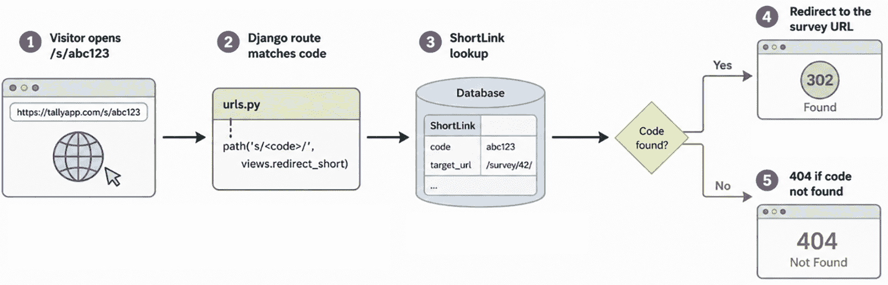
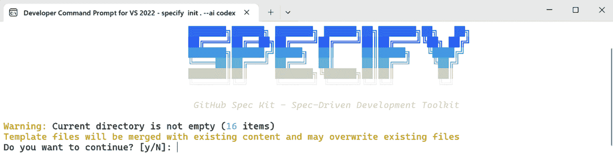
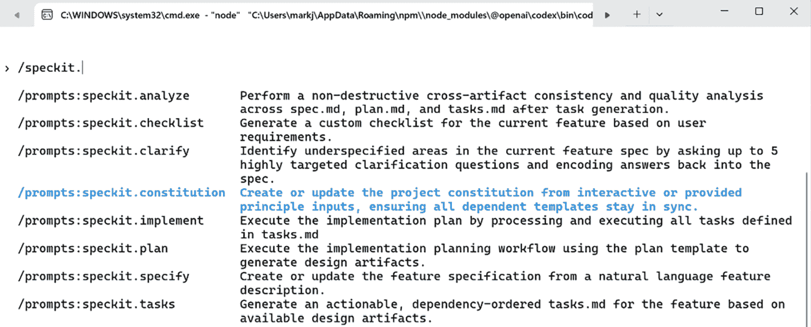

# 使用规格驱动开发添加项目功能


# 规格驱动开发

在上一章中，你使用了一个大型提示词和产品需求文档来生成 `TallyApp` 的第一个可工作版本。该方法展示了 AI 工具如何快速搭建整个项目。然而，真实的软件项目很少在第一次实现后就停止。随着系统演进，会不断添加新功能、优化行为，并发现边缘情况。

对于下一个功能，不要一开始就让 AI “添加一些有用的东西”。首先要把功能写下来。说明它应该做什么、谁可以使用、失败时会发生什么，以及你将如何验证它是否工作。

这种工作方式通常称为**规格驱动开发**。规格说明成为功能的约定描述，而代码成为其实现。当涉及 AI 编码助手时，这种纪律尤为重要，因为它们倾向于根据未经验证的假设编造行为来填补缺失的细节。清晰的规格说明减少了 AI 需要填补的空白，也减少了 AI 发明你未要求的行为的空间。

在本章中，你将把这种方法应用到现有的 `TallyApp` Django 项目中。你将通过设计和实现一个小而现实的功能来扩展当前的代码库，而不是生成一个全新的应用程序。

到本章结束时，你将编写一个结构化的功能规格说明，使用 AI 编码助手在现有的 Django 项目中实现它，并验证该实现是否满足明确定义的验收标准。

## 涵盖主题

- 规格驱动开发
- 使用 `Spec Kit` 构建规格说明
- 为 `TallyApp` 添加 URL 短链接功能
- 扩展 `TallyApp` 的思路

本章建议的聊天机器人提示词及示例回复可在以下链接找到：[`github.com/markjprice/web-dev-ai/blob/main/prompts/ch14-spec/readme.md`](https://github.com/markjprice/web-dev-ai/blob/main/prompts/ch14-spec/readme.md)

## 规格驱动开发

在规格驱动开发中，你从系统应该做什么的书面描述开始。你不再从代码开始并希望设计能自行理顺，而是先写下功能：问题是什么、范围内有什么、范围外有什么、工作完成时必须满足什么条件。然后再实现。

这个想法并不新鲜。优秀的工程师一直在编写需求、用户故事和验收标准。新的是 AI 编码助手的出现。像 `GitHub Copilot`、`OpenAI Codex` 和 `Claude Code` 这样的工具可以快速生成大量代码。它们可以搭建项目、重构模块，甚至提出架构变更。这有帮助，但也引入了风险。如果没有清晰的规格说明，AI 工具会自信地实现你未曾预期的假设。它们会填补你未曾察觉的空白。它们会优化合理性而非正确性。这很危险，因为看似合理的代码往往比明显损坏的代码更难被发现。

规格驱动开发为 AI 辅助编码带来了纪律。规格说明成为参考文档。它定义了功能范围、非目标、数据模型、用户界面行为和错误条件。AI 不再被要求*构建一个应用*，而是被要求满足明确的验收标准。每个需求必须可追溯到代码。每个行为必须可验证。

这就是规格说明重要的原因。`Codex` 或 `Claude Code` 可以编写大量 Django 代码，但除非你定义什么是“完成”，否则它不会知道功能是否完成。对于 URL 短链接功能，这意味着编写诸如：谁可以创建链接、代码如何生成、未知代码会发生什么、哪些测试必须通过等规则。

> **提示：** 为什么当规格说明不完整时，AI 编码助手倾向于做出错误的假设？描述在使用 AI 编码助手时模糊需求的风险。

测试将规格说明从文档转变为可强制执行的东西。无法验证的规格说明只是文档。有自动化测试支撑的规格说明变得可强制执行。在 Python Web 项目中，这通常意味着将验收标准映射到使用 `pytest` 的单元测试，并在适当的情况下映射到浏览器级测试。测试套件成为裁判。当 AI 生成代码时，测试决定该代码是否可接受。如果失败，实现就是错误的，无论它看起来多么完善。

### 优秀规格说明包含的内容

一个有用的 Web 功能规格说明应该简短，但不能模糊。对于 `TallyApp`，典型的功能规格说明可能包含以下部分：

#### 目标

简短段落描述此功能实现了什么。示例：*允许已认证用户创建、编辑和删除调查*。

#### 非目标

列出你刻意不构建的内容。示例：*本迭代不包含公开调查分享*。

> **提示：** 请解释为什么“非目标”在软件规格说明中很重要，并给出真实项目中的例子。

#### 用户故事

从用户角度编写主要交互：

- 作为已登录用户，我可以创建新调查
- 作为已登录用户，我可以编辑现有调查的标题
- 作为已登录用户，我可以删除我自己的调查

#### 验收标准

这些是精确的、可测试的条件。验收标准应写得无需重新解释即可成为测试。避免像* UI 应该简洁*这样的模糊陈述。它们应该是可观察的事实：

- 提交有效的调查表单时，调查保存到数据库
- 提交无效表单时，显示验证错误
- 用户不能编辑其他用户的调查
- 删除后，调查不再出现在列表视图中

> **提示：** 请展示一些编写不佳的验收标准示例，以及如何将它们重写为清晰、可测试的需求。

#### 数据模型变更

定义字段、关系和约束。例如：

- Survey: `id` (主键), `owner` (外键关联用户), `title` (字符串, 最大长度 200), `created_at` (时间戳)。如果字段有约束，写下来。如果关系有级联行为，指明它。

#### 错误处理和边缘情况

- 如果用户尝试编辑不存在的调查会发生什么？
- 如果缺少必需数据会发生什么？
- 对于禁止访问应返回什么 HTTP 状态码？

> **提示：** 请给出开发人员编写规格说明时常忘记的边缘情况示例。请解释如何识别软件规格说明中的隐性假设。

#### 验证命令

写下稍后如何检查该功能：

- 运行单元测试
- 运行集成测试
- 启动开发服务器，如有需要手动确认行为

> **提示：** 请解释规格驱动开发与**测试驱动开发**（TDD）和**行为驱动开发**（BDD）有何不同。包含规格驱动开发、TDD 和 BDD 的并排比较，包括各自的优缺点。

## 规格驱动开发工具


并没有一种标准的方式来进行规格驱动工作。不同的团队以不同的方式构建规格，使用不同的术语，并自动化流程的不同部分。一些开发人员倾向于将轻量级 Markdown 文档与源代码一起存储。其他人则使用类似于传统需求文档的结构化模板。一些流程强调自动化测试作为规格的可执行形式，而另一些则侧重于指导 AI 工具分阶段实现的规划工件。

一小部分支持这种开发风格的工具生态系统已经开始出现。一个例子是 **Spec Kit**，这是 GitHub 的一个开源项目，提供用于编写规格、生成实现计划和将功能分解为任务的模板和命令。另一个工具是 **OpenSpec**，旨在标准化可被 AI 代理解释的机器可读软件规格。一些开发人员还在尝试内置于 AI 编码环境（如 Cursor、Continue 和 Claude Code）中的规格优先工作流，其中结构化提示和规划步骤引导模型进行功能开发。

**警告！** 由于 GitHub Spec Kit、OpenAI Codex、Anthropic Claude Code 和其他 AI 工具正在快速演变，请将确切的提示和细微的设置细节视为可能会随时间而变化。

现在您已经了解了一些规格驱动开发工具，让我们更详细地看看一个实用的选项。

# 使用 Spec Kit 构建规格

支持规格驱动开发的一个实用工具是 **Spec Kit**，这是 GitHub 发布的一个开源项目。它为编写规格、规划实现和协调 AI 辅助开发提供了结构化的工作流和模板。

Spec Kit 不是框架或库。相反，它是一个轻量级系统，帮助开发人员组织他们的规格，以便人类和 AI 助手都能清晰地理解它们。

## Spec Kit 工作流

Spec Kit 将开发组织为一系列阶段。每个阶段生成一份文档，在进入下一步之前阐明系统。

典型的工作流如下所示：

### 1. 项目原则，也称为宪章

一份定义项目高层规则和理念的文档。这些可能包括编码标准、架构约束或测试要求等约定。

此阶段解决的示例问题：

* 系统应优先考虑简单性还是可扩展性？
* 需要哪些测试实践？
* 允许或禁止哪些技术？

这份文档设定了 AI 在更改项目时应遵循的规则。

### 2. 功能规格

规格描述将要构建的功能。

它通常包括：

* 功能目标
* 非目标和约束
* 用户故事
* 验收标准
* 数据模型变更
* 错误处理和边缘情况

这是您准确定义功能必须做什么的阶段。

### 3. 实现计划

规格获批后，下一份文档描述功能将如何实现。

计划通常包括：

* 架构变更
* 新模块或服务
* 数据库迁移
* 测试策略
* 部署考量

AI 工具在此阶段特别有用，因为它们可以根据规格建议实现方法。

### 4. 任务分解

然后将实现计划转换为具体开发任务的列表。

例如：

* 创建 ShortLink Django 模型
* 添加重定向视图
* 创建生成短链接的表单
* 编写单元测试

这些任务可以按顺序执行，通常在 AI 协助下进行。

### 5. 实现

只有在定义了规格、计划和任务之后，实际编码才开始。

在此阶段，AI 助手获得清晰的指令和约束。它不再发明行为，而是简单地实现已描述的内容。

**提示**：请解释 Spec Kit 和 OpenSpec 等工具如何帮助防止 AI 编码助手引入意外功能。

结构有帮助，但也有成本。在对每个更改都使用 Spec Kit 之前，值得了解何时更轻量的方法就足够了。

## 何时 Spec Kit 属于过度设计？

Spec Kit 可以帮助保持 AI 生成的工作在正轨上，但对于小更改来说可能过头了。您用一些编码时间换取了更多的规划和审查时间。

让我们了解 Spec Kit 何时可能属于过度设计或不必要。

### 何时更轻量的提示就足够

如果您处于探索阶段，例如原型设计 UI 或测试基本概念，Spec Kit 的严格流程（`/constitution` → `/specify` → `/plan` → `/tasks`）会拖慢您的速度。

小项目通常受益于氛围编码，即您给出一个高层提示并直接在代码上迭代。为周末业余项目设置宪章属于过度设计。

### 高上下文代码比

Spec Kit 可以为单个功能生成数百行 Markdown。对于小项目（如只有两个视图的基本 URL 短链接服务），文档可能比代码还长。例外是学习时，因为较小的项目更容易理解。

风险在于您花在阅读和纠正 AI 的计划和规格上的时间，可能比直接编写代码或审查单次 AI 输出所需的时间还要多。

### 小调整和一次性错误修复

如果您只是更改按钮颜色、更新正则表达式或修复简单的逻辑错误，只需直接提示您的 AI 编码工具。为 5 行更改运行完整的 `/specify` 和 `/plan` 周期效率低下，并会给您的仓库添加不必要的文件。

### Token 成本和速度

Spec Kit 工作流中的每一步都涉及与 LLM 的大量来回交互，消耗数千个 token 并花费数分钟的处理时间。

对于小项目，您希望在 10 秒内得到结果。Spec Kit 让您等待 AI 思考架构，这对于成熟路径（如基本的 Django 应用）通常是不必要的。

## Birgitta Böckeler 的分类法

规格驱动开发最好理解为一个光谱。一端，您可能编写一个捕捉意图的简短提示。另一端，您可能生成一个包含验收标准和验证步骤的完整规格。*Birgitta Böckeler* 将规格驱动工作描述为一个光谱，而不是单一的僵化过程。

* Birgitta Böckeler 的 * 规格驱动开发分类法不是像已发布规格那样的正式标准。它是一种实用的描述方式，说明在使用 AI 时，它在不同严谨程度下是如何体现的。

### 轻量级

您仍然在编码前思考，但规格是最小化的。它可能是一段简短的文字、一个清单，甚至是一个精心设计的提示。典型特征：

* 目标的简要描述
* 可能几个约束或边缘情况
* 通常直接嵌入 AI 提示中
* 几乎没有单独的工件

用于小功能、错误修复和探索性工作，您在快速迭代。关键思想是您在引导 AI，但不将所有内容形式化。这仍然算作 SDD，因为您在编码前描述了变更。

### 结构化

这更接近我们在本章将看到的内容。典型特征：

* 清晰编写的规格
* 定义的行为和用户交互
* 数据模型考量
* 验收标准或测试用例
* 与实现步骤分离


# 使用 Spec Kit 进行规格驱动开发

## 正式或端到端

这是完整版本，通常与 Spec Kit 等框架相关联。典型特征：

* 多个结构化工件（规格、计划、任务、验证步骤）
* 从需求到实现的可追溯性
* 规格本身的迭代优化
* 在较长工作流中人类与 AI 的强对齐

将其用于大型功能或系统、高风险或高复杂度工作，以及协调至关重要的团队环境。关键思想是规格驱动整个生命周期，而不仅仅是初始提示。

您可以通过以下链接了解更多关于 Birgitta Böckeler 的信息并观看她的一些会议演讲：[`gotopia.tech/experts/1305/birgitta-boeckeler`](https://gotopia.tech/experts/1305/birgitta-boeckeler)

## Spec Kit 的替代方案

结构化 AI 开发工作流并非一刀切。较重的框架（如 Spec Kit）在您需要强护栏、显式规划以及在更大或风险更高的项目中进行可追溯的交接时效果很好。

对于较小的功能或个人工作，较轻量的方法（如 `OpenSpec`）可能更合适，因为它保留了记录意图的习惯，而不会将过程变成文档工厂。目标是给 AI 足够清晰的上下文以生成更好的代码。

对于探索规格驱动 AI 工作流的读者来说，存在一个光谱。Spec Kit 更结构化且面向阶段。OpenSpec 更轻量且较少面向阶段。初学者应警惕任何产生大量规划文档却无法明确改进实现、测试或审查的方法。

您可以通过以下链接了解更多关于作为 Spec Kit 替代方案的 OpenSpec：[`github.com/Fission-AI/OpenSpec`](https://github.com/Fission-AI/OpenSpec)

## Spec Kit 命令

Spec Kit 包含辅助脚本，可自动化该过程的部分步骤。初始化项目后，您可以运行指导开发过程的命令：

1. `/speckit.constitution` – 定义项目原则
2. `/speckit.specify` – 创建基线规格
3. `/speckit.plan` – 生成实现计划
4. `/speckit.tasks` – 将计划分解为任务
5. `/speckit.implement` – 执行实现

其他命令有助于优化规格或检查工件间的一致性。

**警告！** GitHub 当前的 Spec Kit README 指出，大多数代理暴露 `/speckit.*` 斜杠命令，但 Codex CLI 在技能模式下使用 `$speckit-*`。技能模式在功能标志后面，因此如果您未显式启用它，则不在使用它。要启用技能模式，您应该这样启动 Codex：`codex --enable skills`。如果您未传递该标志（或在设置中配置），则技能处于关闭状态。

这些命令本身不生成生产代码。相反，它们构建与 AI 的对话结构，使每一步都建立在前一步的基础上。

AI 编码工具擅长填补空白。当空白显而易见时这很有用，但当缺失细节是产品决策时则有风险。如果规格未说明短链接是公开、私有、过期还是可追踪的，工具可能会替您做决定。

Spec Kit 通过使规格显式化和结构化来减少此问题。因为规格、计划和任务都存在于仓库中，它们可以随时间被审查、版本化和改进。

对于尝试 AI 辅助开发的团队，这种方法提供了有用的平衡：AI 生成代码的速度与传统软件工程的纪律相结合。

## 安装 Specify CLI

本章中，使用 `uv` 安装 GitHub SpecKit `Specify CLI`，如以下命令所示：

```
uv tool install specify-cli --from git+https://github.com/github/spec-kit.git
```

`uv` 是来自 Astral 的快速 Python 包管理器。我们在此使用它是因为 Spec Kit 从 Git 仓库安装时，`uv tool install` 更可靠。如果您愿意，也可以克隆仓库并使用 `pip install -e` 安装。

如果尚未安装 `uv`，请先安装 `uv`，然后运行上述命令。您可以从以下链接安装 `uv`：[`docs.astral.sh/uv/getting-started/installation/`](https://docs.astral.sh/uv/getting-started/installation/)。

安装后，确认 Specify CLI 及其依赖可用：

```
specify check
```

流程就绪后，让我们将其应用到一个自然适合调查应用的小功能上。

# 为 TallyApp 添加 URL 短链接功能

学习如何进行规格驱动开发的一个有用方法是向现有系统添加功能。在本节中，您将为 TallyApp 添加一个 URL 短链接功能。

## 为什么要用 URL 短链接？

URL 短链接似乎与调查无关。但调查创建者经常想在电子邮件、演示文稿或印刷材料中分享他们的调查链接。像 [`tallyapp.example.com/surveys/8e5a4c39-2f4d-4b9e-bbfa-2c10a96d21fd/take/`](https://tallyapp.example.com/surveys/8e5a4c39-2f4d-4b9e-bbfa-2c10a96d21fd/take/) 这样的长 URL 不便于分享。像 [`tallyapp.example.com/s/abc123`](https://tallyapp.example.com/s/abc123) 这样的短链接更容易记忆和分发。

此功能的目标是允许调查创建者生成一个重定向到其调查的短链接。

**提示**：请解释 URL 短链接的内部工作原理。描述生成短 URL 代码的常用算法，并比较随机代码生成与基于哈希的 URL 缩短。

## 编写功能规格

在编写任何代码之前，定义功能的行为。

典型的功能规格包含以下部分。

### 目标

允许已认证用户创建重定向到 TallyApp 内部较长链接的短 URL。

最常见的用例将是为调查生成短链接。

### 非目标

为保持功能小而专注，我们明确排除以下几项能力：

* 首版本无分析追踪
* 链接无过期日期
* 无自定义别名（用户不能选择短代码）
* 仅已认证用户可创建短链接

这些限制防止功能扩展成全功能的商业式服务。

### 用户故事

从用户角度描述交互：

* 作为已登录用户，我可以为调查 URL 创建短链接
* 作为已登录用户，我可以查看我创建的短链接列表
* 作为任何访问者，我可以访问短 URL 并被重定向到目标页面

图 14.1 展示了当有人访问像 `/s/abc123` 这样的短链接时会发生什么：



图 14.1：URL 短链接请求流程

URL 短链接请求流程：

1. 浏览器从您的站点请求短 URL。
2. Django 匹配 `/s/<code>/` 模式并调用视图 `redirect_short`。
3. 视图在 `ShortLink` 表中查找代码。
4. Django 返回 HTTP 302 重定向到原始调查 URL 供浏览器请求。
5. 如果代码不存在，Django 返回 `404 Not Found` 响应。

### 验收标准

这些标准定义可观察的行为：

* 提交有效 URL 时，生成短代码
* 短代码唯一
* 访问 `/s/<code>` 重定向到存储的目标 URL
* 用户只能看到他们创建的短链接


如果短代码不存在，将返回 `404 Not Found` 响应。

这些条件足够具体，可以转化为自动化测试。

### 数据模型

添加一个名为 `ShortLink` 的新 Django 模型。其字段如表 14.1 所示：

| **字段** | **类型** | **描述** |
| --- | --- | --- |
| `id` | 主键 | 内部标识符 |
| `owner` | `ForeignKey(User)` | 短链接的创建者 |
| `target_url` | `URLField` | 原始 URL |
| `code` | `CharField(10)` | 唯一短标识符 |
| `created_at` | `DateTimeField` | 时间戳 |

表 14.1：ShortLink 模型的字段

模型约束：

*   `code` 值必须唯一，且最多十个字符
*   `code` 值应从 URL 安全字符中随机生成

### 验证步骤

可以通过以下方式验证该功能：

1.  运行单元测试
2.  在浏览器中访问生成的短链接
3.  确认重定向行为

## 请求 AI 生成实现计划

规范存在后，你可以将其提供给 AI 编码助手并请求计划。

示例提示词：

```
You are helping extend an existing Django project named TallyApp.
Implement the following feature according to the specification below.
[Paste spec]
First generate an implementation plan. Do not write code yet.
```

一个好的计划应建议如下步骤：

1.  创建一个名为 `shortlinks` 的新 Django 应用
2.  定义 `ShortLink` 模型
3.  添加迁移
4.  创建视图用于：
    *   创建短链接
    *   重定向短链接
5.  添加 URL 路由
6.  创建基础 HTML 表单
7.  添加单元测试

在请求 AI 实现之前，请先审查计划。

## 使用 Specify 和 Codex 规划并实现 URL 短链接功能

首先，关于组件的说明。GitHub 的 Spec Kit 及其 Specify CLI 可以初始化现有项目、安装模板并生成特定代理的命令文件。Spec Kit 支持 Codex CLI 作为首选代理选项，并专门记录了 `specify init . --ai codex` 和 `specify init --here --ai codex` 用于现有项目。

OpenAI 当前的 Codex 设置流程是：登录，选择要让 Codex 处理的文件夹或仓库，然后开始任务。

让我们分步使用 SpecKit 与 Codex：

1.  在现有 Django 项目的根文件夹中开始，即包含 `manage.py` 和应用文件夹的同一文件夹。
2.  在当前文件夹中初始化 Spec Kit，而不是创建新文件夹：

    ```
    specify init . --ai codex
    ```

    Spec Kit 也支持 `--script ps`，如果你想要面向 PowerShell 的脚本，这在 Windows 上是明智的选择：`specify init . --ai codex --script ps`

3.  你将收到关于现有文件的警告，如图 14.2 所示：

    

    图 14.2：在项目文件夹中初始化 Specify

4.  按 `Y` 继续。
5.  选择是否需要 Bash/shell 或 PowerShell 脚本。只要安装了 **Windows Subsystem for Linux 2** (**WSL2**)，两者在 Windows 上都可用。在 Mac 或 Linux 上，选择 Bash。

    **提示**：请解释 GitHub Spec Kit 的内部工作原理及其在项目仓库中生成的文件。展示 Spec Kit 创建的目录结构并解释每个文件的用途。

6.  为该项目设置 Codex 配置的环境变量：

    ```
    setx CODEX_HOME "C:\web-dev-ai\TallyProject\.codex"
    ```

7.  使用最新的 GPT 模型启动 Codex，例如 2026 年 4 月的 5.5 版本：

    ```
    codex --model gpt-5.5
    ```

    截至 2026 年 4 月撰写时，OpenAI 也表示 GPT-5.5 现已在 Codex 中可用，且是大多数 Codex 任务的推荐选择；在 CLI 中可使用 `codex --model gpt-5.5` 启动会话。你可以在以下链接查看最新的 OpenAI Codex 模型：[`developers.openai.com/codex/models`](https://developers.openai.com/codex/models)

8.  在 Codex 中创建宪章文件，如图 14.3 和以下输出所示：

    ```
    /speckit.constitution
    This is an existing Django project named TallyApp.
    Project principles:
    1. Keep the architecture simple and beginner-friendly.
    2. Prefer Django built-ins over third-party packages unless there is a strong reason.
    3. Write code that is readable for learners new to Django.
    4. Use pytest or Django tests to verify acceptance criteria.
    5. Add small, incremental features instead of broad architectural rewrites.
    6. Preserve existing behavior unless the spec explicitly changes it.
    7. Use server-rendered Django templates unless a richer client-side experience is clearly justified.
    8. Avoid over-engineering.
    ```

    

    图 14.3：创建宪章文件

## 创建 URL 短链接规范

接下来，运行 Spec Kit 规范步骤。记录的命令是 `/speckit.specify`。

在 Codex 中运行：

```
/speckit.specify
```

然后粘贴如下聚焦的提示词：

```
Create a feature specification for adding a URL shortener to the existing TallyApp Django project.
Goal:
Allow authenticated users to create short URLs that redirect to longer links inside TallyApp. The main use case is generating short links for surveys so they are easier to share.
Non-goals:
- No click analytics in this version
- No expiration dates
- No custom aliases
- Only authenticated users can create short links
User stories:
- As a logged-in user, I can create a short link for a survey URL
- As a logged-in user, I can view a list of short links I created
- As any visitor, I can visit a short URL and be redirected to the target page
Acceptance criteria:
- When a valid URL is submitted, a short code is generated
- The short code is unique
- Visiting /s/<code> redirects to the stored target URL
- A user can only see short links they created
- If a short code does not exist, return 404 Not Found
Data model:
ShortLink
- owner: ForeignKey(User)
- target_url: URLField
- code: CharField(max_length=10, unique=True)
- created_at: DateTimeField(auto_now_add=True)
Constraints:
- code must be unique
- codes should be randomly generated
- deleting the owning user deletes the link
Please generate a spec that matches the existing Django codebase and keeps the implementation small and teachable.
```

当 Codex 生成规范时，请仔细阅读。这是你应该纠正任何过于聪明、过于宽泛或与现有 TallyApp 设计不一致的地方。

你可以随意修改 Specify 为你创建的任何文件。

## Spec Kit 文件应提交到 Git 吗？

在大多数教学和团队项目中，是的：提交解释功能的规范工件，特别是 `specs/` 文件夹和 `spec.md`、`plan.md`、`tasks.md`、`quickstart.md` 等文件。这些文件是项目设计历史的一部分。它们解释了你要求 AI 构建什么、接受了什么以及功能应如何验证。

请更谨慎地对待 `.specify/` 文件夹。它可能包含项目级的 Spec Kit 配置、模板、脚本和代理命令文件。对于团队项目，如果你希望每个人使用相同的 Spec Kit 工作流，则提交它。对于单人实验，如果它只包含可重新创建的生成辅助文件，可以将其保留在本地。


不要盲目提交所有内容。提交前，请运行 `git status` 并检查变更文件。不要提交密钥、个人机器路径、API 密钥、临时输出、缓存、`__pycache__/`、虚拟环境或代理日志。如果 Spec Kit 创建了定义共享工作流的文件，请提交它们。如果文件只是本地工具状态，请忽略它们。

以下是一个小型的 `.gitignore` 示例：

```
# Python
__pycache__/
*.py[cod]
.venv/
.env
# 本地工具输出
out/
*.log
# 保持 Markdown 规格说明书和项目文档被跟踪。
# 不要忽略 *.md。
```

生成规格说明书不等于批准它。这是你的判断比 AI 的流畅度更重要的第一个节点。

## 审查生成的规格文件

Spec Kit 将规格作为仓库工件存储。例如，`specs/` 下包含 `spec.md` 和相关规划文档的功能文件夹。

打开新的规格文件并检查五件事：

* 目标清晰。
* 非目标真正限制范围。
* 验收标准可测试。
* 数据模型小巧且适配 Django。
* 功能不添加仪表板、分析、**Quick Response**（**QR**）码或你未请求的管理流程等额外内容。

此审查很重要，因为后续步骤将基于此文件构建。

## 请 Codex 生成实施计划

规格说明书看起来正确后，使用以下命令进入规划阶段：

```
/speckit.plan
```

使用如下提示词：

```
Create an implementation plan for the URL shortener feature in TallyApp.
Constraints:
- Existing Django project
- Keep the code simple and suitable for a teaching project
- Prefer one new app named shortlinks unless there is a compelling reason not to
- Use Django templates and standard views
- Include tests for redirect behavior, permissions, and 404 handling
- Do not introduce background jobs, analytics, or external services
```

然后检查计划。一个好的计划应提及创建应用、模型、迁移、表单、视图、路由、模板和测试，而不涉足不必要的抽象。

**提示词**：开发者在请求 AI 生成实施计划时应如何构建提示词？

## 请 Codex 将计划拆解为任务

接下来，运行：

```
/speckit.tasks
```

像这样提示它：

```
Break the URL shortener implementation plan into a sequence of small, reviewable tasks.
Each task should be concrete and produce a visible result.
Include tasks for:
- model creation
- migrations
- creation form
- list page for a user's links
- redirect route
- tests
- brief documentation update
```

在此阶段保持工作量小。如果 Codex 创建了一个名为 *Implement URL shortener* 的巨大单一任务，请推回并要求它更细致地拆分工作。

## 让 Codex 实现功能

现在运行：

```
/speckit.implement
```

给 Codex 一个严格的提示词，例如：

```
Implement the URL shortener feature according to the approved specification, plan, and task list.
Requirements:
- Follow the project principles
- Keep the implementation minimal and readable
- Do not add features not in the spec
- Update URLs, templates, models, and tests as needed
- Run the test suite and report any failures clearly
- Show me the diff or summarize changed files before any large refactor
```

OpenAI Codex 是一个在项目文件夹和仓库上工作的编码代理，GitHub Spec Kit 旨在提供 Codex 可以执行的暂存工件。这种组合正是你想要的：规格约束代理，代理编写代码。

Codex 将输出摘要：

```
Implemented the URL shortener feature and kept it within the approved scope: one new shortlinks app, standard Django views/templates, no analytics, no background jobs, no external services.
  What Changed
  Core feature:
  - Added shortlinks/models.py, shortlinks/forms.py, shortlinks/views.py, shortlinks/urls.py, shortlinks/admin.py, and shortlinks/migrations/0001_initial.py.
  - Added the create/list templates at shortlinks/templates/shortlinks/shortlink_form.html and shortlinks/templates/shortlinks/shortlink_list.html.
  - Wired the app into tallyapp/settings.py and tallyapp/urls.py.
  - Added a simple navigation entry in surveys/templates/surveys/base.html and a dashboard button in surveys/templates/surveys/dashboard.html.
  Verification and docs:
  - Added feature tests in shortlinks/tests.py and a regression check in surveys/tests.py.
  - Updated project-brief.md, quickstart.md, and marked all tasks complete in tasks.md.
  - Added a minimal .gitignore for Python/Django and local Node artifacts.
Tests
  Ran python manage.py test shortlinks surveys
  Result: 17 tests run, all passed.
  Notes
  All URL shortener tasks are now marked complete. The working tree also contains pre-existing planning/spec changes under .specify/ plus generated __pycache__ updates from test execution; I did not revert those automatically.
```

根据输出，所有 URL 短链接任务现已标记为完成，因此下一步是审查实现，如果满意则接受它。测试通过令人鼓舞，但这不代表可以停止思考。

## 接受前审查实现

不要盲目信任第一遍。阅读每个变更文件。我会特别检查：

* `shortlinks/models.py`
* `shortlinks/views.py`
* `shortlinks/forms.py`（如果添加了）
* `shortlinks/urls.py`
* 项目 `urls.py`
* 创建/列表页面的模板
* 测试文件
* 任何迁移文件

注意 Codex 是否严格遵循了规格。AI 编码代理能生成可工作的代码，但它们仍有添加没人要求的“有用东西”的习惯。

**提示词**：请解释开发者如何有效审查 AI 生成的代码。

## 在本地运行 Django 并手动验证功能

从 TallyApp 根目录运行常规 Django 命令：

1. Codex 可能已创建迁移，但如果没有模型变更此命令无害。创建迁移：

   ```
   python manage.py makemigrations
   ```

2. 执行迁移：

   ```
   python manage.py migrate
   ```

3. 运行测试：

   ```
   python manage.py test
   ```

4. 启动 Web 项目：

   ```
   python manage.py runserver
   ```

5. 然后在浏览器中手动验证验收标准：

   * 作为已登录用户创建短链接
   * 确认生成了代码
   * 访问 `/s/<code>` 并确认重定向行为
   * 尝试不存在的代码并确认 404
   * 确认一个用户无法看到另一个用户的短链接

即使测试通过，此手动验证仍值得进行。

## 可选的优化遍

一个好的最终 Codex 提示词是：

```
Review the implemented URL shortener feature against the specification and acceptance criteria.
Identify:
- any missing behavior
- any unnecessary complexity
- any code that should be simplified for teaching purposes
- any tests that are missing
```

前面的审查提示词是工作流经常见效的地方。它要求 Codex 根据商定的规格审查代码。

因此我们现在已添加新功能、审查它，并在需要时优化它。URL 短链接只是一个例子。随着功能变得更模糊或触及系统更多部分，相同步骤变得更有用。

对于本章最后一节，让我们思考一些可以扩展 TallyApp 能力的其他功能。

# 扩展 TallyApp 的想法

此时，TallyApp 项目拥有认证、调查创建、响应收集、分析、测试基础设施，以及使用规格驱动开发构建的额外功能。


然而，仍有许多有趣的方向可用于扩展应用。

练习规格驱动工作流的最佳方法是持续添加小型、定义明确的功能。

以下是几个适合作为练习的想法。

## 练习想法

### 交互式地图位置问题

受访者不再从下拉列表中选择国家，而是可以在地图上选择他们的位置。

想象一个问题，例如：*您从哪里参与？*

界面可以显示一个地球仪或世界地图，用户点击他们的位置。

回答将存储纬度和经度坐标。调查分析随后可以在地理上显示回答，展示不同地区参与情况的聚类。

**提示**：设计一个使用地图界面的地理调查回答规格。

### 拖放排序问题

一些调查要求用户按偏好顺序对项目进行排序。

例如：*按您喜欢使用这些编程语言的程度对它们进行排序。*

拖放界面可以让受访者直观地重新排序项目：

1. Python
2. JavaScript
3. Go
4. Rust

结果将把排序顺序存储在数据库中。

这种问题类型引入了有趣的数据建模挑战。

**提示**：为调查应用中的拖放排序问题设计规格，并解释排序问题涉及的数据建模挑战。

### 调查分支逻辑

更高级的调查会根据之前的回答显示不同的问题。

示例：*您拥有汽车吗？*

- 是 → 显示关于驾驶习惯的问题
- 否 → 跳至公共交通问题

此功能在调查引擎中引入了条件逻辑，并迫使您仔细思考问题和回答的结构方式。

**提示**：为向调查系统添加分支逻辑设计规格。

### 实时回答仪表板

调查创建者可能希望在参与者作答时实时看到回答更新。

这可以使用 WebSockets、Django Channels 或实时更新图表来实现。

实时观看回答累积会让应用程序感觉更加动态。

**提示**：解释如何使用 WebSockets 创建实时调查回答仪表板。

### 调查主题和样式

另一个视觉改进将允许调查创建者自定义其调查的外观。

可能的功能包括：

- 配色主题
- 自定义徽标
- 浅色和深色模式

这将给您一个练习 CSS 自定义属性、主题类和浅/深色样式的理由。

**提示**：请展示如何为 Django Web 应用程序添加主题支持。

## 练习、参考和资源

### 检查您的理解

回答以下问题：

1. 什么是规格驱动开发？为什么在使用 AI 编码助手时它很有用？
2. 为什么在使用 AI 工具时，编写规格比手动编码时更重要？
3. 良好的功能规格的关键部分有哪些？
4. 为什么非目标是规格的重要组成部分？
5. 什么使验收标准有效？
6. 测试如何将规格转化为可执行的契约？
7. Spec Kit 在这个工作流中的作用是什么？
8. Spec Kit 工作流的主要阶段有哪些？
9. 为什么规格驱动开发可能被认为对于小变更是大材小用？
10. 为什么即使测试通过，您也应该审查 AI 生成的代码？
11. 您要求 AI 工具在没有规格的情况下“添加一个有用的功能”。结果包含了您不想要的额外功能。为什么会发生这种情况？
12. 您编写了规格但跳过了非目标部分。实现变得过于复杂。哪里出错了？
13. 您的验收标准说“UI 应该用户友好”。为什么这是个问题？
14. 任务列表包含一个大项目：“实现 URL 短链接”。为什么这是个问题？
15. 您在未审查规格或计划的情况下运行 `/speckit.implement`。可能的结果是什么？
16. 您完成实现且测试通过，但跳过了手动测试。还存在什么风险？

答案可在本书的 GitHub 存储库中找到，链接如下：

[`github.com/markjprice/web-dev-ai/blob/main/docs/Appendix-A.pdf`](https://github.com/markjprice/web-dev-ai/blob/main/docs/Appendix-A.pdf)

### 链接

以下是一些有用的链接。

- 规格驱动开发指南：[`github.com/github/spec-kit/blob/main/spec-driven.md`](https://github.com/github/spec-kit/blob/main/spec-driven.md)
- GitHub 工程博客：与 AI 一起的规格驱动开发：[`github.blog/ai-and-ml/generative-ai/spec-driven-development-with-ai-get-started-with-a-new-open-source-toolkit/`](https://github.blog/ai-and-ml/generative-ai/spec-driven-development-with-ai-get-started-with-a-new-open-source-toolkit/)
- 使用 Markdown 作为编程接口的规格驱动开发：[`github.blog/ai-and-ml/generative-ai/spec-driven-development-using-markdown-as-a-programming-language-when-building-with-ai/`](https://github.blog/ai-and-ml/generative-ai/spec-driven-development-using-markdown-as-a-programming-language-when-building-with-ai/)
- Martin Fowler：探索规格驱动开发：[`martinfowler.com/articles/exploring-gen-ai/sdd-3-tools.html`](https://martinfowler.com/articles/exploring-gen-ai/sdd-3-tools.html)
- Django 重定向快捷方式文档：[`docs.djangoproject.com/en/stable/topics/http/shortcuts/#redirect`](https://docs.djangoproject.com/en/stable/topics/http/shortcuts/#redirect)
- Django 重定向指南：[`realpython.com/django-redirects/`](https://realpython.com/django-redirects/)

## 总结

在本章中，您使用规格驱动开发为现有的 Django 项目添加了一个新功能。

您看到了书面规格如何给 AI 编码助手提供更清晰的边界，特别是当功能影响模型、视图、路由、模板和测试时。

您学习了如何定义目标、非目标、用户故事、验收标准、数据模型变更和验证步骤。

您还看到了 Spec Kit 等工具如何将该规格转化为一个分阶段的过程：项目原则、功能规格、实现计划、任务列表、实现、审查和改进。

最重要的是，您练习了 AI 无法为您完成的开发部分：决定想要什么行为、什么行为超出范围，以及如何证明系统工作正常。

具体来说，您学习了以下内容：

- 什么是规格驱动开发，以及为什么它对 AI 编码助手有用
- 如何构建功能规格
- 如何使用书面规格扩展现有的 Django 项目
- 如何为 TallyApp 添加 URL 短链接功能
- 如何验证实现是否满足定义的验收标准
- 小型、定义明确的功能如何使大型系统更容易演进

在下一章中，您将学习如何将 Web 项目部署到主机服务器，使其公开可用，以便其他人可以访问它。

## 获取本书的 PDF 版本和更多内容

扫描二维码（或访问 packtpub.com/unlock）。按名称搜索本书，确认版本，然后按照页面上的步骤操作。


*注意：请保留发票。直接从 Packt 购买不需要发票。*
