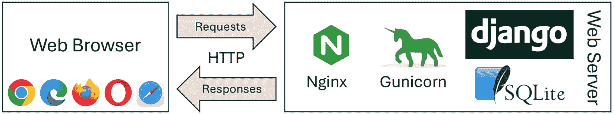
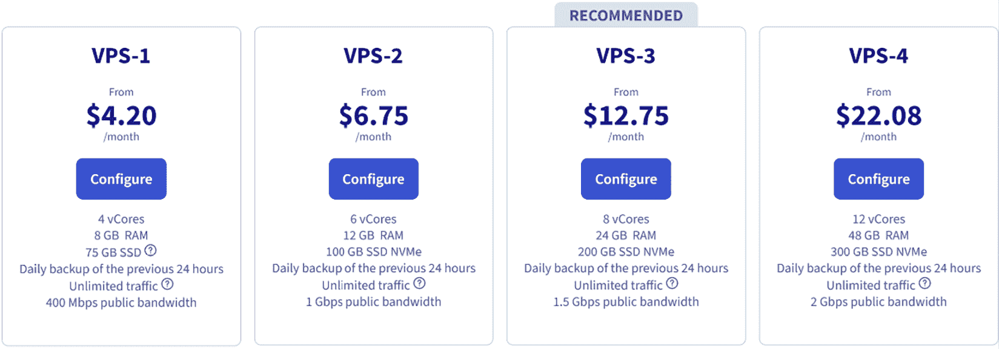
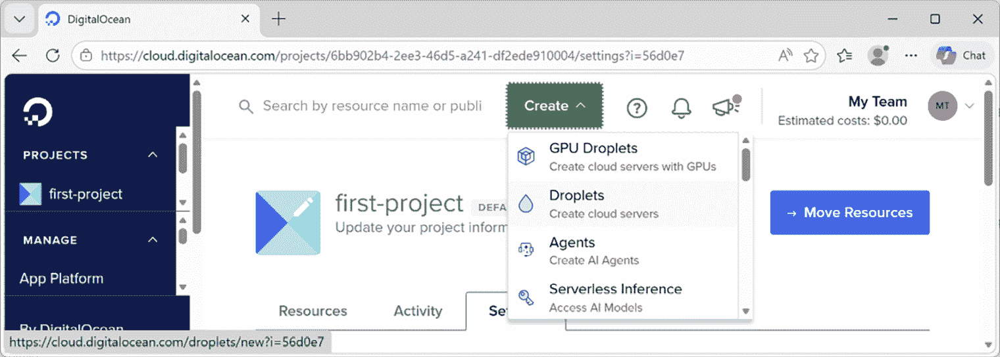
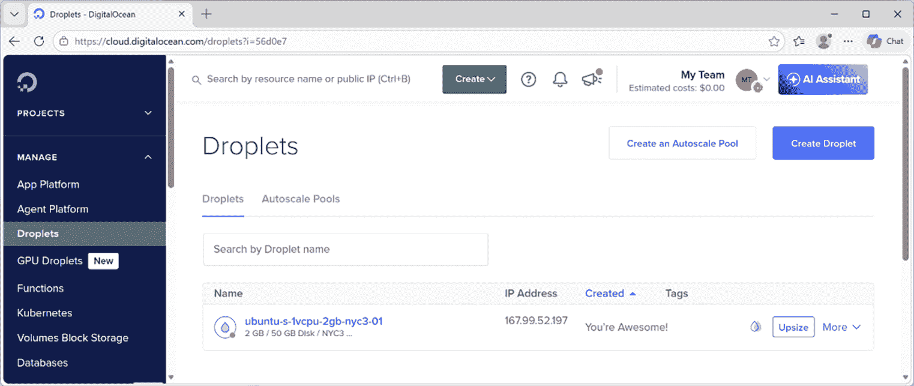

## 第 15 章：部署到公共服务器


在前几章中，你将 TallyApp 构建为一个本地 Django 项目。当你设计功能、编写测试、学习各部分如何组合时，这已经足够了。但一个 Web 应用直到其他人也能使用它，才算真正完成。

在本章中，你将把 TallyApp 部署到服务器上，以便其他人可以通过互联网使用它。这意味着从你自己机器上的开发环境迁移到一种生产风格的设置，该设置持续运行、接受来自互联网的请求、保护用户数据、提供静态文件、存储真实数据库，并且每次都要手动重建服务器。

本章为你提供了一条适用于小型 Django 应用的可行部署路径。你将看到每个主要组件，亲自配置它，并保持设置足够简单以便理解。

我们将使用一个刻意简化的技术栈：一台小型 `Virtual Private Server (VPS)`、Ubuntu、`Nginx`、`Gunicorn`、`Django` 和 `SQLite`。这不是部署 Django 的唯一方式，但它是一个很好的学习环境，因为你可以看到系统的每个主要部分。稍后，同一架构可以通过将 SQLite 替换为 PostgreSQL、添加 Cloudflare、使用托管备份，或使用 `Continuous Integration and Continuous Deployment (CI/CD)` 自动化部署来扩展。

在本章结束时，你将已将 TallyApp 部署到公开可访问的服务器，理解请求如何在生产 Django 技术栈中流转，知道如何在部署间保留和备份用户数据，并理解随着流量增长技术栈的哪些部分需要变更。

在本章中，我们将涵盖以下主题：

- Django 网站的部署选项
- 保护 Django 网站免受常见攻击
- 部署 TallyApp
- 结束语

# Django 网站的部署选项

当你在本地工作时，运行网站仅意味着启动 Django 的开发服务器并在自己的机器上打开浏览器。部署用一个持续运行、能接受来自公共互联网的请求、并能在重启和崩溃中存活的系统来替代那种临时设置。

从实际角度来看，部署涉及：

- 一台始终开启且可从互联网访问的服务器
- 一个监听标准 HTTP 端口的 Web 服务器
- 一个将 Django 作为长期运行进程运行的应用服务器
- 一个独立于代码持久化数据的数据库
- 一个用于更新代码和应用迁移的可重复流程

这些都不特定于 TallyApp。这些是各种规模的 Django 网站使用的相同构建模块。

## TallyApp 的生产架构

在高层次上，TallyApp 将使用一种常见的、刻意平淡的架构在生产环境中运行，如图 15.1 所示：



各组件职责明确：

- `Nginx` 接收公共 Web 流量，提供静态文件，并协助处理 `Transport Layer Security (TLS)`，一种保护网络上传输数据的加密协议（TLS 通常由 Nginx、Cloudflare 或两者终止）。当你使用 `https://` 访问网站时，TLS 确保三件事：（1）加密：数据对拦截者不可读。（2）认证：服务器证明它确实是它声称的身份。（3）完整性：数据在传输过程中不能被悄悄篡改。
- `Gunicorn` 作为生产应用服务器运行 Django。
- `Django` 处理请求并与数据库通信。
- `SQLite` 将调查数据作为持久文件存储在磁盘上。

保持这些职责分离使后续变更更少痛苦。你可以从 SQLite 迁移到 PostgreSQL，或在 Nginx 前放置 Cloudflare，而无需重写视图和模型。

提示：请解释 Web 服务器、应用服务器和数据库在 Django 部署中的区别，并用一个现实世界的类比说明。

## 为什么生产 Django 站点需要 Gunicorn 和 Nginx

Django 内置的开发服务器并非为生产用途设计。相反，Django 应用通常运行在 `Web Server Gateway Interface (WSGI)` 服务器之后。WSGI 是一种规范，而非库。Gunicorn 是与 Django 配合使用的常见 WSGI 实现之一。

Gunicorn 将你的 Django 项目作为一个长期运行的 Python 进程运行。它不直接监听公共互联网。相反，它监听本地套接字并等待 Nginx 将请求转发给它：

1. 浏览器发送 HTTP 请求。
2. Nginx 首先接收它。
3. 该服务器使用 WSGI 接口调用你的 Django 应用。
4. Django 返回一个响应对象。
5. 服务器将 HTTP 响应发送回浏览器。

WSGI 的存在使得 Django（及其他 Web 框架）不需要知道或关心前面是什么 Web 服务器。只要服务器支持 WSGI，Django 就可以在其后运行。

关于 WSGI 的关键点：

- 它是同步且基于请求-响应的，意味着每个请求以阻塞方式处理。服务器将请求传递给你的 Django 应用，该工作进程会被占用直到响应完全生成。如果你的代码等待缓慢操作，如数据库查询或 API 调用，该工作进程就只能干等。在此期间它无法做其他事情。基于请求-响应意味着连接不会保持打开以随时间发送多条消息。
- 实际上，这意味着 WSGI 非常适合传统网页和 API，但不适合实时更新、聊天系统或实时通知等需要长连接的场景。
- Django 是一个 WSGI 应用，Gunicorn 是一个 WSGI 服务器。

Gunicorn 加载你的 Django 项目，并使用 WSGI 协议为每个传入请求调用它。

提示：什么是 WSGI，它在 Python Web 应用中与 ASGI 相比如何？何时会选择 ASGI（如 Daphne/Uvicorn）而不是 Gunicorn？

### Gunicorn 配置

对于 TallyApp，我们将刻意保持 Gunicorn 配置保守。它将只有一个工作进程，并可选少量线程。它将由操作系统的服务管理器管理，以便开机自动启动。

这种配置与 SQLite 配合特别好，因为 SQLite 倾向于有限的写并发。

### 使用 Nginx 作为反向代理

反向代理接收公共请求并在后台将其转发给另一个服务。Nginx 位于 Gunicorn 前面，充当面向公众的 Web 服务器。其职责包括：

- 监听 80 和 443 端口
- 提供 CSS 和图片等静态文件
- 将动态请求转发给 Gunicorn

Nginx 高效处理慢速客户端，使你的 Django 应用无需处理。

这种分工是 Django 应用即使在普通硬件上也能良好运行的原因之一。

提示：请用简单术语解释反向代理，以及为什么 Nginx 用在 Gunicorn 前面，并包含一个请求流程图，展示 Nginx、Gunicorn 和 Django 如何交互。

## 在共享主机、VPS 和云平台之间选择

对于本书，`VPS` 是最佳起点。VPS 以低廉的月费给你一台拥有 root 权限的完整 Linux 机器。你只安装所需的东西，不多不少。

你还应该注意到其他选项的存在：

- 共享主机更便宜但通常不适合 Django 部署
- 平台即服务 为你处理更多事务，但你学到的移动部件更少
- 大型云提供商提供巨大的灵活性，但也带来了此阶段不必要的复杂性

一台小型 VPS 让你看清各部分如何组合，而不会让你不知所措。


## VPS 托管成本

月费主要取决于您选择的 CPU、内存、存储和带宽数量，如*图 15.2*所示：



图 15.2：VPS 的典型月费用

您应该能找到每月约 5-10 美元的 VPS 托管提供商，这足以拥有一个合适的 Web 服务器来托管您的 Django 项目。但要获得更低的成本，您通常需要承诺托管一年或更长时间，因此预计一年的托管费用为 60-120 美元。许多读者可能更倾向于仅在本地托管，而从不实际部署到公共服务器。

**提示**：VPS、PaaS 和无服务器架构对于 Django 应用有哪些权衡？

## SQLite 作为数据库

人们常说 SQLite 不适合生产环境，但这说法过于宽泛。SQLite 是一种基于文件的数据库，以简单和可靠著称，但在并发写入方面存在限制。

对于 TallyApp，如果满足以下条件，SQLite 是一个合理的选择：

* 流量适中
* 数据库写入是短暂的
* 应用程序以少量工作进程运行
* 启用了预写日志（`WAL`）

数据库本身只是磁盘上的一个文件。Django 使用 SQLite 库读写它。无需安装或管理数据库服务器。

**提示**：请解释 SQLite 中的预写日志（`WAL`）及其对并发的重要性。在生产 Django 应用中，SQLite 在什么情况下会成为瓶颈？

### 数据库持久化与迁移

最重要的部署规则之一是：*永远不要将数据库视为一次性的*。

您的应用程序代码可以随时替换。您的数据库必须能经受住部署。

为实现这一点：

* 将 SQLite 数据库文件存储在应用程序代码目录之外
* 将代码更新与数据更新分离
* 使用 Django 迁移来演进数据库模式

当您部署 TallyApp 的新版本时，您会对现有数据库运行迁移。数据保持完好，而模式逐步变更。这反映了迁移在 PostgreSQL 等大型数据库中的工作方式。尽管数据库引擎不同，但命令相似。

### 备份您的数据

即使对于学习项目，备份也很重要。用户会假设他们的调查回答会持久保存。

SQLite 提供了内置机制，用于创建实时数据库的一致性备份。典型方法如下：

* 使用 SQLite 的备份工具创建快照
* 将快照存储在带日期的备份目录中
* 可选择将其复制到服务器外部

这可以通过每日计划任务自动化。关键在于一致性。始终使用 SQLite 自身的工具创建备份，而不是盲目复制数据库文件，特别是当应用程序可能在备份期间运行时。

### 安全更新站点

TallyApp 的典型更新周期如下：

1. 上传或拉取最新代码
2. 安装或更新依赖
3. 应用迁移
4. 收集静态文件
5. 重启应用服务

因为数据位于代码目录之外，更新变得常规且低风险。这是从本地开发的重要思维转变，在本地开发中，删除和重新创建数据库很常见。

### 何时迁移到 PostgreSQL

当流量增长或写入变得频繁且不可预测时，SQLite 将开始显现其局限性。这不是失败。这只是应用程序超越了基于文件的数据库的时刻。

下一步通常是在同一 VPS 上运行 PostgreSQL。架构几乎保持不变。Nginx 和 Gunicorn 保持不变。Django 保持不变。只有数据库后端发生变化。

这是 Django 的优势之一。如果您遵循了最佳实践，数据库后端可以通过最小的应用程序更改进行替换。

**提示**：请指导我如何安全地将 Django 项目从 SQLite 迁移到 PostgreSQL。

### 使用托管数据库进一步扩展

超越单个 VPS，数据库通常会迁移到托管服务。届时：

* 应用服务器可以水平扩展
* 数据库获得自动备份和复制
* 运维复杂性从您转移给提供商

TallyApp 不需要这种级别的基础设施，但了解这条路径很重要。您的 Django 项目可以随着您的需求增长。

## 部署选项总结

将 TallyApp 部署到互联网不需要奇特的工具或复杂的云服务。一个小型 VPS、一个传统的 Web 技术栈和对数据持久化的严谨方法就足够了。

更重要的是，本章建立的模式将在该项目之外为您提供良好的服务。无论您部署的是学习应用、初创原型，还是拥有真实用户和真实期望的生产服务，相同的原则都适用。

有了清晰的部署方法，下一步是确保您的应用在暴露于不可预测的公共互联网环境后，依然保持安全和弹性。

# 保护 Django 网站免受常见攻击

一旦您的站点在公共互联网上线，它将开始接收来自您未邀请的来源的流量。其中一些是合法用户。许多是扫描弱点的自动化机器人。这是正常的。

对于像 TallyApp 这样的初学者 Django 项目，目标不是消除所有风险。那不现实。目标是避免明显的错误，减少常见攻击的影响，并使站点具有足够的弹性，即使在骚扰流量下也能保持运行。

Django 已经包含许多内置保护，但只有在您正确使用它们并谨慎部署应用程序时，它们才有帮助。

您可能会做出以下假设：

* **人们会试图让您的网站瘫痪**：部分属实，但并非针对性攻击。大多数流量将是自动化机器人。上述架构能很好地应对。
* **单台服务器可能很脆弱**：正确。单个 Droplet 是单点故障。但对于演示站点，如果您有备份并能快速重新部署，这是可以接受的。
* **您从第一天就需要强大的保护**：不完全是。您需要基本的 Django 设置和服务器防护，而不是繁重的基础设施。Django 最佳实践 + Cloudflare + 基础服务器加固的组合涵盖了大多数真实风险。

## 了解最常见的攻击

针对小型 Web 应用的大多数攻击并不复杂。它们是自动化和重复性的，寻找容易得手的目标。

与 Django 应用最相关的攻击类别如*表 15.1*所示：

| 名称 | 描述 |
|------|-------------|
| **跨站脚本攻击 (XSS)** | 攻击者试图将恶意 JavaScript 注入其他用户查看的页面。Django 模板默认转义输出，可阻止大多数简单情况。问题通常出在开发人员故意绕过转义时。 |
| **跨站请求伪造 (CSRF)** | 用户被诱导提交非预期的请求，例如更改账户详情。Django 包含 CSRF 保护中间件，但必须启用并在表单中正确使用。 |
| **SQL 注入** | 恶意输入试图篡改数据库查询。Django 的对象关系映射器（`ORM`）通过使用参数化查询来防范此风险，但不安全的原始 SQL 可能会重新引入风险。 |
| **认证滥用** | 机器人尝试猜测密码或重用泄露的凭据。登录页面是常见目标。 |


# Common Website Attack Types

| Attack Type | Description |
|-------------|-------------|
| **Security Misconfiguration** | This is one of the most common issues. Keeping `DEBUG = True`, exposing secret keys, or failing to restrict allowed hosts can leak sensitive information or open the door for attacks. |
| **File Upload Abuse** | If your app allows uploads, attackers may try to upload malicious files or oversized files to exhaust resources. |
| **Denial of Service (DoS)** | Instead of breaking in, attackers flood the site with traffic or expensive requests. For small apps, this is usually application-layer abuse, not a massive network flood. |

**Table 15.1: Common Website Attack Types**

---

# OWASP Top 10

The **Open Web Application Security Project (OWASP) Top 10** is a widely recognized list of the most common and impactful security risks affecting web applications. Maintained by a global community of security professionals, it highlights patterns seen in real-world breaches. It is not an exhaustive list, but a practical guide to the vulnerability types developers are most likely to encounter, helping teams prioritize what matters most when building and deploying secure apps.

The OWASP Top 10 consistently highlights broken access control, injection, and misconfiguration as leading causes of web app vulnerabilities: [`owasp.org/Top10/2025/`](https://owasp.org/Top10/2025/)

> **Tip**: Please provide examples of XSS, CSRF, and SQL Injection in a Django application.

---

# Practical Security Baseline for Beginners

You don't need expensive tools to secure a small Django app. A simple, well-configured setup goes a long way.

Start with Django's deployment checklist:

1.  Set `DEBUG = False`
2.  Define `ALLOWED_HOSTS`
3.  Keep `SECRET_KEY` private
4.  Run `python manage.py check --deploy`

Django explicitly warns that running with `DEBUG = True` in production exposes stack traces, settings, and sensitive internal details.

> **Tip**: What does Django's `check --deploy` command actually verify under the hood?

---

# Enforce HTTPS and Secure Cookies

Django recommends enforcing HTTPS across your entire site, not just the login page, because session cookies are shared across requests. Always serve your site over HTTPS. This protects login sessions and user data.

The following settings should be enabled in your Django settings:

```python
if not DEBUG:  # Enable only in production
    SECURE_SSL_REDIRECT = True
    SESSION_COOKIE_SECURE = True
    CSRF_COOKIE_SECURE = True
    SECURE_HSTS_SECONDS = 31536000  # 1 year
    SECURE_HSTS_INCLUDE_SUBDOMAINS = True
    X_FRAME_OPTIONS = "DENY"
    SECURE_CONTENT_TYPE_NOSNIFF = True
```

Notes on the above settings:

* `SECURE_SSL_REDIRECT = True`: Forces all HTTP requests to redirect to HTTPS. If a user visits `http://your-site.com`, Django automatically redirects them to `https://your-site.com`. This ensures all communication is encrypted. Without this, users might access your site over plain HTTP, allowing attackers to intercept or modify traffic (Man-in-the-Middle attacks).
* `SESSION_COOKIE_SECURE = True`: Ensures the session cookie is only sent over HTTPS. Browsers will not include the session cookie in HTTP requests. Session cookies identify logged-in users. If sent over HTTP, they can be intercepted and used to hijack the session.
* `CSRF_COOKIE_SECURE = True`: Ensures the CSRF cookie is only sent over HTTPS. Similar to the session cookie, but specifically for the CSRF token. CSRF protection relies on a secret token. If that token is exposed over HTTP, an attacker could bypass CSRF protection.
* `SECURE_HSTS_SECONDS = 31536000` (1 year, in seconds): Enables **HTTP Strict Transport Security (HSTS)** and tells browsers to always use HTTPS for your site for the next year. After visiting your site once over HTTPS, the browser will refuse to connect via HTTP for the specified duration. It prevents downgrade attacks where an attacker tries to force a user back to HTTP.
  
  > **Warning!** Only enable this once you are certain HTTPS works correctly everywhere.

* `SECURE_HSTS_INCLUDE_SUBDOMAINS = True`: Extends HSTS to all subdomains. E.g., `api.your-site.com`, `admin.your-site.com`, etc. Attackers often target weaker subdomains. This ensures the entire domain is HTTPS-only.
* `X_FRAME_OPTIONS = "DENY"`: Prevents your site from being embedded in an `<iframe>`. Browsers will block any attempt to load your pages in a frame on another site. Prevents clickjacking attacks, where a malicious site tricks users into clicking hidden elements on your site.
* `SECURE_CONTENT_TYPE_NOSNIFF = True`: This tells browsers not to guess (or "sniff") the content type of a response. Browsers must respect the `Content-Type` header sent by the server. Prevents certain attacks where a file is disguised as one type (e.g., text) but executed as another (e.g., JavaScript).

As a group, these settings enforce HTTPS everywhere, protect sensitive cookies, prevent common browser-based attacks (clickjacking, MIME sniffing), and reduce the risk of traffic interception and tampering.

They are part of Django's **secure-by-default for production** approach, but they only work correctly if your app is properly deployed behind HTTPS (e.g., using Nginx or a cloud platform that terminates TLS).

> **Warning!** Do not blindly enable these in development, because local environments usually don't have HTTPS configured, and the redirects and secure cookies will break your development workflow.

---

# Protect Against XSS and CSRF

Django helps here, but only if you follow its conventions:

* Use Django templates instead of manually building HTML strings
* Avoid marking user input as safe unless absolutely necessary
* Ensure all forms include the CSRF token, like this:

```html
<form method="post">
    
    <!-- form fields -->
</form>
```

For extra protection, consider enabling **Content Security Policy (CSP)**, which restricts where scripts can be loaded from. Django 6 includes built-in support for CSP configuration, such as `SECURE_CSP` settings, but earlier versions like the current LTS 5.2 do not.

CSP is a browser-enforced security mechanism that controls which resources a page is allowed to load and execute. It is defined by the server (usually via an HTTP response header) and tells the browser things like: which domains JavaScript can be loaded from, whether inline scripts are allowed, where images, stylesheets, fonts, and other assets can come from.

The goal is to reduce the impact of attacks like **Cross-Site Scripting (XSS)**. Even if an attacker manages to inject malicious code into your page, a well-configured CSP can prevent that code from running because it doesn't come from an approved source.

A simple example might look like this:

```
Content-Security-Policy: default-src 'self'; script-src 'self' https://trusted.cdn.com;
```

The header above tells the browser: by default, only load resources from your own site, and only allow scripts from your site and a trusted **Content Delivery Network (CDN)**.

CSP works best as a defense-in-depth layer. It doesn't replace secure coding practices, but it makes exploitation much harder when things go wrong.


您可以通过以下链接了解更多关于 CSP 的信息：[`https://developer.mozilla.org/en-US/docs/Web/HTTP/Guides/CSP`](https://developer.mozilla.org/en-US/docs/Web/HTTP/Guides/CSP)

## 避免 SQL 注入

最安全的方法很简单：使用 Django 的 ORM：

```
# Safe
User.objects.filter(username=username)
```

避免使用字符串拼接手动构建 SQL 查询。如果必须使用原始 SQL，请使用参数化查询。

Django 的文档强调，其 ORM 默认可防止 SQL 注入，但前提是正确使用。

## 保护认证

登录端点是机器人攻击的首选目标。

基本防护措施包括：

* 强制使用强密码
* 对登录尝试添加速率限制
* 考虑在重复失败后添加人机验证挑战
* 避免在没有额外保护的情况下将 Django 管理后台暴露在可预测的 URL 上

简单的速率限制方法可以大幅减少暴力破解尝试。

## 安全处理文件上传

如果您的应用允许文件上传：

* 限制文件大小
* 验证文件类型
* 切勿执行上传的文件
* 将上传文件存储在主应用域名之外

Django 建议从单独的域名或存储系统提供上传文件服务，以降低风险。

## 防御拒绝服务攻击

对于小型项目，大多数 DoS 尝试实际上是滥用使用模式。

常见示例：

* 重复登录尝试
* 大文件上传
* 昂贵的数据库查询
* 激进爬取

低成本防御措施包括：

* 对关键端点进行速率限制
* 限制上传大小
* 在适当情况下使用缓存
* 将静态文件移至 CDN

使用 Cloudflare 等服务可以提供免费或低成本的保护，包括基本的**分布式拒绝服务**（**DDoS**）缓解和请求过滤。

**提示**：请展示如何在 Django 中使用中间件或第三方包实现速率限制。请解释 Cloudflare 如何保护小型网站免受机器人和攻击。

## 保护密钥和配置

切勿将密钥存储在源代码仓库中。

请改用环境变量：

```
import os
SECRET_KEY = os.environ["DJANGO_SECRET_KEY"]
```

Django 的部署指南强调敏感设置必须保持机密。

## 日志记录、监控和备份

安全不仅仅是预防。您还必须检测和恢复。

至少应做到：

* 启用错误和可疑活动的日志记录
* 监控登录失败尝试
* 保持定期数据库备份
* 测试从备份恢复

例如，将以下代码添加到您的 `settings.py` 中：

```
import os
LOG_DIR = os.path.join(BASE_DIR, "logs")
os.makedirs(LOG_DIR, exist_ok=True)
LOGGING = {
    "version": 1,
    "disable_existing_loggers": False,
    "formatters": {
        "verbose": {
            "format": "{asctime} {levelname} {name} {message}",
            "style": "{",
        },
    },
    "handlers": {
        "file": {
            "level": "WARNING",
            "class": "logging.FileHandler",
            "filename": os.path.join(LOG_DIR, "django.log"),
            "formatter": "verbose",
        },
    },
    "loggers": {
        "django": {
            "handlers": ["file"],
            "level": "WARNING",
            "propagate": True,
        },
    },
}
```

上述代码：

* 记录警告、错误和异常
* 写入 `logs/django.log`
* 捕获可疑活动，如错误请求或错误

要检查服务器日志，请使用以下 Bash/Shell 命令：

```
sudo journalctl -u gunicorn -f
sudo tail -f /var/log/nginx/error.log
```

要记录登录失败，请将以下代码添加到您的登录视图中：

```
import logging
logger = logging.getLogger(__name__)
def login_view(request):
    if request.method == "POST":
        username = request.POST.get("username")
        password = request.POST.get("password")
        user = authenticate(request, username=username, password=password)
        if user is None:
            logger.warning(f"Failed login attempt for username: {username}")
        else:
            login(request, user)
```

OWASP 强调，日志记录和监控的失败可能导致攻击长时间不被察觉。

## 使用现成的包来跟踪登录

要跟踪登录失败尝试、暂时阻止暴力破解攻击并将尝试存储在数据库中，您可以安装一个名为 Axes 的 Django 中间件包：

```
pip install django-axes
```

然后在 `settings.py` 中启用该包：

```
INSTALLED_APPS += ["axes"]
MIDDLEWARE += ["axes.middleware.AxesMiddleware"]
AUTHENTICATION_BACKENDS = [
    "axes.backends.AxesBackend",
    "django.contrib.auth.backends.ModelBackend",
]
AXES_FAILURE_LIMIT = 5
AXES_COOLOFF_TIME = 1  # hours
```

此包记录到永久表中，因此您必须随后运行数据库迁移：

```
python manage.py migrate
```

合理预期像 `TallyApp` 这样的公共演示站点会收到不需要的流量。不过，这些流量主要来自自动化机器人，而非有针对性的人工攻击者。

## 总结清单

对于适合初学者的部署，应争取达到以下目标：

* 禁用调试模式
* 全站强制 HTTPS
* 使用安全 Cookie
* 配置 `ALLOWED_HOSTS`
* 将密钥排除在源代码控制之外
* 使用 Django 的 ORM 和内置防护
* 为登录和公共端点添加速率限制
* 限制并验证文件上传
* 在您的站点前放置 CDN 或代理
* 启用日志记录并维护备份

上述每一点均在本章或 *第 9 章* *Django – 后端 Web 开发* 中详细介绍。

这并不意味着您的应用无懈可击。但它使其足够健壮以用于生产环境，这正是像 `TallyApp` 这样的公开示例所需要的。

有了这些安全基础，我们现在可以继续将 `TallyApp` 部署到公共服务器，在真实的工作环境中应用这些实践。

# 部署 TallyApp

第一步是选择一个主机服务提供商。这是将持续运行您的应用程序并使其可通过互联网供用户访问的机器。与您的本地开发环境不同，这台服务器必须可靠、随时可达，并能处理来自未知用户和自动化系统的请求。

有几类托管可供选择，每种都有不同的权衡。共享托管便宜，但对大多数 Django 应用程序来说限制太多。平台即服务选项消除了大部分运维负担，但也隐藏了部署实际如何工作。在另一端，大型云提供商提供了巨大的灵活性，但对于小型项目可能引入不必要的复杂性。对于像 `TallyApp` 这样的项目，VPS 达到了恰当的平衡。它以低成本让您完全控制一台 Linux 机器，同时仍然足够简单，能让您理解所有组件如何组合在一起。

选择 VPS 也与本章前面介绍的架构非常契合。您将亲自安装和配置每个组件：Web 服务器、应用服务器和数据库。这听起来可能像是额外的工作，但这正是大量学习发生的地方。您不再依赖黑盒平台，而是能准确看到请求如何流经您的系统，以及您的应用程序在真实环境中的表现。


在下一节中，我们将使用 `DigitalOcean` 作为我们的托管服务商。它提供了一种简单直接的方式来创建和管理虚拟服务器，拥有可预测的定价和完善的文档。更重要的是，它让我们能够专注于理解部署过程，而不是纠结于基础设施的复杂性。

## 为什么 `DigitalOcean` 适合 `TallyApp`

我选择使用 `DigitalOcean` 作为主机提供商，因为它处于一个有用的中间地带：既不像过度抽象的平台那样隐藏一切，也不像超大规模云那样用海量选项和定价复杂性淹没初学者。

对于像 `TallyApp` 这样的项目，它可以说很利于学习，因为它迫使你理解部署期间发生了什么，又不会让你淹没在企业级运维的担忧中。

最大的优势是简单性。你可以在几分钟内从零开始拥有一台公网服务器，使用的是 `Droplet`，它本质上就是一台虚拟机。这与 `Django` 传统上使用 `Gunicorn` 和 `Nginx` 等工具进行部署的方式完美契合。

文档完善且对新手友好。`DigitalOcean` 花费多年时间专门为常见技术栈（如 `Django`）构建教程，包括针对 `Ubuntu`、`Gunicorn` 和 `Nginx` 的分步指南。你可以通过以下链接阅读 `DigitalOcean` 文档教程：[`www.digitalocean.com/community/tutorials`](https://www.digitalocean.com/community/tutorials)。

`DigitalOcean` VPS 还赋予你完全的控制权。你将学习 Web 服务器、反向代理和应用服务器是如何组合在一起的，而不是依赖一个黑盒平台。

### 你应该了解的缺点

简单性的代价是你需要自己负责更多事情。

你在管理一台服务器。这意味着：

*   应用安全更新
*   配置防火墙
*   管理进程和服务
*   手动处理扩缩容

没有自动扩缩容。如果你的网站突然变得流行或遭受攻击，单个 `Droplet` 可能会不堪重负。

你仍需自负应用安全责任，因为它不是全托管的。与 `Heroku` 或 `Vercel` 等平台不同，`DigitalOcean` 不会自动处理许多应用层面的防护。你需要自行配置。

备份和监控是可选的附加组件。除非你启用它们，否则它们不会默认完全集成。

### 它适合像 `TallyApp` 这样的公开演示吗？

适合，但有一个条件：你必须在它前面加一层薄薄的保护。单个低成本 `Droplet` 完全有能力运行流量轻度到中等的 `Django` 应用。对于图书配套网站来说，这通常绰绰有余。

然而，直接将裸露的服务器暴露在互联网上并不理想。如果没有额外保护，它将迅速收到：

*   扫描漏洞的机器人流量
*   登录暴力破解尝试
*   爬虫和抓取工具
*   偶发的流量高峰

这就是将 `DigitalOcean` 与代理层结合变得重要的原因。

### `DigitalOcean` 提供的防护

`DigitalOcean` 为你提供基础设施级别的安全，但不提供完整的应用防护。

包含的防护：

*   通过虚拟专用网络实现的基本网络隔离
*   云防火墙，按端口和 IP 限制入站流量
*   安全外壳（`SSH`）密钥认证而非密码
*   数据中心级别的物理安全
*   基础设施级别的 `DDoS` 防护（有限且不可深度配置）

这些是有用的服务器级防护，但它们无法防范：

*   应用层攻击（例如登录滥用）
*   `XSS` 或 `CSRF` 问题
*   `Django` 配置错误
*   针对你端点的机器人流量

一些有用的功能可用，但需要启用或额外付费，如 `表 15.2` 所示：

| **功能** | **描述** |
| --- | --- |
| 备份 | 自动备份通常费用约为 `Droplet` 价格的 20%。 |
| 监控和警报 | 提供基础监控，但你需要自行配置警报。 |
| 负载均衡器 | 起价约为每月 12 美元。如果你扩展到单服务器之外，这很有用。 |
| 托管数据库 | 比自托管 `PostgreSQL` 更贵，但能降低运维风险。 |

`表 15.2`：可启用的 `DigitalOcean` 功能

## 缺失的一环：边缘防护

`DigitalOcean` 给你提供了服务器，但它不会在每个坏请求到达你的应用之前将其过滤掉。这就是在你的 `Droplet` 前面添加 `Cloudflare`（或类似服务）能增强防护的原因。

即使使用免费的 `Cloudflare` 计划，你也能获得：

*   面向 `CSS` 样式表和图片等静态内容的 `CDN` 缓存
*   基础 `DDoS` 防护
*   机器人过滤
*   `TLS` 终止（在边缘处理 `HTTPS`）

以低成本，你可以添加：

*   速率限制（用于登录和表单）
*   Web 应用防火墙（`WAF`）规则

当与像 `Cloudflare` 这样简单的边缘服务以及良好的 `Django` 配置相结合时，`DigitalOcean` 加 `Cloudflare` 加正确的 `Django` 设置，足以应对小型公开 `TallyApp` 部署。

## 分步部署

你将从理解部署中获益良多，而非仅仅走通往可用服务器的最短路径。

我们将标准化以下目标技术栈：用于应用服务器的小型 `Droplet`、`Ubuntu` `LTS`、为追求简单而用的 `SQLite` 数据库、作为反向代理的 `Nginx`、用于 `Django` 的 `Gunicorn`、`Uncomplicated Firewall (UFW)` 以及可选的备份。这适用于流量适中的公开演示应用。

### 创建 `DigitalOcean` `Droplet`

现在我们可以创建一个 `Droplet` 来托管我们的网站项目：

1.  在以下链接注册 `DigitalOcean` 账号：[`cloud.digitalocean.com/`](https://cloud.digitalocean.com/)
2.  在你账号的 `Projects` 页面，你将已有一个默认项目，通常命名为 `first-project`。我们可以保持原样。
3.  点击 `Create`，然后点击 `Droplets`，如 `图 15.3` 所示：



`图 15.3`：创建 `Droplet`

4.  选择一个区域，要么靠近你大多数预期访客，要么靠近你。我选择了 `New York`。
5.  为你的操作系统选择一个镜像。我选择了 `Ubuntu 24.04 (LTS) x64`。
6.  选择 `Droplet` 规格。我选择了：
    *   Basic（共享 CPU）
    *   Regular SSD
    *   每月 12 美元
    *   2 GB / 1 CPU
    *   50 GB SSD 磁盘
    *   2 TB 流量
7.  可选，启用自动备份计划。我选择了 `Daily Backups`，费用为每月 3.60 美元。备份保留一周。对于时间窗口，我选择了美国东部时间午夜到凌晨 4 点。
8.  选择一种认证方式。我选择了 `SSH`。点击 `Add SSH Key` 并按说明操作。你必须为 `SSH` 密钥命名（我用了 `tallyapp-sshkey`），它将创建两个文件。没有 `.pub` 后缀的文件是你的私钥。**务必妥善保管**。`.pub` 文件是你复制到 `DigitalOcean` 的公钥。

你可以通过以下链接了解更多关于如何使用 `SSH` 连接到 `Droplets` 的信息：[`docs.digitalocean.com/products/droplets/how-to/connect-with-ssh/`](https://docs.digitalocean.com/products/droplets/how-to/connect-with-ssh/)

9.  点击 `Create Droplet`。
10.  记下分配给你服务器的 `IP` 地址，如 `图 15.4` 所示：



`图 15.4`：你服务器的 `IP` 地址

11.  在命令提示符或终端中，输入命令使用你之前创建的私有 `SSH` 密钥文件、默认的 `root` 用户账户和远程服务器的 `IP` 地址连接到你的远程服务器：

```
ssh -i tallyapp-sshkey root@167.99.52.197
```


大多数操作系统（如 Ubuntu 和 CentOS）在初始创建时的默认用户名是 `root`。如果您添加了另一个用户，可以改用该用户名。

1. 输入 SSH 密钥的密码短语。

2. 您现在将连接到远程服务器主机，如下面略微编辑的输出所示：

```
Welcome to Ubuntu 24.04.3 LTS (GNU/Linux 6.8.0-71-generic x86_64)
System information as of Tue Mar 24 16:46:12 UTC 2026
  System load:           0.01
  Usage of /:            4.0% of 47.39GB
  Memory usage:          10%
  Swap usage:            0%
  Processes:             99
  Users logged in:       0
  IPv4 address for eth0: 167.99.52.197
  IPv4 address for eth0: 10.17.0.5
  IPv6 address for eth0: 2604:a880:800:14:0:2:b6e3:6000
...
```

## 初始远程服务器设置

您即将输入命令以更新操作系统包、将自己添加为 Linux 用户、启用防火墙等：

1. 更新包并耐心等待几分钟以完成此过程：

```
apt update && apt upgrade -y
```

2. 添加名为 tallyapp 的用户：

```
adduser tallyapp
```

3. 授予自己管理员权限：

```
usermod -aG sudo tallyapp
```

4. 切换到您的账户：

```
su - tallyapp
```

5. 允许 SSH 通过防火墙：

```
sudo ufw allow OpenSSH
```

6. 启用防火墙：

```
sudo ufw enable
```

7. 安装系统依赖（Python `pip`、虚拟环境支持、Sqlite、Nginx 和 Git）：

```
sudo apt install -y python3-pip python3-venv nginx git sqlite3
```

8. 从其公共 GitHub 仓库克隆您的项目：

```
git clone https://github.com/yourusername/tallyapp.git
```

或者，您可以克隆我的 TallyApp 源代码仓库，链接如下：[`github.com/markjprice/tallyapp`](https://github.com/markjprice/tallyapp)

9. 切换到应用文件夹：

```
cd tallyapp
```

10. 创建虚拟环境：

```
python3 -m venv .venv
```

11. 激活虚拟环境：

```
source .venv/bin/activate
```

12. 安装 Python 依赖：

```
pip install -r requirements.txt
```

13. 安装 Gunicorn：

```
pip install gunicorn
```

14. 创建 `.env` 文件：

```
nano .env
```

15. 定义一些环境变量：

```
DEBUG=False
SECRET_KEY=your_secret_key
ALLOWED_HOSTS=your_domain,your_server_ip
```

16. 应用迁移（这将创建 SQLite 数据库文件 `db.sqlite3`）并收集静态文件：

```
python manage.py migrate
python manage.py collectstatic
python manage.py createsuperuser
```

17. 通过在终端或命令提示符下输入以下内容来测试 Gunicorn：

```
gunicorn --bind 0.0.0.0:8000 tallyapp.wsgi:application
```

18. 在终端或命令提示符下输入以下链接：

```
http://your_server_ip:8000
```

19. 按 `Ctrl` + `C` 停止 Gunicorn。

20. 通过创建配置文件将 Gunicorn 配置为服务：

```
sudo nano /etc/systemd/system/gunicorn.service
```

21. 修改 `gunicorn.service` 文件的内容：

```
[Unit]
Description=gunicorn daemon
After=network.target
[Service]
EnvironmentFile=/home/tallyapp/tallyapp/.env
User=tallyapp
Group=www-data
WorkingDirectory=/home/tallyapp/tallyapp
ExecStart=/home/tallyapp/tallyapp/.venv/bin/gunicorn \
    --workers 1 \
    --bind unix:/home/tallyapp/tallyapp/gunicorn.sock \
    tallyapp.wsgi:application
[Install]
WantedBy=multi-user.target
```

22. 启动并启用 Gunicorn：

```
sudo systemctl start gunicorn
sudo systemctl enable gunicorn
```

23. 配置 Nginx：

```
sudo nano /etc/nginx/sites-available/tallyapp
```

24. 修改文件：

```
server {
    listen 80;
    server_name your_domain your_server_ip;
    location /static/ {
        root /home/tallyapp/tallyapp;
    }
    location / {
        include proxy_params;
        proxy_pass http://unix:/home/tallyapp/tallyapp/gunicorn.sock;
    }
}
```

25. 启用 Nginx：

```
sudo ln -s /etc/nginx/sites-available/tallyapp /etc/nginx/sites-enabled
sudo nginx -t
sudo systemctl restart nginx
```

26. 配置防火墙以允许 Web 流量：

```
sudo ufw allow 'Nginx Full'
```

27. 启用 HTTPS：

```
sudo apt install certbot python3-certbot-nginx
sudo certbot --nginx -d your_domain
```

**提示**：请编写一个 bash 脚本，以零停机时间安全地部署 Django 应用。

此时，应用程序可以运行，但系统中最有价值的部分不是代码。而是网站上线后用户创建的数据。

现在让我们回顾一下备份 SQLite 数据库的步骤。

## 备份您的 SQLite 数据库

使用 SQLite 时，您的整个数据库是主机服务器上以下位置的单个文件：

```
/home/tallyapp/tallyapp/db.sqlite3
```

如果此文件丢失或损坏，您的数据将不复存在，因此备份至关重要。

您可以使用以下命令备份数据库文件：

```
sqlite3 db.sqlite3 ".backup 'db-backup.sqlite3'"
```

**警告！** 请勿使用简单的复制（`cp`）命令。仅当应用停止或空闲时，复制文件才可能是可接受的。对于活动数据库，请使用 SQLite 的 `.backup` 命令或在线备份 API。SQLite 在以下链接中记录了其用于复制活动数据库的在线备份 API：[`sqlite.org/backup.html`](https://sqlite.org/backup.html)

您可以创建一个 `backups` 目录：

```
mkdir -p ~/backups
```

然后执行带时间戳的备份：

```
sqlite3 /home/tallyapp/db.sqlite3 \
  ".backup /home/tallyapp/backups/db-$(date +%F-%H-%M).sqlite3"
```

示例输出：

```
db-2026-03-24-14-30.sqlite3
```

### 使用 cron 自动备份

到目前为止，您一直在手动创建备份。这对于测试来说没问题，但在实际部署中，您需要备份自动且一致地发生。这就是 `cron` 的用武之地。

`cron` 是一个内置的 Linux 调度器，可在指定时间运行命令。它极其可靠，广泛用于备份、日志轮转和清理等例行维护任务。

要编辑计划任务，请运行：

```
crontab -e
```

如果这是您第一次使用，系统可能会要求您选择编辑器（为简单起见，请选择 `nano`）。这将打开您的个人 crontab 文件。

crontab 文件中的每一行包含五个时间字段，后跟命令：

```
* * * * * command
│ │ │ │ │
│ │ │ │ └── Day of week (0–7, where 0 and 7 = Sunday)
│ │ │ └──── Month (1–12)
│ │ └────── Day of month (1–31)
│ └──────── Hour (0–23)
└────────── Minute (0–59)
```

这很重要，因为这里的小错误可能导致备份永不运行或运行过于频繁。

要添加每 `6` 小时运行一次的作业，请添加以下行：

```
0 */6 * * * sqlite3 /home/tallyapp/db.sqlite3 ".backup /home/tallyapp/backups/db-$(date +\%F-\%H-\%M).sqlite3"
```

前面的代码工作原理如下：

* `0 */6 * * *`：在第 0 分钟运行，每 6 小时一次（午夜、上午 6 点、中午 12 点、下午 6 点）。
* `sqlite3 /home/tallyapp/db.sqlite3`：操作您的 SQLite 数据库文件。
* `".backup /home/tallyapp/backups/db-$(date +\%F-\%H-\%M).sqlite3"`：备份带有时间戳的数据库文件，如：`db-2026-04-02-12-00.sqlite3`。`%` 字符被转义（`\%`），因为 `cron` 对 `%` 有特殊处理。如果不转义，命令将会中断。

在依赖此方法之前，请确保备份目录存在：


```
mkdir -p /home/tallyapp/backups
```

## 限制备份大小

如果您从不删除旧备份，它们最终会填满您的磁盘。这是小型服务器上最常见的故障之一。

要删除超过 7 天的备份，可以运行：

```
find /home/tallyapp/backups -type f -mtime +7 -delete
```

上述代码的工作原理如下：

* `-type f`：仅应用于文件
* `-mtime +7`：修改时间超过 7 天前
* `-delete`：删除它们

要自动清理，请向 `cron` 添加第二个计划任务：

```
30 2 * * * find /home/tallyapp/backups -type f -mtime +7 -delete
```

这会在每天凌晨 02:30 运行。

**最佳实践**：最好将清理作为单独的任务，因为这样可以保持备份创建简单快速，清理发生在低流量时段，并避免在一个命令中混合职责。

## 异地备份

为获得更好的保护，请将备份复制到服务器外部：

* 使用 `scp` 下载到本地
* 同步到云存储（例如对象存储或备份服务）

**提示**：如何自动化备份并测试恢复 SQLite 数据库？

## 您已构建的内容

您现在拥有一个完整的部署：

* `Django` 通过 `Gunicorn` 运行
* `Nginx` 处理请求
* `SQLite` 数据库存储在本地
* 自动备份保护您的数据

此设置特意设计得简单且具成本效益，使其成为公共演示项目的理想选择，同时仍遵循标准部署实践。

**提示**：如何在不使用昂贵工具的情况下监控生产环境中的小型 Django 应用？

手动过程值得做一次，因为它能教会您部署实际上做什么。一旦您理解了步骤，自动化就开始变得合理了。

## 持续集成 (CI) 和持续部署 (CD)

随着项目增长，手动将文件复制到服务器并重启服务变得繁琐且容易出错。CI/CD 用一个自动化流水线取代了该手动过程，该流水线以一致的方式构建、测试和部署您的应用程序。

CI 专注于验证更改。每次您将代码推送到仓库时，自动化流程都会运行诸如安装依赖、运行测试和检查代码质量等任务。流水线应在问题到达您的服务器之前尽早发现它们。

CD 更进一步。更改通过验证后，会自动部署到您的服务器。您无需登录 `VPS` 并手动运行命令，流水线每次都会以可预测的顺序执行相同的步骤。

### Django 项目的典型 CI/CD 流水线

对于像 `TallyApp` 这样的 Django 项目，典型的 CI/CD 流水线如下所示：

1. 开发者将代码推送到 `Git` 仓库（例如 `GitHub`）。
2. CI 服务（如 `GitHub Actions`）启动工作流。
3. 工作流安装依赖并运行测试。
4. 如果检查通过，CD 阶段连接到您的服务器。
5. 服务器拉取最新代码。
6. 应用迁移。
7. 收集静态文件。
8. 重启应用服务（`Gunicorn`）。

这反映了您之前遵循的手动部署步骤，但消除了遗漏步骤或引入不一致的风险。

### GitHub Actions

使用 `GitHub Actions` 的最小示例可能：

* 在每次推送到主分支时触发
* 运行 `pip install -r requirements.txt` 和 `python manage.py test`
* 使用 `SSH` 连接到您的服务器并执行部署命令

好处是立竿见影的：

* 部署变得可重复且可靠
* 错误在影响用户前被捕获
* 您花费更少时间管理服务器，更多时间改进应用程序

存在权衡。CI/CD 增加了一些初始复杂性，流水线中的错误可能会快速部署有问题的代码。因此，许多团队从仅持续集成开始，只有在对测试有信心后才添加自动化部署。

对于像 `TallyApp` 这样的小型项目，CI/CD 并非必需。但即使是一个简单的流水线也能让您体会软件是如何构建和维护的，并为手动部署不再切实际的大型项目做好准备。

**提示**：请展示一个适合初学者的用于自动部署 Django 的 CI/CD 流水线。

您现在拥有的不仅仅是一个 Django 项目。您拥有一个包含活动部件、用户数据、安全设置和更新流程的小型公共系统。

## 结束语

您现在做了一件许多学习 Web 开发的人从未真正做过的事：您将一个想法转化为一个工作的应用程序，并将其部署到了公共互联网上。

部署改变了项目的性质。在您自己的机器上，应用是一个实验。在公共服务器上，它有用户、数据、期望和后果。它需要保持运行、快速响应，并在出现问题时表现可预测。

您在本章构建的内容特意设计得简单，但它不是玩具。您使用的架构是支撑大量真实 Django 应用程序的相同模式。学习项目与生产系统的区别不在于工具，而在于这些工具被使用得有多仔细。

部署使本书的主要观点具体化。仅生成设置文件或复制 Shell 命令是不够的。您需要知道请求去向何处、数据存储在哪里、哪些文件必须在更新中保留，以及出现故障时该怎么办。AI 可以帮助编写配置文件和 Shell 命令，但它无法决定您的系统应接受什么风险。这种判断仍然取决于您。

贯穿全书，您一直与 AI 助手并肩工作。您用它来生成想法、解释概念、编写代码、调试问题和探索替代方案。这不是捷径。这是一种新的工作方式。

### 谁将胜出？

在未来十年中脱颖而出的开发者不是那些记住最多语法的人。他们是能够：

* 提出好问题
* 将问题分解为更小的部分
* 批判性地评估生成的解决方案
* 理解他们的代码实际上在做什么
* 随着工具演进快速适应

AI 可以加速您，但无法替代理解。如果有什么不同，它提高了门槛。编写代码变得更容易，这意味着识别代码何时错误、不安全或低效变得更加重要。

像 `TallyApp` 这样的项目是您的起点，而非终点。

从这里开始，您可能会：

* 添加新功能并完善用户体验
* 用 `PostgreSQL` 替换 `SQLite` 并探索扩展
* 引入后台任务和异步处理
* 设置自动化部署和监控
* 使用相同模式构建全新项目

要带走的关键思想是：现代 Web 开发不再是独自工作。而是关于有效地使用工具来帮助您编写、检查、部署和维护软件。您的 AI 助手就是这些工具之一。用得好，它让您更快；用得不好，它让您产生依赖。

这个项目为您提供了一个持续练习这种理解的场所。

## 练习、参考和资源

在本节中，您将接受本章所学内容的测试，并获得有用的参考资料和资源链接。

### 检查您的理解

回答以下关于本章涵盖主题的问题：

1. 为什么 Django 的开发服务器不适合生产环境使用？
2. `Gunicorn` 在 Django 部署中扮演什么角色？
3. `Nginx` 在您的架构中处理什么职责？
4. 为什么 `SQLite` 适用于 `TallyApp`，它有哪些局限性？


