# Django 简介

“完美主义者的截止日期之选的 Web 框架。” 这句标语恰如其分地描述了 Django，这是一个已经存在十多年之久的框架。它经过实战检验并被广泛使用，每天都有越来越多的人使用它。所有这些可能会让你认为 Django 已经过时且不再相关。恰恰相反——它的长寿证明了其 API 的可靠性和一致性，甚至那些在 2007 年学习 Django v1.0 的人今天大多仍可为 Django 4 编写相同的代码。Django 仍在积极开发中，每月都会发布错误修复和安全补丁。

与编写它的语言 Python 一样，Django 易于学习，同时又足够强大和灵活，能够随着你的需求而成长。它是一个“开箱即用”的框架——换句话说，你不需要查找和安装许多其他库或组件即可让你的应用程序运行起来。其他框架，如 Flask 或 Pylons，需要手动安装第三方框架用于数据库连接或模板渲染。相比之下，Django 内置了数据库查询、URL 映射和模板渲染的支持（我们很快会详细介绍这些含义）。然而，Django 易于使用并不意味着它功能有限。Django 被许多大型网站使用，包括 Disqus (https://disqus.com/)、Instagram (https://www.instagram.com/)、Mozilla (https://www.mozilla.org/)、Pinterest (https://www.pinterest.com/)、OpenStack (https://www.openstack.org/) 和国家地理 (http://www.nationalgeographic.com/)。

Django 在 Web 中处于什么位置？谈到 Web 框架时，你可能会想到 ReactJS、Angular 或 Vue 等前端 JavaScript 框架。这些框架用于增强或为已生成的网页添加交互性。Django 位于这些工具之下的一层，负责路由 URL、从数据库获取数据、渲染模板以及处理用户的表单输入。然而，这并不意味着你必须二选一；JavaScript 框架可用于增强 Django 的输出或与 Django 生成的 REST API 交互。

在本書中，我们将使用专业 Django 开发者每天使用的相同方法构建一个 Django 项目。该应用程序名为 Bookr，允许你浏览和添加书籍及书评。本工作坊分为四个部分。在第一部分，我们将从搭建 Django 应用的基础开始，快速构建一些页面，并使用 Django 开发服务器提供服务。你将能够使用 Django 管理站点向数据库添加数据。

本章向你介绍 Django 及其在 Web 开发中的作用。你将首先了解 **model-view-template** 范式的工作原理以及 Django 如何处理 HTTP **请求**和**响应**。掌握基本概念后，你将创建你的第一个 Django 项目 Bookr，这是一个用于添加、查看和管理书评的应用程序。这是一个你将在本书中不断增强和添加功能的应用程序。你将然后学习 `manage.py` 命令（用于编排 Django 操作）。你将使用此命令启动 Django 开发服务器并测试迄今为止编写的代码是否按预期工作。你还将学习如何使用 **PyCharm**，这是一款流行的 Python IDE，你将在本书中全程使用它。你将使用它编写代码以向 Web 浏览器返回**响应**。最后，你将学习如何使用 PyCharm 的调试器来排查代码中的问题。到本章结束时，你将具备使用 Django 开始创建项目的必要技能。

本章将涵盖以下主题：

- 搭建 Django 项目和应用
- 理解 model-view-template 范式
- 探索 Django 项目结构
- 介绍 Django 视图
- 探索 URL 映射细节
- 探索 Django 设置
- 在应用目录中找到 HTML 模板
- 调试和处理错误
- 活动 1.01 – 创建站点欢迎屏幕
- 活动 1.02 – 书籍搜索脚手架

到本书结束时，你将拥有足够的经验来从头到尾设计和构建自己的 Django 项目。

## 技术要求

在本書中，你将编写代码。如果需要参考本章的完整代码，你可以在此 GitHub 仓库中找到：https://github.com/PacktPublishing/Web-Development-with-Django-Second-Edition/tree/main/Chapter01。

## 搭建 Django 项目和应用

在深入探讨 Django 范式和 HTTP 请求背后的理论之前，我们将向你展示启动一个 Django 项目是多么容易。在本节和练习之后，你将创建一个 Django 项目，使用浏览器向其发出请求，并看到响应。


一个 Django 项目是一个包含项目所有数据的文件夹——代码、设置、模板和资源。它是通过在命令行上运行 `django-admin` 命令并使用 `startproject` 参数并提供项目名称创建并搭建的。例如，要创建一个名为 `myproject` 的 Django 项目，运行的命令如下：

```
```bash
django-admin startproject myproject
```
```

这将创建 `myproject` 目录，Django 会在其中填充运行项目所需的必要文件。`myproject` 目录内有两个文件（显示在 *图 1.1* 中）：

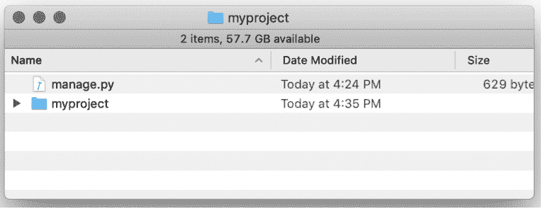

图 1.1 – myproject 的项目目录

`manage.py` 是一个在命令行执行的 Python 脚本，用于与项目交互。我们将使用它来启动 **Django 开发服务器**，这是一个开发 Web 服务器，你将用它在本地计算机上与 Django 项目交互。与 `django-admin` 类似，命令在命令行中传递。与 `django-admin` 不同，该脚本未映射到系统路径，因此我们必须使用 Python 执行它。我们需要使用命令行来执行此操作。例如，在项目目录内，我们运行以下命令：

```
```bash
python3 manage.py runserver
```
```

这会将 `runserver` 命令传递给 `manage.py` 脚本，从而启动 Django 开发服务器。我们稍后将研究 `manage.py` 接受的更多命令。以这种方式与 `manage.py` 交互时，我们称之为管理命令。例如，我们可能会说我们正在执行 `runserver` 管理命令。

`startproject` 命令还创建了一个与项目同名的目录——在本例中为 `myproject`。这是一个 Python 包，包含设置和项目运行所需的其他配置文件。我们稍后将研究其内容。

2. 在你的终端（或命令提示符）中，使用 cd 命令切换到 bookr 项目目录，然后按如下方式运行 manage.py runserver 命令：

```
python3 manage.py runserver
```

注意
在 Windows 上，你可能需要运行并将 python3 替换为仅 python，以便每次运行时命令都能正常工作。

此命令启动 Django 开发服务器。你应该会看到类似以下的输出：

```
WATCHING FOR FILE CHANGES WITH StatReloader

PERFORMING SYSTEM CHECKS...

SYSTEM CHECK IDENTIFIED NO ISSUES (0 SILENCED).

YOU HAVE 18 UNAPPLIED MIGRATION(S). YOUR PROJECT MAY NOT WORK PROPERLY UNTIL YOU APPLY THE MIGRATIONS FOR APP(S): ADMIN, AUTH, CONTENTTYPES, SESSIONS.
RUN 'PYTHON MANAGE.PY MIGRATE' TO APPLY THEM.
JANUARY 01, 2022 - 02:54:03
DJANGO VERSION 4.0, USING SETTINGS 'BOOKR.SETTINGS'
STARTING DEVELOPMENT SERVER AT HTTP://127.0.0.1:8000/
QUIT THE SERVER WITH CONTROL-C.
```

你可能会收到一些关于未应用迁移的警告，但现在没关系。

3. 打开 Web 浏览器并转到 http://127.0.0.1:8000/，这将显示 Django 欢迎屏幕（图 1.2）。如果看到它，你就知道你的 Django 项目已成功创建，一切目前运行正常：

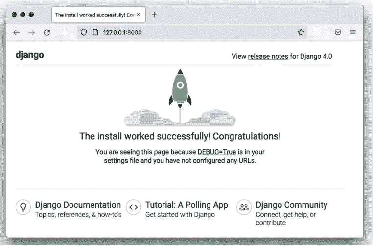

图 1.2 – Django 欢迎屏幕

- 4. 返回终端并通过键入 *Ctrl + C* 停止正在运行的开发服务器。
- 5. 我们现在将为 Bookr 项目创建 *reviews* 应用。在终端中，确保你位于 bookr 项目目录中，然后执行以下命令创建 *reviews* 应用：

```
```text
python3 manage.py startapp reviews
```
```

> **注意**
> 
> 创建 reviews 应用后，你的 Bookr 项目目录中的文件将如下所示： `https://github.com/PacktPublishing/Web-Development-with-Django-Second-Edition/tree/main/Chapter01/Exercise1.01/bookr`。

如果命令成功，则没有输出，但已创建 reviews 应用目录。你可以查看此目录内的文件，查看创建的文件——migrations 目录、`admin.py`、`models.py` 等等。我们将在 *Django 应用* 部分详细介绍这些内容。

在本练习中，我们创建了 Bookr 项目，通过启动 Django 开发服务器测试项目是否正常工作，然后为项目创建了 *reviews* 应用。现在你已经亲手操作过 Django 项目，我们将回到 Django 设计背后的一些理论，以及 HTTP 请求和响应。

## 理解模型-视图-模板范式

应用程序设计中常见的设计模式是 **模型-视图-控制器（MVC）**，其中应用程序的模型（其数据）在一个或多个视图中显示，并且控制器协调模型与视图之间的交互。Django 遵循一种不同但相似的范式，称为 **模型-视图-模板（MVT）**。

与 MVC 类似，MVT 也使用模型来存储数据。然而，在 MVT 中，视图将查询模型然后使用模板渲染它。通常，使用 MVC 语言时，所有三个组件都需要使用相同的语言开发。使用 MVT 时，模板可以用不同的语言编写。在 Django 的情况下，模型和视图用 Python 编写，模板用 HTML 编写。这意味着 Python 开发人员可以处理模型和视图，而专业的 HTML 开发人员处理 HTML。我们将首先更详细地解释模型、视图和模板，然后再查看一些使用示例。

## 模型

Django 模型定义应用程序的数据并提供对 SQL 数据库访问的抽象层，通过 **对象关系映射器（ORM）**。ORM 让你能够使用 Python 代码定义数据模式（类、字段及其关系），而无需了解底层数据库。基本上，这意味着你可以在 Python 代码中定义数据库层，Django 会负责为你生成 SQL 查询。ORM 将在 *第 2 章，模型和迁移* 中详细介绍。

> **注意**
> 
> **SQL 代表结构化查询语言**，是一种描述一种存储数据在表中的数据库类型的方式，每个表有若干行。想象每个表就像一个单独的电子表格。但是，与电子表格不同，数据在每个表之间可以定义关系。你可以通过执行 SQL 查询（在谈论数据库时通常简称为查询）与数据交互。查询允许你检索数据（`SELECT`）、添加或更改数据（`INSERT` 和 `UPDATE` 分别）、以及删除数据（`DELETE`）。可以选择的 SQL 数据库服务器有很多，例如 SQLite、PostgreSQL、MySQL 或 Microsoft SQL Server。每个数据库之间的 SQL 语法大部分相似，但方言可能存在一些差异。Django 的 ORM 会为你处理这些差异——当我们开始编码时，我们将使用 SQLite 数据库在磁盘上存储数据，但后来当我们部署到服务器时，我们将切换到 PostgreSQL，但无需进行任何代码更改。

通常，查询数据库时，结果会作为原始 Python 对象返回（例如，字符串、int、float 或 bytes 的列表）。使用 ORM 时，结果会自动转换为你已定义的模型类的实例。使用 ORM 意味着你会自动受到一种称为 SQL 注入攻击的漏洞的保护。

如果你更熟悉数据库和 SQL，你也可以选择编写自己的查询。

## 视图

Django 视图是定义应用程序大部分逻辑的地方。当用户访问你的网站时，他们的 Web 浏览器会发送请求以从你的网站检索数据（我们将在下一节更详细地介绍 HTTP 请求是什么以及它包含的信息）。视图是你编写的函数，它会以 Python 对象的形式接收此请求（具体来说，是 Django HttpRequest 对象）。你的视图需要决定如何响应请求以及向用户发送什么内容。你的视图必须返回一个 HttpResponse 对象，该对象封装了提供给客户端的所有信息——内容、HTTP 状态和其他标头。

视图还可以选择从请求的 URL 中接收信息——例如 ID 号。视图的一个常见设计模式是使用 Django ORM 通过传递到视图的 ID 查询数据库。然后，视图可以通过提供从数据库检索的模型的数据来渲染模板（稍后会详细介绍）。渲染后的模板成为 HttpResponse 对象的 content，并从视图函数返回。Django 会负责将数据传回浏览器的通信。

## 模板

模板是一个超文本标记语言（HTML）文件（通常——任何文本文件都可以是模板），其中包含由应用程序提供的变量替换的特殊占位符。例如，你的应用程序可以在画廊布局或表格布局中渲染项目列表。你的视图将为两者获取相同的模型，但能够渲染不同的 HTML 文件，使用相同的信息以不同方式呈现数据。Django 强调安全性，因此会自动为你转义变量。例如，< 和 > 符号（以及其他符号）在 HTML 中是特殊字符。如果你尝试在变量中使用它们，Django 会自动对其进行编码，以便在浏览器中正确渲染。

## 实践中的 MVT

我们现在将通过一些示例来说明 MVT 在实践中如何工作。在示例中，我们有一个 Book 模型，存储有关不同书籍的信息，以及一个 Review 模型，存储有关书籍不同评论的信息。

第一个示例中，我们希望能够编辑 Book 或 Review 的信息。以编辑书籍详情的第一个场景为例。我们将有一个视图从数据库获取 Book 数据并提供 Book 模型。然后，我们将包含 Book 对象（和其他数据）的上下文信息传递给模板，该模板将显示一个表单以捕获新信息。第二个场景（编辑评论）类似——从数据库获取 Review 模型，然后传递


Review object and other data to a template to display an edit form. These scenarios might be so similar that we can reuse the same template for both, as shown in Figure 1.3.

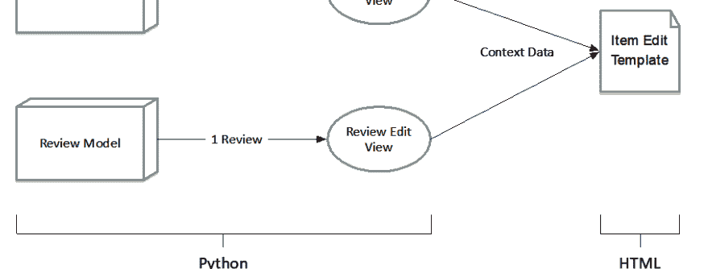

Figure 1.3 – Editing a single book or review

You can see here that we use two models, two views, and one template. Each view fetches a single instance of its associated model, but they can both use the same template, which is a generic HTML page to display a form. Views can provide extra context data to slightly alter the display of the template for each model type. Also illustrated in the diagram are the parts of the code that are written in Python and those that are written in HTML.

In the second example, we want to be able to show a user a list of the books or reviews that are stored in the application. Furthermore, we want to allow the user to search for books and get a list of all that match their criteria. We will use the same two models as the previous example (Book and Review) but we will create new views and templates. Since there are three scenarios, we'll use three views this time – the first fetches all books, the second fetches all reviews, and the last searches for books based on some search criteria. Once again, if we write a template well, we might be able to just use a single HTML template again, as shown in Figure 1.4.

Figure 1.4 – Viewing multiple books or reviews

The Book and Review models remain unchanged from the previous example; the three views will fetch many (zero or more) books or reviews. Then, each view can use the same template, which is a generic HTML file that iterates over a list of objects it is provided and renders them. Once again, the views can send extra data in the context to alter how the template behaves, but the majority of the template will be as generic as possible.

In Django, a model does not always need to be used to render an HTML template. A view can generate the context data itself and render a template with it, without requiring any model data. Figure 1.5 shows a view sending data straight to a template.

Figure 1.5 – A view sending data to a template without a model

In this example, there is a welcome view to welcome a user to the site. It doesn’t need any information from the database, so it can just generate the context data itself. The context data depends on the type of information you want to display – for example, you could pass the user information to greet them by name if they are logged in.

It is also possible for a view to render a template without any context data. This can be useful if you have static information in an HTML file that you want to serve.

Now that you have been introduced to MVT in Django, we can look at how Django processes an HTTP request and generates an HTTP response. However, we first need to explain in more detail what HTTP requests and responses are and what information they contain. We will see this in the next section.

## An introduction to HTTP

Let’s say someone wants to visit your web page. They type in its URL or click a link to your site from a page they are already on. Their web browser creates an HTTP request, which is sent to the server hosting your website. Once a web server receives the HTTP request from your browser, it can interpret it and then send back a response. The response that the server sends might be simple, such as just reading an HTML or image file from disk and sending it. Alternatively, the response might be more complex, maybe using server-side software (such as Django) to dynamically generate the content before sending it.

The following diagram shows the direction of the transmission of HTTP requests and HTTP responses, between a browser and a web server.

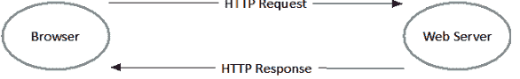

Figure 1.6 – An HTTP request and an HTTP response

The request is made up of four main parts – the method, the path, headers, and the body. Some types of requests don’t have a body. If you just visit a web page, your browser will not send a body, whereas if you are submitting a form (for example, by logging into a site or performing a search), then your request will have a body containing the data you’re submitting. We’ll look at two example requests now to illustrate this.

The first request will be to an example page with the following URL: `https://www.example.com/page`. When your browser visits that page, this is what it’s sending behind the scenes:

```
GET /page HTTP/1.1
Host: www.example.com
User-Agent: Mozilla/5.0 (X11; Ubuntu; Linux x86_64; rv:15.0) Firefox/15.0.1
Cookie: sessid=abc123def456
```

The first line contains the method (GET) and the path (/page). It also contains the HTTP version – in this case, 1.1, although you don’t have to worry about this. There are many different HTTP methods that can be used, depending on how you want to interact with the remote page. Some common ones are GET (to retrieve the remote page), POST (to send data to the remote page), PUT (to create a remote page) and DELETE (to delete the remote page). Note that the descriptions of the actions are somewhat simplified – the remote server can choose how it responds to different methods, and even experienced developers can disagree on the correct method to implement for a particular action. It’s also important to note that even if a server supports a particular method, you will probably need the correct permissions to perform that action – you can’t just delete a web page you don’t like, for example.

When writing a web application, the vast majority of the time you will only deal with GET requests. When you start accepting forms, you’ll also have to use POST requests. It is only when you are working with advanced features, such as creating REST APIs, that you will have to worry about PUT, DELETE, and other methods.

Referring to the example request again, line 2 onwards features the headers of the request. The headers contain extra metadata about the request. Each header is on its own line, with the header name and its value separated by a colon. Most are optional (except for Host – there’ll be more on that soon). Header names are not case-sensitive. For the sake of this example, we’re only showing three common headers here. Let’s look at the example headers in order:

- **Host:** As mentioned, this is the only header that is required (for HTTP 1.1 or later). It is needed for the web server to know which website or application should respond to the request if there are multiple sites hosted on a single server.
- **User-Agent:** Your browser usually sends to the server a string identifying its version and operating system. Your server application could use this to serve different pages to different devices (for example, a mobile-specific page for smartphones).
- **Cookie:** You have probably seen a message when visiting a web page that lets you know that it is storing a cookie in the browser. These are small pieces of information that a website can store in your browser and use to identify you or save settings for when you return to the site. If you were wondering about how your browser sends these cookies back to the server, it is through this header.

There are many other standard headers defined, and it would take up too much space to list them all. They can be used to authenticate to the server (*Authorization*), tell the server what kind of data you can receive (*Accept*), or even what language you’d like for the page (*Accept-Language*, although this will only work if the page creator has made the content available in the particular language you request). You can even define your own headers that only your application knows how to respond to.

Now, let’s look at a slightly more advanced request – one that sends some information to a server and thus (unlike the previous example) contains a body. In this example, we are logging into a web page by sending a username and password – for example, you visit https://www.example.com/login, and it displays a form to enter a username and password. After you click the **Login** button, this is the request that is sent to the server:

```
POST /login HTTP/1.1
Host: www.example.com
Content-Type: application/x-www-form-urlencoded
Content-Length: 32

username=user&password=password1
```


正如你所见，这看起来与第一个示例相似，但有一些不同之处。方法现在是 POST，并且引入了两个新的头部（你可以假设你的浏览器仍会发送之前示例中出现的其他头部）：

- Content-Type：这告诉服务器主体中包含的数据类型。在 application/x-www-form-urlencoded 的情况下，主体是一组键值对。HTTP 客户端可以设置此头部来告诉服务器如果发送其他类型的数据，例如 JSON 或 XML。
- Content-Length：为了让服务器知道要读取多少数据，客户端必须告诉它发送了多少数据。内容长度头部包含主体的长度。如果你计算此示例中主体的长度，你会发现它是 32 个字符。

头部始终由一个空行与主体分隔。通过查看示例，你应该能够看出表单数据是如何在主体中编码的 – username 的值是 user1，password 的值是 password1。

这些请求相当简单，但大多数请求不会更复杂。它们可能有不同的方法和头部，但应遵循相同的格式。现在我们已经看到了请求，我们将看看从服务器返回的 HTTP 响应。

HTTP 响应看起来与请求相似，由三个主要部分组成 – 状态、头部和主体。就像请求一样，取决于响应的类型，它可能没有主体。第一个响应示例是一个简单的成功响应：

```
HTTP/1.1 200 OK
Server: nginx
Content-Length: 18132
Content-Type: text/html
Set-Cookie: sessid=abc123def46

<!DOCTYPE html><html><head>...
```

第一行包含 HTTP 版本、数字状态码（200），然后是代码含义的文本描述（OK – 请求成功）。我们将在下一个示例之后展示更多状态。第 2–5 行包含头部，与请求类似。你可能见过其中的一些头部；我们将在此上下文中解释它们全部：

- Server：这与 User-Agent 头部类似但相反 – 这是服务器告诉客户端它运行的软件。
- Content-Length：客户端使用此值来确定从服务器读取多少数据以获取主体。

- Content-Type：服务器使用此头部向客户端指示它发送的数据类型。客户端然后可以选择如何显示数据 – 例如，图像必须与 HTML 不同地显示。
- Set-Cookie：我们在第一个请求示例中看到客户端如何向服务器发送 cookie。这是服务器发送以在浏览器中设置该 cookie的对应头部。

头部之后是一个空行，然后是响应的主体。我们在这里没有全部显示，只是收到的 HTML 的前几个字符，共 18,132 个，服务器已发送。

接下来，我们将展示一个请求的页面未找到时返回的响应示例：

```
HTTP/1.1 404 Not Found
Server: nginx
Content-Length: 55
Content-Type: text/html

<!DOCTYPE html><html><body>Page Not Found</body></html>
```

它与前一个示例相似，但状态现在是 404 Not Found。如果你曾经在浏览互联网时收到 404 错误，这就是你的浏览器收到的响应类型。各种状态码按它们指示的成功或失败类型分组：

- 100–199：服务器发送此范围内的代码以指示协议更改或需要更多数据。你不必担心这些。
- 200–299：此范围内的状态码表示响应被成功处理。正如我们所见，你最常处理的常见代码是 200 OK。
- 300–399：此范围内的状态码意味着你请求的页面已移动到另一个地址。一个例子是 URL 缩短服务，当你访问时它会将你从短 URL 重定向到完整 URL。常见响应是 301 Moved Permanently 或 302 Found。在发送重定向响应时，服务器还将包含一个 Location 头部，其中包含应重定向到的 URL。
- 400–499：此范围内的状态码意味着请求无法处理，因为客户端发送的内容存在问题。这与由于服务器问题而无法处理请求形成对比（我们很快会讨论这些）。我们已经看到 404 Not Found 响应；这是由于请求错误，因为客户端请求不存在的文档。其他常见响应是 401 Unauthorized（客户端应登录）或 403 Forbidden（客户端不允许访问特定资源）。这两个问题都可以通过让客户端登录来避免，因此它们被视为客户端（请求）问题。

- 500-599：此范围内的状态码表示服务器端错误。客户端不应该期望能够调整请求来解决问题。在使用 Django 时，你最常见的服务器错误状态是 500 Internal Server Error。如果你的代码引发异常，就会生成此错误。另一个常见的是 504 Gateway Timeout，如果你的代码运行时间过长可能会发生。其他常见的变体是 502 Bad Gateway 和 503 Service Unavailable，通常意味着你的应用程序托管存在某种问题。

这些只是最常见的 HTTP 状态之一。你可以在 https://developer.mozilla.org/en-US/docs/Web/HTTP/Status 找到更完整的列表。就像 HTTP 头部一样，状态是任意的，应用程序可以返回自定义状态。服务器和客户端自行决定这些自定义状态和代码的含义。

如果你第一次接触 HTTP 协议，有很多信息需要吸收。幸运的是，Django 做了所有艰苦的工作，并将传入数据封装到 HttpRequest 对象中。大多数时候，你不需要知道大部分传入的信息，但如果需要，它是可用的。同样，在发送响应时，Django 将你的数据封装在 HttpResponse 对象中。通常，你只需设置要返回的内容，但你也有自由设置 HTTP 状态码和头部。我们将在本章后面讨论如何在 HttpRequest 和 HttpResponse 中访问和设置信息。在下一节 处理请求 中，我们将了解 Django 如何接收、解析和响应 HTTP 请求。

## Processing a request

这是请求和响应流程的基本时间线，以便你了解你在每个阶段编写的代码的作用。就编写代码而言，你首先编写的是你的视图。你创建的视图将执行某些操作，例如查询数据库获取数据。然后，视图会将此数据传递给另一个函数来渲染模板，最后返回封装你要发送回客户端的数据的 HttpResponse 对象。

接下来，Django 需要知道如何将特定 URL 映射到你的视图，以便它可以为请求中收到的 URL 加载正确的视图。你将在 URL 配置 Python 文件中编写此 URL 映射。

当 Django 收到请求时，它会解析 URL 配置文件，然后找到对应的视图。它调用视图，并传入代表请求的 HttpRequest 对象。你的视图将返回其 HttpResponse，然后 Django 再次接管，将此数据发送到其托管的 Web 服务器并传回请求它的客户端。

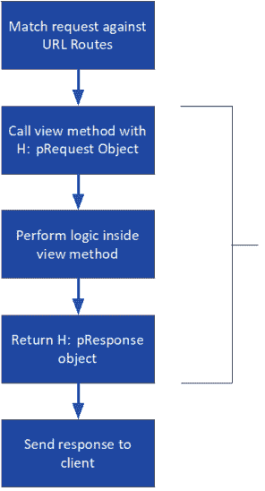

请求和响应流程如图 1.7 所示；标记为 Your Code 的部分是你要编写的代码，而第一步和最后一步由 Django 处理。Django 为你进行 URL 匹配，调用你的视图代码，然后处理将响应传回客户端。

在本节中，我们了解了 HTTP 请求和响应的结构，包括不同类型的请求用于什么。我们还看到了 HTTP 状态码如何用于表示 HTTP 请求或响应中的错误。我们还概述了 Django 如何处理 HTTP 请求。在下一节中，我们将探索 Django 项目结构，并了解各种文件和目录的用途。

## Exploring the Django project structure

我们已经在 Scaffolding a Django project and app 部分介绍了 Django 项目。让我们提醒自己在运行 startproject（对于名为 myproject 的项目）时会发生什么 – 该命令创建一个名为 myproject 的目录，其中包含一个名为 manage.py 的文件，以及一个名为 myproject 的目录（这与项目名称匹配；在 Exercise 1.01 – creating a project and app, and starting the development server 中，此文件夹称为 bookr，与项目相同）。目录布局如图 1.8 所示。我们现在将更详细地检查 manage.py 文件和 myproject 包的内容。


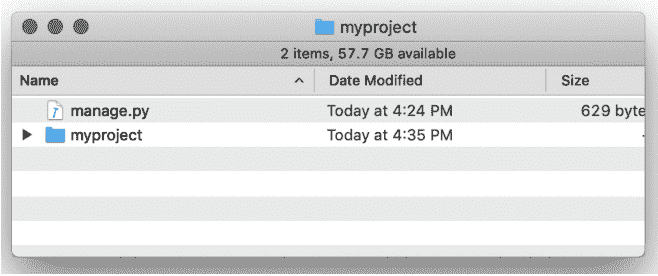

图 1.8 – 我的项目的项目目录

顾名思义，`manage.py` 是一个用于管理你的 Django 项目的脚本。用于与项目交互的大多数命令都将作为命令行参数提供给此脚本。命令作为此脚本的参数提供——例如，如果我们想运行 `manage.py runserver` 命令，则意味着像这样运行 `manage.py` 脚本：

```bash
python3 manage.py runserver
```

`manage.py` 提供了许多有用的命令。你将在本书中更详细地了解它们；其中一些常见命令如下：

- `runserver`: 这会启动 Django 开发 HTTP 服务器，在你的本地计算机上提供 Django 应用。
- `startapp`: 这会在你的项目中创建一个新的 Django 应用。我们很快会更深入地讨论应用是什么。
- `shell`: 这会启动一个预加载了 Django 设置的 Python 解释器。这对于在无需手动加载 Django 设置的情况下与你的应用程序交互很有用。
- `dbshell`: 这会启动一个与你的数据库连接的交互式 shell，使用来自 Django 设置的默认参数。你可以通过这种方式运行手动 SQL 查询。
- `makemigrations`: 这会根据你的模型定义生成数据库更改指令。你将在 *第 2 章，模型和迁移* 中了解这意味着什么以及如何使用此命令。
- `migrate`: 这会应用由 `makemigrations` 命令生成的迁移。你也将在 *第 2 章，模型和迁移* 中使用它。
- `test`: 这会运行你编写的自动化测试。你将在 *第 14 章，测试你的 Django 应用程序* 中使用此命令。

所有命令的完整列表可在 `https://docs.djangoproject.com/en/3.0/ref/django-admin/` 获取。

在接下来的部分中，我们将探索项目目录的内容，了解 Django 应用目录包含什么，并了解如何在 PyCharm 中加载你的项目。

## The myproject directory

除了 manage.py 文件外，startproject 创建的另一个文件项是 myproject 目录。这是你的项目的实际 Python 包。它包含项目的设置、Web 服务器的一些配置文件以及全局 URL 映射。myproject 目录内有五个文件：

- __init__.py
- asgi.py
- settings.py
- urls.py
- wsgi.py

它们也可以在以下屏幕截图中看到：

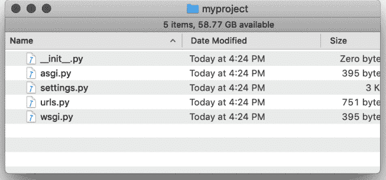

图 1.9 – myproject 包（在 myproject 项目目录内）

现在让我们看看这些文件包含什么内容：

- `__init__.py`: 这是一个空文件，让 Python 知道 myproject 目录是一个 Python 模块。如果你以前使用过 Python，你会熟悉这些文件。
- `settings.py`: 这包含你的应用程序的所有 Django 设置。我们很快会解释其内容。
- `urls.py`: 这具有 Django 最初用于定位视图或其他子 URL 映射的全局 URL 映射。你很快就会向此文件添加 URL 映射。
- `asgi.py` 和 `wsgi.py`: 这些文件是 ASGI 或 WSGI Web 服务器在将你的 Django 应用部署到生产 Web 服务器时用于与之通信的文件。你通常不需要编辑它们，它们在日常开发中也不使用。它们的使用将在 *第 17 章，部署 Django 应用程序（第 1 部分 – 服务器设置）* 中更详细地讨论，该章节托管在此书的 GitHub 仓库上。

## Django development server

你已经在 *练习 1.01 – 创建项目和应用并启动开发服务器* 中启动了 Django 开发服务器。正如我们之前提到的，它是一个仅 intended 在开发期间在开发人员机器上运行的 Web 服务器。它不 intended 用于生产环境。

默认情况下，服务器在 `localhost (127.0.0.1)` 的端口 8000 上监听，但可以通过在 `runserver` 参数后添加端口号，或地址和端口号来更改：

```bash
python3 manage.py runserver 8001
```

这将使服务器在 `localhost (127.0.0.1)` 的端口 8001 上监听。

你也可以让它监听特定地址，如果你的计算机有多个地址，或 `0.0.0.0` 表示所有地址：

```bash
python3 manage.py runserver 0.0.0.0:8000
```

这将使服务器在你计算机的所有地址上端口 8000 上监听，如果你想从另一台计算机或你的智能手机测试你的应用程序，这会很有用。

开发服务器会监视你的 Django 项目目录，并在你保存文件时自动重启，以便你所做的任何代码更改都会自动重新加载到服务器中。但是，你仍然需要手动刷新浏览器才能看到更改。

当你想停止 `runserver` 命令时，可以以在终端中停止进程的通常方式完成——通过键入 *Ctrl + C.*

## Django apps

现在我们已经涵盖了关于应用的大部分理论，我们可以更具体地说明它们的目的。应用目录包含它们提供应用功能所需的所有模型、视图、模板（以及更多）。Django 项目将至少包含一个应用（除非它被大量定制以不依赖大量 Django 功能）。如果设计良好，应用应该能够在不修改的情况下从一个项目中移除并移动到另一个项目。通常，应用将包含单个设计域的模型，这可以作为判断你的应用是否应拆分为多个应用的有用方法。

你的应用可以有任何名称，只要它是有效的 Python 模块名称（即，仅字母、数字和下划线）并且不与项目目录中的其他文件冲突即可。例如，正如我们所见，项目目录中已经有一个名为 `myproject` 的目录（包含 `settings.py` 文件），因此你不能有一个名为 `myproject` 的应用。正如我们在 *练习 1.01 – 创建项目和应用并启动开发服务器* 中所见，创建应用使用 `manage.py startapp appname` 命令，如下所示：

```bash
python3 manage.py startapp myapp
```

`startapp` 命令会在你的项目内创建一个以指定应用名称命名的目录。它还会为应用搭建文件。应用目录内有一系列文件和一个文件夹，如 *图 1.10* 所示：

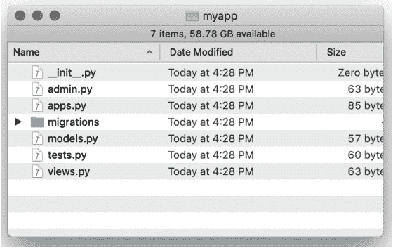

图 1.10 – myapp 应用目录的内容

让我们回顾一下这些文件和文件夹：

- `__init__.py`: 一个空文件，表示此目录是一个 Python 模块。
- `admin.py`: Django 有一个内置的 admin 站点，用于通过 GUI 查看和编辑数据。在此文件中，你将定义你的应用的模型如何在 Django admin 站点中公开。我们将在 *第 4 章，Django Admin 简介* 中更详细地介绍这一点。
- `apps.py`: 这包含应用元数据的一些配置。你不需要编辑此文件。
- `models.py`: 这是你将定义应用程序模型的所在位置。你将在 *第 2 章，模型和迁移* 中更详细地阅读此内容。
- `migrations`: Django 使用迁移文件自动记录模型更改时对底层数据库的更改。它们由 Django 在你运行 `manage.py makemigrations` 命令时生成并存储在此目录中。它们在你运行 `manage.py migrate` 之前不会应用到数据库中。它们也将在 *第 2 章，模型和迁移* 中介绍。
- `tests.py`: 为了测试你的代码是否按预期运行，Django 支持编写测试（单元、功能或集成）并会在此文件中查找它们。我们将在本书中编写一些测试，并在 *第 14 章，测试你的 Django 应用程序* 中详细介绍测试。
- `views.py`: 你的 Django 视图（响应 HTTP 请求的代码）将放在这里。你很快就会创建一个基本视图，视图将在 *第 3 章，URL 映射、视图和模板* 中更详细地介绍。

我们稍后会更详细地检查这些文件的内容，但现在，我们将让 PyCharm 运行起来。

## PyCharm setup

我们在 *练习 1.01 – 创建项目和应用并启动开发服务器* 中确认 Bookr 项目已正确设置（因为开发服务器运行成功），因此我们现在可以开始使用 PyCharm 运行和编辑我们的项目。PyCharm 是 Python 开发的 IDE，包含代码补全、自动样式格式化和内置调试器等功能。我们将然后使用 PyCharm 开始编写自己的 URL 映射、视图和模板。它还将用于启动和停止开发服务器，这将允许通过设置断点来调试你的代码。

### Exercise 1.02 – project setup in PyCharm

在此练习中，我们将打开 Bookr 项目在 PyCharm 中并设置项目解释器，以便 PyCharm 可以运行和调试项目。请按照以下步骤操作：

1. 打开 PyCharm。当你第一次打开 PyCharm 时，你会看到 **Welcome to PyCharm** 屏幕，询问你想要做什么：


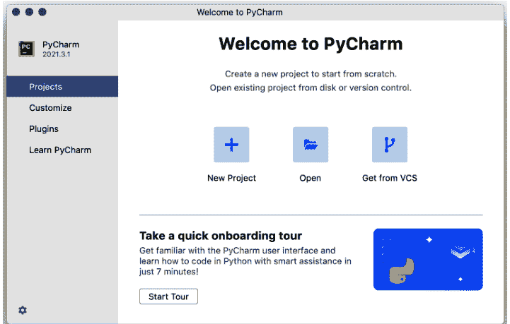

Figure 1.11 – The PyCharm welcome screen

- 2. 点击 Open，然后浏览到你刚刚创建的 bookr 项目并打开它。确保你打开的是 bookr 项目目录，而不是内部的 bookr 包目录。

- 3. 系统会询问你是否要信任 bookr 项目。由于你刚刚创建了它，所以是安全的，点击 Trust Project：

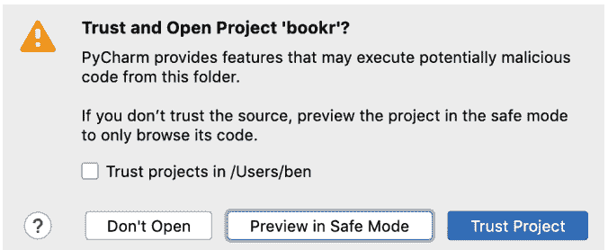

Figure 1.12 – PyCharm’s Trust Project dialog

如果你之前从未使用过 PyCharm，它会询问你想要使用哪些设置和主题，回答完所有问题后，你将在窗口左侧的 **Project** 面板中看到你的 **bookr** 项目结构打开：

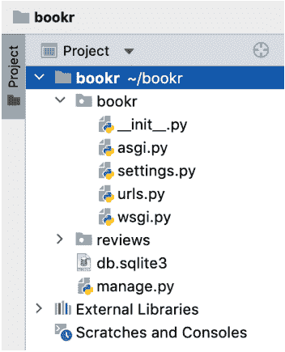

你的项目面板应如下 *Figure 1.13* 所示，并显示 bookr 和 reviews 目录以及 manage.py 文件。如果没有看到这些，而看到的是 asgi.py、settings.py、urls.py 和 wsgi.py，则说明你打开的是 bookr 包目录而非项目目录。选择 **File | Open**，然后浏览并打开 bookr 项目目录。

在 PyCharm 知道如何执行你的项目以启动 Django 开发服务器之前，解释器必须设置为虚拟环境内部的 Python 二进制文件。这首先通过将解释器添加到全局解释器设置中来完成。

- 4. 在 PyCharm 内部打开 **Preferences**（macOS）或 **Settings**（Windows/Linux）窗口：
  - macOS：**PyCharm** 菜单 | **Preferences**
  - Windows 和 Linux：**File** | **Settings**

5. 在左侧的偏好设置列表窗格中，打开 Project: bookr 项，然后点击 Project Interpreter：

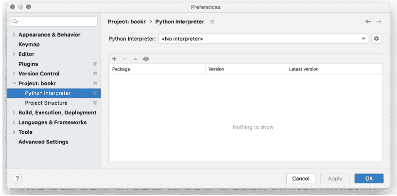

Figure 1.14 – The project interpreter settings

6. 有时，PyCharm 能够自动确定虚拟环境，因此在这种情况下，项目解释器可能已经填充了正确的解释器。如果是这样，并且你在软件包列表中看到 Django，请点击 OK 关闭窗口并完成此练习。

7. 在大多数情况下，Python 解释器必须手动设置。点击 Python Interpreter 下拉菜单旁边的齿轮图标，然后点击 Add....

8. 现在会显示 Add Python Interpreter 窗口。选择 Existing environment 单选按钮，然后点击 Interpreter 选择旁边的省略号 (...)。然后你应该浏览并选择虚拟环境的 Python 解释器。

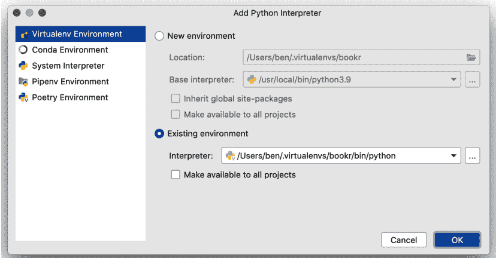

Figure 1.15 – The Add Python Interpreter window

9. 在 macOS 上（假设你将虚拟环境命名为 bookr），路径通常为 /Users/<yourusername>/.virtualenvs/bookr/bin/python3。类似地，在 Linux 上，它应该在 /home/<yourusername>/.virtualenvs/bookr/bin/python3。

10. 如果不确定，你可以在之前运行 python manage.py 命令的终端中运行 which python3 命令，它会告诉你 Python 解释器的路径：

```
which python3
/Users/BEN/.VIRTUALENVS/BOOKR/BIN/PYTHON3
```

在 Windows 上，它将是你使用 virtualenv 命令创建虚拟环境的位置。

选择解释器后，你的 Add Python Interpreter 窗口应如下 Figure 1.15 所示。

11. 点击 OK 关闭 Add Python Interpreter 窗口。

你现在应该看到主偏好设置窗口，并且 Django（以及虚拟环境中的其他软件包）将被列出（见 Figure 1.16）。

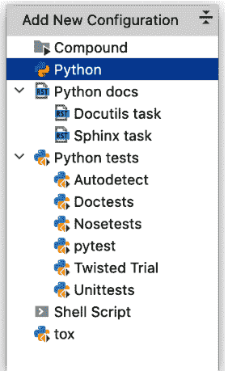

Figure 1.18 – Adding a new Python configuration in the Run/Debug Configurations window

3. 一个包含有关如何运行你的项目字段的新配置面板将显示在窗口右侧。继续按如下方式填写字段：

- - **Name** 字段可以是任何内容，但应易于理解。输入 `Django Dev Server`。

- - **Script path** 是指向你的 `manage.py` 文件的路径。如果点击此字段中的文件夹图标，你可以浏览文件系统以选择 `bookr` 项目目录内的 `manage.py` 文件。

- - **Parameters** 指的是 `manage.py` 脚本之后的参数，与从命令行运行它时相同。我们将在这里使用相同的参数来启动服务器，因此输入 `runserver`。

**Note**
如前所述，`runserver` 命令还可以接受端口或要监听的地址的参数。如果你愿意，可以在同一个 `Parameters` 字段中在 `runserver` 之后添加此参数。

4. **Python interpreter** 设置应已自动设置为在 *Exercise 1.02* 中设置的解释器。如果没有，请点击右侧的箭头下拉菜单进行选择。

**Working directory** 设置应为 `bookr` 项目目录。这可能已经正确设置。

8. 点击 Play 图标启动 Django 开发服务器。

Note
确保停止正在运行的其他 Django 开发服务器实例（例如在终端中）；否则，你启动的服务器将无法绑定到端口 8000 并启动失败。

PyCharm 窗口底部将打开一个控制台，显示开发服务器已启动的输出（Figure 1.21）。

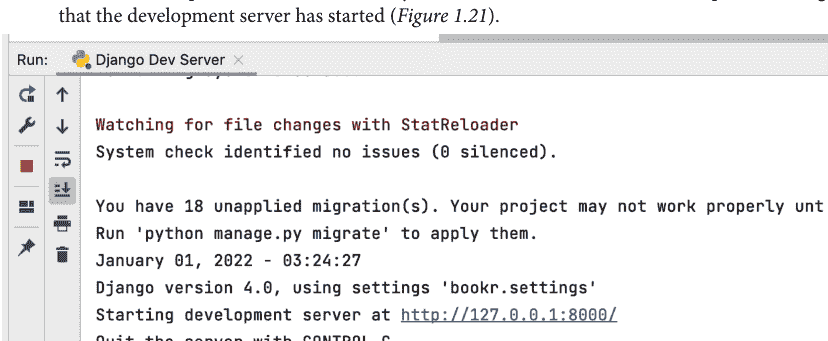

Figure 1.21 – The console with the Django development server running

9. 打开一个 Web 浏览器并导航到 http://127.0.0.1:8000。你应该会看到与你在练习 1.01 中看到的相同的 Django 示例屏幕——创建项目和应用并启动开发服务器（Figure 1.21），这将确认一切再次设置正确。

在本练习中，我们在 PyCharm 中打开了 bookr 项目，然后为项目设置了 Python 解释器。我们还在 PyCharm 中添加了一个运行配置，这使我们能够从 PyCharm 内部启动和停止 Django 开发服务器。稍后我们还将能够通过在 PyCharm 的调试器中运行项目来调试项目。

在本节中，我们探索了 Django 文件夹结构并了解了脚手架中目录和文件夹的目的。我们还了解了如何创建 Django 应用及其包含的文件。最后，我们在 PyCharm 中成功运行了一个 Django 项目。

## Introducing Django views

你现在已准备好开始编写自己的 Django 视图并配置将映射到它们的 URL。正如我们在本章前面看到的，视图只是一个函数，它接收一个 HttpRequest 实例（由 Django 构建）和（可选）来自 URL 的一些参数。它将执行一些操作，例如从数据库获取数据。最后，它返回 HttpResponse。

以我们的 Bookr 应用为例，我们可能有一个视图接收对某本书的请求。它查询数据库以获取这本书，然后返回一个包含显示书籍信息的 HTML 页面的响应。另一个视图可以接收列出所有书籍的请求，然后返回包含该列表的另一个 HTML 页面的响应。视图还可以创建或修改数据；另一个视图可以接收创建新书籍的请求，然后将书籍添加到数据库并返回显示新书籍信息的 HTML 响应。

在本章中，我们只使用函数作为视图，但 Django 也支持类视图，允许你利用面向对象的范式（例如继承）。这使你能够简化在多个具有相同业务逻辑的视图中使用的代码。例如，你可能想要显示所有书籍或仅显示某个出版商的书籍。两个视图都需要从数据库查询书籍列表并将其渲染到书籍列表模板。一个视图类可以继承另一个视图类，只需以不同的方式实现数据获取，而其余功能（例如渲染）保持相同。类视图可能更强大，但也更难学习。它们将在第 11 章《高级模板和类视图》中介绍，当你对 Django 有更多经验时。

传递给视图的 HttpRequest 实例包含与请求相关的所有数据，其属性如下：

- - method：一个字符串，包含浏览器用于请求页面的 HTTP 方法，通常为 GET，但如果用户提交了表单则为 POST。你可以使用它来改变视图的流程——例如，在 GET 时显示空表单，或在 POST 时验证并处理表单提交。
- - GET：这是一个 QueryDict 类，包含 URL 查询字符串中使用的参数。这是 URL 中 ? 之后的部分（如果有）。我们很快会更深入地了解 QueryDict 类。请注意，即使请求不是 GET，此属性也始终可用。
- - POST：这也是一个 QueryDict，包含在 POST 请求中发送到视图的参数，例如来自表单提交。通常，你会将其与 Django 表单一起使用，这将在第 6 章《表单》中介绍。
- - headers：这是一个不区分大小写的键字典，其中包含来自请求的 HTTP 头。例如，你可以根据 User-Agent 头为不同浏览器提供不同的内容来改变响应。我们在本章前面讨论了一些由客户端发送的 HTTP 头。


+   - path: 这是在请求中使用的路径。通常，你不需要检查它，因为 Django 会自动解析路径并将其作为参数传递给视图函数，但在某些情况下它会很有用。

我们现在还不会使用所有这些属性，并且稍后还会介绍其他属性，但你现在可以看到 HttpRequest 参数在你的视图中扮演的角色。

接下来，我们将了解 Django 如何确定针对特定 URL 使用哪个视图。

## 探索 URL 映射细节

我们在“处理请求”部分中简要提到了 URL 映射。Django 并不会自动知道在收到特定 URL 的请求时应该执行哪个视图函数。URL 映射的作用是建立 URL 与视图之间的链接。例如，在 Bookr 中，你可能希望将 /books/ URL 映射到你创建的 books_list 视图。

URL 到视图的映射在 Django 自动创建的文件 urls.py 中定义，位于 bookr 包目录内（尽管也可以在 settings.py 中设置不同的文件；稍后会详细介绍）。

该文件包含一个变量 urlpatterns，它是一个路径列表，Django 会依次评估这些路径，直到找到与所请求 URL 匹配的路径。匹配结果将解析为一个视图函数或另一个 urls.py 文件，其中也包含 urlpatterns 变量，将以相同的方式解析。URL 文件可以以这种方式无限链式连接。这样，你就可以将 URL 映射拆分为单独的文件（例如每个应用一个或多个），以免变得过大。一旦找到视图，Django 就会使用 HttpRequest 和从 URL 解析出的任何参数调用它。

规则是通过调用 path 函数来设置的，该函数将 URL 的路径作为第一个参数。路径可以包含将作为函数参数传递给视图的命名参数。它的第二个参数是视图或另一个也包含 urlpatterns 的文件。

还有 re_path 函数，它与 path 类似，只是它将正则表达式作为第一个参数，以便进行更高级的配置。URL 映射还有很多内容；它将在第 3 章《URL 映射、视图和模板》中介绍。为了说明这些概念，图 1.22 显示了 Django 生成的默认 urls.py 文件：

```
from django.contrib import admin
from django.urls import path

urlpatterns = [
    path('admin/', admin.site.urls),
]
```

图 1.22 – 默认的 urls.py 文件

你可以看到列出所有已设置 URL 的 `urlpatterns` 变量。目前只设置了一条规则，它将以 `admin/` 开头的任何路径映射到 admin URL 映射（`admin.site.urls` 模块）。这不是映射到视图；相反，它是链式连接 URL 映射的示例 – `admin.site.urls` 模块将定义剩余的路径（在 `admin/` 之后），这些路径映射到 admin 视图。我们将在本书后面介绍 Django 管理站点，从 *第 4 章，Django 管理简介* 开始。

我们现在将编写一个视图并为其设置 URL 映射，以便实际操作。

## 练习 1.03 – 编写一个视图并将 URL 映射到它

我们的第一个视图将非常简单，只返回一些静态文本内容。在本练习中，我们将了解如何编写视图并设置 URL 映射以解析到视图：

> **注意**
> 当你在项目中修改文件并保存时，你可能会看到运行 Django 开发服务器的终端或控制台中服务器自动重启。这是正常的——它会自动重启以加载你所做的代码更改。请注意，如果你编辑模型或迁移，它不会自动应用对数据库的更改——有关此内容的更多信息将在 *第 2 章，模型和迁移* 中介绍。

-   1. 在 PyCharm 中，展开左侧 **Project** 浏览器中的 `reviews` 文件夹，然后双击其中的 `views.py` 文件以打开它。在 PyCharm 的右侧（编辑器）窗格中，你应该会看到 Django 自动生成的占位符文本：

```
from django.shortcuts import render

# Create your views here.
```

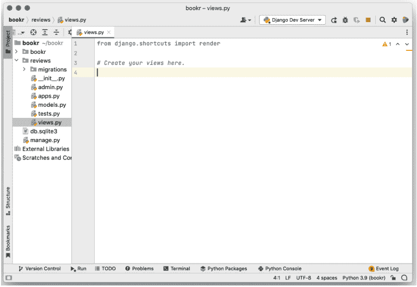

图 1.23 – views.py 默认内容

-   2. 从 views.py 中删除此占位符文本，并改插入以下内容：

```
from django.http import HttpResponse

def index(request):
    return HttpResponse("Hello, world!")
```

首先，需要从 django.http 导入 HttpResponse 类。这用于创建返回给 Web 浏览器的响应。你也可以用它来控制诸如 HTTP 头或状态码之类的内容。现在，它将只使用默认的头和 200 Success 状态码。它的第一个参数是要作为响应正文发送的字符串内容。

然后，视图函数返回一个 HttpResponse 实例，其中包含我们定义的内容（Hello, world!）。

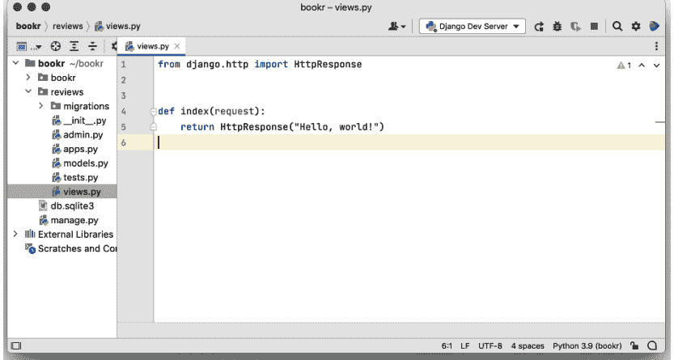

图 1.24 – 编辑后的 views.py 内容

3. 我们现在将为 index 视图设置一个 URL 映射。这将非常简单，不包含任何参数。展开项目窗格中的 bookr 目录，然后打开 urls.py。Django 已自动生成此文件。

现在，我们只需添加一个简单的 URL 来替换 Django 提供的默认索引。

4. 通过在其他现有导入之后添加以下行，将你的视图导入到 urls.py 文件中：

```
import reviews.views
```

5. 通过添加对 path 函数的调用，使用空字符串和对 index 函数的引用，将映射到 index 视图添加到 urlpatterns 列表中：

```
urlpatterns = [
    path('admin/', admin.site.urls),
    path('', reviews.views.index)
]
```

确保不要在 index 函数后添加括号（即应为 reviews.views.index 而不是 reviews.views.index()，因为我们传递的是对函数的引用而不是调用它。完成后，你的 urls.py 文件应如下图 1.25 所示。

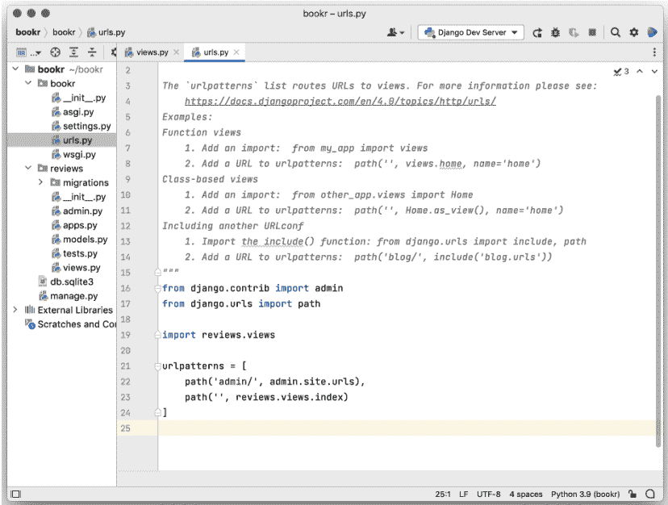

图 1.25 – 编辑后的 urls.py

6. 切换回你的 Web 浏览器并刷新。Django 默认欢迎屏幕应被视图中定义的文本 Hello, world! 替换。

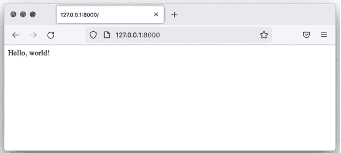

图 1.26 – Web 浏览器现在应显示 Hello, world! 消息

我们刚刚了解了如何编写视图函数并将 URL 映射到它。然后我们通过在 Web 浏览器中加载它来测试视图。

接下来，我们将了解如何处理通过 HTTP 请求发送但不在 URL 路径中的数据。

## 使用 GET、POST 和 QueryDict 对象

数据可以通过 URL 上的参数或 POST 请求的主体作为 HTTP 请求的一部分传入。你可能在浏览网页时注意到 URL 中的参数——问号 ? 后的文本——例如，http://www.example.com/?parameter1=value1&parameter2=value2。我们在本章前面也看到了登录用户时 POST 请求中的表单数据示例（请求主体为 username=user&password=password1）。

Django 会自动将这些参数字符串解析为 QueryDict 对象。数据随后可在传递给你的视图的 HttpRequest 对象上使用——具体来说，分别用于 URL 参数和主体参数的 HttpRequest.GET 和 HttpRequest.POST 属性。QueryDict 对象在大多数情况下表现得像字典，只是它们可以为一个键包含多个值。

为了展示访问项的不同方法，我们将使用一个简单的 QueryDict（qd 变量）作为示例，其中只有一个键（k）。k 项在列表中有三个值——字符串 a、b 和 c。以下代码片段显示了 Python 解释器的输出。

首先，从参数字符串构造 QueryDict qd 变量：

```
>>> qd = QueryDict("k=a&k=b&k=c")
```

使用方括号表示法或 get 方法访问项时，将返回该键的最后一个值：

```
>>> qd["k"]
'c'
>>> qd.get("k")
'c'
```

要访问键的所有值，应使用 getlist 方法，如下所示：

```
>>> qd.getlist("k")
['a', 'b', 'c']
```

getlist 总是返回一个列表；如果键不存在，则为空：

```
>>> qd.getlist("bad key")
[]
```


虽然 `getlist` 对不存在的键不会抛出异常，但使用方括号表示法访问不存在的键会像普通字典一样抛出 `KeyError`。请使用 `get` 方法来避免此错误。

GET 和 POST 的 `QueryDict` 对象是不可变的（无法更改），因此如果你需要更改其值，应使用 `copy` 方法获取可变副本，如下所示：

```
>>> qd["k"] = "d"
AttributeError: This QueryDict instance is immutable
>>> qd2 = qd.copy()
>>> qd2
<QueryDict: {'k': ['a', 'b', 'c']}>
>>> qd2["k"] = "d"
>>> qd2["k"]
"d"
```

为了举例说明 `QueryDict` 是如何从 URL 填充的，让我们设想一个示例 URL：http://127.0.0.1:8000?val1=a&val2=b&val2=c&val3。

在后台，Django 会将 URL 中的查询（? 之后的所有内容）传入以实例化一个 `QueryDict` 对象，并将其附加到传给视图函数的 `request` 上。过程大致如下：

```
request.GET = QueryDict("val1=a&val2=b&val2=c&val3")
```

请记住，这是在视图函数内收到 `request` 之前完成的，因此您无需执行此操作。

对于上面的示例 URL，我们可以按如下方式访问视图函数中的参数：

```
request.GET["val1"]
```

使用标准字典访问，它将返回 "a" 值：

```
request.GET["val2"]
```

同样，使用标准字典访问，由于 `val2` 键设置了两个值，它将返回最后一个值 "c"：

```
request.GET.getlist("val2")
```

这将返回 `val2` 的所有值组成的列表 - ["b", "c"]：

```
request.GET["val3"]
```

- 3. 在浏览器中访问 `http://127.0.0.1:8000`。请注意，页面仍然显示 **Hello, world!** 这是因为我们还没有提供 `name` 参数。您可以将名字添加到 URL 中——例如，`http://127.0.0.1:8000?name=Ben`。这可以在以下截图中看到：

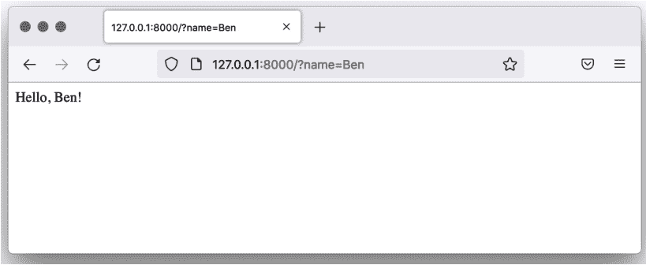

图 1.28 – 在 URL 中设置名字

- 4. 尝试添加两个名字——例如，`http://127.0.0.1:8000?name=Ben&name=John`。如前所述，`get` 函数会获取参数的最后一个值，因此您应该看到 **Hello, John!**：

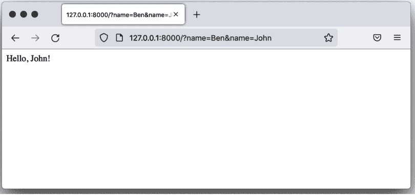

图 1.29 – 在 URL 中设置多个名字

- 5. 尝试不设置名字，如下所示——`http://127.0.0.1:8000?name=`。页面应恢复显示 **Hello, world!**：

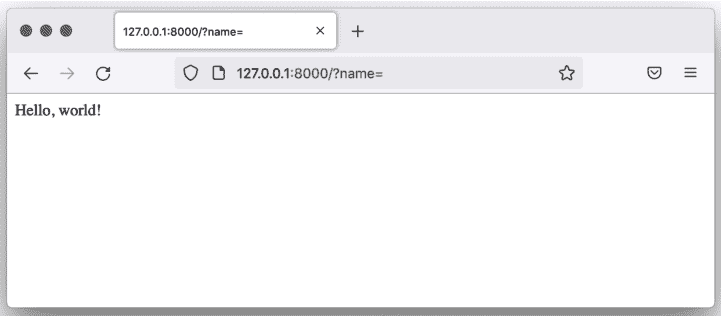

> **注意**
>
> 您可能想知道为什么我们使用 `or` 将 name 设置为默认值 **world**，而不是将 `'world'` 作为默认值传给 `get`。想一想在 *步骤 6* 中，当我们为 `name` 参数传入一个空值时发生了什么。如果我们把 `'world'` 作为 `get` 的默认值，`get` 函数仍然会返回一个空字符串。这是因为 `name` 已经设置了一个值；只是该值为空。在开发视图时请记住这一点，因为未设置值和设置为空值是有区别的。根据您的用例，您可以选择将默认值传给 `get`。

在本练习中，我们在视图中使用传入请求的 `GET` 属性从 URL 检索值。我们了解了如何设置默认值，以及如果同一参数设置了多个值，会检索哪个值。视图返回了 `HttpResponse`，其中包含我们想要发送到浏览器的消息。

在下一节中，我们将学习如何更新和使用 Django 的设置。

## 探索 Django 设置

我们还没有查看 Django 如何存储其设置。现在我们已经了解了 Django 的不同部分，现在是检查 `settings.py` 文件的好时机。Django 包含许多可用于自定义它的设置。当您启动 Bookr 项目时，系统会为您创建一个默认的 `settings.py` 文件。我们现在将讨论文件中一些更重要的设置，以及随着您对 Django 越来越熟练可能会用到的一些其他设置。您应该在 PyCharm 中打开 `settings.py` 文件并跟着操作，以便查看项目中的值位于何处以及具体是什么值。

此文件中的每个设置只是一个文件级全局变量。我们将按它们在此文件中出现的顺序来讨论，虽然我们可能会跳过一些设置——例如，在 `DEBUG` 和 `INSTALLED_APPS` 之间有一个 `ALLOWED_HOSTS` 设置，我们不会在本书的这一部分介绍它（您将在第 16 章“Django 应用程序的部署”中看到它）：

```
SECRET_KEY = '...'
```

这是一个自动生成的值，不应与任何人共享。它用于哈希、令牌和其他加密功能。如果 cookie 中已有现有会话，并且您更改了此值，则这些会话将不再有效：

```
DEBUG = True
```

将此值设置为 `True` 后，Django 会自动向浏览器显示异常，以便您调试遇到的任何问题。当您将应用部署到生产环境时，应将其设置为 `False`：

```
INSTALLED_APPS = [...]
```

当您编写自己的 Django 应用（例如 reviews 应用）或安装第三方应用（这将在第 15 章“集成第三方库”中介绍）时，应将它们添加到此列表中。正如我们所见，在此处添加它们并不是严格必需的（我们的 index 视图在 reviews 应用不在列表中的情况下也能正常工作）。但是，为了让 Django 能够自动找到应用的模板、静态文件、迁移和其他配置，必须在此处列出：

```
ROOT_URLCONF = 'bookr.urls'
```

这是 Django 首先加载以查找 URL 的 Python 模块。请注意，它就是我们之前将 index 视图 URL 映射添加到的文件：

```
TEMPLATES = [...]
```

现在，理解此设置中的所有内容并不十分重要，因为您不会更改它；需要指出的一行是：

```
'APP_DIRS': True,
```

这告诉 Django，在加载要渲染的模板时，它应在每个 `INSTALLED_APP` 内的 `templates` 目录中查找。我们还没有为 reviews 创建 `templates` 目录，但将在下一个练习中添加一个。

Django 还有更多设置未在 settings.py 文件中列出，因此在这些情况下它将使用其内置默认值。您也可以使用该文件为您的应用程序设置任意自定义设置。第三方应用可能也希望在此处添加设置。在后面的章节中，我们将在此处为其他应用添加设置。您可以在 https://docs.djangoproject.com/en/3.0/ref/settings/ 找到所有设置及其默认值的列表。

## 在代码中引用 Django 设置

有时在自己的代码中引用 settings.py 中的设置会很有用，无论这些设置是 Django 的内建设置还是您自己定义的设置。您可能会倾向于编写如下导入设置的代码：

```
from bookr import settings

if settings.DEBUG:  # check if running in DEBUG mode
    do_some_logging()
```

这种方法是不正确的，原因如下：

- 您可以运行 Django 并指定一个不同的设置文件来读取，在这种情况下，前面的代码会引发错误，因为它无法找到该文件。或者，如果文件存在，导入会成功，但会包含错误的设置。
- Django 有一些设置可能不在 settings.py 文件中列出，如果没有列出，它将使用自己的内部默认值。例如，如果您从 settings.py 文件中删除了 `DEBUG = True` 这一行，Django 将回退到使用其内部的 `DEBUG` 值（即 `False`）。但是，如果您尝试直接使用 `settings.DEBUG` 访问它，您将收到错误。
- 第三方库可以改变设置的定义方式，因此您的 settings.py 文件看起来会完全不同。预期的变量可能根本不存在。所有这些应用的行为超出了本书的范围，但这是需要注意的一点。

首选方法是改用 `django.conf` 模块，如下所示：

```
from django.conf import settings  # import settings from here instead

if settings.DEBUG:
    do_some_logging()
```

从 `django.conf` 导入设置时，Django 会缓解我们刚才讨论的三个问题：

- 设置从指定的任何 Django 设置文件中读取
- 任何默认设置值都会被填充
- Django 负责解析第三方库定义的任何设置

在我们新的、更短的示例代码片段中，即使 settings.py 文件中缺少 `DEBUG`，它也会回退到 Django 内部默认值（即 `False`）。Django 定义的所有其他设置也是如此；但是，如果您在此文件中定义自己的自定义设置，Django 不会有它们的内部值，因此在您的代码中，您应该为它们不存在的情况做好准备——您的代码如何表现由您决定，并且超出了本书的范围。


接下来，我们将了解 Django 如何定位模板文件。

## 在应用目录中查找 HTML 模板

有许多选项可用来告诉 Django 如何查找模板，这些选项可以在 settings.py 的 TEMPLATES 设置中进行配置，但（目前）最简单的做法是在 reviews 目录内创建一个 templates 目录。由于 settings.py 中的 APP_DIRS 为 True（如上一节所见），Django 会查找该目录（以及其他应用的 templates 目录）。然而，要让 Django 知道 reviews 目录是一个应用，我们需要在设置中对其进行配置。我们将在下一个练习中完成这一点。

## 练习 1.05 – 创建 templates 目录和基础模板

在本练习中，你将为 reviews 应用创建一个 templates 目录。然后，你将添加一个 HTML 模板文件，Django 可以将其渲染为 HTTP 响应。

我们在“探索 Django 设置”一节中讨论过 settings.py 及其 INSTALLED_APPS 设置。我们需要将 reviews 应用添加到 INSTALLED_APPS 中，以便 Django 能够找到模板。请按照以下步骤操作：

- 1. 在 PyCharm 中打开 settings.py。更新 INSTALLED_APPS 设置，并在末尾添加 reviews。它应如下所示：

```
INSTALLED_APPS = [
    'django.contrib.admin',
    'django.contrib.auth',
    'django.contrib.contenttypes',
    'django.contrib.sessions',
    'django.contrib.messages',
    'django.contrib.staticfiles',
    'reviews'
]
```

图 1.31 – 已将 reviews 应用添加到 settings.py

- 2. 保存并关闭 settings.py。

- 3. 在 PyCharm 的项目浏览器中，右键单击 reviews 目录，然后选择“新建 | 目录”。

图 1.32 – 在 reviews 目录内新建一个目录

4. 输入名称 `templates`，然后按 *Enter/Return* 键创建它：

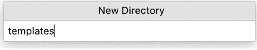

图 1.33 – 将目录命名为 templates

5. 右键单击新创建的 `templates` 目录，然后选择 **新建 | HTML 文件**。

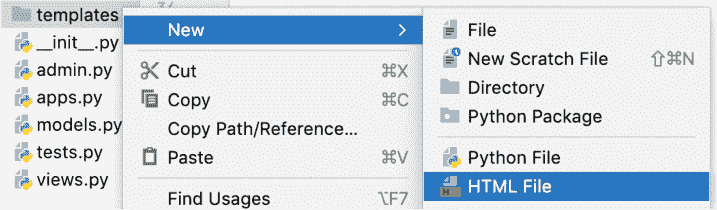

图 1.34 – 在 templates 目录中新建一个 HTML 文件

6. 在出现的窗口中，输入名称 `base.html`，保持选中 **HTML 5 文件**，然后按 *Enter/Return* 键创建文件：

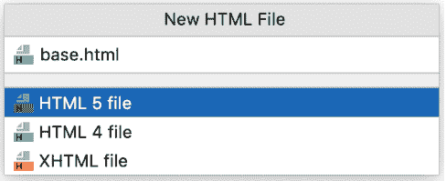

图 1.35 – 新建 HTML 文件窗口

7. PyCharm 创建文件后，也会自动打开该文件。其内容如下：

```
<!DOCTYPE html>
<html lang="en">
<head>
    <meta charset="UTF-8">
    <title>Title</title>
</head>
<body>

</body>
</html>
```

8. 在 <body> 和 </body> 标签之间，添加一条简短消息，以验证模板正在被渲染：

```
<body>
    Hello from a template!
</body>
```

以下截图展示了你的完整代码应呈现的样子：

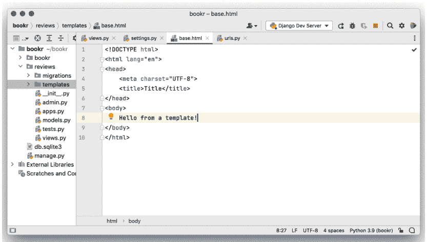

图 1.36 – 带有一些示例文本的 base.html 模板

在本练习中，我们为 reviews 应用创建了一个 templates 目录，并添加了一个 HTML 模板。一旦我们在视图上实现 render 函数的使用，该 HTML 模板就会被渲染。

## 使用 render 函数渲染模板

现在我们有一个可用的模板，但我们需要更新 index 视图，使其渲染该模板，而不是像当前那样返回 “Hello (name)!” 文本（可参考图 1.30 查看当前效果）。我们将通过使用 render 函数并提供模板名称来实现这一点。render 是一个返回 HttpResponse 的快捷函数。还有其他渲染模板的方法可以提供更多控制，但目前这个函数已足够满足我们的需求。render 至少接受两个参数——第一个始终是传递给视图的 request，第二个是被渲染模板的名称/相对路径。我们还将使用第三个参数调用它，即包含模板中所有可用变量的渲染上下文——有关这方面的更多内容，将在练习 1.07“在模板中使用变量”中介绍。

## 练习 1.06 – 在视图中渲染模板

在本练习中，你将更新 index 视图函数，以渲染你在练习 1.05“创建 templates 目录和基础模板”中创建的 HTML 模板。你将使用 render 函数，该函数会从磁盘加载你的模板，渲染它，并将其发送到浏览器。这将取代你当前从 index 视图函数返回的静态文本：

- 1. 在 PyCharm 中，打开 reviews 目录中的 views.py。
- 2. 我们不再手动创建 HttpResponse，因此删除导入 HttpResponse 的那一行：

```
from django.http import HttpResponse
```

- 3. 将其替换为从 django.shortcuts 导入 render 函数的语句：

```
from django.shortcuts import render
```

- 4. 更新 index 函数，使其不再返回 HttpResponse，而是返回对 render 的调用，并传入 request 和模板名称：

```
def index(request):
    return render(request, "base.html")
```

以下截图展示了完整的 views.py 文件：

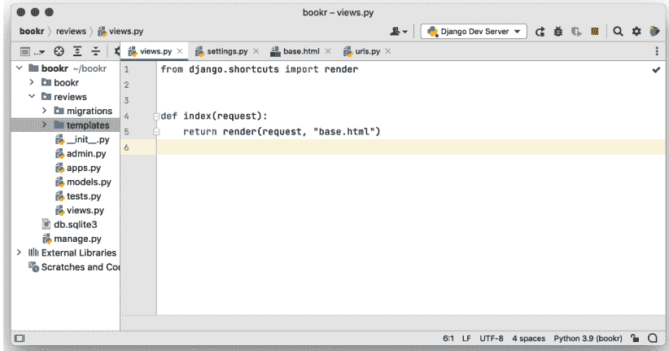

图 1.37 – 完成了模板渲染的 view.py

5. 如果开发服务器尚未运行，请启动它。然后，打开你的 Web 浏览器并刷新 http://127.0.0.1:8000。你应该会看到渲染出的“Hello from a template!”消息，如图 1.38 所示：

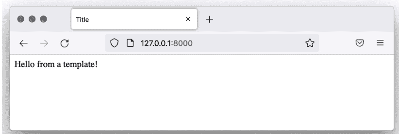

图 1.38 – 你渲染的第一个 HTML 模板

## 在模板中渲染变量

模板并非仅仅是静态 HTML。大多数情况下，它们会包含在渲染过程中被插值的变量。这些变量通过上下文（context）从视图传递给模板——上下文是一个字典（或类似字典的对象），包含模板可以使用的所有变量的名称。我们再次以 Bookr 为例。如果模板中没有变量，那么每显示一本书，你就需要一个不同的 HTML 文件。相反，我们在模板中使用诸如 book_name 这样的变量，然后视图为模板提供一个 book_name 变量，其值设为其加载的书籍模型的标题。当显示另一本书时，HTML 无需更改；视图只是向它传递一本不同的书。你可以看到模型、视图和模板现在是如何协同工作的。

与 PHP 等其他一些语言不同，变量必须显式传递给模板，视图中的变量不会自动对模板可用。这既是出于安全原因，也是为了避免意外污染模板的命名空间（我们不希望模板中出现任何意外的变量）。

在模板内部，变量用双花括号 – {{ }} 表示。虽然这并非严格的标准，但这种风格相当常见，并用于其他模板工具，如 Vue.js 和 Mustache。Symfony（一个 PHP 框架）在其 Twig 模板语言中也使用了双花括号，因此你可能在那里见过类似的用法。

要在模板中渲染变量，只需用花括号将其包裹起来 – {{ book_name }}。Django 会自动对输出中的 HTML 进行转义，因此你可以在变量中包含特殊字符（如 < 或 >），而不必担心它会破坏你的输出。如果某个变量未传递给模板，Django 只会在该位置渲染为空，而不会抛出异常。

还有更多使用过滤器以不同方式渲染变量的方法，但这些将在第 3 章“URL 路由器、视图和模板”中介绍。

## 练习 1.07 – 在模板中使用变量

我们将在 base.html 文件中放入一个简单变量，以演示 Django 的变量插值是如何工作的：

- 1. 在 PyCharm 中，打开 base.html 文件。
- 2. 更新 <body> 元素，使其包含一个渲染 name 变量的位置：

```
<body>
Hello, {{ name }}!
</body>
```

3. 回到你的 Web 浏览器并刷新（你应该仍在 http://127.0.0.1:8000）。你会看到页面现在显示 “Hello, !”。这是因为我们尚未在渲染上下文中设置 name 变量。

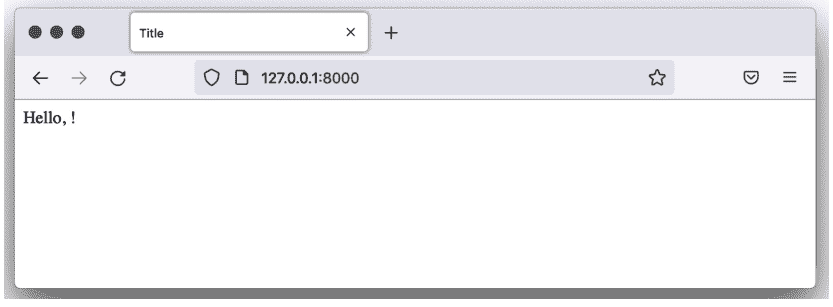

图 1.39 – 由于未设置上下文，模板中没有渲染出任何值

4. 打开 views.py，在 index 函数中添加一个名为 name 的变量，并将其值设置为 "world"：

```
def index(request):
    name = "world"
    return render(request, "base.html")
```

5. 再次刷新浏览器。请注意，没有任何变化——我们想要渲染的任何内容都必须作为上下文显式传递给 render 函数。这是在渲染时可供使用的变量字典。

6. 将上下文字典作为第三个参数传递给 render 函数。将你的 render 代码行改为如下：

```
return render(request, "base.html", {"name": name})
```


整个 views.py 文件在下面的截图中显示：

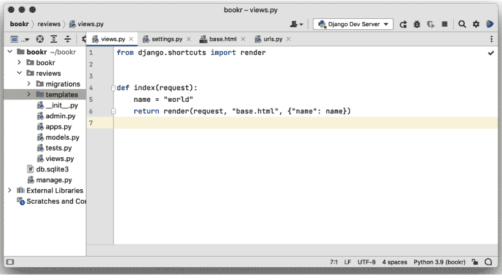

图 1.40 – views.py 中在 render 上下文中设置了 name 变量

- 7. 再次刷新浏览器，你会看到它现在显示 Hello, world!。

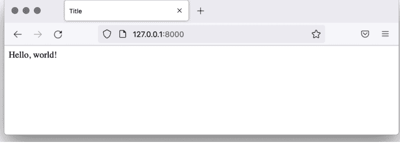

图 1.41 – 使用变量渲染的模板

在本练习中，我们将上一练习中创建的模板与 render 函数结合起来，渲染一个 HTML 页面，其中 name 变量通过上下文字典传递给它。

在下一节中，我们将看看一些调试代码和处理错误的方法。

## 调试和处理错误

在编程时，除非你是从不犯错的完美程序员，否则你可能在某个时候需要处理错误或调试代码。当程序中出现错误时，通常有两种方式可以察觉——要么你的代码会引发异常，要么在查看页面时你会得到意外的输出或结果。你可能会更频繁地看到异常，因为有很多偶然的方式会导致它们。如果你的代码生成了意外的输出但没有引发任何异常，你可能希望使用 PyCharm 调试器来找出原因。

我们将首先概述一些 Python 异常以及如何处理它们，并附带一个练习来演示 Django 如何显示异常。然后，我们将看看如何在 PyCharm 调试器中运行 Django，以便在程序执行时窥探其内部。

## 异常

如果你之前使用过 Python 或其他编程语言，你可能已经遇到过异常。如果没有，这里有一个快速介绍。异常在发生错误时会被 *引发*（在其他语言中称为 *抛出*）。程序的执行在代码的该点停止，并且异常会沿着函数调用链向后传播，直到被捕获。如果未被捕获，则程序将崩溃，有时还会显示描述异常及其发生位置的错误消息。Python 本身会引发一些异常，你的代码也可以在任何时候引发异常以快速停止执行。你在用 Python 编程时可能会看到的一些常见异常如下：

- **IndentationError**：如果你的代码缩进不正确或混合使用了制表符和空格，Python 会引发此错误
- **SyntaxError**：如果你的代码语法无效，Python 会引发此错误：
```
>>> a === 1
  File "<stdin>", line 1
    a === 1
        ^
SyntaxError: invalid syntax
```
- **ImportError**：当导入失败时引发——例如，尝试从不存在的文件导入或尝试导入文件中未设置的名称：
```
>>> import missing_file
Traceback (most recent call last):
  File "<stdin>", line 1, in <module>
ImportError: No module named missing_file
```

```
>>> a === 1
  File "<stdin>", line 1
    a === 1
        ^
SyntaxError: invalid syntax
```

```
>>> import missing_file
Traceback (most recent call last):
  File "<stdin>", line 1, in <module>
ImportError: No module named missing_file
```

- NameError：尝试访问尚未设置变量时引发：
```
>>> a = b + 5
Traceback (most recent call last):
  File "<stdin>", line 1, in <module>
NameError: name 'b' is not defined
```
- KeyError：访问 dict（或类似 dict 的对象）中未设置的键时引发：
```
>>> d = {'a': 1}
>>> d['b']
Traceback (most recent call last):
  File "<stdin>", line 1, in <module>
KeyError: 'b'
```
- IndexError：访问列表索引超出长度时引发：
```
>>> l = ['a', 'b']
>>> l[3]
Traceback (most recent call last):
  File "<stdin>", line 1, in <module>
IndexError: list index out of range
```
- TypeError：尝试对不支持该操作的<|message|>
```
>>> 1 + '1'
Traceback (most recent call last):
  File "<stdin>", line 1, in <module>
TypeError: unsupported operand type(s) for +: 'int' and 'str'
```

Django 也会引发自己的自定义异常，你将在本书中逐步了解它们。

当使用 settings.py 文件中 DEBUG = True 运行 Django 开发服务器时，Django 会自动捕获代码中发生的异常（而不是崩溃）。它随后会生成一个 HTTP 响应，向你展示堆栈跟踪和其他信息以帮助你调试问题。在生产环境中运行，DEBUG 应设置为 False。Django 然后会返回一个标准的内部服务器错误页面，而不包含任何敏感信息。你也可以选择显示自定义错误页面。

## 练习 1.08 – 生成和查看异常

让我们在视图中创建一个简单的异常，以便你熟悉 Django 如何显示它们。在这种情况下，我们将尝试使用一个不存在的变量，这将引发 NameError：

- 1. 在 PyCharm 中打开 views.py。在 index 视图函数中，修改发送给 render 函数的上下文，使其使用一个不存在的变量。我们将尝试在上下文字典中发送 invalid_name，而不是 name。不要更改上下文字典的键，只更改其值：
```
return render(request, "base.html", {"name": invalid_name})
```
- 2. 返回浏览器并刷新页面。你应该会看到类似图 1.42 的屏幕：

```
return render(request, "base.html", {"name": invalid_name})
```

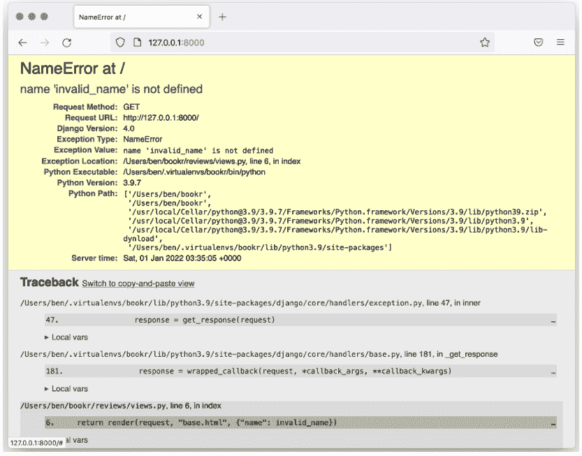

图 1.42 – Django 异常屏幕

# 图 1.45 – 第 5 行的断点

4. 返回浏览器并刷新页面。你的浏览器不会显示任何内容；相反，它将继续尝试加载页面。根据你的操作系统，PyCharm 应该再次变得活跃；如果没有，将其带到前台。你应该会看到第 5 行被高亮显示，并且在窗口底部显示调试器。堆栈帧（调用到当前行的函数链）在左侧，当前函数的变量在右侧。

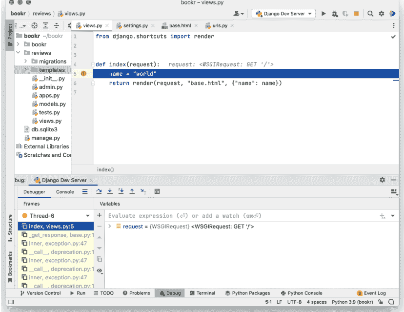

# 图 1.46 – 调试器在当前行（5）高亮处暂停

当前作用域中只有一个变量 request。如果你点击其名称左侧的切换三角形，可以显示或隐藏它所设置的属性。

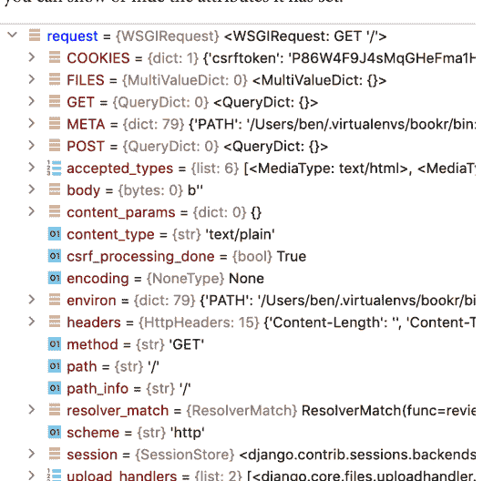

图 1.47 – request 变量的属性

例如，如果你向下滚动属性列表，你可以看到 method 是 GET 而 path 是 /。

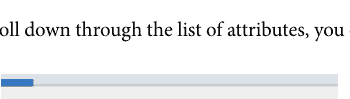

图 1.48 – 操作栏

5. 操作栏，如图 1.48 所示，位于堆栈帧和变量之上。其按钮（从左到右）如下：

- Step Over：执行当前行代码并继续到下一行。
- Step Into：进入当前行。例如，如果该行包含一个函数，它将继续在调试器中进入该函数。

- **Step into My Code**：进入正在执行的行，但继续直到找到你编写的代码。例如，如果你正在进入第三方库代码，而该代码后来调用了你的代码，它不会显示第三方代码，而是继续直到返回到你编写的代码。
- **Step Out**：从当前代码返回到调用它的函数或方法。它是 **Step In** 操作的相反操作。
- **Run to Cursor**：如果你有一个比当前位置更靠后的代码行想要执行，而不想为中间的所有行点击 Step Over，请将光标放在该行上。然后点击 **Run to Cursor**，执行将继续直到该行。

请注意，并非所有按钮在任何时候都很有用。例如，很容易跳出你的视图并最终混淆 Django 库代码。

- 6. 点击 **Step Over** 按钮一次以执行第 5 行。
- 7. 你可以看到 name 变量已添加到调试器视图的变量列表中，其值为 world。

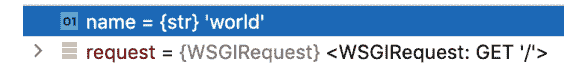

图 1.49 – 新变量 name 现在在作用域中，其值为 world

- 8. 我们现在位于 index 视图函数的末尾，如果我们对这行代码执行下一步，它将跳转到 Django 库代码，我们不想看到它。要继续执行并将响应发送回浏览器，请点击窗口左侧的 **Resume Program** 按钮（图 1.50）。你应该会看到浏览器现在再次加载了页面：


图 1.50 – 控制执行的动作——绿色播放图标是 Resume Program 按钮


图1.50中还有更多按钮；自上而下分别是**重新运行**（停止程序并重新启动）、**修改运行配置...**（打开运行配置窗口）、**恢复程序**（继续运行直到下一个断点）、**暂停程序**（在程序当前执行点处中断）、**停止**（停止调试器）、**查看断点**（打开窗口查看所有已设置的断点）和**静音断点**（用于将全部断点切换为启用或禁用，但不会移除它们）。

9. 现在，点击 PyCharm 中的断点（第5行旁边的红色圆圈）将其关闭。

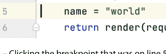

图1.51 – 单击第5行上的断点会将其禁用

这只是对如何在 PyCharm 中设置断点的简要介绍。如果你在其他 IDE 中使用过调试功能，那么你应该熟悉这些概念——你可以单步执行代码、进入或跳出函数，或计算表达式。设置断点后，你可以右键单击断点来更改选项。例如，你可以让断点带有条件，使执行只在特定情况下停止。所有这些都超出了本书的范围，但在尝试解决代码中的问题时，了解这些是很有用的。

在本章结束时，我们将完成两个活动。首先，你将构建 Bookr 的欢迎页面，然后搭建图书搜索页面的框架。

### 活动 1.01 – 创建站点欢迎页面

我们正在构建的 Bookr 网站需要一个欢迎页，向用户致意并让他们知道自己所在的网站。该页面还将包含指向网站其他部分的链接，但这些链接将在后续章节中添加。现在，你将创建一个带有欢迎消息的页面。

以下步骤将帮助你完成此活动：

1. 在你的 `index` 视图中，渲染 `base.html` 模板。
2. 更新 `base.html` 模板，使其包含欢迎消息。消息应同时放在 `<head>` 中的 `<title>` 标签内，以及正文中一个新的 `<h1>` 标签内。

完成此活动后，你应该能看到类似下面的内容：

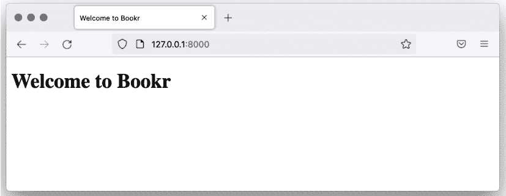

图1.52 – Bookr 欢迎页面

**注意**

此活动的解决方案可在 https://github.com/PacktPublishing/Web-Development-with-Django-Second-Edition/tree/main/ActivitySolutions 找到。

在下一个活动中，你将构建一个基本页面，用于在 Bookr 中显示图书搜索结果。

### 活动 1.02 – 图书搜索脚手架

像 Bookr 这样的网站有一个有用的功能，就是可以快速搜索数据以找到网站上的内容。Bookr 将实现图书搜索，允许用户通过部分书名找到特定图书。虽然我们还没有任何图书可搜索，但我们仍然可以实现一个显示用户搜索文本的页面。用户将搜索字符串作为 URL 参数的一部分输入。我们将在第6章“表单”中实现搜索和便于文本输入的表单。

以下步骤将帮助你完成此活动：

1. 创建搜索结果 HTML 模板。模板中应包含一个变量占位符，用于显示通过渲染上下文传入的搜索词。在 `<title>` 和 `<h1>` 标签中显示传入的变量。在正文中，使用 `<em>` 标签将搜索文本包裹起来，使其显示为斜体。
2. 在 `views.py` 中添加搜索视图函数。该视图应从 URL 参数（位于请求的 GET 属性中）读取搜索字符串，然后渲染你在上一步中创建的模板，并使用上下文字典传入要替换的搜索值。
3. 在 `urls.py` 中为新视图添加 URL 映射。URL 可以是类似 `/book-search` 的路径。

完成此活动后，你应该能够通过 URL 参数传入搜索值，并看到它渲染在结果页面上。看起来应该像这样：

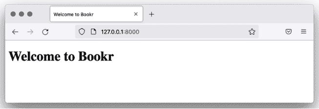

图1.53 – 搜索 Django workshop

你还应该能够传入特殊 HTML 字符，例如 `<` 和 `>`，以观察 Django 如何在模板中自动转义它们。

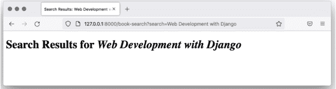

图1.54 – 注意 HTML 字符如何被转义，从而保护我们免受标签注入

**注意**

此活动的解决方案可在 https://github.com/PacktPublishing/Web-Development-with-Django-Second-Edition/tree/main/ActivitySolutions 找到。

### 总结

本章是对 Django 的快速介绍。你首先快速了解了 HTTP 协议以及 HTTP 请求和响应的结构。然后我们看到了 Django 如何使用 MVT 范式，以及它如何解析 URL、生成 HTTP 请求并将其发送到返回 HTTP 响应的视图。我们构建了 Bookr 项目的脚手架，然后为其创建了 reviews 应用。接下来，我们构建了两个示例视图，以说明如何从请求中获取数据并在渲染模板时使用这些数据。你还通过实验了解了 Django 在渲染模板时如何对 HTML 输出进行转义。

我们通过 PyCharm IDE 完成了所有这些操作，你学习了如何设置它以调试应用程序。调试器将帮助你找出程序无法按预期工作的原因。

在下一章中，你将开始学习 Django 的数据库集成及其模型系统，从而能够为应用程序存储和检索真实数据。
