## 模型与迁移

在上一章中，我们简要介绍了 Django 及其在 Web 应用开发中的用途。然后，我们学习了**模型-视图-模板（MVT）**的概念。之后，我们创建了一个 Django 项目并启动了 Django 开发服务器。我们还简要讨论了 Django 的视图、URL 和模板。

在本章中，你将了解数据库的概念、数据库的类型以及它们在构建 Web 应用中的重要性。你将首先使用名为 SQLite DB Browser 的开源数据库可视化工具创建一个数据库。然后，你将使用 SQL 命令执行一些基本的**创建、读取、更新和删除（CRUD）**数据库操作。接下来，你将学习 Django 的**对象关系映射（ORM）**，通过它，你的应用程序可以使用简单的 Python 代码与关系数据库交互并无缝协作，无需运行复杂的 SQL 查询。你将学习模型和迁移，它们是 Django ORM 的一部分，用于将数据库模式更改从应用程序传播到数据库，并执行数据库 CRUD 操作。在本章末尾，你将研究各种类型的数据库关系，并利用这些知识对相关记录执行查询。

本章将涵盖以下主题：

- 理解并使用数据库
- 使用 SQL 理解 CRUD 操作
- 探索 Django ORM
- 创建 Django 模型和迁移
- Django 的数据库 CRUD 操作
- 批量创建和批量更新操作
- 使用 Q 对象执行复杂查询
- 活动 2.01 – 为项目管理应用程序创建模型
- 填充 Bookr 项目的数据库

数据库是结构化数据的集合，有助于轻松管理信息。一个称为**数据库管理系统（DBMS）**的软件层用于存储、维护和对数据执行操作。数据库有两种类型：关系数据库和非关系数据库。在以下小节中，我们将简要了解关系数据库以及数据如何存储在这些数据库中。

### 关系数据库

关系数据库或**结构化查询语言（SQL）**数据库以预定义的行和列结构存储数据，这种结构称为**表**。一个数据库可以由多个这样的表组成，这些表具有固定的属性、数据类型以及与其他表的关系。例如，正如我们在*图2.1*中所见，图书库存表具有固定的列结构，包含**图书编号**、**作者**、**书名**和**副本数量**，条目构成表中的行。还可能存在其他表，例如**学生信息**和**借阅记录**，它们可能与库存表相关。此外，每当有图书借给学生时，记录将根据多个表（例如**学生信息**表与**图书库存**表）之间的关系来存储。

这种预定义的规则结构定义了数据类型、表结构以及不同表之间的关系，就像数据库的脚手架或蓝图。这个蓝图统称为**数据库模式**。将其应用于数据库时，它会为数据库存储应用程序数据做好准备。为了管理和维护这些数据库，关系数据库有一种通用语言，称为 SQL。关系数据库的一些示例包括 SQLite、PostgreSQL、MySQL 和 OracleDB。

### 非关系数据库

非关系数据库或**不仅仅是 SQL（NoSQL）**数据库旨在存储非结构化数据。它们非常适合大量生成的数据，这些数据不遵循关系数据库那样的严格规则。非关系数据库的一些示例包括 Cassandra、MongoDB、CouchDB 和 Redis。

例如，假设你需要使用 Redis 在数据库中存储公司的股票价值。这里，公司名称将作为键存储，股票价值将作为值存储。在这种用例中使用键值型 NoSQL 数据库是合适的，因为它为唯一键存储所需的值，并且访问速度更快。

就本书的范围而言，我们将只处理关系数据库，因为 Django 官方不支持非关系数据库。但是，如果你想探索，有许多分支项目（例如 **Django non-rel**）支持 NoSQL 数据库。

在下一节中，你将了解使用 SQL 命令进行数据库 CRUD 操作。


## 使用 SQL 进行数据库操作

SQL 使用一组命令来执行各种数据库操作，例如创建条目、读取值、更新条目和删除条目。这些操作统称为 CRUD 操作。为了详细了解数据库操作，让我们先对 SQL 命令进行一些实践。大部分关系型数据库共享相似的 SQL 语法；然而，部分操作会有所不同。

在本章范围内，我们将使用 SQLite 作为数据库。SQLite 是一种轻量级关系型数据库，并且是 Python 标准库的一部分。这就是 Django 将 SQLite 作为其默认数据库配置的原因。不过，我们还将在 *第 17 章，部署 Django 应用（第 1 部分 – 服务器设置）* 中学习更多关于如何进行配置更改以使用其他数据库的内容。本章可以从本书的 GitHub 仓库下载，地址为：`https://github.com/PacktPublishing/Web-Development-with-Django-Second-Edition/tree/main/Chapter17`。

在下一节中，我们将学习数据库中数据类型的重要性。

### 关系型数据库中的数据类型

数据库为我们提供了一种限制可存储在给定列中的数据类型的方式。这些称为数据类型。以下是关系型数据库（如 SQLite3）的数据类型示例：

- `INTEGER`：用于存储整数
- `TEXT`：可存储文本
- `REAL`：用于浮点值

例如，你希望一本书的标题使用 TEXT 作为数据类型。因此，数据库将强制执行一条规则：除了文本数据之外，其他类型的数据都不能存储在该列中。同样，书的价格可以具有 REAL 数据类型，以此类推。

利用之前关于数据库学到的一些概念，在下一节中，我们将通过创建数据库和数据表来进行实践。

### 练习 2.01 – 创建图书数据库

在本练习中，你将为图书评论应用创建一个图书数据库。为了更好地可视化 SQLite 数据库中的数据，你将安装一个名为 DB Browser for SQLite 的开源工具。该工具有助于可视化数据并提供一个执行 SQL 命令的 shell。

如果尚未安装，请访问 https://sqlitebrowser.org，并从下载部分根据你的操作系统安装该应用程序并启动它。DB Browser 安装的详细说明可在前言中找到。要创建数据库，请按照以下步骤操作：

> **注意**
> 数据库操作也可以使用命令行 shell 执行。

1. 启动应用程序后，点击应用程序左上角的 **New Database** 创建新数据库。创建一个名为 `bookr` 的数据库，因为你正在开发图书评论应用：

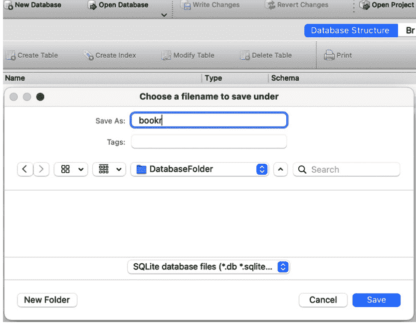

图 2.1 - 创建名为 `bookr` 的数据库

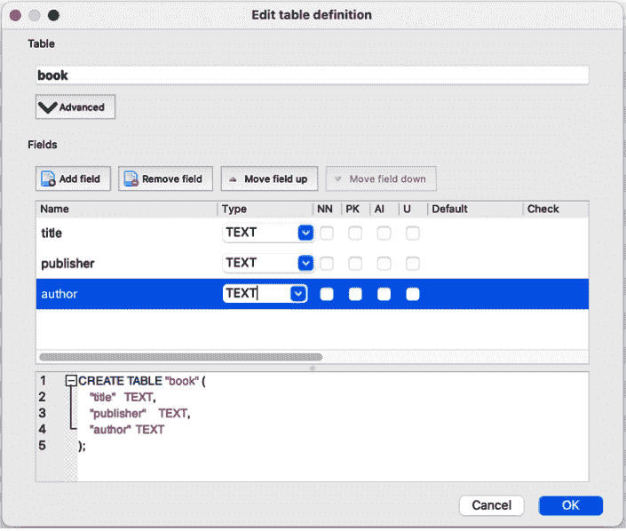

图 2.3：创建名为 publisher 和 author 的 TEXT 字段

这将在 `bookr` 数据库中创建一个名为 `book` 的数据表，其中包含 `title`、`publisher` 和 `author` 字段。可以如下所示查看：

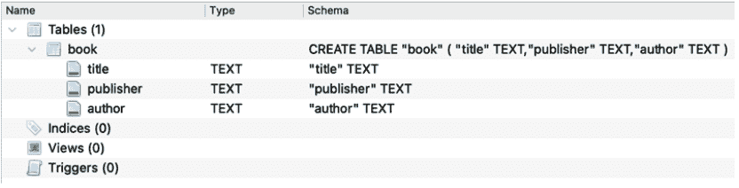

图 2.4：具有 title、publisher 和 author 字段的数据库

总的来说，在本节关于数据库的内容中，我们学习了为什么需要数据库以及它们如何存储数据，并简要介绍了两种最常见的数据库类型。此外，我们还使用名为 DB Browser 的开源工具创建了一个简单的数据库和表。在下一节中，我们将学习如何使用 SQL 对数据库执行 CRUD 操作。

## 使用 SQL 理解 CRUD 操作

假设我们的图书评论应用的编辑或用户想要对图书库存进行一些修改，例如向数据库添加几本书、更新数据库中的条目等。SQL 提供了多种执行此类 CRUD 操作的方法。在深入 Django 模型和迁移的世界之前，让我们先探索这些基本的 SQL 操作。

你将为以下 CRUD 操作运行一些 SQL 命令。

要运行它们，请按照以下步骤操作：

1. 在 DB Browser 中导航到 **Execute SQL** 选项卡。你可以在 **SQL 1** 窗口中输入或粘贴我们在以下各节中列出的 SQL 命令。你可以在执行之前花一些时间修改查询并理解它们。

2. 准备好后，点击看起来像 **Play** 按钮的图标或按 F5 键执行命令。结果将显示在 **SQL 1** 窗口下方的窗口中：

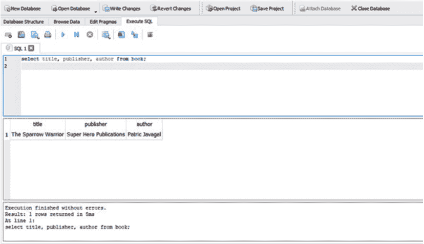

图 2.5：在 DB Browser 中执行 SQL 命令

现在我们将尝试一些 SQL 创建操作来在数据库中创建几条记录。

### SQL 创建操作

SQL 中的创建操作使用 `insert` 命令执行，正如名称所示，它允许我们向数据库插入数据。让我们回到图书示例。由于我们已经创建了数据库和 book 表，现在可以通过执行以下命令在数据库中创建或插入条目：

```sql
insert into book values ('The Sparrow Warrior', 'Super Hero Publications', 'Patric Javagal');
```

这会将命令中定义的值插入到 book 表中。这里，`The Sparrow Warrior` 是标题，`Super Hero Publications` 是出版商，`Patric Javagal` 是作者。请注意，插入的顺序与我们创建表的方式相对应；即值分别插入到代表 title、publisher 和 author 的列中。同样，让我们再执行两次插入以填充 book 表：

```sql
insert into book values ('Ninja Warrior', 'East Hill Publications', 'Edward Smith');
insert into book values ('The European History', 'Northside Publications', 'Eric Robbins');
```

到目前为止执行的三次插入将在 book 表中插入三行。但我们如何验证呢？我们如何知道我们插入的那三条条目是否已正确输入到数据库中？让我们在下一节学习如何做到这一点。

### SQL 读取操作

我们可以使用 `select` SQL 操作从数据库读取。例如，以下 SQL `select` 命令检索在 book 表中创建的选定条目：

```sql
select title, publisher, author from book;
```

你应该会看到以下输出：

|   | title | publisher | author |
|---|---|---|---|
| 1 | The Sparrow Warrior | Super Hero Publications | Patric Javagal |
| 2 | Ninja Warrior | East Hill Publications | Edward Smith |
| 3 | The European History | Northside Publications | Eric Robbins |

图 2.6：使用 select 命令后的输出

这里，`select` 是从数据库读取的命令，title、publisher 和 author 字段是我们打算从 book 表中选择的列。由于这些是数据库中所有的列，`select` 语句返回了数据库中存在的所有值。`select` 语句也称为 SQL 查询。获取数据库中所有字段的另一种方法是使用 `*` 通配符代替显式指定所有列名：

```sql
select * from book;
```

这将返回与前一图所示相同的输出。现在，假设我们想要获取标题为 `The Sparrow Warrior` 的书的作者姓名；此时，`select` 查询如下：

```sql
select author from book where title="The Sparrow Warrior";
```

在这里，我们添加了一个特殊的 SQL 关键字 `where`，以便 `select` 查询仅返回匹配条件的条目。查询的结果，当然是 `Patric Javagal`。现在，如果我们想更改这本书的出版商名称怎么办？

### SQL 更新操作

在 SQL 中，更新数据库中记录的方式是使用 `update` 命令：

```sql
update book set publisher = 'Northside Publications' where title='The Sparrow Warrior';
```

这里，如果 title 的值为 `The Sparrow Warrior`，我们将 publisher 值设置为 `Northside Publications`。然后我们可以运行在 SQL *读取操作* 部分运行的 `select` 查询，以查看运行更新命令后更新后的表是什么样子的：

|   | title | publisher | author |
|---|---|---|---|
| 1 | The Sparrow Warrior | Northside Publications | Patric Javagal |
| 2 | Ninja Warrior | East Hill Publications | Edward Smith |
| 3 | The European History | Northside Publications | Eric Robbins |

图 2.7：更新 The Sparrow Warrior 的出版商值

接下来，如果我们想删除刚刚更新的记录怎么办？我们将在下一节看到这一点。


# SQL 删除操作

下面是一个使用 `delete` 命令从数据库中删除记录的示例：

```sql
delete from book where title='The Sparrow Warrior';
```

`delete` 是 SQL 中用于删除操作的关键字。在这里，只有当标题为 The Sparrow Warrior 时，才会执行此操作。删除操作后，book 表将如下所示：

|   | title | publisher | author |
|---|---|---|---|
| 1 | Ninja Warrior | East Hill Publications | Edward Smith |
| 2 | The European History | Northside Publications | Eric Robbins |

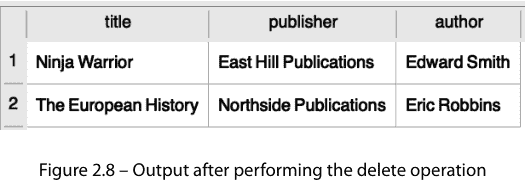

这些是 SQL 的基本操作。我们不会进一步深入所有 SQL 命令和语法，但欢迎你探索更多关于使用 SQL 进行数据库基础操作的内容。

> **注意**
> 
> 如需进一步阅读，你可以先探索使用 `join` 语句的某些高级 SQL `select` 操作，它们用于跨多个表查询数据。有关 SQL 的详细课程，你可以参考 *The SQL Workshop* (`https://www.packtpub.com/product/the-sql-workshop/9781838642358`)。

在本节中，我们学习了如何通过使用 SQL 对数据库执行 CRUD 操作来与数据库交互。在下一节中，我们将学习 Django 的 ORM，即一个抽象层，如何与数据库交互。

## 探索 Django ORM

Web 应用程序不断与数据库交互，其中一种方式是使用 SQL。如果你决定不使用 Django 等 Web 框架而仅使用 Python 编写 Web 应用程序，可以使用 `psycopg2` 等 Python 库（用于 PostgreSQL）直接使用 SQL 命令与数据库交互。但是在开发具有多个表和字段的 Web 应用程序时，SQL 命令很容易变得过于复杂，从而难以维护。因此，像 Django 这样流行的 Web 框架提供了一层抽象，使我们能够轻松地处理数据库。Django 中帮助我们实现这一点的部分称为 ORM。

Django ORM 将面向对象的 Python 代码转换为实际的数据库结构，例如具有数据类型定义的数据库表，并通过简单的 Python 代码实现所有数据库操作。

因此，在执行数据库操作时，我们不必处理 SQL 命令。这有助于更快地进行应用程序开发并便于维护应用程序源代码。

Django 支持 SQLite、PostgreSQL、Oracle Database 和 MySQL 等关系数据库。Django 的数据库抽象层确保相同的 Python/Django 源代码可以在这些关系数据库中的任何一个中使用，只需对项目设置进行很少的修改即可。由于 SQLite 是 Python 库的一部分，并且 Django 默认配置为 SQLite，因此在本章的范围内，我们在学习 Django 模型和迁移时将使用 SQLite。接下来，我们将了解如何使用 Django 进行数据库配置。

## 数据库配置和创建 Django 应用程序

正如我们在 *Chapter 1, An Introduction to Django* 中已经看到的，当我们创建一个 Django 项目并运行 Django 服务器时，默认的数据库配置是 SQLite3。数据库配置位于项目目录中，`settings.py` 文件内。

> **注意**
> 
> 请确保查看 bookr 应用的 `settings.py` 文件。通读整个文件一次将有助于你理解后续的概念。你可以在此处找到该文件：https://github.com/PacktPublishing/Web-Development-with-Django-Second-Edition/blob/main/Chapter02/final/bookr/bookr/settings.py。

因此，对于我们的示例项目，数据库配置将位于以下位置：`bookr/settings.py`。当创建 Django 项目时，此文件中存在的默认数据库配置如下所示：

```
DATABASES = {
    'default': {
        'ENGINE': 'django.db.backends.sqlite3',
        'NAME': BASE_DIR / 'db.sqlite3',
    }
}
```

`DATABASES` 变量被分配一个包含项目数据库详细信息的字典。在字典内部，有一个以 default 为键的嵌套字典。它保存了 Django 项目默认数据库的配置。我们使用以 `default` 为键的嵌套字典的原因是 Django 项目可能与多个数据库交互，而默认数据库是在未明确指定时 Django 用于所有操作的数据库。`ENGINE` 键表示使用哪个数据库引擎；在本例中为 `sqlite3`。

NAME 键定义数据库的名称，可以是任意值。但对于 SQLite3，由于数据库以文件形式创建，NAME 可以具有文件需要创建的目录的完整路径。db 文件的完整路径是通过将 BASE_DIR 中之前定义的路径与 db.sqlite3 拼接（或连接）来处理的。请注意，BASE_DIR 是 settings.py 文件中已定义的项目目录。

如果你使用其他数据库，如 PostgreSQL、MySQL 等，则必须在前述数据库设置中进行更改，如下所示：

```
DATABASES = {
    'default': {
        'ENGINE': 'django.db.backends.postgresql',
        'NAME': 'bookr',
        'USER': <username>,
        'PASSWORD': <password>,
        'HOST': <host-IP-address>,
        'PORT': '5432',}}
```

这里，ENGINE 已更改为使用 PostgreSQL。需要为 HOST 和 PORT 分别提供服务器的主机 IP 地址和端口号。如名称所示，USER 是数据库用户名，PASSWORD 是数据库密码。除了配置更改外，我们还必须安装数据库驱动程序或绑定以及数据库主机和凭据。这将在后面的章节中详细介绍，但现在由于我们使用的是 SQLite3，默认配置已足够。请注意，前面的代码只是示例，展示了使用 PostgreSQL 等不同数据库时需要进行的更改，但由于我们使用的是 SQLite，我们将使用已存在的数据库配置，无需对数据库设置进行任何修改。接下来，我们将简要介绍 Django 应用以及 Django 中存在的一些默认应用。

## Django 应用

Django 项目可以有多个应用，它们通常作为独立实体存在。因此，每当需要时，一个应用也可以插入到不同的 Django 项目中。例如，如果我们开发一个电子商务 Web 应用程序，该 Web 应用程序可以有多个应用，例如用于客户支持的聊天机器人或用于在用户从应用程序购买商品时接受付款的支付网关。如果需要，这些应用也可以插入到或在不同的项目中重用。

Django 默认启用了以下应用。以下是一个项目 settings.py 文件的片段：

```
INSTALLED_APPS = [
    'django.contrib.admin',
    'django.contrib.auth',
    'django.contrib.contenttypes',
    'django.contrib.sessions',
    'django.contrib.messages',
    'django.contrib.staticfiles',
]
```

这些是用于管理站点、身份验证、内容类型、会话、消息以及用于收集和管理静态文件的一个应用程序的一组已安装或默认应用。在接下来的章节中，我们将深入研究这一点。对于本章的范围而言，我们将在下一节中了解为什么这些已安装应用需要 Django 迁移。

## Django 迁移

正如我们之前所学，Django 的 ORM 有助于简化数据库操作。操作的一个主要部分是将 Python 代码转换为数据库结构，例如具有指定数据类型的数据库字段和表。换句话说，将 Python 代码转换为数据库结构的过程称为 **migration**。例如，而不是通过运行 SQL 命令创建数据库表，你会在 Python 中为它们编写模型；这将在即将到来的 *Creating models and migrations* 部分中学习。这些模型将具有 **fields**，它们构成了数据库表的蓝图。字段反过来将具有不同的字段类型，为我们提供有关存储在其中的数据类型的信息（回想一下我们在 Exercise 2.01 – 创建书籍数据库的第 4 步中如何将字段的数据类型指定为 TEXT）。

由于我们已经设置了 Django 项目，让我们执行第一次迁移。虽然我们尚未向项目添加任何代码，但我们可以迁移 INSTALLED_APPS 中列出的应用程序。这是因为 Django 的已安装应用需要在数据库中存储相关数据以供其操作，而迁移将创建所需的数据库表来在数据库中存储数据。应在此终端或 shell 中输入以下命令来执行此操作：

```
python manage.py migrate
```

> **注意**
> 对于 macOS，你可以使用 python3 代替前述命令中的 python。

这里，manage.py 是一个在项目创建时自动创建的脚本。它用于执行管理或管理任务。通过执行此命令，我们创建了已安装应用所需的所有数据库结构。

由于我们使用 DB Browser for SQLite 来浏览数据库，让我们查看执行 migrate 命令后所做的更改的数据库。


数据库文件将在项目目录下以 `db.sqlite3` 的名称创建。按照以下步骤验证迁移是否成功以及数据库表是否已创建：

1. 打开 DB Browser，点击 **Open Database**，导航直到找到 `db.sqlite3` 文件并打开它。你应该会看到由 Django 迁移创建的一组新表。在 DB Browser 中看起来如下：

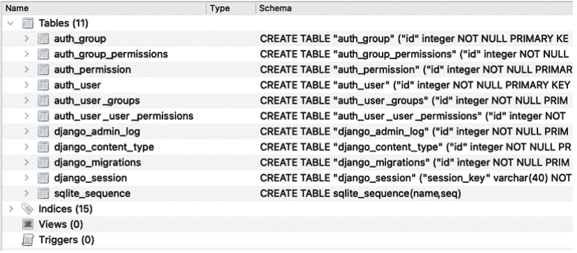

Figure 2.9: Contents of the db.sqlite3 file

2. 现在，通过点击数据库表浏览新创建的数据库结构，我们应该会看到以下内容：

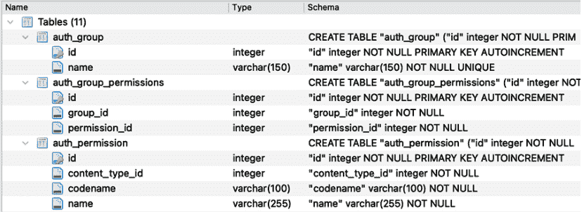

Figure 2.10: Browsing through the newly created database structure

3. 注意到创建的数据库表具有不同的字段，每个字段都有各自的数据类型。在 DB Browser 中点击 Browse data 选项卡并从下拉菜单中选择一个表。例如，点击 auth_group_permissions 表后，你应该会看到类似如下的内容：

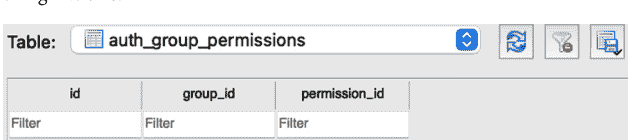

Figure 2.11: Viewing the auth_group_permissions table

你会看到这些表目前还没有可用数据，因为 Django 迁移只创建数据库结构或蓝图，而实际数据在应用程序运行期间存储。现在我们已经迁移了内置或默认的 Django 应用，让我们尝试创建一个应用并执行 Django 迁移。

在本节中，我们学习了 Django 的 ORM 以及它如何简化 Web 应用程序的数据库操作。之后，我们学习了 Django 数据库配置设置。我们还简要介绍了 Django 迁移，我们将在下一节中通过为我们的 Bookr 应用程序创建模型和迁移来更深入地学习。

## Creating Django models and migrations

Django 模型本质上是一个 Python 类，它保存了在数据库中创建表的蓝图。models.py 文件可以包含许多这样的模型，每个模型都会被转换为一个数据库表。类的属性根据模型定义形成数据库表字段和关系。

对于我们的 reviews 应用程序，我们需要依次创建以下模型及其数据库表：

- Book: 这应该存储有关书籍的信息
- Contributor: 这应该存储有关为书籍撰写做出贡献的人的信息，例如作者、合著者或编辑
- Publisher: 顾名思义，这是指图书出版商
- Review: 这应该存储应用程序用户撰写的全部图书评论

我们应用程序中的每本书都需要有一个出版商，所以让我们将 Publisher 作为第一个模型创建。在 reviews/models.py 中输入以下代码：

```
from django.db import models

class Publisher(models.Model):
    """A company that publishes books."""
    name = models.CharField(
        max_length=50,
        help_text="The name of the Publisher.")
    website = models.URLField(
        help_text="The Publisher's website.")
    email = models.EmailField(
        help_text="The Publisher's email address.")
```

**Note**

你可以通过点击以下链接查看 bookr 应用的完整 models.py 文件：https://github.com/PacktPublishing/Web-Development-with-Django-Second-Edition/blob/main/Chapter02/final/bookr/reviews/models.py。

第一行代码导入了 Django models 模块。虽然在创建 Django 应用时这一行会自动生成，但请确保如果不存在则添加它。导入之后，其余代码定义了一个名为 Publisher 的类，它是 Django 的 models.Model 的子类。此外，该类将具有 name、website 和 email 等属性或字段。以下是创建此模型时使用的字段类型。

正如我们所见，每个字段都被定义为以下类型：

- CharField: 此字段类型存储较短的字符串字段，例如 Packt Publishing。对于非常长的字符串，我们使用 TextField。
- EmailField: 这与 CharField 类似，但会验证字符串是否代表有效的电子邮件地址，例如 customersupport@packtpub.com。
- URLField: 同样，这与 CharField 类似，但会验证字符串是否代表有效的 URL，例如 https://www.packtpub.com。

接下来，我们将查看在创建每个字段时使用的字段选项。

## Field options

Django 提供了一种为模型字段定义字段选项的方法。这些字段选项用于设置值或约束等。例如，我们可以使用 `default=<value>` 为字段设置默认值，以确保每次在数据库中为该字段创建记录时，它都会设置为我们指定的默认值。以下是在定义 Publisher 模型时我们使用的两个字段选项：

- `help_text`: 此字段选项帮助我们为字段添加描述性文本，该文本会自动包含在 Django 表单中
- `max_length`: 此选项提供给 `CharField`，其中定义了字段的最大长度，以字符数为单位

Django 还有许多其他字段类型和字段选项，可以从详尽的官方 Django 文档中探索。随着我们开发示例图书评论应用程序，我们将学习项目中使用的类型和字段。现在，让我们通过以下步骤将 Django 模型迁移到数据库中：

1. 在 shell 或终端中执行以下命令来执行此操作（从存储 `manage.py` 文件的文件夹运行）：

```
python manage.py makemigrations reviews
```

命令的输出如下所示：

```
Migrations for 'reviews':
    reviews/migrations/0001_initial.py
        - Create model Publisher
```

`makemigrations <appname>` 命令为给定应用创建迁移脚本，在本例中为 reviews 应用。注意，在运行 makemigrations 后，migrations 文件夹下会创建一个新文件：

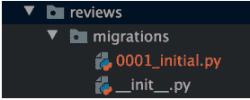

Figure 2.12: New file under the migrations folder

这是 Django 创建的迁移脚本。当我们不带应用名称运行 `makemigrations` 时，将为项目中的所有应用创建迁移脚本。

2. 接下来，让我们列出项目迁移状态。记住，之前我们已经将迁移应用到 Django 的已安装应用，现在我们创建了一个新的应用 reviews。在 shell 或终端中运行以下命令，它将显示整个项目的模型迁移状态（从存储 manage.py 文件的文件夹运行）：

```
python manage.py showmigrations
```

前述命令的输出如下：

```
admin
  [X] 0001_initial
  [X] 0002_logentry_remove_auto_add
  [X] 0003_logentry_add_action_flag_choices
auth
  [X] 0001_initial
  [X] 0002_alter_permission_name_max_length
  [X] 0003_alter_user_email_max_length
  [X] 0004_alter_user_username_opts
  [X] 0005_alter_user_last_login_null
  [X] 0006_require_contenttypes_0002
  [X] 0007_alter_validators_add_error_messages
  [X] 0008_alter_user_username_max_length
  [X] 0009_alter_user_last_name_max_length
  [X] 0010_alter_group_name_max_length
  [X] 0011_update_proxy_permissions
contenttypes
  [X] 0001_initial
  [X] 0002_remove_content_type_name
reviews
  [ ] 0001_initial
sessions
  [X] 0001_initial
```

这里，[X] 标记表示迁移已应用。注意区别，所有其他应用的迁移都已应用，除了 reviews。showmigrations 命令可以执行以了解迁移状态，但在执行模型迁移时这不是强制步骤。

3. 接下来，让我们了解 Django 如何将模型转换为实际的数据库表。为此，按如下方式运行 `sqlmigrate` 命令：

```
python manage.py sqlmigrate reviews 0001_initial
```

我们应该看到以下输出：

```
BEGIN;
--
-- Create model Publisher
--
CREATE TABLE "reviews_publisher" ("id" integer
    NOT NULL PRIMARY KEY AUTOINCREMENT, "name"
    varchar(50) NOT NULL, "website" varchar(200)
    NOT NULL, "email" varchar(254) NOT NULL);
COMMIT;
```

前面的片段显示了 Django 迁移数据库时使用的 SQL 命令等价物。在本例中，我们创建 `reviews_publisher` 表，其中包含 name、website 和 email 字段，并具有定义的字段类型。此外，所有这些字段都被定义为 NOT NULL，意味着这些字段的条目不能为空并且必须具有值。`sqlmigrate` 命令在执行模型迁移时不是强制步骤。

在下一节中，我们将学习主键及其在存储数据库数据时的重要性。

## Primary keys

假设一个名为 `users` 的数据库表，如其名称所示，存储有关用户的信息。假设它有超过 1,000 条记录，并且至少有 3 个用户同名 Joe Burns。我们如何从应用程序中唯一识别这些用户？解决方案是拥有一种唯一识别数据库中每条记录的方法。这是通过 **primary keys** 实现的。主键对于数据库表是唯一的，并且根据规则，表不能有两行具有相同的主键。在 Django 中，当数据库模型中未明确提及主键时，Django 会自动创建 `id` 作为主键（整数类型），并且随着新记录的创建而自动递增。

在上一节中，注意 `python manage.py sqlmigrate` 命令的输出。在创建 Publisher 表时，SQL CREATE TABLE 命令向表中添加了一个名为 `id` 的字段。`id` 值被定义为 PRIMARY KEY AUTOINCREMENT。在关系数据库中，主键用于唯一标识数据库中的条目。例如，book 表具有 `id` 作为主键，其数字从 1 开始。随着新记录的创建，该值每次递增一个。`id` 的整数值在 book 表中始终是唯一的。由于迁移脚本已通过执行 `makemigrations` 创建，让我们现在通过执行以下命令迁移 reviews 应用中新建的模型：

```
python manage.py migrate reviews
```


你应该得到以下输出：

```
Operations to perform:
  Apply all migrations: reviews
Running migrations:
  Applying reviews.0001_initial... OK
```

此操作为 reviews 应用创建数据库表。以下是从 DB Browser 中截取的片段，显示在执行迁移后数据库中已创建新的 reviews_publisher 表：

|  | 名称 | 类型 | 数据库定义 |
|---|---|---|---|
|  | reviews_publisher |  | CREATE TABLE "reviews_publisher" ("id" integer NOT NULL ... |
|  | id | integer | "id" integer NOT NULL PRIMARY KEY AUTOINCREMENT |
|  | name | varchar(50) | "name" varchar(50) NOT NULL |
|  | website | varchar(200) | "website" varchar(200) NOT NULL |
|  | email | varchar(254) | "email" varchar(254) NOT NULL |

图 2.13：在执行迁移命令后创建的 reviews_publisher 表

到目前为止，我们已经探讨了如何创建模型并将其迁移到数据库。现在让我们着手为我们的图书评论应用创建剩余的模型。正如我们已经看到的，该应用将具有以下数据库表：

- **Book:** 这是保存图书本身信息的数据库表。我们已经创建了 Book 模型并已将其迁移到数据库。
- **Publisher:** 此表保存有关图书出版商的信息。
- **Contributor:** 此表保存有关贡献者的信息，即作者、合著者或编辑。
- **Review:** 此表保存评论者发布的评论信息。

让我们按照以下代码片段所示，将 Book 和 Contributor 模型添加到 reviews/models.py 中：

```
class Book(models.Model):
    """A published book."""
    title = models.CharField(
        max_length=70, help_text="The title of the book.")
    publication_date = models.DateField(
        verbose_name="Date the book was published.")
    isbn = models.CharField(
        max_length=20, verbose_name="ISBN number of the book.")
class Contributor(models.Model):
    """A contributor to a Book, e.g. author, editor,
       co-author."""
    first_names = models.CharField(
        max_length=50, help_text="The contributor's first name or names.")
    last_names = models.CharField(
        max_length=50, help_text="The contributor's last name or names.")
    email = models.EmailField(
        help_text="The contact email for the contributor.")
```

代码不言自明。Book 模型具有 title、publication_date 和 isbn 字段。Contributor 模型具有 first_names 和 last_names 字段以及贡献者的电子邮件 ID。除了我们在 Publisher 模型中看到的模型之外，还有一些新添加的模型。它们具有 DateField 作为新的字段类型，其名称所暗示的那样，用于存储日期。还使用了名为 verbose_name 的新字段选项。它为字段提供描述性名称。接下来，我们将了解关系型数据库中关系的工作方式。

## Relationships

关系型数据库的强大之处之一是能够在跨数据库表的存储数据之间建立关系。关系通过在表之间建立正确的引用来维护数据完整性，这反过来有助于维护数据库。另一方面，关系规则确保数据一致性并防止重复。

在关系型数据库中，可以存在以下类型的关系：

- Many-to-one
- Many-to-many
- One-to-one

让我们在以下各节中详细探讨每种关系。

### Many-to-one

在此关系中，一个表中的许多记录（行/条目）可以引用另一个表中的一条记录（行/条目）。例如，可以由一个出版商出版许多本书。这是一个多对一关系的示例。要建立这种关系，我们需要使用数据库的外键。关系型数据库中的外键在来自一个表的字段与来自不同表的主键之间建立关系。

例如，假设你有一个名为 employee_info 的表，其中存储了属于不同部门的员工数据，其员工 ID 作为主键，同时还有一列存储其部门名称；该表还包含一列存储该部门的部门 ID。现在，还有另一个名为 departments_info 的表，其中部门 ID 作为主键。在这种情况下，部门 ID 就是 employee_info 表中的外键。

在我们的 bookr 应用中，Book 模型可以有一个外键引用 Publisher 表的主键。由于我们已经创建了 Book、Contributor 和 Publisher 的模型，现在让我们在 Book 和 Publisher 模型之间建立多对一关系。对于 Book 模型，添加最后一行：

```
class Book(models.Model):
    """A published book."""
    title = models.CharField(
        max_length=70, help_text="The title of the book.")
    publication_date = models.DateField(
        verbose_name="Date the book was published.")
    isbn = models.CharField(
        max_length=20, verbose_name="ISBN number of the book.")
    publisher = models.ForeignKey(
        Publisher, on_delete=models.CASCADE)
```

现在新添加的 publisher 字段使用外键在 Book 和 Publisher 之间建立多对一关系。这种关系确保了多对一关系的性质，即许多本书可以有一个出版商：

- models.ForeignKey：这是建立多对一关系的字段选项。
- Publisher：当我们在 Django 中与不同表建立关系时，我们引用创建该表的模型；在这种情况下，Publisher 表由 Publisher 模型（或 Publisher Python 类）创建。
- on_delete：这是一个字段选项，用于确定在引用对象被删除时应采取的操作。在这种情况下，on_delete 选项设置为 CASCADE（models.CASCADE），这会删除被引用的对象。

例如，假设一个出版商出版了一组书籍。出于某种原因，如果出版商必须从应用中删除，下一个操作是 CASCADE，这意味着从应用中删除所有被引用的书籍。还有许多其他 on_delete 操作，例如以下：

- PROTECT：这会防止记录删除，除非所有被引用的对象都被删除
- SET_NULL：如果数据库字段已配置为存储空值，则将其设置为 null 值
- SET_DEFAULT：在引用对象被删除时设置为默认值

我们将仅对我们的图书评论应用使用 CASCADE 选项。

### Many-to-many

在此关系中，一个表中的多个记录可以与另一个表中的多个记录相关。例如，一本书可以有多个合著者，而每位作者（贡献者）可能写过多本书。因此，这在 Book 和 Contributor 表之间形成多对多关系：

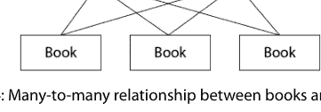

图 2.14：书籍与合著者之间的多对多关系

在 models.py 中，对于 Book 模型，添加最后一行，如下所示：

```
class Book(models.Model):
    """A published book."""
    title = models.CharField(
        max_length=70, help_text="The title of the book.")
    publication_date = models.DateField(
        verbose_name="Date the book was published.")
    isbn = models.CharField(
        max_length=20, verbose_name="ISBN number of the book.")
    publisher = models.ForeignKey(
        Publisher, on_delete=models.CASCADE)
    contributors = models.ManyToManyField(
        'Contributor', through="BookContributor")
```

新添加的 contributors 字段使用 ManyToManyField 字段类型在 Book 和 Contributor 之间建立多对多关系：

- models.ManyToManyField：这是建立多对多关系的字段类型。

- through：这是多对多关系的特殊字段选项。当我们在两个表之间有多对多关系时，如果我们想存储有关该关系的额外信息，则可以使用它通过中间表建立关系。


例如，我们有两个表，即 Book 和 Contributor，我们需要在其中存储书籍的贡献者类型信息，例如 Author、Co-Author 或 Editor。然后贡献者类型存储在名为 BookContributor 的中间表中。以下是 BookContributor 表/模型的示例。请确保将此模型包含在 reviews/models.py 中：

```python
class BookContributor(models.Model):
    class ContributionRole(models.TextChoices):
        AUTHOR = "AUTHOR", "Author"
        CO_AUTHOR = "CO_AUTHOR", "Co-Author"
        EDITOR = "EDITOR", "Editor"

    book = models.ForeignKey(
        Book, on_delete=models.CASCADE)
    contributor = models.ForeignKey(
        Contributor, on_delete=models.CASCADE)
    role = models.CharField(
        verbose_name="The role this contributor had in the book.",
        choices=ContributionRole.choices,
        max_length=20)
```

> **注意**
> 完整的 models.py 文件可以在此处查看：https://github.com/PacktPublishing/Web-Development-with-Django-Second-Edition/blob/main/Chapter02/final/bookr/reviews/models.py。

像 BookContributor 这样的中间表通过使用外键同时指向 Book 和 Contributor 表来建立关系。它还可以具有额外的字段，可以存储有关 BookContributor 模型与以下字段的关系的信息：

- **book**：这是对 Book 模型的外键。如前所述，`on_delete=models.CASCADE` 会在相关书籍从应用程序中删除时删除关系表中的条目。
- **Contributor**：同样，这是对 Contributor 模型/表的外键。这在删除时也定义为 CASCADE。
- **role**：这是中间模型的字段，用于存储有关 Book 和 Contributor 之间关系的额外信息。
- **class ContributionRole(models.TextChoices)**：这可以通过创建 `models.TextChoices` 的子类来定义一组选择。例如，ContributionRole 是从 TextChoices 创建的子类，由 roles 字段使用以将 Author、Co-Author 和 Editor 定义为一组选择。
- **`choices`**：这是指在模型中定义的一组选择，在使用模型创建 Django 表单时很有用。

> **注意**
> 当在建立多对多关系时未提供 `through` 字段选项时，Django 会自动创建一个中间表来管理该关系。

## 一对一关系

在此关系中，表中的一条记录将仅引用不同表中的一条记录。例如，一个人只能有一个驾驶执照，因此拥有驾驶执照的人可以形成一对一的关系：

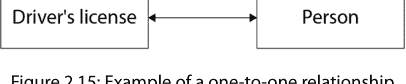

图 2.15：一对一关系的示例

OneToOneField 可用于建立一对一关系，如下所示：

```python
class DriverLicence(models.Model):
    person = models.OneToOneField(
        Person, on_delete=models.CASCADE)
    licence_number = models.CharField(max_length=50)
```

现在我们已经探索了数据库关系，让我们回到我们的 bookr 应用程序并在其中添加一个模型。

## 添加 Review 模型

我们已经将 Book 和 Publisher 模型添加到 reviews/models.py 文件中。我们将要添加的最后一个模型是 Review 模型。以下代码片段可以帮助我们完成此操作：

```python
from django.contrib import auth

class Review(models.Model):
    content = models.TextField(
        help_text="The Review text.")
    rating = models.IntegerField(
        help_text="The rating the reviewer has given.")
    date_created = models.DateTimeField(
        auto_now_add=True,
        help_text="The date and time the review was created.")
    date_edited = models.DateTimeField(
        null=True,
        help_text="The date and time the review was last edited."
    )
    creator = models.ForeignKey(
        auth.get_user_model(), on_delete=models.CASCADE)
    book = models.ForeignKey(
        Book, on_delete=models.CASCADE,
        help_text="The Book that this review is for."
    )
```

> **注意**
> 
> 完整的 `models.py` 文件可以在此处查看：https://github.com/PacktPublishing/Web-Development-with-Django-Second-Edition/blob/main/Chapter02/final/bookr/reviews/models.py。

review 模型/表将用于存储用户提供的书籍评论和评分。它具有以下字段：

- **content**：此字段存储书籍评论的文本；因此使用的字段类型为 `TextField`，因为它可以存储大量文本。
- **rating**：此字段存储书籍的评论评分。由于评分将为整数，因此使用的字段类型为 `IntegerField`。
- **date_created**：此字段存储评论撰写的时间和日期；因此字段类型为 `DateTimeField`。
- **date_edited**：此字段存储每次编辑评论时的日期和时间。同样，字段类型为 `DateTimeField`。
- **Creator**：此字段指定评论创建者或撰写书籍评论的人。请注意，这是一个指向 `auth.get_user_model()` 的外键，它指的是 Django 内置身份验证模块中的 User 模型。它具有 `on_delete=models.CASCADE` 字段选项。这说明当用户从数据库中删除时，该用户撰写的所有评论都将被删除。
- **Book**：Reviews 具有一个名为 book 的字段，是对 Book 模型的外键。这是因为评论必须为书籍评论应用程序撰写，并且一本书可以有许多评论，所以这是一对多的关系。这也使用 `on_delete=models.CASCADE` 字段选项定义，因为一旦书籍被删除，就没有保留评论的意义了。因此，当一本书被删除时，所有引用该书的评论也将被删除。

在下一节中，我们将学习并实现模型方法。

## 模型方法

在 Django 中，我们可以在模型类中编写方法。这些被称为 **模型方法**，它们可以是自定义方法或覆盖 Django 模型默认方法的特殊方法。其中一种方法就是 `__str__()`。此方法返回模型实例的字符串表示形式，在使用 Django shell 时尤其有用。在以下示例中，`__str__()` 方法被添加到 Publisher 模型中，Publisher 对象的字符串表示形式将为出版商的名称；因此返回 `self.name`，其中 `self` 指的是 Publisher 对象：

```python
class Publisher(models.Model):
    """A company that publishes books."""
    name = models.CharField(
        max_length=50,
        help_text="The name of the Publisher.")
    website = models.URLField(
        help_text="The Publisher's website.")
    email = models.EmailField(
        help_text="The Publisher's email address.")

    def __str__(self):
        return self.name
```

同样将 `__str__()` 方法添加到 Contributor 和 Book 中，如下所示：

```python
class Book(models.Model):
    """A published book."""
    title = models.CharField(
        max_length=70, help_text="The title of the book.")
    publication_date = models.DateField(
        verbose_name="Date the book was published.")
    isbn = models.CharField(
        max_length=20,
        verbose_name="ISBN number of the book.")
    publisher = models.ForeignKey(
        Publisher,
        on_delete=models.CASCADE)
    contributors = models.ManyToManyField(
        'Contributor', through="BookContributor")

    def __str__(self):
        return self.title


class Contributor(models.Model):
    """A contributor to a Book, e.g. author, editor, co-author."""
    first_names = models.CharField(
        max_length=50,
        help_text="The contributor's first name or names.")
    last_names = models.CharField(
        max_length=50,
        help_text="The contributor's last name or names.")
    email = models.EmailField(
        help_text="The contact email for the contributor.")

    def __str__(self):
        return self.first_names
```

同样，book 的字符串表示形式是 title，因此返回值为 `self.title`，其中 `self` 指的是 Book 对象。Contributor 的字符串表示形式是贡献者的名字；因此返回 `self.first_names`。这里，`self` 指的是 Contributor 对象。接下来，我们将查看迁移 reviews 应用。

## 迁移 reviews 应用

由于我们已经准备好了整个模型文件，让我们现在将模型迁移到数据库中，类似于我们之前对已安装应用所做的操作。由于 reviews 应用有一组由我们创建的模型，在运行迁移之前创建迁移脚本非常重要。迁移脚本有助于识别模型中的任何更改，并在运行迁移时将这些更改传播到数据库中。按照以下步骤创建迁移脚本，然后将模型迁移到数据库中：

1. 执行以下命令创建迁移脚本：

```bash
python manage.py makemigrations reviews
```

你应该会得到类似以下的输出：

```text
reviews/migrations/0002_auto_20191007_0112.py
  - Create model Book
  - Create model Contributor
  - Create model Review
  - Create model BookContributor
  - Add field contributors to book
  - Add field publisher to book
```

迁移脚本将在应用程序文件夹中的名为 migrations 的文件夹中创建。

2. 接下来，使用 migrate 命令将所有模型迁移到数据库中：

```bash
python manage.py migrate reviews
```


你应该会看到以下输出：

```
Operations to perform:
  Apply all migrations: reviews
Running migrations:
  Applying reviews.0002_auto_20191007_0112... OK
```

执行此命令后，我们成功创建了 reviews 应用中定义的数据库表。迁移完成后，你可以使用 DB Browser for SQLite 来浏览刚刚创建的表。

- 3. 为此，打开 DB Browser for SQLite，单击 Open Database 按钮（图 2.16），然后导航到你的项目目录：


图 2.16：单击 Open Database 按钮

- 4. 选择 db.sqlite3 数据库文件将其打开（图 2.17）。

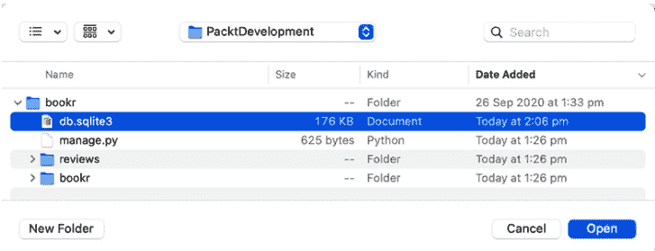

图 2.17：在 bookr 目录中定位 db.sqlite3

现在你应该能够浏览已创建的新表集合。以下截图显示了 reviews 应用中定义的数据库表：

图 2.18：reviews 应用中定义的数据库表

在本节中，我们进一步了解了 Django 模型和迁移，以及 Python 的简单类如何转化为数据库表。我们还学习了各种类属性如何按照定义的字段类型转换为相应的数据库列。随后，我们学习了主键以及数据库中可能存在的不同类型的关系。我们还为书评应用创建了模型，并迁移了这些模型，将它们转换为数据库表。在下一节中，我们将学习如何使用 Django 的 ORM 执行数据库 CRUD 操作。

## Django 的数据库 CRUD 操作

由于我们已经为书评应用创建了必要的数据库表，接下来让我们了解 Django 中的基本数据库操作。

在 SQL CRUD 操作一节中，我们已经简要介绍了使用 SQL 语句进行数据库操作。我们尝试过使用 insert 语句在数据库中创建条目，使用 select 语句从数据库读取，使用 update 语句更新条目，以及使用 delete 语句从数据库删除条目。

Django 的 ORM 提供了相同的功能，而无需处理 SQL 语句。Django 的数据库操作就是简单的 Python 代码，因此我们免去了在 Python 代码中维护 SQL 语句的麻烦。让我们看看这些操作是如何执行的。

为了执行 CRUD 操作，我们将运行以下命令进入 Django 的命令行 shell：

```
python manage.py shell
```

> **注意**
> 在本章中，我们将使用代码块开头的 >>> 符号（高亮显示）来表示 Django shell 命令。将查询粘贴到 DB Browser 中时，请确保每次都排除该符号。

当交互式控制台启动时，它看起来如下：

```
Type "help", "copyright", "credits" or "license" for more information.
(InteractiveConsole)
>>>
```

在下面的练习中，我们将执行一个创建操作。

## 练习 2.02 – 在 bookr 数据库中创建一条记录

在本练习中，你将通过保存一个模型实例来在数据库中创建一条新记录。换句话说，你将在不显式运行 SQL 查询的情况下，在数据库表中创建一条记录。请按照以下步骤操作：

- 1. 首先，从 reviews.models 导入 Publisher 类/模型：

```
>>> from reviews.models import Publisher
```

- 2. 通过传递 Publisher 模型所需的全部字段值（name、website 和 email），创建 Publisher 类的一个对象或实例：

```
>>> publisher = Publisher(name='Packt Publishing',
    website='https://www.packtpub.com',
    email='info@packtpub.com')
```

- 3. 接下来，要将对象写入数据库，务必调用 save() 方法，因为在调用该方法之前，记录不会在数据库中创建：

```
>>> publisher.save()
```

现在你可以使用 DB Browser 看到数据库中创建的新记录：

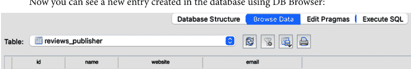

图 2.19：在数据库中创建的记录

- 4. 使用对象属性对对象进行进一步修改，并将更改保存到数据库：

```
>>> publisher.email = 'info@packtpub.com'
>>> publisher.email = 'customersupport@packtpub.com'
>>> publisher.save()
```

你可以使用 DB Browser 查看更改，如下所示：

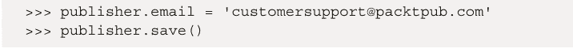

图 2.20：更新了 email 字段的记录

在本练习中，我们通过创建模型对象的实例在数据库中创建了一条记录，并使用 save() 方法将模型对象写入数据库。

请注意，按照上述方法，只有在调用 save() 方法后，对类实例的修改才会被保存。然而，如果我们使用 create() 方法，Django 会一步将修改保存到数据库。我们将在接下来的练习中使用该方法。

## 练习 2.03 – 使用 create() 方法创建记录

与之前的练习不同，之前的练习是分两步执行：先创建对象，然后使用 save() 方法在数据库中创建记录。而本练习中，你将使用 create() 方法一步在 contributor 表中创建一条记录：

- 1. 首先，像之前一样导入 Contributor 类：

```
>>> from reviews.models import Contributor
```

- 2. 调用 `create()` 方法，一步在数据库中创建一个对象。确保传递所有必需的参数（`first_names`、`last_names` 和 `email`）：

```
>>> contributor =
    Contributor.objects.create(first_names="Rowel",
    last_names="Atienza",
    email="RowelAtienza@example.com")
```

- 3. 使用 DB Browser 验证 contributor 记录已在数据库中创建。如果 DB Browser 尚未打开，请像上一节那样打开 `db.sqlite3` 数据库文件。单击 **Browse Data**，从 Table 下拉菜单中选择所需的表——本例中是 `reviews_contributor` 表，如截图所示——并验证新创建的数据库记录：

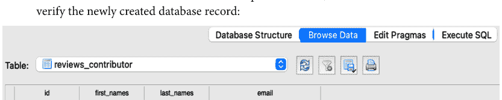

图 2.21：在 DB Browser 中验证记录的创建

在本练习中，我们了解到，使用 `create()` 方法可以一步在数据库中为模型创建一条记录。

## 创建带有外键的对象

类似于我们在 `Publisher` 和 `Contributor` 表中创建记录的方式，现在让我们为 `Book` 表创建一条记录。如果你还记得，`Book` 模型有一个指向 `Publisher` 的外键，该外键不能为 null。因此，填充 publisher 外键的一种方法是在 book 的 `publisher` 字段中提供已创建的 `publisher` 对象，如下面的练习所示。

## 练习 2.04 – 为多对一关系创建记录

在本练习中，你将在 `Book` 表中创建一条记录，包括指向 `Publisher` 模型的外键。如你所知，`Book` 和 `Publisher` 之间的关系是多对一关系，因此你必须先获取 `Publisher` 对象，然后在创建 book 记录时使用它。为此，请按照以下步骤操作：

- 1. 首先，导入 `Publisher` 类：

```
>>> from reviews.models import Book, Publisher
```

- 2. 使用以下命令从数据库中检索 publisher 对象。get() 方法用于从数据库中检索对象。我们还没有探索数据库读取操作。目前，请使用以下命令；我们将在下一节中更深入地探讨如何从数据库读取/检索数据：

```
>>> publisher =
    Publisher.objects.get(name='PacktPublishing')
```

- 3. 创建 book 时，我们需要提供一个 date 对象，因为 publication_date 是 Book 模型中的一个 date 字段。因此，从 datetime 导入 date，以便在创建 book 对象时可以提供 date 对象，如下面的代码所示：

```
>>> from datetime import date
```

- 4. 使用 create() 方法在数据库中创建一条 book 记录。确保传递所有字段，即 title、publication_date、isbn 和 publisher 对象：

```
>>> book = Book.objects.create(title="Advanced Deep Learning with Keras", publication_date=date(2018, 10, 31), isbn="9781788629416", publisher=publisher)
```

请注意，由于 publisher 是一个外键，并且它不是可空的（不能包含 null 值），因此必须传递一个 publisher 对象。当未提供必需的 foreign key 对象 publisher 时，数据库将抛出完整性错误。

图 2.22 显示了创建第一条记录后的 Book 表。请注意，外键字段（publisher_id）指向 Publisher 表的 id 值（主键）。book 记录中的 publisher_id 指向主键为 1 的 Publisher 记录，如下面的两张截图所示：

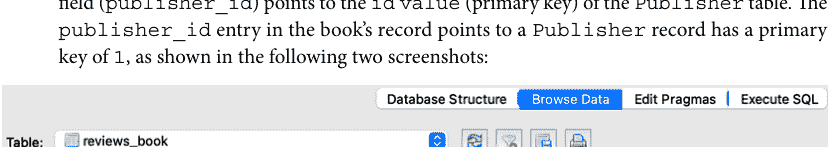

图 2.22：指向 reviews_book 主键的外键


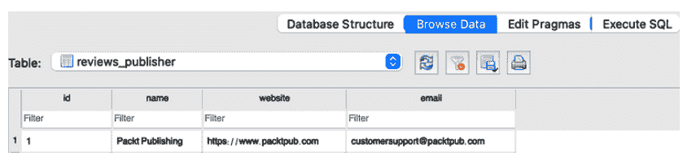

图 2.23：指向 reviews_publisher 主键的外键

在本练习中，我们了解到在创建数据库记录时，如果是外键，则可以将对象分配给字段。我们知道 Book 模型也与 Contributor 模型存在多对多关系。现在让我们探索在数据库中创建记录时建立多对多关系的方式。

## 练习 2.05 – 使用多对多关系创建记录

在本练习中，你将使用 BookContributor 关系模型在 Book 和 Contributor 之间创建多对多关系：

- 1. 如果你已重新启动 shell 并丢失了 publisher 和 book 对象，请使用以下 Python 语句集从数据库中检索它们：

```
>>> from reviews.models import Book
>>> from reviews.models import Contributor
>>> contributor =
    Contributor.objects.get(first_names='Rowel')
>>> book = Book.objects.get(title="Advanced Deep
    Learning with Keras")
```

- 2. 建立多对多关系的方式是通过在中间模型或关系模型中存储有关关系的信息；在这种情况下为 BookContributor。由于我们已经从数据库中获取了 book 和 contributor 记录，让我们在为 BookContributor 关系模型创建记录时使用这些对象。为此，首先创建 BookContributor 关系类的实例，然后将对象保存到数据库中。在此过程中，确保传递所需的字段，即 book 对象、contributor 对象和 role：

```
>>> from reviews.models import BookContributor
>>> book_contributor = BookContributor(book=book,
    contributor=contributor, role='AUTHOR')
>>> book_contributor.save()
```

请注意，我们在创建 `book_contributor` 对象时将 role 设置为 `AUTHOR`。这是在建立多对多关系时存储关系数据的经典示例。role 可以是 `AUTHOR`、`CO_AUTHOR` 或 `EDITOR`。

这建立了书籍 *Advanced Deep Learning with Keras* 与贡献者 Rowel 之间的关系（Rowel 是该书的作者）。

在本练习中，我们使用 `BookContributor` 关系模型在 Book 和 `Contributor` 之间建立了多对多关系。关于我们刚刚创建的多对多关系的验证，我们将在本章后面的几个练习中详细介绍。

## 练习 2.06 – 使用 add() 方法的多对多关系

在本练习中，你将使用 `add()` 方法建立多对多关系。当我们不使用关系来创建对象时，可以使用 `through_default` 传递一个包含定义所需字段的参数的字典。继续上一个练习，让我们再向题为 *Advanced Deep Learning with Keras* 的书籍添加一位贡献者。这次，该贡献者是该书的编辑：

- 1. 如果你已重新启动 shell，请运行以下两个命令以导入并获取所需的 book 实例：

```
```python
>>> from reviews.models import Book, Contributor
>>> book = Book.objects.get(title="Advanced Deep
Learning with Keras")
```
```

- 2. 使用 `create()` 方法创建贡献者，如下所示：

```
```python
>>> contributor =
    Contributor.objects.create(first_names='Packt',
    last_names='Example Editor',
    email='PacktEditor@example.com')
```
```

- 3. 使用 `add()` 方法将新创建的贡献者添加到书籍中。确保以 dict 的形式提供 `role` 关系参数。输入以下代码：

```
```python
>>> book.contributors.add(contributor,
    through_defaults={'role': 'EDITOR'})
```
```

因此，我们使用 `add()` 方法在书籍和贡献者之间建立了多对多关系，同时将关系数据 role 存储为 `EDITOR`。让我们现在看看其他实现方式。

## 使用 create() 和 set() 方法进行多对多关系

假设书籍 Advanced Deep Learning with Keras 共有两位编辑。让我们使用以下方法向书籍添加另一位编辑。如果贡献者尚未存在于数据库中，则可以使用 create() 方法同时创建条目并建立其与书籍的关系：

```
>>> book.contributors.create(first_names='Packtp',
    last_names='Editor Example',
    email='PacktEditor2@example.com',
    through_defaults={'role': 'EDITOR'})
```

同样，我们也可以使用 set() 方法添加书籍的贡献者列表。让我们创建一个 publisher、两位共同作者的贡献者集合以及一个 book 对象。首先，如果尚未导入，请使用以下代码导入 Publisher 模型：

```
>>> from reviews.models import Publisher
```

以下代码将帮助我们实现：

```
>>> publisher =
    Publisher.objects.create(name='Pocket Books',
    website='https://pocketbookssampleurl.com',
    email='pocketbook@example.com')
>>> contributor1 =
    Contributor.objects.create(first_names='Stephen',
    last_names='Stephen', email='StephenKing@example.com')
>>> contributor2 =
    Contributor.objects.create(first_names='Peter',
    last_names='Straub', email='PeterStraub@example.com')

>>> book = Book.objects.create(title='The Talisman',
    publication_date=date(2012, 9, 25),
    isbn='9781451697216', publisher=publisher)
```

由于这是多对多关系，我们可以使用 set() 方法一次性添加对象列表。我们可以使用 through_defaults 指定贡献者的角色；在这种情况下，他们是共同作者：

```
>>> book.contributors.set([contributor1, contributor2],
    through_defaults={'role': 'CO_AUTHOR'})
```

## 读操作

Django 为我们提供了允许从数据库读取/检索的方法。我们可以使用 `get()` 方法从数据库检索单个对象。我们已在前几节中创建了一些记录，因此让我们使用 `get()` 方法检索一个对象。

## 练习 2.07 – 使用 get() 方法检索对象

在本练习中，你将使用 `get()` 方法从数据库检索对象。请按照以下步骤操作：

- 1. 获取 name 字段为 Pocket Books 的 Publisher 对象：

```
```python
>>> from reviews.models import Publisher
>>> publisher =
    Publisher.objects.get(name='Pocket Books')
```
```

- 2. 重新输入检索到的 publisher 对象并按 *Enter*：

```
```
>>> publisher
<Publisher: Pocket Books>
```
```

请注意，输出会显示在 shell 中。这称为对象的字符串表示。它是添加 `__str__()` 模型方法的结果，就像我们在 *Model methods* 部分为 Publisher 类所做的那样。

- 3. 检索对象后，你可以访问对象的所有属性。由于这是一个 Python 对象，可以通过使用 `.` 后跟属性名来访问对象的属性。因此，你可以使用以下命令检索出版商的名称：

```
```
>>> publisher.name
'Pocket Books'
```
```

- 4. 同样，要检索出版商的网站，请使用以下命令：

```
```
>>> publisher.website
'https://pocketbookssampleurl.com'
```
```

出版商的电子邮件地址可以按如下方式检索：

```
```
>>> publisher.email
'pocketbook@example.com'
```
```

在本练习中，我们学习了如何使用 `get()` 方法获取单个对象。使用此方法有几个缺点。让我们接下来找出它们是什么。

## 使用 get() 方法返回对象

需要注意的是，get() 方法只能获取一个对象。如果另一个对象携带与所提字段相同的值，则我们可以预期返回多于一个错误消息。例如，如果 Publisher 表中有两个条目 name 字段的值相同，我们可以预期出现错误。在这种情况下，有其他方法可以检索这些对象，我们将在后续部分中探讨。

当 get() 查询没有返回对象时，我们也可以收到匹配查询不存在的错误消息。get() 方法可与对象的任何字段一起使用以检索记录。在以下情况下，我们使用 website 字段：

```
```python
>>> publisher =
    Publisher.objects.get(
    website='https://pocketbookssampleurl.com')
```
```

检索对象后，我们仍然可以获取出版商的名称，如下所示：

```
```python
>>> publisher.name
'Pocket Books'
```
```

另一种检索对象的方法是使用其主键 pk，如下所示：

```
```python
>>> Publisher.objects.get(pk=2)
<Publisher: Pocket Books>
```
```

使用 pk 作为主键是使用主键字段的更通用方法。但对于 Publisher 表，由于我们知道 id 是主键，因此可以简单地使用 id 字段名来创建我们的 get() 查询：

```
```python
>>> Publisher.objects.get(id=2)
<Publisher: Pocket Books>
```
```

> **注意**
> 
> 对于 Publisher 和所有其他表，主键是 id，这是 Django 自动创建的。这发生在创建表时未提及主键字段时。但也可能存在显式声明某个字段为主键的情况。

在下一个练习中，我们将了解如何查询并检索给定模型的全部对象。


## 练习 2.08 – 使用 all() 方法检索一组对象

我们可以使用 all() 方法检索所有对象的集合。在本练习中，你将使用此方法检索所有贡献者的姓名。为此，请按照以下步骤操作：

- 1. 添加以下代码以从 Contributor 表中检索所有对象：

```
>>> from reviews.models import Contributor

>>> Contributor.objects.all()
<QuerySet [<Contributor: Rowel>, <Contributor: Packt>,
<Contributor: Packt>, <Contributor: Stephen>, <Contributor:
Peter>]>
```

执行后，你将获得所有对象的 QuerySet。

- 2. 我们可以使用列表索引查找特定对象，或使用循环遍历列表以执行其他操作：

```
>>> contributors = Contributor.objects.all()
```

- 3. 由于 Contributor 是一个对象列表，你可以使用索引访问列表中的任何元素，如以下命令所示：

```
>>> contributors[0]
<Contributor: Rowel>
```

在这种情况下，列表中的第一个元素是一个 first_names 值为 'Rowel' 且 last_names 值为 'Atienza' 的贡献者，如以下代码所示：

```
>>> contributors[0].first_names
'Rowel'
>>> contributors[0].last_names
'Atienza'
```

在本练习中，我们学习了如何使用 all() 方法检索所有对象，以及如何将检索到的对象集合作为列表使用。

## 通过过滤检索对象

如果某个字段值对应多个对象，我们就不能使用 get() 方法，因为 get() 方法只能返回一个对象。对于这种情况，我们有 filter() 方法，它可以检索所有符合指定条件的对象。

## 练习 2.09 – 使用 filter() 方法检索对象

在本练习中，你将使用 filter() 方法获取特定条件下的对象集合。具体来说，你将检索所有名字为 Peter 的贡献者姓名。为此，请按照以下步骤操作：

- 1. 首先，创建另外两个贡献者：

```
>>> from reviews.models import Contributor
>>> Contributor.objects.create(first_names='Peter',
    last_names='Wharton',
    email='PeterWharton@example.com')
>>> Contributor.objects.create(first_names='Peter',
    last_names='Tyrrell',
    email='PeterTyrrell@example.com')
```

- 2. 要检索 first_names 值为 Peter 的贡献者，请添加以下代码：

```
>>> Contributor.objects.filter(first_names='Peter')
<QuerySet [<Contributor: Peter>, <Contributor: Peter>,
<Contributor: Peter>]>
```

- 3. filter() 方法即使只有一个对象也会返回该对象。你可以在此处看到这一点：

```
>>> Contributor.objects.filter(first_names='Rowel')
<QuerySet [<Contributor: Rowel]>
```

- 4. 此外，如果查询不匹配任何内容，filter() 方法将返回一个空的 QuerySet。这可以在此处看到：

```
>>> Contributor.objects.filter(first_names='Nobody')
<QuerySet []>
```

在本练习中，我们看到了使用过滤器根据特定条件检索少量对象集合的用法。在下一节中，我们将学习使用字段查找进行过滤。

## 通过字段查找进行过滤

现在，假设我们想要通过提供某些条件，使用对象的字段来过滤和查询一组对象。在这种情况下，我们可以使用双下划线查找。例如，Book 对象有一个 publication_date 字段；假设我们想要过滤并获取所有在 01-01-2014 之后出版的书籍。我们可以通过使用双下划线方法轻松查找这些书籍。为此，我们将首先导入 Book 模型：

```
>>> from reviews.models import Book
>>> book = Book.objects.filter(publication_date__gt=date(
    2014, 1, 1))
```

这里，publication_date__gt 表示 publication date 大于 (gt) 某个指定日期，在本例中为 01-01-2014。类似地，我们有以下缩写：

- lt: 小于
- lte: 小于或等于
- gte: 大于或等于

过滤后的结果可以在此处看到：

```
>>> book
<QuerySet [<Book: Advanced Deep Learning with Keras>]>
```

以下是查询集中书籍的出版日期，这证实了出版日期在 01-01-2014 之后：

```
>>> book[0].publication_date
datetime.date(2018, 10, 31)
```

## 使用模式匹配进行过滤操作

对于过滤结果，我们还可以查找参数是否包含我们正在查找的字符串的一部分：

```
>>> book =
    Book.objects.filter(title__contains='Deep learning')
```

这里，title__contains 查找标题包含 'Deep learning' 作为字符串一部分的所有对象：

```
>>> book
<QuerySet [<Book: Advanced Deep Learning with Keras>]>

>>> book[0].title
'Advanced Deep Learning with Keras'
```

同样，如果字符串匹配需要不区分大小写，我们可以使用 icontains。使用 startswith 匹配以指定字符串开头的任何字符串。

## 使用 `exclude()` 方法检索对象

在上一节中，我们学习了通过匹配特定条件获取一组对象。现在，假设我们想要做相反的操作；也就是说，我们想要获取所有不匹配特定条件的对象。在这种情况下，我们可以使用 `exclude()` 方法排除特定条件并获取所有所需对象。这将通过示例更清晰。以下是所有贡献者的列表：

```
```python
>>> Contributor.objects.all()
<QuerySet [<Contributor: Rowel>, <Contributor: Packt>,
<Contributor: Packt>, <Contributor: Stephen>,
<Contributor: Peter>, <Contributor: Peter>,
<Contributor: Peter>]>
```
```

现在，从此列表中，我们将排除所有 first_names 值为 Peter 的贡献者：

```
```python
>>> Contributor.objects.exclude(first_names='Peter')
<QuerySet [<Contributor: Rowel>, <Contributor: Packt>,
<Contributor: Packt>, <Contributor: Stephen>]>
```
```

我们在这里看到，查询返回了所有名字不是 Peter 的贡献者。

## 使用 `order_by()` 方法检索对象

我们可以使用 `order_by()` 方法按指定字段对对象列表进行排序并检索。例如，在以下代码片段中，我们按出版日期对书籍进行排序：

```
```python
>>> books = Book.objects.order_by("publication_date")
>>> books
<QuerySet [<Book: The Talisman>, <Book: Advanced Deep Learning with
Keras>]>
```
```

让我们检查查询的顺序。由于查询集是一个列表，我们可以使用索引检查每本书的出版日期：

```
```python
>>> books[0].publication_date
datetime.date(2012, 9, 25)
>>> books[1].publication_date
datetime.date(2018, 10, 31)
```
```

请注意，索引为 0 的第一本书的出版日期早于索引为 1 的第二本书的出版日期。因此，这证实了查询的书籍列表已按其出版日期正确排序。我们也可以为字段参数使用带负号的前缀以按降序排列结果。这可以从以下代码片段中看出：

```
>>> books = Book.objects.order_by("-publication_date")
>>> books

<QuerySet [<Book: Advanced Deep Learning with Keras>,
<Book: The Talisman>] >
```

由于我们在 publication date 前加上了负号，请注意查询的书籍集合现在已按相反顺序返回，其中索引为 0 的第一本书对象具有比第二本书更新的日期：

```
>>> books[0].publication_date
datetime.date(2018, 10, 31)

>>> books[1].publication_date
datetime.date(2012, 9, 25)
```

我们也可以使用字符串字段或数值字段进行排序。例如，以下代码可用于按主键或 id 对书籍进行排序：

```
>>> books = Book.objects.order_by('id')
>>> books
<QuerySet [<Book: Advanced Deep Learning with Keras>,
<Book: The Talisman>] >
```

查询的书籍集合已按 book id 升序排列：

```
>>> books[0].id
1
>>> books[1].id
2
```

同样，要按降序排列，可以使用负号作为前缀，如下所示：

```
>>> books = Book.objects.order_by('-id')
>>> books
<QuerySet [<Book: The Talisman>, <Book: Advanced Deep Learning with Keras>] >
```


现在，按 book id 降序排列的书籍查询集如下：

```
>>> books[0].id
2
>>> books[1].id
1
```

要按字符串字段进行字母顺序排序，我们可以这样做：

```
>>> books = Book.objects.order_by('title')
>>> books
<QuerySet [<Book: Advanced Deep Learning with Keras>, <Book: The Talisman>]>
```

由于我们使用书籍标题进行排序，查询集已按字母顺序排列。我们可以按如下方式看到这一点：

```
>>> books[0]
<Book: Advanced Deep Learning with Keras>
>>> books[1]
<Book: The Talisman>
```

与之前看到的排序类型类似，负号前缀可以帮助我们按反向字母顺序排序，如下所示：

```
>>> books = Book.objects.order_by('-title')
>>> books
<QuerySet [<Book: The Talisman>, <Book: Advanced Deep Learning with Keras>]>
```

这将导致以下输出：

```
>>> books[0]
<Book: The Talisman>
>>> books[1]
<Book: Advanced Deep Learning with Keras>
```

Django 提供的另一个有用的方法是 values()。它帮助我们获取字典的查询集而不是对象。在下面的代码片段中，我们将其用于 Publisher 对象：

```
>>> publishers = Publisher.objects.all().values()

>>> publishers
<QuerySet [{'id': 1, 'name': 'Packt Publishing', 'website': 'https://www.packtpub.com', 'email': 'customersupport@packtpub.com'}, {'id': 2, 'name': 'Pocket Books', 'website': 'https://pocketbookssampleurl.com',
'email': 'pocketbook@example.com'}]>
>>> publishers[0]
{'id': 1, 'name': 'Packt Publishing', 'website': 'https://www.packtpub.com', 'email': 'customersupport@packtpub.com'}

>>> publishers[0]
{'id': 1, 'name': 'Packt Publishing', 'website': 'https://www.packtpub.com', 'email': 'customersupport@packtpub.com'}
```

在接下来的几节中，我们将探讨如何跨关系进行查询。

## Querying across relationships

正如本章所研究的那样，reviews 应用有两个种类的关系：多对一和多对多。到目前为止，我们已经学习了使用 get()、filters、字段查找等进行查询的各种方法。现在让我们研究如何跨关系执行查询。有几种方法可以做到这一点——我们可以使用外键、对象实例等。让我们借助一些示例来探索这些。

### Querying using foreign keys

当我们在两个模型/表之间存在关系时，Django 提供了一种使用关系执行查询的方法。本节中显示的命令将通过使用模型关系执行查询来检索 Packt Publishing 出版的所有书籍。与之前看到的类似，这使用双下划线查找来完成。例如，Book 模型有一个指向 Publisher 模型的 publisher 外键。使用此外键，我们可以使用双下划线和 Publisher 模型中的 name 字段执行查询。这可以从以下代码中看出：

```
>>> Book.objects.filter(publisher__name='Packt Publishing')
<QuerySet [<Book: Advanced Deep Learning with Keras>]>
```

### Querying using the model name

另一种查询方式是使用关系反向查询，使用小写的模型名称。例如，假设我们想使用查询中的模型关系查询出版了书籍 Advanced Deep Learning with Keras 的出版商。对于此，我们可以执行以下语句以检索 Publisher 信息对象：

```
>>> Publisher.objects.get(book__title='Advanced Deep Learning with Keras')
<Publisher: Packt Publishing>
```

这里，book 是小写的模型名称。正如我们所知，Book 模型有一个 publisher 外键，其 name 值为 Packt Publishing。

### Querying across foreign key relationships using the object instance

我们也可以使用对象的外键检索信息。假设我们想查询标题为 The Talisman 的出版商名称：

```
>>> book = Book.objects.get(title='The Talisman')
>>> book.publisher
<Publisher: Pocket Books>
```

使用对象在这里是一个示例，我们使用反向方向通过使用 set.all() 方法获取出版商出版的所有书籍：

```
>>> publisher = Publisher.objects.get(name='Pocket Books')

>>> publisher.book_set.all()
<QuerySet [<Book: The Talisman>] >
```

我们也可以使用查询链创建查询：

```
>>> Book.objects.filter(publisher__name='Pocket Books').filter(title='The Talisman')
<QuerySet [<Book: The Talisman>] >
```

让我们执行一些练习来巩固我们迄今为止学到的各种查询知识。

## Exercise 2.10 – querying across a many-to-many relationship using the field lookup

我们知道 Book 和 Contributor 之间存在多对多关系。在本练习中，不创建对象，你将执行查询以检索所有为题为 The Talisman 的书籍撰稿的贡献者：

- 1. 首先，导入 Contributor 类：
  ```
  >>> from reviews.models import Contributor
  ```
- 2. 现在，添加以下代码以查询 The Talisman 的贡献者集合：
  ```
  >>> Contributor.objects.filter(book__title='The Talisman')
  ```

```
>>> from reviews.models import Contributor
```

```
>>> Contributor.objects.filter(book__title='The Talisman')
```

- 3. 使用 contributor 对象和 book_set() 方法，获取该贡献者撰写的所有书籍：

```
>>> contributor.book_set.all()
<QuerySet [<Book: Advanced Deep Learning with Keras>]>
```

由于 Book 和 Contributor 之间存在多对多关系，我们可以使用 set() 方法查询与模型关联的对象集合。在这种情况下，contributor.book_set.all() 返回了该贡献者撰写的所有书籍。

## Exercise 2.13 – using the update() method

在本练习中，你将使用 update() 方法更新现有记录：

- 1. 更改 last name 为 Tyrrell 的贡献者的 first_names：

```
>>> from reviews.models import Contributor
>>> Contributor.objects.filter(last_names='Tyrrell').
    update(first_names='Mike')
1
```

返回值显示已更新的记录数。在这种情况下，已更新一条记录。

- 2. 使用 get() 方法获取刚刚修改的贡献者，并验证名字已更改为 Mike：

```
>>> Contributor.objects.get(last_names='Tyrrell').
    first_names
'Mike'
```

> Note
> 如果 filter 操作有多个记录，则 update() 方法将更新 filter 返回的所有记录中指定的字段。

在本练习中，我们学习了如何使用 update() 方法更新数据库中的记录。现在，最后，让我们尝试使用 delete() 方法从数据库中删除一条记录。

## Exercise 2.14 – using the delete() method

数据库中现有的记录可以使用 delete() 方法删除。在本练习中，你将从 contributors 表中删除 last_name 值为 Wharton 的记录：

- 1. 使用 get() 方法获取对象并使用 delete() 方法，如下所示：

```
>>> from reviews.models import Contributor
>>> Contributor.objects.get(last_names='Wharton').
    delete()
(1, {'reviews.Contributor': 1}
```

请注意，你在不将 contributor 对象分配给变量的情况下调用了 delete() 方法。由于 get() 方法返回单个对象，因此你可以在不实际为其创建变量的情况下访问对象的方法。

- 2. 验证 last_name 为 'Wharton' 的贡献者对象已被删除：

```
>>> Contributor.objects.get(last_names='Wharton')
Traceback (most recent call last):
File "<console>", line 1, in <module>
File "../../site-packages/django/db/models/manager.py",
line 82, in manager_method
return getattr(self.get_queryset(), name)(*args,
**kwargs)
File "../../site-packages/django/db/models/query.py",
line 417, in get
self.model._meta.object_name
reviews.models.Contributor.DoesNotExist: Contributor
matching query does not exist.
```

正如你所见，运行查询后，我们得到了对象不存在错误。这是预期的，因为记录已被删除。在本练习中，我们学习了如何使用 delete() 方法从数据库中删除记录。

## Bulk create and bulk update operations

当我们有一大批需要创建或更新的记录时，我们可以使用 bulk_create() 和 bulk_update() 方法分别执行批量创建和批量更新操作。当我们有大量记录需要创建或更新时，使用这些方法在执行数据库操作时可以是高效的。


通常，使用对象列表调用 `bulk_create` 方法的方式如下：

```
Person.objects.bulk_create([
    Person(name='Robert', address='5, Byron bay, NSW'),
    Person(name='Mark', address="Unit 12, New town, NSW 2000"),])
```

同样，批量更新也是在类似对象的列表上执行。可以按以下示例所示更改对象的属性，并使用 `bulk_update()` 方法在单个命令中将它们更新到数据库中，如以下代码段所示：

```
persons[0].address = "8, Byron bay, NSW"
persons[1].address = "15, New town, NSW"
Person.objects.bulk_update(persons, ["address"])
```

我们将在接下来的练习中看到这两种方法的更多示例。

## 练习 2.15 – 使用 bulk_create 创建多条记录

在本练习中，我们将使用 `bulk_create()` 方法一次性向 Publisher 表中创建多条条目。为此，请执行以下步骤：

- 1. 如果尚未导入，请在 Django shell 中导入 Publisher 模型：

```
>>> from reviews.models import Publisher
```

- 2. 通过将 Publisher 对象列表传递给 `bulk_create()` 方法，在 Publisher 表中创建多条记录：

```
>>> Publisher.objects.bulk_create([
    Publisher(name="New Town Publisher",
              website="www.newtownexample.com",
              email='newtow@example.com'), Publisher(name="Byron Bay Press", website="www.byronbayexample.com", email='byronbayexample@email.com'),
    Publisher(name="Katoomba Publisher",
              website="www.katoombaexample.com",
              email='katoombaexample@email.com')])

[<Publisher: New Town Publisher>, <Publisher: Byron Bay Press>, <Publisher: Katoomba Publisher>]
```

该方法返回作为数据库中条目创建的对象列表。如果需要创建大量条目，这可能是执行任务最有效的方法之一。

接下来，我们将尝试使用 `bulk_update` 方法高效地批量更新记录。

## 练习 2.16 – 使用 `bulk_update` 更新多条记录

与前一个练习类似，我们可以使用 `bulk_update` 方法一次性更新多条记录：

- 1. 首先，如果尚未导入，请导入 `Publisher` 模型：

```
```python
>>> from reviews.models import Publisher
```
```

- 2. 在下一步中，我们将挑选几个 `Publisher` 对象作为列表。

- 3. 假设这两个出版商已合并为一家公司，并且需要共享相同的网站，现在让我们在一个查询集中更新这两个对象：

```
```python
>>> publishers = [Publisher.objects.get(name='New Town Publisher'), Publisher.objects.get(name='Byron Bay Press')]
>>> publishers[0].website = "www.newsouthwalespublisher.com"
>>> publishers[1].website = "www.newsouthwalespublisher.com"

>>> Publisher.objects.bulk_update(publishers, ["website"])
2
```
```

运行 `bulk_update` 方法后，它会返回已更新对象的数量；在本例中为两个对象。同样，这也是一次性更新多个对象的高效方式。

## 使用 Q 对象执行复杂查询

Q 对象用于执行复杂查询，尤其是在查询涉及 WHERE 子句中的 AND 或 OR 操作时。例如，如果我们需要执行与此处所示的 SQL 查询类似的查询：

```
```sql
SELECT * FROM Person WHERE name LIKE "Rob%" OR name LIKE "Bob%";
```
```

前面的 SQL 语句查询任何名字以 Rob 或 Bob 开头的人。

在 `LIKE "Rob%"` 中，这里 `LIKE` 关键字模式匹配字符串，以检查字符串是否以指定的 Rob 值开头。

Q 对象在组合 WHERE 子句时使用 & 和 | 运算符分别表示 AND 和 OR 操作。前面使用 Q 对象的查询可以写成如下形式：

```
Person.objects.get(Q(name__startswith='Rob') | Q(name__startswith='Bob'))
```

## 练习 2.17 – 使用 Q 对象执行复杂查询

接下来，使用之前学到的概念，Q 对象让我们可以查询两个出版商：

- 1. 如果尚未导入，请导入 Publisher 并从 django.db.models 导入 Q，如以下命令所示：

```
>>> from django.db.models import Q
>>> from reviews.models import Publisher
```

- 2. 按如下所示执行 Q 对象查询。在这里，我们检查是否有任何 Publisher 对象的名称以 New 或 Idea 开头：

```
>>> Publisher.objects.filter(Q(name__startswith="New")
        | Q(name__startswith="Idea"))
<QuerySet [<Publisher: New Town Publisher>]>
```

由于没有名称以 Idea 开头的 Publisher，而有一个名称以 New 开头的对象，因此返回了一个对象。

这是一个使用 AND 运算符的 Q 对象查询示例。在此查询中，我们查询名称以 New 开头并且名称以 Publisher 结尾的 Publisher 对象：

```
>>> Publisher.objects.filter(Q(name__startswith="New") &
        Q(name__endswith="Publisher"))
<QuerySet [<Publisher: New Town Publisher>]>
```

在这种情况下，只返回了一个对象，即 New Town Publisher，它满足查询中所述的条件。这样，可以使用 AND 或 OR 运算符组合多个 WHERE 子句以获得所需的结果。

## 练习 2.18 – 验证查询集是否包含给定对象

在本练习中，我们将使用 contains 方法检查查询是否包含指定的对象：

- 1. 如果尚未导入，请导入 Publisher 模型：

```
>>> from reviews.models import Publisher
```

- 2. 运行如下所示的查询。在此示例中，我们正在执行 Q 对象查询，结果有两个出版商：

```
```python
>>> publishers =
    Publisher.objects.filter(Q(name__startswith="New")
        | Q(name__endswith="Publisher"))
>>> publishers
<QuerySet [<Publisher: New Town Publisher>, <Publisher: Katoomba Publisher>]>
```
```

- 3. 获取一个新的出版商对象并验证它是否属于之前的查询集：

```
```python
>>> new_town_publisher =
    Publisher.objects.get(name='New Town Publisher')
>>> new_town_publisher
<Publisher: New Town Publisher>
>>> publishers.contains(new_town_publisher)
True
```
```

如果对象存在，则返回布尔值，例如 `True` 或 `False`。

以下是查询集不包含指定对象的示例，在这种情况下返回的结果为 `False`：

```
```python
>>> publishers.contains(Publisher.objects.get(name='Byron
    Bay Press'))
False
```
```

在本练习中，我们学习了如何使用简单的 `contains()` 方法检查对象是否属于查询集。

总体而言，在本整个部分中，我们学习并使用了 Django 的命令行交互式 shell。使用上一节为图书评论应用程序创建的模型，我们使用 Django 交互式 shell 执行了 CRUD 操作。我们还探索了从数据库中过滤和查询（读取）的各种方法。所有这些数据库操作在开发任何 Django 应用程序时都将派上用场。在本章中迄今为止学到的概念的基础上，在下一节中，您将为示例应用程序创建模型并执行一些 CRUD 操作。

## 活动 2.01 – 为项目管理应用程序创建模型

假设您正在开发一个名为 Juggler 的项目管理应用程序。Juggler 是一个可以跟踪多个项目的应用程序，每个项目可以有多个相关任务。以下步骤将帮助您完成此活动：

- 1. 使用迄今为止学到的技术，创建一个名为 `juggler` 的 Django 项目。
- 2. 创建一个名为 `projectp` 的 Django 应用。
- 3. 将应用 projects 添加到 `juggler/settings.py` 文件中。
- 4. 在 `projectp/models.py` 中创建两个相关的模型类 Project 和 Task。
- 5. 创建迁移脚本并将模型的定义迁移到数据库。
- 6. 打开 Django shell 并导入模型。
- 7. 使用示例填充数据库并编写查询以显示给定项目关联的任务列表。

> **注意**
> 此活动的完整解决方案可在 https://github.com/PacktPublishing/Web-Development-with-Django-Second-Edition/tree/main/ActivitySolutions 上找到。

## 填充 Bookr 项目的数据库

虽然我们知道如何为项目创建数据库记录，但在接下来的几章中，我们将不得不创建大量记录来处理项目。因此，我们创建了一个脚本，可以使事情变得更容易。该脚本通过读取包含大量记录的逗号分隔值（CSV）文件来填充数据库。请按照以下步骤填充项目的数据库：

- 1. 在项目目录内创建以下文件夹结构：
- `bookr/reviews/management/commands/`
- 2. 从以下位置复制 `loadcsv.py` 文件和 WebDevWithDjangoData.csv 到创建的文件夹中。这可以在本书的 GitHub 仓库 http://packt.live/3pvbCLM 上找到。

由于 `loadcsv.py` 放置在 management/commands 文件夹中，它现在就像一个 Django 自定义管理命令。您可以查看 `loadcsv.py` 文件并阅读有关编写 Django 自定义管理命令的更多信息：https://docs.djangoproject.com/en/3.0/howto/custom-management-commands/。


+   3. 现在，让我们重新创建一个新的数据库。删除项目文件夹中存在的 SQL 数据库文件：

```
rm db.sqlite3
```

+   4. 要创建新的数据库，请执行 Django migrate 命令：

```
python manage.py migrate
```

现在你可以在 bookr 文件夹下看到新创建的 db.sqlite3 文件。

+   5. 执行 loadcsv 自定义管理命令来填充数据库：

```
python manage.py loadcsv --csv reviews/management/commands/
WebDevWithDjangoData.csv
```

+   6. 使用 DB Browser for SQLite，验证 bookr 项目创建的所有表都已填充。

至此，我们已成功填充了应用程序的数据库，这将在本书后续章节的工作中派上用场。

## 摘要

在本章中，我们学习了一些基本的数据库概念及其在应用程序开发中的重要性。我们使用了一个免费的数据库可视化工具 DB Browser for SQLite，来理解数据库表和字段是什么以及记录如何在数据库中存储，并进一步使用简单的 SQL 查询对数据库执行了一些基本的 CRUD 操作。

我们随后学习了 Django 如何提供一个名为 ORM 的有价值的抽象层，它帮助我们使用简单的 Python 代码无缝地与关系数据库交互，而无需编写 SQL 命令。作为 ORM 的一部分，我们学习了 Django 模型、迁移，以及它们如何帮助将对 Django 模型所做的更改传播到数据库中。

我们通过学习数据库关系及其在关系数据库中的关键类型来巩固了我们对数据库的了解。我们还使用 Django shell，使用 Python 代码执行了之前使用 SQL 执行的相同 CRUD 查询。后来，我们学习了如何使用模式匹配和字段查找以更精细的方式检索数据。随着我们学习这些概念，我们也在 Bookr 应用程序上取得了相当大的进展。我们为 reviews 应用创建了模型，并获得了与应用程序数据库中存储的数据交互所需的所有技能。在下一章中，我们将学习如何创建 Django 视图、URL 路由和模板。
