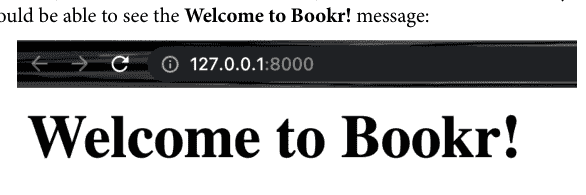
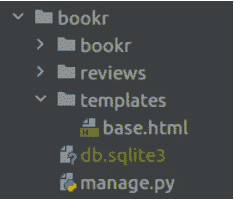
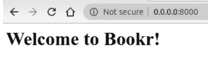
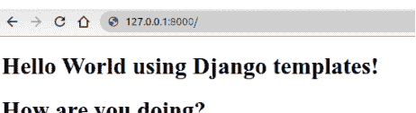
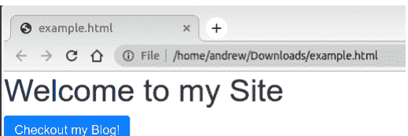
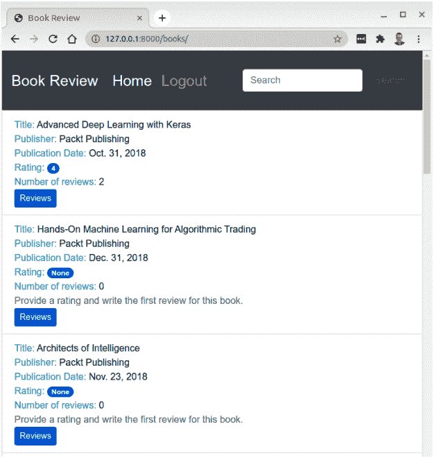
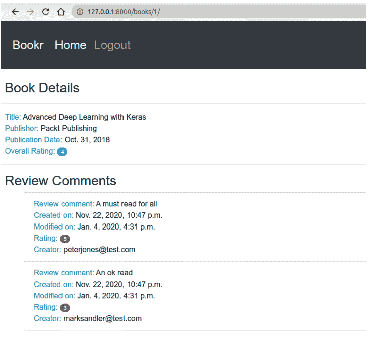

## URL 映射、视图和模板

在上一章中，我们介绍了数据库，并学习了如何从数据库中存储、检索、更新和删除记录。我们还学习了如何创建 Django 模型并应用数据库迁移。

然而，仅靠这些数据库操作无法向用户显示应用程序的数据。我们需要一种以有意义的方式向用户显示所有存储信息的方法——例如，在浏览器中以可呈现的格式显示 Bookr 应用程序数据库中存在的所有书籍。这就是 Django 视图、模板和 URL 映射发挥作用的地方。视图是 Django 应用程序的一部分，它接收 Web 请求并提供 Web 响应。例如，Web 请求可能是用户尝试通过输入网站地址来查看网站，而 Web 响应可能是网站的首页在用户浏览器中加载。视图是 Django 应用程序最重要的部分之一，其中编写应用程序逻辑。该应用程序逻辑控制与数据库的交互，例如从数据库中创建、读取、更新或删除记录。它还控制数据如何显示给用户。这是通过 Django HTML 模板实现的。

本章向您介绍 Django 的三个核心概念：视图、模板和 URL 映射。您将首先探索 Django 中的两种主要视图类型：基于函数的视图和基于类的视图。接下来，您将学习 Django 模板语言和模板继承的基础知识。利用这些概念，您将创建一个页面来显示 Bookr 应用程序中所有书籍的列表。您还将创建另一个页面来显示书籍的详细信息、评论和评分。

在本章中，我们将研究以下主题：

- 理解基于函数的视图
- 理解基于类的视图
- URL 配置
- 使用 Django 模板
- Django 的模板语言

通过使用和学习上述主题，到本章结束时，我们将实现一种列出所有书籍并在 Bookr 应用程序中显示任何给定书籍详情的方法。

Django 视图可以大致分为两种类型：**基于函数的视图**和**基于类的视图**。在本章中，我们将更深入地了解 Django 中的基于函数的视图。

> **注意**
> 基于类的视图是一个更高级的主题，将在 *第 11 章，高级模板和基于类的视图* 中详细讨论。

## 技术要求

本章的完整代码文件可以在 https://github.com/PacktPublishing/Web-Development-with-Django-Second-Edition/tree/main/Chapter03 找到。

### 理解基于函数的视图

顾名思义，基于函数的视图以 Python 函数实现。为了理解它们的工作原理，请考虑以下片段，它展示了一个名为 home_page 的简单视图函数：

```
from django.http import HttpResponse

def home_page(request):
    message = "<html><h1>Welcome to my Website</h1></html>"
    return HttpResponse(message)
```

这里定义的视图函数 home_page 以请求对象作为参数，并返回一个 HttpResponse 对象，其中包含 Welcome to my Website 消息。使用基于函数视图的优点是，由于它们以简单的 Python 函数实现，因此更容易学习，也更容易被其他程序员阅读。基于函数视图的主要缺点是代码无法重用，也无法像基于类的视图那样简洁地用于通用用例。下一节是对基于类视图的简要介绍。

### 理解基于类的视图

顾名思义，基于类的视图以 Python 类实现。利用类继承的原则，这些类被实现为 Django 通用视图类的子类。与基于函数视图中所有视图逻辑都显式表达在函数中不同，Django 的通用视图类带有各种预构建的属性和方法，可以提供编写简洁、可重用视图的捷径。此属性在 Web 开发期间经常派上用场；例如，开发人员经常需要渲染一个 HTML 页面，而不需要从数据库插入任何数据，或针对用户的任何自定义。在这种情况下，可以简单地继承 Django 的 TemplateView，并指定 HTML 文件的路径。以下是一个基于类视图的示例，它可以显示与基于函数视图示例中相同的消息：

```
from django.views.generic import TemplateView

class HomePage(TemplateView):
    template_name = 'home_page.html'
```

在前面的代码片段中，HomePage 是一个基于类的视图，继承自 django.views.generic 模块中的 Django TemplateView。template_name 类属性定义了在调用视图时要渲染的模板。对于模板，我们在 templates 文件夹中添加一个 HTML 文件，其内容如下：

```
<html><h1>Welcome to my Website</h1></html>
```

这是一个非常基本的基于类视图的示例，将在第 11 章 高级模板和基于类视图 中进一步探讨。使用基于类视图的主要优点是，与基于函数视图相比，实现相同功能所需的代码行更少。此外，通过继承 Django 的通用视图，我们可以保持代码简洁并避免代码重复。然而，基于类视图的缺点是，对于刚接触 Django 的人来说，代码通常可读性较差，这意味着学习它通常是一个比基于函数视图更长期的过程。

在下一节中，我们将学习 URL 配置。

### URL 配置

Django 视图无法单独在 Web 应用程序中工作。当向应用程序发出 Web 请求时，Django 的 URL 配置负责将请求路由到适当的视图函数来处理请求。Django 中 urls.py 文件中的典型 URL 配置如下所示：

```
from . import views

urlpatterns = [
    path('url-path/', views.my_view, name='my-view'),
]
```

这里，urlpatterns 是定义 URL 路径列表的变量，而 'url-path/' 定义了要匹配的路径。


在前面的代码片段中，我们首先从 `django.http` 模块导入了 `HttpResponse` 类。接下来，我们定义了 `welcome_view` 函数，它可以在 Web 浏览器中显示 “Welcome to Bookr!” 消息。`request` 对象是一个函数参数，承载着 HTTP 请求对象。下一行定义了 `message` 变量，其中包含显示标题的 HTML，随后一行统计数据库中可用的图书数量。

在最后一行，我们返回一个 `HttpResponse` 对象，其字符串与 `message` 变量相关联。当调用 `welcome_view` 视图函数时，它会在 Web 浏览器中显示 “Welcome to Bookr! 2 books and counting”。

3. 现在，创建 URL 映射以调用新创建的视图函数。打开项目 URL 文件 `bookr/urls.py`，并添加 `urlpatterns` 列表，如下所示：

```
from django.contrib import admin
from django.urls import include, path

urlpatterns = [
    path('admin/', admin.site.urls),
    path('', include('reviews.urls'))
]
```

`urlpatterns` 列表中的第一行，即 `path('admin/', admin.site.urls)`，如果 URL 路径中包含 `admin/`（例如 `http://0.0.0.0:8000/admin`），则会路由到 admin URL。

类似地，考虑第二行 `path('', include('reviews.urls'))`。这里提到的路径是空字符串 `''`。如果 URL 在 `http://hostname:port-number/` 之后没有任何特定路径（例如 `http://0.0.0.0:8000/`），则会包含 `review.urls` 中存在的 `urlpatterns`。

`include` 函数是一个快捷方式，允许你组合 URL 配置。在 Django 项目中，通常每个应用保留一个 URL 配置。这里，我们为 `reviews` 应用创建了一个单独的 URL 配置，并将其添加到项目级 URL 配置中。

4. 由于我们还没有 `reviews.urls` URL 模块，因此创建一个名为 `bookr/reviews/urls.py` 的文件，并添加以下代码行：

```
from django.contrib import admin
from django.urls import path
from . import views

urlpatterns = [
    path('', views.welcome_view,
    name='welcome_view'),
]
```

这里，我们再次对 URL 路径使用了空字符串。因此，当调用 `http://0.0.0:8000/` 时，在从 `bookr/urls.py` 路由到 `bookr/reviews/urls.py` 之后，此模式会调用 `welcome_view` 视图函数。

5. 在对这两个文件进行修改之后，我们已经准备好了调用 `welcome_view` 视图所需的 URL 配置。现在，使用 `./manage.py runserver` 启动 Django 服务器，并在 Web 浏览器中输入 `http://0.0.0:8000` 或 `http://127.0.0.1:8000`。你应该能够看到 “Welcome to Bookr!” 消息：



图 3.1 – 在主页上显示 “Welcome to Bookr!” 和图书数量

注意
如果没有 URL 匹配，Django 会调用错误处理，例如显示 “404 Page not found” 消息或类似内容。

在本练习中，我们学习了如何编写基本的视图函数并执行相关的 URL 映射。我们创建了一个网页，向用户显示一条简单的消息，并报告当前数据库中有多少本书。

然而，敏锐的读者会注意到，像前面的示例那样将 HTML 代码放在 Python 函数中看起来并不优雅。随着我们的视图越来越大，这变得更加不可持续。因此，在下一节中，我们将把注意力转向 HTML 代码应该所在的位置——模板内部。

## 使用 Django 模板

在练习 3.01 – 实现一个简单的基于函数的视图中，我们看到了如何创建视图、进行 URL 映射并在浏览器中显示消息。但如果你还记得，我们在视图函数本身中硬编码了 “Welcome to Bookr!” HTML 消息，并返回了一个 `HttpResponse` 对象，如下所示：

```
message = f"<html><h1>Welcome to Bookr!</h1> "
"<p>{Book.objects.count()} books and counting!</p></html>"
return HttpResponse(message)
```

在 Python 模块中硬编码 HTML 并不是一个好习惯，因为随着要在网页上渲染的内容量增加，我们需要为其编写的 HTML 代码量也会增加。在 Python 代码中夹杂大量 HTML 代码会使代码难以阅读，并且从长远来看难以维护。

因此，Django 模板为我们提供了一种更好的方式来编写和管理 HTML 模板。Django 的模板不仅适用于静态 HTML 内容，也适用于动态 HTML 模板。

Django 的模板配置在 `settings.py` 文件中的 `TEMPLATES` 变量中完成。默认配置如下所示：

```
TEMPLATES = [
    {
        'BACKEND':
            'django.template.backends.django.DjangoTemplates',
        'DIRS': [],
        'APP_DIRS': True,
        'OPTIONS': {
            'context_processors': [
                'django.template.context_processors.debug',
                'django.template.context_processors.request',
                'django.contrib.auth.context_processors.auth',
                'django.contrib.messages.context_processors.messages',
            ],
        },
    },
]
```

让我们逐一了解前面代码片段中的每个关键字：

- `'BACKEND': 'django.template.backends.django.DjangoTemplates'`：这指的是要使用的模板引擎。模板引擎是 Django 用于处理 HTML 模板的 API。Django 内置了 Jinja2 和 DjangoTemplates 引擎。默认配置是 DjangoTemplates 引擎和 Django 模板语言。但是，如果需要，可以更改为其他引擎，例如 Jinja2 或任何其他第三方模板引擎。不过，对于我们的 Bookr 应用程序，我们将保持此配置不变。
- `'DIRS': []`：这指的是 Django 按给定顺序搜索模板的目录列表。
- `'APP_DIRS': True`：这告诉 Django 模板引擎是否应该在 `settings.py` 文件的 `INSTALLED_APPS` 下定义的已安装应用中查找模板。此选项的默认值是 `True`。
- `'OPTIONS'`：这是一个包含模板引擎特定设置的字典。在此字典中，有一个默认的上下文处理器列表，它帮助 Python 代码与模板交互，以创建和渲染动态 HTML 模板。

当前的默认设置大多适合我们的目的。但是，在下一个练习中，我们将为模板创建一个新目录，并且需要指定此文件夹的位置。例如，如果我们有一个名为 `my_templates` 的目录，我们需要通过将其添加到 `TEMPLATES` 设置中来指定其位置，如下所示：

```
TEMPLATES = [
{
    'BACKEND':
        'django.template.backends.django.DjangoTemplates',
    'DIRS': [os.path.join(BASE_DIR, 'my_templates')],
    'APP_DIRS': True,
    'OPTIONS': {
        'context_processors': [
            'django.template.context_processors.debug',
            'django.template.context_processors.request',
            'django.contrib.auth.context_processors.auth',
            'django.contrib.messages.context_processors.messages',
        ],
    },
},
]
```

`BASE_DIR` 是项目文件夹的目录路径。这在 `settings.py` 文件中定义。`os.path.join()` 方法将项目目录与模板目录连接起来，返回模板目录的完整路径。在接下来的练习中，我们将使用模板向用户显示消息。

## 练习 3.02 – 使用模板显示问候消息

在本练习中，我们将创建第一个 Django 模板，并且就像在之前的练习中所做的那样，我们将使用模板显示 `Welcome to Bookr!` 消息。让我们开始执行这些步骤：

- 1. 在 `bookr` 项目目录中创建一个名为 `templates` 的目录，并在其中创建一个名为 `base.html` 的文件。目录结构应如下图所示：



图 3.2 – bookr 的目录结构

> **注意**
> 
> 使用默认配置时（即 `DIRS` 为空列表时），Django 只会搜索应用文件夹的 `templates` 目录中存在的模板（对于图书评论应用，即 `reviews/templates` 文件夹）。由于我们将新的模板目录放在了主项目目录中，因此除非在 `DIRS` 列表中包含该目录，否则 Django 的模板引擎将无法找到它。

- 2. 将该文件夹添加到 `TEMPLATES` 设置中：

```
TEMPLATES = [
    {
        'BACKEND':
            'django.template.backends.django.DjangoTemplates',
        'DIRS': os.path.join(BASE_DIR, 'my_templates'),
        'APP_DIRS': True,
        'OPTIONS': {
            'context_processors': [
                'django.template.context_processors.debug',
```


```
'django.template.context_processors.request',
'django.contrib.auth.context_processors.auth',
django.contrib.messages.context_processors
    .messages',
],
},
},
]
```

+   3. 将以下代码行添加到 `base.html` 文件中：

```
<!doctype html>
<html lang="en">
<head>
    <meta charset="utf-8">
    <title>Home Page</title>
</head>
<body>
    <h1>Welcome to Bookr!</h1>
</body>
</html>
```

这是一个简单的 HTML，用于在标题中显示“Welcome to Bookr!”消息。

+   4. 修改 `bookr/reviews/views.py` 内的代码，使其如下所示：

```
from django.shortcuts import render

def welcome_view (request):
    return render(request, 'base.html')
```

由于我们已经在 TEMPLATES 配置中配置了 `'templates'` 目录，因此模板引擎可以使用 `base.html`。该代码使用从 `django.shortcuts` 模块导入的 render 方法来渲染 `base.html` 文件。

+   5. 保存文件，运行 `./manage.py runserver`，然后在浏览器中打开 http://0.0.0.8000/ 或 http://127.0.0.1:8000/ URL，以检查新添加的模板是否已在浏览器中加载：



图 3.3 – 在首页显示“Welcome to Bookr!”

在本练习中，我们创建了一个 HTML 模板，并使用 Django 模板和视图返回了 `Welcome to Bookr!` 消息。

总的来说，Django 模板帮助我们处理 HTML 模板，并以所需格式向用户呈现信息。接下来，我们将学习 Django 模板语言，它可以与 HTML 模板一起用于渲染应用程序的数据。

## Django 模板语言

Django 模板不仅可以返回静态 HTML 模板，还可以在生成模板时添加动态应用程序数据。除了数据，我们还可以在模板中包含一些编程元素。所有这些共同构成了 Django 模板语言的基础。接下来的几节将介绍 Django 模板语言的一些基本部分，例如模板变量、模板标签、注释和过滤器。

### 模板变量

模板变量用两个花括号表示，如下所示：

```
{{ variable }}
```

当模板中出现这个时，变量携带的值将被替换到模板中。模板变量有助于将应用程序的数据添加到模板中：

```
template_variable = "I am a template variable."

<body>
    {{ template_variable }}
</body>
```

### 模板标签

标签类似于程序化控制流，例如 if 条件或 for 循环。标签用两个花括号和百分号表示，如下所示。以下是一个使用模板标签遍历列表的 for 循环示例：

```



```

与 Python 编程不同，我们还需要通过添加结束标签（例如 ``）来标记控制流的结束。这可以与模板变量一起使用，以显示列表中的元素，如下所示：

```
<ul>
    
        <li>{{ element.title }}</li>
    
</ul>
```

### 注释

Django 模板语言中的注释可以如下编写；`` 和 `` 之间的任何内容都将被注释掉：

```

    <p>This text has been commented out</p>

```

### 过滤器

过滤器可用于修改变量，使其以不同格式呈现。过滤器的语法是变量与过滤器名称之间用管道符（|）分隔：

```
{{ variable|filter }}
```

以下是一些内置过滤器的示例：

- {{ variable|lower }}：此过滤器将变量字符串转换为小写
- {{ variable|title }}：此过滤器将每个单词的首字母转换为大写

让我们使用所学概念来开发图书评论应用程序。

render 函数接受三个参数：第一个是传入视图的 request 对象，第二个是 `books_list.html` HTML 模板，它将显示书籍列表，第三个是我们传递给模板的 context。

由于我们已将 `book_list` 作为 context 的一部分传递，模板将使用它通过模板标签和模板变量来渲染书籍列表。

3. 在路径 `bookr/reviews/templates/reviews/books_list.html` 下创建 `book_list.html` 文件，并将以下 HTML 代码添加到该文件中：

```
<!doctype html>
<html lang="en">
<head>
    <meta charset="utf-8">
    <title>Bookr</title>
</head>
    <body>
        <h1>Book Review application</h1>
        <hr>
```

你可以在 https://github.com/PacktPublishing/Web-Development-with-Django-Second-Edition/blob/main/Chapter03/Exercise3.03/bookr/reviews/templates/reviews/book_list.html 找到完整代码。

这是一个简单的 HTML 模板，其中包含遍历 `book_list` 以显示书籍列表的模板标签和变量。

4. 在 `bookr/reviews/urls.py` 中，添加以下 URL 模式以调用 `books_list` 视图：

```
from django.urls import path
from . import views

urlpatterns = [
    path('books/', views.book_list,
        name='book_list'),
]
```

这为 `books_list` 视图函数进行了 URL 映射。

## 模板继承

随着项目的构建，模板数量会增加。在设计应用程序时，很可能某些页面看起来相似，并且某些功能具有共同的 HTML 代码。使用模板继承，其他 HTML 文件可以继承共同的 HTML 代码。这类似于 Python 中的类继承，父类拥有所有公共代码，子类拥有子类需求所特有的额外部分。

例如，假设以下是一个名为 `base.html` 的父模板：

```
<!doctype html>
<html lang="en">
<head>
<meta charset="utf-8">
<title>Hello World</title>
</head>
<body>
<h1>Hello World using Django templates!</h1>


</body>
</html>
```

以下是一个子模板的示例：

```


<h1>How are you doing?</h1>

```

在前面的代码片段中，`` 行从父模板 `base.html` 扩展模板。从父模板扩展后，`block content` 之间的任何 HTML 代码都将与父模板一起显示。子模板渲染后，在浏览器中的效果如下：



图 3.5 – 扩展 base.html 模板后显示问候消息

在下一节中，我们将使用 Bootstrap 进行一些模板样式设计。

## 使用 Bootstrap 进行模板样式设计

我们已经了解了如何使用视图、模板和 URL 映射来显示所有书籍。虽然我们能够在浏览器中显示所有信息，但如果我们能添加一些样式，让网页看起来更好，那就更好了。为此，我们可以添加一些 Bootstrap 元素。Bootstrap 是一个开源层叠样式表（CSS）框架，特别适合设计可在桌面和移动浏览器上运行的响应式页面。

使用 Bootstrap 很简单。首先，你需要将 Bootstrap CSS 添加到 HTML 中。你可以自己创建一个名为 `example.html` 的新文件进行实验。用以下代码填充它，并在浏览器中打开：

```
<!doctype html>
<html lang="en">
<head>
<!-- Required meta tags -->
<meta charset="utf-8">
<meta name="viewport" content="width=device-width, initial-scale=1, shrink-to-fit=no">

<!-- Bootstrap CSS -->
<link rel="stylesheet" href="https://stackpath.bootstrapcdn.com/bootstrap/4.4.1/css/bootstrap.min.css" integrity="sha384-Vkoo8x4CGsO3+Hhxv8T/Q5PaXtkKtu6ug5TOeNV6gBiFeWPGFN9M uhOf23Q9Ifjh" crossorigin="anonymous">
</head>
<body>
Content goes here
</body>
</html>
```

前面代码中的 Bootstrap CSS 链接会将 Bootstrap CSS 库添加到你的页面。这意味着某些 HTML 元素类型和类将从 Bootstrap 继承其样式。例如，如果你将 `btn-primary` 类添加到按钮的 class 中，按钮将以蓝底白字的形式呈现。


尝试在 `<body>` 和 `</body>` 之间添加以下内容：

```
<h1>Welcome to my Site</h1>
<button type="button" class="btn btn-primary">
  Checkout my Blog!</button>
```

你会看到标题和按钮都得到了很好的样式，使用的是 Bootstrap 的默认样式：



图 3.6 – 应用 Bootstrap 后的显示效果

这是因为在 Bootstrap CSS 代码中，它使用以下代码指定了 btn-primary 类的颜色：

```
.btn-primary {
  color: #fff;
  background-color: #007bff;
  border-color: #007bff
}
```

你可以看到，使用 Bootstrap 等第三方 CSS 库可以让你快速创建样式精美的组件，而无需编写太多 CSS。接下来，我们将使用基础模板的模板继承，并添加一些样式元素，例如导航栏。

> **注意**
> 我们建议你通过以下教程进一步探索 Bootstrap：
> https://getbootstrap.com/docs/4.4/getting-started/introduction/。

## 练习 3.04 – 添加模板继承和 Bootstrap 导航栏

在本练习中，我们将使用模板继承从基础模板继承模板元素并在 book_list 模板中重用它们以显示书籍列表。我们还将在 base HTML 文件中使用 Bootstrap 的某些元素，在页面顶部添加导航栏。base.html 的 bootstrap 代码取自 https://getbootstrap.com/docs/4.4/getting-started/introduction/ 和 https://getbootstrap.com/docs/4.4/components/navbar/。让我们开始以下步骤：

- 1. 打开位于 bookr/templates/base.html 的 base.html 文件。删除任何现有代码并替换为以下代码：

```
<!doctype html>

<html lang="en">
<head>
    <!-- Required meta tags -->
    <meta charset="utf-8">
    <meta name="viewport" content="width=device-width, initial-scale=1, shrink-to-fit=no">
    <!-- Bootstrap CSS -->
```

你可以在 https://github.com/PacktPublishing/Web-Development-with-Django-Second-Edition/blob/main/Chapter03/Exercise3.04/bookr/reviews/templates/reviews/base.html 查看此文件的完整代码。

这是一个包含所有 Bootstrap 样式元素和导航栏的 base.html 文件。

- 2. 接下来，打开模板 bookr/reviews/templates/reviews/books_list.html，删除所有现有代码，并替换为以下代码：

```



<ul class="list-group">
    
    <li class="list-group-item">
        <span class="text-info">Title: </span> <span>{{ item.book.title }}</span>
        <br>
        <span class="text-info">Publisher: </span><span>{{ item.book.publisher }}</span>
```

你可以在 `https://github.com/PacktPublishing/Web-Development-with-Django-Second-Edition/blob/main/Chapter03/Exercise3.04/bookr/reviews/templates/reviews/book_list.html` 查看此文件的完整代码。

此模板已配置为继承 `base.html` 文件，并且还添加了一些样式元素以显示书籍列表。模板中帮助继承 `base.html` 文件的部分如下：

```
```django




```
```

- 3. 添加两个新模板后，在你的网络浏览器中打开其中一个 URL（`http://0.0.0.0:8000/books/` 或 `http://127.0.0.1:8000/books/`）以查看书籍列表页面，现在应该格式整齐：



图 3.7 – 格式整齐的书籍列表页面

在本练习中，我们使用 Bootstrap 为应用程序添加了一些样式，并且在显示书籍评论应用程序中的书籍列表时使用了模板继承。到目前为止，我们一直在大量处理显示应用程序中存在的全部书籍。在下一个活动中，你将显示单个书籍的详细信息和评论。

## 活动 3.01 – 实现书籍详情视图

在此活动中，你将实现一个新的视图、模板和 URL 映射，以显示书籍的以下详细信息：标题、出版商、出版日期和总体评分。此外，页面还应显示所有评论评论，指定评论者的姓名以及评论的撰写日期和（如果适用）修改日期。以下步骤将帮助你完成此活动：

- 1. 创建一个书籍详情端点，扩展基础模板。
- 2. 创建一个书籍详情视图，该视图将特定书籍的主键作为参数，并返回一个列出书籍详细信息和任何相关评论的 HTML 页面。
- 3. 在 `urls.py` 中进行所需的 URL 映射。书籍详情视图 URL 应为 `http://0.0.0.0:8000/books/1/`（其中 1 代表正在访问的书籍的 ID）。你可以使用 `get_object_or_404` 方法检索具有给定主键的书籍。

> **注意**
> 
> `get_object_or_404` 函数是根据主键检索实例的有用快捷方式。你也可以使用 *第 2 章，模型和迁移* 中描述的 `.get()` 方法来执行此操作：`Book.objects.get(pk=pk)`。然而，`get_object_or_404` 的额外优势在于，如果对象不存在，它会返回 HTTP `404 Not Found` 响应。如果我们只是使用 `get()`，并且有人尝试访问不存在的对象，我们的 Python 代码将遇到异常并返回 HTTP `500 Server Error` 响应。这是不希望的，因为它看起来像是我们的服务器未能正确处理请求。

- 4. 活动结束时，你应该能够点击书籍列表页面上的 **Reviews** 按钮并获取书籍的详细视图。详细视图应显示所有详细信息，如以下屏幕截图所示：



# 图 3.8 – 显示书籍详情的页面

# 注意

此活动的解决方案可以在 https://github.com/PacktPublishing/Web-Development-with-Django-Second-Edition/tree/main/ActivitySolutions 上找到。

在模板部分，我们学习了如何使用 Django 模板向用户展示静态信息，使用模板语言显示应用程序的动态数据，以及使用 Bootstrap 为信息添加样式，使其对用户更具可读性。

## 总结

本章介绍了处理网站 HTTP 请求所需的核心基础设施。请求首先通过 URL 模式映射到适当的视图。URL 中的参数也会传递给视图，以指定页面上显示的对象。视图负责编译要在网站上显示的任何必要信息，然后将此字典传递给模板，模板将其渲染为 HTML 代码，可作为响应返回给用户。我们介绍了基于类和基于函数的视图，并学习了 Django 模板语言和模板继承。我们为书籍评论应用程序创建了两个新页面，一个显示存在的全部书籍，另一个是书籍详情视图页面。在下一章中，我们将学习 Django 管理员和超级用户、注册模型，以及使用管理站点执行 **创建、读取、更新和删除（CRUD）** 操作。
