## Django 管理员简介

本章向你介绍 Django 管理应用程序的基本功能。你将首先为 Bookr 应用程序创建超级用户帐户，然后继续使用管理应用程序执行 **创建、读取、更新和删除（CRUD）** 操作。你将学习如何将 Django 应用程序与管理应用程序集成，并查看 `ForeignKey` 在管理应用程序中的行为。在本章结束时，你将看到如何通过子类化 `AdminSite` 和 `ModelAdmin` 类，根据独特的一组偏好来自定义管理应用程序，使其界面更直观、更用户友好。

在本章中，我们将涵盖以下主题：

- 创建超级用户帐户
- 使用 Django 管理应用程序进行 CRUD 操作
- 管理 Django 用户和组
- 在管理应用程序中注册模型
- 自定义管理界面

到本章结束时，你将能够执行以下操作：

- 创建管理员帐户
- 创建用户帐户和组，并分配权限
- 将你的模型与管理应用程序注册
- 自定义管理应用程序的全局属性
- 自定义管理模型更改列表页面和表单的功能


在开发应用时，通常需要填充数据然后修改这些数据。我们已经在第 2 章《模型和迁移》中看到，如何在命令行中使用 Python manage.py shell 来完成此操作。在第 3 章《URL 映射、视图和模板》中，我们学习了如何使用 Django 的视图和模板为我们的模型开发 Web 表单界面。但这两种方法都不适合管理 reviews/models.py 中的类数据。使用 shell 管理数据对非程序员来说过于技术化，而构建单独的网页将是一个繁琐的过程，因为这会让我们为模型中的每个表重复相同的视图逻辑和非常相似的模板功能。幸运的是，这个问题的解决方案在 Django 早期开发阶段就被设计出来了。

Django 管理站点实际上是以 Django 应用的形式编写的。它提供了一个直观呈现的 Web 界面，用于对模型数据进行管理访问。管理界面设计用于网站管理员使用。它并非 intended 用于与站点交互的非特权用户。在我们这种图书评论系统的情况下，普通图书评论者永远不会遇到管理应用。他们会看到我们使用第 3 章《URL 映射、视图和模板》中的视图和模板构建的应用页面，并在页面上撰写评论。

此外，虽然开发者花费大量精力为普通用户创建简单且引人入胜的 Web 界面，但面向管理用户的管理界面保持了实用主义的感觉，通常会显示模型的复杂性。它可能逃过了你的注意，但你的 Bookr 项目中已经有一个管理应用。查看 bookr/settings.py 中的已安装应用列表：

```
INSTALLED_APPS = [
    'django.contrib.admin',
    ...
]
```

现在，查看 bookr/urls.py 中的 URL 模式：

```
urlpatterns = [
    path('admin/', admin.site.urls),
    ...
]
```

如果我们将此路径放入浏览器中，我们可以看到在开发服务器上管理应用的链接是 http://127.0.0.1:8000/admin/。不过，在使用它之前，我们需要通过命令行创建一个超级用户。

## 技术要求

本章的完整代码文件可以在 https://github.com/PacktPublishing/Web-Development-with-Django-Second-Edition/tree/main/Chapter04/ 找到。

## 创建超级用户账户

我们的 Bookr 应用刚刚找到了一位新用户。她的名字是 Alice，她想立即开始添加她的评论。Bob 已经在使用 Bookr，他刚刚通知我们他的个人资料似乎不完整，需要更新。David 不再想使用该应用，想要删除他的账户。出于安全原因，我们不希望任何用户都能为我们执行这些任务。这就是为什么我们需要创建一个具有提升权限的超级用户。让我们从现在就开始做这件事。

在 Django 的授权模型中，超级用户是指 Staff 属性已设置的账户。我们将在本章后面检查这一点，并在第 9 章《会话和身份验证》中更深入地了解此授权模型。

我们可以通过使用我们在前几章中探索过的 manage.py 脚本来创建超级用户。再次强调，我们在输入命令时需要位于项目目录中。我们将使用 createsuperuser 子命令，通过在命令行中输入以下命令（如果你使用的是 Windows，你需要输入 python 或 py 而不是 python3）：

```
python3 manage.py createsuperuser
```

> **注意**
> 在本章中，我们将使用属于 example.com 域的电子邮件地址。这遵循了使用此保留域进行测试和文档的既定惯例。如果你愿意，也可以使用自己的电子邮件地址。

让我们继续创建我们的超级用户。

### 练习 4.01 – 创建超级用户账户

在本练习中，你将创建一个超级用户账户，让用户可以登录到管理站点。此功能也将在即将进行的练习中用于实现只有超级用户才能执行的操作。以下步骤将帮助你完成此练习：

- 1. 输入以下命令创建超级用户：

```
python manage.py createsuperuser
```

执行上述命令后，你将被提示创建超级用户。此命令会提示你输入超级用户名、可选的电子邮件地址和密码。

- 2. 按如下方式添加超级用户的用户名和电子邮件。这里，我们在提示符下输入 `bookradmin`（已高亮）并按 *Enter* 键。同样，在下一个提示符，即要求你输入电子邮件地址时，你可以添加 `bookradmin@example.com`（已高亮）。按 *Enter* 键继续：

```
Username (leave blank to use 'django'): bookradmin
Email address: bookradmin@example.com
Password:
```

这将把名称 `bookradmin` 分配给超级用户。请注意，你不会立即看到任何输出。

- 3. shell 中的下一个提示是密码。添加一个强密码并按 *Enter* 键再次确认：

```
Password:
Password (again):
```

你应该在屏幕上看到以下消息：

```
Superuser created successfully.
```

请注意，密码会根据以下标准进行验证：

- 它不能是 20,000 个最常见密码之一
- 它应至少有八个字符
- 它不能仅为数字字符
- 它不能从用户名、名字、姓氏或用户电子邮件地址派生

至此，你已创建了一个名为 `bookradmin` 的超级用户，可以登录到管理应用。以下屏幕截图显示了 shell 中的外观：

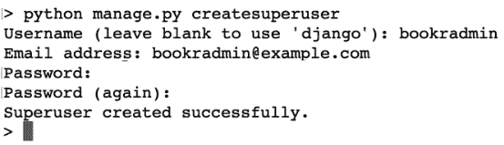

- 4. 访问 `http://127.0.0.1:8000/admin` 上的管理应用并使用你创建的超级用户账户登录：

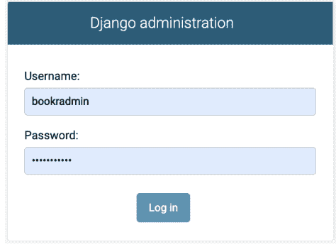

图 4.2 – Django 管理登录表单

在本练习中，你创建了一个超级用户账户，我们将在本章剩余部分使用它根据需要分配或移除权限。

创建了超级用户账户后，我们现在能够登录到 Django 管理应用并了解它提供的 CRUD 功能。

## 使用 Django 管理应用进行 CRUD 操作

让我们回到 Bob、Alice 和 David 的请求。作为超级用户，你的任务将涉及创建、更新、检索和删除各种用户账户、评论和书名。这组活动统称为 CRUD。CRUD 操作是管理应用行为的核心。事实证明，管理应用已经知道来自另一个 Django 应用《身份验证和授权》的模型——在 INSTALLED_APPS 中引用为 'django.contrib.auth'。登录 http://127.0.0.1:8000/admin/ 时，我们会看到来自授权应用的模型，如图 4.3 所示：

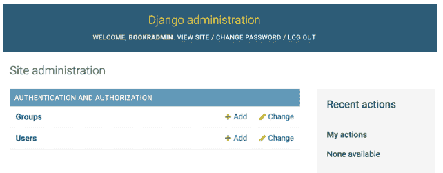

图 4.3 – Django 管理窗口

当管理应用初始化时，它会调用其 autodiscover() 方法来检测是否有其他已安装的应用包含 admin 模块。如果有，这些 admin 模型将被导入。在我们的例子中，它已发现 'django.contrib.auth.admin'。现在模块已导入，我们的超级用户账户也已准备就绪，让我们开始处理 Bob、Alice 和 David 的请求。

### 创建

在 Alice 开始撰写评论之前，我们需要通过管理应用为她创建一个账户。完成后，我们可以查看可以分配给她的管理访问级别。要创建用户，我们需要点击 Users 旁边的 + Add 选项（参见图 4.3），并填写表单，如图 4.4 所示。

> **注意**
> 我们不希望任何随机用户能够访问 Bookr 用户的账户。因此，选择强而安全的密码至关重要。

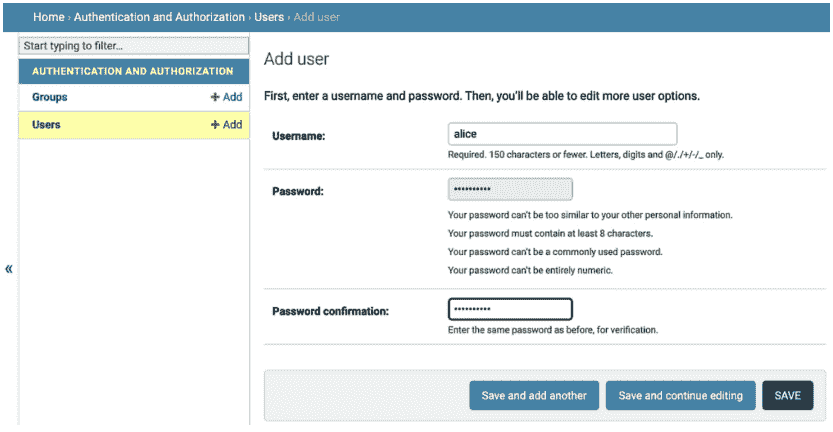

图 4.4 – 添加用户页面

表单底部有三个按钮：

- **保存并添加另一个**：这会创建用户并再次呈现相同的添加用户页面，字段为空。
- **保存并继续编辑**：这会创建用户并加载更改用户页面。更改用户页面让你添加在添加用户页面上不存在的额外信息，


such as **名字**、**姓氏**以及更多（参见 *图4.5*）。请注意，**密码**在表单上没有可编辑字段。相反，它显示有关密码存储所用哈希技术的信息，此外还有一个指向单独的*更改密码*表单的链接：

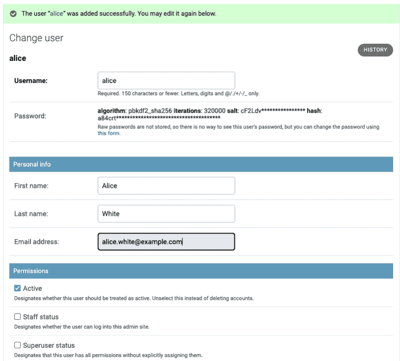

图4.5 – 点击“保存并继续编辑”后显示的“更改用户”页面

- **保存**：这将创建用户，并让用户导航到**选择要更改的用户**列表页面，如*图4.6*所示。

## 活动 4.01 – 创建用户账户

我们现在已经了解了如何通过 Django 管理界面创建用户账户。

是时候将所学知识付诸实践了：使用电子邮件地址 `david.green@example.com` 为新用户 David Green 创建一个账户。

与 Alice White 的账户一样，只需将此账户设为活跃用户，不要勾选**员工状态**或**超级用户状态**复选框。

> **注意**
> 
> 本活动的解决方案可在 `https://github.com/PacktPublishing/Web-Development-with-Django-Second-Edition/tree/main/ActivitySolutions` 中找到。

现在你已经通过 Django 管理界面创建了用户，我们可以研究其余三个 CRUD 操作——检索、更新和删除。

## 检索

管理任务需要分配给一些用户，为此，管理员（拥有超级用户账户的人）希望查看那些电子邮件地址以 `n@example.com` 结尾的用户，并将任务分配给这些用户。这正是**检索**功能派上用场的地方。在“添加用户”页面上点击**保存**按钮后（参见 *图4.4*），我们会进入**选择要更改的用户**列表页面（如 *图4.6* 所示），该页面执行检索操作。请注意，在**选择要更改的用户**列表页面上，也可以通过点击**添加用户 +**按钮访问**创建**表单。因此，在我们添加了几个用户之后，更改列表将如下所示：

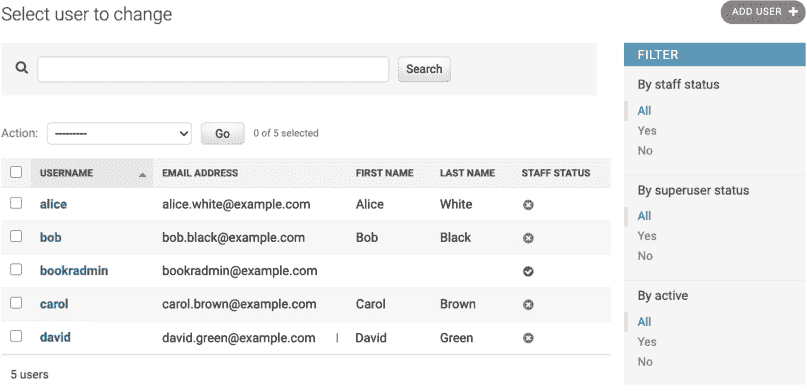

页面顶部有一个搜索栏，用于搜索用户名、电子邮件地址以及用户的名字和姓氏等内容。右侧是一个筛选面板，可根据“按员工状态”、“按超级用户状态”和“按活跃”的值缩小选择范围。在图4.7中，你可以看到我们搜索字符串 n@example.com 时发生的情况。这将只返回那些电子邮件地址由以 n 结尾的用户名和以 example.com 开头的域名组成的用户的姓名。我们只能看到三个电子邮件地址符合此要求的用户——bookradmin@example.com、carol.brown@example.com 和 david.green@example.com：

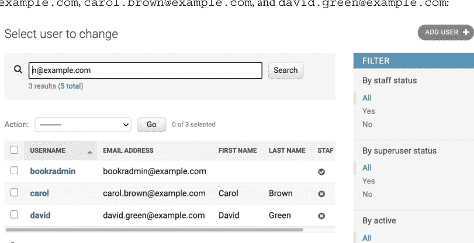

图4.7 – 按电子邮件地址的一部分搜索用户

检索功能（如列表页面和搜索栏）允许我们获取用于更新和删除操作的记录。

## 更新

请记住，Bob 想要更新他的个人资料。让我们通过点击**选择要更改的用户**列表中的 **bob** 用户名链接来**更新** Bob 未完成的个人资料：

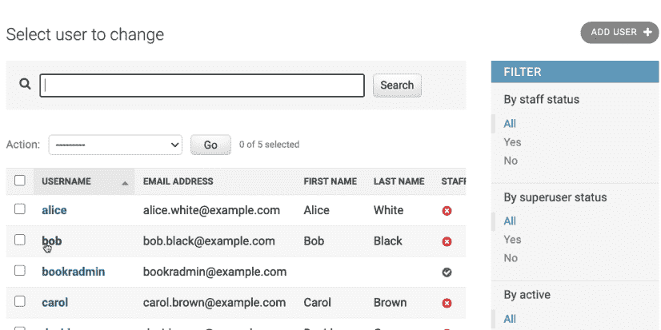

图4.8 – 从“选择要更改的用户”列表中选择 bob

这将带我们返回**更改用户**表单，在其中可以输入**名字**、**姓氏**和**电子邮件地址**的值：

## Django 管理

欢迎，BOOKRADMIN 查看站点 / 更改密码 / 注销

首页 › 身份验证和授权 › 用户 › bob

# 更改用户

用户名：

bob

必填。150 个字符或更少。仅限字母、数字和 @/./+/-/_。

密码：

算法：pbkdf2_sha256 迭代次数：180000 盐值：uC20bk***** 哈希：4vVTw**********

原始密码不会被存储，因此无法查看此用户的密码，但你可以通过此表单更改密码。

# 个人信息

名字：

Bob

姓氏：

Black

电子邮件地址：

bob.black@example.com

图4.9 – 添加个人信息

从图4.9可以看出，我们在此添加关于 Bob 的个人信息——具体来说，是他的名字、姓氏和电子邮件地址。

另一种类型的更新操作是“软删除”。Active 布尔属性允许我们停用用户，而不是删除整个记录并丢失所有依赖该账户的数据。这种使用布尔标志将记录标记为不活动或已删除（并随后在查询中过滤掉这些标记记录）的做法被称为软删除。类似地，我们可以通过勾选相应的复选框，将用户升级为员工状态或超级用户状态：

## 权限

Active
指定是否应将此用户视为活跃。取消勾选此项而不是删除账户。

员工状态
指定用户是否可以登录此管理站点。

超级用户状态
指定此用户拥有所有权限，而无需显式分配。

图4.10 – Active、员工状态和超级用户状态布尔字段

## 删除

David 不再想使用 Bookr 应用程序，并已请求我们删除他的账户。auth 管理后台也支持这一点。在“选择要更改的用户”列表页面上选择一个用户或用户记录，然后从“操作”下拉菜单中选择“删除选定的用户”选项。然后，点击“执行”按钮（图4.11）：

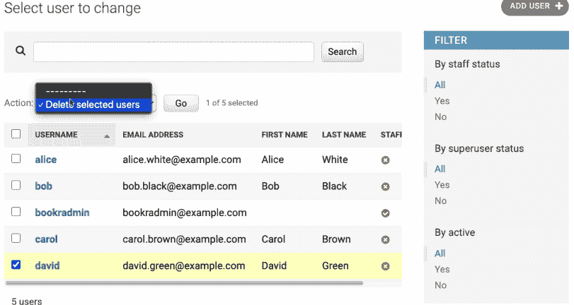

图4.11 – 从“选择要更改的用户”列表页面删除

系统将显示一个确认屏幕，一旦你删除了该对象，系统将带你返回“选择要更改的用户”列表：

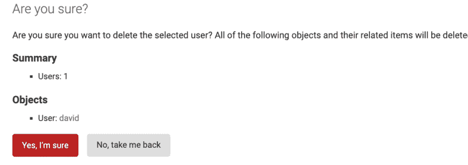

图4.12 – 用户删除确认

用户被删除后，你将看到以下消息：

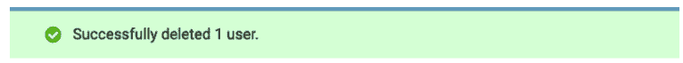

图4.13 – 用户删除通知

完成确认后，你会发现 David 的账户不再存在。

到目前为止，我们已经学习了如何添加新用户、获取其他用户的详细信息、修改用户数据以及删除用户。这些技能帮助我们满足了 Alice、Bob 和 David 的请求。随着我们应用的用户数量增长，处理数百名用户的请求最终将变得相当困难。解决这个问题的一个方法是将部分管理职责委托给一组选定的用户。我们将在接下来的章节中学习如何做到这一点。

## 管理 Django 用户和组

Django 的身份验证模型由用户、组和权限组成。用户可以属于多个组，这是一种对用户进行分类的方式。它还通过允许将权限分配给用户集合以及单个用户，简化了权限的实现。

在练习 4.01（创建超级用户账户）中，我们了解了如何满足 Alice、David 和 Bob 对其个人资料进行修改的请求。这非常容易做到，而且我们的应用程序似乎完全有能力处理他们的请求。

当用户数量增长时会发生什么？管理员用户能同时管理 100 或 150 个用户吗？可以想象，这可能是一项相当复杂的任务。为了克服这一点，我们可以为一组特定用户提供更高的权限，他们可以帮助减轻管理员的任务。这正是组派上用场的地方。虽然我们将在 *第9章，会话与身份验证* 中了解更多关于用户、组和权限的内容，但我们可以通过创建一个**帮助台用户组**来开始理解组及其功能，该组包含可以访问管理界面但缺乏许多强大功能的账户，例如添加、编辑或删除组，或添加或删除用户的能力。

## 练习 4.02 – 通过管理应用添加和修改用户和组

在本练习中，我们将向我们的一位 Bookr 用户 Carol 授予一定级别的管理访问权限。首先，我们将定义组的访问级别，然后将 Carol 添加到该组。这将允许 Carol 更新用户个人资料并检查用户日志。以下步骤将帮助你完成本练习：

- 1. 访问 `http://127.0.0.1:8000/admin/` 上的管理界面，并使用通过超级用户命令设置的账户以 bookradmin 身份登录。
- 2. 在管理界面中，依次点击链接**首页 | 身份验证和授权 | 组**：

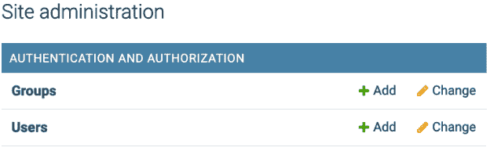

图4.14 – “身份验证和授权”页面上的“组”和“用户”选项


3. 在右上角使用 ADD GROUP + 添加一个新组：

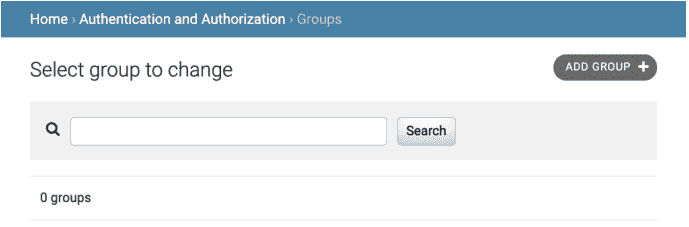

图 4.15 – 添加一个新组

4. 将组命名为 Help Desk User 并赋予以下权限，如图 4.16 所示：

- Can view log entry
- Can view permission
- Can change user
- Can view user

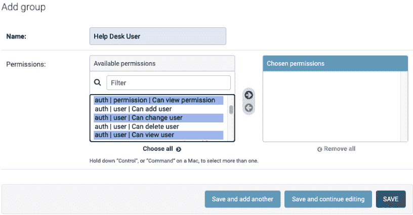

图 4.16 – 选择权限

5. 现在，导航到 Home | AUTHENTICATION AND AUTHORIZATION | Users 并点击名字为 carol 的用户的链接：

Select user to change

图 4.19 – 点击用户名 carol

6. 滚动到 Permissions 字段集并选中 Staff status 复选框。这是 Carol 能够登录到 admin 应用所必需的：

图 4.20 – 点击 Staff status 复选框

7. 通过从 **Available groups** 选择框中选中它（参考图 4.20）并点击右箭头将其移入她的 **Chosen groups** 列表中，如图 4.21 所示，将 Carol 添加到我们在之前步骤中创建的 **Help Desk User** 组中。注意，除非你这样做，否则 Carol 将无法使用她的凭据登录到 admin 界面：

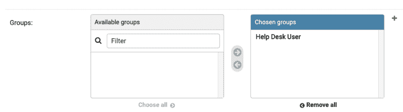

图 4.21 – 将 Help Desk User 组移入 Carol 的 Chosen groups 列表中

8. 让我们测试一下到目前为止我们所做的工作是否产生了正确的结果。为此，退出 admin 站点然后再次以 Carol 的身份登录。退出后，你应该在屏幕上看到以下内容：

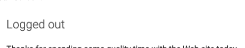

图 4.22 – 已退出屏幕

**Note**
如果你不记得最初给她设置的密码，可以通过在命令行中输入 `python3 manage.py changepassword carol` 来更改密码。

成功登录后，在 admin 仪表板上，你可以看到没有指向 Groups 的链接：

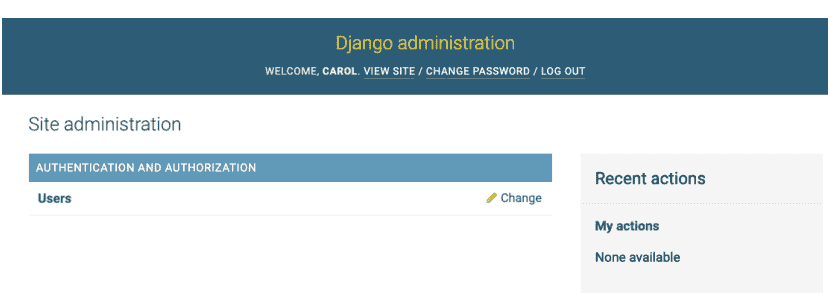

图 4.23 – admin 仪表板

由于我们没有为 Help Desk User 组分配任何组权限，甚至没有分配 auth | group | Can view group，当 Carol 登录时，她无法访问 Groups 管理界面。同样，当你导航到 Home | AUTHENTICATION AND AUTHORIZATION | Users 并点击一个用户链接时，你会看到没有编辑或删除用户的选项。这是因为授予了 Help Desk User 组的权限，而 Carol 是该组成员。组成员可以查看和编辑用户，但不能添加或删除任何用户。

在本练习中，我们学习了如何向 Django 应用的用户授予一定程度的管理权限。

现在我们已经了解了 admin 应用如何与 AUTHENTICATION AND AUTHORIZATION 模型中的 Users 和 Groups 协同工作，我们可以将注意力转向在 reviews 应用中注册我们开发的模型。

## Registering models with the admin app

Django admin 应用会根据模型的特点，以最少的代码量为 Django 对象生成可用的 CRUD 界面。在本节中，我们将首先了解如何将模型注册到 admin 应用，以及界面元素（如更改列表和更改页面）是如何从模型属性派生的。我们将以一个重要的练习结束，该练习演示了模型中外键设置如何决定对象删除过程的行为。

## Registering the reviews model

假设 Carol 被要求改进 Bookr 中的 **Reviews** 部分；也就是说，只有最相关和最全面的评论才应显示，重复或垃圾条目应被删除。为此，她需要访问 `reviews` 模型。正如我们在之前对组和用户的调查中所看到的，admin 应用已经包含 Authentication and Authorization 应用模型的 admin 页面，但它尚未引用我们 Reviews 应用中的模型。为了使 admin 应用感知到这些模型，我们需要显式地将它们注册到 admin 应用。幸运的是，我们不需要修改 admin 应用的代码来做到这一点，因为我们可以在项目中导入 admin 应用并使用其 API 来注册我们的模型。这已经在 Authentication and Authorization 应用中完成了，所以让我们在 Reviews 应用中尝试一下。我们的目标是能够使用 admin 应用编辑我们 `reviews` 模型中的数据。

查看 `reviews/admin.py` 文件。它是一个占位符文件，是使用我们在 *Chapter 1, An Introduction to Django* 中使用的 `startapp` 子命令生成的，目前包含以下行：

```
from django.contrib import admin

# Register your models here.
```

现在我们可以尝试扩展它。为了使 admin 应用感知到我们的模型，我们可以修改 `reviews/admin.py` 文件并导入模型。然后我们可以使用 `AdminSite` 对象 `admin.site` 将模型注册。`AdminSite` 对象包含 Django admin 应用的实例（稍后，我们将学习如何子类化这个 `AdminSite` 并覆盖其许多属性）。然后，`reviews/admin.py` 将如下所示：

```
from django.contrib import admin
from reviews.models import (Publisher, Contributor,
                            Book, BookContributor, Review)

# Register your models here.
admin.site.register(Publisher)
admin.site.register(Contributor)
admin.site.register(Book)
admin.site.register(BookContributor)
admin.site.register(Review)
```

`admin.site.register` 方法通过将其添加到 `admin.site._registry` 中包含的类注册表中，使模型可供 admin 应用使用。如果我们选择不通过 admin 界面使模型可访问，我们只需不注册它。当你在浏览器中重新加载 http://127.0.0.1:8000/admin/ 时，你将在 admin 应用登陆页面上看到以下内容：

## Site administration

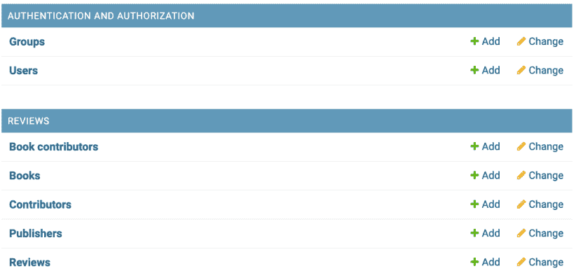

图 4.24 – Admin 应用登陆页面

注意在导入 reviews 模型后 admin 页面外观的变化。

将 Reviews 应用的五个模型注册到 admin 应用后，我们可以检查它为我们创建的一些默认界面。

## Change lists

我们现在有了模型的更改列表。如果我们点击 Publishers 链接，我们将被带到 http://127.0.0.1:8000/admin/reviews/publisher 并看到包含指向出版商的链接的更改列表。这些链接由 Publisher 对象的 id 字段指定。如果你的数据库已使用第 3 章 URL Mapping, Views, and Templates 中的脚本填充，你将看到包含七个出版商的列表，如图 4.25 所示。

> **Note**
> 根据你的数据库状态和已完成的活动，这些示例中的对象 ID、URL 和链接的编号可能与此处列出的不同。

# Select publisher to change

Action: ______ Go 0 of 9 selected

- PUBLISHER
- Pocket Books
- CreateSpace Independent Publishing Platform
- Houghton Mifflin Harcourt
- Simon and Schuster
- Bay Back Books
- Scribner
- Penguin Classics
- Harper Collins
- Packt Publishing
9 publishers

图 4.25 – Select publisher to change 列表

我们可以跟随更改列表中的一个链接并检查 Change publisher 页面。

## The Change publisher page

Change publisher 页面位于 http://127.0.0.1:8000/admin/reviews/publisher/1，包含我们所期望的内容（见图 4.26）。有一个用于编辑出版商详细信息的表单。这些详细信息是从 reviews.models.Publisher 类派生的：

# Change publisher

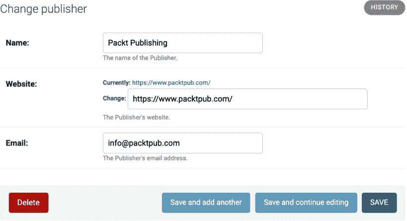

图 4.26 – Change publisher 页面

如果我们点击了 **ADD PUBLISHER +** 按钮，admin 应用将返回一个类似的用于添加出版商的表单。admin 应用的美妙之处在于，它仅用一行代码 – `admin.site.register(Publisher)` – 就为我们提供了所有这些 CRUD 功能，使用 `reviews.models.Publisher` 属性的定义作为页面内容的模式：

```
```python
class Publisher(models.Model):
    """A company that publishes books."""
    name = models.CharField(max_length=50,
        help_text="The name of the Publisher.")
    website = models.URLField(
        help_text="The Publisher's website.")
    email = models.EmailField(
        help_text="The Publisher's email address.")
```
```

出版商 **Name** 字段被限制为 50 个字符，如模型中指定。每个字段下方以灰色显示的帮助文本是从模型上指定的 `help_text` 属性派生的。我们可以看到 `models.CharField`、`models.URLField` 和 `models.EmailField` 分别以 HTML 呈现为 text、url 和 email 类型的输入元素。


表单中的字段会在适当位置进行验证。除非模型字段设置为 `blank=True` 或 `null=True`，否则如果字段留空，表单将抛出错误，就像 `Publisher.name` 字段的情况一样。同样，由于 `Publisher.website` 和 `Publisher.email` 分别定义为 `models.URLField` 和 `models.EmailField` 的实例，它们也会相应地得到验证。在图4.27中，我们可以看到**名称**作为必填字段的验证、**网站**作为URL的验证，以及**电子邮件**作为电子邮件地址的验证：

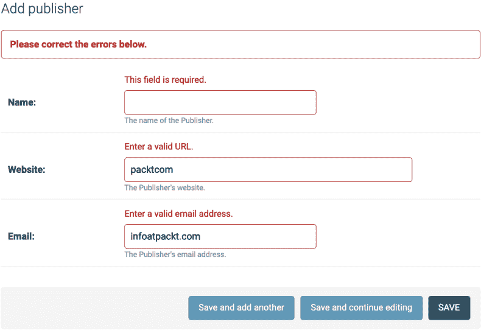

图4.27 – 字段验证

检查管理应用如何渲染模型元素，有助于理解其工作原理。在浏览器中，右键单击**查看页面源代码**，并检查为此表单渲染的HTML。您将看到一个浏览器标签页显示类似如下内容：

```
```html
<fieldset class="module aligned ">
  <div class="form-row errors field-name">
    <ul class="errorlist"><li>This field is
      required.</li></ul>
    <div>
      <label class="required" for="id_name">Name:</label>
      <input type="text" name="name" class="vTextField"
        maxlength="50" required="" id="id_name">
```
```
<div class="help">The name of the Publisher.</div>
</div>
</div>
<div class="form-row errors field-website">
<ul class="errorlist"><li>Enter a valid URL.</li></ul>
<div>
<label class="required" for="id_website">Website:</label>
<input type="url" name="website" value="packtcom" class="vURLField" maxlength="200" required="" id="id_website">
<div class="help">The Publisher's website.</div>
</div>
</div>
<div class="form-row errors field-email">
<ul class="errorlist"><li>Enter a valid email address.</li></ul>
<div>
<label class="required" for="id_email">Email:</label>
<input type="email" name="email" value="infoatpackt.com" class="vTextField" maxlength="254" required="" id="id_email">
<div class="help">The Publisher's email address.</div>
</div>
</div>
</fieldset>
```

表单有一个publisher_form ID，并且包含一个fieldset，其中的HTML元素对应于reviews/models.py中Publisher模型的数据结构，如下所示：

```
class Publisher(models.Model):
    """A company that publishes books."""
    name = models.CharField(max_length=50,
        help_text="The name of the Publisher.")
    website = models.URLField(
        help_text="The Publisher's website.")
    email = models.EmailField(
        help_text="The Publisher's email address.")
```

注意，对于name，输入字段渲染如下：

```
<input type="text" name="name" value="Packt Publishing" class="vTextField" maxlength="50" required="" id="id_name">
```

它是一个必填字段，具有文本类型和50的maxlength，由模型定义中的 `max_length` 参数指定：

```
name = models.CharField(max_length=50,
    help_text="The name of the Publisher.")
```

类似地，我们可以看到模型中定义为URLField和EmailField的website和email在HTML中分别渲染为url和email类型的input元素：

```
<input type="url" name="website"
    value="https://www.packtpub.com/"
    class="vURLField" maxlength="200" required=""
    id="id_website">
<input type="email" name="email" value="info@packtpub.com"
    class="vTextField" maxlength="254"
    required="" id="id_email">
```

我们已经了解到，Django管理应用会根据我们提供的模型定义，为Django模型派生出合理的HTML表示。

## 书籍修改页面

类似地，有一个修改页面，可以通过从**站点管理**页面选择**图书**，然后从更改列表中选择特定的书来访问：

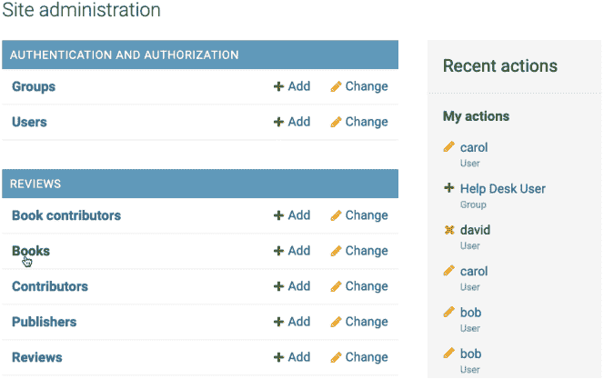

图4.28 – 从站点管理页面选择图书

单击**图书**后，如前面的截图所示，您将在屏幕上看到以下内容：

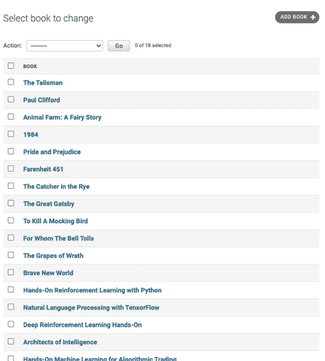

图4.29 – 书籍修改页面

在本例中，选择书籍*智能架构师*将把我们带到URL http://127.0.0.1:8000/admin/reviews/book/3/change/。在之前的示例中，所有模型字段都被渲染为简单的HTML文本控件。`models.Book`中使用的`django.db.models.Field`的其他一些子类的渲染方式值得进一步研究：

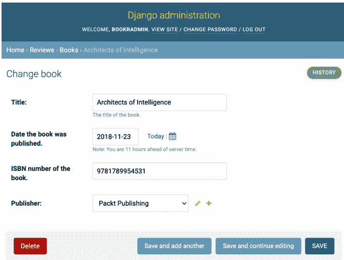

### 图4.30 – 修改书籍页面

这里，publication_date是使用models.DateField定义的。它使用日期选择控件渲染。控件的视觉表示会因不同的操作系统和浏览器选择而有所不同：

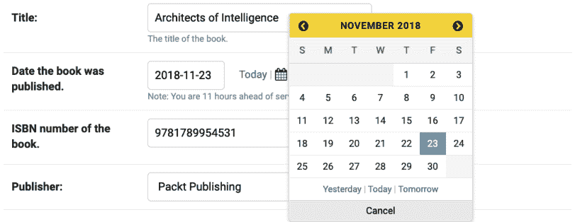

### 图4.31 – 日期选择控件

由于Publisher被定义为外键关系，它被渲染为一个**Publisher**下拉菜单，其中包含Publisher对象的列表：

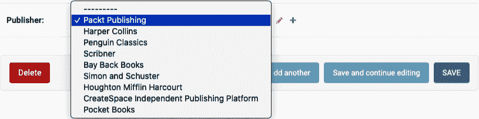

图4.32 – Publisher下拉菜单

这让我们了解到管理应用如何处理删除操作。管理应用在确定如何实现删除功能时，会从模型的外键约束中获取线索。在BookContributor模型中，Contributor被定义为外键。reviews/models.py中的代码如下所示：

```
```python
contributor = models.ForeignKey(Contributor,
    on_delete=models.CASCADE)
```
```

通过在外键上设置 `on_delete=CASCADE`，模型指定了删除记录时所需的数据库行为；删除操作会级联到外键引用的其他对象。

理解外键设置对删除流程的影响非常重要，下面的练习将探讨这一点。

## 练习4.03 – 管理应用中的外键与删除行为

目前，reviews模型中的所有`ForeignKey`关系都定义为`on_delete=CASCADE`行为。例如，假设管理员删除一个出版商，这将删除与该出版商关联的所有图书。我们不希望发生这种情况，而这正是我们将在本练习中更改的行为：

- 1. 访问`http://127.0.0.1:8000/admin/reviews/contributor/`处的**贡献者**更改列表，并选择一个要删除的贡献者。确保该贡献者是一本书的作者。
- 2. 单击**删除**按钮，但不要单击确认对话框上的**是的，我确定**。您将看到类似于*图4.33*中的消息：

### 您确定吗？

您确定要删除贡献者“Rowel”吗？以下所有相关项都将被删除：

### 摘要

- 贡献者：1
- 书籍贡献者：1

### 对象

- 贡献者：Rowel
  - 书籍贡献者：BookContributor object (19)

是的，我确定
不，带我返回

图4.33 – 级联删除确认对话框

根据外键的on_delete=CASCADE参数，我们会收到警告：删除此Contributor对象将对BookContributor对象产生级联影响。

3. 在reviews/models.py文件中，将BookContributor的Contributor属性修改为以下内容并保存文件：

```
contributor = models.ForeignKey(Contributor,
    on_delete=models.PROTECT)
```

4. 现在，再次尝试删除Contributor对象。您将看到类似于图4.34中的消息：

### 无法删除贡献者

删除贡献者“Rowel”将需要删除以下受保护的相关对象：

- 书籍贡献者：BookContributor object (19)

图4.34 – 外键保护错误

由于on_delete参数为PROTECT，我们尝试删除具有依赖关系的对象将抛出错误。如果我们在模型中使用这种方法，则需要先删除ForeignKey关系中的对象，然后才能删除原始对象。在这种情况下，这意味着在删除Contributor对象之前，需要先删除BookContributor对象。


5. 现在我们已经了解了 admin 应用如何处理 ForeignKey 关系，让我们将 BookContributor 类中的 ForeignKey 定义恢复为以下内容：

```
contributor = models.ForeignKey(Contributor,
    on_delete=models.CASCADE)
```

我们已经考察了 admin 应用的行为如何适应在模型定义中表达的 ForeignKey 约束。如果 `on_delete` 行为设置为 `models.PROTECT`，admin 应用会返回一个错误，解释为什么受保护的对象阻止了删除。在构建真实应用时，此功能非常有用，因为手动错误意外导致重要记录被删除的情况时有发生。在下一节中，我们将了解如何自定义 admin 应用界面以获得更流畅的用户体验。

## 自定义 admin 界面

在最初开发应用程序时，默认 admin 界面的便利性对于构建应用的快速原型非常出色。事实上，对于许多更简单的应用程序或仅需要最少数据维护的项目而言，此默认 admin 界面可能完全足够。然而，随着应用程序成熟到发布阶段，admin 界面通常需要进行自定义，以便更直观地使用并在用户权限范围内稳健地控制数据。你可能希望保留默认 admin 界面的某些方面，同时对某些功能进行一些调整以更好地满足你的目的。例如，你希望出版商列表显示出版商的完整名称，而不是 Publisher (1)、Publisher (2) 等等。除了美观之外，这还使使用和在应用中导航变得更容易。

在本节中，我们将研究 AdminSite 对象并了解其一些重要属性，这些属性可用于修改 admin 应用的全局外观。然后我们将研究在项目中对 AdminSite 进行子类化的方法，以便我们可以对其进行自定义而不是使用其默认外观。最后，我们将通过创建一个新项目并自定义其 admin 界面来检验我们对这些技术的掌握。

### 全局 Django admin 自定义

我们看到过一个标题为 Log in | Django site admin 的页面，其中包含一个 Django 管理表单。然而，Bookr 应用程序的管理用户可能会对所有这些 Django 术语感到困惑，如果他们必须处理多个 Django 应用，而这些应用都具有相同的 admin 应用，则会非常混乱且容易出错。作为一个直观且用户友好的应用程序的开发者，你应该对其进行自定义。此类全局属性指定为 AdminSite 对象的属性。下面的表格详细说明了一些最简单的自定义，以提高你的应用 admin 界面的可用性：

| AdminSite 属性 | 基础值 | 描述 |
| --- | --- | --- |
| `site_title` | `"Django site admin"` | 填充 admin 界面每个页面的 `<title>` 标签。 |
| `site_header` | `"Django administration"` | 设置登录表单上的标题。 |
| `index_title` | `"Site administration"` | 设置 admin 索引页面的标题（模型列出之处）。 |
| `index_template` | `None` | 提供查找 admin 索引模板的路径。如果未设置，则使用 `admin/index.html` 模板。 |
| `app_index_template` | `None` | 提供查找应用 admin 索引模板的路径。如果未设置，则使用 `admin/app_index.html` 模板。 |
| `login_template` | `None` | 提供查找登录模板的路径。如果未设置，则使用 `admin/login.html` 模板。 |
| `logout_template` | `None` | 提供查找注销模板的路径。如果未设置，则使用 `registration/logged_out.html` 模板。 |
| `password_change_template` | `None` | 提供查找密码更改模板的路径。如果未设置，则使用 `registration/password_change_form.html` 模板。 |
| `password_change_done_template` | `None` | 提供查找密码更改完成模板的路径。如果未设置，则使用 `registration/password_change_done.html` 模板。 |

图 4.35 – 重要的 AdminSite 属性

如果这看起来有点抽象，检查本表格中的属性使用 Django shell 可能会有所帮助。

### 从 Python shell 检查 AdminSite 对象

让我们更深入地研究 AdminSite 类。我们已经遇到过 AdminSite 类的一个对象。它就是我们在上一个 *Registering the reviews model* 部分中使用的 `admin.site` 对象。如果开发服务器未运行，现在使用 `runserver` 子命令启动它，如下所示（Windows 上使用 `python` 而不是 `python3`）：

```
python3 manage.py runserver
```

我们可以通过再次使用 `manage.py` 脚本在 Django shell 中导入 admin 应用来检查 `admin.site` 对象：

```
python3 manage.py shell
>>> from django.contrib import admin
```

我们可以交互式地检查 `site_title`、`site_header` 和 `index_title` 的默认值，并看到它们与我们在 Django admin 应用的渲染网页上已观察到的预期值 `'Django site admin'`、`'Django administration'` 和 `'Site administration'` 相匹配：

```
>>> admin.site.site_title
'Django site admin'
>>> admin.site.site_header
'Django administration'
>>> admin.site.index_title
'Site administration'
```

AdminSite 类还指定了用于渲染 admin 界面并确定其全局行为的表单和视图。

现在我们已经检查了对象的属性，我们将尝试对其进行子类化，以便在我们的 Django 项目中自定义它们。

### 对 AdminSite 进行子类化 – 第一种方法

我们可以对 `reviews/admin.py` 文件进行一些修改。不是导入 `django.contrib.admin` 模块并使用其 `site` 对象，我们将导入 `AdminSite`，对其进行子类化，并实例化我们自定义的 `admin_site` 对象。考虑以下代码片段。这里，`BookrAdminSite` 是 `AdminSite` 的子类，包含 `site_title`、`site_header` 和 `index_title` 的自定义值；`admin_site` 是 `BookrAdminSite` 的实例，我们可以使用它代替默认的 `admin.site` 对象来注册我们的模型。`reviews/admin.py` 文件将如下所示：

```
from django.contrib.admin import AdminSite
from reviews.models import (Publisher, Contributor, Book,
    BookContributor, Review)

class BookrAdminSite(AdminSite):
    site_title = 'Bookr Admin'
    site_header = 'Bookr administration'
    index_title = 'Bookr site admin'

admin_site = BookrAdminSite(name='bookr')

# Register your models here.
admin_site.register(Publisher)
admin_site.register(Contributor)
admin_site.register(Book)
admin_site.register(BookContributor)
admin_site.register(Review)
```

现在我们创建了自己的 `admin_site` 对象，该对象覆盖了 `admin.site` 对象的行为，我们需要在代码中删除对 `admin.site` 对象的现有引用。在 `bookr/urls.py` 中，我们需要将 admin 指向新的 `admin_site` 对象并更新我们的 URL 模式。否则，我们仍在使用默认的 admin 站点，我们的自定义将被忽略。更改将如下所示：

```
from reviews.admin import admin_site
import reviews.views
from django.urls import include, path

urlpatterns = [
    path("admin/", admin_site.urls),
    path("book-search", reviews.views.book_search),
    path("", include("reviews.urls")),
]
```

这在登录屏幕上产生了预期的结果：

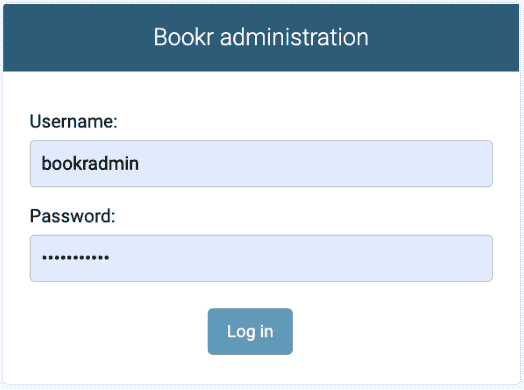

图 4.36 – 自定义登录屏幕

然而，现在出现了一个问题；我们丢失了 auth 对象的界面。以前，admin 应用通过自动发现过程发现了在 `reviews/admin.py` 和 `django.contrib.auth.admin` 中注册的模型，但现在我们通过创建新的 AdminSite 覆盖了此行为：

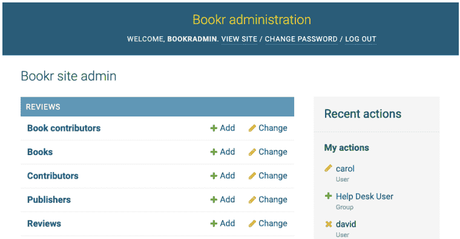

图 4.37 – 自定义 AdminSite 缺少身份验证和授权


我们可以在 `bookr/urls.py` 中将两个 `AdminSite` 对象都引用到 URL 模式，但这种方法会导致我们最终拥有两个独立的 admin 应用，一个用于认证，一个用于 reviews。因此，URL `http://127.0.0.1:8000/admin` 将带你进入从 `admin.site` 对象派生的原始 admin 应用，而 `http://127.0.0.1:8000/bookradmin` 将带你进入我们的 `BookrAdminSite`，`admin_site`。这不是我们想要做的，因为我们仍然会剩下没有我们通过子类化 `BookrAdminSite` 时添加的自定义的 admin 应用：

```
```python
from django.contrib import admin
from reviews.admin import admin_site
from django.urls import path
urlpatterns = [path('admin/', admin.site.urls),
               path('bookradmin/', admin_site.urls),]
```
```

为避免此问题，让我们在下一小节中看看我们可以做什么。

## Subclassing AdminSite – a better way

这一直是 Django admin 界面中一个笨拙的问题，导致早期版本中出现了大量临时解决方案。然而，自 Django 2.1 发布以来，已经有一种简单的方法可以在不破坏自动发现或其任何其他默认功能的情况下集成 admin 应用的自定义界面。让我们通过以下步骤看看如何操作：

- 1. 由于 `BookrAdminSite` 是项目特定的，代码实际上不属于我们的 reviews 文件夹。因此，将 `BookrAdminSite` 移动到 Bookr 项目目录顶层名为 `admin.py` 的新文件中：

```
```python
from django.contrib import admin

class BookrAdminSite(admin.AdminSite):
    title_header = 'Bookr Admin'
    site_header = 'Bookr administration'
    index_title = 'Bookr site admin'
```
```

`bookr/urls.py` 中的 URL 设置路径更改为 `path('admin/', admin.site.urls)`，我们定义我们的 `ReviewsAdminConfig`。

- 2. 添加一个名为 `reviews/adminconfig.py` 的文件，包含以下内容：

```
```python
from django.contrib.admin.apps import AdminConfig
class ReviewsAdminConfig(AdminConfig):
    default_site = 'admin.BookrAdminSite'
```
```

3. 用 reviews.apps.ReviewsAdminConfig 替换 django.contrib.admin，以便 INSTALLED_APPS 在 bookr/settings.py 文件中如下所示：

```
INSTALLED_APPS = [
    'reviews.adminconfig.ReviewsAdminConfig',
    'django.contrib.auth',
    'django.contrib.contenttypes',
    'django.contrib.sessions',
    'django.contrib.messages',
    'django.contrib.staticfiles',
    'reviews']
```

有了 ReviewsAdminConfig 对 default_site 的指定，我们不再需要用自定义的 AdminSite 对象 admin_site 替换对 admin.site 的引用。我们可以用我们最初拥有的 admin.site 调用替换那些 admin_site 调用。现在，reviews/admin.py 恢复为以下内容：

```
from django.contrib import admin
from reviews.models import (Publisher, Contributor,
    Book, BookContributor, Review)

# Register your models here.
admin.site.register(Publisher)
admin.site.register(Contributor)
admin.site.register(Book, BookAdmin)
admin.site.register(BookContributor)
admin.site.register(Review)
```

我们还可以自定义 AdminSite 的其他方面，但我们将在第 9 章《Sessions and Authentication》中重新审视这些内容，一旦我们对 Django 的模板和表单有更全面的理解。

以下活动旨在测试你为新 Django 项目配置和自定义 Django admin 应用而学到的技能。

## Activity 4.02 – customizing the AdminSite object

你已经学会了如何在 Django 项目中修改 AdminSite 对象的属性。此活动将挑战你使用这些技能来定制一个新项目并覆盖其站点标题、站点头部和索引头部。此外，你还将通过创建项目特定的模板并将其设置在我们的自定义 AdminSite 对象中来替换注销消息。你正在开发一个名为 Comment8or 的 Django 项目，该项目实现了一个留言板。Comment8or 面向技术人群，因此你需要使措辞简洁且缩写：

- - Comment8or admin 站点将被称为 c8admin。这将出现在站点头部和索引标题中。
- - 对于标题头部，它将显示 c8 site admin。
- - 默认的 Django admin 注销消息是 `Thanks for spending some quality time with the Web site today.` 在 Comment8or 中，它将显示 `Bye from c8admin.` 

完成此活动的步骤如下：

- 1. 按照你在 *Chapter 1, An Introduction to Django* 中学到的流程，创建一个名为 `comment8or` 的新 Django 项目，一个名为 `messageboard` 的应用，并运行迁移。创建一个名为 `c8admin` 的超级用户。
- 2. 在 Django 源代码中，有一个位于 `django/contrib/admin/templates/registration/logged_out.html` 的布局页面模板。在你的项目目录下 `comment8or/templates/comment8or` 中复制它并根据要求修改模板中的消息。
- 3. 在项目内部，创建一个 `admin.py` 文件，实现一个自定义的 `AdminSite` 对象。根据要求为 `index_title`、`title_header`、`site_header` 和 `logout_template` 属性设置适当的值。
- 4. 向 `messageboard/adminconfig.py` 添加一个自定义的 `AdminConfig` 子类。
- 5. 在 `comment8or/settings.py` 中用自定义的 `AdminConfig` 子类替换 admin 应用。
- 6. 配置 `TEMPLATES` 设置，以便可以发现项目的模板。

项目首次创建时，登录页面看起来像这样：

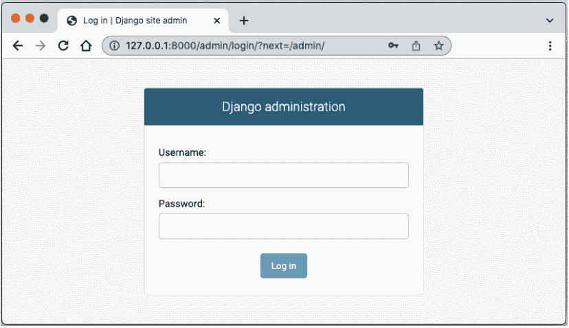

Figure 4.38 – Login page for the project

应用索引页面看起来像这样：

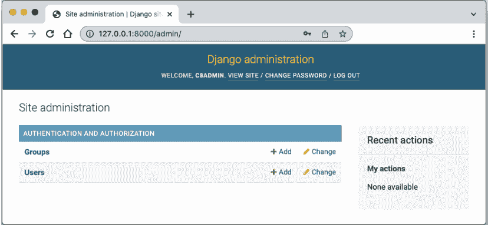

Figure 4.39 – App index page for the project

最后，注销页面看起来像这样：

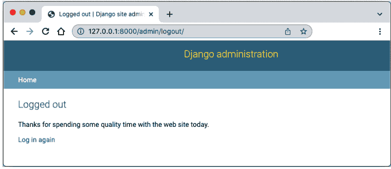

Figure 4.40 – Logout page for the project

完成所有自定义后，登录页面将看起来像这样：

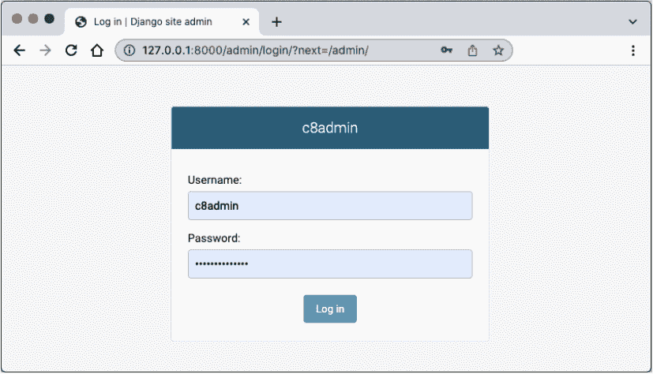

Figure 4.41 – Login page after customization

应用索引页面将看起来像这样：

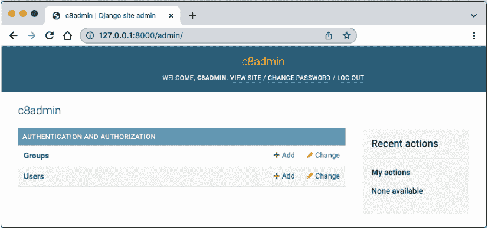

Figure 4.42 – App index page after customization

最后，注销页面将看起来像这样：

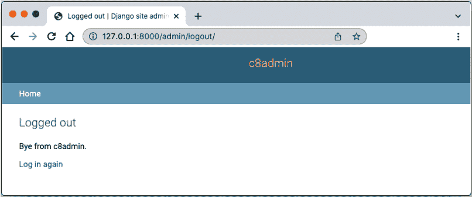

Figure 4.43 – Logout page after customization

你已通过子类化 AdminSite 成功自定义了 admin 应用。

Note
此活动的解决方案可以在 https://github.com/PacktPublishing/Web-Development-with-Django-Second-Edition/tree/main/ActivitySolutions 上找到。

在下一节中，我们将检查 AdminSite 对象并了解其一些重要属性，这些属性可用于修改 admin 应用的全局外观。然后我们将检查在项目中子类化 AdminSite 的方法，以便我们可以将其从默认外观中自定义。我们将通过创建一个新项目并自定义其 admin 界面来测试我们对这些技术的了解。

## Customizing the ModelAdmin classes

现在我们已经了解了如何使用子类化的 AdminSite 来自定义 admin 应用的全局外观，我们将看看如何自定义 admin 应用对单个模型的界面。由于 admin 界面是从模型结构自动生成的，它的外观过于通用，需要出于美观和可用性的考虑进行自定义。点击 admin 应用中 Books 的一个链接并将其与 Users 链接进行比较。两个链接都会带你进入更改列表页面。这些是 Bookr 管理员在想要添加新书籍或添加或更改用户的权限时访问的页面。如前所述，更改列表页面会列出模型对象，并提供选择其中一组进行批量删除（或其他批量活动）、检查单个对象以编辑它或添加新对象的选项。注意两者之间的区别


两个变更列表页面，目的是让我们的原始 Books 页面具有与 Users 页面一样完整的功能。下面来自 Authentication and Authorization 应用的截图包含了一些实用功能，例如搜索栏、可排序的重要用户字段列标题以及结果过滤器：

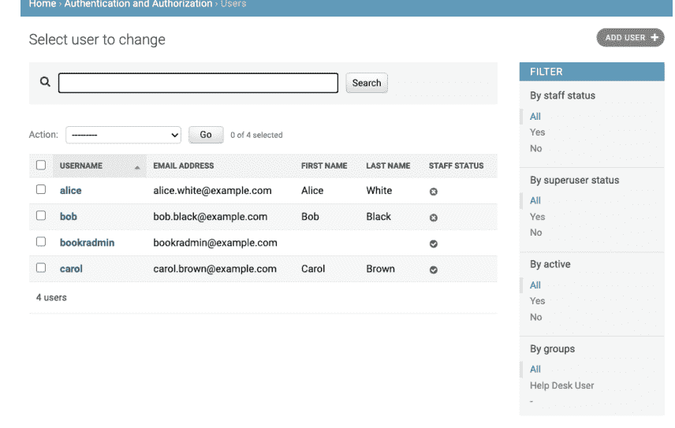

图 4.44 – Users 变更列表包含自定义的 ModelAdmin 功能

在本节中，我们将学习如何开发 ModelAdmin 类来定制变更列表页面上的字段，并实现过滤器和搜索栏。我们还会了解如何将模型字段分组到 admin 的增删改查（CRUD）表单中，或者如果某些字段应保留默认值或系统生成的值，则将其从表单中排除。

## 列表显示字段

在 Users 变更列表页面上，你会看到以下内容：

- 其中列出了用户对象，并通过其 USERNAME、EMAIL ADDRESS、FIRST NAME、LAST NAME 和 STAFF STATUS 属性进行摘要显示。
- 这些单独的属性是可排序的。可以通过单击列标题来更改排序顺序。
- 页面顶部有一个搜索栏。
- 在右侧列中，有一个选择过滤器，允许选择多个用户字段，其中一些字段不会出现在列表显示中。

回顾第 2 章“模型与迁移”，我们在 Publisher、Book 和 Contributor 类上定义了 __str__ 方法。以 Book 类为例，它的 __str__() 表示返回图书对象的标题：

```
class Book(models.Model):
    ...
    def __str__(self):
        return self.title
```

如果我们没有在 Book 类上定义 __str__() 方法，它会从基类 Model，即 django.db.models.Model 中继承该方法。

这个基类提供了一种以字符串形式表示对象的抽象方式。例如，当我们有一个 Book，其主键（此处为 id 字段）值为 17 时，最终会得到字符串表示形式 Book object (17)：

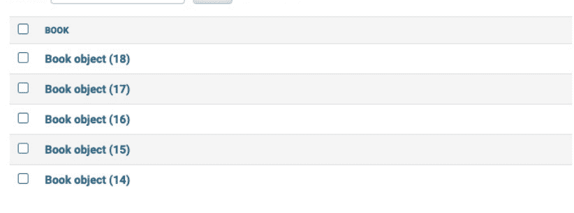

图 4.46 – 使用 Model __str__ 表示的 Books 变更列表

在我们的应用中，将 Book 对象表示为多个字段的组合可能会很有用。例如，如果我们希望图书以 Title (ISBN) 的形式表示，下面的代码片段将产生所需的结果：

```
class Book(models.Model):
    ...
    def __str__(self):
        return "{} ({})".format(self.title, self.isbn)
```

这本身就是一项有用的更改，因为它使对象在应用中的表示更加直观：

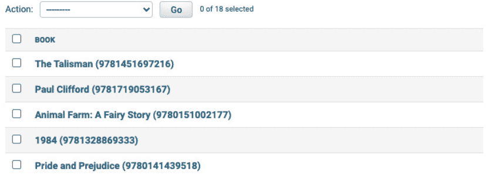

图 4.47 – 带有自定义字符串表示的 Books 变更列表的一部分

我们并不局限于在 list_display 字段中使用对象的 __str__ 表示。列表显示中出现的列由 Django admin 应用的 ModelAdmin 类决定。在 Django shell 中，我们可以导入 ModelAdmin 类并检查其 list_display 属性：

```
python manage.py shell
>>> from django.contrib.admin import ModelAdmin
>>> ModelAdmin.list_display
('__str__',)
```

这就解释了为什么 list_display 的默认行为是显示一个单列表格，其中内容是对象的 __str__ 表示，这样我们就可以通过覆盖该值来定制列表显示。最佳实践是为每个对象创建 ModelAdmin 的子类。如果我们希望图书列表显示包含两个单独的列（Title 和 ISBN），而不是像图 4.47 那样用一个包含两个值的单列，我们可以创建 ModelAdmin 的子类 BookAdmin，并指定自定义的 list_display。这样做的好处是，我们现在可以按 Title 和 ISBN 对图书进行排序。我们可以将这个类添加到 reviews/admin.py 中：

```
class BookAdmin(admin.ModelAdmin):
    list_display = ('title', 'isbn')
```

- 它可以接受 ModelAdmin 子类中的一个方法，该方法将模型对象作为单个参数。请注意，这需要以字符串参数的形式指定，因为若在类内部直接引用，它会超出作用域而未被定义：

```
class BookAdmin(admin.ModelAdmin):

    list_display = ('title', 'isbn13')
    def isbn13(self, obj):
        """ '9780316769174' => '978-0-31-676917-4' """
        return "{}-{}-{}-{}-{}".format(obj.isbn[0:3],
            obj.isbn[3:4], obj.isbn[4:6],
            obj.isbn[6:12], obj.isbn[12:13])
```

- 它可以接受模型类的一个方法（或非字段属性），例如 __str__，只要该方法接受模型对象作为参数。例如，我们可以将 isbn13 转换为 Book 模型类上的一个方法：

```
class Book(models.Model):

    def isbn13(self):
        """ '9780316769174' => '978-0-31-676917-4' """
        return "{}-{}-{}-{}-{}".format(self.isbn[0:3],
            self.isbn[3:4], self.isbn[4:6],
            self.isbn[6:12], self.isbn[12:13])
```

现在，当你在 http://127.0.0.1:8000/admin/reviews/book 查看 Books 变更列表时，可以看到带连字符的 ISBN13 字段：

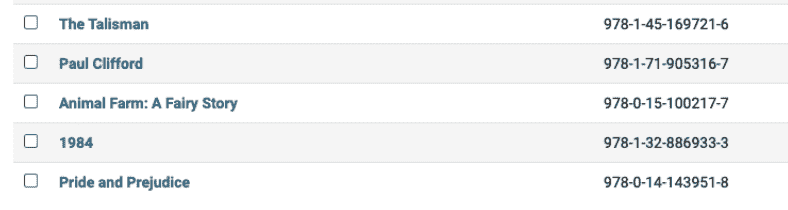

图 4.49 – 带连字符 ISBN13 的 Books 变更列表的一部分

值得注意的是，诸如 __str__ 或我们的 isbn13 方法之类的计算字段，在摘要页面上无法作为可排序字段。此外，我们不能在 list_display 中包含 ManyToManyField 类型的字段。

虽然从模型属性派生的列会从字段属性中获取其列标题和属性，但我们可以使用 display 装饰器来指定计算字段的显示列属性。

## display 装饰器

在 `list_display` 中使用可调用对象时，如 `initialled_name` 和 `isbn13` 的情况，我们可以使用 `admin.display` 装饰器，通过 `description` 参数指定将出现在变更列表标题中的列名。我们还可以通过在该可调用对象上指定 `ordering`，来绕过计算字段不可排序的限制。`empty_value` 参数可用于指定 None 值或空字符串的显示方式。默认的 empty_value 显示为单个短横线字符：

```
@admin.display(
    ordering='isbn',
    description='ISBN-13',
    empty_value='-/-'
)
def isbn13(self, obj):
    """ '9780316769174' => '978-0-31-676917-4' """
    return "{}-{}-{}-{}-{}".format(obj.isbn[0:3],
                                   obj.isbn[3:4], obj.isbn[4:6], obj.isbn[6:12],
                                   obj.isbn[12:13])
```

`admin.display` 的 boolean 参数可用于标记一个值，使其以布尔形式呈现：

```
@admin.display(
    boolean=True,
    description='Has ISBN',
)
def has_isbn(self, obj):
    """ '9780316769174' => True """
    return bool(obj.isbn)
```

这些 display 装饰器设置组合在一起，将为我们提供如下所示的显示列：

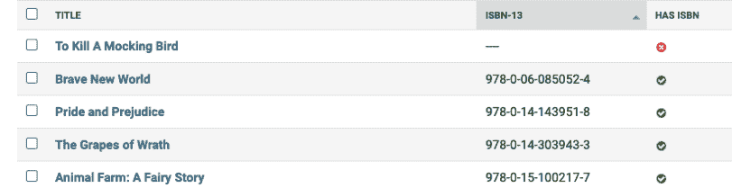

图 4.50 – 带有 admin display 设置的 Books 变更列表

## 过滤器

一旦管理界面需要处理大量记录，缩小变更列表页面上显示的结果就很方便。最简单的过滤器是选择单个值。例如，图 4.6 中描述的用户过滤器允许通过选择“按员工状态”、“按超级用户状态”和“按活跃状态”来筛选用户。我们已经在用户过滤器上看到，BooleanField 可以用作过滤器。我们还可以在 CharField、DateField、DateTimeField、IntegerField、ForeignKey 和 ManyToManyField 上实现过滤器。在这种情况下，通过将 publisher 添加为 Book 的 ForeignKey，其定义如下：

```
publisher = models.ForeignKey(Publisher,
    on_delete=models.CASCADE)
```

过滤器是通过 ModelAdmin 子类的 list_filter 属性实现的。在我们的 Bookr 应用中，按书名或 ISBN 过滤是不切实际的，因为这会产生一个很大的过滤器选项列表，而每个选项只返回一条记录。页面右侧的过滤器会比实际的变更列表占据更多空间。一个实用的选择是按出版社过滤图书。我们为 Publisher 模型定义了一个自定义的 __str__ 方法，该方法返回出版社的 name 属性，因此我们的过滤器选项将显示为出版社名称。

我们可以像这样在 reviews/admin.py 的 BookAdmin 类中指定变更列表过滤器：

```
list_filter = ('publisher',)
```


以下是图书变更列表页面现在应呈现的样子：

选择要更改的图书

添加图书 +

操作： — 执行 已选择 0 / 6 项

| 标题 | 图书 ISBN 号 |
| --- | --- |
| Hands-On Reinforcement Learning with Python | 9781788836524 |
| Natural Language Processing with TensorFlow | 9781788478311 |
| Deep Reinforcement Learning Hands-On | 9781788834247 |
| Architects of Intelligence | 9781789954531 |
| Hands-On Machine Learning for Algorithmic Trading | 9781789346411 |
| Advanced Deep Learning with Keras | 9781788629416 |

6 本图书

筛选

按出版社

- 全部
- Packt Publishing
- Harper Collins
- Penguin Classics
- Scribner
- Bay Back Books
- Simon and Schuster
- Houghton Mifflin Harcourt
- HardPress

图 4.50 – 带出版社筛选器的图书变更列表页面

通过这行代码，我们在图书变更列表页面上实现了一个有用的出版社筛选器。

为了巩固我们对筛选器的理解，我们将为图书变更列表页面添加更多筛选器。

## 练习 4.04 – 添加 date list_filter 和 date_hierarchy 筛选器

我们已知 `admin.ModelAdmin` 类提供了一些有用的属性，用于自定义变更列表页面上的筛选器。例如，按日期筛选是许多应用程序的关键功能，也能帮助我们让应用更易于使用。在本练习中，我们将研究如何通过在筛选器中加入日期字段来实现日期筛选，并了解 `date_hierarchy` 筛选器：

1. 编辑 `reviews/admin.py` 文件，修改 `BookAdmin` 类中的 `list_filter` 属性，使其包含 `'publication_date'`：

```
class BookAdmin(admin.ModelAdmin):
    list_display = ('title', 'isbn13')
    list_filter = ('publisher', 'publication_date')
```

2. 重新加载图书变更列表页面，确认筛选器现在包含日期设置：

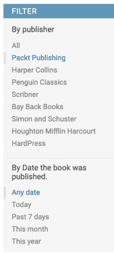

图 4.51 – 确认图书变更列表页面包含日期设置

如果 Bookr 项目接收大量新书发布，并且我们想筛选最近七天或一个月内发布的图书，那么这个出版日期筛选器会非常方便。不过，有时我们可能希望按特定年份或特定年份中的特定月份进行筛选。幸运的是，`admin.ModelAdmin` 类自带一个自定义筛选器属性，专用于按时间信息层级进行导航，它就是 `date_hierarchy`。

3. 向 `BookAdmin` 添加一个 `date_hierarchy` 属性，并将其值设置为 `publication_date`：

```
class BookAdmin(admin.ModelAdmin):
    date_hierarchy = 'publication_date'
    list_display = ('title', 'isbn13')
    list_filter = ('publisher', 'publication_date')
```

6. 确认选择其中一个月后，会进一步筛选到该月中的具体日期：

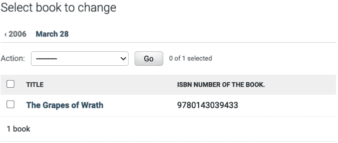

图 4.54 – 将月份筛选到该月中的具体日期

正如我们在本练习中所看到的，`date_hierarchy` 筛选器是一种方便的方式，用于自定义包含大量可按时间排序数据的变更列表，以便更快速地选择记录。

现在让我们来看看应用中搜索栏的实现。

## 搜索栏

这就引出了我们想要实现的最后一项功能——搜索栏。与筛选器一样，基本的搜索栏实现起来非常简单。我们只需在 `ModelAdmin` 类中添加 `search_fields` 属性即可。我们的 `Book` 类中显而易见的字符字段是 `title` 和 `isbn`。目前，图书变更列表顶部显示了一个日期层级。搜索栏将出现在其上方：

### 选择要更改的图书

- 1996
- 2001
- 2002
- 2004
- 2006
- 2012
- 2017
- 2018
- 2019

操作：

已选择 0 / 17 项

|  | 标题 | 图书 ISBN 号 |
| --- | --- | --- |
|  | Paul Clifford | 9781719053167 |
|  | Animal Farm: A Fairy Story | 9780151002177 |
|  | 1984 | 9781328869333 |
|  | Pride and Prejudice | 9780141439518 |
|  | Fahrenheit 451 | 9781451673319 |
|  | The Catcher in the Rye | 9780316769174 |
|  | The Great Gatsby | 9780743273565 |
|  | To Kill A Mockingbird | 9780060935467 |
|  | For Whom The Bell Tolls | 9781476787770 |
|  | The Grapes of Wrath | 9780143039433 |

筛选

按出版社

- 全部
- Packt Publishing
- Harper Collins
- Penguin Classics
- Scribner
- Bay Back Books
- Simon and Schuster
- Houghton Mifflin Harcourt
- HardPress

按图书出版日期

- 任意日期
- 今天
- 过去 7 天
- 本月
- 今年

图 4.55 – 添加搜索栏之前的图书变更列表

我们可以先在 `reviews/admin.py` 的 `BookAdmin` 中添加此属性，然后查看结果：

```
search_fields = ('title', 'isbn')
```

结果将如下所示：

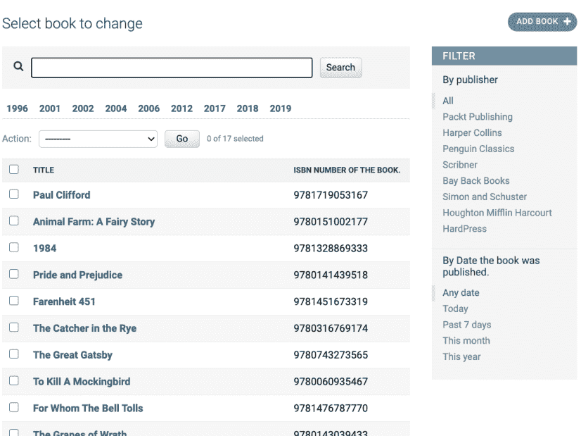

图 4.56 – 带搜索栏的图书变更列表

现在我们可以对与标题字段或 ISBN 匹配的字段执行简单的文本搜索。此搜索需要精确的字符串匹配，因此“color”不会匹配“colour”。它也缺乏我们期望从 Elasticsearch 等更复杂的搜索工具中获得的那种深层语义处理。如果你碰巧有条码扫描器，ISBN 查找是一个非常不错的功能。将搜索限制在 Books 模型上的字段显得相当局限。我们可能还想按出版社名称搜索。幸运的是，`search_fields` 足够灵活，可以实现这一点。要搜索 `ForeignKeyField` 或 `ManyToManyField`，我们只需指定当前模型上的字段名和关联模型上的字段名，两者用两个下划线分隔。在这种情况下，Book 有一个外键 `publisher`，我们想搜索 `Publisher.name` 字段，因此可以在 `BookAdmin.search_fields` 中将其指定为 `'publisher__name'`：

```
search_fields = ('title', 'isbn', 'publisher__name')
```

如果我们希望将搜索字段限制为精确匹配，而不是返回包含搜索字符串的结果，那么可以在字段后加上 `__exact` 后缀。因此，将 `isbn` 替换为 `isbn__exact` 将要求匹配完整的 ISBN，我们将无法使用 ISBN 的一部分来获得匹配。

类似地，我们可以使用 `__startswith` 后缀来限制搜索字段，使其只返回以搜索字符串开头的匹配结果。将出版社名称搜索字段限定为 `publisher__name__startswith` 意味着我们搜索“pack”会得到结果，但搜索“ackt”则不会。

至此，我们完成了对变更列表页面常见自定义的探讨。我们可能还想自定义应用中创建和更新表单的行为。

## 排除字段和字段分组

在某些情况下，在管理界面中限制模型中某些字段的可见性是合适的。这可以通过 `exclude` 属性来实现。

这是带有**编辑日期**字段可见的评论表单屏幕。请注意，**创建日期**字段并未出现——它已经是一个隐藏视图，因为 `date_created` 在模型上是通过 `auto_now_add` 参数定义的：

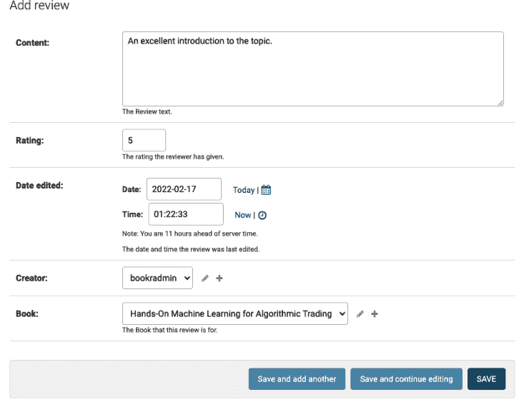

图 4.57 – 评论表单

如果我们想从评论表单中排除**编辑日期**字段，我们可以在 `ReviewAdmin` 类中进行如下操作：

```python
exclude = ('date_edited',)
```

然后评论表单将不显示**编辑日期**：

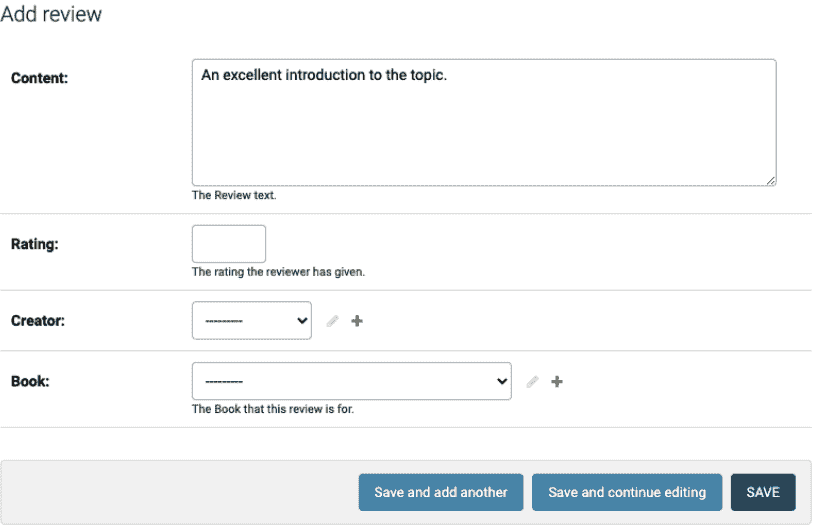

图 4.58 – 排除编辑日期字段后的评论表单

相反，更稳妥的做法可能是将管理字段限制为那些明确允许的字段。这可以通过 `fields` 属性来实现。这种方法的好处是，如果模型中添加了新字段，除非将它们添加到 `ModelAdmin` 子类的 `fields` 元组中，否则它们不会出现在管理表单中：

```python
fields = ('content', 'rating', 'creator', 'book')
```

这将得到与之前相同的结果。


另一个选项是使用 `ModelAdmin` 子类的 `fieldsets` 属性，将表单布局指定为一系列分组字段。`fieldsets` 中的每个分组由一个标题和一个字典组成，字典中包含一个指向字段名字符串列表的 `fields` 键：

```
fieldsets = (
    ("Linkage", {"fields": ("creator", "book")}),
    ("Review content", {"fields": ("content", "rating")}),
)
```

评价表单应如下所示：

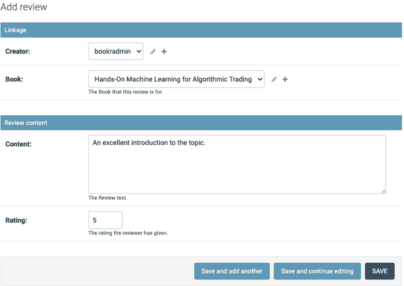

图 4.59 – 使用 fieldsets 的评价表单

如果我们想省略某个 fieldset 的标题，可以将其设置为 `None`：

```
fieldsets = (
    (None, {'fields': ('creator', 'book')}),
    ('Review content', {'fields': ('content',
                                   'rating')})
)
```

现在，评价表单应如以下截图所示：

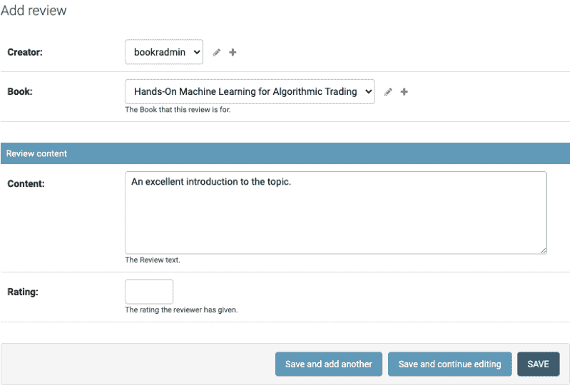

图 4.60 – 第一个 fieldset 无标题的评价表单

我们已经了解了变更列表和表单定制，接下来可以通过一个综合活动将所学知识付诸实践。

### 活动 4.03 – 定制 Model admin

在我们的数据模型中，`Contributor` 类用于存储图书贡献者的数据；他们可以是作者、撰稿人或编辑。本活动重点在于修改 `Contributor` 类并添加 `ContributorAdmin` 类，以提高 admin 应用的易用性。目前，`Contributor` 变更列表默认显示单列 `FirstNames`，这是基于*第 2 章“模型和迁移”*中创建的 `__str__` 方法。我们将研究一些其他表示方式。以下是帮助你完成活动的步骤：

1. 编辑 `reviews/models.py`，为 `Contributor` 模型添加额外功能。
2. 为 `Contributor` 添加一个 `initialled_name` 方法，该方法不接收参数（类似于 `Book.isbn13` 方法）。
3. `initialled_name` 方法将返回一个字符串，包含 `Contributor.last_names`，后跟逗号和给定名字的首字母缩写。例如，对于 `first_names` 为 `Jerome David`、`last_names` 为 `Salinger` 的 `Contributor` 对象，`initialled_name` 将返回 `Salinger, JD`。
4. 用调用 `initialled_name()` 的方法替换 `Contributor` 的 `__str__` 方法。

此时，**Contributors** 显示列表将如下所示：

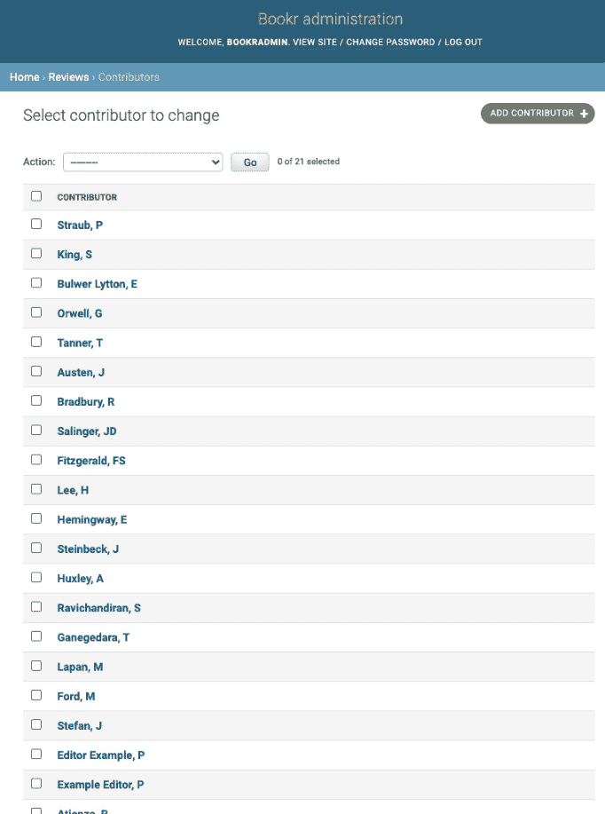

图 4.61 – Contributors 显示列表

5. 编辑 `reviews/admin.py` 文件。我们将修改在*列表显示字段*部分中从 `admin.ModelAdmin` 子类化的 `ContributorAdmin`。

6. 修改它，使 Contributors 变更列表上的记录显示为两列可排序字段：Last Names 和 First Names。我们可以从 `ContributorAdmin` 中移除现有的 `list_display` 属性以及 `initialled_name` 函数。

7. 添加一个搜索栏，用于搜索 Last Names 和 First Names。并修改它，使其只匹配 Last Names 的开头。

8. 添加一个基于 Last Names 的过滤器。

完成活动后，你应该会看到类似这样的结果：

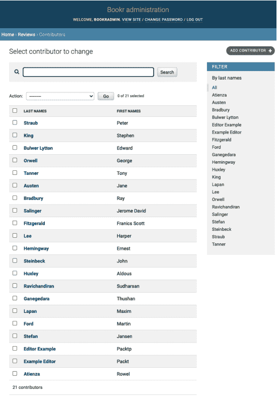

图 4.62 – 预期输出

可以做出诸如此类的更改，以改进 admin 用户界面的功能。通过在 Contributors 变更列表中将 First Names 和 Last Names 列实现为独立的列，我们让用户可以选择按任一字段排序。通过考虑哪些列在搜索检索和筛选选择中最有用，我们可以提高记录检索的效率。

> **注意**
> 本活动的解决方案可在 https://github.com/PacktPublishing/Web-Development-with-Django-Second-Edition/tree/main/ActivitySolutions 上找到。

### 摘要

在本章中，我们了解了如何通过 Django 命令行创建超级用户，以及如何使用超级用户访问 admin 应用。然后，在简要浏览了 admin 应用的基本功能之后，我们探讨了如何将模型注册到 admin 应用中，为数据生成 CRUD 界面。

接着，我们学习了如何通过修改站点级功能来改进这个界面。我们通过向 admin 站点注册自定义模型 admin 类，改变了 admin 应用向用户展示模型数据的方式。这使我们能够对模型界面的表示进行细粒度的更改。这些修改包括：通过添加额外的列、过滤器、日期层级和搜索栏来定制变更列表页面。我们还通过分组和排除字段来修改模型 admin 页面的布局。

这只是对 admin 应用功能的浅尝辄止。我们将在第 10 章“高级 Django Admin 与定制”中重新探讨 `AdminSite` 和 `ModelAdmin` 的丰富功能。但首先，我们需要学习 Django 的一些中级功能。在下一章中，我们将学习如何组织并服务静态内容，例如 CSS、JavaScript 和图片，以及如何从 Django 应用中提供这些内容。
