## 服务静态文件

一个仅包含纯超文本标记语言（HTML）的 Web 应用是非常有限的。我们可以使用层叠样式表（CSS）和图片来增强网页的外观，并使用 JavaScript 添加交互。我们将所有这些类型的文件称为“静态文件”。它们在开发完成后作为应用的一部分被部署。我们可以将此与动态响应进行比较，动态响应是在发出请求时实时生成的。你编写的所有视图都是通过渲染模板来生成动态响应的。请注意，我们不会将模板视为静态文件，因为它们不是原样发送给客户端的；而是先渲染，然后作为动态响应的一部分发送。

在开发期间，静态文件在开发者的机器上创建，然后必须移动到生产 Web 服务器。如果你必须在短时间内（例如，几小时）上线，那么收集所有静态资源、将它们移动到正确的目录并上传到服务器可能会非常耗时。在使用其他框架或语言开发 Web 应用时，你可能需要手动将所有静态文件放入 Web 服务器托管的特定目录。更改服务静态文件的 URL 可能意味着需要更新代码中的多处值。

Django 可以帮助我们管理静态资源，使这一过程更加容易。它提供了在开发期间使用其开发服务器提供静态文件的工具。当你的应用上线时，它还可以收集所有资源并将它们复制到一个文件夹中，供专门的 Web 服务器托管。这使你可以再开发期间以有意义的方式隔离静态文件，并在部署时自动打包它们。

此功能由 Django 内置的 `staticfiles` 应用提供。它添加了几个用于处理和服务静态文件的有用功能：

- `static` 模板标签会自动构建资源的静态 URL 并将其包含在 HTML 中。
- 一个名为 `static` 的视图在开发环境中提供静态文件。
- 静态文件查找器可用于自定义在文件系统中哪里可以找到资源。
- `collectstatic` 管理命令会查找所有静态文件并将它们移动到一个目录中以便部署。
- `findstatic` 管理命令会显示针对特定请求加载了磁盘上的哪个静态文件。这也可以帮助我们调试某个文件是否未加载。

在本章的练习和活动中，我们将向 Bookr 应用添加静态文件（图片和 CSS）。在开发期间，每个文件都将存储在 Bookr 项目目录内。我们需要为每个文件生成一个 URL，以便模板可以引用它们，并且浏览器可以下载它们。URL 生成后，Django 需要提供这些文件。当我们把 Bookr 应用部署到生产环境时，需要找到所有静态文件并将它们移动到一个可以由生产 Web 服务器提供服务的目录中。如果有静态文件未按预期加载，我们需要某种方法来确定原因。

为了简单起见，让我们以单个静态文件为例：`logo.png`。我们将简要介绍前面提到的每个功能的作用，并在本章中深入解释。我们将介绍静态文件应用的五个部分：

- `static` 模板标签用于将文件名转换为可在模板中使用的 URL 或路径，例如从 `logo.png` 到 `/static/logo.png`。
- `static` 视图接收在 `/static/logo.png` 路径加载静态文件的请求。它读取文件并将其发送到浏览器。
- 静态文件查找器（或简称 `finder`）由 `static` 视图用于在磁盘上定位静态文件。有不同的查找器，但在本例中，其中一个只是将 `/static/logo.png` URL 路径转换为磁盘上的路径 `bookr/static/logo.png`。
- 部署到生产环境时，必须使用 `collectstatic` 管理命令。这将把 `logo.png` 文件从 Bookr 项目目录复制到 Web 服务器目录，例如 `/var/www/bookr/static/logo.png`。
- 如果静态文件无法正常工作（例如，对其请求返回 `404 Not Found` 响应，或提供了错误的文件），那么我们可以使用 `findstatic` 管理命令来尝试确定原因。该命令以文件名作为参数，并输出查看了哪些目录以及在哪里找到了请求的文件。

这些是日常最常用的功能，但我们还将讨论其他功能。

在本章中，你将首先学习静态响应和动态响应之间的区别。然后你将看到 Django 的 `staticfiles` 应用如何帮助管理静态文件。当你继续开发 Bookr 应用时，你将使用图片和 CSS 来增强它。你将看到为项目布局静态文件的不同方式，并了解 Django 如何为生产部署整合这些文件。Django 包含了用于在模板中引用静态文件的工具；你将看到这些工具如何帮助减少部署应用到生产环境时必须做的工作。在此之后，


你将探索 `findstatic` 命令，该命令可用于调试与静态文件相关的问题。随后，你将了解如何为将静态文件存储在远程服务上编写代码的概述。最后，你将查看缓存网络资源以及 Django 如何帮助进行缓存失效。

本章将涵盖以下主要主题：

- Static file serving
- Introduction to Static Files Finder
- Generating static URLs with the static template tag
- FileSystem Finder
- Static file finders – use during collectstatic
- `STATICFILES_DIRS` prefixed mode
- The `findstatic` command
- Serving the latest files (for cache validation)
- Custom storage engines

## Technical requirements

本章的所有代码文件均可在 https://github.com/PacktPublishing/Web-Development-with-Django-Second-Edition/tree/main/Chapter05 获取。

## Static file serving

在引言中，我们提到 Django 包含一个名为 `static` 的视图函数，用于提供静态文件。关于提供静态文件，首要需要明确的是 Django 并非打算在生产环境中提供它们。这不是 Django 的职责，而且在生产环境中，Django 会拒绝提供静态文件。这是正常且预期的行为。如果 Django 只是从文件系统读取并发送文件，那么它与普通 Web 服务器相比并无优势，而普通 Web 服务器在执行此任务时可能性能更好。此外，如果你使用 Django 提供静态文件，你将使 Python 进程在请求期间保持忙碌状态，而它无法处理更适合它的动态请求。

出于这些原因，Django `static` 视图仅设计用于开发期间使用，并且在你的 DEBUG 设置为 False 时将无法工作。由于在开发期间我们通常只有一个人访问站点（开发者），因此 Django 提供静态文件是可以的。我们稍后将讨论 `staticfiles` 应用如何支持生产部署。整个生产部署流程将在第 17 章《Deploying a Django Application (Part 1 – Server Setup)》中介绍，该章节托管在此书的 GitHub 仓库中。

当运行 Django 开发服务器时，只要你的 settings.py 文件包含以下元素，就会为静态视图自动设置 URL 映射：

- 将 DEBUG 设置为 True
- 在其 INSTALLED_APPS 中包含 'django.contrib.staticfiles'

这两个设置默认都存在。

创建的 URL 映射大致等同于在你的 urlpatterns 中有以下映射：

```
path(settings.STATIC_URL, django.conf.urls.static)
```

任何以 settings.STATIC_URL 开头的 URL（默认为 /static/）都会映射到静态视图。

> Note
> 你可以在不将 staticfiles 包含在 INSTALLED_APPS 中的情况下使用静态视图，但你必须手动设置等效的 URL 映射。

接下来，我们将讨论 Django 如何使用 Static Files Finder 定位静态文件。

## Introduction to Static Files Finder

Django 需要在磁盘上定位静态文件的有三种情况，为此它使用静态文件查找器。它可以被视为一个插件。它是一个实现将 URL 路径转换为磁盘的方法的类，并遍历项目目录以查找静态文件。

第一次使用是在 Django 静态视图接收到加载特定静态文件的请求时；此时，它需要将 URL 中的路径转换为磁盘上的位置。例如，假设 URL 的路径是 /static/logo.png，并且它被转换为磁盘上的 bookr/static/logo.png 路径。正如我们在上一节中所述，这仅在开发期间发生。在生产服务器上，Django 不应接收此请求，因为它将由 Web 服务器直接处理。

第二次是在使用 collectstatic 管理命令时。它收集项目目录中的所有静态文件并将其复制到单个目录，以便由生产 Web 服务器提供服务。bookr/static/logo.png 将被复制到 Web 服务器根目录——例如，/var/www/bookr/static/logo.png。静态文件查找器包含用于定位项目目录内所有静态文件的代码。

最后一次使用静态文件查找器是在执行 findstatic 管理命令时。这与第一次使用类似，其中它接受一个静态文件名（如 logo.png），但它会将完整路径（bookr/static/logo.png）输出到终端，而不是加载文件内容。

Django 附带了一些内置查找器，但如果你想将静态文件存储在自定义目录结构中，也可以编写自己的查找器。Django 使用的查找器列表由 settings.py 中的 STATICFILES_FINDERS 设置定义。在本章中，我们将在 AppDirectoriesFinder 和 FileSystemFinder 部分分别介绍默认静态文件查找器 AppDirectoriesFinder 和 FileSystemFinder 的行为。

> **Note**
> 
> 如果你查看 settings.py，你不会看到默认情况下定义了 STATICFILES_FINDERS 设置。这是因为 Django 将使用其内置的默认设置，定义为 ['django.contrib.staticfiles.finders.FileSystemFinder', 'django.contrib.staticfiles.finders.AppDirectoriesFinder']。如果你将 STATICFILES_FINDERS 设置添加到 settings.py 文件以包含自定义查找器，请确保在使用的情况下包含这些默认值。

在本节中，我们将首先讨论静态文件查找器及其在第一种情况——响应请求中的使用。然后，我们将介绍一些更多概念并返回 collectstatic 的行为以及它如何使用静态文件查找器。

## Static file finders – use during a request

当 Django 接收到对静态文件的请求时（请记住，Django 仅在开发期间提供静态文件），每个已定义的静态文件查找器将被查询，直到在磁盘上找到文件。或者，如果没有任何查找器能定位到文件，静态视图将返回 HTTP 404 Not Found 响应。

例如，请求的 URL 将类似于 /static/main.css 或 /static/reviews/logo.png。每个查找器将依次使用 URL 中的路径进行查询，并返回诸如 bookr/static/main.css 的路径用于第一个文件，以及 bookr/reviews/static/reviews/logo.png 用于第二个文件。每个查找器将使用其逻辑将 URL 路径转换为文件系统路径——我们将在 AppDirectoriesFinder 和 FileSystemFinder 部分讨论此逻辑。

## AppDirectoriesFinder

AppDirectoriesFinder 类用于在每个应用目录中的名为 static 的目录内查找静态文件。应用程序必须在你的 settings.py 文件的 INSTALLED_APPS 设置中列出（我们在第 1 章《An Introduction to Django》中已完成此操作）。正如我们在第 1 章《An Introduction to Django》中也提到的，应用程序最好是自包含的。通过让每个应用程序拥有一个静态目录，我们可以通过将应用特定的静态文件也存储在应用目录内来继续自包含的设计。

在我们使用 AppDirectoriesFinder 之前，我们将解释如果多个静态文件具有相同名称时可能出现的问题，以及如何解决此问题。

## Static file namespacing

在之前的部分《Static file finders – use during a request》中，我们讨论了提供名为 logo.png 的文件。这将为 reviews 应用程序提供一个 logo。文件名（logo.png）可能很常见——你可以想象，如果我们添加一个 store 应用（用于购买书籍），它也将有一个 logo。更不用说第三方 Django 应用也可能想要使用 logo.png 这样的通用名称。即将描述的问题可能适用于任何具有通用名称的静态文件，例如 styles.css 或 main.js。

让我们考虑 reviews 和 stores 示例。我们可以在这两个应用中添加一个静态目录。然后，每个静态目录都将有一个 logo.png 文件（尽管是不同的 logo）。目录结构如 Figure 5.1 所示：

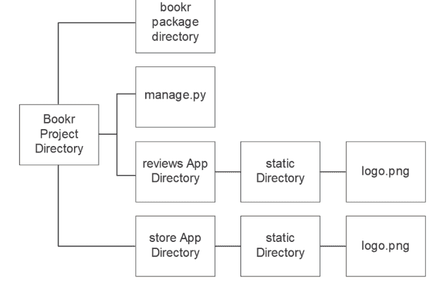

Figure 5.1 – Directory layout with static directories inside app directories

用于下载静态文件的 URL 路径是相对于静态目录的。因此，如果我们对 /static/logo.png 发出 HTTP 请求，则不清楚引用的是哪个 logo.png。Django 将依次检查每个应用程序的静态目录（按 INSTALLED_APPS 设置中指定的顺序）。它找到的第一个 logo.png 将被提供。在这种目录布局中，没有办法指定要加载哪个 logo.png。

我们可以通过为静态文件命名空间来解决此问题。这是在静态目录内使用另一个目录的过程，该目录的名称与应用相同。reviews 应用在其静态目录内有一个 reviews 目录，而 store 应用在其静态目录内有一个 store 目录。相应的 logo.png 文件随后被移动到这些子目录中。新的目录布局如 Figure 5.2 所示：


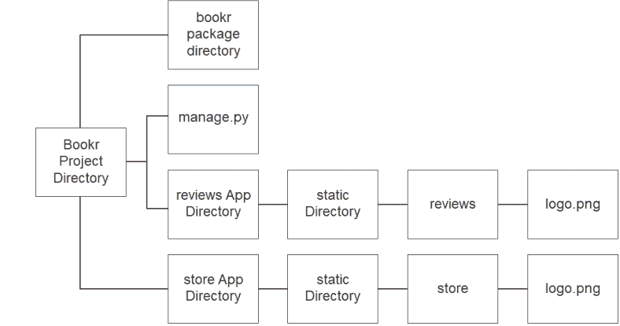

*图 5.2 – 使用命名空间目录的目录布局*

要加载特定文件，我们必须同时包含命名空间目录。对于评论 logo，其 URL 路径为 `/static/reviews/logo.png`，在磁盘上映射到 `bookr/reviews/static/reviews/logo.png`。同样，对于商店 logo，路径为 `/static/store/logo.png`，映射到 `bookr/store/static/store/logo.png`。你可能已经注意到，在 *静态文件查找器 – 请求期间使用* 部分中，logo.png 文件的示例路径已经是命名空间化的。

> **注意**
> 
> 如果你正在考虑编写一个可能作为独立插件发布的 Django 应用，你可以使用更明确的子目录名称。例如，你可以选择包含整个点分项目路径的名称：`bookr/reviews/static/bookr.reviews`。不过在大多数情况下，让子目录名称仅对你的项目唯一就足够了。

现在我们已经介绍了 `AppDirectoriesFinder` 和静态文件命名空间，我们就可以使用它们来提供我们的第一个静态文件。在本章的第一个练习中，我们将为一个基础业务网站创建一个新的 Django 项目。然后我们将从一个名为 `landing` 的应用中提供一个 logo 文件，该应用将在此项目中创建。`AppDirectoriesFinder` 类用于在每个应用目录中的 `static` 目录内查找静态文件。应用必须在你的 `settings.py` 文件的 `INSTALLED_APPS` 设置中列出。正如我们在 *第 1 章，Django 简介* 中提到的，应用最好是自包含的。通过让每个应用都有一个 `static` 目录，我们可以通过将应用特定的静态文件也存储在应用目录内来继续这种自包含的设计。

从应用目录提供静态文件是最简单的方法。这是因为我们不需要进行任何设置更改。相反，我们只需在正确的目录中创建文件，它们就会使用默认的 Django 配置提供服务。

> **业务网站项目**
> 在本章的练习中，我们将创建一个新的 Django 项目，并用它来演示静态文件概念。该项目将是一个基础业务网站，具有一个简单的落地页，其中包含一个 logo。该项目将有一个应用，名为 *landing*。
> 
> 你可以参考 *第 1 章，Django 简介* 中的 *练习 1.01 – 创建项目和应用，并启动开发服务器*，以回顾创建 Django 项目的方法。

## 练习 5.01 – 从应用目录提供文件

在本练习中，你将为 *landing* 应用添加一个 logo 文件。这将通过在 *landing* 应用目录内的 `static` 目录中放置一个 `logo.png` 文件来完成。完成后，你可以测试静态文件是否正确提供，并确认将提供它的 URL：

- 1. 首先创建新的 Django 项目。你可以重用已安装 Django 的 Bookr 虚拟环境。
- 2. 打开一个新的终端并激活虚拟环境（请参考 *前言* 中有关如何创建和激活虚拟环境的说明）。
- 3. 在终端（或命令提示符）中运行 `django-admin` 命令以启动名为 `business_site` 的 Django 项目：
```
django-admin startproject business_site
```
不会有任何输出。此命令将在名为 `business_site` 的新目录中搭建 Django 项目。
- 4. 使用 `startapp` 管理命令在此项目中创建一个新的 Django 应用。应用应命名为 *landing*。为此，`cd` 进入 `business_site` 目录，然后运行以下命令：
```
python3 manage.py startapp landing
```
同样不会有任何输出。该命令将在 `business_site` 目录内创建 `landing` 应用目录。

> **注意**
> 请记住，在 Windows 上，命令是 `python manage.py startapp landing`。

5. 启动 PyCharm 并打开 business_site 目录。如果你已经打开了一个项目，可以通过选择 File | Open 来执行此操作；否则，只需在欢迎 PyCharm 窗口中点击 Open。导航到 business_site 目录，选择它，然后点击 Open。如果提示，请选择 Trust Project。business_site 项目窗口应与图 5.3 所示类似：

> 注意
> 有关如何设置和配置 PyCharm 以与你的 Django 项目配合使用的详细说明，请参考第 1 章 *An Introduction to Django* 中的练习 1.02 – 在 PyCharm 中进行项目设置。

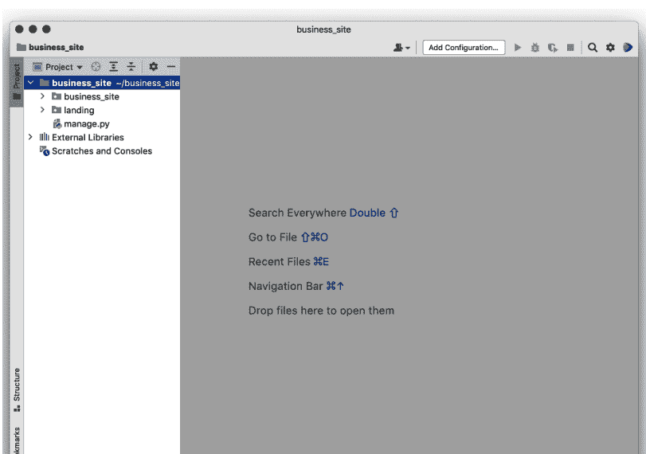

图 5.3 – business_site 项目

6. 创建一个新的运行配置以执行项目的 manage.py runserver。你可以再次重用 Bookr 虚拟环境。完成后，Run/Debug Configurations 窗口应与图 5.4 所示类似：

## 注意

> 如果你不确定如何在 PyCharm 中配置这些设置，请参考第 1 章 *An Introduction to Django* 中的练习 1.02 – 在 PyCharm 中进行项目设置。

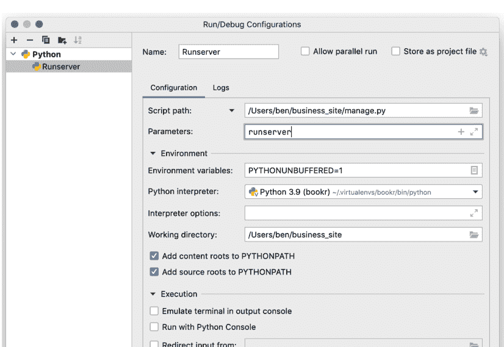

图 5.4 – Runserver 的 Run/Debug Configurations

你可以通过点击 Run 按钮，然后在浏览器中访问 http://127.0.0.1:8000/ 来测试配置是否正确设置。你应该会看到 Django 欢迎屏幕。如果调试服务器无法启动或你看到 Bookr 主页，那么你可能仍在运行 Bookr 项目。尝试停止 Bookr runserver 进程（在运行它的终端中按 Ctrl + C），然后启动你刚刚设置的新服务器。

- 7. 打开 business_site 目录中的 settings.py 并将 'landing' 添加到 INSTALLED_APPS 设置中。我们在第 1 章 *An Introduction to Django* 中练习 1.05 – 创建模板目录和基础模板 的步骤 1 中学习了如何执行此操作。
- 8. 在 PyCharm 中，右键单击项目窗格中的 landing 目录并选择 New | Directory。

9. 输入 `static` 并按 *Enter* 键：

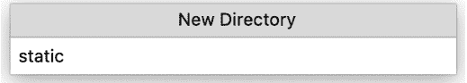

图 5.5 – 将目录命名为 static

10. 右键单击你刚刚创建的 `static` 目录并再次选择 **New | Directory**。

11. 输入 `landing` 并按 *Enter*。这将实现我们之前讨论的静态文件目录的命名空间化：

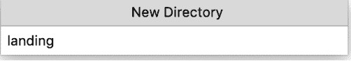

图 5.6 – 命名新的目录 reviews 以实现命名空间化

12. 从 `https://raw.githubusercontent.com/PacktPublishing/Web-Development-with-Django-Second-Edition/main/Chapter05/Exercises.01/business_site/landing/static/landing/logo.png` 下载 `logo.png` 文件并将其移动到 `landing/static/landing` 目录中。

13. 启动 Django 开发服务器。如果尚未运行，请导航到 `http://127.0.0.1:8000/static/landing/logo.png`。你应该在浏览器中看到图像被提供：

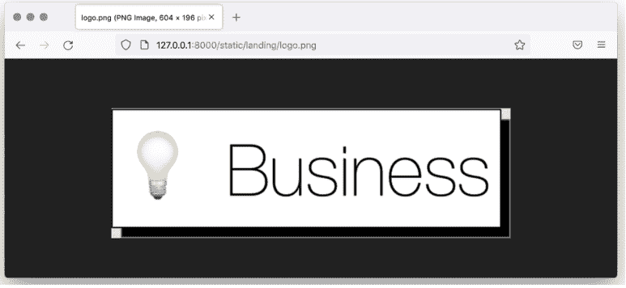

图 5.7 – Django 提供的图像

如果你看到图 5.7 所示的图像，则表示你已正确设置了静态文件提供。

现在你已经看到加载静态图像工作正常，我们将学习更多关于如何防止硬编码这些 URL 的方法。在下一节中，你将看到 Django 如何自动为模板使用生成正确的静态 URL。

## 使用 static 模板标签生成静态 URL

在练习 5.01 – 从应用目录提供文件 中，你设置了一个由 Django 提供的图像文件。我们看到图像的 URL 为 http://127.0.0.1:8000/static/landing/logo.png，你可以在 HTML 模板中使用它。例如，要使用 img 标签显示图像，你可以在模板中使用以下代码：

```

```

或者，由于 Django 也提供媒体并且与动态模板响应具有相同的 host，你可以简化为仅包含路径，如下所示：

```

```

这两个地址（URL 和路径）都已硬编码到模板中——也就是说，我们包含静态文件的完整路径并假设文件托管的位置。这在使用 Django 开发服务器或将静态文件和 Django 网站托管在同一域名上时效果很好。随着网站变得更受欢迎，为了获得更好的性能，你可能考虑从自己的域名或内容分发网络（CDN）提供静态文件。

> 注意
> CDN 是一种可以为你托管网站部分或全部的服务。它提供多个 Web 服务器，可以无缝加速你的网站加载。例如，它可能会从地理位置最接近用户的服务器为用户提供文件。有多个 CDN 提供商，具体取决于设置方式，它们可能要求你指定用于提供静态文件的特定域名。

例如，一个常见的分离方法：为静态文件提供使用不同的域名。你将主网站托管在 https://www.example.com，但希望从 https://static.example.com 提供静态文件。在开发期间，我们可以使用上面看到的 logo 文件的路径。但在部署到生产服务器时，我们的 URL 需要更改以包含域名，如下所示：

```

```


我们可以通过 img 标签将 logo 作为页面上的图像包含进来，如下所示：

```

```

这在模板中渲染如下：

```

```

或者，我们也可以使用 static 标签来生成链接 CSS 文件的 URL，如下所示：

```
<link href="" rel="stylesheet">
```

这将被渲染为如下：

```
<link href="/static/path/to/file.css" rel="stylesheet">
```

它也可以在 script 标签中使用来包含 JavaScript 文件，使用以下代码行：

```
in a script tag:<script src=""></script>
```

这被渲染为如下：

```
<script src="/static/path/to/file.js"></script>
```

你甚至可以使用它来生成指向静态文件的下载链接，就像我们在这里做的那样：

```
<a href="">Download PDF</a>
```

> **Note**
> 请注意，这不会生成实际的 PDF 内容——它只会创建一个指向已存在文件的链接。

这被渲染为如下：

```
<a href="/static/path/to/document.pdf">Download PDF</a>
```

在参考这些示例的同时，我们现在可以展示使用 static 标签而不是硬编码的优势。当我们准备部署到生产环境时，我们只需在 settings.py 中更改 STATIC_URL 值。模板中的任何值都不需要更改。

例如，我们可以将 STATIC_URL 更改为 https://static.example.com/，然后当页面下次渲染时，我们看到的示例将自动更新。

以下行显示了图像的这种情况：

```

```

以下内容用于 CSS 链接：

```
<link href="https://static.example.com/path/to/files.css" rel="stylesheet">
```

对于脚本，它如下所示：

```
<script src="https://static.example.com/path/to/file.js"></script>
```

最后，以下内容用于链接：

```
<a href="https://static.example.com/path/to/document.pdf">Download PDF</a>
```

请注意，在所有这些示例中，都将字面字符串作为参数传递（它是带引号的）。你也可以使用变量作为参数——例如，如果你正在使用上下文渲染模板，如此示例代码中：

```
def view_function(request):
    context = {"image_file": "logofile.png"}
    return render(request, "example.html", context)
```

我们正在使用一个名为 image_file 的变量渲染 example.html 模板。此变量的值为 logo.png。

你将不带引号地将此变量传递给 static 标签：

```

```

它将像这样渲染（假设我们将 STATIC_URL 改回 /static/）：

```

```

模板标签也可以与 as [variable] 后缀一起使用，将结果分配给一个变量以便在模板后面使用。这在静态文件查找花费很长时间并且你想多次引用同一个静态文件时很有用（例如在多个地方包含图像）。

第一次引用静态 URL 时，给它一个变量名以分配给它。在这种情况下，我们正在创建 logo_path 变量：

```

```

这与我们之前看到的示例渲染方式相同：

```

```

然而，我们随后可以在模板后面的位置再次使用已分配的变量（logo_path）：

```

```

这再次渲染为相同内容：

```

```

此变量现在只是在模板作用域中的一个普通上下文变量，可以在模板中的任何位置使用。但是要小心，因为你可能会覆盖已经定义过的变量——尽管这是在使用任何分配变量的模板标签（例如 ）时的一般警告。

在下一个练习中，我们将通过向 business_site 项目添加模板，然后包含示例图像，将 static 模板付诸实践。

## Exercise 5.02 – using the static template tag

在 Exercise 5.01 – serving a file from an app directory 中，你测试了从 static 目录提供 logo.png。在本练习中，你将继续使用 business site 项目并创建 index.html 文件作为我们着陆页的模板。然后，你将使用  模板标签在此页面中包含 logo：

- 1. 在 PyCharm 中（确保你在 business_site 项目中），右键单击 landing 目录并创建一个名为 templates 的新文件夹。
- 2. 右键单击新的 templates 目录并选择 New | HTML File。选择 HTML 5 file 并将其命名为 index.html：

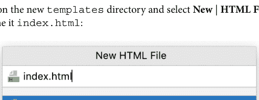

Figure 5.8 – New index.html

- 3. 打开 `index.html` 文件并首先加载 static 标签库以使 static 标签在模板中可用。使用 `load` 模板标签来完成此操作。在文件的第二行（就在 `<!DOCTYPE html>` 之后），添加此行以加载 static 库：
  
  ```django
  
  ```

- 4. 你也可以通过添加一些额外内容使模板更漂亮一些。在 `<title>` 标签内输入 Business Site 文本：
  
  ```html
  <title>Business Site</title>
  ```
  
  然后，在 body 内，添加一个包含 `Welcome to my Business Site` 文本的 `<h1>` 元素：
  
  ```html
  <h1>Welcome to my Business Site</h1>
  ```

- 5. 在标题文本下方，使用 `` 模板标签设置 `` 的源。你将使用它来引用来自 *Exercise 5.01 – serving a file from an app directory* 的 logo：
  
  ```html
  
  ```

- 6. 最后，为了丰富网站内容，在 `` 下方添加一个 `<p>` 元素。给它一些关于业务的文本：
  
  ```html
  <p>Welcome to the site for my Business. For all your Business needs!</p>
  ```
  
  尽管额外的文本和标题不是很重要，但它们让我们了解如何在其余内容周围使用 `` 模板标签。保存文件。完成后，它应该看起来像这样：https://raw.githubusercontent.com/PacktPublishing/Web-Development-with-Django-Second-Edition/main/Chapter05/Exercise5.02/business_site/landing/templates/index.html。

- 7. 接下来，设置一个 URL 来使用以渲染模板。你还将使用内置的 `TemplateView` 来渲染模板，而无需创建视图。打开 `business_site` 包目录中的 `urls.py`。在文件开头按如下方式导入 `TemplateView`：
  
  ```python
  from django.views.generic import TemplateView
  ```
  
  你也可以删除此 Django admin 导入行，因为我们在本项目中不使用它：
  
  ```python
  from django.contrib import admin
  ```

- 8. 添加一个从 `/` 到 `TemplateView` 的 URL 映射。`TemplateView` 的 `as_view` 方法接受 `template_name` 作为参数，它的使用方式与你可能传递给 render 函数的路径相同。你的 `urlpatterns` 应该如下所示：
  
  ```python
  urlpatterns = [
      path("", 
           TemplateView.as_view(template_name="index.html")),
  ]
  ```

保存 urls.py 文件。完成后，它应该看起来像这样：https://raw.githubusercontent.com/PacktPublishing/Web-Development-with-Django-Second-Edition/main/Chapter05/Exercise5.02/business_site/business_site/urls.py。

9. 启动 Django 开发服务器，如果它尚未运行。导航到 http://127.0.0.1:8000/ 在你的浏览器中。你应该看到你的新着陆页，如图 5.9 所示：

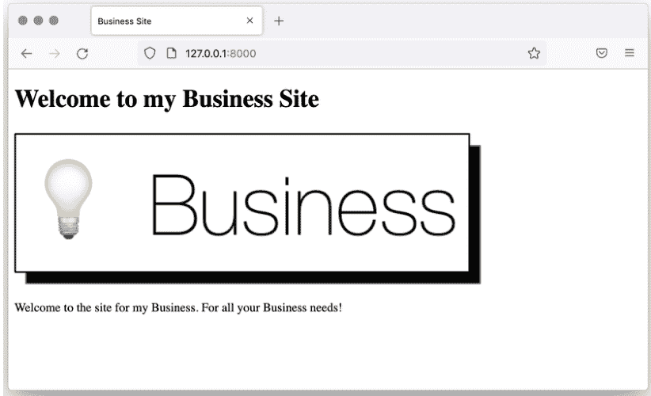

Figure 5.9 – My business site with a logo

在本练习中，我们为 landing 添加了一个基础模板并将 static 库加载到模板中。一旦 static 库被加载，我们就能够使用 static 模板标签加载图像。然后，我们能够在浏览器中看到我们的业务 logo 渲染出来。

到目前为止，静态文件加载已使用 AppDirectoriesFinder，因为它使用时不需要额外配置。在下一节中，我们将查看 FileSystemFinder，它更灵活但需要少量配置才能使用。


## FileSystemFinder

到目前为止，我们已经学习了 `AppDirectoriesFinder`，它会加载 Django 应用目录内的静态文件。然而，我们期望设计良好的应用是自包含的，因此它们只应包含所依赖的静态文件。如果我们有在整个网站或不同应用中使用的其他静态文件，则应将它们存储在应用目录之外。

> **Note**
>
> 作为一般规则，你的 CSS 可能在整个网站中保持一致，可以保存在全局目录中。某些图片和 JavaScript 代码可能特定于应用，因此这些会存储在该应用的 `static` 目录中。这只是一般建议：你可以将静态文件存储在对你的项目最有意义的任何位置。

在我们的 business site 应用中，我们将在站点 `static` 目录中存储一个 CSS 文件，因为它不仅会在 `landing` 应用中使用，而且在我们添加更多应用时也会在整个站点中使用。

Django 提供了使用其 `FileSystemFinder` 静态文件查找器从任意目录提供静态文件的支持。目录可以位于磁盘上的任何位置。通常，你会在项目目录内有一个 `static` 目录，但如果你的公司有一个在许多不同项目中使用的全局 `static` 目录，包括非 Django Web 应用，那么你也可以使用它。

`FileSystemFinder` 使用 `settings.py` 文件中的 `STATICFILES_DIRS` 设置来确定在其中搜索静态文件的目录。创建项目时不存在此设置，必须由开发者设置。我们将在下一个练习中添加它。有两种构建此列表的选项：

- 设置目录列表
- 设置形如 `(prefix, directory)` 的元组列表

一旦我们涵盖了更多基础知识，第二种用例将更容易理解，因此我们将在解释并演示第一种情况后返回。将在 *STATICFILES_DIRS prefixed mode* 部分介绍。对于现在，我们将只解释第一种用例，即一个或多个目录的列表。

在 `business_site` 中，我们将在项目目录内添加一个静态目录，即包含 landing 应用和 `manage.py` 文件的同一目录。我们可以使用 `BASE_DIR` 设置在分配给 `STATICFILES_DIRS` 的列表构建时：

```python
STATICFILES_DIRS = [BASE_DIR / "static"]
```

我们也在本节前面提到，你可能想在此列表中设置多个目录路径，例如，如果你有一些由多个 Web 项目共享的公司范围的静态数据。只需将额外目录添加到 STATICFILES_DIRS 列表中：

```python
STATICFILES_DIRS = [BASE_DIR / "static",
    "/Users/username/projects/company-static/"
]
```

每个目录都将按指定顺序检查以查找匹配的文件。如果文件同时存在于两个目录中，则会提供先找到的那个。例如，如果 static/main.css（位于 business_site 项目目录内）和 /Users/username/projects/company-static/bar/main.css 文件都存在，则对 /static/main.css 的请求将提供 business_site 项目的 main.css，因为它在列表中排在前面。在决定将目录添加到 STATICFILES_DIRS 的顺序时请考虑这一点；你可以选择优先使用项目静态文件而不是全局文件，反之亦然。

在我们的 business site（以及后来的 Bookr）中，我们将只在此列表中使用一个静态目录，因此我们不必担心这个问题。

在下一个练习中，我们将添加一个包含 CSS 文件的静态目录。然后，我们将配置 STATICFILES_DIRS 设置，以便可以从静态目录提供服务。

### Exercise 5.03 – serving from a project static directory

我们在 Exercise 5.01 – serving a file from an app directory 中展示了提供应用特定图片文件的示例。现在，我们想提供一个要在整个项目中用于设置样式的 CSS 文件，因此我们将从项目文件夹内的静态目录提供此文件。

在此练习中，你将设置项目以从特定目录提供静态文件，然后再次使用 `` 模板标签将其包含在模板中。这将使用 business_site 示例项目完成：

- 1. 如果 business_site 项目尚未打开，请在 PyCharm 中打开它。然后，右键单击 business_site 项目目录（顶层的 business_site 目录，而不是 business_site 包目录）并选择 New | Directory。
- 2. 在 New Directory 对话框中，输入 static 并单击 OK。
- 3. 右键单击你刚创建的 static 目录并选择 New | File。
- 4. 在 New File 对话框中，输入 main.css 并单击 OK。
- 5. 应该会自动打开空白的 `main.css` 文件。输入几条简单的 CSS 规则以居中文本并设置字体和背景颜色，如下所示：

  ```css
  body {
      font-family: Arial, sans-serif;
      text-align: center;
      background-color: #f0f0f0;
  }
  ```

  你现在可以保存并关闭 `main.css`。你可以在 https://raw.githubusercontent.com/PacktPublishing/Web-Development-with-Django-Second-Edition/main/Chapter05/Exercise5.03/business_site/static/main.css 查看完整文件以供参考。

- 6. 打开 `business_site/settings.py`。在此处，设置 `STATICFILES_DIRS` 设置的目录列表。在这种情况下，列表将只有一个项目。在 `settings.py` 文件底部使用以下代码定义一个名为 `STATICFILES_DIRS` 的新变量：

  ```python
  STATICFILES_DIRS = [BASE_DIR / "static"]
  ```

  在 `settings.py` 文件中，`BASE_DIR` 是一个包含项目目录路径的变量。你可以通过将 `static` 连接到 `BASE_DIR` 来构建你在 *Step 2* 中创建的 `static` 目录的完整路径。然后，你可以将它放在一个列表中。完整的 `settings.py` 文件应如下所示：https://raw.githubusercontent.com/PacktPublishing/Web-Development-with-Django-Second-Edition/main/Chapter05/Exercise5.03/business_site/business_site/settings.py。

- 7. 如果尚未运行，请启动 Django 开发服务器。你可以通过检查是否可以加载 `main.css` 文件来验证设置是否正确。请注意，这不是命名空间的，因此 URL 为 `http://127.0.0.1:8000/static/main.css`。在浏览器中打开此 URL 并检查内容是否与你刚刚输入和保存的内容匹配：

  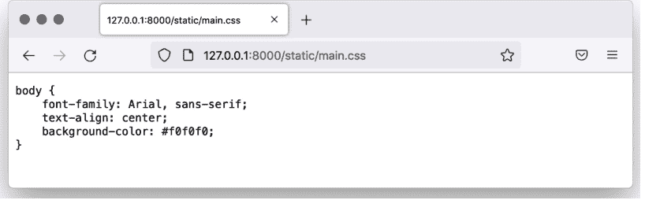

  Figure 5.10 – CSS served by Django

  如果文件无法加载，请检查你的 STATICFILES_DIRS 设置。如果你是在修改 settings.py 时服务器正在运行，可能需要重新启动 Django 开发服务器。

- 8. 现在，你需要在 index 模板中包含 main.css。打开 templates 文件夹中的 index.html。在关闭的 `</head>` 标签之前，添加此 `<link>` 标签以加载 CSS：

  ```html
  <link rel="stylesheet" href="">
  ```

  这会链接 main.css 文件，使用 `` 模板标签。如前所述，由于 main.css 不是命名空间的，你只需包含其名称。保存文件；它应如下所示：https://raw.githubusercontent.com/PacktPublishing/Web-Development-with-Django-Second-Edition/main/Chapter05/Exercise5.03/business_site/landing/templates/index.html。

- 9. 在浏览器中加载 `http://127.0.0.1:8000/`；你应该会看到背景颜色、字体和对齐方式都发生了变化：

  

  Figure 5.11 – CSS applied with custom fonts visible

你的 business landing 页面应如下图所示 Figure 5.11。由于你将 CSS 包含在 index.html 模板中，它将在扩展此模板的所有模板中可用（尽管目前还没有；这是为未来做的好规划）。

在此练习中，我们将一些 CSS 规则放入文件中，并使用 Django 的 `FileSystemFinder` 提供它们。这是通过在 `business_site` 项目目录内创建 `static` 目录并在 Django 设置（`settings.py` 文件）中使用 `STATICFILES_DIRS` 设置指定它来实现的。我们使用静态模板标签将 `main.css` 文件链接到 `index.html` 模板。我们在浏览器中加载主页面并看到字体和颜色更改已应用。

我们现在已经介绍了在请求期间如何使用静态文件查找器（在给定 URL 时加载特定静态文件）。我们现在将查看它们的另一个用例：在运行 `collectstatic` 管理命令时查找和复制静态文件以进行生产部署。

## Static file finders – use during collectstatic

一旦我们完成了对静态文件的操作，就需要将它们移动到可以由生产 Web 服务器提供的特定目录。然后，我们可以通过将 Django 代码和静态文件复制到生产 Web 服务器来部署我们的网站。在 `business_site` 的情况下，我们希望将 `logo.png` 和 `main.css`（以及 Django 本身包含的其他静态文件）移动到可以复制到生产 Web 服务器的单个目录中。这就是 `collectstatic` 管理命令的作用。

我们已经讨论了 Django 在请求处理期间如何使用静态文件查找器。现在，我们将介绍另一个用例：收集静态文件以进行部署。运行 `collectstatic` 管理命令时，Django 使用每个查找器列出磁盘上的静态文件。找到的每个静态文件然后被复制到 `STATIC_ROOT` 目录（也在 `settings.py` 中定义）。这有点像处理请求的逆过程。不是获取 URL 路径并将其映射到文件系统路径，而是将文件系统路径复制到前端 Web 服务器可以预测的位置。这允许前端 Web 服务器独立于 Django 处理对静态文件的请求。

> **Note**
>
> 前端 Web 服务器是设计用于将请求路由到应用程序（如 Django）或从磁盘读取静态文件的 Web 服务器。它们可以处理请求更快，但不能像 Django 这样的东西那样以相同的方式生成动态内容。前端 Web 服务器是 Apache HTTPD、Nginx 和 lighttpd 等软件。

对于 `collectstatic` 如何工作的一些具体示例，我们将使用来自 *Exercise 5.01 – serving a file from an app directory* 和 *Exercise 5.03 – serving from a project static directory* 的两个文件，分别是 `landing/static/landing/logo.png` 和 `static/main.css`。

假设 `STATIC_ROOT` 已设置为由普通 Web 服务器提供服务的目录——这将是类似 `/var/www/business_site/static` 的内容。这些文件的目标将分别是 `/var/www/business_site/static/landing/logo.png` 和 `/var/www/business_site/static/main.css`。


现在，当静态文件请求到来时，Web 服务器将能够轻松地提供它，因为路径映射是一致的：

- `/static/main.css` 是从 `/var/www/business_site/static/main.css` 文件提供的
- `/static/reviews/logo.png` 是从 `/var/www/business_site/static/reviews/logo.png` 文件提供的

这意味着 Web 服务器根目录是 `/var/www/business_site/`，静态路径会以 Web 服务器加载文件的常规方式直接从磁盘加载。

至此，我们已经演示了 Django 在开发期间如何定位静态文件并自行提供它们。在生产环境中，我们需要前端 Web 服务器能够在不涉及 Django 的情况下提供静态文件，这既是为了安全，也是为了速度。

如果不运行 `collectstatic`，Web 服务器将无法将 URL 映射回路径。例如，它不知道 `main.css` 必须从项目静态目录加载，而 `logo.png` 要从 landing 应用目录加载——它完全没有 Django 目录布局的概念。

你可能会想通过将 Web 服务器根目录设置为 Django 项目目录来直接提供文件——**不要这样做。** 共享整个 Django 项目目录存在**安全风险**，因为这会使 `settings.py` 或其他敏感文件可能被下载。运行 `collectstatic` 会将文件复制到一个目录中，为了安全起见，可以将该目录移出 Django 项目目录，放到 Web 服务器根目录。

到目前为止，我们已经讨论了使用 `collectstatic` 将静态文件直接复制到 Web 服务器根目录。你也可以让 Django 将文件复制到中间目录，然后让部署过程将其移动到 CDN 或其他服务器。我们不会详细讨论具体的部署过程；你选择如何将静态文件复制到 Web 服务器将取决于你或你公司现有的设置（例如，持续交付流水线）。

> **注意**
>
> `collectstatic` 命令不会考虑静态模板标签的使用。它会收集静态目录中的所有静态文件，即使你的项目没有在模板中包含这些文件。

在下一个练习中，我们将实际操作 `collectstatic` 命令。我们将使用它把到目前为止所有的 `business_site` 静态文件复制到一个临时目录中。

## 练习 5.04 – 为生产环境收集静态文件

虽然本章不涉及部署到 Web 服务器，但我们仍然可以使用 `collectstatic` 管理命令并查看其结果。在本练习中，我们将创建一个临时存放目录，用于将要复制的静态文件。该目录名为 `static_production_test`，位于 `business_site` 项目目录内。作为部署过程的一部分，你可以将此目录复制到生产 Web 服务器。但是，由于我们要到第 17 章《部署 Django 应用程序（第 1 部分 – 服务器设置）》才会设置 Web 服务器，因此我们将只检查其内容，以了解文件是如何复制和组织的：

- 1. 在 PyCharm 中，创建一个临时目录来存放收集的文件。右键单击 `business_site` 项目目录（这是顶层文件夹，而不是 `business_site` 模块），然后选择**新建 | 目录**。
- 2. 在**新建目录**对话框中，输入 `static_production_test`，然后点击**确定**。
- 3. 打开 `settings.py`，在文件底部为 `STATIC_ROOT` 定义一个新设置。将其设置为你刚创建的目录路径：
- 4. 在终端中运行 `collectstatic` 管理命令：
- 5. 让我们查看 `static_production_test` 目录，检查已创建的内容。该目录的展开视图（来自 PyCharm 项目页面）如图 5.12 所示，供参考。你的目录应该类似：

```
STATIC_ROOT = BASE_DIR / "static_production_test"
```

这将把 `static_dir` 与 `BASE_DIR`（`business_site` 项目路径）连接起来，以生成完整路径。保存 `settings.py` 文件。它应类似于：https://raw.githubusercontent.com/PacktPublishing/Web-Development-with-Django-Second-Edition/main/Chapter05/Exercise5.04/business_site/business_site/settings.py。

```
python3 manage.py collectstatic
```

你应该会看到类似下面的输出：

```
130 static files copied to '/Users/ben/business_site/static_production_test'.
```

如果你期望它只复制两个文件，这似乎很多，但请记住，它会复制所有已安装应用的所有文件。在这种情况下，由于你安装了 Django admin 应用，132 个文件中的大部分都是为其提供的。

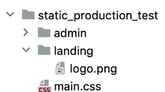

图 5.12 – collectstatic 命令的目标目录

你应该会注意到其中有三项：

- admin 目录：其中包含 Django admin 应用的文件。如果查看其内部，你会发现它已按 css、fonts、img 和 js 组织成子文件夹。
- landing 目录：这是来自 landing 应用的静态目录。里面是 logo.png 文件。创建此目录是为了与我们之前创建的目录的命名空间匹配。
- main.css 文件：它来自你的项目静态目录。由于你没有将其放在命名空间目录中，因此它被直接放在 STATIC_ROOT 内。

如果你愿意，可以打开其中任意文件，验证其内容与你刚刚处理的文件是否一致——它们应该一致，因为它们只是原始文件的副本。

在本练习中，我们收集了 business_site 中的所有静态文件（包括 Django 自带的 admin 静态文件）。它们被复制到由 `STATIC_ROOT` 设置定义的目录中（`business_site` 项目目录内的 `static_production_test`）。我们看到 `main.css` 直接位于此文件夹内，但其他静态文件则按命名空间放在其应用目录中（admin 和 reviews）。此文件夹本可以复制到生产 Web 服务器来部署我们的项目。

在下一节中，我们将了解如何为每个静态文件目录源添加前缀，以自定义收集后静态文件的组织方式。

## STATICFILES_DIRS 前缀模式

如前所述，`STATICFILES_DIRS` 设置也接受元组形式的条目，格式为 `(prefix, directory)`。这些操作模式并不互斥；`STATICFILES_DIRS` 可以同时包含非前缀（字符串）或前缀（元组）条目。本质上，这允许你将某个 URL 前缀映射到目录。在 Bookr 中，我们没有足够的静态资源需要这样设置，但如果你想以不同方式组织静态资源，这会很有用。例如，你可以将所有图片放在某个目录中，而将所有 CSS 放在另一个目录中。如果你使用第三方 CSS 生成工具（例如带 LESS 的 Node.js），则可能需要这样做。

> **注意**
>
> LESS 是一个使用 Node.js 的 CSS 预处理器。它允许你使用变量和其他原生 CSS 中不存在的类编程概念来编写 CSS。然后 Node.js 会将其编译为 CSS。更深入的说明超出了本书的范围；只要这样说就足够了：如果你使用它（或类似工具），那么你可能希望直接从其保存编译输出的目录提供文件。

解释前缀模式工作原理的最简单方式是举一个简短示例。这将扩展我们在*练习 5.03 – 从项目静态目录提供文件*中创建的 `STATICFILES_DIRS` 设置；不过，这并不是一个练习。在此示例中，将向此设置添加两个带前缀的目录——一个用于提供图片，一个用于提供 CSS：

```
STATICFILES_DIRS = [
    BASE_DIR / "static",
    ("images", BASE_DIR / "static_images"),
    ("css", BASE_DIR / "static_css"),
]
```

除了已经无前缀提供的 static 目录外，我们还添加了 `business_site` 项目目录内的 `static_images` 目录来提供文件。它的前缀为 `images`。我们还添加了 Bookr 项目目录内的 `static_css` 目录来提供文件，前缀为 `css`。

然后，我们可以分别从 static、`static_css` 和 `static_images` 目录提供三个文件：`main.js`、`main.css` 和 `main.jpg`。目录布局将如*图 5.13*所示：

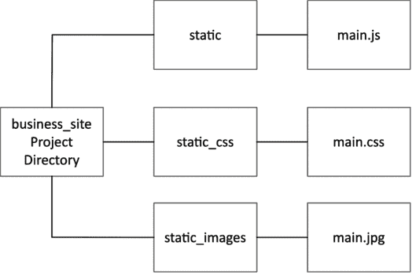

图 5.13 – 使用前缀 URL 的目录布局


通过 URL 访问这些文件时，映射关系如*图5.14*所示：

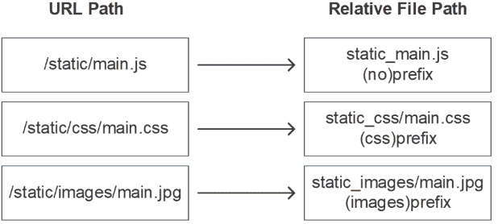

图5.14 – 根据前缀将 URL 映射到文件

Django 会将任何带有前缀的静态 URL 路由到与该前缀匹配的目录。

当与 `static` 模板标签一起使用时，请使用前缀和文件名，而不是目录名；请看以下示例：

```
```django

```
```

当使用 `collectstatic` 命令收集静态文件时，它们会被移入 `STATIC_ROOT` 中以前缀名称命名的目录。`STATIC_ROOT` 目录内的源路径和目标路径如*图5.15*所示：

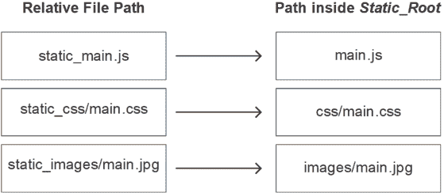

图5.15 – 从项目目录中的路径到 `STATIC_ROOT` 中路径的映射

Django 会在 `STATIC_ROOT` 内部创建前缀目录。这样一来，即使使用 Web 服务器而不通过 Django 进行 URL 查找，路径也能保持一致。

接下来，我们将了解一个管理命令，当静态文件未按预期加载时，它对故障排除非常有用：findstatic。

## findstatic 命令

staticfiles 应用还提供了另一个管理命令：findstatic。该命令允许你输入静态文件的相对路径（与在 `static` 模板标签中使用的路径相同），Django 会告诉你该文件位于哪里。它还可以在 verbose 模式下使用，以输出它正在搜索的目录。

> **注意**
> 你可能不熟悉 verbosity 或 verbose 模式的概念。较高的 verbosity（或直接开启 verbose 模式）会使命令生成更多输出。许多命令行应用程序可以以不同级别的 verbosity 执行。当你尝试调试正在使用的程序时，这会很有帮助。要查看 verbose 模式的示例，你可以尝试以 verbose 模式运行 Python  shell。输入 `python -v`（而不是仅输入 `python`）并按回车。Python 将以 verbose 模式启动，并打印出它导入的每个文件的路径。

此命令主要用于调试/故障排除。如果加载了错误的文件，或者找不到特定文件，你可以使用此命令来尝试找出原因。该命令将显示磁盘上正在为特定路径加载哪个文件，或者让你知道找不到该文件以及搜索了哪些目录。

这有助于解决多个文件同名且优先级与你预期不符的问题。你可能还会发现 Django 没有在你期望的目录中搜索该文件，这种情况下，可能需要将静态目录添加到 `STATICFILES_DIRS` 设置中。

在下一个练习中，你将执行 findstatic 管理命令，以便熟悉好（文件正确找到）和坏（文件缺失）场景下的输出。

## 练习5.05 – 使用 findstatic 查找文件

你现在将使用各种选项运行 findstatic 命令，并理解其输出的含义。首先，我们将使用它来查找一个存在的文件，并查看它显示的文件路径。然后，我们将尝试查找一个不存在的文件，并检查输出的错误。接下来，我们将以不同的详细程度和不同的命令交互方式重复此过程。虽然此练习不会对 Bookr 项目进行更改或推进，但最好熟悉此命令，以防在你自己的 Django 应用程序中需要用到它。让我们开始吧：

- 1. 打开终端，导航到 business_site 项目目录。
- 2. 不带任何选项执行 findstatic 命令。它将输出一些帮助信息，解释其使用方法：
- 3. 你可以一次查找一个或多个文件。让我们从一个我们知道存在的文件开始：main.css。我们将使用 findstatic 管理命令在磁盘上定位它，输入以下命令：
- 4. 让我们尝试查找一个不存在的文件，logo.png：

```
python3 manage.py findstatic
```

将显示以下帮助输出：

```
usage: manage.py findstatic [-h] [--first] [--version] [-v {0,1,2,3}] [--settings SETTINGS] [--pythonpath PYTHONPATH] [--traceback] [--no-color] [--force-color] [--skip-checks] staticfile [staticfile ...]
manage.py findstatic: error: Enter at least one label.
```

```
python3 manage.py findstatic main.css
```

上述命令输出找到 main.css 的路径：

```
Found 'main.css' here:
/Users/ben/business_site/static/main.css
```

你的完整路径会有所不同（除非你也叫 Ben），但你可以看到，当 Django 在请求中找到 main.css 时，它会从项目的 static 目录加载 main.css 文件。

如果你安装的第三方应用程序没有正确设置静态文件的命名空间，并且与你的某个文件冲突，这将非常有用。

```
python3 manage.py findstatic logo.png
```

Django 将显示一条错误信息，说明无法找到该文件：

```
No matching file found for 'logo.png'.
```

Django 无法找到此文件，因为我们已经对其进行了命名空间化——我们必须包含完整的相对路径，就像在 static 模板标签中使用的那样。

- 5. 再次尝试查找 logo.png，但这次使用完整路径：

```
python3 manage.py findstatic landing/logo.png
```

Django 现在可以找到该文件了：

```
Found 'landing/logo.png' here:
/Users/ben/business_site/landing/static/landing/logo.png
```

- 6. 你可以通过将每个文件作为参数添加来一次查找多个文件：

```
python3 manage.py findstatic landing/logo.png
missing-file.js main.css
```

每个文件的位置状态显示如下：

```
No matching file found for 'missing-file.js'.
Found 'landing/logo.png' here:
/Users/ben/business_site/landing/static/landing/logo.png
Found 'main.css' here:
/Users/ben/business_site/static/main.css
```

- 7. 该命令可以以 0、1 或 2 的详细程度执行。默认情况下，它以详细程度 1 执行。要设置详细程度，请使用 `--verbosity` 或 `-v` 标志。将详细程度降低到 0 只会输出它定位到的路径，而没有任何额外信息。对于缺失的路径，不会显示错误：

```
python3 manage.py findstatic -v0 landing/logo.png
missing-file.js main.css
```

输出只显示找到的路径——注意，没有显示缺失文件 missing-file.js 的错误：

```
/Users/ben/business_site/landing/static/landing/logo.png
/Users/ben/business_site/static/main.css
```

如果你将输出通过管道传递给另一个文件或命令，这种详细程度会很有用。

- 8. 要获得关于 Django 正在搜索所请求文件的哪些目录的更多信息，请将详细程度提高到 2：

```
```bash
python3 manage.py findstatic -v2 landing/logo.png
missing-file.js main.css
```
```

输出包含更多信息，包括为所请求文件搜索过的目录。你可以看到，由于安装了 admin 应用，Django 也在 Django admin 应用目录中搜索静态文件：

```
```text
(bookr) → business_site python3 manage.py findstatic -v2 landing/logo.png missing-file.js main.css
No matching file found for 'missing-file.js'.

Looking in the following locations:
    /Users/ben/business_site/static
    /Users/ben/.virtualenvs/bookr/lib/python3.9/site-packages/django/contrib/admin/static
    /Users/ben/business_site/landing/static
Found 'landing/logo.png' here:
    /Users/ben/business_site/landing/static/landing/logo.png
Looking in the following locations:
    /Users/ben/business_site/static
    /Users/ben/.virtualenvs/bookr/lib/python3.9/site-packages/django/contrib/admin/static
    /Users/ben/business_site/landing/static
Found 'main.css' here:
    /Users/ben/business_site/static/main.css
Looking in the following locations:
    /Users/ben/business_site/static
    /Users/ben/.virtualenvs/bookr/lib/python3.9/site-packages/django/contrib/admin/static
    /Users/ben/business_site/landing/static
```
```

图5.16 – 以详细程度 2 执行 findstatic，准确显示搜索了哪些目录

`findstatic` 命令并不是你在使用 Django 时会日常使用的命令，但在尝试排查静态文件问题时，了解它很有用。我们看到了命令的输出，存在的文件的完整路径，以及文件不存在时的错误消息。我们还运行该命令并一次提供多个文件，并看到所有文件的信息都输出出来了。最后，我们以不同的详细程度运行了该命令。`-v0` 标志抑制了有关缺失文件的错误。`-v1` 是默认值，显示找到的路径和错误。使用 `-v2` 标志提高详细程度，还会打印出正在为特定静态文件搜索的目录。

在下一节中，我们将了解静态文件缓存，以及 Django 如何帮助我们确保用户获得最新版本。


## 为最新文件提供服务（用于缓存失效）

如果你不熟悉缓存，其基本思想是某些操作执行起来可能需要很长时间。我们可以通过将操作结果存储在访问速度更快的地方来加快系统速度，这样下次需要时就可以快速检索。耗时较长的“操作”可以是任何东西——一个运行时间很长的函数、一个渲染时间很长的图像，或一个在互联网上下载时间很长的较大资源。我们关注的是最后一种情况。

你可能已经注意到，第一次访问某个网站时加载速度可能很慢，但下一次加载就会快得多。这是因为你的浏览器缓存了一些（或全部）站点加载所需的静态文件。

以我们的业务站点为例，我们有一个页面包含 `logo.png` 文件。第一次访问业务站点时，我们必须下载动态 HTML，它很小且传输速度很快。我们的浏览器解析 HTML 并看到应包含 `logo.png` 文件。然后它也可以下载此文件，该文件要大得多，下载时间可能更长。请注意，此场景假设我们的业务站点现在托管在远程服务器上，而不是本地机器上——后者对我们访问速度非常快。

如果 Web 服务器已正确设置，你的浏览器会将 `logo.png` 存储在你的计算机上。下一次我们访问 *landing* 页面（或确实包含 `logo.png` 文件的任何页面）时，我们的浏览器会识别 URL 并可以从磁盘加载文件，而无需再次下载，从而加快浏览体验。

> **注意**
> 我们说浏览器会在“Web 服务器设置正确”的情况下进行缓存。这是什么意思？前端 Web 服务器应配置为在静态文件响应中发送特殊的 HTTP 头。它可以发送 `Cache-Control` 头，其值可以是 `no-cache`（文件不应被缓存——也就是说，每次都应请求最新版本）或 `max-age=seconds`（文件只有在上次检索时间超过 *seconds* 秒后才应再次下载）。响应中还可能包含 `Expires` 头，其值为一个日期。一旦达到此日期，文件就被视为“过期”，此时应请求新版本。

计算机科学中最困难的问题之一是缓存失效。例如，如果我们更改了 `logo.png`，我们的浏览器如何知道应下载新版本？确定其是否已更改的唯一可靠方法是每次都重新下载文件并将其与已保存的版本进行比较。当然，这违背了缓存的初衷，因为我们仍会在文件更改时每次都下载（或不下载）。我们可以缓存任意或服务器指定的时间，但如果在此时间到期前静态文件已更改，我们就不会知道。我们将继续使用旧版本，直到我们认为它已过期，此时才会下载新版本。

如果我们有一周的过期时间，而静态文件在第二天就更改了，我们仍将使用旧文件六天。当然，浏览器可以强制不使用缓存重新加载页面（具体操作方法取决于浏览器；例如 Shift + F5 或 Cmd + Shift + R），如果你想强制再次下载所有静态资源。

没有必要尝试缓存我们的动态响应（渲染模板）。由于它们设计为动态，我们希望确保用户在每次页面加载时都能获得最新版本，因此不应缓存它们。它们的大小也相当小（与图像等资源相比），因此缓存它们带来的速度优势不大。

Django 提供了一个内置解决方案。在 `collectstatic` 阶段，当文件被复制时，Django 可以在其文件名中附加内容的哈希值。例如，源文件 `logo.png` 将被复制到 `static_production_test/landing/logo.f30ba08c60ba.png`。这仅在使用 `ManifestFilesStorage` 存储引擎时才会执行。

由于文件名只有在内容更改时才会更改，浏览器将始终下载新内容。

使用 ManifestFilesStorage 只是使缓存失效的一种方法。对于你的特定应用程序，可能还有其他更合适的选项。

> **注意**
> 哈希是一个单向函数，它会生成固定长度的字符串，而与输入的长度无关。有多种不同的哈希函数可用，Django 用于内容哈希的是 **MD5**。虽然不再具有加密安全性，但对于此目的已足够。为了说明固定长度的特性，字符串的 MD5 哈希为 `0cc175b9c0f1b6a831c399e269772661`。一个更长字符串的 MD5 哈希为 `69fc4316c18cdd594a58ec2d59462b97`。它们都长 32 个字符。

你可以通过更改 `settings.py` 中的 `STATICFILES_STORAGE` 值来选择存储引擎。这是一个指向要使用的模块和类的带点路径的字符串。实现哈希添加功能的类是 `django.contrib.staticfiles.storage.ManifestStaticFilesStorage`。

使用此存储引擎不需要对 HTML 模板进行任何更改，前提是你使用 `static` 模板标签包含静态资源。Django 会生成一个清单文件（`staticfiles.json`，JSON 格式），其中包含原始文件名与哈希文件名之间的映射。它在使用 `static` 模板标签时会自动插入哈希文件名。如果你不使用 `static` 标签包含静态文件，而是手动插入静态 URL，那么你的浏览器将尝试加载未哈希的路径，并且在缓存应失效时 URL 不会自动更新。

例如，你可以使用 `static` 标签包含 `logo.png`：

```html

```

页面渲染时，将从 `staticfiles.json` 中检索最新的哈希，输出将如下所示：

```html

```

而如果我们没有使用 `static` 标签，而是硬编码路径，它将始终按原样显示：

```html

```

由于其中不包含哈希，我们的浏览器将看不到路径的更改，因此永远不会尝试下载新文件。

Django 在运行 `collectstatic` 时会保留带有旧哈希的文件的先前版本，因此如果需要，应用程序的旧版本仍可以引用它。文件的最新版本也会以无哈希形式复制，以便非 Django 应用程序可以在无需查找哈希的情况下引用它。

在下一个练习中，我们将更改项目设置以使用 `ManifestFilesStorage` 引擎，然后运行 `collectstatic` 管理命令。这将像 *练习 5.04 – 为生产收集静态文件* 中那样复制所有静态资源；但是，它们现在将在文件名中包含哈希。

### 练习 5.06 – 探索 ManifestFilesStorage 存储引擎

在本练习中，你将暂时更新 `settings.py` 以使用 `ManifestFilesStorage`，然后运行 `collectstatic` 以查看文件如何生成哈希：

1. 在 PyCharm 中（仍在 `business_site` 项目中），打开 `settings.py` 并在文件底部添加 `STATICFILES_STORAGE` 设置：

    ```python
    STATICFILES_STORAGE = "django.contrib.staticfiles.storage.ManifestStaticFilesStorage"
    ```

    完成的 files 应该如下所示：https://github.com/PacktWorkshops/The-Django-Workshop/blob/master/Chapter05/Exercise5.06/business_site/business_site/settings.py。

2. 打开终端，导航到 `business_site` 项目目录，并像之前一样运行 `collectstatic` 命令：

    ```bash
    python3 manage.py collectstatic
    ```


如果你的 `static_production_test` 目录不是空的（在练习 5.04 – 收集生产用静态文件 中文件已被移入该目录，因此很可能不是空的），那么在执行收集时会提示你是否覆盖现有文件：

```
(bookr) → business_site python3 manage.py collectstatic
```

```
You have requested to collect static files at the destination location as specified in your settings:
```

```
/Users/ben/business_site/static_production_test
```

```
This will overwrite existing files!
Are you sure you want to do this?
```

```
Type 'yes' to continue, or 'no' to cancel:
```

图 5.17 – 静态文件收集时允许覆盖的提示

只需输入 yes 然后按 Enter 即可允许覆盖。

该命令的输出会告诉你复制了多少个文件，以及有多少个文件被处理并在文件名中添加了哈希：

```
0 static files copied to '/Users/ben/business_site/static_production_test', 130 unmodified, 98 post-processed.
```

由于自上次运行 collectstatic 以来你没有更改任何文件，因此没有文件被复制。相反，Django 会对文件进行后处理（其中 28 个）——即生成它们的哈希并将其附加到文件名。

3. 静态文件已像之前一样被复制到 `static_production_test` 目录中；不过，每个文件现在都有两个副本：一个带哈希命名，一个不带哈希。例如，`static/main.css` 已被复制到 `static_production_test/main.856c74fb7029.css`（如果你的 CSS 文件内容不同，例如有额外的空格或换行符，则文件名可能会不同）：

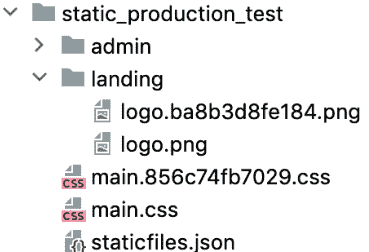

图 5.18 – 带有哈希文件名的展开的 static_production_test 目录

*图 5.18* 显示了展开的 `static_production_test` 目录结构。你可以看到每个静态文件的两个副本，以及 `staticfiles.json` 清单文件。以 `logo.png` 为例，你可以看到 `landing/static/landing/logo.png` 已被复制到 `static_production_test/landing/logo.ba8d3d8fe184.png`。

让我们修改 `main.css` 文件，看看哈希如何变化。

+   4. 在文件末尾添加一些空行并保存它（确保你编辑的是源文件，而不是已复制到 `static_production_test` 目录中的文件）。这不会改变 CSS 的效果，但文件内容的更改会影响其哈希值。重新在终端中运行 `collectstatic` 命令：

```
```bash
python3 manage.py collectstatic
```
```

再次，你可能需要输入 yes 来确认覆盖，这将给出以下输出：

```
```
You have requested to collect static files at the destination
location as specified in your settings:

    /Users/ben/business_site/static_production_test

This will overwrite existing files!
Are you sure you want to do this?

Type 'yes' to continue, or 'no' to cancel: yes

1 static file copied to '/Users/ben/business_site/static_
production_test', 129 unmodified, 98 post-processed.
```
```

由于只有一个文件被更改，因此只有一个静态文件被复制（`main.css`）。

5. 再次查看 `static_production_test` 目录。你应该会看到带有旧哈希的旧文件被保留，并且添加了一个带有新哈希的新文件：

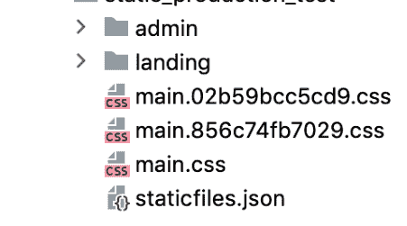

图 5.19 – 添加了带有最新哈希的另一个 main.css 文件

在本例中，我们有 `main.856c74fb7029.css`（已存在）、`main.02b59bcc5cd9.css`（新）和 `main.css`。你的哈希值可能不同。

`main.css` 文件（无哈希）始终包含最新内容——也就是说，`main.02b59bcc5cd9.css` 和 `main.css` 文件的内容是相同的。在 collectstatic 执行期间，Django 会复制带哈希的文件，也会复制不带哈希的文件。

6. 现在，检查 Django 生成的 `staticfiles.json` 文件。这是允许 Django 从普通路径查找哈希路径的映射。打开 `static_production_test/staticfiles.json`。所有内容可能都显示在一行中。如果是这样，请从 View 菜单 | Active Editor | Soft Wrap 启用文本软换行。滚动到文件末尾；你应该会看到 `main.css` 文件的条目；以下是一个示例：

```
"main.css": "main.02b59bcc5cd9.css"
```

这就是 Django 在使用 `static` 模板标签时能够在模板中填充正确 URL 的方式：通过在此映射文件中查找哈希路径。

7. 我们已经完成了对 `business_site` 的使用，它只是用于测试。你可以删除该项目或保留它以供活动期间参考。

> Note
> 
> 不幸的是，我们无法检查模板中哈希 URL 的插值方式，因为在调试模式下运行 Django 时，Django 不会查找文件的哈希版本。正如我们所知，Django 开发服务器仅在调试模式下运行，因此如果我们关闭调试模式以尝试查看哈希插值，Django 开发服务器将无法启动。你需要在部署到生产环境并使用前端 Web 服务器时自行检查此插值。

在本练习中，我们通过在 settings.py 中添加 STATICFILES_STORAGE 设置，将 Django 配置为对静态文件存储使用 ManifestFilesStorage。然后，我们执行了 collectstatic 命令，查看哈希是如何生成并添加到复制文件的文件名中的。我们看到了 staticfiles.json 清单文件，它存储了从原始路径到哈希路径的查找。最后，我们清理了本练习和练习 5.04 – 收集生产用静态文件 中添加的设置和目录。这些是 STATIC_ROOT 设置、STATICFILES_STORAGE 设置以及 static_production_test 目录。

到目前为止，我们只看到了如何定位存储在磁盘上的静态文件。Django 可以被定制为定位存储在其他位置的静态文件（例如云中）。在下一节中，我们将简要介绍如何使用自定义存储引擎。

## Custom storage engines

在上一节中，我们将存储引擎设置为 ManifestFilesStorage。该类由 Django 提供，但也可以编写自定义存储引擎。例如，你可以编写一个存储引擎，在运行 collectstatic 时将静态文件上传到 CDN、Amazon S3 或 Google Cloud 存储桶。

编写自定义存储引擎超出了本书的范围。已经存在第三方库支持上传到各种云服务。其中一个库是 Django Storages，可以在 https://django-storages.readthedocs.io/ 找到。

以下代码是一个简短的骨架，指示你应实现哪些方法来创建自定义文件存储引擎：

```
from django.conf import settings
from django.contrib.staticfiles import storage

class CustomFilesStorage(storage.StaticFilesStorage):
    def __init__(self):
        """The class must be able to be instantiated
        without any arguments.
        Create custom settings in settings.py and read them
        instead."""
```

```
self.setting = settings.CUSTOM_STORAGE_SETTING
```

你定义的类型（在本例中称为 CustomFilesStorage）必须能够在没有任何参数的情况下实例化。__init__ 函数必须能够从全局标识符（在本例中来自 Django 设置）加载任何设置：

```
def delete(self, name):
    """Implement delete of the file from the remote service."""
```

delete 方法应能够从远程服务中删除由 name 参数指定的文件：

```
def exists(self, name):
    """Return True if a file with name exists in the remote service."""
```

exists 方法应查询远程服务以检查指定名称的文件是否存在。如果文件存在则返回 True，如果不存在则返回 False：

```
def listdir(self, path):
    """List a directory in the remote service. Return should be a 2-tuple of lists, the first a list of directories, the second a list of files."""
```

listdir 方法应查询远程服务以列出 path 处的目录。然后它应返回一个二元组列表。该元组的第一个元素是 path 内部的目录列表，而第二个元素是文件列表；以下是一个示例：

```
return (["directory1", "directory2"], ["main.css", "document.txt", "image.jpg"])
```

如果 path 不包含任何目录或不包含任何文件，则应为该元素返回空列表。如果目录为空，则应返回两个空列表：

```
def size(self, name):
    """Return the size in bytes of the file with name."""
```


The size method should query the remote service and get the size of the file specified by name:

```
def url(self, name):
    """Return the URL where the file of with name can be access on the remote service. For example, this might be URL of the file after it has been uploaded to a specific remote host with a specific domain."""
```

The url method should determine the URL to access the file specified by name. This can be built by appending name to a specific static hosting URL:

```
def _open(self, name, mode="rb"):
    """Return a File-like object pointing to file with name. For example, this could be a URL handle for a remote file."""
```

The _open method will provide a handle remote file, specified by name. How you implement this will depend on the type of remote service. You might have to download the file and then use a memory buffer (such as an io.BytesIO object) to simulate opening the file:

```
def _save(self, name, content):
    """Write the content for a file with name. In this method you might upload the content to a remote service."""
```

The _save method should save content to the remote file at name. The method of implementing this will depend on your remote service. It might transfer the file over SFTP, or upload it to a CDN.

While this example does not implement any transferring to or from a remote service, you can refer to it to get an idea of how to implement a custom storage engine.

After implementing your custom storage engine, you can make it active by setting its dotted module path in the STATICFILES_STORAGE setting in settings.py.

You’ll now work on the first activity in this chapter. In this activity, you’ll add a static logo image to the Bookr application. The logo will be displayed in the Reviews section of the website.

## Activity 5.01 – adding a Reviews logo

The Bookr app should have a logo that is specific to pages in the Reviews app. This will involve adding a base template just for the Reviews app and updating our current Reviews templates to inherit from it. Then, you'll include the Bookr Reviews logo on this base template.

These steps will help you complete this activity:

- 1. Add a CSS rule to position the logo. Put this rule into the existing `base.html` file, after the `.navbar-brand` rule:
  ```
  .navbar-brand > img {
    height: 60px;
  }
  ```
- 2. Add a `brand` block template tag that inheriting templates can override. Put this inside the `<a>` element with the `navbar-brand` class. The default contents of `block` should be left as *Book Review*.
- 3. Add a static directory inside the Reviews app, containing a namespaced directory. Download the Reviews `logo.png` file from `https://raw.githubusercontent.com/PacktPublishing/Web-Development-with-Django-Second-Edition/main/Chapter05/Activity5.01/bookr/reviews/static/reviews/logo.png` and put it inside this directory.
- 4. Create a `templates` directory for the Bookr project (inside the Bookr project directory). Then, move the Reviews app's current `base.html` into this directory so that it becomes a base template for the whole project.
- 5. Add the new `templates` directory's path to the `TEMPLATES["DIRS"]` setting in `settings.py`.
- 6. Create another `base.html` template specifically for the Reviews app. Put it inside the Reviews app's `templates` directory. The new template should extend the existing (now global) `base.html` file.
- 7. The new `base.html` file should override the content of the `brand` block. This block should contain just a `` whose `src` attribute is set using the `` template tag. The image source should be the logo we added in *Step 2*.

```
.navbar-brand > img {
  height: 60px;
}
```

Refer to the following screenshots to see what your pages should look like after these changes. Note that although you are making changes to the base template, it will not change the layout of the main page:

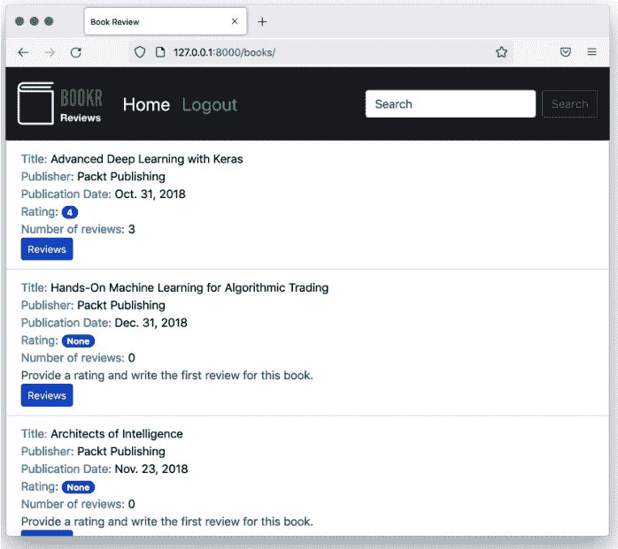

Figure 5.20 – The Book List page after adding the Reviews logo

On the **Book Details** page, you will also see the Reviews logo:

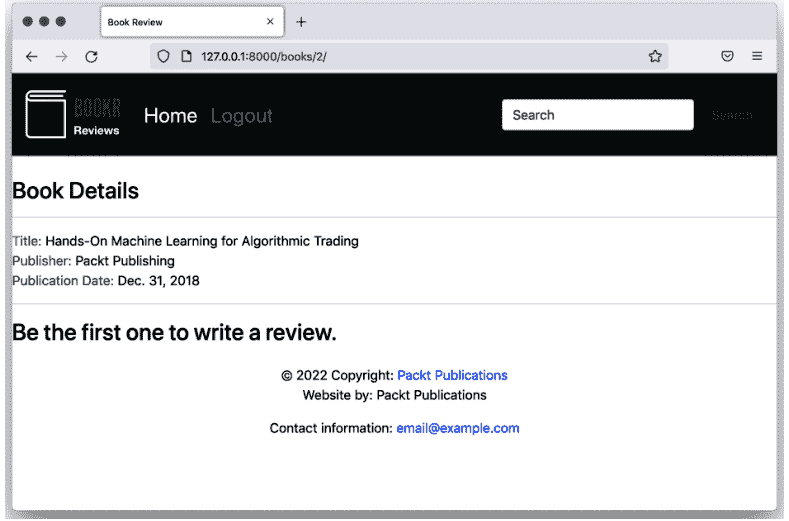

Figure 5.21 – The Book Details page after adding the Reviews logo

> **Note**
> The solution for this activity can be found on https://github.com/PacktPublishing/Web-Development-with-Django-Second-Edition/tree/main/ActivitySolutions.

## Activity 5.02 – CSS enhancements

Currently, the CSS is kept inline in the base.html template. As a best practice, it should be moved into its own file so that it can be cached separately and decrease the size of the HTML downloads. As part of this, you’ll also add some CSS enhancements such as fonts and colors, and link in Google Fonts CSS to support these changes.

These steps will help you complete this activity:

- 1. Create a directory named `static` in the Bookr project directory. Then, create a new file inside it named `main.css`.
- 2. Copy the contents of the `<style>` element from the main `base.html` template into the new `main.css` file, then remove the `<style>` element from the template. Add these extra rules to the end of the CSS file:
  ```
  body {
      font-family: 'Source Sans Pro', sans-serif;
      background-color: #e6efe8
      color: #393939;
  }
  
  h1, h2, h3, h4, h5, h6 {
      font-family: 'Libre Baskerville', serif;
  }
  ```
- 3. Link to the new `main.css` file with a `<link rel="stylesheet" href="...">` tag. Use the `` template tag to generate the URL for the href attribute, and don't forget to load the `static` library.
- 4. Link in the Google Fonts CSS by adding this code to the base template:
  ```
  <link rel="stylesheet" href="https://fonts.googleapis.com/css?family=Libre+Baskerville|Source+Sans+Pro&display=swap">
  ```

(You will need to have an active internet connection so that your browser can include this remote CSS file.)

5. Update your Django settings to add `STATICFILES_DIRS`, which is set to the static directory you created in *Step 1*. When you’re finished, your Bookr application should look like *Figure 5.22*:

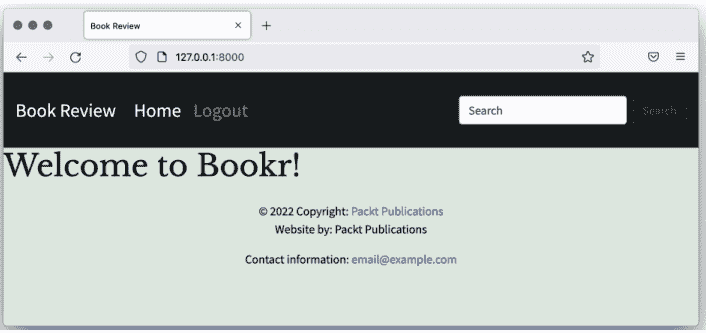

Figure 5.22 – Main page with a new font and background color

Notice the new font and background color. These should be displayed on all the Bookr pages.

> **Note**
> 
> The solution for this activity can be found on `https://github.com/PacktPublishing/Web-Development-with-Django-Second-Edition/tree/main/ActivitySolutions`.

## Activity 5.03 – adding a global logo

You have already added a logo that is served on pages for the Reviews app. We have another logo to be used globally by default, but other apps will be able to override it:

- 1. Download the Bookr logo (`logo.png`) from `https://raw.githubusercontent.com/PacktPublishing/Web-Development-with-Django-Second-Edition/main/Chapter05/Activity5.03/bookr/static/logo.png`.
- 2. Save it in the main static directory for the project.
- 3. Edit the main `base.html` file. We already have a block for the logo (brand), so a `` can be placed inside here. Use the `static` template tag to refer to the logo you just downloaded.
- 4. Check that your pages work. On the main URL, you should see the Bookr logo, but on the **Book List** and **Book Details** pages, you should see the Bookr Reviews logo.

When you’re finished, you should see the Bookr logo on the main page:

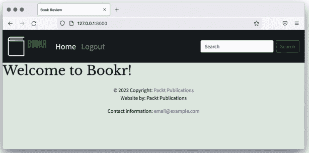

Figure 5.23 – Bookr logo on the main page

When you visit a page that had the Bookr Reviews logo before, such as the **Book List** page, it should still show the Bookr Reviews logo:

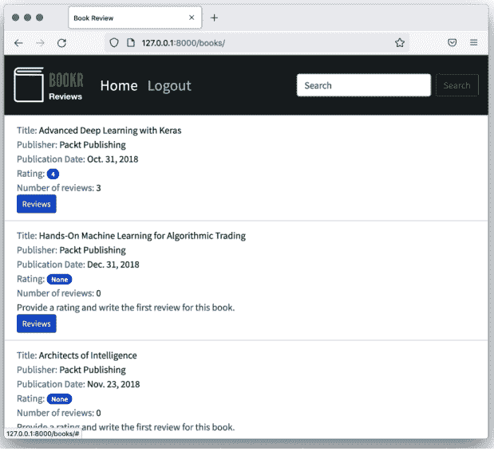

Figure 5.24 – Bookr Reviews logo still appears on the Reviews pages

Note
The solution for this activity can be found on https://github.com/PacktPublishing/Web-Development-with-Django-Second-Edition/tree/main/ActivitySolutions.

## Summary

In this chapter, we showed you how to use Django’s staticfiles app to find and serve static files. We used the built-in static view to serve these files with the Django dev server in DEBUG mode. We showed different places to store static files by using a directory that is global to the project or in a specific directory for the application; global resources should be stored in the former while application-specific resources should be stored in the latter. We showed the importance of namespacing static file directories to prevent conflicts. After serving the assets, we used the static tag to include them in our template. We then demoed how the collectstatic command copies all the assets into the STATIC_ROOT directory, for production deployment. We showed how to use the findstatic command to debug the loading of static files. To invalidate caches automatically, we looked at using ManifestFilesStorage to add a hash of the file’s content to the static file URL. Finally, we briefly talked about using a custom file storage engine.

So far, we have only fetched web pages using content that already exists. In the next chapter, we will start adding forms so that we can interact with web pages by sending data to them over HTTP.


