## Forms

本章介绍网页表单，这是一种将信息从浏览器发送到 Web 服务器的方法。我们将先介绍表单的一般概念，并讨论数据如何被编码以发送到服务器。

到目前为止，我们为 Django 构建的视图都是单向的。我们的浏览器正在从我们编写的视图中检索数据，但它不会向这些视图发送任何数据。在第 4 章《Django 管理员简介》中，我们通过使用 Django 管理员并提交表单来创建模型实例，但这些表单使用的是 Django 内置的视图，而不是我们自己创建的。在本章中，我们将使用 Django Forms 库开始接收用户提交的数据。数据将通过 URL 参数中的 GET 请求和/或请求体中的 POST 请求提供。但在深入细节之前，先让我们了解 Django 中的表单是什么。你将了解到在 GET HTTP 请求中发送表单数据与在 POST HTTP 请求中发送表单数据的区别，以及如何选择使用哪一种。

在本章中，我们将涵盖以下主题：

- 什么是表单？
- Django Forms 库
- 验证表单并检索 Python 值
- 活动 1 – 书籍搜索

到本章结束时，你将学会 Django 的 Forms 库如何用于自动构建和验证表单，以及它如何减少需要手动编写的 HTML 数量。

### 技术要求

本章的完整代码文件可在 https://github.com/PacktPublishing/Web-Development-with-Django-Second-Edition/tree/main/Chapter06 获取。

### What is a form?

在使用交互式 Web 应用时，我们不仅希望向用户提供数据，还希望从用户那里接受数据，以定制我们生成的响应，或让他们向网站提交数据。在浏览网页时，你肯定使用过表单。无论你是否登录到网上银行账户、使用浏览器冲浪、在社交媒体上发布消息，或向在线邮件客户端写邮件，在所有这些情况下，你都在表单中输入数据。表单由输入组成，这些输入定义了要提交到服务器的数据的键值对。例如，登录网站时发送的数据将具有键 *username* 和 *password*，值分别为你的用户名和你的密码。我们将在后面的部分更详细地介绍不同类型的输入。表单中的每个输入都有一个 *name*，这就是服务器端（在 Django 视图中）识别其数据的方式。可以有多个具有相同 *name* 的输入，其数据以包含该名称的所有已发布值的列表形式提供——例如，具有要应用于用户的权限的复选框列表。每个复选框将具有相同的名称但不同的值。表单具有属性，指定浏览器应将数据提交到哪个 URL 以及应使用什么方法提交数据（浏览器仅支持 *GET* 或 *POST*）。

以下图所示的 GitHub 登录页面就是一个表单的示例：

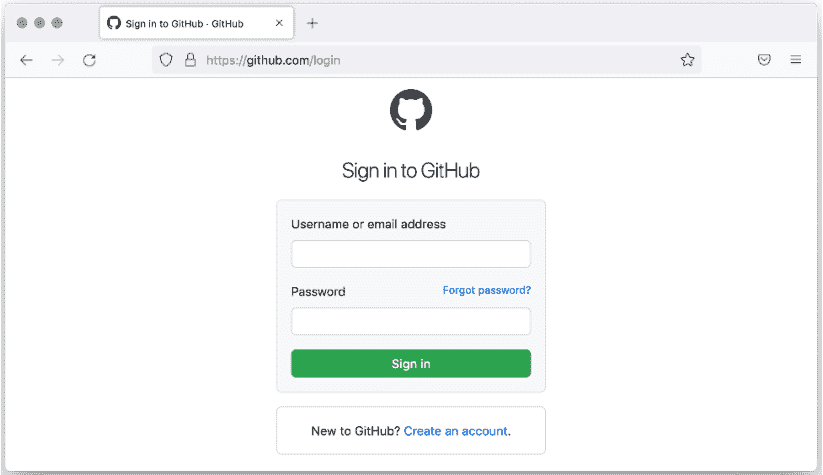

图 6.1：GitHub 登录页面是表单的一个示例

它有三个可见的输入：一个文本字段（**用户名或电子邮件地址**）、一个密码字段（**密码**）和一个提交按钮（**登录**）。它还有一个不可见的字段——其类型为隐藏，包含用于安全性的特殊令牌，称为 CSRF 令牌。我们将在本章后面讨论这个问题。当你点击 **登录** 按钮时，表单数据将通过 *POST* 请求提交。如果输入了有效的用户名和密码，你将被登录；否则，表单将显示错误，如下所示：

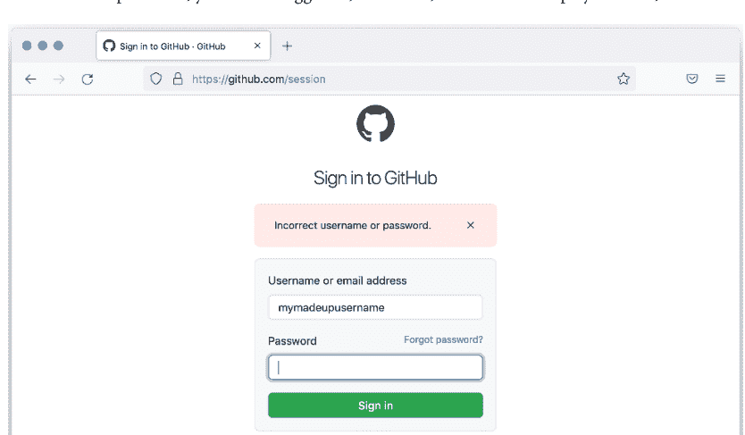

图 6.2：使用错误的用户名或密码提交的表单

表单可以有两种状态：提交前和提交后。第一种是页面首次加载时的初始状态。所有字段都将具有默认值（通常为空），并且不会显示错误。如果输入到表单中的所有信息都是有效的，那么通常在提交后，你将被带到显示提交结果的页面。这可能是搜索结果页面或显示你创建的新对象的页面。在这种情况下，你将看不到表单的提交后状态。

如果你没有输入有效的信息到表单中，那么它将被再次渲染为提交后状态。在此状态下，你将看到你输入的信息，以及任何错误以帮助你解决表单问题。这些错误可能是字段错误或非字段错误。字段错误适用于特定字段——例如，留下必填字段空白或输入的值过大、过小、过长或过短。如果表单要求你输入姓名而你留空，这将显示为该字段旁边的字段错误。

非字段错误要么不适用于某个字段，要么适用于多个字段，并在表单顶部显示。在前面的图中，我们可以看到一条消息，提示用户名或密码可能不正确以登录。出于安全原因，GitHub 不会透露用户名是否有效，因此这显示为非字段错误，而不是用户名或密码的字段错误（Django 也遵循此约定）。非字段错误也适用于相互依赖的字段。例如，在信用卡表单上，如果付款被拒绝，我们可能不知道信用卡号码或安全码是否不正确；因此，我们不能在特定字段上显示该错误。它适用于整个表单。

让我们从表单元素本身开始，查看 HTML 表单的不同部分。

### The form element

所有在表单提交期间使用的输入都必须包含在 `<form>` 元素内。有三个 HTML 属性你必须使用来修改表单的行为：

- `method`
  这是提交表单的 HTTP 方法；要么是 `get` 要么是 `post`。如果省略，则默认为 `get`（因为这是你在浏览器中输入 URL 并按 *Enter* 时的默认方法）。
- `action`
  这是指发送表单数据到的 URL（或路径）。如果省略，数据将被发送回当前页面。
- `enctype`
  这设置表单的编码类型。你只有在使用表单上传文件时才需要更改此设置。最常见的值是 `application/x-www-form-urlencoded`（如果省略此值时的默认值）或 `multipart/form-data`（如果你上传文件则设置此值）。请注意，你不必担心视图中的编码类型——Django 会自动处理不同类型。

以下是未设置任何属性的表单示例：

```
<form>
    <!-- Input elements go here -->
</form>
```

它将使用 GET 请求向表单显示的当前 URL 提交其数据，使用 `application/x-www-form-urlencoded` 编码类型。

在下面的示例中，我们将在表单上设置全部三个属性：

```
<form method="post" action="/form-submit"
enctype="multipart/form-data">
    <!-- Input elements go here -->
</form>
```

此表单将使用 POST 请求向 /form-submit 路径提交其数据，将数据编码为 multipart/form-data。

GET 和 POST 请求在数据发送方式上有什么不同？回想一下第 1 章《Django 简介》中，我们讨论了浏览器发送的底层 HTTP 请求和响应数据是什么样的。在接下来的两个示例中，我们将两次提交相同的表单，第一次使用 GET，第二次使用 POST。表单将有两个输入：名字和姓氏。

使用 GET 提交的表单会像这样在 URL 中发送其数据：

```
GET /form-submit?first_name=Joe&last_name=Bloggs HTTP/1.1
Host: www.example.com
```

而使用 POST 提交的表单会像这样在请求体中发送其数据：

```
POST /form-submit HTTP/1.1
Host: www.example.com
Content-Length: 31
Content-Type: application/x-www-form-urlencoded

first_name=Joe&last_name=Bloggs
```

你会注意到，在这两种情况下，表单数据都被编码相同；只是对于 GET 和 POST 请求放置的位置不同。在“在 GET 或 POST 之间选择”部分，我们将讨论如何在这两种类型的请求之间进行选择。

### Types of inputs

到目前为止，我们已经看到了四种输入的示例（文本、密码、提交和隐藏）。大多数输入都是使用 <input> 标签创建的，其类型通过其 type 属性指定。每个输入都有一个 name 属性，定义了发送到服务器的 HTTP 请求中的键值对的键。

在下一个练习中，我们将看看如何用 HTML 构建一个表单。这将使你能够熟悉许多不同的表单字段。


## 练习 6.01 – 用 HTML 构建表单

在本章的前几个练习中，我们需要一个 HTML 表单来进行测试。我们将在本练习中手动编写一个。这也能让你体验不同字段是如何被验证和提交的。我们将在一个新的 Django 项目中完成此操作，以免干扰 Bookr。你可以参考第 1 章来回顾如何创建一个 Django 项目：

1. 我们先创建新的 Django 项目。你可以复用已经安装了 Django 的 Bookr 虚拟环境。打开一个新终端并激活虚拟环境。然后使用 django-admin 启动一个名为 form_project 的 Django 项目。为此，运行以下命令：

```
django-admin startproject form_project
```

这将在名为 form_project 的目录中搭建 Django 项目。

2. 使用 startapp 管理命令在此项目中创建一个新的 Django 应用。该应用应命名为 form_example。为此，先 cd 进入 form_project 目录，然后运行以下命令：

```
python3 manage.py startapp form_example
```

这将在 form_project 目录内创建 form_example 应用目录。

3. 启动 PyCharm，然后打开 form_project 目录。如果你已经有打开的项目，可以通过选择 File -> Open 来完成；否则，只需在 Welcome to PyCharm 窗口中点击 Open。导航到 form_project 目录，选中它，然后点击 Open。

如果出现提示，请务必选择 Trust Project。

form_project 项目窗口应如下所示：

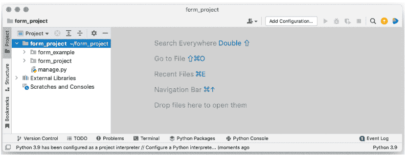

图 6.3：form_project 项目已打开

4. 创建一个新的运行配置，为项目执行 manage.py runserver。你可以再次复用 Bookr 虚拟环境。完成后，Run/Debug Configurations 窗口应类似于下图：

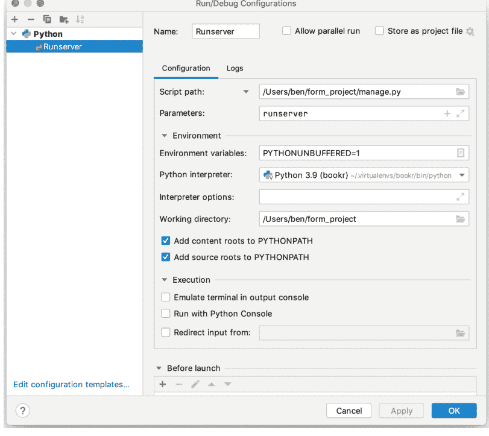

图 6.4：Runserver 的 Run/Debug Configurations

你可以通过点击 Run 按钮，然后在浏览器中访问 http://127.0.0.1:8000/ 来测试配置是否正确。你应该会看到 Django 欢迎屏幕。如果调试服务器无法启动，或者你看到的是 Bookr 主页，那么你可能还有 Bookr 项目在运行。试着停止 Bookr 的 runserver 进程，然后启动你刚刚设置的新进程。

5. 打开 form_project 目录中的 settings.py，并将 "form_example" 添加到 INSTALLED_APPS 设置中。

6. 设置这个新项目的最后一步是为 form_example 应用创建一个 templates 目录。右键点击 form_example 目录，然后选择 New | Directory。将其命名为 templates。

7. 我们需要一个 HTML 模板来显示我们的表单。右键点击你刚刚创建的 templates 目录，然后选择 New | HTML File 来创建一个。

在出现的对话框中，输入名称 form-example.html 并按 Enter 创建它。

8. form-example.html 文件现在应该已经在 PyCharm 的编辑窗格中打开了。首先创建 form 元素。我们将把它的 method 属性设置为 post。action 属性将被省略，这意味着表单将提交回加载它的同一个 URL。

将这段代码插入到 <body> 和 </body> 标签之间：

```
<form method="post">
</form>
```

9. 现在，让我们添加一些输入字段。为了在每个输入之间添加一点间距，我们将它们包裹在 <p> 标签中。我们先从一个文本字段和一个密码字段开始。这段代码应该插入到你刚刚创建的 <form> 标签之间：

```
<p>
    <label for="id_text_input">Text Input</label><br>
    <input id="id_text_input" type="text"
        name="text_input" value="" placeholder=
        "Enter some text">
</p>
<p>
    <label for="id_password_input">Password Input
    </label><br>
    <input id="id_password_input" type="password"
        name="password_input" value="" placeholder="Your
        password">
</p>
```

10. 接下来，我们将添加两个复选框和三个单选按钮。在你在上一步中添加的 HTML 之后插入这段代码；它应该出现在 </form> 标签之前：

```
<p>
    <input id="id_checkbox_input" type="checkbox"
        name="checkbox_on" value="Checkbox Checked"
        checked>
    <label for="id_checkbox_input">Checkbox</label>
</p>
<p>
    <input id="id_radio_one_input" type="radio"
```

```
```html
name="radio_input" value="Value One">
<label for="id_radio_one_input">Value One</label>
<input id="id_radio_two_input" type="radio"
    name="radio_input" value="Value Two" checked>
<label for="id_radio_two_input">Value Two</label>
<input id="id_radio_three_input" type="radio"
    name="radio_input" value="Value Three">
<label for="id_radio_three_input">Value Three
</label>
</p>
```
```

11. 接下来是一个下拉选择菜单，用于选择最喜欢的书。将这段代码添加在上一步的代码之后，但在 `</form>` 标签之前：

```
```html
<p>
    <label for="id_favorite_book">Favorite Book
    </label><br>
    <select id="id_favorite_book" name=
        "favorite_book">
        <optgroup label="Non-Fiction">
            <option value="1">Deep Learning with
                Keras</option>
            <option value="2">Web Development with
                Django</option>
        </optgroup>
        <optgroup label="Fiction">
            <option value="3">Brave New World</option>
            <option value="4">The Great
                Gatsby</option>
        </optgroup>
    </select>
</p>
```
```

它会显示四个选项，分为两组。用户将只能选择一个选项。

12. 接下来是一个多选列表（通过 multiple 属性实现）。将这段代码添加在上一步的代码之后，但在 </form> 标签之前：

```
<p>
    <label for="id_books_you_own">Books You Own</label><br>
    <select id="id_books_you_own" name="books_you_own" multiple>
        <optgroup label="Non-Fiction">
            <option value="1">Deep Learning with Keras</option>
            <option value="2">Web Development with Django</option>
        </optgroup>
        <optgroup label="Fiction">
            <option value="3">Brave New World</option>
            <option value="4">The Great Gatsby</option>
        </optgroup>
    </select>
</p>
```

用户可以从四个选项中选择零个或多个。它们显示为两组。

13. 接下来是一个 textarea。它类似于文本字段，但有多行。与前面的步骤一样，这段代码应该添加在结束的 </form> 标签之前：

```
<p>
    <label for="id_text_area">Text Area</label><br>
    <textarea name="text_area" id="id_text_area" placeholder="Enter multiple lines of text">
    </textarea>
</p>
```

14. 接下来，我们将添加一些用于特定数据类型的字段：数字、电子邮件和日期输入。把所有这些添加到 </form> 标签之前：

```
<p>
    <label for="id_number_input">Number Input</label><br>
    <input id="id_number_input" type="number"
        name="number_input" value="" step="any"
        placeholder="A number">
</p>
<p>
    <label for="id_email_input">Email Input</label><br>
    <input id="id_email_input" type="email"
        name="email_input" value="" placeholder="Your
        email address">
</p>
<p>
    <label for="id_date_input">Date Input</label><br>
    <input id="id_date_input" type="date"
        name="date_input" value="2019-11-23">
</p>
```

15. 现在我们将添加一些按钮来提交表单。同样，在结束的 </form> 标签之前插入：

```
<p>
    <input type="submit" name="submit_input"
        value="Submit Input">
</p>
<p>
    <button type="submit" name="button_element"
        value="Button Element">Button With<strong>
        Styled</strong> Text
    </button>
</p>
```

这将演示创建提交按钮的两种方式：作为 <input> 或 <button>。

16. 最后，我们将添加一个隐藏字段。在结束的 </form> 标签之前插入：

```
<input type="hidden" name="hidden_input" value="Hidden Value">
```

这个字段无法被看到或编辑，因此它有一个固定的值。

你现在可以保存并关闭 form-example.html 了。

17. 与任何模板一样，除非我们有一个视图来渲染它，否则我们无法看到它。打开 form_example 应用的 views.py 文件，并添加一个名为 form_example 的新视图。它应该渲染并返回你刚刚创建的模板，如下所示：

```
def form_example(request):
    return render(request, "form-example.html")
```

你现在可以保存并关闭 views.py 了。

18. 现在你应该熟悉下一步了，那就是为视图添加一个 URL 映射。打开 form_project 包目录中的 urls.py 文件。将 form-example 路径到你的 form_example 视图的映射添加到 urlpatterns 变量中。它应该看起来像这样：

```
path('form-example/', form_example.views.form_example)
```

确保你还要添加 form_example.views 的导入。保存并关闭 urls.py。

19. 启动 Django 开发服务器（如果它还没有运行），然后在你的浏览器中加载你的新视图；地址是 http://127.0.0.1:8000/form-example/。你的页面应该看起来像这样：


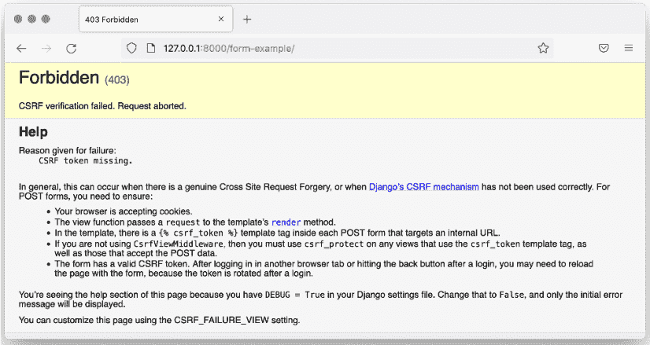

Figure 6.7: CSRF verification error

20. If you do receive an error, just go **Back** in your browser to return to the input example page.

In this exercise, you created an example page showcasing many HTML inputs, then created a view to render it and a URL to map to it. You loaded the page in your browser and experimented with changing data and trying to submit the form when it contained errors.

We just saw an example of Django’s CSRF protection. In the next section, we’ll learn what CSRF is and how Django’s protection works.

## Form security with Cross-Site Request Forgery Protection

Throughout this book, we have mentioned features that Django includes to prevent certain types of security exploits. One of these features is protection against **Cross-Site Request Forgery (CSRF)**.

The CSRF attack exploits the fact that a form on a website can be submitted to any other website. The `action` attribute of this form just needs to be set appropriately. Let’s look at an example for Bookr. We don’t have this set up yet, but we will be adding a view and a URL that allows us to post a review for a book. To do this, we’ll have a form for posting the review content and selecting the rating. Its HTML is like this:

```
```html
<form method="post" action="http://127.0.0.1:8000/books/4/reviews/">
    <p>
        <label for="id_review_text">Your Review
```
```

```
```html
placeholder="Enter your review"></textarea>
</p>
<p>
    <label for="id_rating">Rating</label><br/>
    <input id="id_rating" type="number" name="rating"
        placeholder="Rating 1-5">
</p>
<p>
    <button type="submit">Enter My Website</button>
</p>
</form>
```
```

When the template gets rendered, the template tag is interpolated, so the output HTML ends up like this (note that the inputs are still in the output – they have just been removed here for brevity):

```
```html
<form method="post" action=
"http://127.0.0.1:8000/books/4/reviews/">
    <input type="hidden" name="csrfmiddlewaretoken"
        value="tETZjLDUxEv1tiYqGCSbMQkhWiesHCnutxpt6mutHI6YH6
4F0nin5k2JW3B68IeJ">
    ...

</form>
```
```

Since this is a hidden field, the form on the page does not look any different from how it did before.

The CSRF token is unique to every visitor on the site. If an attacker were to copy the HTML from our site, they would get their own CSRF token, which would not match that of any other user, so Django would reject the form when it was posted by someone else.

CSRF tokens also change periodically. This limits how long the attacker would have to take advantage of a particular user and token combination. Even if they were able to get the CSRF token of a user that they were trying to exploit, they would have a short window of time to use it.

Now that you know what a CSRF token is used for, we will be adding it to our example form in the next exercise. Before we get to that, let’s have a quick refresh about accessing data in a request using QueryDict objects.

## Accessing data in the View

As we discussed in Chapter 1, Django provides two QueryDict objects on the HTTPRequest instances that are passed to the view function. These are request.GET, which contains parameters passed in the URL, and request.POST, which contains parameters in the HTTP request body. Even though request.GET has GET in its name, this variable is populated even for non-GET HTTP requests. This is because the data it contains is parsed from the URL. Since all HTTP requests have a URL, all HTTP requests may contain GET data, even if they are POST or PUT, and so on.

In the next exercise, we will add code to our view to read and display the POST data.

## Exercise 6.02 – working with POST data in a view

We will now add some code to our example view to print out the received POST data to the console. We will also insert the HTTP method that was used to generate the page, into the HTML output. This will allow us to be sure of what method was used to generate the page (GET or POST) and see how the form differs for each type:

+   1. First, in PyCharm, open the form_example app’s views.py file. Alter the form_example view so that it prints each value in the POST to the console by adding this code inside the function:

```
for name in request.POST:
    print("{}": {}".format(name,
        request.POST.getlist(name)))
```

This code iterates over each key in the request POST data’s QueryDict and prints the key and list of values to the console. We already know that each QueryDict can have multiple values for a key, so we use the getlist function to get them all.

+   2. Pass the template’s request.method into a context variable named method. Do this by updating the call to render in the view so that it’s like this:

```
return render(request, "form-example.html", {"method":
request.method})
```

+   3. We will now display the method variable in the template. Open the form-example.html template and use a <h4> tag to show the method variable. Put this just after the opening <body> tag, like so:

```
<body>
    <h4>Method: {{ method }}</h4>
```

Note that we could access the method directly inside the template without passing it in a context dictionary, by using the request.method variable. We know from Chapter 3, URL Mapping, Views, and Templates, that by using the render shortcut function, the request is always available in the template. We just demonstrated how to access the method in the view here because later on, we will change the behavior of the page based on the method.

+   4. We also need to add the CSRF token to the form HTML. We do this by putting the  template tag after the opening <form> tag. The start of the form should look like this:

```
<form method="post">
    
```

Now, save the file.

+   5. Start the Django Dev Server if it's not already running. Load the example page (http://127.0.0.1:8000/form-example/) in your browser; you should see it now displays the method at the top of the page (GET):

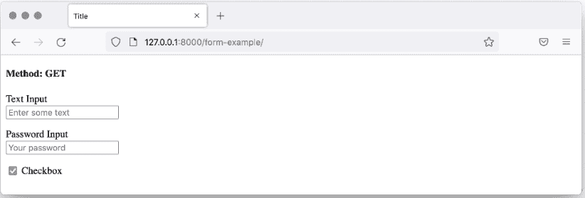

Figure 6.10: Method at the top of the page

+   6. Enter some text or data in each of the inputs and submit the form by clicking the Submit Input button:

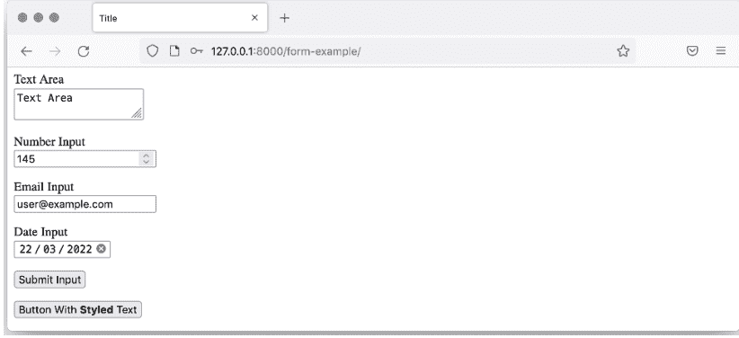

Figure 6.11: Clicking the Submit Input to submit the form

You should see the page reload and the method display change to POST:

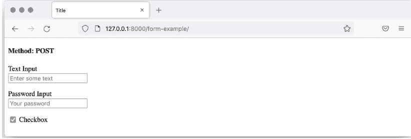

Figure 6.12: Method updated to POST after form submitted

+   7. Switch back to PyCharm and look in the Run console at the bottom of the window. If the console is not visible, click the Run button at the bottom of the window to show it:

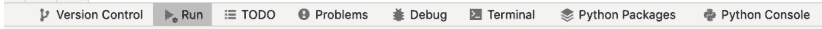

Figure 6.13: Clicking the Run button at the bottom of the window to display the console

If you’re running the dev server in Debug mode, click Debug instead.

Inside the Run console, the list of the values that were posted to the server should be displayed:

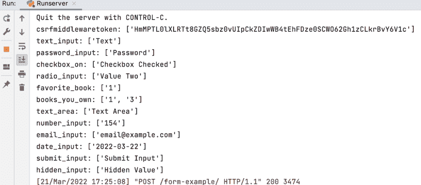

Figure 6.14: Input values shown in the Run console

Here are some things you should note:

+   - All values are sent as text, even number and date inputs
+   - For the select inputs, the selected value attributes of the selected options are sent, not the text content of the option tag.
+   - If you select multiple options for books_you_own, then you will see multiple values in the request. This is why we use the getlist method since multiple values are sent for the same input name.
+   - If the checkbox was checked, you will have a checkbox_on input in the debug output. If it was not checked, then the key will not exist at all (that is, there is no key instead of having the key existing with an empty string or None value).
+   - We have a value for the submit_input name, which is the text Submit Input. You submitted the form by clicking the Submit Input button, so we receive its value. Notice that no value is set for the button_element input since that button was not clicked.

8. We will experiment with two other ways of submitting the form, first by pressing Enter on the keyboard when your cursor is in a text-like input (text, password, date, email, but not text area as pressing Enter will add a new line).


如果你以这种方式提交表单，表单的行为就好像你点击了表单上的第一个提交按钮一样，因此 `submit_input` 输入值会被包含进去。你看到的输出应该与前一幅图相匹配。

另一种提交表单的方式是点击 `button_element` 提交输入。我们将尝试点击此按钮来提交表单。你应该会看到 `submit_button` 不再出现在已发布的值列表中，而 `button_element` 现在出现了：

```
csrfmiddlewaretoken: ['HmMPTL0LXLRT\ntext_input: ['Text']\npassword_input: ['']\ncheckbox_on: ['Checkbox Checked']\nradio_input: ['Value Two']\nfavorite_book: ['1']\nbooks_you_own: ['1', '3']\ntext_area: ['Text Area']\nnumber_input: ['154']\nemail_input: ['email@example.com']\ndate_input: ['2022-03-22']\nbutton_element: ['Button Element']\nhidden_input: ['Hidden Value']
```

Figure 6.15: submit_button is now gone from the inputs, and button_element has been added

你可以使用这种多提交技术来改变视图的行为，具体取决于点击了哪个按钮。你甚至可以拥有多个具有相同 *name* 属性的提交按钮，以使逻辑更易于编写。

在此练习中，你通过使用 `` 模板标签向表单元素添加了 CSRF 令牌。这意味着你的表单可以成功提交到 Django，而不会生成 **HTTP Permission Denied** 响应。然后我们添加了一些代码来输出表单在提交时包含的值。我们尝试使用各种值提交表单，以查看它们是如何解析为 `request.POST` 部分的 `QueryDict` 中的 Python 变量的。我们现在将讨论有关 GET 和 POST 请求之间差异的更多理论，然后转向 Django Forms 库，该库使设计和验证表单变得更容易。

## Choosing between GET or POST

选择使用 GET 还是 POST 请求需要考虑多个因素。最重要的是决定请求是否应该是幂等的。如果请求可以重复并且每次都产生相同的结果，则可以说该请求是幂等的。让我们看一些例子。

如果你在浏览器中输入任何网页地址（例如我们迄今为止构建的 Bookr 页面中的任何一个），它将执行 GET 请求来获取信息。你可以刷新页面，无论你刷新多少次，你都会得到相同的数据返回。你所做的请求不会影响服务器上的内容。我们称这些请求为幂等。

现在，回忆一下你在第 4 章中通过 Django 管理界面添加数据时。你将新书的信息输入到表单中，然后点击保存。你的浏览器发出 POST 请求在服务器上创建一个新书。如果你重复该 POST 请求，服务器将创建另一本 Book，并且每次重复请求时都会这样做。由于请求正在更新信息，因此它不是幂等的。你的浏览器会警告你这一点。如果你曾经尝试刷新提交表单后被发送到的页面，你可能会收到一条消息，询问你是否要“Repost form data?”（或更冗长的描述，如下图所示）。这是一个警告，说明你正在再次发送表单数据，这可能会导致你刚刚执行的操作被重复：

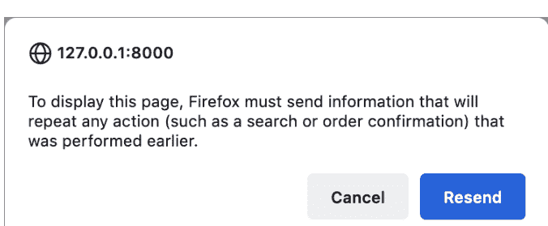

Figure 6.16: Firefox confirming if information should be resent

这并不是说所有 GET 请求都是幂等的，而所有 POST 请求都不是——你的后端应用程序可以按你想要的任何方式设计。尽管这不是最佳实践，但开发人员可能决定在他们的 Web 应用程序中在 GET 请求期间使数据更新。当你构建应用程序时，你应该尝试确保 GET 请求是幂等的，并且只将更改数据的操作留给 POST 请求。除非你有充分的理由不这样做，否则请坚持这些原则。

另一个需要考虑的点是，Django 仅对 POST 请求应用 CSRF 保护。任何 GET 请求，包括更改数据的请求，都可以在没有 CSRF 令牌的情况下访问。

有时，很难判断请求是否幂等——例如登录表单。在你提交用户名和密码之前，你未登录，之后服务器认为你已登录，所以我们可以认为它是非幂等的，因为它改变了你在服务器上的身份验证状态？另一方面，一旦登录，如果你能够再次发送你的凭据，你仍将保持登录状态。这意味着请求是幂等且可重复的。那么，请求应该是 GET 还是 POST？这就引出了在选择使用哪种方法时需要考虑的第二个点：表单数据可见性。

如果使用 GET 请求发送表单数据，表单参数将可见于 URL 中。例如，如果我们使用 GET 请求制作登录表单，登录 URL 可能是 https://www.example.com/login?username=user&password=password1。用户名，更糟糕的是密码，在 Web 浏览器的地址栏中可见。它也会存储在浏览器历史记录中，因此任何在真实用户之后使用该浏览器的人都可以登录到该站点。URL 也常存储在 Web 服务器日志文件中，这意味着凭据也会在那里可见。总之，无论请求的幂等性如何，都不要通过 URL 参数传递敏感数据。

有时，知道参数将可见于 URL 中可能是你所期望的。例如，在使用搜索引擎搜索时，通常搜索参数会可见于 URL 中。要亲身体验，请尝试访问 https://www.google.com 并搜索某些内容。你会注意到，结果页面的 URL 中包含你的搜索词作为 q 参数。例如，搜索“Django”会带你到 URL https://www.google.com/search?q=Django。这允许你通过发送此 URL 与他人分享搜索结果。在活动 1 中，你将添加一个搜索表单，类似地传递参数。

另一个考虑因素是，浏览器允许的 URL 最大长度可能与 POST 主体的大小相比很短——有时只有大约 2,000 个字符（或约 2 KB），而 POST 主体可以是数兆字节或数千兆字节（假设你的服务器设置为允许这些大小的请求）。

如前所述，无论请求的类型如何（GET、POST、PUT 等），URL 参数都可在 request.GET 中使用。你可能会发现将一些数据发送到 URL 参数中，而另一些数据发送到请求主体（可在 request.POST 中使用）很有用。例如，你可以在 URL 中指定一个格式参数来设置某些输出数据的转换格式，但输入数据在 POST 主体中提供。

在 GET 查询字符串中设置参数似乎是多余的，因为值可以作为 URL 路径的一部分传递，然后由 Django 解析以路由 URL。接下来，我们将看看为什么你可能更喜欢使用查询字符串。

## Why use GET when we can put parameters in the URL mappings?

Django 允许我们轻松定义包含变量的 URL 映射。例如，我们可以为搜索视图设置如下 URL 映射：

```
path("/search/<str:search>/", reviews.views.search)
```

这乍一看似乎是个不错的方法，但当我们开始想要使用参数自定义结果视图时，它会很快变得复杂。例如，我们可能希望能够从一个结果页移动到下一个结果页，因此我们将添加一个 page 参数：

```
path("/search/<str:search>/<int:page>/", reviews.views.search)
```

然后，我们可能还希望按特定类别（如作者姓名或出版日期）对搜索结果进行排序，因此我们将为此添加另一个参数：

```
path("/search/<str:search>/<int:page>/<str:order >", reviews.views.search)
```

你可能已经看到了这种方法的问题——我们无法在不提供页面的情况下对结果进行排序。如果我们还想添加 results_per_page 参数，我们就无法在不设置 page 和 order 键的情况下使用它。

与之相比，使用查询参数——所有参数都是可选的，因此你可以这样搜索：

```
?search=search+term:
```

或者你可以这样设置页面：

```
?search=search+term&page=2
```

或者只设置结果排序方式：

```
?search=search+term&order=author
```

或者你可以将它们全部组合：

```
?search=search+term&page=2&order=author
```

使用 URL 查询参数的另一个原因是，当提交表单时，浏览器总是以这种方式发送输入值——它无法更改为将参数作为 URL 路径组件提交。因此，当使用 GET 提交表单时，必须使用 URL 查询参数作为输入数据。

现在我们已经介绍了 HTTP 请求和 HTML 中表单的基础知识，让我们看看 Django Forms 库，它使处理表单和请求变得容易得多。

## The Django Forms library

我们已经了解了如何在 HTML 中手动编写表单，以及如何使用 QueryDict 在请求对象上访问数据。我们看到浏览器为我们提供了某些字段类型（如电子邮件或数字）的一些验证，但我们尚未尝试在 Python 视图中验证数据。我们应该在 Python 视图中验证表单，原因有两个：

- 仅依赖浏览器对输入数据的验证是不安全的。浏览器可能未实现某些验证功能，这意味着用户可以发布任何类型的数据。例如，较旧的浏览器不验证数字字段，因此用户可以输入超出我们预期范围的数字。此外，恶意用户可能完全不使用浏览器来尝试发送有害数据。浏览器验证应被视为对用户的便利，仅此而已。


- 浏览器不允许我们进行跨字段验证。例如，我们可以使用 `required` 属性来标记必须填写的输入。经常情况下，我们希望根据另一个输入的值来设置 `required` 属性。例如，电子邮件地址输入只有在用户勾选了 **Register My Email** 复选框时才应被设为 `required`。

Django Forms 库允许你使用 Python 类快速定义一个表单。这是通过创建 Django Form 基类的子类来完成的。然后你可以使用该类的实例在模板中渲染表单并验证输入数据。我们将我们的类称为表单，这与我们通过子类化 Django Models 来创建 Model 类的方式类似。表单包含一个或多个特定类型的字段（例如文本字段、数字字段或电子邮件字段）。你会注意到这听起来像 Django Models，而表单 *确实* 与 Models 相似，但使用不同的字段类。你甚至可以从 Model 自动创建一个表单——我们将在 *Chapter 7* 中介绍这一点。

## Defining a form

创建 Django 表单与创建 Django 模型类似：你定义一个继承自 `django.forms.Form` 类的类。该类具有不同 `django.forms.Field` 子类的实例作为属性。渲染时，类中的属性名对应于 HTML 中的输入名称。为了让你快速了解有哪些字段，一些示例是 `CharField`、`IntegerField`、`BooleanField`、`ChoiceField` 和 `DateField`。每个字段通常在 HTML 中渲染为一个输入，但表单字段类与输入类型之间并不总是存在一一对应关系。表单字段更与它们收集的数据类型耦合，而不是它们如何显示。

为说明这一点，请考虑一个 `text` 输入和一个 `password` 输入。它们都接受一些键入的文本数据，但它们之间的主要区别在于文本在 `text` 输入中会被显示，而在 `password` 输入中文本会被隐藏。在 Django 表单中，这两个字段都使用 `CharField` 表示。它们在显示上的差异是通过更改字段使用的 *widget* 来设置的。

> **Note**
> 如果你不熟悉 widget 这个词，它指的是实际进行交互的输入以及它如何显示。文本输入、密码输入、选择菜单、复选框和按钮都是不同 widget 的示例。我们在 HTML 中看到的输入与 widget 是一一对应的。在 Django 中并非如此，同一类型的 `Field` 类可以根据指定的 widget 以多种方式渲染。

Django 定义了多个 widget 类来定义字段应如何作为 HTML 渲染。它们继承自 django.forms.widgets.Widget。widget 可以传递给 Field 构造函数以更改其渲染方式。例如，CharField 默认渲染为 text <input>。如果我们使用 PasswordInput widget，它将改为渲染为 password <input>。我们将使用的其他 widget 如下：

- RadioSelect，将 ChoiceField 渲染为单选按钮而不是 <select> 菜单
- Textarea，将 CharField 渲染为 <textarea>
- HiddenInput，将字段渲染为隐藏的 <input>

我们将看一个示例表单并逐一添加字段和功能。首先，让我们只创建一个包含文本输入和密码输入的表单。

```
from django import forms

class ExampleForm(forms.Form):
    text_input = forms.CharField()
    password_input = forms.CharField(widget=forms.PasswordInput)
```

widget 参数可以只是 widget 子类，这在很多情况下是可以的。如果你想进一步自定义输入的显示及其属性，你可以将 widget 参数设置为 widget 类的实例。我们很快就会进一步查看自定义 widget 显示。在这种情况下，我们只使用 PasswordInput 类，因为我们没有超出更改输入类型的自定义。

当表单在模板中渲染时，它看起来像这样：

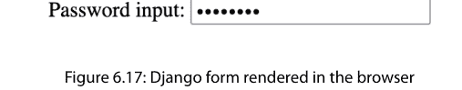

Figure 6.17: Django form rendered in the browser

请注意，页面加载时输入中不包含任何内容；文本已被输入以说明不同的输入类型。

如果我们检查页面源代码，我们将看到 Django 生成的 HTML。对于前两个字段，它看起来像这样（为可读性添加了一些空格）：

```
<p>
    <label for="id_text_input">Text input:</label>
    <input type="text" name="text_input" required
        id="id_text_input">
</p>
<p>
    <label for="id_password_input">Password input:</label>
    <input type="password" name="password_input" required
        id="id_password_input">
</p>
```

请注意 Django 已自动生成一个标签，其文本源自字段名。name 和 id 属性已被自动设置。Django 还会自动向输入添加 required 属性。与模型字段类似，表单字段构造函数也接受 required 参数——默认为 True。将其设置为 False 会从生成的 HTML 中移除 required 属性。

接下来，我们将看看如何向表单添加复选框。

复选框使用 BooleanField 表示，因为它只有两种值：已勾选或未勾选。它以与其它字段相同的方式添加到表单中：

```
class ExampleForm(forms.Form):
    ...
    checkbox_on = forms.BooleanField()
```

Django 为这个新字段生成的 HTML 与前两个字段类似：

```
<label for="id_checkbox_on">Checkbox on:</label>
<input type="checkbox" name="checkbox_on" required
    id="id_checkbox_on">
```

接下来是选择输入：

- 我们需要提供要在 <select> 下拉列表中显示的选择列表。
- 字段类构造函数接受一个 `choices` 参数。choices 以二元元组的元组形式提供。每个子元组中的第一个元素是该选项的值，而第二个元素是该选项的文本或描述。例如，choices 可以这样定义：

```
BOOK_CHOICES = (
    ("1", "Deep Learning with Keras"),
    ("2", "Web Development with Django"),
    ("3", "Brave New World"),
    ("4", "The Great Gatsby")
)
```

请注意，如果你愿意，可以使用列表代替元组（或两者结合）。如果希望你的 choices 可变，这会很有用：

```
BOOK_CHOICES = (
    ["1", "Deep Learning with Keras"],
    ["2", "Web Development with Django"],
    ["3", "Brave New World"],
    ["4", "The Great Gatsby"]
]
```

- 要实现 `optgroup`，我们可以嵌套 choices。要像我们在之前的示例中那样实现 choices，我们可以使用如下结构：

```
BOOK_CHOICES = (
    (
        "Non-Fiction", (
            ("1", "Deep Learning with Keras"),
            ("2", "Web Development with Django")
        )
    ),
    (
        "Fiction", (
            ("3", "Brave New World"),
            ("4", "The Great Gatsby")
        )
    )
)
```

Choices 也可以在表单实例化后设置。你可能希望在视图中动态生成 `list/tuple` choice，然后将其分配给字段的 `choices` 属性，如下所示：

```
form = ExampleForm()
form.fields["books_you_own"].choices = [("1", "Deep
Learning with Keras"), ...]
```

接下来是单选输入，与选择输入类似：

- 与选择输入一样，单选输入使用 ChoiceField，因为它们在多个选项之间提供单一选择。
- 选择的选项通过 choices 参数传递给字段构造函数。
- choices 以二元元组的元组形式提供，也与选择输入相同：

```
choices = (
    ("1", "Option One"),
    ("2", "Option Two"),
    ("3", "Option Three")
)
```

- ChoiceField 默认显示为选择输入，因此必须将 widget 设置为 RadioSelect 才能将其渲染为单选按钮。把选择设置与此结合起来，我们可以像这样向表单添加单选按钮：

```
RADIO_CHOICES = (
    ("Value One", "Value One"),
    ("Value Two", "Value Two"),
    ("Value Three", "Value Three")
)

class ExampleForm(forms.Form):
    ...
    radio_input =
        forms.ChoiceField(choices=RADIO_CHOICES,
        widget=forms.RadioSelect)
```


以下是生成的 HTML：

```
<label for="id_radio_input_0">Radio input:</label>
<ul id="id_radio_input">
<li>
<label for="id_radio_input_0">
<input type="radio" name="radio_input"
    value="Value One" required
    id="id_radio_input_0">
Value One
</label>
</li>
<li>
<label for="id_radio_input_1">
<input type="radio" name="radio_input"
    value="Value Two" required
    id="id_radio_input_1">
Value Two
</label>
</li>
<li>
<label for="id_radio_input_2">
<input type="radio" name="radio_input"
    value="Value Three" required
    id="id_radio_input_2">
Value Three
</label>
</li>
</ul>
```

Django 会自动为这三个单选按钮生成唯一的 label 和 ID。

- 要创建文本区域，请使用带有 Textarea 控件的 CharField：

```
class ExampleForm(forms.Form):
    ...
    text_area = forms.CharField(widget=forms.Textarea)
```

您可能会注意到，该文本区域比我们之前见到的要大得多（见下图）：

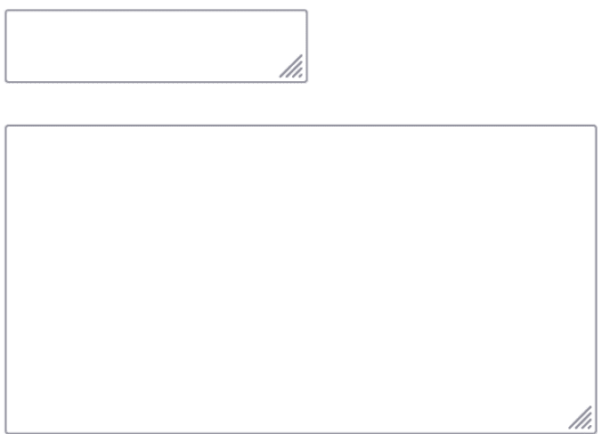

图 6.18：普通文本区域（上）与 Django 默认文本区域（下）

这是因为 Django 会自动添加 cols 和 rows 属性。它们分别设置文本字段显示的列数和行数：

```
<label for="id_text_area">Text area:</label>
<textarea name="text_area" cols="40" rows="10" required id="id_text_area"></textarea>
```

- 请注意，cols 和 rows 设置不会影响字段中可以输入的文本量，只影响一次显示的量。另外，文本区域的大小可以通过 CSS（例如 height 和 width 属性）来设置。这会覆盖 cols 和 rows 设置。

- IntegerField 生成的 HTML 缺少其他两个字段所拥有的 `step` 属性，这意味着该控件将只接受整数值。

- 另外两个字段（`FloatField` 和 `DecimalField`）生成的 HTML 非常相似，它们在浏览器中的行为相同，只有在 Django 代码中使用其值时才有所不同。

正如您可能已经猜到的，可以使用 EmailField 创建电子邮件输入框：

```
class ExampleForm(forms.Form):
    ...
    email_input = forms.EmailField()
```

其 HTML 与我们手动创建的电子邮件输入框类似：

```
<label for="id_email_input">Email input:</label>
<input type="email" name="email_input" required
id="id_email_input">
```

继续我们手动创建的表单，接下来要查看的字段是 DateField：

- 默认情况下，Django 会将 DateField 渲染为文本输入，浏览器在点击该字段时不会显示日历弹窗。

我们可以不带任何参数地将 DateField 添加到表单中，如下所示：

```
class ExampleForm(forms.Form):
    ...
    date_input = forms.DateField()
```

渲染后，它看起来就像一个普通的文本输入框：


图 6.19：表单中默认的 DateField 显示

以下是默认生成的 HTML：

```html
<label for="id_date_input">Date input:</label>
<input type="text" name="date_input" required
id="id_date_input">
```

使用文本输入的原因是它允许用户以多种不同格式输入日期。例如，默认情况下，用户可以按*年-月-日*（以连字符分隔）或*月/日/年*（以斜杠分隔）的格式输入日期。

可以通过使用 `input_formats` 参数向 `DateField` 构造函数传递格式列表来指定可接受的格式。例如，我们可以接受*日/月/年*或*日/月/年（含世纪）*格式的日期，如下所示：

```python
DateField(input_formats = ["%d/%m/%y", "%d/%m/%Y"])
```

我们可以通过向控件构造函数传递 `attrs` 参数来覆盖字段控件上的任何属性。该参数接受一个属性键/值字典，这些属性将被渲染到输入的 HTML 中。

我们还没有使用过这个功能，但在下一章深入定制字段渲染时，我们会再次看到它。现在，我们只设置一个属性 type，它将覆盖默认的输入类型：

```python
class ExampleForm(forms.Form):
    …
    date_input =
    forms.DateField(widget=forms.DateInput(attrs={"type":
    "date"}))
```

渲染后，它现在看起来就像我们之前的日期字段，点击它会弹出日历日期选择器：

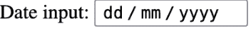

图 6.20：带日期输入的 DateField

现在检查生成的 HTML，我们可以看到它使用了 date 类型：

```html
<label for="id_date_input">Date input:</label>
<input type="date" name="date_input" required
id="id_date_input">
```

我们最后缺少的输入是隐藏输入：

- 同样，由于 Django 表单以数据为中心的特性，没有 `HiddenField`。
- 相反，我们选择需要隐藏的字段类型，并将其控件设置为 `HiddenInput`。然后，我们可以使用字段构造函数的 `initial` 参数来设置该字段的值：

```
class ExampleForm(forms.Form):
    …
    hidden_input =
    forms.CharField(widget=forms.HiddenInput,
    initial="Hidden Value")
```

以下是生成的 HTML：

```
<input type="hidden" name="hidden_input" value="Hidden Value" id="id_hidden_input">
```

- 请注意，由于这是一个 `hidden` 输入，Django 不会生成 `label` 或周围的 `p` 元素。

Django 还提供了其他以类似方式工作的表单字段。从 `DateTimeField`（用于捕获日期和时间）、`GenericIPAddressField`（用于 IPv4 或 IPv6 地址）到 `URLField`（用于 URL）等等。完整的字段列表可在 https://docs.djangoproject.com/en/4.0/ref/forms/fields/ 查看。

## 在模板中渲染表单

我们已经了解了如何创建表单并添加字段，也了解了表单的外观和生成的 HTML。但表单在模板中是如何渲染的呢？我们只需实例化表单类，并像传递任何其他变量一样，通过上下文将其传递给视图中的 render 函数。

例如，下面是我们如何将 `ExampleForm` 传递给模板：

```
def view_function(request):
    form = ExampleForm()
    return render(request, "template.html", {"form": form})
```

在渲染模板时，Django 不会为您添加 <form> 元素或提交按钮；您应该在模板中放置表单的位置周围添加这些元素。表单可以像任何其他变量一样渲染。

我们之前简要提到过，表单在模板中使用 as_p 方法渲染。选择这种布局方法是因为它最接近我们之前手动构建的示例表单。Django 提供了三种可用的布局方法：

- as_table

表单以表格行的形式渲染，每个输入占据一行。Django 不会生成外围的 table 元素，因此您需要自己包裹表单；例如：

```
<form method="post">
    <table>
        {{ form.as_table }}
    </table>
</form>
```

as_table 是默认的渲染方法，因此 {{ form.as_table }} 和 {{ form }} 是等价的。

渲染后，表单看起来像这样：

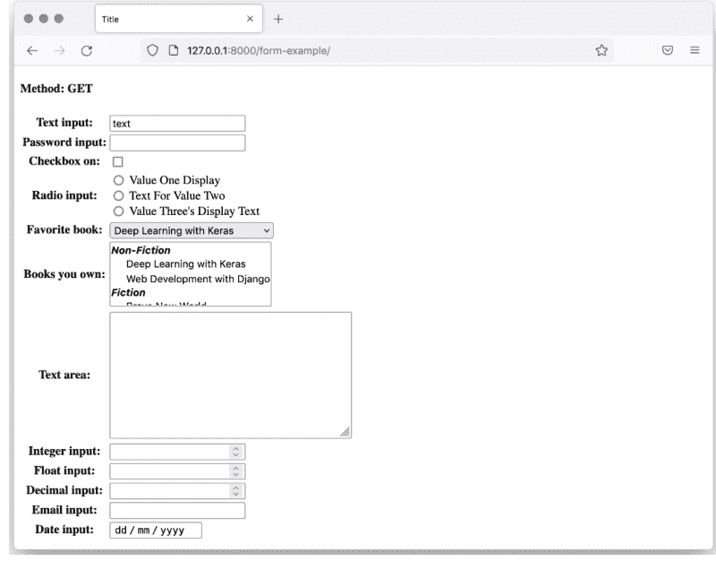

图 6.21：以表格形式渲染的表单

以下是生成的一小段 HTML 示例：

```
<tr>
    <th>
        <label for="id_text_input">Text input:</label>
    </th>
    <td>
        <input type="text" name="text_input" required
            id="id_text_input">
    </td>
</tr>
<tr>
    <th>
        <label for="id_password_input">Password input:
        </label>
    </th>
    <td>
        <input type="password" name="password_input"
            required id="id_password_input">
    </td>
</tr>
```

- as_ul

这会以列表项（li）的形式将表单字段渲染在 ul 或 ol 元素内。与 as_table 一样，Django 不会创建包含元素（<ul> 或 <ol>），必须由您自行添加：

```
<form method="post">
    <ul>
        {{ form.as_ul }}
    </ul>
</form>
```


以下是使用 as_ul 渲染的表单：

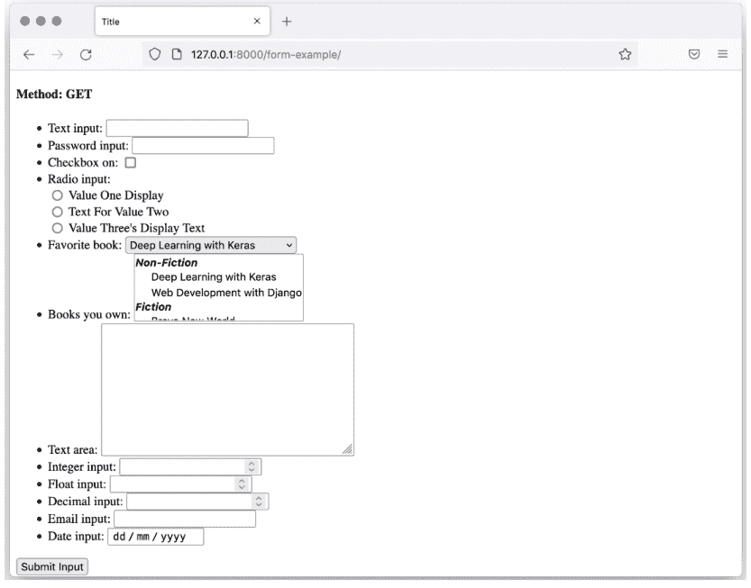

图 6.22：使用 as_ul 渲染的表单

下面是生成的 HTML 示例：

```
<li>
  <label for="id_text_input">Text input:</label>
  <input type="text" name="text_input" required
    id="id_text_input">
</li>
<li>
  <label for="id_password_input">Password input:
  </label>
  <input type="password" name="password_input"
    required id="id_password_input">
</li>
```

+   - as_p

最后，还有 as_p 方法，我们在之前的示例中使用过它。每个输入都包装在 p 标签内，这意味着你不需要像之前的方法那样手动包装表单（在 <table> 或 <ul> 中），：

```
<form method="post">
    {{ form.as_p }}
</form>
```

以下是渲染后的表单的样子：

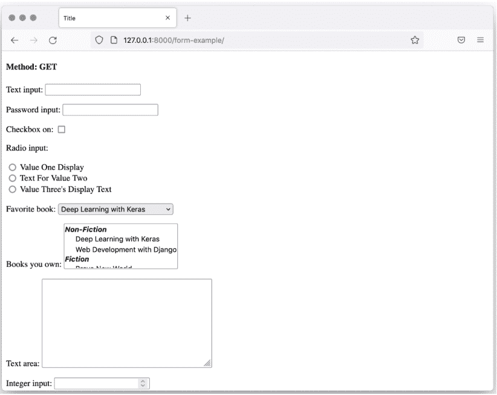

图 6.23：使用 as_p 渲染的表单

你以前见过这个，但再次，这里有一个生成的 HTML 示例：

```
<p>
    <label for="id_text_input">Text input:</label>
    <input type="text" name="text_input" required
        id="id_text_input">
</p>
<p>
    <label for="id_password_input">Password input:
    </label>
    <input type="password" name="password_input"
        required id="id_password_input">
</p>
```

选择哪种方法来渲染你的表单取决于哪种最适合你的应用程序。在行为和在视图中的使用方面，它们都是相同的。在第 15 章中，我们还将介绍一种渲染表单的方法，它将使用 Bootstrap CSS 类。

现在你已经了解了 Django 表单，我们可以更新我们的示例表单页面，使其使用 Django 表单而不是手动编写所有 HTML。我们将在下一个练习中通过用 Django 表单替换手写的 HTML 来实现这一点。

## 练习 6.03 – 构建和渲染一个 Django 表单

在这个练习中，你将使用我们见过的所有字段构建一个 Django 表单。表单和视图的行为将与手动构建的表单类似；然而，你将能够看到使用 Django 编写表单时所需的代码要少得多。你的表单还将自动获得字段验证，并且如果我们对表单进行更改，我们不必再更改 HTML，因为它将根据表单定义动态更新：

- 1. 在 PyCharm 中，在 form_example 应用目录内创建一个名为 forms.py 的新文件。
- 2. 在 forms.py 文件顶部导入 Django forms 库：
- 3. 通过创建 RADIO_CHOICES 变量来定义单选按钮的选项。按如下方式填充它：

```
from django import forms
```

```
RADIO_CHOICES = (
    ("Value One", "Value One Display"),
    ("Value Two", "Text For Value Two"),
    ("Value Three", "Value Three's Display Text")
)
```

你将在创建名为 radio_input 的 ChoiceField 时很快使用它。

保存文件。

6. 打开 form_example 应用的 views.py 文件。在文件顶部，添加一行代码从 forms.py 文件导入 ExampleForm：

```
from .forms import ExampleForm
```

7. 在 form_example 视图内部，实例化 ExampleForm 类并将其分配给 form 变量：

```
form = ExampleForm()
```

8. 使用 form 键将 form 变量添加到上下文字典中。返回行应如下所示：

```
return render(request, "form-example.html",
    {"method": request.method, "form": form})
```

保存文件。

确保你没有删除打印表单发送数据的代码，因为我们将在本练习后面再次使用它。

9. 打开 form_example 应用 templates 目录中的 form-example.html 文件。你可以删除 form 元素的大部分内容，除了  模板标签和提交按钮。完成后，它应如下所示：

```
<form method="post">
    

    <p>
        <input type="submit" name="submit_input"
               value="Submit Input">
    </p>
    <p>
        <button type="submit" name="button_element"
                value="Button Element">
            Button With <strong>Styled</strong> Text
        </button>
    </p>
</form>
```

10. 使用 as_p 方法添加对 form 变量的渲染。将其放在  模板标签之后的那一行。整个 form 元素现在应如下所示：

```
<form method="post">
    
    {{ form.as_p }}
    <p>
```

```
```html
<input type="submit" name="submit_input"
       value="Submit Input">
</p>
<p>
    <button type="submit" name="button_element"
            value="Button Element">
        Button With <strong>Styled</strong> Text
    </button>
</p>
</form>
```
```

11. 如果尚未运行，请启动 Django Dev Server，然后在浏览器中访问表单示例页面，地址为 http://127.0.0.1:8000/form-example/。它应如下所示：

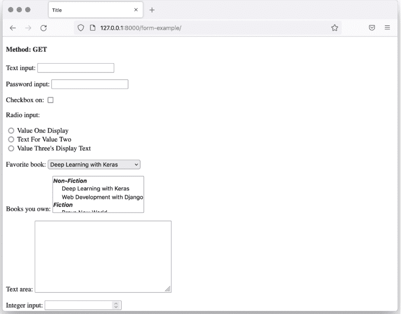

图 6.24：浏览器中渲染的 Django ExampleForm

## 验证表单并检索 Python 值

到目前为止，我们已经看到 Django 表单如何使使用 Python 代码定义表单变得更加简单，并自动渲染它。现在我们将研究使 Django 表单有用的另一部分：它们能够自动验证表单，然后从中检索原生的 Python 对象和值。

在 Django 中，表单可以是 *未绑定* 或 *已绑定*。这些术语描述表单是否已接收提交的 POST 数据用于验证。到目前为止，我们只看到未绑定的表单——它们是在没有参数的情况下实例化的，像这样：

```
```python
form = ExampleForm()
```
```

如果表单是用一些用于验证的数据调用的，例如 POST 数据，则表单是绑定的。可以这样创建已绑定的表单：

```
```python
form = ExampleForm(request.POST)
```
```

已绑定的表单允许我们开始在表单实例上使用内置的与验证相关的工具。首先是 `is_valid` 方法，它检查表单的有效性，然后是 `cleaned_data` 属性，其中包含从字符串转换为 Python 对象的<|message|>。`cleaned_data` 属性仅在表单已被 *清理* 后可用，清理过程是将数据清理并从字符串转换为 Python 对象的过程。清理过程在 `is_valid` 调用期间运行。如果在调用 `is_valid` 之前尝试访问 `cleaned_data`，将引发 `AttributeError`。

访问 `ExampleForm` 的清理数据的简短示例如下所示：

```
```python
form = ExampleForm(request.POST)

if form.is_valid(): # cleaned_data 只有在表单有效时才会被填充
    if form.cleaned_data["integer_input"] > 5:
        do_something()
```
```

在这个示例中，`form.cleaned_data["integer_input"]` 是整数值 10，因此可以与数字 5 进行比较。将其与已发布的值进行比较，后者是字符串 10。清理过程为我们执行了此转换。其他字段如日期或布尔值也会相应转换。

清理过程还会在表单和字段上设置任何错误，这些错误将在再次渲染表单时显示。让我们看看这一切的实际效果。现代浏览器提供大量客户端验证，因此它们会防止表单在未满足基本验证规则时被提交。如果你尝试在上一个练习中提交表单且字段为空，你可能已经看到过这种情况：

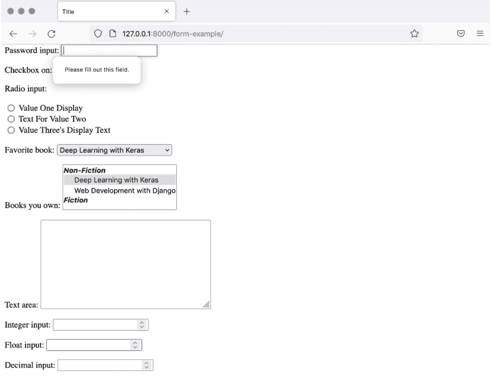

*图 6.26* 显示浏览器阻止表单提交。由于浏览器阻止了提交，Django 从未有机会自行验证表单。为了允许表单被提交，我们需要添加一些浏览器无法自行验证的更高级验证。我们将在下一节讨论可以应用于表单字段的不同类型的验证，但现在，我们只需将 `max_digits` 设置为 3 添加到 `ExampleForm` 的 `decimal_input`。这意味着用户不应在表单中输入超过三位数。

> **注意**
> 
> 为什么 Django 应该验证表单如果浏览器已经在这样做并阻止提交？服务器端应用程序永远不应信任来自用户的输入：用户可能使用旧浏览器或其他 HTTP 客户端发送请求，因此不会从浏览器收到任何错误。此外，正如我们刚才提到的，有一些浏览器不理解的验证类型，因此 Django 必须在自己的端验证这些。


ExampleForm 可以这样更新：

```
class ExampleForm(forms.Form):
    ...
    decimal_input = forms.DecimalField(max_digits=3)
    ...
```

现在，视图应该更新为：当请求方法为 POST 时，将 `request.POST` 传递给表单类，例如：

```
if request.method == "POST":
    form = ExampleForm(request.POST)
else:
    form = ExampleForm()
```

如果你在请求方法不是 POST 时将 `request.POST` 传入表单构造函数，那么表单首次渲染时总会包含错误，因为 `request.POST` 将是空的。

现在，浏览器将允许我们提交表单，但如果 `decimal_input` 包含超过三位数字，就会显示错误：

- 确保总数字不超过 3 位。

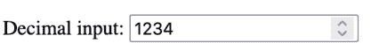

图 6.27：字段无效时显示的错误

当表单有错误时，Django 会在模板中自动以不同的方式渲染表单。但是我们如何让视图根据表单的有效性采取不同的行为呢？如前面提到的，我们应该使用表单的 `is_valid` 方法。包含这种检查的视图可能会包含如下代码：

```
form = ExampleForm(request.POST)

if form.is_valid():
    # perform operations from with data from
    form.cleaned_data
    return redirect("/success-page")  # redirect to a
    success page
```

在这个例子中，如果表单有效，我们会重定向到一个成功页面。否则，我们假定执行流程照常继续，并将无效表单传回 `render` 函数，以便显示给用户并附上错误信息。

> 注意
> 为什么在成功时返回重定向？有两个原因：第一，提前返回可以阻止视图其余部分的执行（即失败分支）；第二，如果用户随后重新加载页面，可以避免浏览器弹出关于重新发送表单数据的提示。

在下一个练习中，我们将实际看到表单验证，并根据表单的有效性改变视图的执行流程。

## 练习 6.04 – 在视图中验证表单

在本练习中，我们将更新示例视图，使其根据 HTTP 方法以不同方式实例化表单。我们还将修改表单，使其打印出已清理的数据（cleaned data）而不是原始 POST 数据，但仅在表单有效时这样做：

- 1. 在 PyCharm 中，打开 `form_example` 应用目录下的 `forms.py` 文件。给 `ExampleForm` 的 `decimal_input` 添加一个 `max_digits=3` 参数：

```
class ExampleForm(forms.Form):
    ...
    decimal_input = forms.DecimalField(max_digits=3)
```

添加此参数后，我们就能提交表单了，因为浏览器不知道如何验证这条规则，但 Django 知道。

- 2. 打开 `reviews` 应用的 `views.py` 文件。我们需要更新 `form_example` 视图，使得如果请求方法是 POST，则用 POST 数据实例化 `ExampleForm`；否则，不带参数实例化它。用以下代码替换当前表单初始化代码：

```
def form_example(request):
    if request.method == "POST":
        form = ExampleForm(request.POST)
    else:
        form = ExampleForm()
```

- 3. 接下来，同样针对 POST 请求方法，我们将使用 `is_valid` 方法检查表单是否有效。如果表单有效，我们将打印出所有已清理的数据。在 `ExampleForm` 实例化之后添加一个检查 `form.is_valid()` 的条件，然后将调试打印循环移入此条件内。你的 POST 分支应如下所示：

```
if request.method == "POST":
    form = ExampleForm(request.POST)
    if form.is_valid():
        for name in request.POST:
            print("{}": {}".format(name,
            request.POST.getlist(name)))
```

- 4. 我们不再遍历原始的 `request.POST` `QueryDict`（其中所有数据都是字符串），而是遍历表单的 `cleaned_data`。这是一个普通字典，包含转换为 Python 对象后的值。将 `for` 行和 `print` 行替换为以下两行：

```
for name, value in
    form.cleaned_data.items():
        print("{}: ({}) {}".format(name,
        type(value), value))
```

我们不再需要使用 `getlist()`，因为 `cleaned_data` 已经将多值字段转换为列表。

- 5. 启动 Django 开发服务器（如果尚未运行）。切换到浏览器，访问示例表单页面，地址为 `http://127.0.0.1:8000/form-example/`。表单看起来应该和之前一样。填写所有字段，但确保在**十进制输入**字段中输入四个或更多数字以使表单无效。提交表单；当页面刷新时，你应该会看到**十进制输入**字段的错误信息显示出来：

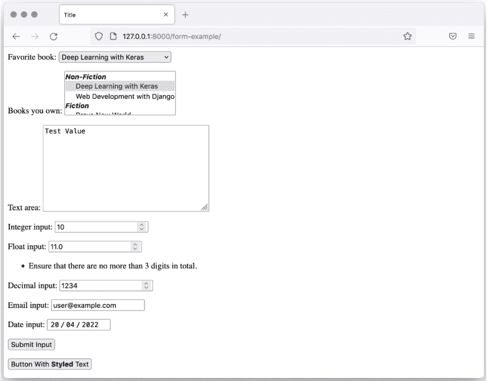

图 6.28：表单提交后显示的十进制输入错误

- 6. 修正表单错误，确保“十进制输入”字段中只有三位数字，然后再次提交表单。切换回 PyCharm 并检查调试控制台。你应该会看到所有已清理的数据已打印出来：

```
text_input: (<class 'str'>) Text
password_input: (<class 'str'>) password
checkbox_on: (<class 'bool'>) True
radio_input: (<class 'str'>) Value One
favorite_book: (<class 'str'>) 1
books_you_own: (<class 'list'>) ['1']
text_area: (<class 'str'>) Test Value
integer_input: (<class 'int'>) 10
float_input: (<class 'float'>) 11.0
decimal_input: (<class 'decimal.Decimal'>) 123
email_input: (<class 'str'>) user@example.com
date_input: (<class 'datetime.date'>) 2022-04-20
hidden_input: (<class 'str'>) Hidden Value
```

图 6.29：已打印出表单的已清理数据

注意所发生的类型转换。CharFields 已被转换为 `str`，BooleanField 被转换为 `bool`，IntegerField、FloatField 和 DecimalField 分别被转换为 `int`、`float` 和 `Decimal`。DateField 变成 `datetime.date`，选择字段将保留其初始选择值的字符串值。注意 `books_you_own` 会自动转换为 `str` 列表。

另外，请注意，与遍历所有 POST 数据时不同，`cleaned_data` 只包含表单字段。其他数据（例如 CSRF 令牌和被点击的提交按钮）存在于 POST 的 `QueryDict` 中，但并不包含在其中，因为它们不是表单字段。

在本练习中，你更新了 `ExampleForm`，使得浏览器允许提交它，即使 Django 会认为它无效。这允许 Django 对表单执行验证。然后，你更新了 `form_example` 视图，根据 HTTP 方法以不同方式实例化 `ExampleForm` 类，对于 POST 请求传入请求的 POST 数据。视图还更新了调试输出代码，以打印 `cleaned_data` 字典。最后，你测试了提交有效和无效表单数据，以查看不同的执行路径以及表单生成的数据类型。我们看到，Django 根据字段类自动将 POST 数据从字符串转换为 Python 类型。

接下来，我们将了解如何向字段添加更多验证选项，从而让我们更严格地控制可以输入的值。

## 内置字段验证

我们还没有讨论可以在字段上使用的标准验证参数。虽然我们已经提到了 `required` 参数（默认值为 `True`），但还可以使用许多其他参数来更严格地控制输入到字段中的数据。下面是一些有用的参数：

- `max_length`
  设置可输入字段的最大字符数，适用于 CharField（以及 FileField——我们将在第 8 章中讨论）。
- `min_length`
  设置必须输入到字段的最小字符数，适用于 CharField（以及 FileField——同样，更多内容见第 8 章）。
- `max_value`
  设置可输入到数值字段中的最大值，适用于 IntegerField、FloatField 和 DecimalField。
- `min_value`
  设置可输入到数值字段中的最小值，适用于 IntegerField、FloatField 和 DecimalField。
- `max_digits`
  设置可输入的最大数字位数。这包括小数点前后的数字（如果存在小数点）。例如，数字 12.34 有四位数字，而 56.7 有三位。这用于 DecimalField。
- `decimal_places`
  设置小数点后最多允许的位数。此参数与 `max_digits` 配合使用，且小数位数始终计入总位数，即使小数点后没有输入那么多位也是如此。例如，`max_digits` 为 4，`decimal_places` 为 3：如果输入数字 12.34，它将被解释为 12.340——也就是说，会补零，直到小数点后的位数等于 `decimal_places` 设置。由于我们将 `decimal_places` 设置为 3，总位数最终为 5，超过了 `max_digits` 的 4。数字 1.2 则是有效的，因为即使扩展为 1.200，总位数也只有 4。

你可以混合搭配这些验证规则（前提是字段支持它们）。CharField 可以有 `max_length` 和 `min_length`；数值字段可以同时有 `min_value` 和 `max_value`，依此类推。


如果需要更多验证选项，你可以编写自定义验证器，我们将在下一节中介绍。现在，我们将向 ExampleForm 添加一些验证器，以便在实际操作中查看它们。

## 练习 6.05 – 添加额外字段验证

在本练习中，我们将在 ExampleForm 的字段上添加和修改验证规则。然后我们将看到这些更改如何影响表单的行为，无论是在浏览器中还是在 Django 验证表单时：

- 1. 在 PyCharm 中，打开 form_example 应用目录中的 forms.py 文件。
- 2. 我们将使 text_input 最多需要三个字符。向 CharField 构造函数添加一个 max_length=3 参数：
- 3. 通过要求至少八个字符使 password_input 更安全。向 CharField 构造函数添加一个 min_length=8 参数：
- 4. 用户可能没有书籍，因此 books_you_own 字段不应为必填项。向 MultipleChoiceField 构造函数添加一个 required=False 参数：
- 5. 用户只能在 integer_input 中输入 1 到 10 之间的值。向 IntegerField 构造函数添加 min_value=1 和 max_value=10 参数：
- 6. 最后，向 DecimalField 构造函数添加 max_digits=5 和 decimal_places=3：
- 保存文件。

```
text_input = forms.CharField(max_length=3)
```

```
password_input = forms.CharField(min_length=8,
widget=forms.PasswordInput)
```

```
books_you_own =
forms.MultipleChoiceField(required=False,
choices=BOOK_CHOICES)
```

```
integer_input = forms.IntegerField(min_value=1,
max_value=10)
```

```
decimal_input = forms.DecimalField(max_digits=5,
decimal_places=3)
```

7. 如果尚未运行，请启动 Django 开发服务器。我们不需要对任何其他文件进行任何更改即可获得这些新的验证规则，因为 Django 会自动更新 HTML 生成和验证逻辑。这是使用 Django 表单所带来的巨大好处。只需在浏览器中访问或刷新 http://127.0.0.1:8000/form-example/，新的验证就会自动添加。表单在尝试提交不正确的值之前看起来不会有任何不同，在这种情况下，浏览器可以自动显示错误。可以尝试以下操作：

- - 输入 **Text input** 字段中多于三个字符是无法完成的。
- - 在密码字段中输入少于八个字符然后移开焦点可能会导致浏览器显示错误，指出此值无效（只有某些浏览器支持此功能）。
- - 不要为 **Books you own** 字段选择任何值。这将不再阻止你提交表单。
- - 使用 **Integer input** 上的步进按钮。你只能输入 1 到 10 之间的值。如果输入超出此范围的值，浏览器应显示错误。
- - **Decimal input** 是唯一一个在浏览器中不验证 Django 规则的字段。你需要输入无效值（例如 123.456）并提交表单，然后才会显示由 Django 生成的错误。

下图显示了浏览器可用于自行验证的一些字段：

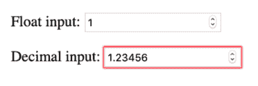

图 6.30：某些浏览器会突出显示无效字段

图 6.31 显示了浏览器在表单提交时可能以另一种方式呈现验证错误的示例 – 在特定字段旁边放置错误消息：

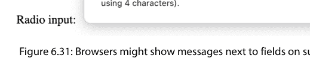

图 6.31：浏览器可能会在提交时在字段旁边显示消息

图 6.32 显示了一个只能由 Django 生成的错误，因为浏览器不理解 DecimalField 验证规则：

- - 确保总共不超过 3 位数字。

Decimal input: 1234

图 6.32：浏览器认为表单有效，但 Django 认为无效

在本练习中，我们在表单字段上实现了一些基本的验证规则。然后我们在不更改模板或视图的情况下在浏览器中加载了表单示例页面。我们尝试使用不同的值提交表单，以检查浏览器如何验证表单与 Django 的比较。

在本章的活动中，我们将使用 Django 表单实现 Book Search 视图。

## 活动 1 – 书籍搜索

在此活动中，你将完成在第 1 章中开始的 Book Search 视图。你将构建一个 SearchForm，它提交并接受来自 request.GET 的搜索字符串。它将有一个选择字段来选择搜索标题或贡献者。然后它将搜索标题或贡献者的 first_names 或 last_names 中包含给定文本的所有书籍。你将然后在 search-results.html 模板中呈现此书籍列表。搜索词不应为必填项，但如果存在，则长度应超过三个字符。由于视图即使使用 GET 方法也会进行搜索，因此表单始终会进行验证检查。如果我们将字段设为必填，则每次页面加载时都会始终显示错误。

搜索将有两种方式。第一种是通过 base.html 模板中的搜索表单提交，该表单位于每个页面的右上角。这将只搜索 Book 标题。另一种方法是通过在 search-results.html 页面上呈现的 SearchForm 提交。此表单将显示一个 ChoiceField 用于在标题或贡献者搜索之间进行选择。

以下步骤将帮助你完成此活动：

- 1. 创建一个 forms.py 文件，导入 Django forms 库，然后创建一个 SearchForm 类。
- 2. SearchForm 应有两个字段。第一个是名为 search 的 CharField。此字段不应为必填项，但应具有最小长度为 3。
- 3. SearchForm 上的第二个字段是名为 search_in 的 ChoiceField。这将允许你在标题和贡献者之间进行选择（标签分别为 Title 和 Contributor）。它不应为必填项。
- 4. 更新 book_search 视图，以便使用来自 request.GET 的数据实例化 SearchForm。
- 5. 添加代码以使用 title__icontains 搜索 Book 模型（用于不区分大小写的搜索）。如果按标题搜索，应执行此操作。搜索仅在表单有效且包含某些搜索文本时执行。search_in 值应使用 GET 方法从 cleaned_data 中检索，因为它可能不存在，因为它不是必填项。将其默认为 title。
- 6. 搜索贡献者时，使用 first_names__icontains 或 last_names__icontains，然后遍历贡献者并检索每个贡献者的书籍。如果按贡献者搜索，应执行此操作。搜索仅在表单有效且包含某些搜索文本时执行。组合 first 或 last 名称的搜索结果有多种方法。到目前为止，你所介绍的技术中最简单的方法是执行两个查询，一个用于匹配名字，然后用于姓氏，并分别迭代它们。
- 7. 更新 render 调用，以便在上下文中包含 form 变量和检索到的书籍（以及 search_text，它已在传递）。模板的位置在第 3 章中已更改，因此相应地更新 render 的第二个参数。
- 8. 我们在第 1 章中创建的 search-results.html 模板现在基本上是多余的，因此你可以清除其内容。更新 search-results.html，使其从 base.html 扩展，而不是作为独立的模板文件。
- 9. 添加一个 title 块，如果表单有效且已设置 search_text，则显示 Search Results for <search_text>；否则，只显示 Book Search。此块稍后也会添加到 base.html 中。
- 10. 添加一个 content 块，其中应显示一个 <h2> 标题，文字为 Search for Books，在 <h2> 下呈现表单。 <form> 元素可以没有属性，它将默认为向其所在的同一 URL 发出 GET 请求。添加一个提交按钮，如我们在之前的活动中所使用，具有 btn btn-primary 类。
- 11. 在表单下方，显示一条消息，说明 Search results for <search_text>，如果表单有效且已输入搜索文本；否则不显示消息。这应显示在 <h3> 标签中，搜索文本应用 <em> 标签包裹。
- 12. 遍历搜索结果并呈现每个结果。显示书籍标题和任何贡献者的名字和姓氏。书籍标题应链接到 book_detail 页面。如果书籍列表为空，则显示文本 No results found。你应将结果包装在 <ul> 标签中，class 为 list-group；每个结果应为 class 为 list-group-item 的 <li> 项。这将类似于 book_list 页面，但我们不会显示太多信息（仅标题和贡献者）。


+   13. 更新 `base.html`，使其在搜索 `<form>` 标签中包含 action 属性。使用 `url` 模板标签为此属性生成 URL。
+   
+   14. 将搜索字段的 name 属性设置为 `search`，value 属性设置为输入的 `search_text`。同时，确保该字段的最小长度为 3。
+   
+   15. 在 `base.html` 中，添加一个标题块到被其他模板覆盖的 title 标签中（如步骤 9）。在 `<title>` HTML 元素内部添加一个块模板标签。它应包含内容 **Bookr**。

完成此活动后，你应该能够打开位于 `http://127.0.0.1:8000/book-search/` 的 Book Search 页面；它看起来像图 6.33：

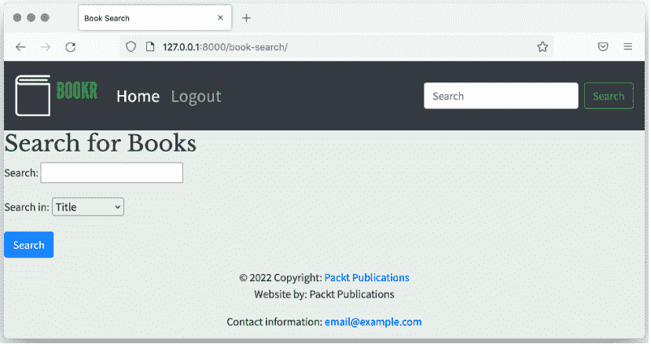

图 6.33：没有搜索的 Book Search 页面

当使用仅两个字符搜索时，你的浏览器应阻止你提交任一搜索字段。

如果你搜索的内容没有结果，你将看到一条没有结果的消息。通过标题搜索（这可以在任一字段中完成）将显示匹配结果：

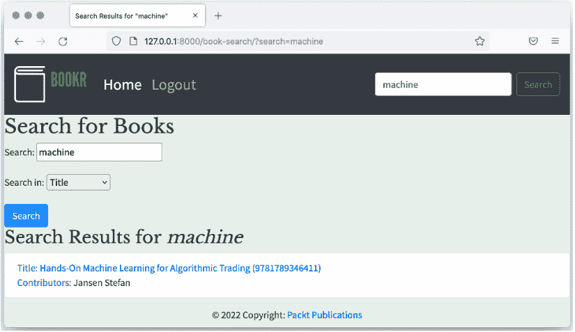

图 6.34：标题搜索

同样，通过贡献者搜索（尽管这只能在下方表单中完成）时，你也会看到匹配结果：

## 高级表单验证和
模型表单

继续使用你在上一章开始的 `form_project` 应用程序，你将在本章开始时为你的应用添加一个新表单，其中包含自定义多字段验证和表单清理。你将学习如何设置表单的初始值以及自定义小部件（生成的 HTML 输入元素）。然后，你将被介绍 `ModelForm` 类，它允许表单从模型自动创建。你将在视图中使用它来自动保存新的或更改的 Model 实例。

在本章中，我们将通过引入构成大多数生产网站基础的概念，进一步深入 Django 表单验证的知识。

例如，某个字段可能仅在另一个字段设置时才需要。假设我们想添加一个复选框，让用户订阅我们的月度新闻通讯。其下方有一个文本框，让他们输入电子邮件地址。通过一些基本验证，我们可以检查以下内容：

- 用户是否已勾选复选框
- 用户是否已输入其电子邮件地址

当用户点击 **Submit** 按钮时，我们将能够验证两个字段是否都被操作。但如果用户不想订阅我们的新闻通讯呢？如果他们点击 **Submit** 按钮，理想情况下，两个字段都应为空。这就是验证每个字段可能不起作用的地方。

另一个例子可能是我们有两个字段，每个字段的最大值为 50。但两个字段的总和必须小于 75。我们将从本章开始，探讨如何编写自定义验证规则来解决此类问题。

之后，随着本章的进展，我们将查看如何在表单上设置初始值。这在自动填写用户已知的<|message|>信息时很有用。例如，如果用户已登录，我们可以自动将用户的联系信息填入表单。

我们将通过查看模型表单来结束本章，它将允许我们从 Django Model 类自动创建表单。这减少了创建新 Model 实例所需编写的代码量。

在本章中，我们将涵盖以下主题：

- 自定义字段验证和清理
- 添加占位符和初始值
- 创建或编辑 Django 模型

到本章结束时，你将知道如何为 Django 表单添加额外的多字段验证，如何自定义和设置字段的表单小部件，如何使用 ModelForms 从 Django 模型自动创建表单，以及如何从 ModelForms 自动创建 Model 实例。

## 技术要求

本章的完整代码文件可在 https://github.com/PacktPublishing/Web-Development-with-Django-Second-Edition/tree/main/Chapter07 找到

## 自定义字段验证和清理

我们已经看到 Django 表单如何将来自 HTTP 请求的值（字符串）转换为 Python 对象。在非自定义 Django 表单中，目标类型取决于字段类。例如，IntegerField 派生的 Python 类型是 int，并且字符串值按用户输入的方式原样提供给我们。但是，我们也可以在 Form 类上实现方法，以任何我们选择的方式更改字段的输出值。这使我们能够清理或过滤用户的输入数据，使其更符合我们的预期。我们可以将整数四舍五入到最接近的 10 的倍数，以便适合特定项目的订购批量大小。或者，我们可以将电子邮件地址转换为小写，以便搜索数据一致。

我们也可以实现一些自定义验证器。我们将从几个不同的角度来看验证字段的方法：通过编写自定义验证器，以及通过为字段编写自定义 clean 方法。每种方法都有其优缺点：自定义验证器可以应用于不同的字段和表单，因此你不必为每个字段编写验证逻辑；自定义 clean 方法必须在你想要清理的每个表单上实现，但更强大，允许验证，因为你可以使用表单中的其他字段或更改字段返回的 cleaned 值。

## 自定义验证器

验证器只是一个接受值并在值无效时引发 django.core.exceptions.ValidationError 的函数——有效性由你编写的代码决定。值是一个 Python 对象（即 cleaned_data，它已经从 POST 请求字符串转换而来）。

下面是一个简单的示例，验证值是否小写：

```
```python
from django.core.exceptions import ValidationError


def validate_lowercase(value):
    if value.lower() != value:
        raise ValidationError("{} is not lowercase."
                              .format(value))
```
```

请注意，该函数对成功或失败均不返回任何内容。它只会在值无效时引发 `ValidationError`。

> **Note**
> 
> 请注意，`ValidationError` 的行为和处理方式与我们在 Django 中看到的其他异常不同。通常，如果你在视图中引发异常，你会从 Django 得到一个 500 状态码的 HTTP 响应（如果你没有在代码中处理异常）。
> 
> 当在验证/清理代码中引发 `ValidationError` 时，Django 表单类会为你捕获该错误；然后，表单的 `is_valid` 方法将返回 `False`。你不必在可能引发 `ValidationError` 的代码周围编写 try/except 处理程序。

验证器可以作为字段构造函数的 `validators` 参数传递给表单中的列表；例如，传递给我们 `ExampleForm` 中的 `text_input` 字段：

```
```python
class ExampleForm(forms.Form):
    text_input =
        forms.CharField(validators=[validate_lowercase])
```
```

现在，如果我们提交表单并且字段包含大写值，我们将收到错误，如下图所示：

- Text is not lowercase.

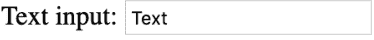

图 7.1 – 小写文本验证器生效

验证器函数可以在任意数量的字段上使用。在我们的示例中，如果我们希望大量字段强制小写，validate_lowercase 可以传递给它们所有。现在，让我们看看如何以另一种方式实现它，使用自定义 clean 方法。

## 清理方法

clean 方法是在 Form 类上创建的，并以 clean_field_name 格式命名。例如，text_input 的 clean 方法将称为 clean_text_input，books_you_own 的 clean 方法将称为 clean_books_you_own，依此类推。

清理方法不接受参数；相反，它们应使用 self 上的 cleaned_data 属性来访问字段数据。此字典将包含在标准 Django 方式下清理后的数据，如我们在前一个示例中看到的那样。clean 方法必须返回清理后的值，该值将替换 cleaned_data 字典中的原始值。即使该方法没有更改值，也必须返回一个值。你也可以在 clean 方法中使用 raise ValidationError，并且错误将被附加到该字段（与验证器相同）。

让我们将小写验证器重新实现为 clean 方法，如下所示：

```
class ExampleForm(forms.Form):
    text_input = forms.CharField()
    ...

    def clean_text_input(self):
        value = self.cleaned_data["text_input"]
        if value.lower() != value:
            raise ValidationError("{} is not lowercase."
                .format(value))

        return value
```

你可以看到逻辑本质上是相同的，只是我们必须在最后返回验证后的值。如果我们提交表单，我们将得到与上次尝试相同的结果（图 7.1）。

让我们再看一个清理示例。不是在值无效时引发异常，我们可以将其转换为小写。我们将使用以下代码实现它：

```
class ExampleForm(forms.Form):
    text_input = forms.CharField()
    ...

    def clean_text_input(self):
        value = self.cleaned_data['text_input']
        return value.lower()
```


现在，假设我们以大写形式在输入中输入文本：

文本输入：ALL UPPERCASE

图 7.2 – 输入的 ALL UPPERCASE 文本

如果我们使用视图中的调试输出来检查清理后的数据，我们会看到它已变为小写：

```
text_input: (<class 'str'>) all uppercase
```

图 7.3 – 清理后的数据已被转换为小写

这些只是使用验证器和 clean 方法验证字段的几个简单示例。你当然可以根据需要使每种类型的验证更加复杂，并使用 clean 方法以更复杂的方式转换数据。

到目前为止，你只学习了简单的表单验证方法，其中每个字段都是独立处理的。字段是否有效（或无效）仅基于其包含的信息，而与其它无关。如果一个字段的有效性取决于用户在另一个字段中输入的内容会怎样？一个例子是，你有一个电子邮件字段，用于收集希望订阅邮件列表的人的电子邮件地址。该字段只有在他们勾选表示希望订阅的复选框时才为必填项。单独来看，这两个字段都不是必填的——我们不希望复选框必须被勾选，但如果被勾选，则电子邮件字段也应为必填。

在下一节中，我们将展示如何通过重写表单中的 clean 方法来验证字段相互依赖的表单。

## 多字段验证

我们刚刚查看了可以添加到 Django 表单中的 clean_field_name 方法，用于清理特定字段。Django 还允许我们重写 clean 方法，在其中我们可以访问所有字段的 cleaned_data，并且我们知道所有自定义字段方法都已被调用。这使得字段可以根据另一个字段的数据进行验证。

参考我们之前的示例，即表单中只有在复选框被勾选时才需要电子邮件地址，我们将看看如何使用 clean 方法实现这一点。

首先，创建一个 Form 类并添加两个字段——使用 required=False 参数使它们都为可选：

```
class NewsletterSignupForm(forms.Form):
    signup = forms.BooleanField(label="Sign up to newsletter?", required=False)
    email = forms.EmailField(help_text="Enter your email address to subscribe", required=False)
```

我们还引入了可用于任何字段的两个新参数：

- label
  这允许你为字段设置标签文本。如我们所见，Django 会从字段名自动生成标签文本。如果设置了 label 参数，你可以覆盖此默认值。如果想要更有描述性的标签，请使用此参数。
- help_text
  如果需要显示有关字段所需输入的更多信息，可以使用此参数。默认情况下，它显示在字段之后。

渲染后的表单如下所示：

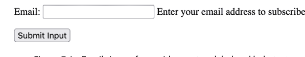

图 7.4 – 带自定义标签和帮助文本的电子邮件订阅表单

如果我们现在提交表单且不输入任何数据，什么也不会发生。两个字段都不是必填的，因此表单验证通过。

现在，我们可以在 clean 方法中添加多字段验证。我们将检查“Sign up to newsletter”复选框是否被勾选，然后检查“Email”字段是否有值。内置的 Django 方法已在此阶段验证了电子邮件地址的有效性，因此我们只需要检查是否存在值。我们将使用 add_error 方法为电子邮件字段设置错误。这是你之前未见过的方法，但非常简单；它接受两个参数——要设置错误的字段名，以及错误文本。

以下是 `clean` 方法的代码：

```
class NewsletterSignupForm(forms.Form):
    …

    def clean(self):
        cleaned_data = super().clean()

        if cleaned_data["signup"] and not
            cleaned_data.get("email"):
                self.add_error("email", "Your email address is
                    required if signing up for the newsletter.")
```

你的 `clean` 方法必须始终调用 `super().clean()` 方法以检索清理后的数据。当调用 `add_error` 为表单添加错误时，表单将不再验证（`is_valid` 方法返回 `False`）。

现在，如果我们提交表单且未勾选复选框，仍然不会生成错误，但如果你在没有电子邮件地址的情况下勾选复选框，你将收到我们刚刚编写的代码的错误：

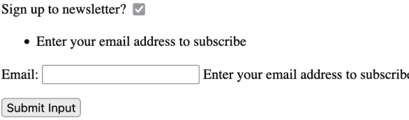

图 7.5 – 尝试在没有电子邮件地址的情况下订阅时显示的错误

你可能会注意到，我们使用 `get` 方法从 `cleaned_data` 字典中检索电子邮件。之所以这样做，是因为如果表单中的 `email` 值无效，则 `email` 键将不存在于字典中。浏览器应防止用户在输入无效电子邮件时提交表单，但用户可能使用的是不支持此客户端验证的旧浏览器，因此，出于安全考虑，我们使用 `get` 方法。由于 signup 字段是 `BooleanField`，且不是必填项，只有在使用自定义验证函数时才会无效。我们这里没有使用，因此使用方括号符号访问其值是安全的。

在进入第一个练习之前，还有一个验证场景需要考虑，那就是添加不特定于任何字段的错误。Django 将这些称为 *非字段错误*。在多个字段相互依赖的情况下，你可能希望在许多场景中使用这些错误。

例如，考虑一个购物网站。你的订单表单可能有两个数值字段，其总和不能超过某个值。如果总和被超过，可以减少任一字段的值以使总和低于最大值，因此错误不特定于任一字段。要添加非字段错误，请调用 add_error 方法并将第一个参数设为 None。

让我们看看如何实现这一点。在此示例中，我们将有一个表单，用户可以在其中指定要订购的项目 A 或项目 B 的数量。用户总共不能订购超过 100 件商品。字段将具有 max_value 为 100 和 min_value 为 0，但需要在 clean 方法中编写自定义验证来处理总量的验证：

```
class OrderForm(forms.Form):
    item_a = forms.IntegerField(min_value=0, max_value=100)
    item_b = forms.IntegerField(min_value=0, max_value=100)

    def clean(self):
        cleaned_data = super().clean()
        if cleaned_data.get("item_a", 0) +
        cleaned_data.get("item_b", 0) > 100:
            self.add_error(None, "The total number of items must be 100 or less.")
```

字段（item_a 和 item_b）以正常方式添加，并带有标准验证规则。你可以看到我们以与之前相同的方式使用了 clean 方法。此外，我们已在此方法中实现了最大商品逻辑。以下行是在超过最大商品数时注册非字段错误的内容：

```
self.add_error(None, "The total number of items must be 100 or less.")
```

再次，我们使用 get 方法并提供默认值 0 来访问 item_a 和 item_b 的值。这是为了防止用户使用旧浏览器（2011 年或更早）并能够提交包含无效值的表单。

在浏览器中，字段级验证确保每个字段中输入的值在 0 到 100 之间，否则会阻止表单提交：

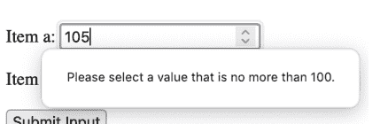

图 7.6 – 如果某个字段超过最大值，则表单无法提交

然而，如果我们输入两个值，其总和超过 100，我们可以看到 Django 如何显示非字段错误：

- The total number of items must be 100 or less.

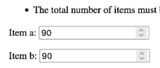

图 7.7 – 表单开头显示的 Django 非字段错误

Django 非字段错误始终显示在表单的开头，在其他字段或错误之前。

在以下练习中，我们将构建一个表单，实现验证函数、字段 clean 方法和表单 clean 方法。

## 练习 7.01 – 自定义 clean 和验证方法

在此练习中，你将构建一个新表单，允许用户为书籍或杂志创建订单。它必须具有以下验证标准：

- 用户最多可订购 80 本杂志和/或 50 本书籍，但商品总数不得超过 100
- 用户可以选择接收订单确认，如果选择，则必须输入电子邮件地址
- 如果用户未选择接收订单确认，则不应输入电子邮件地址


+   - 为确保其属于我们公司，电子邮件地址必须属于我们公司的域名（就我们而言，我们只需使用 `example.com`）
+   - 为了与其他电子邮件地址保持一致，地址应转换为小写

这听起来像很多规则，但使用 Django，如果我们逐一处理，就会很简单。我们将继续使用你在 *Chapter 6, Forms* 中开始的 `form_project` 应用。如果你尚未完成 *Chapter 6, Forms*，你可以从 `https://github.com/PacktPublishing/Web-Development-with-Django-Second-Edition/tree/main/Chapter06/final/form_project` 下载代码。

+   1. 在 PyCharm 中，打开 `form_example` 应用的 `forms.py` 文件。

> **Note**
> 
> 请确保 Django 开发服务器未在运行；否则，在你修改此文件时它可能会崩溃，导致 PyCharm 跳入调试器。

由于我们对 `ExampleForm` 的工作已完成，你可以将其从此文件中删除。

+   2. 创建一个名为 `OrderForm` 的新类，它继承自 `forms.Form`：

```
```python
class OrderForm(forms.Form):
```
```

+   3. 按如下方式向该类添加四个字段：
+   
+   - `magazine_count`，IntegerField，`min_value` 为 0，`max_value` 为 80
+   - `book_count`，IntegerField，`min_value` 为 0，`max_value` 为 50
+   - `send_confirmation`，BooleanField，非必填
+   - `email`，EmailField，也是非必填

该类应如下所示：

```
```python
class OrderForm(forms.Form):
    magazine_count = forms.IntegerField(min_value=0,
                                        max_value=80)
    book_count = forms.IntegerField(min_value=0,
                                    max_value=50)
    send_confirmation = 
        forms.BooleanField(required=False)
    email = forms.EmailField(required=False)
```
```

4. 添加一个验证函数来检查用户的电子邮件地址是否在正确的域名上。首先，需要导入 ValidationError；将此行添加到文件顶部：

```
from django.core.exceptions import ValidationError
```

然后，在导入行之后编写此函数（在 OrderForm 类实现之前）：

```
def validate_email_domain(value):
    if value.split("@")[-1].lower() != "example.com":
        raise ValidationError("The email address must
            be on the domain example.com.")
```

该函数在 @ 符号上分割电子邮件地址，然后检查其后的部分是否等于 example.com。此函数单独使用时将验证非电子邮件地址。例如，not-valid@some other domain@example.com 字符串不会在此函数中引发 ValidationError。这在我们的情况下是可以接受的，因为我们使用的是 EmailField，其他标准字段验证器将检查电子邮件地址的有效性。

5. 将 validate_email_domain 函数作为验证器添加到 OrderForm 上的 email 字段。更新 EmailField 构造函数调用以添加 validators 参数，并传入包含验证函数的列表：

```
class OrderForm(forms.Form):
    ...
    email = forms.EmailField(required=False,
        validators=[validate_email_domain])
```

6. 添加 clean_email 方法到表单以确保电子邮件地址为小写：

```
class OrderForm(forms.Form):
    # truncated for brevity

    def clean_email(self):
        return self.cleaned_data['email'].lower()
```

7. 现在，添加 clean 方法以执行所有跨字段验证。首先，我们将仅添加确保只有在请求订单确认时才输入电子邮件地址的逻辑：

```
class OrderForm(forms.Form):
    # truncated for brevity
    def clean(self):
        cleaned_data = super().clean()
        if cleaned_data["send_confirmation"] and not
        cleaned_data.get("email"):
```

```
self.add_error("email", "Please enter an email address to receive the confirmation message.")
elif cleaned_data.get("email") and not cleaned_data["send_confirmation"]:
    self.add_error("send_confirmation", "Please check this if you want to receive a confirmation email.")
```

如果选中了 Send confirmation 但未添加电子邮件地址，这将向 Email 字段添加错误：

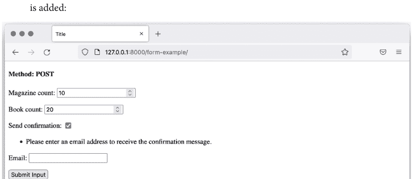

Figure 7.8 – Error if Send confirmation is checked but no email address is added

同样，如果输入了电子邮件地址但未选中 Send confirmation，也会向 Email 添加错误：

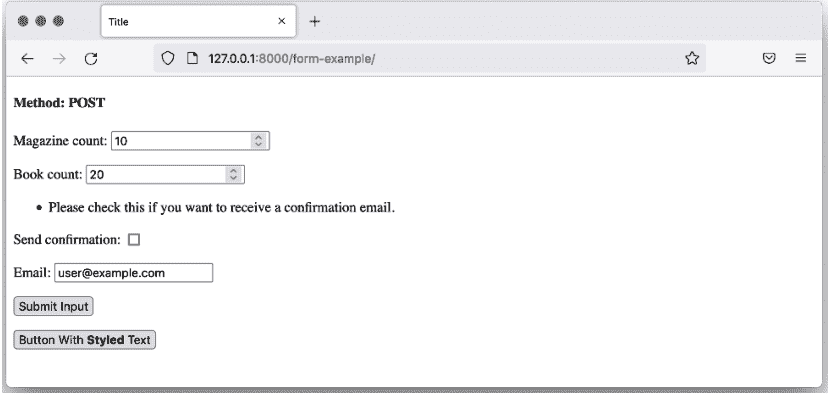

Figure 7.9 – Error because an email has been entered but the user has not chosen to receive confirmation

8. 在 clean 方法中添加最后的检查。项目总数不应超过 100。如果 magazine_count 和 book_count 的总和大于 100，我们将添加一个非字段错误：

```
class OrderForm(forms.Form):
    ...
    def clean(self):
        ...
        item_total = cleaned_data.get("magazine_count", 0) + cleaned_data.get("book_count", 0)

        if item_total > 100:
            self.add_error(None, "The total number of items must be 100 or less.")
```

这将通过将 None 作为第一个参数传递给 add_error 调用来添加非字段错误。

Note
请参阅 https://raw.githubusercontent.com/PacktPublishing/Web-Development-with-Django-Second-Edition/main/Chapter07/Exercise7.01/form_project/form_example/forms.py 获取完整代码。

保存 forms.py。

9. 打开 reviews 应用的 views.py 文件。我们将更改表单的导入，以便导入 OrderForm 而不是 ExampleForm。请考虑以下导入行：

```
from .forms import ExampleForm
```

按如下方式更改它：

```
from .forms import OrderForm
```

10. 在 form_example 视图中，将使用 ExampleForm 的两行更改为使用 OrderForm。请考虑以下代码行：

```
form = ExampleForm(request.POST)
```

按如下方式更改：

```
form = OrderForm(request.POST)
```

同样，请考虑以下代码行：

```
form = ExampleForm()
```

按如下方式更改：

```
form = OrderForm()
```

其余函数可以保持不变。

我们不需要对模板进行更改。启动 Django 开发服务器并在浏览器中导航到 http://127.0.0.1:8000/form-example/。你应该会看到表单的渲染方式与图 7.10 所示类似：

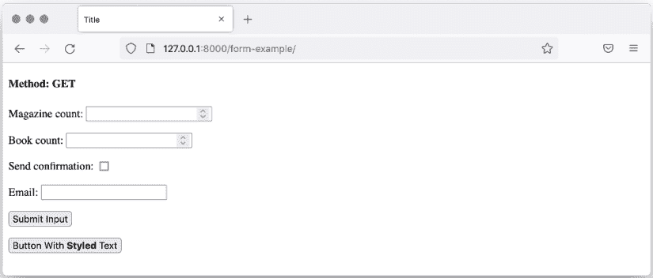

Figure 7.10 – OrderForm in the browser

+   11. 尝试使用 **Magazine count** 为 80 和 **Book count** 为 50 提交表单。浏览器会允许此操作，但由于它们的总和超过 100，表单中的 `clean` 方法会触发错误并在页面上显示：

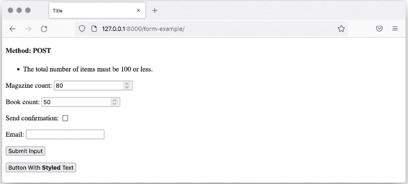

Figure 7.11 – A non-field error displayed on the form when the maximum number of allowed items is exceeded

12. 尝试选中 **Send confirmation** 但将 **Email** 字段留空。然后，填写 **Email** 文本框但取消选中 **Send confirmation**。任一组合都会导致错误，指出两者必须同时存在。错误会根据缺少的字段而有所不同：

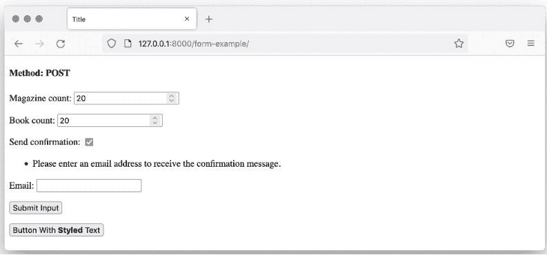

Figure 7.12 – Error message if no email address is present

13. 现在，尝试选中 **Send confirmation**，并输入位于 `example.com` 域上的电子邮件地址。你应该会收到一条消息，指出你的电子邮件地址必须具有 `example.com` 域名。你还应该收到一条消息，指出必须设置电子邮件——这是因为电子邮件没有进入 cleaned_data 字典。毕竟，它是无效的：

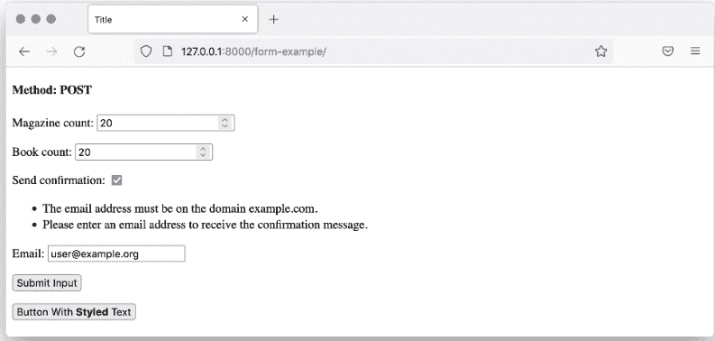

Figure 7.13 – The error message that’s shown when the email domain is not example.com

14. 最后，为 **Magazine count** 和 **Book count** 输入有效值（例如 20 和 20）。选中 **Send confirmation** 并输入 UserName@Example.Com 作为电子邮件（确保匹配字母大小写，包括混合的大写和小写字符）：

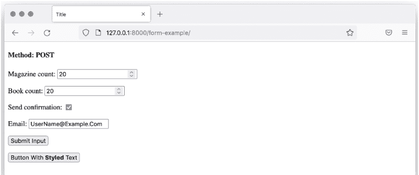

15. 切换到 PyCharm 并查看调试控制台。你会看到电子邮件在被我们的调试代码打印时已转换为小写：

```
magazine_count: (<class 'int'>) 20
book_count: (<class 'int'>) 20
send_confirmation: (<class 'bool'>) True
email: (<class 'str'>) username@example.com
```

Figure 7.15 – Email in lowercase, as well as other fields

这是我们的 `clean_email` 方法在起作用——即使我们输入了大写和小写混合的数据，它也已被转换为全小写。

在此练习中，我们创建了一个新的 `OrderForm`，实现了表单和字段 clean 方法。我们使用自定义验证器确保 **Email** 字段符合我们的特定验证规则——只允许特定域名。我们使用自定义字段清理方法（`clean_email`）将电子邮件地址转换为小写。然后我们实现了 `clean` 方法来验证相互依赖的表单。在此方法中，我们添加了字段和非字段错误。


到目前为止，我们已经学习了多字段验证，以及如何实现它们以确保我们可以在一次完成表单验证，而不是逐一高亮错误。

在下一节中，我们将介绍如何为表单添加占位符和初始值。

## 添加占位符和初始值

我们第一个手工构建的表单具有我们当前 Django 表单仍然没有的两个东西——占位符和初始值。添加占位符很简单；它们只是作为表单字段的 widget 构造函数的属性添加。这与我们在之前的示例中为 DateField 设置类型所见的类似。

这里有一个例子：

```
class ExampleForm(forms.Form):
    text_field = forms.CharField(
        widget=forms.TextInput(attrs={"placeholder": "Text Placeholder"})
    )
    password_field = forms.CharField(
        widget=forms.PasswordInput(attrs={"placeholder": "Password Placeholder"})
    )
    email_field = forms.EmailField(
        widget=forms.EmailInput(attrs={"placeholder": "Email Placeholder"})
    )
    text_area = forms.CharField(
        widget=forms.Textarea(attrs={"placeholder": "Text Area Placeholder"})
    )
```

`request.POST` 中的值将覆盖 `initial` 中的值。这意味着即使我们为必填字段设置了初始值，如果提交时留空，则它将无法通过验证。字段不会回退到 `initial` 中的值。

是否在 Form 类本身或视图中设置初始值取决于你以及你的用例。如果你有一个在多个视图中使用的表单，但通常具有相同的值，那么最好在表单中设置 `initial` 值。否则，在视图中使用 `setting` 可以更灵活。

在下一个练习中，我们将为上一个练习中的 `OrderForm` 类添加占位符和初始值。

## 练习 7.02 – 占位符和初始值

在这个练习中，你将通过添加占位符文本来增强 `OrderForm` 类。你将模拟向表单传递一个初始电子邮件地址。它将是一个硬编码地址，但一旦用户可以登录，它可以是与他们账户关联的电子邮件地址——你将在 *第 9 章，Sessions and Authentication* 中学习会话和身份验证：

+   1. 在 PyCharm 中打开 `reviews` 应用的 `forms.py` 文件。你将为 `OrderForm` 上的 `magazine_count`、`book_count` 和 `email` 字段添加占位符，这意味着也需要设置 widget。
+   
+   对于 `magazine_count` 字段，添加一个 `NumberInput` widget，并在 `attrs` 字典中使用 `placeholder`。此 `placeholder` 应设置为 **Number of Magazines**。编写以下代码：

```
magazine_count = forms.IntegerField(
    min_value=0,
    max_value=80,
    widget=forms.NumberInput(attrs={"placeholder":
    "Number of Magazines"}),
)
```

+   2. 以相同的方式为 `book_count` 字段添加占位符。占位符文本应为 **Number of Books**：

```
book_count = forms.IntegerField(
    min_value=0,
    max_value=50,
    widget=forms.NumberInput(attrs={"placeholder":
    "Number of Books"}),
)
```

3. 对 OrderForm 的最后一次更改是为 email 字段添加占位符。这次，widget 是 EmailInput。占位符文本应为 Your company email address：

```
email = forms.EmailField(
    required=False,
    validators=[validate_email_domain],
    widget=forms.EmailInput(attrs={"placeholder":
    "Your company email address"}),
)
```

请注意，clean_email 和 clean 方法应保持在练习 7.01 中自定义 clean 和验证方法时的状态。保存文件。

4. 打开 form_project 应用的 views.py 文件。在 form_example 视图函数中，创建一个名为 initial 的新字典变量，只有一个键 email，如下所示：

```
initial = {"email": "user@example.com"}
```

5. 在你实例化 OrderForm 的两个地方，也使用 initial kwarg 传入 initial 变量。第一个实例如下：

```
form = OrderForm(request.POST, initial=initial)
```

第二个实例如下：

```
form = OrderForm(initial=initial)
```

views.py 的完整代码可以在 https://github.com/PacktPublishing/Web-Development-with-Django-Second-Edition/blob/main/Chapter07/Exercise7.02/form_project/form_example/views.py 找到。保存 views.py 文件。

+   6. 如果尚未运行，请启动 Django dev 服务器。在浏览器中浏览至 http://127.0.0.1:8000/form-example/。你应该会看到你的表单现在具有占位符和初始值设置：

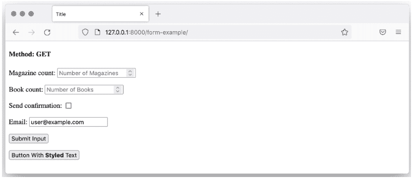

图 7.17 – 具有初始值和占位符的订单表单

在这个练习中，我们向表单字段添加了占位符。这是通过在表单类上定义表单字段时设置表单 widget 并在 attrs 字典中设置占位符值来完成的。我们还使用字典为表单设置了初始值，并使用 initial kwarg 将其传递给表单实例。

在下一节中，我们将讨论如何使用表单中的数据与 Django 模型一起工作，以及 ModelForm 如何使这变得更容易。

## 创建或编辑 Django 模型

我们已经看到了如何定义表单，并且在第 2 章，Models and Migrations 中，你学习了如何创建 Django 模型实例。通过将这些东西结合使用，你可以构建一个显示表单并将模型实例保存到数据库的视图。这为你提供了一种在无需编写大量样板代码或创建自定义表单的情况下保存数据的方式。在 Bookr 中，我们将使用此方法允许用户在无需访问 Django 管理站点的情况下添加评论。如果不使用 ModelForm，你可以这样做：

+   你可以基于现有模型创建一个表单；例如，Publisher。表单将称为 PublisherForm。

+   - 你可以手动在 PublisherForm 上定义字段，使用在 Publisher 模型上定义相同的规则，如下所示：

```
class PublisherForm(forms.Form):
    name = forms.CharField(max_length=50)
    website = forms.URLField()
    ...
```

+   - 在视图中，初始值将从数据库中查询的模型中检索，然后使用 initial 参数传递给表单。如果你正在创建新实例，初始值将为空——如下所示：

```
if create:
    initial = {}
else:
    publisher = Publisher.objects.get(pk=pk)
    initial = {"name": publisher.name, "website":
    publisher.website, ...}

form = PublisherForm(initial=initial)
```

+   - 然后，在视图的 POST 流程中，你可以根据 cleaned_data 创建或更新模型：

```
form = PublisherForm(request.POST, initial=initial)
if create:
    publisher = Publisher()
else:
    publisher = Publisher.objects.get(pk=pk)

publisher.name = form.cleaned_data['name']
publisher.website = forms.cleaned_data['website']
...
publisher.save()
```

这需要大量工作，我们必须考虑我们有多少重复的逻辑。例如，我们在 name 表单字段中定义了 name 的长度。如果我们在这里犯了错误，我们可能会允许字段中的名称比模型允许的更长。我们还必须记住在 `initial` 字典中设置所有字段，以及使用表单的 `cleaned_data` 在新模型或更新的模型上设置值。如果模型发生变化，这里有很多出错的机会，以及记住为这些步骤中的每一个添加或删除字段设置数据。所有这些代码也必须为你工作的每个 Django 模型重复，加剧了重复问题。

## ModelForm 类

幸运的是，Django 提供了使用 ModelForm 类以更简单的方式从表单构建 Model 实例的方法。ModelForm 是从特定模型自动构建的表单。它将继承模型的验证规则（例如字段是否必填或 CharField 实例的最大长度等）。它提供了一个额外的 `__init__` 参数（称为 instance），用于从现有模型自动填充初始值。它还添加了一个 save 方法以自动将表单数据持久化到数据库。你需要做的就是指定其模型和应使用的字段：这是在表单类的 class Meta 属性上完成的。让我们看看如何从 Publisher 构建表单。

在包含表单的文件内部（例如我们一直在使用的 `forms.py` 文件），唯一的变化是必须导入模型：

```
```python
from .models import Publisher
```
```

然后，可以定义 Form 类。该类需要一个 `class Meta` 属性，而该属性又必须定义 model 属性以及 fields 或 excludes 属性：

```
```python
class PublisherForm(forms.ModelForm):
    class Meta:
        model = Publisher
        fields = ("name", "website", "email")
```
```

`fields` 是要包含在表单中的字段的列表或元组。当手动设置字段列表时，如果你向模型添加额外字段，你还必须在此处添加其名称以使其显示在表单上。

你也可以使用特殊的 `__all__` 值代替列表或元组以自动包含所有字段，如下所示：

```
```python
class PublisherForm(forms.ModelForm):
    class Meta:
        model = Publisher
        fields = "__all__"
```
```

如果模型字段的 editable 属性设置为 False，则它将不会自动包含。


相反，`exclude` 属性会将字段设置为在表单中不显示。添加到模型中的任何字段都将自动添加到表单中。我们可以使用 `exclude` 定义前面的表单，使用任何空元组，因为我们想要所有字段。代码如下：

```
```python
class PublisherForm(forms.ModelForm):
    class Meta:
        model = Publisher
        exclude = ()
```
```

这可以为你节省一些工作，因为你不需要将字段同时添加到模型和 `fields` 列表中；然而，它并不那么安全，因为你可能会自动向最终用户公开你不想让他们看到的字段。例如，如果你有一个 User 模型和 UserForm，你可能会向 User 模型添加一个 `is_admin` 字段，以便给予管理员用户额外的权限。如果该字段不在 `exclude` 中，它将被显示给用户。然后用户就可以让自己成为管理员，这可能是你不希望发生的。

无论我们决定使用这三种选择表单显示的方法中的哪一种，在我们的情况下，它们在浏览器中显示都是一样的。这是因为我们选择显示所有字段。它们在浏览器中渲染时看起来都像这样：

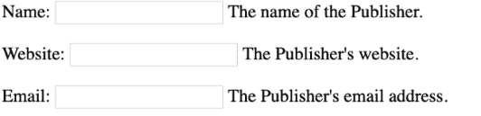

图 7.18 – PublisherForm

请注意，来自 Publisher 模型的 `help_text` 也会自动渲染。

在视图中的使用与我们之前看到的其他表单类似。此外，正如前面提到的，可以提供一个额外的参数，称为 `instance`。它可以设置为 None，这将渲染一个空表单。

假设，在你的视图函数中，你有一些方法来确定你是在创建还是编辑模型实例（我们稍后会讨论如何做到这一点），这将决定一个名为 `is_create` 的变量（如果正在创建实例则为 True，如果正在编辑现有实例则为 False）。你的用于创建表单的视图函数可以这样写：

```
```python
if is_create:
    instance = None
else:
    instance = get_object_or_404(Publisher, pk=pk)

if request.method == "POST":
    form = PublisherForm(request.POST, instance=instance)
    if form.is_valid():
```
```

额外字段放在 Model 字段之后。额外字段不会自动处理——它们不存在于模型上，因此 Django 不会尝试在模型实例上保存它们。相反，你应该通过检查表单的 `cleaned_data` 值来处理它们的值的保存方式，就像处理标准表单一样，例如（在你的视图函数内部）：

```
```python
if form.is_valid():
    if form.cleaned_data.get("email_on_save"):
        send_email()  # assume this function is defined
    else:
        form.save()  # save the instance regardless of sending
        the email or not
    return redirect(success_url)
```
```

在下面的练习中，你将在 Bookr 中编写一个新的视图函数，以便创建和编辑 Publisher。

## 练习 7.03 – 创建和编辑一个出版商

在本练习中，我们将回到 Bookr。我们希望在不使用 Django 管理后台的情况下添加创建和编辑 Publisher 的能力。为此，我们将为 Publisher 模型添加一个 ModelForm。它将在一个新的视图函数中使用。该视图函数将接受一个可选参数 `pk`，它将是正在编辑的 Publisher 对象的 ID，或者为 None 以创建新的 Publisher。我们将添加两个新的 URL 映射来促进这一点。当完成时，我们将能够通过其 ID 查看和更新任何出版商。例如，*Publisher 1* 的信息将在 `/publishers/1` URL 路径下查看/编辑：

- 1. 在 PyCharm 中，打开 reviews 应用的 `forms.py` 文件。在 forms 导入之后，导入 Publisher 模型：
  
  ```python
  from .models import Publisher
  ```
  
- 2. 创建一个 PublisherForm 类，继承自 `forms.ModelForm`：
  
  ```python
  class PublisherForm(forms.ModelForm):
  ```
  
- 3. 在 PublisherForm 上定义类 Meta 属性。Meta 所需的属性是 model（Publisher）和 fields（`"__all__"`）：
  
  ```python
  class PublisherForm(forms.ModelForm):
      class Meta:
          model = Publisher
          fields = "__all__"
  ```
  
  保存 `forms.py`。

```
```python
from .models import Publisher
```
```

```
```python
class PublisherForm(forms.ModelForm):
```
```

```
```python
class PublisherForm(forms.ModelForm):
    class Meta:
        model = Publisher
        fields = "__all__"
```
```

> Note
> 完整文件可以在 https://github.com/PacktPublishing/Web-Development-with-Django-Second-Edition/blob/main/Chapter07/Exercise7.03/bookr/reviews/forms.py 找到。

4. 打开 reviews 应用的 views.py 文件。在文件顶部导入 PublisherForm：

```
from .forms import PublisherForm, SearchForm
```

5. 确保你从 django.shortcuts 导入了 get_object_or_404 和 redirect 函数，如果你还没有导入的话：

```
from django.shortcuts import render, get_object_or_404, redirect
```

6. 此外，确保你已导入 Publisher 模型，如果你还没有导入的话。你可能已经导入了该模型和其他模型：

```
from .models import Book, Contributor, Publisher
```

7. 你需要的最后一个导入是 messages 模块。这将允许我们注册一条消息，让用户知道 Publisher 对象已被编辑或创建：

```
from django.contrib import messages
```

如果还没有，请添加此导入。

8. 创建一个名为 publisher_edit 的新视图函数。它接受两个参数：request 和 pk（要编辑的 Publisher 对象的 ID）。这是可选的，如果它为 None，则将创建 Publisher 对象而不是编辑：

```
def publisher_edit(request, pk=None):
```

9. 在视图函数内部，我们需要尝试在 pk 不为 None 时加载现有的 Publisher 实例。否则，publisher 应该是 None：

```
def publisher_edit(request, pk=None):
    if pk is not None:
        publisher = get_object_or_404(Publisher,
            pk=pk)
    else:
        publisher = None
```

- 10. 在获取到 `Publisher` 实例或 `None` 之后，完成 *POST* 请求的分支。以你在本章前面看到的相同方式实例化表单，但现在，确保它以 instance 作为 kwarg 传递。然后，如果表单有效，使用 `form.save()` 方法保存它。此方法将返回更新的 `Publisher` 实例，该实例存储在 `updated_publisher` 变量中。然后，根据 `Publisher` 是创建还是更新，注册不同的成功消息。最后，重定向回此 `publisher_edit` 视图，因为此时 `updated_publisher` 总是会有 ID：

```
```python
def publisher_edit(request, pk=None):
    ...
    if request.method == "POST":
        form = PublisherForm(request.POST,
                             instance=publisher)
        if form.is_valid():
            updated_publisher = form.save()
            if publisher is None:
                messages.success(request, "Publisher
{} was created."
.format(updated_publisher))
            else:
                messages.success(request, "Publisher
{} was updated."
.format(updated_publisher))

            return redirect("publisher_edit",
            updated_publisher.pk)
```
```

如果表单无效，执行将落到下面并仅返回带有无效表单的 render 函数调用（这将在 *步骤 12* 中实现）。重定向使用一个命名 URL 映射，该映射将在本练习后面添加。

- 11. 接下来，填充代码的非 *POST* 分支。在这种情况下，只需使用你的实例实例化表单：

```
```python
def publisher_edit(request, pk=None):
    ...
    if request.method == "POST":
        ...
    else:
        form = PublisherForm(instance=publisher)
```
```

12. 在步骤 14 中，你将创建一个 `form-example.html` 文件来渲染，但我们可以现在添加对 render 函数的调用。通过将 HTTP 方法和表单作为上下文传递，使用 render 函数在视图中渲染它：

```
```python
def publisher_edit(request, pk=None):
    ...
    return render(request, "form-example.html",
        {"method": request.method, "form": form})
```
```

保存此文件。你可以参考 https://github.com/PacktPublishing/Web-Development-with-Django-Second-Edition/blob/main/Chapter07/Exercise7.03/bookr/reviews/views.py。

13. 打开 reviews 目录中的 `urls.py`。添加两个新的 URL 映射；它们都将指向 `publisher_edit` 视图。一个将捕获 Publisher 的 ID，我们希望编辑它并将其作为 `pk` 参数传递给视图。另一个将使用 `new` 而不是 ID，并且不会传递 `pk`，这将表示我们想要创建一个新的 Publisher。

向你的 `urlpatterns` 变量添加 `"publishers/<int:pk>/"` 路径映射到 `reviews.views.publisher_edit` 视图，名称为 `"publisher_edit"`。

另外，添加 `"publishers/new/"` 路径映射到 `reviews.views.publisher_edit` 视图，名称为 `"publisher_create"`：

```
```python
urlpatterns = [
    ...
    path("publishers/<int:pk>/", views.publisher_edit,
         name="publisher_edit"),
    path("publishers/new/", views.publisher_edit,
         name="publisher_create")
]
```

由于第二个映射没有捕获任何内容，传递给 `publisher_detail` 视图函数的 pk 将为 None。

保存 `urls.py` 文件。参考的完整版本位于 https://github.com/PacktPublishing/Web-Development-with-Django-Second-Edition/blob/main/Chapter07/Exercise7.03/bookr/reviews/urls.py。


14. 使用 PyCharm 中的 New HTML File 功能，在 reviews 应用的 templates 目录下创建一个 form-example.html 文件。由于这是一个独立的模板（它不扩展任何其他模板），我们需要在其中渲染消息。在打开的 <body> 标签后添加以下代码以遍历所有消息并显示它们：

```

<p><em>{{ message.level_tag|title }}:</em>
{{ message }}</p>

```

这将遍历我们添加的消息并显示标签（在我们的例子中为 Success），然后是消息。

15. 然后，添加正常的表单渲染和提交代码：

```
<form method="post">
    
    {{ form.as_p }}
    <p>
        <input type="submit" value="Submit">
    </p>
</form>
```

保存并关闭此文件。

你可以在 https://github.com/PacktPublishing/Web-Development-with-Django-Second-Edition/blob/main/Chapter07/Exercise7.03/bookr/reviews/templates/form-example.html 处查看此文件的完整版本。

16. 启动 Django 开发服务器，然后导航到 http://127.0.0.1:8000/publishers/new/。你应该会看到一个空白的 PublisherForm 被显示：

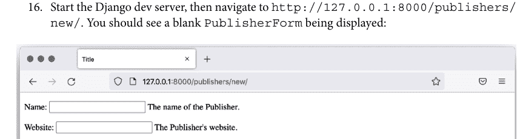

Figure 7.20 – Blank publisher form

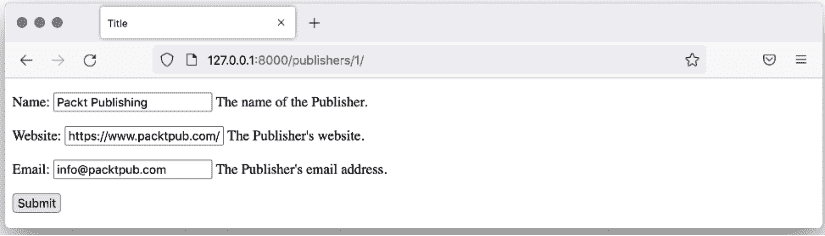

Figure 7.22 – Existing Publisher 1 information

尝试对现有的 **Publisher** 实例进行更改。注意保存后，消息会不同——它会告诉用户 *Publisher* 实例已被 *updated* 而不是 created：

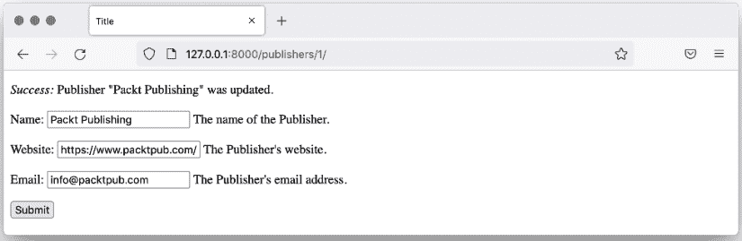

Figure 7.23 – Publisher after updating instead of creating

在本练习中，我们从模型（`PublisherForm` 由 `Publisher` 创建）实现了一个 `ModelForm`，并看到了 Django 如何自动生成具有正确验证规则的表单字段。然后我们使用了表单内置的 `save` 方法，在 `publisher_edit` 视图中保存对 `Publisher` 实例的更改（或自动创建它）。我们将两个 URL 映射到该视图。第一个用于编辑现有 `Publisher` 并向视图传递 pk。另一个不向视图传递此 pk，表示应创建 `Publisher` 实例。最后，我们使用浏览器实验了创建新的 `Publisher` 实例然后编辑现有实例。

## Activity 7.01 – styling and integrating the publisher form

在 *Exercise 7.03 – creating and editing a publisher* 中，你添加了 `PublisherForm` 来创建和编辑 `Publisher` 实例。你使用一个未扩展任何其他模板的独立模板构建了它，因此它缺少全局样式。在本次活动中，你将构建一个通用的表单详情页，该页面将显示一个 Django 表单，类似于 `form-example.html`，但扩展自基础模板。

模板将接受一个变量来显示正在编辑的模型类型。你还将更新主 base.html 模板以使用 Bootstrap 样式渲染 Django 消息。

以下步骤将帮助你完成此活动：

- 1. 首先编辑项目的 base.html 文件。用一个 div 容器包裹 content 块，以获得更美观的布局和一些间距。用 class="container-fluid" 的 <div> 元素包围现有的 content 块。
- 2. 在 messages 中渲染每条消息（类似于 Exercise 7.03 – creating and editing a publisher 的步骤 14）。在你刚刚创建的 <div> 容器之后但在 content 块之前添加  块。你应该使用 Bootstrap 框架类——以下片段会帮助你：
- 3. 在 reviews 应用的命名空间 templates 目录下创建一个名为 instance-form.html 的新模板。
- 4. instance-form.html 应扩展自 reviews 应用的 base.html。
- 5. 传递给此模板的上下文将包含一个名为 instance 的变量。这将是正在编辑的 Publisher 实例，或在创建新的 Publisher 实例时为 None。上下文还将包含一个 model_type 变量，这是一个字符串，表示模型类型（在本例中为 Publisher）。使用这两个变量填充 title 块模板标签：
- 6. instance-form.html 应包含一个 content 块模板标签，以覆盖 base.html 的 content 块。
- 7. 在 content 块内添加一个 <h2> 元素并使用与 title 相同的逻辑填充它。为了获得更好的样式，将出版商名称包裹在 <em> 元素中。
- 8. 在模板中添加一个 <form> 元素，method 为 post。由于我们发布回同一 URL，因此不需要指定 action。
- 9. 在 <form> 主体中包含 CSRF token 模板标签。

```
<div class="alert alert-danger{{ message.level_tag }}" role="alert">
    {{ message }}
</div>
```

Bootstrap 类和 Django 消息标签在大部分情况下名称对应（例如 success 和 alert-success）。例外是 Django 的 error 标签。对应的 Bootstrap 类是 alert-danger。有关 Bootstrap 警告的更多信息，请参阅 https://getbootstrap.com/docs/4.0/components/alerts/。这就是为什么你需要在此片段中使用 if 模板标签。

- - 如果 instance 为 None，则标题应为 New Publisher
- - 否则，标题应为 Editing Publisher <Publisher Name>

- 10. 在 `<form>` 内使用 `as_p` 方法渲染 Django 表单（其上下文变量为 `form`）。
- 11. 向表单添加一个 `submit <button>`。其文本应取决于你是在编辑还是创建。使用编辑时的 `Save` 文本或创建时的 `Create`。你可以在此处使用 Bootstrap 类进行按钮样式设置。它应具有 `class="btn btn-primary"` 属性。
- 12. 在 `reviews/views.py` 中，`publisher_edit` 视图不需要太多更改。更新 `render` 调用以渲染 `instance-form.html` 而不是 `form-example.html`。
- 13. 更新传递给 `render` 调用的上下文字典。它应包括 `Publisher` 实例（已定义的 `publisher` 变量）和 `model_type` 字符串。上下文字典已包含 `form`（一个 `PublisherForm` 实例）。你可以删除 `method` 键。
- 14. 由于我们已完成 `form-example.html` 模板的使用，它可以被删除。

完成后，`Publisher` 创建页面（位于 http://127.0.0.1:8000/publishers/new/）应如下图所示 Figure 7.24：

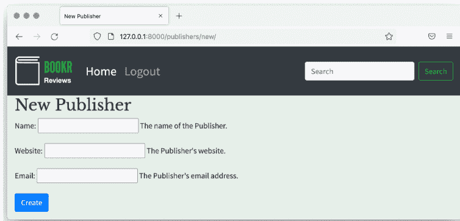

Figure 7.24 – The Publisher creation page

编辑 Publisher 时（例如 http://127.0.0.1:8000/publishers/1/），你的页面应如下图所示 Figure 7.25：

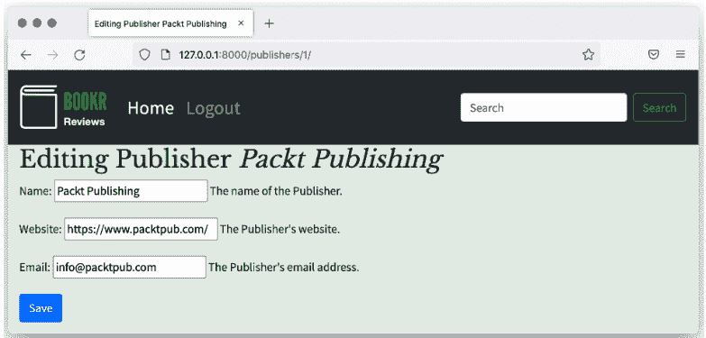

Figure 7.25 – The Editing Publisher page

保存 Publisher 实例后，无论是创建还是编辑，你都应该在页面顶部看到一条成功消息（Figure 7.26）：

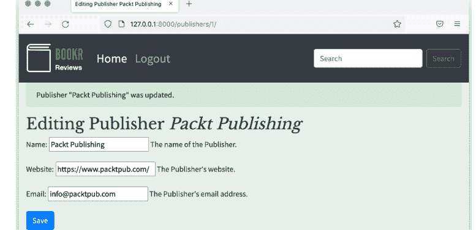

Figure 7.26 – Success message rendered as a Bootstrap alert

## Activity 7.02 – Review Creation UI

> **Note**
> 
> The solution for this activity can be found on `https://github.com/PacktPublishing/Web-Development-with-Django-Second-Edition/tree/main/ActivitySolutions`.

*Activity 7.01 – styling and integrating the Publisher form* 非常广泛；然而，通过完成它，你创建了一个基础，使添加其他 *edit* 和 *create* 视图变得更容易。你将在本次活动中亲身体验这一点，当你将构建用于创建和编辑评论的表单时。因为 `instance-form.html` 模板是通用制作的，你可以在其他视图中重用它。

在本活动中，你将创建一个 review `ModelForm`，然后添加一个 `review_edit` 视图来创建或编辑 Review 实例。你可以重用 *Activity 7.01 – styling and integrating the Publisher form* 中的 `instance-form.html`，并传入不同的上下文变量使其与 Review 模型一起工作。在处理评论时，你将在一本书的上下文中操作——也就是说，`review_edit` 视图必须接受 Book PK 作为参数。你将单独获取这本书并将其分配给你创建的 Review 实例。

以下步骤将帮助你完成此活动：

- 1. 在 `forms.py` 中，添加一个 `ReviewForm`，它继承自 `ModelForm`；其模型应为 Review（确保导入 Review 模型）。
  
  `ReviewForm` 应排除 `date_edited` 和 `book` 字段，因为用户不应在表单中设置这些字段。数据库允许任何评分，但我们可以覆盖 `rating` 字段，使用需要最小值为 0 且最大值为 5 的 `IntegerField`。
  
  创建一个名为 `review_edit` 的新视图。它应接受两个参数在 request 之后：`book_pk`，为必需，以及 `review_pk`，为可选（默认为 None）。使用 `get_object_or_404` 快捷方式获取 Book 实例和 Review 实例（对每种类型调用一次）。获取评论时，确保评论属于该书。如果 `review_pk` 为 None，则 Review 实例也应为 None。

- 2. 如果 `request` 方法为 `POST`，则使用 `request.POST` 和 review 实例实例化一个 `ReviewForm`。确保导入此 `ReviewForm`。
  
  如果表单有效，则保存表单但将 save 的 `commit` 参数设为 False。然后，将返回的 Review 实例上的 book 属性设置为在 *步骤 2* 中获取的 book。
  
  如果 Review 实例正在更新而不是创建，则还应将 `date_edited` 属性设置为当前日期和时间。使用 `from django.utils.timezone.now()` 函数。然后，保存 Review 实例。


+   3. 通过注册成功消息并重定向回 `book_detail` 视图来完成有效表单分支。 由于 Review 模型不包含有意义的文本描述，请在消息中使用 Book 标题——例如，Review for “<book title>” created。
+   4. 如果 `request` 方法不是 POST，则实例化一个 `ReviewForm` 并仅传入 Review 实例。
+   5. 渲染 `instance-form.html` 模板。 在上下文字典中，包含在 publisher_view 中使用过的相同项：form、instance 和 model_type（Review）。 再包含两个额外项——related_model_type，应为 Book，以及 related_instance，将为 Book 实例。
+   6. 编辑 instance-form.html 以添加显示步骤 6 中添加的相关实例信息的位置。 在 <h2> 元素下方，添加一个 <p> 元素，仅在 related_model_type 和 related_instance 都设置时才显示。 它应显示文本 For <related_model_type> <related_instance> ——例如，For Book Advanced Deep Learning with Keras。 将 related_instance 输出放在 <em> 元素中以提高可读性。
+   7. 在 reviews 应用的 urls.py 中，为 review_edit 视图添加 URL 映射。 /books/ 和 /books/<pk>/ URL 已配置。 添加 /books/<book_pk>/reviews/new/ 以创建评论和 /books/<book_pk>/reviews/<review_pk>/ 以编辑评论。 确保为它们提供诸如 review_create 和 review_edit 之类的名称。
+   8. 在 book_detail.html 模板内部，添加用户可以点击以创建或编辑评论的链接。 在 content 块内，刚好在 endblock 关闭模板标签之前添加链接。 它应使用 url 模板标签链接到创建模式下的 review_edit 视图。 此外，使用 class="btn btn-primary" 属性使链接显示为 Bootstrap 按钮。 链接文本应为 Add Review。
+   9. 最后，在遍历 Book 的 Reviews 的 for 循环内部添加编辑评论的链接。 在所有 text-info<span> 实例之后，使用 url 模板标签添加指向 review_edit 视图的链接。 你需要提供 book.pk 和 review.pk 作为参数。 链接的文本应为 Edit Review。

完成后，Review Comments 页面应如下图所示 Figure 7.27：

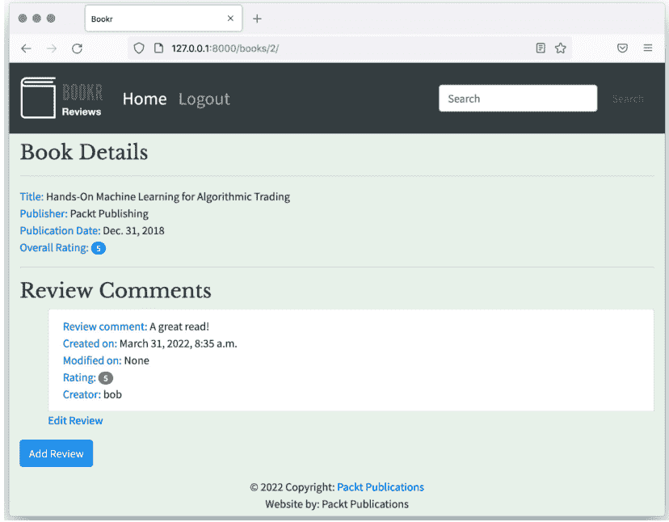

Figure 7.27 – The Book Details page with the added Add Review button

你将看到 **Add Review** 按钮。 点击它将带你到 **Create Book Review** 页面，其应如下图所示 *Figure 7.28*：

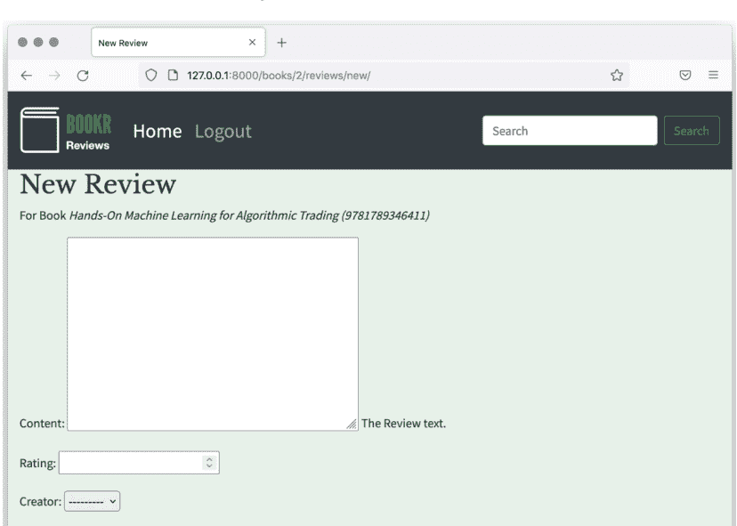

Figure 7.28 – The Create Book Review page

在表单中输入一些详细信息并点击 **Create**。 你将被重定向到 **Book Details** 页面。 你应该看到成功消息和你的评论，如 *Figure 7.29* 所示：

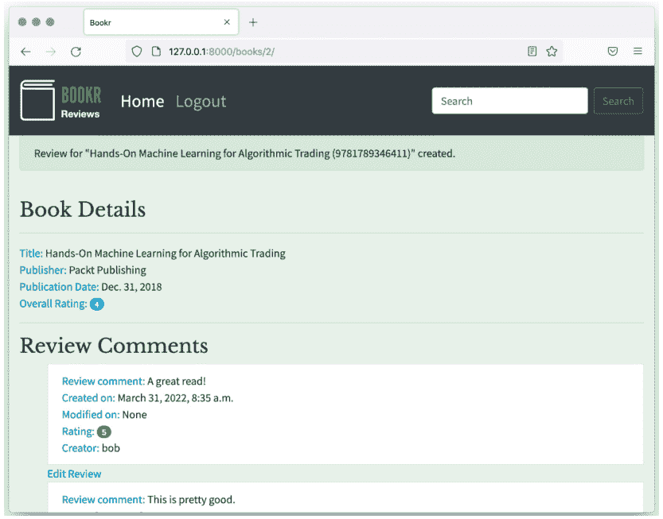

Figure 7.29 – The Book Details page with a review added

你还将看到 **Edit Review** 链接。 如果你点击它，你将被带到一个已预填充你的评论数据的表单（见 *Figure 7.30*）：

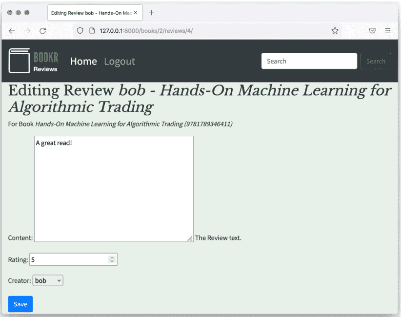

Figure 7.30 – Review form when editing a review

保存现有评论后，你应该会看到 **Book Details** 页面上的 **Modified on** 日期已更新（*Figure 7.31*）：

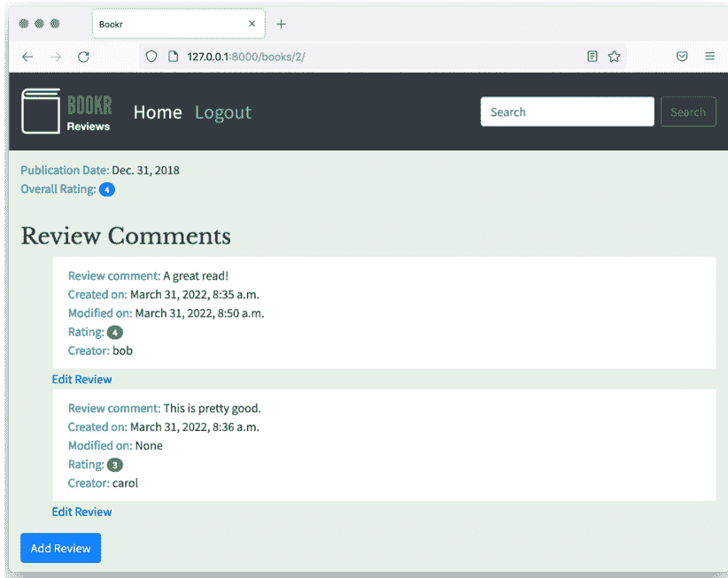

Figure 7.31 – The Modified on: date field has now been populated

## Note

本活动的解决方案可在 https://github.com/PacktPublishing/Web-Development-with-Django-Second-Edition/tree/main/ActivitySolutions 上找到。

## Summary

本章深入探讨了表单。 我们看到了如何通过自定义验证高级规则来增强 Django 表单以清理数据和验证字段。 我们还看到了自定义清理方法如何转换从表单中获取的数据。 我们看到可以添加到表单的一个不错功能是能够在字段上设置初始值和占位符值，以便用户不必填写它们。

然后我们研究了如何使用 ModelForm 类从 Django 模型自动创建表单。 我们看到了如何只向用户显示某些字段以及如何将自定义表单验证规则应用于 ModelForm。 我们还看到了 Django 如何在视图内部自动将新的或更新的模型实例保存到数据库中。 在本章的活动中，我们通过添加用于创建和编辑出版商以及提交评论的表单进一步增强了 Bookr。

在下一章中，我们将继续用户输入提交的主题，并讨论 Django 如何处理文件上传和下载。
