## Media Serving and File Uploads

媒体文件是指可在部署后添加以丰富 Django 应用的额外文件。 通常，它们是你将在网站中使用的额外图像，但任何类型的文件（包括视频、音频、PDF、文本、文档，甚至 HTML）都可以作为媒体提供。

你可以将它们视为介于动态数据和静态资源之间。 它们不是 Django 即时生成的动态数据，例如渲染模板时。 它们也不是站点开发人员在站点部署时包含的静态文件。 相反，它们是可以由用户上传或由你的应用程序为以后检索而生成的额外文件。

媒体文件的一些常见示例（你将在本章后面的 Activity 8.01 – image and PDF upload of books 中看到）是可附加到 Book 对象的图书封面和预览 PDF。 你还可以使用媒体文件允许用户为博客文章上传图像或为社交媒体网站上传头像。 如果你想使用 Django 构建自己的视频分享平台，你将把上传的视频存储为媒体。 如果所有这些文件都是静态文件，你的网站将无法正常运行，因为用户将无法上传自己的图书封面、视频等，只能使用你部署的那些。

在本章中，我们将涵盖以下主题：
- Settings for media uploads and serving
- File uploads using HTML forms
- File uploads with Django forms
- Image uploads with Django forms
- Serving uploaded (and other) files using Django
- ModelForms and file uploads
- Activity 8.01 – image and PDF upload for books
- Activity 8.02 – displaying cover and sample link

## Technical requirements

本章练习和活动的代码可在本书的 GitHub 仓库中找到，地址为 https://github.com/PacktPublishing/Web-Development-with-Django-Second-Edition/tree/main/Chapter08。

## Settings for media uploads and serving

在第 5 章 Serving Static Files 中，我们研究了 Django 如何用于提供静态文件。 提供媒体文件非常相似。 必须在 settings.py 中配置两个设置：MEDIA_ROOT 和 MEDIA_URL。 它们类似于用于提供静态文件的 STATIC_ROOT 和 STATIC_URL。

- MEDIA_ROOT： 这是媒体（例如上传的文件）将在磁盘上存储的路径。 与静态文件一样，你的 Web 服务器应配置为直接从此目录提供服务，以减轻 Django 的负担。
- MEDIA_URL： 这与 STATIC_URL 类似，但如你可能猜到的，它是应用于提供媒体的 URL。 它必须以 / 结尾。 通常，你将使用诸如 /media/ 之类的内容。

> **Note**
> 出于安全原因，MEDIA_ROOT 的路径必须与 STATIC_ROOT 的路径不同，且 MEDIA_URL 必须与 STATIC_URL 不同。 如果它们相同，用户可能会用恶意代码替换你的静态文件（例如 JavaScript 或 CSS 文件）并利用你的用户。

MEDIA_URL 设计用于在模板中使用，以便你不硬编码 URL，并且可以轻松更改它们。 例如，当你部署到生产环境时，你可能希望将其设置为特定主机或内容分发网络（CDN）。 我们将在即将到来的部分中讨论在模板中使用 MEDIA_URL。

## Serving media files in development

与静态文件一样，在生产环境中提供媒体时，你的 Web 服务器应配置为直接从 MEDIA_ROOT 目录提供服务，以防止 Django 被请求占用。 Django 开发服务器可以在开发中提供媒体文件。 然而，与静态文件不同，媒体文件的 URL 映射和视图并未自动设置。


Django 提供了静态 URL 映射，可以添加到现有的 URL 映射中，以提供媒体文件服务。将其添加到您的 urls.py 文件中，如下所示：

```
from django.conf import settings
from django.conf.urls.static import static

urlpatterns = [
    # your existing URL maps
]
if settings.DEBUG:
    urlpatterns += static(settings.MEDIA_URL,
                          document_root=settings.MEDIA_ROOT)
```

这将把 settings.py 中定义的 MEDIA_ROOT 设置对应的目录，通过同样在 settings.py 中定义的 MEDIA_URL 设置来提供服务。我们在追加映射之前检查 settings.DEBUG，是为了不在生产环境中添加此映射。

例如，如果您的 MEDIA_ROOT 设置为 /var/www/bookr/media，而 MEDIA_URL 设置为 /media/，那么 /var/www/bookr/media/image.jpg 文件就可以通过 http://127.0.0.1:8000/media/image.jpg 访问。

当 Django 的 DEBUG 设置为 False 时，静态 URL 映射不起作用，因此它不能在生产环境中使用。但是，如前所述，在生产环境中，您的 Web 服务器应该处理这些请求，这样 Django 就不需要处理它们了。

在第一个练习中，您将新建一个项目，并将 MEDIA_ROOT 和 MEDIA_URL 添加到 settings.py 中。然后添加静态媒体服务 URL 映射，并添加一个测试文件，以确保媒体服务配置正确。

## 练习 8.01 – 配置媒体存储和服务

在此练习中，您将新建一个 Django 项目，作为本章使用的示例项目。然后，配置它以能够提供媒体文件服务。您将创建一个 media 目录，并添加 MEDIA_ROOT 和 MEDIA_URL 设置，然后为 MEDIA_URL 设置 URL 映射。

图 8.1 显示了 PyCharm 中项目的 Runserver 配置。

3. 在 media_project 项目目录下创建一个名为 media 的新目录。然后，在此目录中创建一个名为 test.txt 的新文件。其目录结构如图 8.2 所示：

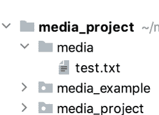

图 8.2：media 目录和 test.txt 布局

4. test.txt 文件也会自动打开。在其中输入 Hello, world!，然后保存并关闭文件。

5. 打开 media_project 包目录下的 settings.py。在文件末尾，使用刚创建的 media 目录的路径添加 MEDIA_ROOT 设置。将目录名称（media）与 BASE_DIR 拼接：

```
MEDIA_ROOT = BASE_DIR / "media"
```

6. 在步骤 5 添加的行正下方，为 MEDIA_URL 添加另一个设置；该设置应为 "/media/"：

```
MEDIA_URL = "/media/"
```

完成这些更改后，settings.py 应如下所示：https://raw.githubusercontent.com/PacktPublishing/Web-Development-with-Django-Second-Edition/main/Chapter08/Exercise8.01/media_project/media_project/settings.py。

7. 打开 media_project 包的 urls.py 文件。在 urlpatterns 定义之后，添加以下代码，以便在 DEBUG 模式下添加媒体服务 URL。首先，您需要在 urlpatterns 定义上方添加突出显示的导入行，以导入 Django 的 settings 和静态服务视图：

```
from django.contrib import admin
from django.urls import path
from django.conf import settings
from django.conf.urls.static import static

urlpatterns = [
```

```
path("admin/", admin.site.urls),
]
```

8. 然后，在 urlpatterns 定义之后立即添加以下代码（参考上一步中的代码块），以条件性地将 MEDIA_URL 设置映射到静态视图，该视图将从 MEDIA_ROOT 提供文件服务：

```
if settings.DEBUG:
    urlpatterns += static(settings.MEDIA_URL,
    document_root=settings.MEDIA_ROOT)
```

现在可以保存此文件了。它应如下所示：https://raw.githubusercontent.com/PacktPublishing/Web-Development-with-Django-Second-Edition/main/Chapter08/Exercise8.01/media_project/media_project/urls.py。

9. 启动 Django 开发服务器（如果尚未运行），然后访问 http://127.0.0.1:8000/media/test.txt。如果一切正确，您应该在浏览器中看到 Hello, world! 文本：

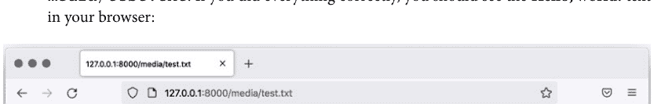

图 8.3：提供媒体文件服务

如果您的浏览器显示如图 8.3 所示，则说明媒体文件正在从 MEDIA_ROOT 目录提供。

我们创建的 test.txt 文件仅用于测试，但在练习 8.02 – 模板设置及在模板中使用 MEDIA_URL 中我们还会用到它，所以暂时不要删除。

在此练习中，我们配置了 Django 来提供媒体文件服务。我们提供了一个测试文件，以确保一切按预期工作，结果也确实如此。接下来，我们将了解如何在模板中自动生成媒体 URL。

## 上下文处理器与在模板中使用 MEDIA_URL

要在模板中使用 MEDIA_URL，我们可以通过视图中的渲染上下文字典将其传入。例如，如下代码块所示：

```
```python
from django.conf import settings

def my_view(request):
    return render(request, "template.html", {"MEDIA_URL":
        settings.MEDIA_URL, "username": "jbloggs"})
```
```

这样是可行的，但问题在于，MEDIA_URL 是一个常见变量，我们可能希望在多个地方使用，这样我们就几乎必须在每个视图中都传递它。

相反，我们可以使用**上下文处理器**，它可以在每次渲染调用时自动向上下文字典中添加一个或多个变量。

上下文处理器是一个接受一个参数（当前请求）的函数。它返回一个上下文信息字典，该字典将与传递给渲染调用的字典合并。

我们可以查看媒体上下文处理器的源代码，它会说明其工作原理：

```
```python
def media(request):
    """
    Add media-related context variables to the context.
    """
    return {"MEDIA_URL": settings.MEDIA_URL}
```
```

启用媒体上下文处理器后，MEDIA_URL 将被添加到上下文字典中。我们可以将之前看到的渲染调用改为：

```
```python
return render(request, "template.html", {"username": "jbloggs"})
```
```

发送到模板的数据相同，因为上下文处理器会添加 MEDIA_URL。

媒体上下文处理器的完整模块路径是 django.template.context_processors.media。Django 提供的其他上下文处理器示例如下：

- `django.template.context_processors.debug`：返回 `{"DEBUG": settings.DEBUG}` 字典。
- `django.template.context_processors.request`：返回 `{"request": request}` 字典；也就是说，它只是将当前 HTTP 请求添加到上下文中。

要启用某个上下文处理器，必须将其模块路径添加到 TEMPLATES 设置的 context_processors 选项中。例如，要启用媒体上下文处理器，请添加 django.template.context_processors.media。我们将在练习 8.02 – 模板设置及在模板中使用 MEDIA_URL 中详细介绍具体做法。

启用媒体上下文处理器后，就可以像普通变量一样在模板中访问 MEDIA_URL 变量：

```
{{ MEDIA_URL }}
```

例如，您可以使用它来引用图像：

```

```

请注意，与静态文件不同，没有用于加载媒体文件的模板标签（即，没有与  模板标签对应的等效标签）。

也可以编写自定义上下文处理器。例如，回到我们构建的 Bookr 应用程序，我们可能希望在每页的侧边栏中显示最近五条评论的列表。这样的上下文处理器可以执行以下代码：

```
from reviews.models import Review

def latest_reviews(request):
    return {"latest_reviews": Review.objects.order_by("-date_created")[:5]}.
```

这可以保存在 Bookr 项目目录中名为 context_processors.py 的文件中，然后在 context_processors 设置中通过其模块路径 context_processors.latest_reviews 来引用。或者，我们可以将其保存在 reviews 应用中，并引用为 reviews.context_processors.latest_reviews。上下文处理器是应视为项目级还是应用特定，由您自行决定。但是请记住，无论它存储在哪里，一旦启用，它都会应用于所有应用的所有渲染调用。

上下文处理器可以返回包含多个项目甚至零项目的字典。如果它有条件地仅在满足特定标准时才添加项目，就会出现这种情况。例如，仅在用户登录时显示最新评论。

让我们在下一个练习中详细探讨这一点。


# 练习 8.02 – 模板设置和使用模板中的 MEDIA_URL

在本练习中，你将继续使用 `media_project` 并配置 Django 以自动将 `MEDIA_URL` 设置添加到每个模板。你通过将 `django.template.context_processors.media` 添加到 `TEMPLATES` 上下文处理器设置来实现这一点。然后你将添加一个使用此新变量的模板以及一个用于渲染它的示例视图。你将在本章的练习中不断修改视图和模板：

+   1. 在 PyCharm 中打开 `settings.py`。首先，你需要将 `media_example` 添加到 `INSTALLED_APPS` 设置中，因为在项目设置时并未完成：

```
```python
INSTALLED_APPS = [
    # other apps truncated for brevity
    "media_example",
]
```
```

+   2. 文件大约 halfway 下方，你会找到 `TEMPLATES` 设置，它是一个字典。其内部是 `OPTIONS` 项（另一个字典）。`OPTIONS` 内部是 `context_processors` 设置。

将以下内容添加到此列表的末尾：

```
```python
"django.template.context_processors.media"
```
```

完整的列表应如下所示：

```
```python
TEMPLATES = [
    {
        "BACKEND":
            "django.template.backends.django
            .DjangoTemplates",
        "DIRS": [],
        "APP_DIRS": True,
        "OPTIONS": {
            "context_processors": [
                "django.template.context_processors
                .debug",
                "django.template.context_processors
                .request",
                "django.contrib.auth.context_processors
                .auth",
                "django.contrib.messages
                .context_processors.messages",
                "django.template.context_processors
                .media",
            ],
```
```
```
},
},
]
```

完整的文件应如下所示：https://raw.githubusercontent.com/PacktPublishing/Web-Development-with-Django-Second-Edition/main/Chapter08/Exercise8.02/media_project/media_project/settings.py。

+   3. 打开 `media_example` 应用的 `views.py` 文件并创建一个名为 `media_example` 的新视图。目前，它只需渲染一个名为 `media-example.html` 的模板（你将在步骤 5 中创建）。视图函数的完整代码如下：

```
```python
def media_example(request):
    return render(request, "media-example.html")
```
```

保存 `views.py`。它应如下所示：https://raw.githubusercontent.com/PacktPublishing/Web-Development-with-Django-Second-Edition/main/Chapter08/Exercise8.02/media_project/media_example/views.py。

+   4. 你需要一个指向 `media_example` 视图的 URL 映射。打开 `media_project` 包的 `urls.py` 文件。

首先，使用文件中的其他导入导入 `media_example.views`：

```
```python
import media_example.views
```
```

然后在 `urlpatterns` 中添加路径以将 `media-example/` 映射到 `media_example` 视图：

```
```python
path('media-example/',
     media_example.views.media_example)
```
```

你的完整 urlpatterns 应如下所示的代码块：

```
```python
from django.conf.urls.static import static

import media_example.views

urlpatterns = [
    path("admin/", admin.site.urls),
    path("media-example/",
         media_example.views.media_example)
]

if settings.DEBUG:
    urlpatterns += static(settings.MEDIA_URL,
    document_root=settings.MEDIA_ROOT)
```
```

你可以保存并关闭文件。

5. 在 media_example 应用目录内创建 templates 目录。然后，在 media_project 项目 templates 目录内创建一个新的 HTML 文件。选择 HTML 5 文件并将文件命名为 media-example.html：

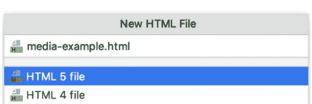

图 8.4：创建 media-example.html

6. media-example.html 文件应自动打开。你只需在文件内添加一个指向你在练习 8.01 – 配置媒体存储和服务中创建的 test.txt 文件的链接。在 <body> 元素内，添加突出显示的代码：

```
<body>
    <a href="{{ MEDIA_URL }}test.txt">Test Text File</a>
</body>
```

注意 MEDIA_URL 和文件名之间没有 / ——这是因为我们在 settings.py 中定义它时已经添加了尾部斜杠。你可以保存文件。完整的文件将如下所示：https://raw.githubusercontent.com/PacktPublishing/Web-Development-with-Django-Second-Edition/main/Chapter08/Exercise8.02/media_project/media_example/templates/media-example.html。

+   7. 如果尚未运行，请启动 Django 开发服务器，然后访问 `http://127.0.0.1:8000/media-example/`。你应该会看到类似 *图 8.5* 的简单页面：

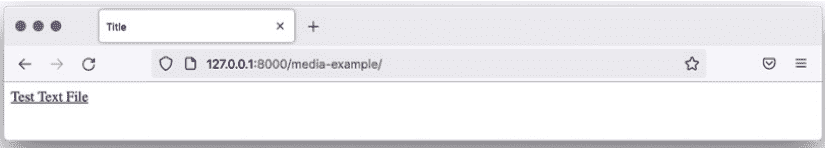

如果点击链接，你将被带到 `test.txt` 显示页面并看到你在 *练习 8.01 – 配置媒体存储和服务（图 8.5）* 中创建的 *Hello, world!* 文本。这意味着你已正确配置了 Django `context_processors` 设置。

我们已完成 `test.txt` 的使用，因此现在可以删除该文件。我们将在其他练习中使用 `media_example` 视图和模板，因此保留它们。在下一节中，我们将讨论如何使用 Web 浏览器上传文件以及 Django 如何在视图中访问它们。

## 使用 HTML 表单进行文件上传

在 *第 6 章，表单* 中，我们学习了 HTML 表单。我们讨论了如何使用 `<form>` 的 method 属性进行 GET 或 POST 请求。到目前为止，我们仅使用表单提交文本数据，但也可以使用表单提交一个或多个文件。

提交文件时，我们必须确保表单上至少有两个属性：method 和 enctype。你可能仍需要其他属性，例如 action。支持文件上传的表单可能如下所示：

```
```html
<form method="post" enctype="multipart/form-data">
```
```

文件上传仅适用于 POST 请求。GET 请求无法实现，因为无法通过 URL 发送文件的全部数据。enctype 属性必须设置为让浏览器知道应将表单数据作为多部分发送，一部分用于表单的文本数据，单独的部分用于附加到表单的每个文件。这种编码对用户是无缝的，他们不知道浏览器如何编码表单，也无需做任何不同的操作。

要将文件附加到表单，你需要创建一个 `file` 类型的输入。你可以手动编写 HTML 代码如下：

```
```html
<input type="file" name="file-upload-name">
```
```

当输入在浏览器中渲染时，空时看起来像这样：

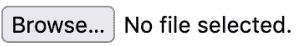

图 8.6：空文件输入

按钮的标题可能因浏览器而异。

点击 **Browse…** 按钮将显示 *文件打开* 对话框：

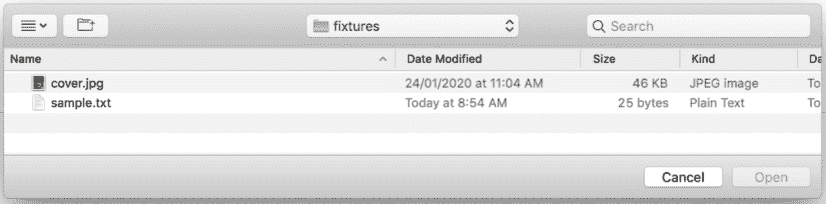

图 8.7：macOS 上的文件浏览器

选择文件后，文件名会显示在字段中：

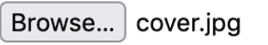

图 8.8：文件输入中选择了 cover.jpg

*图 8.8* 显示了一个文件输入，其中已选择名为 `cover.jpg` 的文件。

我们简要了解了文件上传字段在浏览器中的外观，让我们开始查看 Django 端的文件上传过程。

## 在视图中处理上传的文件

除了文本数据，如果表单还包含文件上传，Django 将使用 request.FILES 属性填充上传的文件。request.FILES 属性是一个类似字典的对象，其键为赋予文件输入的 name 属性。

在上一节的表单示例中，文件输入的 name 为 file-upload-name。因此，文件在视图中可通过 request.FILES["file-upload-name"] 访问。

request.FILES 包含的文件是类似文件的对象（具体为 django.core.files.uploadedfile.UploadedFile 实例），因此要使用它们，必须读取其数据。例如，要在视图中获取上传文件的内容，可以编写如下代码：

```
content = request.FILES["file-upload-name"].read()
```

更常见的做法是将文件内容写入磁盘。当文件上传时，它们存储在临时位置（如果小于 2.5 MB 则在内存中，否则在磁盘上的临时文件）。要将文件数据存储在已知位置，必须读取内容然后将其写入该位置的磁盘。UploadedFile 具有 chunks 方法，可一次读取文件数据的一个块，以防止一次性读取整个文件而使用过多内存。

因此，不要简单地使用 read 和 write 函数，使用 chunks 方法一次仅将文件的小块读入内存：

```
with open("/path/to/output.jpg", "wb+") as output_file:
    uploaded_file = request.FILES["file-upload-name"]
    for chunk in uploaded_file.chunks():
        output_file.write(chunk)
```

请注意，在接下来的一些示例中，我们将此代码称为 save_file_upload 函数。假设该函数定义如下：

```
def save_file_upload(upload, save_path):
    with open(save_path, "wb+") as output_file:
        for chunk in upload.chunks():
            output_file.write(chunk)
```

之前的示例代码然后可以重构为调用该函数：

```
uploaded_file = request.FILES["file-upload-name"]
save_file_upload(uploaded_file, "/path/to/output.jpg")
```


每个`UploadedFile`对象（前面示例代码中的`uploaded_file`变量）也包含关于上传文件的额外元数据，例如文件的名称、大小和内容类型。你会发现以下属性最为有用：

- `size`：顾名思义，这是上传文件的大小（以字节为单位）。
- `name`：这是上传文件的名称，例如`image.jpg`、`file.txt`、`document.pdf`等等。此值由浏览器发送。
- `content_type`：上传文件的内容类型（MIME类型）。例如`image/jpeg`、`text/plain`、`application/pdf`等等。与`name`一样，此值由浏览器发送。
- `charset`：对于文本文件，这是上传文件的字符集或文本编码。类似UTF-8或ASCII。同样，此值也由浏览器确定并发送。

这里有一个快速访问这些属性的示例（例如在视图中）：

````
```python
upload = request.FILES["file-upload-name"]
size = upload.size
name = upload.name
content_type = upload.content_type
charset = upload.charset
```
````

## 浏览器发送值的安全性与信任

正如我们刚才所述，`UploadedFile`的`name`、`content_type`和`charset`值由浏览器决定。这一点很重要，因为恶意用户可能发送伪造值来伪装实际上传的文件。Django不会自动尝试确定上传文件的内容类型或字符集，因此它依赖客户端在发送此信息时保持准确。

如果我们手动处理文件上传的保存而没有适当的检查，那么可能会发生以下情况：

1. 网站的一个用户上传了一个恶意的`malware.exe`可执行文件，但发送了`image/jpeg`内容类型。
2. 我们的代码检查内容类型并认为是安全的，因此将`malware.exe`保存到`MEDIA_ROOT`文件中。
3. 网站的另一个用户下载了一个他们认为是书籍封面图片的文件，但实际上是`malware.exe`可执行文件。他们打开该文件后，电脑便感染了恶意软件。

这个场景已经简化了，恶意文件可能不会有一个如此明显的名称（也许是类似`cover.jpg.exe`这样的名字），但整个过程已经说明。

你选择如何处理上传文件的安全将取决于具体的用例，但在大多数情况下，以下这些提示会有所帮助：

- 当你将文件保存到磁盘时，生成一个名称，而不是使用上传者提供的名称。你应该将文件扩展名替换为你期望的扩展名。例如，如果文件名为`cover.exe`，但内容类型是`image/jpeg`，则将文件保存为`cover.jpg`。你也可以生成一个完全随机的文件名以获得额外的安全性。
- 检查文件扩展名是否与内容类型匹配。这种方法并非万无一失，因为MIME类型太多，如果你处理的是不常见的文件，可能无法匹配。Python内置的`mimetypes`模块可以在这方面提供帮助。它的`guess_type`函数接收一个文件名并返回一个MIME类型元组（内容类型）和编码。以下是在Python控制台中使用它的简短片段：

````
```python
>>> import mimetypes
>>> mimetypes.guess_type('file.jpg')
('image/jpeg', None)
>>> mimetypes.guess_type('text.html')
('text/html', None)
>>> mimetypes.guess_type('unknownfile.abc')
(None, None)
>>> mimetypes.guess_type('archive.tar.gz')
('application/x-tar', 'gzip')
```
````

- 如果你期望的是图片上传，请使用`Pillow`库尝试将上传的文件作为图像打开。如果它不是有效的图像，Pillow将无法打开它。这正是Django使用`ImageField`上传图像时所做的事情。我们将在*练习8.05 – 使用Django表单上传图像*中展示如何使用此技术打开和处理图像。

如果类型或编码无法猜测，元组中的任何一个元素都可能是`None`。通过执行`import mimetypes`将模块导入到你的文件中后，你就可以在视图函数中像这样使用它：

````
```python
upload = request.FILES["file-upload-name"]
mimetype, encoding = mimetypes.guess_type(upload.name)
if mimetype != upload.content_type:
    raise TypeError("Mimetype doesn't match file
    extension.")
```
````

这种方法适用于常见文件类型（如图像），但如前所述，许多不常见的类型可能对mimetype返回`None`。

你还可以考虑使用python-magic Python包，它会检查文件的实际内容以尝试确定其类型。它通过PIP安装，其GitHub项目位于：https://github.com/ahupp/python-magic。安装并使用import magic将其导入到你的文件中后，你就可以在视图函数中这样使用它：

```
upload = request.FILES["field_name"]
mimetype = magic.from_buffer(upload.read(2048),
 mime=True)
```

然后你可以验证`mimetype`是否在允许的类型列表中。

这并不是防范恶意文件上传的所有方法的完整列表。最佳方法取决于你正在构建的应用程序类型。你可能会构建一个用于托管任意文件的网站，在这种情况下，你根本不需要任何内容检查。

现在让我们看看如何构建一个HTML表单和视图来允许上传文件。然后我们将它们存储在media目录中，并在浏览器中检索下载的文件。

## 练习8.03 – 文件上传与下载

在本练习中，你将在media-example.html模板中添加一个带有文件字段的表单。这将允许你使用浏览器将文件上传到media_example视图。你还将更新media_example视图，将文件保存到MEDIA_ROOT目录，以便可供下载。然后，你将通过再次下载文件来测试这一切是否正常工作：

1. 在PyCharm中，打开templates文件夹中的media-example.html模板。在`<body>`元素内，删除在练习8.02 – 模板设置及在模板中使用MEDIA_URL的第6步中添加的`<a>`链接。将其替换为一个`<form>`元素（在以下代码片段中突出显示）。确保开始标签具有method="post"和enctype="multipart/form-data"：

```
</head>
<body>
    <form method="post" enctype="multipart/form-data">

    </form>
</body>
```

2. 在`<form>`主体中插入``模板标签。

3. 在``之后，添加一个`<input>`元素，带有type="file"和name="file_upload"：

```
<input type="file" name="file_upload">
```

4. 最后，在结束的`</form>`标签之前，添加一个`<button>`元素，带有type="submit"和“Submit”文本内容：

```
<button type="submit">Submit</button>
```

你的HTML主体现在应该如下所示：

```
<body>
    <form method="post" enctype="multipart/form-data">
        
        <input type="file" name="file_upload">
        <button type="submit">Submit</button>
    </form>
</body>
```

现在，保存并关闭文件。它应该看起来像这样：https://raw.githubusercontent.com/PacktPublishing/Web-Development-with-Django-Second-Edition/main/Chapter08/Exercise8.03/media_project/media_example/templates/media-example.html。

5. 打开media_example应用的views.py文件。在media_example视图中，添加代码将上传的文件保存到MEDIA_ROOT目录。为此，你需要从settings访问MEDIA_ROOT，因此在文件顶部导入Django settings：

```
from django.conf import settings
```

6. 仅当请求方法为POST时，才应保存上传的文件。在media_example视图中，添加一个if语句来验证request.method是否为POST：

```
def media_example(request):
    if request.method == "POST":
        ...
```

7. 在上一步添加的if语句中，通过将上传的文件名与MEDIA_ROOT目录拼接来生成输出路径。然后，以wb模式打开此路径，并使用chunks方法遍历上传的文件。最后，将每个块写入保存的文件：

```
def media_example(request):
    if request.method == 'POST':
        save_path = settings.MEDIA_ROOT /
        request.FILES["file_upload"].name

        with open(save_path, "wb") as output_file:
            for chunk in
                request.FILES["file_upload"].chunks():
                    output_file.write(chunk)

    return render(request, "media-example.html")
```


请注意，上传的文件及其元数据正通过 `request.FILES` 字典访问，使用的键与文件输入的名称一致（在我们的示例中，这个名称是 `file_upload`）。现在可以保存并关闭 `views.py` 了。它现在应该看起来像这样：`https://raw.githubusercontent.com/PacktPublishing/Web-Development-with-Django-Second-Edition/main/Chapter08/Exercise8.03/media_project/media_example/views.py`。

+   8. 如果 Django 开发服务器尚未运行，请启动它，然后导航到 `http://127.0.0.1:8000/media-example/`。你应该会看到文件上传字段和**提交**按钮，如下图所示：

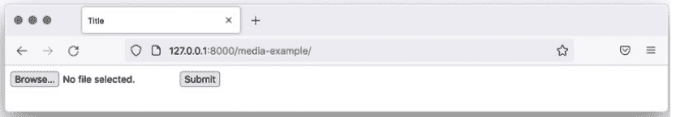

图 8.9：文件上传表单

点击**浏览…**（或浏览器中对应的按钮），然后选择一个要上传的文件。文件名将出现在文件输入框中。然后，点击**提交**。

页面将重新加载，表单将再次变为空。这是正常现象——在后台，文件应该已经保存了。

+   9. 尝试使用 `MEDIA_URL` 下载你上传的文件。在本示例中，上传了一个名为 `cover.jpg` 的文件。它将可以通过 `http://127.0.0.1:8000/media/cover.jpg` 下载。你的 URL 将取决于你上传的文件名称：


图 8.10：在 `MEDIA_URL` 中可见的上传文件

如果你上传的是图片、HTML 文件或其他浏览器可以显示的文件类型，你将能够在浏览器中直接查看它。否则，你的浏览器只会再次将其下载到磁盘。这两种情况都意味着上传成功。

你还可以通过在 media_project 项目目录中查看 media 目录来确认上传是否成功：

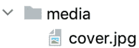

图 8.11：media 目录中的 cover.jpg

图 8.11 显示了 PyCharm 中 media 目录里的 cover.jpg 文件。

在本练习中，你添加了一个 `enctype` 设置为 `multipart/form-data` 的 HTML 表单，以便允许文件上传。它包含一个用于选择要上传文件的文件输入。然后，你为 media_example 视图添加了保存功能，以便将上传的文件保存到磁盘。

在下一节中，我们将介绍如何使用 Django 表单简化表单生成并添加验证，以处理文件上传。

## 使用 Django 表单上传文件

在第 6 章“表单”中，我们了解了 Django 如何简化表单的定义并自动将其渲染为 HTML。在前面的示例中，我们手动定义了表单并编写了 HTML。我们可以将其替换为 Django 表单，并使用 `FileField` 构造器来实现文件输入。

以下是在表单上定义 `FileField` 的方法：

```
from django import forms

class ExampleForm(forms.Form):
    file_upload = forms.FileField()
```

`FileField` 构造器可以接受以下关键字参数：

- Required：对于必填字段，该参数应为 `True`；如果字段是可选的，则为 `False`
- max_length：指上传文件的文件名的最大长度
- allow_empty_file：如果设置了此参数，即使上传的文件为空（大小为 0），该字段也会被视为有效

除了这三个关键字参数之外，构造器还可以接受标准的 `Field` 参数，例如 `widget`。`FileField` 的默认 widget 类是 `ClearableFileInput`；这是一个文件输入，可以显示一个复选框，勾选该复选框可以发送一个空值，并清除模型字段上已保存的文件。

在视图中使用带有 `FileField` 构造器的表单与其他表单类似，但当表单已提交（即 `request.METHOD` 为 `POST`）时，还应该将 `request.FILES` 传入表单构造器。这是因为 Django 在验证表单时需要访问 `request.FILES` 来查找有关上传文件的信息。

因此，视图函数中的基本流程类似于这样：

```
def view(request):
    if request.method == "POST":
        # 使用 POST 数据和文件实例化表单
        form = ExampleForm(request.POST, request.FILES)
        if form.is_valid():
            # 处理表单并保存文件
            return redirect("success-url")
    else:
        # 像之前一样实例化一个空表单
        form = ExampleForm()
```

```
# 与其他表单一样渲染模板
return render(request, "template.html", {"form": form})
```

在处理上传文件和表单时，你可以通过 `request.FILES` 或 `form.cleaned_data` 来访问上传的文件；这两个方式返回的是同一个对象。在前面的示例中，我们可以像这样处理上传的文件：

```
if form.is_valid():
    save_file_upload("/path/to/save.jpg",
                     request.FILES["file_upload"])
    return redirect("/success-url/")
```

或者，由于它们包含的是同一个对象，你也可以使用 `form.cleaned_data`：

```
if form.is_valid():
    save_file_upload("/path/to/save.jpg",
                     form.cleaned_data["file_upload"])
    return redirect("/success-url/")
```

保存的数据将是相同的。

> **注意**
> 
> 在*第 6 章“表单”*中，你尝试了表单并提交了无效值。当页面刷新并显示表单错误时，你之前输入的数据会在页面重新加载时被重新填充。但文件字段不会出现这种情况；相反，如果表单无效，用户将需要重新导航并再次选择文件。

在下一个练习中，我们将通过构建一个示例表单，并修改视图使其仅在表单有效时保存文件，来将我们学到的 `FileField` 知识付诸实践。

## 练习 8.04 – 使用 Django 表单上传文件

在之前的练习中，你在 HTML 中创建了一个表单，并使用它将文件上传到 Django 视图。如果你在未选择文件的情况下尝试提交表单，你会看到 Django 异常页面。你没有对表单进行任何验证，因此这种方法相当脆弱。

在本练习中，你将创建一个带有 `FileField` 的 Django 表单，这样你就可以使用表单验证功能来使视图更加健壮，同时减少代码量：

+   1. 在 PyCharm 中，在 `media_example` 应用内部，创建一个名为 `forms.py` 的新文件。它会自动打开。在文件开头，导入 Django 表单库：

```
from django import forms
```

然后，创建一个 `forms.Form` 的子类，并将其命名为 `UploadForm`。在其中添加一个名为 `file_upload` 的 `FileField` 字段。你的类应该包含以下代码：

```
class UploadForm(forms.Form):
    file_upload = forms.FileField()
```

你可以保存并关闭此文件。完整的文件应该看起来像这样：`https://raw.githubusercontent.com/PacktPublishing/Web-Development-with-Django-Second-Edition/main/Chapter08/Exercise8.04/media_project/media_example/forms.py`。

+   2. 打开 `form_example` 应用的 `views.py` 文件。在文件开头、现有导入语句的正下方，你需要像这样导入新类：

```
from .forms import UploadForm
```

+   3. 如果你位于视图的 POST 分支中，则需要同时使用 `request.POST` 和 `request.FILES` 来实例化 `UploadForm`。如果不传入 `request.FILES`，则表单实例将无法访问上传的文件。在 `if request.method == "POST"` 检查下方，使用这两个参数实例化 `UploadForm`：

```
form = UploadForm(request.POST, request.FILES)
```

+   4. 现有的定义 `save_path` 和存储文件内容的行可以保留，但它们应该缩进一个代码块，并放入表单有效性检查中，这样它们就只在表单有效时执行。添加 `if form.is_valid():` 这一行，然后缩进其他行，使代码看起来像这样：

```
if form.is_valid():
    save_path = os.path.join(settings.MEDIA_ROOT,
    request.FILES["file_upload"].name)

    with open(save_path, "wb") as output_file:
        for chunk in
        request.FILES["file_upload"].chunks():
            output_file.write(chunk)
```


5. 由于你现在使用的是表单，可以通过表单访问文件上传。将 `request.FILES["file_upload"]` 的用法替换为 `form.cleaned_data["file_upload"]`：

```python
if form.is_valid():
    save_path = settings.MEDIA_ROOT /
        form.cleaned_data["file_upload"].name

    with open(save_path, "wb") as output_file:
        for chunk in
            form.cleaned_data["file_upload"].chunks():
            output_file.write(chunk)
```

6. 最后，添加一个 else 分支来处理非 POST 请求，它只需在不带任何参数的情况下实例化一个表单：

```python
if request.method == "POST":
    ...
else:
    form = UploadForm()
```

7. 在 render 调用中添加一个上下文字典参数，并在 `form` 键中设置表单变量：

```python
return render(request, "media-example.html", {"form":
form})
```

你现在可以保存并关闭此文件。它应该看起来像这样：`https://raw.githubusercontent.com/PacktPublishing/Web-Development-with-Django-Second-Edition/main/Chapter08/Exercise8.04/media_project/media_example/views.py`。

8. 最后，打开 `media-example.html` 模板并删除你手动定义的 `<input>` 文件。用 `form` 替换它，使用 `as_p` 方法渲染（已高亮）：

```html
<body>
    <form method="post" enctype="multipart/form-data">
        
        {{ form.as_p }}
        <button type="submit">Submit</button>
    </form>
</body>
```

你不应更改文件的其他任何部分。你可以保存并关闭此文件。它应该看起来像这样：`https://raw.githubusercontent.com/PacktPublishing/Web-Development-with-Django-Second-Edition/main/Chapter08/Exercise8.04/media_project/media_example/templates/media-example.html`。

9. 如果尚未运行，请启动 Django 开发服务器，然后导航到 `http://127.0.0.1:8000/media-example/`。你应该会看到文件上传字段和 **Submit** 按钮如下：

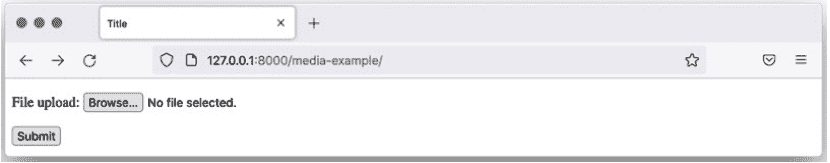

图 8.12：浏览器中渲染的 Django 文件上传表单

10. 由于我们使用的是 Django 表单，因此我们会自动获得其内置验证。如果尝试在未选择文件的情况下提交表单，浏览器应会阻止它并显示错误，如下所示：

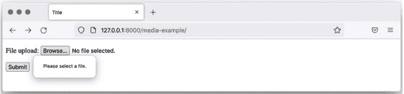

图 8.13：表单提交被浏览器阻止

11. 最后，重复你在 *Exercise 8.03 – file upload and download* 中执行的文件上传测试，选择一个文件并提交表单。然后你应该能够使用 MEDIA_URL 检索该文件。在此例中，文件名为 `cover.jpg` 再次被上传（见以下截图）：

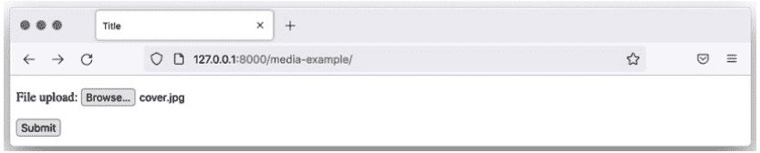

图 8.14：上传名为 cover.jpg 的文件

然后你可以在 http://127.0.0.1:8000/media/cover.jpg 处检索该文件，并在浏览器中看到如下内容：


图 8.15：使用 Django 表单上传的文件在浏览器中也可见

在本练习中，我们用包含 FileField 的 Django 表单替换了手动构建的表单。我们通过同时传入 request.POST 和 request.FILES 在视图中实例化了表单。然后我们使用标准的 is_valid 方法检查表单的有效性，并且只有在表单有效时才保存文件上传。我们测试了文件上传，并看到我们能够使用 MEDIA_URL 检索上传的文件。

在下一节中，我们将研究 ImageField，它与 FileField 类似，但专门用于图像。

## 使用 Django 表单上传图像

如果你想在 Python 中处理图像，你会使用的最常见库称为 Pillow，而 Django 用于验证图像的也是该库。最初有一个名为 Python Imaging Library 的库，称为 PIL。它没有得到更新，最终该库被分叉并仍在维护，即 Pillow。为了保持向后兼容性，安装时该包仍称为 PIL。例如，Image 对象是从 PIL 导入的：

```
from PIL import Image
```

Python Imaging Library、PIL 和 Pillow 的术语经常可以互换使用。你可以假设如果有人提到 PIL，他们指的是最新的 Pillow 库。

Pillow 提供了各种获取图像数据或对其进行操作的方法。你可以了解图像的宽度和高度、缩放、裁剪并对其应用转换。可用操作太多，无法在本章中全部涵盖，因此我们只介绍一个简单示例（缩放图像），你将在下一个练习中使用它。

由于图像是用户可能想要上传的最常见文件类型之一，Django 还包括 ImageField。它与 FileField 行为相似，但还会自动验证数据是否为图像文件。这有助于防止安全问题，即我们期望图像，但用户上传了恶意文件。

ImageField 的 UploadedFile 具有与 FileField 相同的全部属性和方法（size、content_type、name、chunks() 等），但额外增加了一个属性：image。这是用于验证上传文件是否为有效图像的 PIL Image 对象实例。

在检查表单有效后，底层 PIL Image 对象将被关闭。这是为了释放内存并防止 Python 进程打开太多文件，从而可能导致性能问题。这对开发人员意味着你可以访问图像的一些元数据（如宽度、高度和格式），但在不重新打开图像的情况下无法访问实际的图像数据。

为了说明，我们将创建一个带有 ImageField 的表单，名为 picture：

```
class ExampleForm(forms.Form):
    picture = forms.ImageField()
```

在视图函数内部，可以在表单的 cleaned_data 中访问 picture 字段：

```
if form.is_valid():
    picture_field = form.cleaned_data["picture"]
```

然后可以检索 picture 字段的 Image 对象：

```
image = picture_field.image
```

现在我们在视图中有了对图像的引用，可以获取一些元数据：

```
w = image.width  # 一个整数，例如 600
h = image.height  # 也是一个整数，例如 420
f = image.format  # 图像格式的字符串，例如 "PNG"
```

Django 还会自动将 UploadedFile 的 content_type 属性更新为 picture 字段的正确类型。这会覆盖浏览器在上传文件时发送的值。

尝试使用访问实际图像数据（而非仅元数据）的方法将导致引发异常。这是因为 Django 已关闭底层图像文件。

例如，以下代码片段将引发 AttributeError：

```
image.getdata()
```

相反，我们需要重新打开图像。图像数据可以使用 ImageField 引用在导入 Image 类后打开：

```
from PIL import Image
```

```
image = Image.open(picture_field)
```

现在图像已打开，你可以对其执行操作。在下一节中，我们将研究一个简单示例——调整上传图像的大小。

## 使用 Pillow 调整图像大小

Pillow 支持在保存图像之前可能想要执行的大量操作。我们无法在本书中全部解释，因此我们只使用一个常见操作：在保存之前将图像调整为特定大小。这将帮助我们节省存储空间并提高下载速度。例如，用户可能在 Bookr 中上传的封面图像比我们所需的大得多。在保存文件（写回磁盘）时，我们必须指定使用的格式。我们可以通过多种方法确定上传图像的类型（例如检查上传文件的 `content_type` 或 Image 对象的 `format`），但在我们的示例中，我们将始终将其保存为 JPEG 文件。

PIL Image 类有一个 thumbnail 方法，它会在保留宽高比的同时将图像调整为最大尺寸。例如，我们可以设置最大尺寸为 50 像素（px）乘 50 px。200 px × 100 px 的图像将被调整为 50 px × 25 px：通过将最大维度设置为 50 px 来保留宽高比。每个维度按 0.25 的因子缩放：

```python
from PIL import Image

size = 50, 50  # 调整大小的目标宽度、高度元组
image = Image.open(image_file)  # 像之前一样打开图像
image.thumbnail(size)  # 执行调整大小
```

此时，调整大小仅在内存中完成。更改不会在调用 save 方法之前保存到磁盘，如下所示：

```python
image.save("path/to/file.jpg")
```

输出格式会自动根据使用的文件扩展名确定，在本例中为 JPEG。save 方法还可以接收 format 参数来覆盖它，例如：

```python
image.save("path/to/file.png", "JPEG")
```

尽管扩展名为 .png，但格式指定为 JPEG，因此输出将为 JPEG 格式。正如你可能想象的那样，这可能会非常令人困惑，因此你可能决定只指定扩展名。

在下一个练习中，我们将更改我们一直在使用的 UploadForm，使其使用 ImageField 而不是 FileField，然后在保存到媒体目录之前实现上传图像的调整大小。


## 练习 8.05 – 使用 Django 表单上传图片

在本练习中，你将更新在练习 8.04 – 使用 Django 表单上传文件 中创建的 UploadForm 类，将其改为使用 ImageField 而不是 FileField（这只需要更改字段的类）。你会发现表单在浏览器中的渲染方式与之前相同。接下来，你将尝试上传一些非图片文件，看看 Django 如何验证表单以禁止它们。最后，你将更新视图以使用 PIL 在保存前调整图片大小，然后进行测试：

- 1. 打开 media_example 应用的 forms.py 文件。在 UploadForm 类中，将 file_upload 改为 ImageField 的实例而不是 FileField。更新后，UploadForm 应该如下所示：

```
class UploadForm(forms.Form):
    file_upload = forms.ImageField()
```

保存并关闭文件。你的 forms.py 文件应该如下所示：https://raw.githubusercontent.com/PacktPublishing/Web-Development-with-Django-Second-Edition/main/Chapter08/Exercise8.05/media_project/media_example/forms.py。

- 2. 如果 Django 开发服务器尚未运行，请启动它，然后导航到 http://127.0.0.1:8000/media-example/。你应该会看到表单的渲染效果，它看起来与我们使用 FileField 时完全相同（见以下截图）：

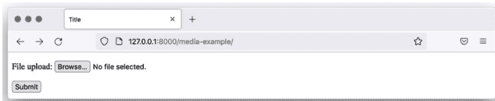

图 8.16：ImageField 看起来与 FileField 相同

- 3. 当你尝试上传非图片文件时，你会注意到区别。点击 Browse... 按钮并尝试选择一个非图片文件。根据你的浏览器或操作系统，你可能无法选择图片以外的任何文件，如图 8.17 所示：

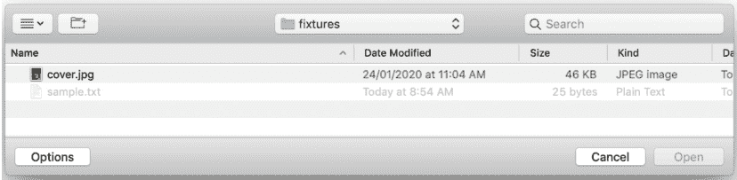

图 8.17：只能选择图片文件

你的浏览器可能允许你选择图片，但在选择后在表单中显示错误。或者你的浏览器可能允许你选择文件并提交表单，然后 Django 会引发 ValidationError。无论如何，你可以确定在你的视图中，表单的 is_valid 视图只有在上传了图片时才会返回 True。

> Note
> 你现在不需要测试上传文件，因为结果与练习 8.04 – 使用 Django 表单上传文件 中的结果相同。

- 4. 你需要做的第一件事是确保 Pillow 库已安装。在终端中（确保已激活虚拟环境），运行以下命令：

```
pip3 install pillow
```

（在 Windows 中，这是 pip install pillow）。你会得到类似图 8.18 的输出：

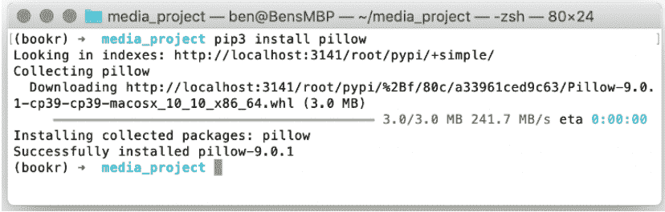

图 8.18：pip3 安装 pillow

如果 Pillow 已安装，你会看到 Requirement already satisfied 输出信息。

- 5. 现在，我们可以更新 media_example 视图以在保存前调整图片大小。切换回 PyCharm 并打开 media_example 应用的 views.py 文件，然后通过在文件顶部附近添加以下导入行来导入 PIL 的 Image 类：

```
from PIL import Image
```

- 6. 进入 media_example 视图。在生成 save_path 的行下方，删除打开输出文件、遍历上传文件并写入其块的三个行。用以下代码替换它，该代码使用 PIL 打开上传的文件，调整其大小，然后保存它：

```
image = Image.open(form.cleaned_data["file_upload"])
image.thumbnail((50, 50))
image.save(save_path)
```

第一行通过打开上传的文件创建 Image 实例，下一行执行缩略图转换（最大尺寸为 50 px x 50 px），第三行将文件保存到我们在之前的练习中一直生成的相同保存路径。你可以保存文件。它应该如下所示：https://raw.githubusercontent.com/PacktPublishing/Web-Development-with-Django-Second-Edition/main/Chapter08/Exercise8.05/media_project/media_example/views.py。

- 7. Django 开发服务器应仍在步骤 2 中运行，但如果未运行，你应该启动它。然后，导航到 http://127.0.0.1:8000/media-example/。你会看到熟悉的 UploadForm。选择一张图片并提交表单。如果上传和调整大小成功，表单将刷新并再次变为空。

- 8. 使用 MEDIA_URL 查看上传的图片。例如，名为 cover.jpg 的文件可以从 http://127.0.0.1:8000/media/cover.jpg 下载。你应该会看到图片已被调整大小，最大尺寸仅为 50 px：

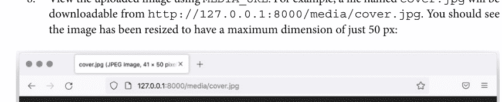

图 8.19：调整大小后的封面

虽然这种尺寸的缩略图可能不太有用，但至少让我们确信图片调整大小已正确工作。

在本练习中，我们将 UploadForm 上的 FileField 改为 ImageField。我们看到浏览器不允许我们上传除图片之外的任何内容。然后我们向 media_example 视图添加了代码，使用 PIL 调整上传的图片大小。

我们已鼓励出于性能原因使用单独的 Web 服务器来提供静态和媒体文件。然而，在某些情况下，你可能希望使用 Django 来提供文件，例如在允许访问之前提供身份验证。在下一节中，我们将讨论如何使用 Django 提供媒体文件。

## 使用 Django 提供上传（和其他）文件

在本章以及第 5 章《提供静态文件》中，我们一直不鼓励使用 Django 提供文件。这是因为它会不必要地占用 Python 进程来提供文件，而 Web 服务器完全有能力处理此事。不幸的是，Web 服务器通常不提供动态访问控制，即仅允许经过身份验证的用户下载文件。根据你在生产环境中使用的 Web 服务器，你可能可以让它针对 Django 进行身份验证，然后自行提供文件；然而，特定 Web 服务器的具体配置超出了本书的范围。

你可以采取的一种方法是指定 MEDIA_ROOT 目录的子目录，并让你的 Web 服务器阻止访问仅此特定文件夹。任何受保护的媒体都应存储在其中。如果你这样做，只有 Django 才能读取其中的文件。例如，你的 Web 服务器可以提供 MEDIA_ROOT 目录中的所有内容，除了 MEDIA_ROOT/protected 目录。

另一种方法是将 Django 视图配置为从磁盘提供特定文件。视图将确定要发送的文件在磁盘上的路径，然后使用 FileResponse 类发送它。FileResponse 类接受一个打开的文件句柄作为参数，并尝试根据文件的内容确定正确的 content type。Django 会在请求完成后关闭文件句柄。

视图函数将接受请求和要下载的文件的相对路径作为参数。此相对路径是 MEDIA_ROOT/protected 文件夹内部的路径。

在我们的例子中，我们只需检查用户是否匿名（未登录）。我们将通过检查 request.user.is_anonymous 属性来做到这一点。如果他们未登录，我们将引发 django.core.exceptions.PermissionDenied 异常，该异常向浏览器返回 HTTP 403 Forbidden 响应。这将停止视图的执行并且不会返回任何文件：

```
import os.path
from django.conf import settings
from django.http import FileResponse
from django.core.exceptions import PermissionDenied

def download_view(request, relative_path):
    if request.user.is_anonymous:
        raise PermissionDenied
    full_path = os.path.join(settings.MEDIA_ROOT,
        "protected", relative_path)
    file_handle = open(full_path, "rb")
    return FileResponse(file_handle)  # Django sends the file then closes the handle
```

此视图的 URL 映射可以如下所示，使用 path path 转换器在你的 urls.py 文件中：

```
urlpatterns = [
    ...
    path("downloads/<path:relative_path>",
    views.download_view)
]
```

你可以以多种方式选择实现发送文件的视图。重要的是你使用 FileResponse 类，该类旨在将文件分块流式传输给客户端，而不是全部加载到内存中。这将减少服务器的负载，并在你必须使用 Django 发送文件时减轻对资源使用的影响。

现在我们知道了如何上传和处理图片，让我们看看如何将它们存储在模型上。

## 在模型实例上存储文件

到目前为止，我们手动管理文件的上传和保存。你也可以通过将保存的路径分配给 CharField 来将文件与模型实例关联起来。然而，与 Django 的许多功能一样，此功能（以及更多功能）已由 models.FileField 类提供。FileField 实例实际上并不存储文件数据；相反，它们存储文件存储的路径（就像 CharField 会做的那样），但它还提供了辅助方法。这些方法有助于加载文件（因此你不必手动打开它们）并根据实例的 ID（或其他属性）为你生成磁盘路径。


请注意 user_grouped_file_path 只是一个说明性的函数，故意保持简短，因此它在文件名只有单个字符或用户名包含无效字符时将无法正确工作。例如，如果用户名中包含 / 字符，则它将在生成的路径中充当目录分隔符。

现在，我们已经深入研究了如何在模型上设置 FileField，但我们如何实际将上传的文件保存到其中呢？这和为任何类型的值赋值一样简单，只需将上传的文件分配给模型的属性即可。下面是一个使用视图和本节前面示例中使用的简单 ExampleModel 的快速示例：

```python
class ExampleModel(models.Model):
    file_field = models.FileField(upload_to="files/")

def view(request):
    if request.method == "POST":
        m = ExampleModel()  # Create a new ExampleModel instance
        m.file_field = request.FILES["uploaded_file"]
        m.save()
    return render(request, "template.html")
```

在这个示例中，我们创建了一个新的 ExampleModel 并将上传的文件（在表单上称为 uploaded_file）分配给其 file_field 属性。当我们保存模型实例时，Django 会自动将文件以其名称写入 upload_to 目录路径。如果上传的文件名为 image.jpg，则保存路径将为 MEDIA_ROOT/upload_to/image.jpg。

我们也可以同样轻松地更新现有模型的 file 字段或使用表单（在保存前进行验证）。下面是另一个简单的示例来演示这一点：

```python
class ExampleForm(forms.Form):
    uploaded_file = forms.FileField()

def view(request, model_pk):
    form = ExampleForm(request.POST, request.FILES)
    if form.is_valid():
        # Get an existing model instance
        m = ExampleModel.objects.get(pk=model_pk)

        # store the uploaded file on the instance
        m.file_field = form.cleaned_data["uploaded_file"]
        m.save()
    return render(request, "template.html")
```

你可以看到，在现有模型实例上更新 FileField 的过程与在新实例上设置它相同，如果你选择使用 Django 表单或直接访问 request.FILES，过程也一样简单。

现在我们将看看如何使用 ImageField 在模型上存储图像。

## 在模型实例上存储图像

虽然 FileField 可以存储任何类型的文件，包括图像，但也存在 ImageField。正如你所预期的那样，这仅用于存储图像。模型 forms.FileField 与 forms.ImageField 之间的关系与 models.FileField 和 models.ImageField 之间的关系类似，这意味着 ImageField 扩展了 FileField 并添加了用于处理图像的额外方法。

ImageField 构造函数接受与 FileField 相同的参数，并添加了两个额外的可选参数：

- `height_field`：这是模型上字段的名称，每次保存模型实例时都会用图像的高度进行更新

- `width_field`：这是 height_field 的宽度对应项：存储图像宽度的字段，每次保存模型实例时都会更新

这两个参数都是可选的，但如果使用，它们命名的字段必须存在。也就是说，将 height_field 或 width_field 设为空是有效的，但如果它们被设置为不存在的字段的名称，则会发生错误。其目的是帮助在数据库中搜索具有特定尺寸的文件。

下面是一个使用 ImageField 的示例模型，它会更新图像尺寸字段：

```python
class ExampleModel(models.Model):
    image = models.ImageField(upload_to="images/%Y/%m/%d/",
                              height_field="image_height",
                              width_field="image_width"
                              )
    image_height = models.IntegerField()
    image_width = models.IntegerField()
```

请注意，`ImageField` 使用 `upload_to` 参数，其中包含在保存时更新的日期格式化指令。`upload_to` 的行为与 `FileField` 完全相同。

保存 `ExampleModel` 实例后，其 `image_height` 字段将被更新为图像的高度，`image_width` 将被更新为图像的宽度。

我们不会展示在视图中设置 `ImageField` 值的示例，因为该过程与普通 `FileField` 相同。

## 使用 FieldFile

当你访问模型实例的 `FileField` 或 `ImageField` 属性时，你不会得到一个原生的 Python 文件对象。相反，你将使用一个 `FieldFile` 对象。`FieldFile` 类是对文件的包装，添加了额外的方法。是的，拥有名为 `FileField` 和 `FieldFile` 的类可能会令人困惑。

Django 使用 `FieldFile` 而不是仅使用文件对象的理由有两个。首先，它添加了打开、读取、删除文件以及生成文件 URL 的额外方法。其次，它提供了一个抽象层以允许使用替代存储引擎。

## 自定义存储引擎

我们在 *第 5 章，Serving Static Files* 中研究了自定义存储引擎，关于存储静态文件。我们不会详细检查媒体文件的自定义存储引擎，因为 *第 5 章，Serving Static Files* 中为静态文件概述的代码也适用于媒体文件。需要注意的重要一点是，你使用的存储引擎可以在不更新其他代码的情况下更改。这意味着你可以在开发期间将媒体文件存储在本地驱动器上，然后在应用程序部署到生产环境时将它们保存到 CDN。

默认存储引擎类可以用 `settings.py` 中的 `DEFAULT_FILE_STORAGE` 设置。存储引擎也可以按字段指定（对于 `FileField` 或 `ImageField`），使用 storage 参数，例如：

```python
storage_engine = CustomStorageEngine()

class ExampleModel(models.Model):
    image_field = ImageField(storage=storage_engine)
```

这演示了上传或检索文件时实际发生的情况。Django 将写入或读取操作委托给存储引擎。即使保存到磁盘时也是如此；然而，这是基础性的，对用户来说是不可见的。

## 读取存储的 FieldFile

现在我们已经了解了自定义存储引擎，让我们来看一下如何从 FieldFile 读取。在前面的章节中，我们看到了如何将文件设置在模型实例上。再次读取数据也一样简单——我们有几种不同的方法可以帮助我们，具体取决于我们的用例。

在下面的几个代码片段中，假设我们位于一个视图中，并且以某种方式检索了我们的模型实例，并将其存储在 m 变量中：

```python
m = ExampleModel.objects.get(pk=model_pk)
```

我们可以使用 read 方法读取文件的全部数据：

```python
data = m.file_field.read()
```

或者，我们可以使用 open 方法手动打开文件。如果我们想将自己生成的数据写入文件，这可能会很有用：

```python
with m.file_field.open("wb") as f:
    chunk = f.write(b"test")  # write bytes to the file
```

如果我们想分块读取文件，可以使用 chunks 方法。这与我们之前看到的从上传文件读取块的方式相同：

```python
for chunk in m.file_field.chunks():
    write_chunk(open_file, chunk)  # assume this method is defined somewhere
```

我们也可以通过使用其 path 属性手动自行打开文件：

```python
open(m.file_field.path)
```

如果我们想为下载而流式传输 FileField，最好的方法是使用 FileResponse 类，正如我们之前看到的那样。将此与 FileField 上的 open 方法结合使用。请注意，如果我们只是想提供一个媒体文件，我们只有在尝试限制对文件的访问时才应实现一个视图来执行此操作。否则，我们应该只使用 MEDIA_URL 提供文件并让 Web 服务器处理请求。以下是我们如何编写 download_view 以使用 FileField 而不是手动指定的路径：

```python
def download_view(request, model_pk):
    if request.user.is_anonymous:
        raise PermissionDenied
    m = ExampleModel.objects.get(pk=model_pk)
    return FileResponse(m.file_field.open())  # Django sends the file then closes the handle
```


Django 会打开正确的路径，并在响应后关闭它。Django 还会尝试确定文件的正确 MIME 类型。我们假设 FileField 的 upload_to 属性已设置为受保护的目录，Web 服务器禁止直接访问该目录。

## 在 FileField 中存储现有文件或内容

我们已经看到如何将上传的文件存储到图像字段中：只需像这样将其分配给字段即可：

```python
m.file_field = request.FILES["file_upload"]
```

但是我们如何将字段值设置为我们可能已经在磁盘上拥有的现有文件呢？你可能会认为可以使用标准的 Python 文件对象，但这不起作用：

```python
m.file_field = open("/path/to/file.txt", "rb")  # Don't do this
```

你也可能尝试使用一些内容来设置文件：

```python
m.file_field = "new file content"  # Don't do this
```

这同样不会起作用。

你需要改用 FileField 的 save 方法，该方法接受 Django File 对象或 ContentFile 对象的实例（这两个类的完整路径分别是 django.core.files.File 和 django.core.files.base.ContentFile）。我们将简要讨论 save 方法及其参数，然后再回到这些类。

FileField 的 save 方法接受三个参数：

- name：这是你要保存的文件的名称，也是文件在存储引擎中保存时的名称（在我们的例子中，是保存在磁盘上的 MEDIA_ROOT 内部）。
- content：这是一个我们刚刚看到的 File 或 ContentFile 的实例；同样，我们很快会讨论这些。
- save：此参数是可选的，默认为 True。它表示在保存文件后是否将模型实例保存到数据库。如果设置为 False（即模型未保存），则文件仍会写入存储引擎（到磁盘），但关联不会存储在模型上。之前的 file 路径（如果未设置则无文件）仍会存储在数据库中，直到手动调用模型实例的 save 方法。你只有在打算对模型实例进行其他更改然后手动保存它时，才应将此参数设置为 False。

回到 `File` 和 `ContentFile`：要使用哪一个取决于你想在 `FileField` 中存储什么。

`File` 用作 Python 文件对象的包装器，如果你有一个现有的文件或类似文件的对象想要保存，就应该使用它。类似文件的对象包括 `io.BytesIO` 或 `io.StringIO` 实例。要实例化一个 `File` 实例，只需将原生文件对象传递给构造函数，例如：

```python
f = open("/path/to/file.txt", "rb")
file_wrapper = File(f)
```

当你已经加载了一些数据时使用 `ContentFile`，数据可以是 `str` 对象或 `bytes` 对象。将数据传递给 `ContentFile` 构造函数：

```python
string_content = ContentFile("A string value")
bytes_content = ContentFile(b"A bytes value")
```

现在你有了 `File` 实例或 `ContentFile` 实例，将数据保存到 `FileField` 很简单，使用 `save` 方法：

```python
m = ExampleModel.objects.first()
with open("/path/to/file.txt") as f:
    file_wrapper = File(f)
    m.file_field.save("file.txt", file_wrapper)
```

由于我们没有为 save 方法传递 `save` 的值，它将默认为 `True`，因此模型实例会自动持久化到数据库中。

接下来，我们将查看如何将使用 PIL 处理过的图像保存回图像字段。

## 将 PIL 图像写入 ImageField

在 *Exercise 8.05 – image uploads using Django forms* 中，你使用 PIL 调整图像大小并将其保存到磁盘。当使用模型时，你可能希望执行类似的操作，但让 Django 使用 `ImageField` 处理文件存储，这样你就不必手动操作了。如练习中所示，你可以将图像保存到磁盘，然后使用 `File` 类包装存储的路径——像这样：

```python
image = Image.open(request.FILES["image_field"])
image.thumbnail((150, 150))
image.save("/tmp/thumbnail.jpg")  # save thumbnail to temp
                             # location

with open("/tmp/thumbnail.jpg", "rb") as f:
    image_wrapper = File(f)
    m.image_field.save("thumbnail.jpg", image_wrapper)

os.unlink("/tmp/thumbnail.jpg")  # clean up temp file
```

在这个例子中，我们让 PIL 使用 `Image.save()` 方法将图像存储到临时位置，然后重新打开文件。

这种方法有效，但并不理想，因为它涉及将文件写入磁盘然后再次读出，有时速度会很慢。相反，我们可以在内存中执行整个过程。

> **Note**
>
> `io.BytesIO` 和 `io.StringIO` 是有用的对象。它们的行为像文件，但只存在于内存中。BytesIO 用于存储原始字节，StringIO 接受 Python 3 的原生 Unicode 字符串。你可以使用 read、write 和 seek，就像普通文件一样。与普通文件不同，它们不会写入磁盘，而是在程序终止时消失，或超出作用域后被垃圾回收。它们非常有用，如果一个函数想要写入类似文件的内容，但你希望立即访问数据。

首先，我们将图像数据保存到 `io.BytesIO` 对象中。然后，我们将 BytesIO 对象包装在 `django.core.files.images.ImageFile` 实例中（File 的子类，专门用于图像，并提供 width 和 height 属性）。一旦我们有了这个 ImageFile 实例，我们就可以在 ImageField 的 save 方法中使用它。

> **Note**
>
> `ImageFile` 是一个文件或类似文件的包装器，就像 `File` 一样。它提供了两个额外的属性：width 和 height。ImageFile 不会在你用它包装非图像时产生任何错误。例如，你可以使用 `open()` 打开一个文本文件并将文件句柄传递给 ImageFile 构造函数而不会有问题。你可以通过尝试访问 width 或 height 属性来检查你传入的图像文件是否有效：如果这些值为 None，则 PIL 无法解码图像数据。你可以自行检查这些值的有效性，如果它们为 None 则抛出异常。

让我们在一个视图中实际看看这一点：

```python
from io import BytesIO
from PIL import Image
from django.core.files.images import ImageFile


def index(request, pk):
    # trim out logic for checking if method is POST

    # get a Model instance, or create a new one
    m = ExampleModel.objects.get(pk=pk)

    # store the uploaded image in a variable for shorter code
    uploaded_image = request.FILES["image_field"]

    # load a PIL image instance from the uploaded file
    image = Image.open(uploaded_image)

    # perform the image resize
    image.thumbnail((150, 150))

    # Create a BytesIO file-like object to store
    image_data = BytesIO()

    # Write the Image data back out to the BytesIO object
    # Retain the existing format from the uploaded image
    image.save(fp=image_data, format=uploaded_image.format)

    # Wrap the BytesIO containing the image data
    image_file = ImageFile(image_data)

    # Save the wrapped image file data with the original name
    m.image_field.save(uploaded_image.name, image_file)
    # this also saves the model instance
    return redirect("/success-url/")
```

你可以看到这段代码稍微多一点，但它节省了将数据写入磁盘的操作。你可以根据需要选择使用任一方法（或你自己想出的其他方法）。

## 在模板中引用媒体

一旦我们上传了文件，我们希望能够在模板中引用它。对于上传的图像，例如书籍封面，我们希望在页面上显示图像。我们在 Exercise 8.02 – template settings, and using MEDIA_URL in templates 中看到如何使用 MEDIA_URL 在模板中构建 URL。当在模型实例上使用 FileField 或 ImageField 时，不必这样做，因为 Django 已为你提供了此功能。

FileField 的 url 属性将根据 settings 中的 MEDIA_URL 自动生成媒体文件的完整 URL。

> **Note**
>
> 注意，本节中对 FileField 的引用也适用于 ImageField，因为它是 FileField 的子类。


这可以在你能够访问实例和字段的任何地方使用，例如在视图或模板中。以下示例在视图中：

```
instance = ExampleModel.objects.first()
url = instance.file_field.url  # Get the URL
```

或在模板中（假设实例已传递到模板上下文）：

```

```

在下一个练习中，我们将创建一个带有 FileField 和 ImageField 的新模型，然后展示 Django 如何自动保存这些文件。我们还将演示如何检索已上传文件的 URL。

## 练习 8.06 – 模型上的 FileField 和 ImageField

在本练习中，我们将创建一个带有 FileField 和 ImageField 的模型。完成此操作后，我们需要生成迁移并应用它。我们将更改一直在使用 UploadForm，使其同时具有 FileField 和 ImageField。media_example 视图将被更新以将上传的文件存储到模型实例上。最后，我们将在示例模板中添加  以显示之前上传的图像：

- 1. 在 PyCharm 中，打开 media_example 应用的 models.py 文件。创建一个名为 ExampleModel 的新模型，包含两个字段：名为 image_field 的 ImageField，以及名为 file_field 的 FileField。ImageField 应将 upload_to 设置为 images/，FileField 应将 upload_to 设置为 files/。完成的模型应如下所示：

```
class ExampleModel(models.Model):
    image_field = models.ImageField(upload_to="images/")
    file_field = models.FileField(upload_to="files/")
```

你的 models.py 文件现在应如下所示：https://raw.githubusercontent.com/PacktPublishing/Web-Development-with-Django-Second-Edition/main/Chapter08/Exercise8.06/media_project/media_example/models.py。

- 2. 打开终端并导航到 media_project 项目目录。确保你的 bookr 虚拟环境处于激活状态。运行 makemigrations 管理命令为此新模型生成迁移（对于 Windows，你可以在以下代码中使用 python 而不是 python3）：

```
python3 manage.py makemigrations
```

> Note
> 要了解如何创建和激活虚拟环境，请参阅本书的 Preface 部分。

输出应如下所示：

```
(bookr)$ python3 manage.py makemigrations
Migrations for 'media_example':
    media_example/migrations/0001_initial.py
      - Create model ExampleModel
```

3. 通过运行 migrate 管理命令应用迁移：

```
python3 manage.py migrate
```

输出将如下所示：

```
(bookr)$ python3 manage.py migrate
Operations to perform:
  Apply all migrations: admin, auth, contenttypes,
  reviews, sessions
Running migrations:
  # output trimmed for brevity
  Applying media_example.0001_initial... OK
```

请注意，所有初始 Django 迁移也将被应用，因为我们在创建项目后没有应用这些迁移。

4. 切回 PyCharm 并打开 media_example 应用的 forms.py 文件。将现有的 ImageField 从 file_upload 重命名为 image_upload。然后，添加一个名为 file_upload 的新 FileField。进行这些更改后，你的 UploadForm 代码应如下所示：

```
class UploadForm(forms.Form):
    image_upload = forms.ImageField()
    file_upload = forms.FileField()
```

你可以保存并关闭文件。它应如下所示：https://raw.githubusercontent.com/PacktPublishing/Web-Development-with-Django-Second-Edition/main/Chapter08/Exercise8.06/media_project/media_example/forms.py。

5. 打开 media_example 应用的 views.py 文件。首先，将 ExampleModel 导入到文件中。为此，在现有导入语句之后在文件顶部添加这一行：

```
from .models import ExampleModel
```

一些导入将不再需要，因此你可以删除这些行：

```
from PIL import Image
from django.conf import settings
```

10. 如果尚未运行，请启动 Django 开发服务器，然后导航到 `http://127.0.0.1:8000/media-example/`。你应该会看到渲染出包含两个字段的表单：

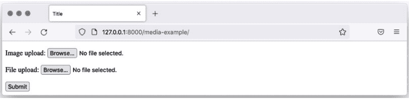

图 8.20：包含两个字段的 UploadForm

11. 为每个字段选择一个文件 – 对于 `ImageField`，你必须选择一张图片，但对于 `FileField` 允许任何类型的文件。图 8.20 显示了选择文件后的字段：

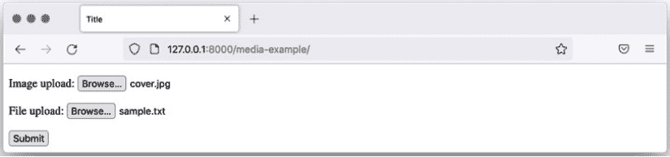

图 8.21：选择文件后的 ImageField 和 FileField

然后，提交表单。如果提交成功，页面将重新加载，并且我们上次上传的图像将被显示（图 8.22）：

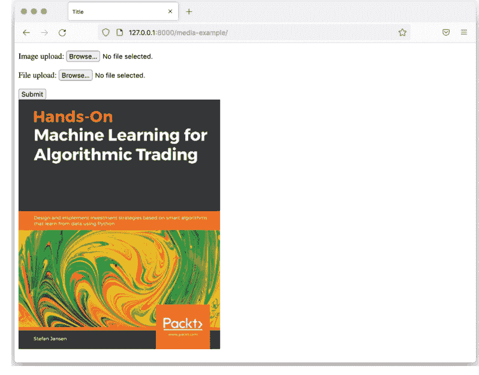

图 8.22：显示上次上传的图像

12. 你可以通过查看 MEDIA_ROOT 目录来了解 Django 如何存储文件。图 8.23 显示了 PyCharm 中的目录结构：

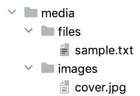

图 8.23：Django 创建的已上传文件

你可以看到 Django 已创建了 `files` 和 `images` 目录。这些是你设置在模型 `ImageField` 和 `FileField` 的 `upload_to` 参数中的目录。

我们也可以通过尝试下载它们来验证这些上传，例如，`http://127.0.0.1:8000/media/files/sample.txt` 或 `http://127.0.0.1:8000/media/images/cover.jpg`。

在本练习中，我们创建了带有 FileField 和 ImageField 的 ExampleModel，并了解了如何将上传的文件存储在其上。我们了解了如何为模板生成已上传文件的 URL。我们尝试上传了一些文件，并看到 Django 自动创建了 upload_to 目录（media/files 和 media/images），然后将文件存储在其中。

在下一节中，我们将了解如何通过使用 ModelForm 来生成表单并在无需手动在视图中设置文件的情况下保存模型，从而进一步简化流程。

## ModelForms 和文件上传

我们已经看到在表单上使用 `form.ImageField` 可以防止非图像被上传。我们还看到 `models.ImageField` 使为模型存储图像变得容易。但我们需要意识到 Django 并不会阻止你将非图像文件设置为 `ImageField`。例如，考虑一个同时具有 `FileField` 和 `ImageField` 的表单：

```
class ExampleForm(forms.Form):
    uploaded_file = forms.FileField()
    uploaded_image = forms.ImageField()
```

在下面的视图中，如果表单上的 `uploaded_image` 字段不是图像，则表单将不会验证，因此上传数据的某些有效性得以保证。以下是一个示例：

```
def view(request):
    form = ExampleForm(request.POST, request.FILES)
    if form.is_valid():
        m = ExampleModel()
        m.file_field = form.cleaned_data["uploaded_file"]
        m.image_field = 
            forms.cleaned_data["uploaded_image"]
        m.save()
    return render(request, "template.html")
```

由于我们确信表单有效，我们知道 `forms.cleaned_data["uploaded_image"]` 必须包含一张图像。因此，我们永远不会将非图像分配给模型实例的 `image_field`。

然而，如果我们在代码中犯了错误，写了如下内容怎么办：

```
m.image_field = forms.cleaned_data["uploaded_file"]
```

也就是说，如果我们不小心引用了 `FileField`，Django 不会验证是否将（潜在的）非图像分配给 `ImageField`，因此它不会抛出异常或产生任何错误。我们可以通过使用 `ModelForm` 来减轻此类问题的可能性。

我们在 *第 7 章，高级表单验证和模型表单* 中介绍了 `ModelForm`。这些是其字段从模型自动定义的表单。我们看到 `ModelForm` 具有 save 方法，可自动在数据库中创建或更新模型数据。当与具有 `FileField` 或 `ImageField` 的模型一起使用时，`ModelForm` 的 save 方法也会保存上传的文件。

以下是使用 `ModelForm` 在视图中保存新模型实例的示例。在这里，我们只需确保将 `request.FILES` 传递给 `ModelForm` 构造函数：

```
class ExampleModelForm(forms.Model):
    class Meta:
        model = ExampleModel  # The same ExampleModel class
                            # we've seen previously
        fields = "__all__"


def view(request):
    if request.method == "POST":
        form = ExampleModelForm(request.POST,
                                request.FILES)
        form.save()
        return redirect("/success-page")
    else:
        form = ExampleModelForm()
    return (request, "template.html", {"form": form})
```

与任何 `ModelForm` 一样，save 方法可以调用时将 commit 参数设置为 `False`。然后模型实例不会保存到数据库，并且 `FileField` 和 `ImageField` 文件不会保存到磁盘。save 方法应在其模型实例上调用 – 这将提交对数据库的更改并保存文件。在下面的这个简短示例中，我们在保存之前在模型实例上设置一个值：

```
def view(request):
    if request.method == "POST":
        form = ExampleModelForm(request.POST,
                                request.FILES)
        m = form.save(False)
        m.attribute = "value"  # Set arbitrary value on the
                                # model instance before save


```
m.save()  # save the model instance, also write the
            files to disk
        return redirect("/success-page/")
    else:
        form = ExampleModelForm()
    return (request, "template.html", {"form": form})
```

调用模型实例的 save 方法会将模型数据保存到数据库，并将上传的文件保存到磁盘。在下一个练习中，我们将从练习 8.06 – FileField 和 ImageField on models 中创建的 ExampleModel 构建 ModelForm，然后使用它测试文件上传。

## 练习 8.07 – 使用 ModelForm 进行文件和图片上传

在本练习中，你将把 UploadForm 更新为 ModelForm 的子类，并使其自动从 ExampleModel 构建。然后你将更改 media_example 视图，使其从表单自动保存实例，以便可以看到代码量如何减少：

- 1. 在 PyCharm 中打开 media_example 应用的 forms.py 文件。你需要在本章中使用 ExampleModel，因此在文件顶部在 from django import forms 语句之后使用 import 导入它。插入以下行：

```
from .models import ExampleModel
```

- 2. 将 UploadForm 改为 forms.ModelForm 的子类。删除类体并用 class Meta 定义替换，其 model 应为 ExampleModel。将 fields 属性设置为 __all__。完成此步骤后，UploadForm 应如下所示：

```
class UploadForm(forms.ModelForm):
    class Meta:
        model = ExampleModel
        fields = "__all__"
```

保存并关闭文件。它现在应如下所示：https://raw.githubusercontent.com/PacktPublishing/Web-Development-with-Django-Second-Edition/main/Chapter08/Exercise8.07/media_project/media_example/forms.py。

- 3. 打开 media_example 应用的 views.py 文件。由于你不再需要直接引用 ExampleModel，可以删除文件顶部的导入。删除以下行：

```
from .models import ExampleModel
```

- 4. 在 media_example 视图中，删除 form.is_valid() 分支的全部内容并替换为单行：

```
instance = form.save()
```

表单的 save 方法将处理将实例持久化到数据库并保存文件。它将返回 ExampleModel 的实例，与我们在第 7 章 Advanced Form Validation and Model Forms 中处理过的其他 ModelForm 相同。

完成此步骤后，你的 media_example 函数应如下所示 https://raw.githubusercontent.com/PacktPublishing/Web-Development-with-Django-Second-Edition/main/Chapter08/Exercise8.07/media_project/media_example/views.py。保存并关闭 views.py。

- 5. 如果尚未运行，请启动 Django 开发服务器，然后导航到 http://127.0.0.1:8000/media-example/。你应该会看到表单渲染出两个字段，Image 字段和 File 字段（图 8.24）：

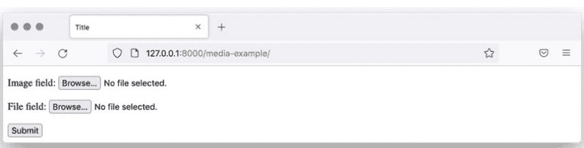

图 8.24：UploadForm 作为 ModelForm 在浏览器中渲染

请注意，这些字段的名称现在与模型匹配而不是表单，因为表单只是使用模型的字段。

- 6. 浏览并选择一张图片和一个文件（图 8.25），然后提交表单：

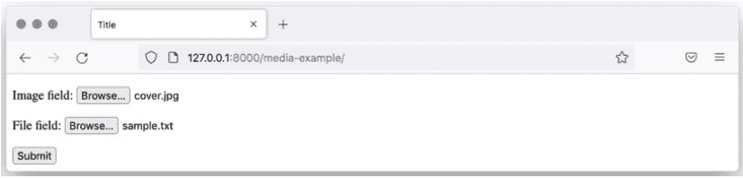

图 8.25：已选择图片和文件

- 7. 页面将重新加载，并且与 *练习 8.06 – FileField and ImageField on models* 相同，你将看到之前上传的图片（图 8.26）：

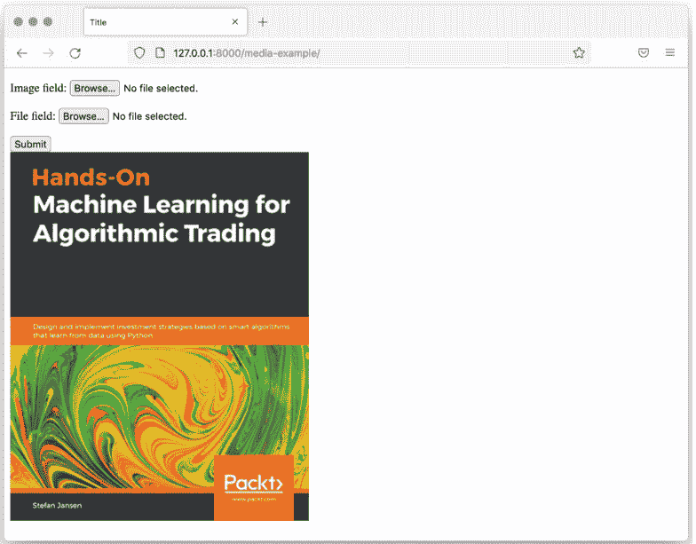

图 8.26：上传后显示图片

- 8. 最后，检查 `media` 目录的内容。你应该会看到目录结构与 *练习 8.06 – FileField and ImageField on models* 匹配，图片在 `images` 目录中，文件在 `files` 目录中：

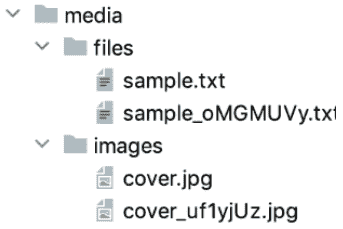

图 8.27：上传的文件目录与练习 6 匹配

在本练习中，我们将 `UploadForm` 改为 `ModelForm` 子类，这使我们能够自动生成上传字段。我们可以用对表单 `save` 方法的调用替换存储上传文件到模型的代码。

在继续本章的活动之前，我们需要简要讨论在使用实例时如何处理文件保存。

### 处理文件保存

正如你在 *第 7 章* 中使用 `ModelForms` 时所知，你可以向 `ModelForm` 传递 instance 参数，使其在保存时更新现有模型而不是创建新模型。

例如，按如下方式更新视图中的示例模型：

```
```python
def update_view(request, pk):
    instance = ExampleModel.objects.get(pk=pk)
    form = UploadForm(request.POST, request.FILES,
                      instance=instance)
    if form.valid():
        form.save()
```
```

当访问表单的 `cleaned_data` 属性时，我们会得到 `request.POST` 中包含的数据。如果该键没有值，则我们会从实例中获取值。

这通常不会引起任何问题，但在处理 `ImageField` 或 `FileField` 时，返回的数据类型会与请求或实例不同。

如果上传了文件，则 cleaned data 将为 InMemoryUploadedFile 或 TemporaryUploadedFile（取决于其大小；只有小文件才能放入内存）。如果未上传文件，则类型将为 FileField 的 FieldFile 或 ImageField 的 ImageFieldFile。

为了解释，请考虑以下代码：

```
def update_view(request, pk):
    instance = ExampleModel.objects.get(pk=pk)
    form = UploadForm(request.POST, request.FILES,
        instance=instance)
    if form.is_valid()
        form_file = form.cleaned_data["file_field"]
        form_image = form.cleaned_data["image_field"]
```

在上传了数据的情况下（即用户在表单中选择了图片和文件），则 form_file 和 form_image 将为 InMemoryUploadedFile 或 TemporaryUploadedFile。但是，如果用户未为字段上传任何内容（假设表单中字段不是必需的），则 form_file 将为 FieldFile 实例，而 form_image 将为 ImageFieldFile 实例。

为了区分它们，你可以进行几种不同的检查。其中最简单的方法是检查 path 属性的存在。由于上传的文件尚未保存到磁盘，因此它们没有 path：

```
if hasattr(form_file, "path"):
    print("This is a FieldFile")
else:
    print("This is an uploaded file")
```

有时你需要在执行某些操作之前检查正在处理的文件类型，并且如果用户未上传新文件则跳过该操作。例如，我们不希望调整已分配给模型的图片大小。我们只会对新上传的图片进行图片调整大小：

```
if hasattr(image_file, "path"):
    print("This image was on the instances so no need to resize")
else:
    perform_resize(image_file)
```

你需要在本章的第一个活动中进行类似的检查。

我们现在已经涵盖了开始使用文件上传增强 Bookr 所需的一切。在本章的活动中，我们将为书籍添加封面图片和示例文档（PDF、文本文件等）的上传支持。书籍封面将在保存前使用 PIL 调整大小。

## 活动 8.01 – 书籍的图片和 PDF 上传

在本活动中，你将首先清理（删除）我们在本章练习中使用的示例视图、模板、表单、模型和 URL 映射。然后你需要生成并应用迁移以从数据库中删除 ExampleModel。

然后你可以开始添加 Bookr 增强功能，首先向 Book 模型添加 ImageField 和 FileField 以存储书籍封面和示例。然后你将创建迁移并应用它以将这些字段添加到数据库。你可以然后构建一个表单，仅显示这些新字段。你将添加一个视图，使用此表单在先调整图片大小为缩略图大小后保存模型实例及其上传的文件。你可以重用第 7 章 Advanced Form Validation and Model Forms 中的 instance-form.html 模板，只需进行少量更改以允许文件上传。

完成活动的步骤如下：

- 1. 更新 Django 设置以添加 MEDIA_ROOT 和 MEDIA_URL 设置。
- 2. /media/ URL 映射应添加到主 urls.py 文件中。使用 static 视图并利用 Django 设置中的 MEDIA_ROOT 和 MEDIA_URL。请记住，此映射只有在 DEBUG 为 True 时才应添加。
- 3. 向 Book 模型添加 ImageField（命名为 cover）和 FileField（命名为 sample）。字段应分别上传到 book_covers/ 和 book_samples/。它们都应允许 null 和 blank 值。
- 4. 再次运行 makemigrations 和 migrate 以将 Book 模型更改应用到数据库。
- 5. 创建 BookMediaForm 作为 ModelForm 的子类。其 model 应为 Book，fields 仅应为你在步骤 3 中添加的字段。
- 6. 添加 book_media 视图。这将不允许你创建 Book，而是只允许你为现有 Book 添加媒体（因此它必须将 pk 作为必需参数）。
- 7. book_media 视图应验证表单并使用 save 保存它但不提交实例。上传的封面应首先使用 thumbnail 方法调整大小，如 Writing PIL images to ImageField 部分所示。最大尺寸应为 300 px x 300 px。然后应将其存储在实例上，并保存实例。请记住 cover 字段不是必需的，因此在尝试操作图片之前应检查这一点，并且如果实例上已有图片则无需调整图片大小。


在成功执行 POST 后，添加一条“Book 已更新”的成功消息，然后重定向到 book_detail 视图。

8. 渲染 instance-form.html，传入一个包含 form、model_type 和 instance 的上下文字典，就像你在第 6 章“表单”中所做的那样。另外，传入另一个项 is_file_upload，设置为 True。这个变量将在下一步中使用。

9. 在 instance-form.html 模板中，使用 is_file_upload 变量为表单添加正确的 enctype 属性。这将允许你在需要时切换表单模式以启用文件上传。

10. 最后，添加一个 URL 映射，将 /books/<pk>/media/ 映射到 book_media 视图。

完成后，你应该能够启动 Django 开发服务器，并在 http://127.0.0.1:8000/books/<pk>/media/ 加载 book_media 视图，例如 http://127.0.0.1:8000/books/2/media/。你应该会在浏览器中看到 BookMediaForm 渲染出来，如图 8.28 所示：

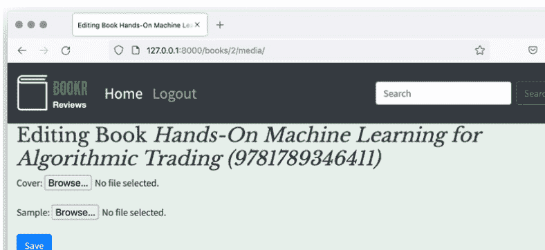

图 8.28：浏览器中的 BookMediaForm

为这本书选择一张封面图片和一个示例文件。你可以使用 https://raw.githubusercontent.com/PacktPublishing/Web-Development-with-Django-Second-Edition/main/Chapter08/Activity8.01/bookr/fixtures/machine-learning-for-algorithmic-trading.png 上的图片，以及 https://github.com/PacktPublishing/Web-Development-with-Django-Second-Edition/blob/main/Chapter08/Activity8.01/bookr/fixtures/machine-learning-for-trading.pdf 上的 PDF（或者你也可以使用任何其他你选择的图片/PDF）。

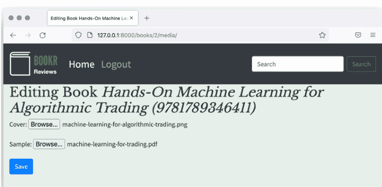

图 8.29：已选择的图书封面和示例文件

提交表单后，你将被重定向到图书详情视图，并看到成功消息（图 8.30）：

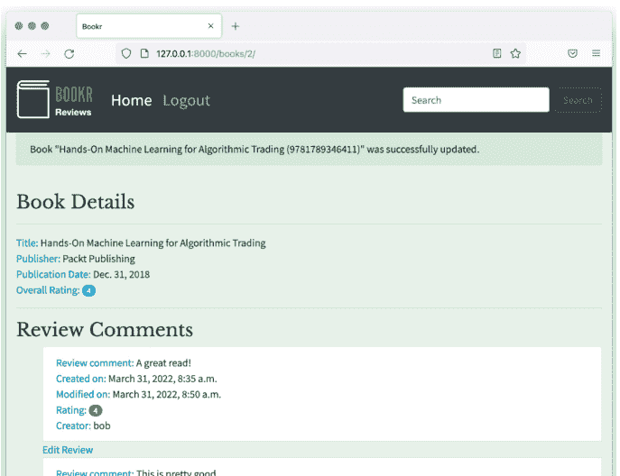

图 8.30：图书详情页面上的成功消息

## 活动 8.02 —— 显示封面和示例链接

在此活动中，你将更新 `book_detail.html` 模板以显示 Book 的封面（如果设置了的话）。你还将添加一个下载示例文件的链接，同样仅在设置了示例文件时才显示。你将使用 `FileField` 和 `ImageField url` 属性来生成媒体文件的 URL。

以下步骤将帮助你完成此活动：

1. 在 `book_detail.html` 模板的图书详情显示部分，如果书有 `cover` 图像，添加一个 `` 元素。然后，在其中显示书的封面。在 `` 标签后使用 `<br>`，使图片单独占一行。
2. 在 *出版日期* 显示之后，添加一个指向示例文件的链接。只有上传了 `sample` 文件时才应显示。确保你添加另一个 `<br>` 标签，以便正确显示。
3. 在包含“添加评论”链接的部分，添加另一个指向该书媒体页面的链接。遵循与 **添加评论** 链接相同的样式。

完成这些步骤后，你应该能够加载图书的详情页面。如果书没有 `cover` 或 `sample`，那么页面看起来应该与之前非常相似，只是你应该在底部看到指向 **媒体** 页面的新链接（*图 8.33*）：

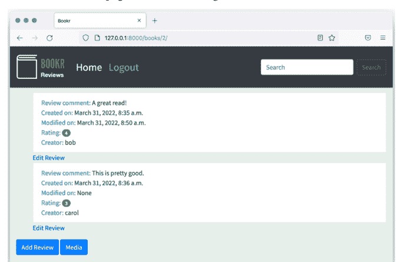

图 8.33：图书详情页面上可见的新媒体按钮

一旦你为书上传了封面和/或示例，就应该显示封面图像和示例链接（图 8.34）：

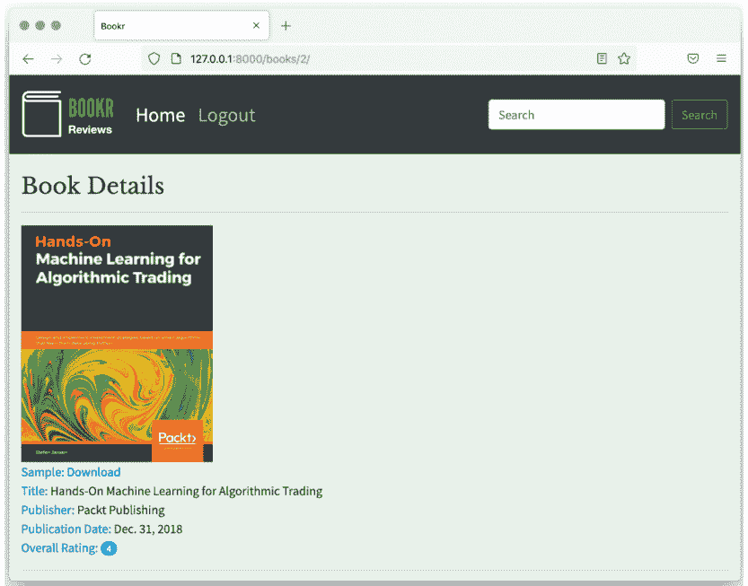

图 8.34：显示的图书封面和示例链接

## 注意

此活动的解决方案可在 https://github.com/PacktPublishing/Web-Development-with-Django-Second-Edition/tree/main/ActivitySolutions 找到。

## 总结

在本章中，我们添加了 MEDIA_ROOT 和 MEDIA_URL 设置以及一个用于提供媒体文件的特殊 URL 映射。然后，我们创建了一个表单和一个视图来上传文件并将它们保存到媒体目录。我们了解了如何添加上下文处理器，以便在所有模板中自动访问 MEDIA_URL 设置。然后，我们通过使用带 FileField 或 ImageField 的 Django 表单，而不是在 HTML 中手动定义表单，增强并简化了表单代码。

我们了解了 Django 为 ImageField 提供的一些图像增强功能，以及如何使用 Pillow 与图像交互。我们展示了一个示例视图，该视图可以使用 FileResponse 类提供需要身份验证的文件。然后，我们了解了如何使用 FileField 和 ImageField 在模型上存储文件，并使用 FileField.url 属性在模板中引用它们。通过从模型实例自动构建 ModelForm，我们减少了必须编写的代码量。最后，我们做了两个活动来增强 Bookr，为 Book 模型添加了封面图片和示例文件。

在第 9 章“会话与身份验证”中，我们将学习如何向 Django 应用程序添加身份验证，以保护其免受未经授权用户的访问。

因此，当我们在 Django 中编写视图时，不必在响应头中显式设置一系列重要的安全功能。这些对响应对象的附加内容会在视图返回响应后由 SecurityMiddleware 实例自动完成。由于中间件组件包装了视图，并对请求执行一系列预处理、对响应执行后处理，视图不会充满大量重复代码，我们可以专注于编写应用程序逻辑，而不是担心低层服务器行为。Django 的中间件栈实现并没有将这些功能构建到 Django 核心中，而是允许这些组件既可选用又可替换。

## 中间件模块

当我们运行 startproject 子命令时，默认的中间件模块列表会被添加到 <project>/settings.py 文件的 MIDDLEWARE 变量中，如下所示：

```
MIDDLEWARE = [
    "django.middleware.security.SecurityMiddleware",
    "django.contrib.sessions.middleware.SessionMiddleware",
    "django.middleware.common.CommonMiddleware",
    "django.middleware.csrf.CsrfViewMiddleware",
    "django.contrib.auth.middleware.AuthenticationMiddleware",
    "django.contrib.messages.middleware.MessageMiddleware",
    "django.middleware.clickjacking.XFrameOptionsMiddleware",
]
```

这是一个适合大多数 Django 应用程序的最小中间件栈。下面的列表详细说明了每个模块的通用用途：

- SecurityMiddleware 提供常见的安全增强功能，例如处理 SSL 重定向和添加响应头以防止常见攻击
- SessionMiddleware 启用会话支持，并无缝地将存储的会话与当前请求关联起来
- CommonMiddleware 实现许多杂项功能，例如拒绝来自 DISALLOWED_USER_AGENTS 列表的请求、实现 URL 重写规则以及设置 Content-Length 头
- CsrfViewMiddleware 添加针对跨站请求伪造（CSRF）的保护
- AuthenticationMiddleware 向请求对象添加 user 属性
- MessageMiddleware 添加“flash”消息支持
- `XFrameOptionsMiddleware` 防止 X-Frame-Options 头导致的点击劫持攻击

中间件模块按照它们在 MIDDLEWARE 列表中的出现顺序加载。这是合理的，因为我们希望首先调用处理初始安全问题的中间件，以便在进一步处理之前拒绝危险请求。Django 还附带几个执行重要功能的其他中间件模块，例如使用 gzip 文件压缩、重定向配置和 Web 缓存配置。

本章专门讨论作为中间件组件实现的有状态应用程序开发的两个重要方面 —— `SessionMiddleware` 和 `AuthenticationMiddleware`。

`SessionMiddleware` 的 `process_request` 方法将一个 session 对象作为 `request` 对象的属性添加。`AuthenticationMiddleware` 的 `process_request` 方法将一个 user 对象作为 `request` 对象的属性添加。

如果项目不需要用户身份验证或不需要保留单独交互状态的手段，那么可以在没有这些中间件栈层的情况下编写 Django 项目。然而，大多数默认中间件在应用程序安全性中扮演重要角色。如果你没有充分理由更改中间件组件，最好保持这些初始设置。Admin 应用程序需要 `SessionMiddleware`、`AuthenticationMiddleware` 和 `MessageMiddleware` 才能运行，如果安装了 Admin 应用程序但没有它们，Django 服务器将抛出如下错误：

```
django.core.management.base.SystemCheckError: SystemCheckError: System check identified some issues:

ERRORS:

?: (admin.E408) 'django.contrib.auth.middleware.AuthenticationMiddleware' must be in MIDDLEWARE in order to use the admin application.
?: (admin.E409) 'django.contrib.messages.middleware.MessageMiddleware' must be in MIDDLEWARE in order to use the admin application.
?: (admin.E410) 'django.contrib.sessions.middleware.SessionMiddleware' must be in MIDDLEWARE in order to use the admin application.
```

既然我们了解了中间件模块，让我们看看如何使用身份验证应用程序的视图和模板在我们的项目中启用身份验证的一种方法。


## 实现认证视图和模板

我们在第4章“Django Admin 简介”中遇到了 Admin 应用中的登录表单。这是为有权访问 Admin 应用的员工用户提供的认证入口点。我们还需要为想要发表书评的普通用户创建登录功能。幸运的是，认证应用提供了实现这一点的工具。

当我们深入学习认证应用的表单和视图时，我们会遇到其实现中的很多灵活性。我们可以自由地实现自己的登录页面，在视图级别定义非常简单或细粒度的安全策略，并针对外部权威机构进行认证。

认证应用之所以存在，是为了容纳许多不同的认证方法，从而使 Django 不会僵化地强制执行单一机制。对于第一次接触文档的用户来说，这可能会让人相当困惑。在本章的大部分内容中，我们将遵循 Django 的默认设置，但也会指出一些重要的配置选项。

Django 项目的 settings 对象包含用于控制登录行为的属性。LOGIN_URL 指定登录页面的 URL，默认值为 '/accounts/login/'。LOGIN_REDIRECT_URL 指定成功登录后重定向的路径，默认路径为 '/accounts/profile/'。

认证应用提供了用于执行典型认证任务的标准表单和视图。这些表单位于 django.contrib.auth.forms，而视图位于 django.contrib.auth.views。

这些视图被 django.contrib.auth.urls 中的以下 URL 模式引用：

```python
urlpatterns = [
    path('login/', views.LoginView.as_view(),
         name='login'),
    path('logout/', views.LogoutView.as_view(),
         name='logout'),
    path('password_change/',
         views.PasswordChangeView.as_view(),
         name='password_change'),
    path('password_change/done/',
         views.PasswordChangeDoneView.as_view(),
         name='password_change_done'),
    path('password_reset/',
         views.PasswordResetView.as_view(),
         name='password_reset'),
    path('password_reset/done/',
         views.PasswordResetDoneView.as_view(),
         name='password_reset_done'),
    path('reset/<uidb64>/<token>/',
         views.PasswordResetConfirmView.as_view(),
         name='password_reset_confirm'),
    path('reset/done/',
         views.PasswordResetCompleteView.as_view(),
         name='password_reset_complete'),
]
```

如果这种视图风格看起来不熟悉，那是因为它们是类视图（class-based views），而不是我们之前遇到的函数视图（function-based views）。我们将在*第11章“高级模板和类视图”*中了解更多关于类视图的内容。现在，请注意认证应用利用类继承来分组视图的功能，并避免大量重复编码。

如果我们想保持认证应用和 Django 设置预先配置的默认 URL 和视图，我们可以将认证应用的 URL 包含在我们项目的 `urlpatterns` 中。

通过这种方法，我们节省了大量工作。我们只需将认证应用的 URL 包含在 `<project>/urls.py` 文件中，并将其分配给 `accounts` 命名空间。指定此命名空间可确保我们的反向 URL 与视图的默认模板值相对应。认证应用的视图包含对名为 `password_reset_done` 和 `password_reset_complete` 的模板的代码引用，因此它们的路径也需要显式包含在我们的 urlpatterns 中：

```python
from django.contrib import admin, auth
...

urlpatterns = [
    path("admin/", admin.site.urls),
    path("accounts/", include(("django.contrib.auth.urls",
        "auth"),
        namespace="accounts")),
    path("accounts/password_reset/done/",
        auth.views.PasswordResetDoneView.as_view(),
        name="password_reset_done"),
    path("accounts/reset/done/",
        auth.views.PasswordResetCompleteView.as_view(),
        name="password_reset_complete"),
    path("", reviews.views.index),
    path("book-search/", reviews.views.book_search,
        name="book_search"),
    path("", include("reviews.urls")),
]
```

尽管认证应用提供了表单和视图，但它缺乏将这些组件渲染为 HTML 所需的模板。*图 9.1* 列出了我们在项目中实现认证功能所需的模板。幸运的是，Admin 应用确实实现了一组我们可以使用的模板。

我们可以简单地将 Django 源代码中 `django/contrib/admin/templates/registration` 目录和 `django/contrib/admin/templates/admin/login.html` 下的模板文件复制到我们项目的 `templates/registration` 目录：

> **注意**
>
> 当我们说 Django 源代码时，指的是您的 Django 安装所在的目录。如果您在虚拟环境中安装了 Django（如*前言*所述），您可以在 `<您的虚拟环境名称>/lib/python3.X/site-packages/django/contrib/admin/templates/registration/` 找到这些模板文件。如果您的虚拟环境已激活且 Django 已安装在其中，您还可以在终端中运行 `python -c "import sys; print(sys.path)"` 命令来获取 `site-packages` 目录的完整路径。

| 模板路径 |
| --- |
| `templates/registration/login.html` |
| `templates/registration/password_reset_email.html` |
| `templates/registration/password_change_form.html` |
| `templates/registration/password_change_done.html` |
| `templates/registration/password_reset_form.html` |
| `templates/registration/password_reset_done.html` |
| `templates/registration/password_reset_confirm.html` |
| `templates/registration/password_reset_complete.html` |
| `templates/registration/logged_out.html` |

图 9.1 – 认证模板的默认路径

## 会话与认证

> **注意**
>
> 我们只需要复制视图所依赖的模板，并应避免复制 `base.html` 或 `base_site.html` 文件。

起初这看起来结果不错，但就目前而言，Admin 模板并不能满足我们的精确需求，这一点从登录页面（*图 9.2*）可以看出：

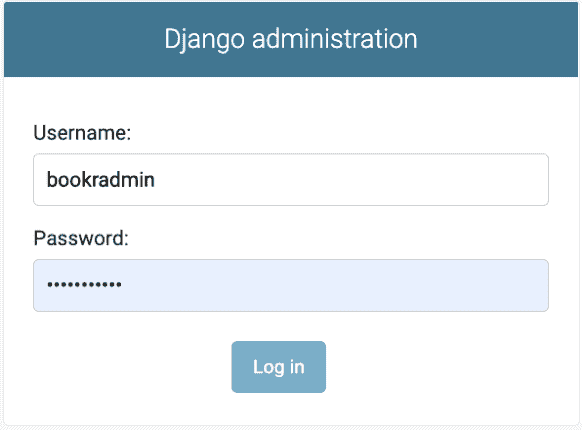

图 9.2 – 用户登录界面的初步尝试

由于这些认证页面继承自 Admin 应用的 `admin/base_site.html` 模板，因此它们遵循 Admin 应用的风格。我们希望这些页面遵循我们开发的 `bookr` 项目的风格。为此，我们可以对从 Admin 应用复制到我们项目中的每个 Django 模板执行以下三个步骤：

1. 需要做的第一个更改是将 `` 标记替换为 ``。

2. 鉴于 `templates/base.html` 仅包含标题、品牌和内容块的定义，我们应该检查 `bookr` 文件夹中模板的额外块替换。我们不会在应用的模板布局中使用 `userlinks` 和 `breadcrumbs` 块中的内容，因此这些块可以完全删除。

   其中一些块，如 `content_title` 和 `reset_link`，包含与我们的应用程序相关的 HTML 内容，因此应予以保留。

   例如，`password_change_done.html` 模板包含 userlinks 和 breadcrumbs 块：

```html


<a href="{{ docroot }}"></a> /  / <a href=""></a>

<div class="breadcrumbs">
<a href=""></a>
&rsaquo; 
</div>



<p></p>

```

   在 bookr 项目中，它将被简化为以下模板：

```html




<p></p>

```

3. 同样，有一些反向 URL 模式需要更改以反映当前路径，因此 `` 将被替换为 ``。

鉴于这些考虑，下一个练习将重点将 Admin 应用的登录模板转换为 bookr 项目的登录模板。

> **注意**
>
> `i18n` 模块用于创建多语言内容。如果您打算为网站开发多语言内容，请在模板中保留 `i18n` 导入、`translate` 标签和 `blocktrans` 语句。为简洁起见，本章不详细讨论这些内容。


## 练习 9.01 – 改造 Admin 应用的登录模板

我们在本章开始时没有为项目提供登录页面。通过添加用于身份验证的 URL 模式，并将 Admin 应用中的模板复制到项目中，我们可以实现登录页面的功能。但这个登录页面直接从 Admin 应用复制而来，与 Bookr 的设计脱节，因此并不令人满意。在本练习中，我们将按照所需的步骤，将 Admin 应用的登录模板改造为适用于我们项目的模板。新的登录模板需要直接从 bookr 项目的 `templates/base.html` 中继承样式和格式：

1. 在项目中创建一个 `templates/registration` 目录。

Admin 登录模板位于 Django 源码目录下的 `django/contrib/admin/templates/admin/login.html` 路径。它以 `extends` 标签、`load` 标签开始，导入 `i18n` 和 `static` 模块，并包含一系列覆盖父模板 `django/contrib/admin/templates/admin/base.html` 中定义块的 `block` 扩展。`login.html` 文件的截断片段如以下代码块所示：

```



{{ block.super }}...


{{ block.super }} login




```

2. 将此 Admin 登录模板 `django/contrib/admin/templates/admin/login.html` 复制到 `templates/registration` 中，并使用 PyCharm 开始编辑该文件。

3. 由于你正在编辑的登录模板位于 `templates/registration/login.html`，并扩展了基础模板（`templates/base.html`），请将 `templates/registration/login.html` 顶部的 `extends` 标签参数替换为以下内容：

```

```

4. 我们不需要这个文件的大部分内容。只需保留包含登录表单的 `content` 块。模板的其余部分将包含加载 `i18n` 和 `static` 标签库的内容：

```



...

```

5. 现在，你必须将 `templates/registration/login.html` 中的路径和反向 URL 模式替换为适合你的项目的路径和反向 URL 模式。由于你的模板中没有定义 `app_path` 变量，因此需要用登录的反向 URL `'accounts:login'` 来替换它。所以，考虑下面这一行：

```
<form action="{{ app_path }}" method="post" id="login-form">
```

这一行将更改为：

```
<form action="" method="post"
id="login-form">
```

你的项目路径中没有定义 `'admin_password_reset'`，因此它将替换为 `'accounts:password_reset'`。

考虑下面这一行：

```

```

这将更改为以下一行：

```

```

你的登录模板将如下所示：

`templates/registration/login.html`

```





<p class="errornote">

</p>

```

你可以在以下网址找到该文件的完整代码：https://github.com/PacktPublishing/Web-Development-with-Django-Second-Edition/tree/main/Chapter09/Exercise9.01/bookr。

6. 如前所述，要使用标准的 Django 身份验证视图，我们必须为它们添加 URL 映射。打开 bookr 项目目录中的 `urls.py` 文件，确保从 `django.contrib` 中导入了 `auth`，并将这三个路径添加到 URL 模式中：

```
from django.contrib import admin, auth
...
urlpatterns = [
    ...
    path("accounts/",
        include(("django.contrib.auth.urls", "auth"),
        namespace="accounts")),
    path("accounts/password_reset/done/",
        auth.views.PasswordResetDoneView.as_view(),
        name="password_reset_done"),
    path("accounts/reset/done/",
        auth.views.PasswordResetCompleteView.as_view(),
        name="password_reset_complete"),
    ...
]
```

7. 现在，当你访问 http://127.0.0.1:8000/accounts/login/ 处的登录链接时，你将看到此页面：

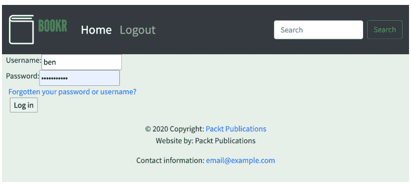

图 9.3 – Bookr 登录页面

完成此练习后，你已在项目中创建了非管理员身份验证所需的模板。

> **注意**
>
> 在继续之前，你需要确保 `registration` 目录中的其余模板遵循 bookr 项目的样式；也就是说，它们不能继承自 Admin 应用的 `admin/base_site.html` 模板。你已经看到了 `password_change_done.html` 和 `login.html` 模板是如何做到这一点的。请将你在本练习（以及之前部分）中学到的知识应用到 `registration` 目录中的其余文件。或者，你可以从本书的 GitHub 仓库下载修改后的文件：https://github.com/PacktPublishing/Web-Development-with-Django-Second-Edition/tree/main/Chapter09/Activity9.01/bookr。

现在我们已经修改了项目以启用身份验证，接下来我们将学习 Django 中的密码和会话存储。

## Django 中的密码存储

Django 不会将密码以明文形式存储在数据库中。相反，密码会使用 PBKDF2/SHA256、BCrypt/SHA256 或 Argon2 等哈希算法进行摘要处理。由于哈希算法是单向转换，这可以防止用户的密码从数据库中存储的哈希值被解密。用户通常期望系统管理员能找回他们遗忘的密码，因此这常常令他们感到意外，但这是安全设计中的最佳实践。所以，如果我们查询数据库中的密码，会看到类似这样的内容：

```
sqlite> select password from auth_user;
pbkdf2_sha256$320000$auohDtokS8a6LAoaG79Tv1$Mxzssu6gfd5uZvI1ADFI4faAjP0g3puP2JxxFdWZI0=
pbkdf2_sha256$320000$SqoVF8nhgo4zgw4juRUNtAK5TATQEqXtbRAfc4Ccuuwr9nRHVuShZo5W6N90ygpvVbA=
pbkdf2_sha256$320000$Ss3eprgniu7e4q0ux9Xj5nh$/SAFKgXuYIWSm08PWEwBUsMfmPCYd60rAaz0JZnLKGs=
```

图 9.4 – Django SQLite3 数据库中的密码哈希

此字符串的组成部分为 `<algorithm>$<iterations>$<salt>$<hash>`。由于一些哈希算法会随着时间推移而被攻破，而且我们有时需要满足强制性的安全要求，Django 足够灵活，能够容纳新的算法，并可以维护用多种算法加密的数据。

## 个人资料页面与 `request.user` 对象

当登录成功时，登录视图会重定向到 `/accounts/profile`。但是，这个路径并未包含在现有的身份验证 URL 中，身份验证应用也没有为其提供模板。为了避免“Page not found”错误，需要一个视图和相应的 URL 模式。

每个 Django 请求都有一个 `request.user` 对象。如果请求是由未认证用户发出的，`request.user` 将是一个 `AnonymousUser` 对象。如果请求是由已认证用户发出的，那么 `request.user` 将是一个 `User` 对象。这使得在 Django 视图中检索个性化用户信息并在模板中渲染变得很容易。

在下一个练习中，我们将向 bookr 项目添加一个个人资料页面。

## 练习 9.02 – 添加个人资料页面

在本练习中，我们将向项目添加一个个人资料页面。为此，我们需要在 URL 模式中包含其路径，并在视图和模板中同时包含它。个人资料页面将简单地显示 `request.user` 对象中的以下属性：

- `username`
- `first_name` 和 `last_name`
- `date_joined`
- `email`
- `last_login`

执行以下步骤以完成本练习：

1. 将 `bookr/views.py` 添加到项目中。它需要一个简单的 `profile` 函数来定义我们的视图：

```
from django.shortcuts import render

def profile(request):
    return render(request, 'profile.html')
```

2. 在你的主 bookr 项目的 `templates` 文件夹中，创建一个名为 `profile.html` 的新文件。在此模板中，可以使用类似 `{{ request.user.username }}` 的表示法轻松引用 `request.user` 对象的属性：

```


Bookr


<h2>Profile</h2>
<div>
    <p>
        Username: {{ request.user.username }} <br>
        Name: {{ request.user.first_name }} {{
```


```
```html
request.user.last_name }}<br>
Date Joined: {{ request.user.date_joined }} <br>
Email: {{ request.user.email }}<br>
Last Login: {{ request.user.last_login }}<br>

</p>
</div>

```
```

我们还添加了一个包含用户个人资料详细信息的块。更重要的是，我们确保 `profile.html` 继承自 `base.html`。

+   3. 最后，该路径需要在 `bookr/urls.py` 中的 `urlpatterns` 列表顶部添加。首先导入新的视图，然后添加一条将 `accounts/profile/` URL 链接到 `bookr.views.profile` 的路径：

```
```python
from bookr.views import profile

urlpatterns = [
    path('accounts/profile/', profile,
         name='profile'),
    path("", reviews.views.index),
    path("book-search/",
         reviews.views.book_search,
         name="book_search"),
    path('', include('reviews.urls'))]
```
```

这是一个用户个人资料页面的良好开端。当 Alice 登录并访问 `http://localhost:8000/accounts/profile/` 时，它会按图 9.5 所示渲染。请记住，如果需要启动服务器，请使用 `python manage.py runserver` 命令：

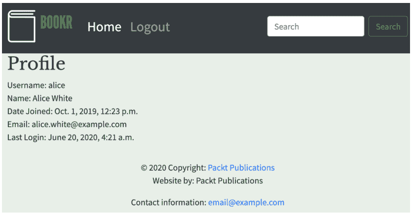

图 9.5 – Alice 访问她的用户个人资料

至此，我们已经了解了如何在用户成功登录后将其重定向到其个人资料页面。现在，让我们讨论如何仅向特定用户授予内容访问权限。

## Authentication decorators and redirection

现在我们已经学会如何允许普通用户登录到我们的项目，我们可以了解如何将内容限制为已认证用户。身份验证模块附带了一些有用的装饰器，可根据当前用户的身份验证或访问权限来保护视图。

不幸的是，如果例如名为 Alice 的用户退出 Bookr，个人资料页面仍会渲染并显示空的详细信息。最好不要发生这种情况，而是将任何未认证的访问者重定向到登录屏幕：

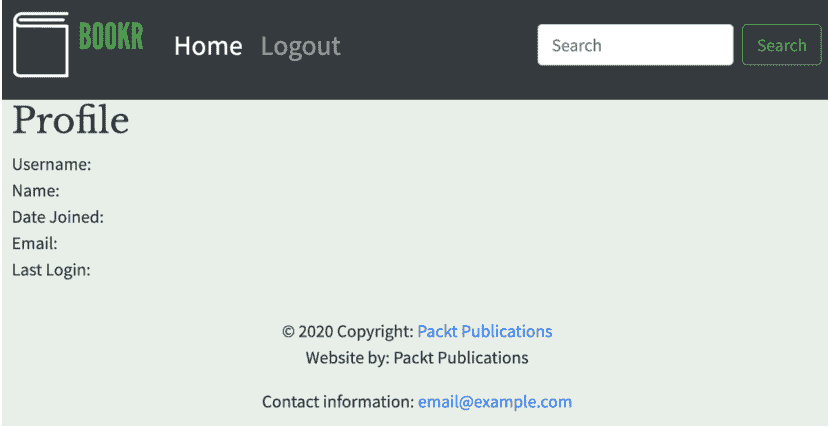

图 9.6 – 未认证用户访问用户个人资料

身份验证应用附带了用于向 Django 视图添加身份验证行为的有用装饰器。在保护我们的个人资料视图这种情况下，我们可以使用 login_required 装饰器：

```
from django.contrib.auth.decorators import login_required

@login_required
def profile(request):
    ...
```

现在，如果未认证用户访问 /accounts/profile URL，他们将被重定向到 http://localhost:8000/accounts/login/?next=/accounts/profile/。

此 URL 将用户带到登录 URL。GET 变量中的 next 参数告诉登录视图在成功登录后重定向到何处。默认行为是重定向回当前视图，但这可以通过为 login_required 装饰器指定 login_url 参数来覆盖。例如，如果我们在登录后需要重定向到不同的页面，我们可以在装饰器调用中明确说明，如下所示：

```
@login_required(login_url='/accounts/profile2')
```

如果我们重写了登录视图，使其期望重定向 URL 指定在不同于 'next' 的 URL 参数中，我们可以在装饰器调用中使用 `redirect_field_name` 参数明确说明：

```
```python
@login_required(redirect_field_name='redirect_to')
```
```

通常存在 URL 应该限制为持有特定条件的用户或组的情況。考虑我们有一个页面供员工用户查看任何用户个人资料的情况。我们不希望此 URL 对所有用户都可访问，因此我们希望将此 URL 限制为具有 'view_user' 权限的用户或组，并将未经授权的请求转发到登录 URL：

```
```python
from django.contrib.auth.decorators import (login_required,
    permission_required)
…

@permission_required('view_group')
def user_profile(request, uid):
    user = get_object_or_404(User, id=uid)
    permissions = user.get_all_permissions()
    return render(request, 'user_profile.html',
        {'user': user, 'permissions': permissions})
```
```

因此，使用此装饰器应用于我们的 user_profile 视图后，未经授权的用户访问 `http://localhost:8000/accounts/users/123/profile/` 将被重定向到 `http://localhost:8000/accounts/login/?next=/accounts/users/123/profile/`。

有时，我们需要构建更微妙的条件权限，这些权限不属于这两个装饰器的范围。为此目的，Django 提供了一个自定义装饰器，该装饰器接受任意函数作为参数。user_passes_test 装饰器需要 test_func 参数：

```
```python
user_passes_test(test_func, login_url=None,
    redirect_field_name='next')
```
```

下面是一个示例，我们有一个视图 veteran_features，仅对注册时间超过一年的用户可用：

```
```python
from django.contrib.auth.decorators import (login_required,
    permission_required, user_passes_test)
…

def veteran_user(user):
    now = datetime.datetime.now()
    if user.date_joined is None:
        return False
    return now - user.date_joined > datetime.timedelta(days=365)
```

```
@user_passes_test(veteran_user)
def veteran_features(request):
    user = request.user
    permissions = user.get_all_permissions()
    return render(request, 'veteran_profile.html',
        {'user': user, 'permissions': permissions})
```

有时，我们视图中的逻辑无法通过其中一个装饰器处理，我们需要在视图的控制流程中应用重定向。我们可以使用 redirect_to_login 辅助函数来执行此操作。它接受与装饰器相同的参数，如以下代码段所示：

```
redirect_to_login(next, login_url=None,
    redirect_field_name='next')
```

我们将在以下练习中通过将它们应用于 Bookr 项目来巩固我们对身份验证装饰器的了解。

## Exercise 9.03 – adding authentication decorators to the views

在了解了身份验证应用的权限和身份验证装饰器的灵活性后，我们现在将开始在 Reviews 应用中使用它们。我们需要确保只有已认证用户可以编辑评论，并且只有员工用户可以编辑出版社。有几种方法可以做到这一点，因此我们将尝试几种方法。所有这些步骤中的代码都在 reviews/views.py 文件中：

+   1. 你解决这个问题的第一反应可能是认为 publisher_edit 方法需要一个适当的装饰器来强制用户具有 edit_publisher 权限。为此，你可以轻松地执行以下操作：

```
from django.contrib.auth.decorators import
permission_required
...
@permission_required('edit_publisher')
def publisher_edit(request, pk=None):
    ...
```

2. 使用这种方法是可以的，它是向视图添加权限检查的一种方法。你也可以使用稍微复杂但更灵活的方法。不要使用权限装饰器来强制 publisher_edit 方法的权限，你可以创建一个要求员工用户的测试函数，并将此测试函数应用于 publisher_edit，使用 user_passes_test 装饰器。编写测试函数允许对用户访问权限或权限的验证方式进行更多自定义。如果你在步骤 1 中对 views.py 文件进行了更改，请随意注释掉装饰器（或删除它），并改写以下测试函数：

```
from django.contrib.auth.decorators import
user_passes_test
...

def is_staff_user(user):
    return user.is_staff

@user_passes_test(is_staff_user)
...
```

3. 通过添加适当的装饰器，确保 review_edit 和 book_media 需要登录：

```
...

from django.contrib.auth.decorators import
    (login_required, user_passes_test)
...
@login_required
def review_edit(request, book_pk, review_pk=None):

@login_required
def book_media(request, pk):
...
```

4. 在 review_edit 方法中，添加逻辑要求用户必须是员工用户或评论的所有者。review_edit 视图控制评论创建和评论更新的行为。我们正在开发的约束仅适用于现有评论正在更新的情况。因此，添加代码的位置是在成功检索到 Review 对象之后。如果用户不是员工帐户或评论的创建者与当前用户不匹配，我们需要引发 PermissionDenied 错误：


```
```python
...

from django.core.exceptions import PermissionDenied
from PIL import Image
from django.contrib import messages

...

@login_required
def review_edit(request, book_pk, review_pk=None):
    book = get_object_or_404(Book, pk=book_pk)

    if review_pk is not None:
        review = get_object_or_404(Review,
                                   book_id=book_pk,
                                   pk=review_pk)
        user = request.user
        if not user.is_staff and review.creator.id != user.id:
            raise PermissionDenied
    else:
        review = None

...
```
```

现在，当非工作人员用户尝试编辑其他用户的评论时，将抛出 Forbidden 错误，如图 *9.7* 所示。在下一节中，我们将研究如何在模板中应用条件逻辑，这样用户就不会进入其权限不足而无法访问的页面：

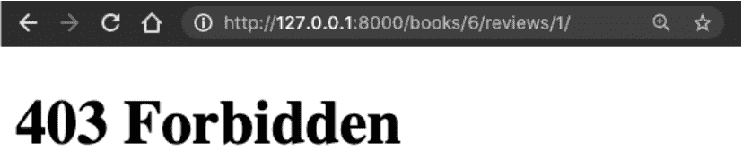

图 9.7 – 非工作人员用户禁止访问

在本练习中，我们使用身份验证装饰器来保护 Django 应用中的视图。所应用的这些身份验证装饰器提供了一种简单的机制，来限制缺少必要权限的用户、非工作人员用户以及未认证用户访问视图。Django 的身份验证装饰器提供了一种遵循 Django 角色和权限框架的健壮机制，而 `user_passes_test` 装饰器则提供了开发自定义身份验证的选项。

现在我们已经使用装饰器控制了应用的身份验证流程，接下来可以利用用户身份验证数据来自定义模板。

## 使用身份验证数据增强模板

在练习 9.02——添加个人资料页面中，我们看到可以将 `request.user` 对象传递给模板，以在 HTML 中渲染当前用户的属性。我们也可以根据用户类型或用户所拥有的权限，采用不同的模板渲染方式。考虑我们要添加一个仅对工作人员用户可见的编辑链接，可以使用一个 if 条件来实现这一点：

```

<p><a href="">Edit this Review</a>
</p>

```

如果我们不花时间根据权限有条件地渲染链接，用户在应用中导航时会感到沮丧，因为他们点击的许多链接都会导致 403 禁止访问页面。接下来的练习将展示如何利用模板和身份验证在项目中呈现与上下文相符的链接。

## 练习 9.04 ——在基础模板中切换登录和退出登录链接

在 bookr 项目的基础模板中（位于 `templates/base.html`），我们在页头有一个占位符形式的退出登录链接。其 HTML 代码如下：

```
<li class="nav-item">
<a class="nav-link" href="#">Logout</a>
</li>
```

我们不希望用户在退出登录后仍然看到退出登录链接。因此，本练习旨在对模板应用条件逻辑，以便根据用户是否已认证来切换登录和退出登录链接：

- 1. 编辑 `templates/base.html` 文件。复制退出登录列表元素的结构并创建一个登录列表元素。然后，将占位符链接替换为退出登录和登录页面的正确 URL——分别为 `/accounts/logout` 和 `/accounts/login`，如下所示：

```
```html
<li class="nav-item">
    <a class="nav-link" href="/accounts/logout">Logout
    </a>
</li>
<li class="nav-item">
    <a class="nav-link" href="/accounts/login">Login</a>
</li>
```
```

- 2. 现在，将我们的两个 `li` 元素放在一个 `if ... else ... endif` 条件块中。我们要应用的逻辑条件是 `user.is_authenticated`：

```
```django

    <li class="nav-item">
        <a class="nav-link" href="/accounts/logout">Logout
        </a>
    </li>

    <li class="nav-item">
        <a class="nav-link" href="/accounts/login">Login
        </a>
    </li>

```
```

- 3. 现在，访问用户个人资料页面 `http://localhost:8000/accounts/profile/`。当已认证时，你会看到退出登录链接：

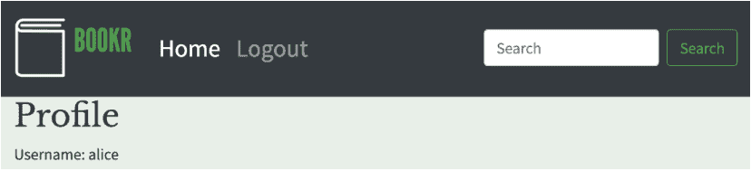

图 9.8 – 已认证用户会看到退出登录链接

4. 现在，点击退出登录链接；你将被带到 `/accounts/logout` 页面。菜单中会出现登录链接，这证实了该链接是根据用户的认证状态而上下文相关的：


图 9.9 – 未认证用户会看到登录链接

本练习是 Django 模板如何与身份验证信息结合使用，以创建有状态且上下文相关的用户体验的一个简单示例。我们也不希望提供用户无权访问的链接，或用户权限级别不允许执行的操作。以下活动将使用这一模板技术来修复 Bookr 中的一些此类问题。

## 活动 9.01 ——在模板中使用条件块生成基于身份验证的内容

在本活动中，你将在模板中应用条件块，根据用户认证和用户状态修改内容。不应向用户展示他们无权访问的链接或未被授权执行的操作。以下步骤将帮助你完成本活动：

- 1. 在 `book_detail` 模板中（文件位于 `reviews/templates/reviews/book_detail.html`），对未认证用户隐藏“添加评论”和“媒体”按钮。
- 2. 另外，隐藏显示“成为第一个撰写评论的人”的标题，因为这不是未认证用户可用的选项。
- 3. 在同一个模板中，让“编辑评论”链接仅对工作人员用户或撰写该评论的用户显示。该模板块的条件逻辑与我们在上一节的 `review_edit` 视图中使用的条件逻辑非常相似：

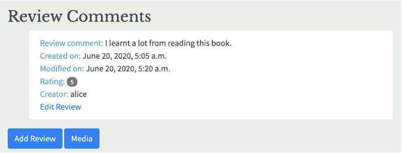

图 9.10 – 当 Alice 登录后，她的评论上会出现编辑评论链接

当另一个用户登录时，**编辑评论**链接将不会出现：

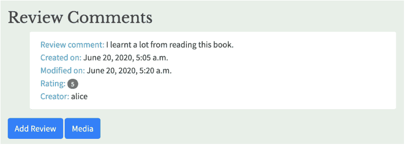

图 9.11 – 当 Bob 登录时，Alice 的评论上没有编辑评论链接

- 4. 修改 `template/base.html`，使其在页头搜索表单右侧显示当前已认证用户的用户名，并链接到用户个人资料页面。

完成本活动后，你将在模板中添加反映当前用户认证状态和身份的动态内容，如下面的截图所示：

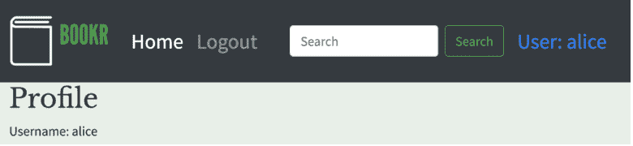

图 9.12 – 已认证用户的名称出现在搜索表单之后

> **注意**
> 你可以在此处找到本活动的解决方案：https://github.com/PacktPublishing/Web-Development-with-Django-Second-Edition/tree/main/ActivitySolutions。

至此，我们已经回顾了 Django 中可用的身份验证机制，接下来可以考察 Django 如何实现会话。

## 会话

了解一些理论有助于理解为什么会话是 Web 应用中管理用户内容的常见解决方案。HTTP 协议定义了客户端与服务器之间的交互。它被称为“无状态”协议，因为服务器在请求之间不保留任何状态信息。这种协议设计在万维网早期非常适用于传递超文本信息，但并不适合那些向特定用户传递定制信息的安全 Web 应用的需求。

我们现在已经习惯看到网站适应我们的浏览习惯。购物网站会推荐与我们最近浏览过的商品相似的商品，并告知我们本地区热门的商品。这些功能都需要一种有状态的网站开发方法。实现有状态 Web 体验的最常见方式之一就是通过会话。会话是指用户当前与 Web 服务器或应用的交互，要求在交互期间持续保存数据。这可能包括用户访问过的链接、执行过的操作，以及在交互中做出的偏好设置等信息。

如果用户在一个页面上将博客网站设置为深色主题，那么人们会期望下一页也使用相同的主题。我们将这种表现描述为维持状态。会话密钥作为浏览器 cookie 存储在客户端，可以与用户登录期间持续存在的服务器端信息进行关联。

在 Django 中，会话以中间件的形式实现。当我们最初在第 4 章《Django Admin 简介》中创建应用时，会话支持已经默认激活。

### 会话引擎

当前和已过期会话的信息需要存储在某个地方。在万维网早期，这是通过将会话信息保存在服务器上的文件中完成的，但随着 Web 服务器架构变得更加复杂、性能需求不断提高，诸如数据库或内存存储等更高效的策略已成为常态。默认情况下，在 Django 中，会话信息存储在项目的数据库中。

对于大多数小型项目来说，这是一个合理的默认设置。然而，Django 的中间件会话实现使我们能够灵活地以多种方式存储项目的会话信息，以


适合我们的系统架构和性能要求。每种不同的实现都称为会话引擎。如果我们想要更改会话配置，需要在项目的 settings.py 文件中指定 SESSION_ENGINE 设置：

- **缓存会话：** 在某些环境中，将会话信息缓存到内存或数据库中是一种适合高性能的方法。Django 为此目的提供了 django.contrib.sessions.backends.cache 和 django.contrib.sessions.backends.cached_db 会话引擎。

- **基于文件会话：** 如前所述，这是一种维护会话信息的方式，已有些过时，但在性能不是问题且有理由不将动态信息存储在数据库中的站点中可能适用。

- **基于 Cookie 的会话：** 而不是在服务器端保存会话信息，你可以通过将会话内容序列化为 JSON 并将其存储在基于浏览器的 cookie 中，从而完全在 Web 浏览器客户端中保存它们。

## 你需要标记 cookie 内容吗？

Django 的所有会话实现都需要在用户的 Web 浏览器中存储一个 session ID cookie。

无论使用哪种会话引擎，所有这些中间件实现都涉及在 Web 浏览器中存储站点特定的 cookie。在 Web 开发的早期，将 session ID 作为 URL 参数传递并不罕见，但出于安全原因，这种方法在 Django 中已被弃用。

在许多司法管辖区，包括欧盟，网站在浏览器中设置 cookie 时在法律上必须警告用户。如果你在运营网站的地区存在此类立法要求，则有责任确保代码符合这些义务。请务必使用最新实现，并避免使用未跟上立法变化的已废弃项目。

> **注意**
> 为了适应这些变化和立法要求，有许多有用的应用，例如 **Django Cookie Consent** 和 **Django Cookie Law**，它们旨在与多个立法框架一起使用。你可以通过以下链接了解更多信息：
> - https://github.com/jazzband/django-cookie-consent
> - https://github.com/TyMaszWeb/django-cookie-law
> 存在许多 JavaScript 模块实现了类似的 cookie 同意机制。

有了这个认识，我们可以检查会话数据如何在 Django 中实现。

## Pickle 还是 JSON 存储？

Python 在其标准库中提供了 **pickle** 模块，用于将 Python 对象序列化为字节流表示。pickle 是一种二进制结构，其优点是不同架构和不同 Python 版本之间具有互操作性，因此可以在 Windows PC 上将 Python 对象序列化为 pickle，然后在 Linux Raspberry Pi 上反序列化为 Python 对象。

这种灵活性带来了安全漏洞，不建议将其用于表示不可信数据。考虑以下包含多种类型数据的 Python 对象。它可以使用 pickle 序列化：

```
import datetime
data = dict(viewed_books=[17, 18, 3, 2, 1],
    search_history=['1981', 'Machine Learning',
    'Bronte'],
    background_rgb=(96, 91, 92),
    foreground_rgb=(17, 17, 17),
    last_login_login=datetime.datetime(2019, 12, 3,
    15, 30, 30),
    password_change=datetime.datetime(2019, 9, 2,
    8, 41, 25),
    user_class='Veteran',
    average_rating=4.75,
    reviewed_books={18, 3, 7})
```

使用 pickle 模块的 dumps（dump string）方法，我们可以将 data 对象序列化以生成字节表示：

```
import pickle
data_pickle = pickle.dumps(data)
```

**JSON 代表 JavaScript Object Notation。** JSON 的语法是 JavaScript 语言的一个小子集。它是消息传递和数据交换的广泛标准，通常用于在 Web 浏览器和服务器之间传输数据。我们可以使用与 pickle 格式概述类似的方法来序列化 JSON：

```
import json
data_json = json.dumps(data)
```

由于 data 包含 Python `datetime` 和 `set` 对象，而这些对象无法使用 JSON 序列化，因此在尝试序列化结构时，会抛出类型错误：

```
TypeError: Object of type datetime is not JSON serializable
```

对于序列化为 JSON，我们可以将 `datetime` 对象转换为 `string` 类型并将它们设置在列表中：

```
data['last_login_login'] = 
    data['last_login_login'].strftime("%Y%d%m%H%M%S")
data['password_change'] = 
    data['password_change'].strftime("%Y%d%m%H%M%S")
data['reviewed_books'] = list(data['reviewed_books'])
```

由于 JSON 数据是人类可读的，因此很容易检查：

```
{"viewed_books": [17, 18, 3, 2, 1], "search_history": ["1981", "Machine Learning", "Bronte"], "background_rgb": [96, 91, 92], "foreground_rgb": [17, 17, 17], "last_login_login": "20190312153030", "password_change": "20190209084125", "user_class": "Veteran", "average_rating": 4.75, "reviewed_books": [18, 3, 7]}
```

请注意，我们必须显式转换 `datetime` 和 `set` 对象，但元组会自动转换为 JSON 中的列表。Django 随附 `PickleSerializer` 和 `JSONSerializer`。如果需要更改序列化器，可以通过在项目的 `settings.py` 文件中设置 `SESSION_SERIALIZER` 变量来更改：

```
SESSION_SERIALIZER =
'django.contrib.sessions.serializers.JSONSerializer'
```

## 练习 9.05 – 检查会话键

本练习的目的是查询项目的 SQLite 数据库并对 session 表执行查询，以熟悉会话数据是如何存储的。然后你将创建一个 Django 管理命令，用于检查使用 `JSONSerializer` 存储的会话数据：

- 1. 启动 DB Browser for SQLite 应用程序并打开你的 db.sqlite3 数据库：

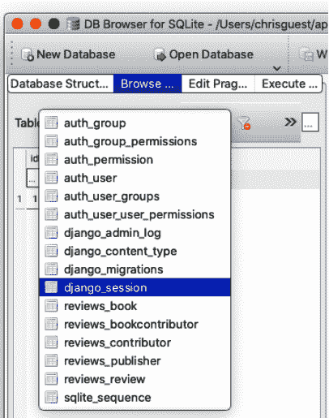

图 9.13 - DB Browser for SQLite 中的表选择

- 2. 在 Database Structure 选项卡下，展开 django_session 表：

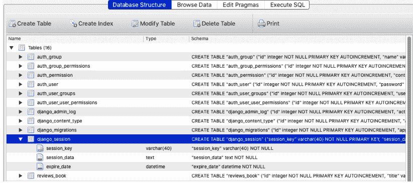

图 9.14 - DB Browser for SQLite 中的表定义

这会显示数据库中的 django_session 表在 session_key、session_data 和 expire_date 字段中存储会话信息。

3. 点击 Browse Data 选项卡并选择 django_session 表：

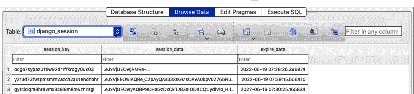

图 9.15 – 在 django_session 表中查询数据

4. Django 使用加密签名值存储会话数据。由于默认情况下我们使用数据库来存储会话，因此我们将导入 Session 模型，以及 django.contrib.sessions.backends.db.SessionStore 的 SessionStore 类，它具有 decode 方法，我们可以使用它来读取 Session 对象中编码的 session_data。

5. 此代码片段可以通过在命令行中输入 python manage.py shell 来使用 Django shell 执行，以获取交互式提示：

```
>>> from django.contrib.sessions.backends.db import SessionStore
>>> from django.contrib.sessions.models import Session
>>> session_store = SessionStore()
>>> sessions = Session.objects.all()
>>> session_store.decode(sessions[0].session_data)
{'_auth_user_id': '2', '_auth_user_backend': 'django.contrib.auth.backends.ModelBackend', '_auth_user_hash': 'eb5de6bf54460bafc9e0f555c65d16b17b3fdf754617d1d73529d9605fea2f0c'}
```

6. 使用这种方法，我们可以创建一个用于检查会话数据的管理命令。会话中可能存储敏感数据，因此创建管理命令可确保只有具有服务器控制台访问权限的用户才能访问数据。

7. 使用 PyCharm，在 Bookr 项目的 reviews/management/commands 目录中，创建一个名为 sessioninfo.py 的 Python 文件。

8. 让我们首先导入必要的模块。我们将使用 Python 标准库的 pprint 模块中的 pformat 命令来格式化会话数据。我们需要 django.contrib.auth.models 中的 User 模型和 django.contrib.sessions.models 中的 Session 模型来查询 User 和 Session 对象。django.core.management.base 中的 BaseCommand 类为我们的 Django 管理命令提供了脚手架：

```
from pprint import pformat

from django.contrib.auth.models import User
from django.contrib.sessions.models import Session
from django.contrib.sessions.backends.db import SessionStore
from django.core.management.base import BaseCommand
```

9. 最低限度，用户命令需要通过将 Command 类子类化为 BaseCommand 并定义 handle 方法来定义。通常，额外的命令行参数将在 add_arguments 方法中定义，但我们旨在创建一个非常简单的示例。Command 类的 help 属性用于在用户输入 python manage.py --help 或 python manage.py sessioninfo --help 时提供信息：

```
class Command(BaseCommand):
    help = "List all user sessions and the data that
            they contain."
```

10. 编写 Command 类的 handle 方法。首先实例化一个 SessionStore 对象，然后遍历 Session 对象并使用 SessionStore.decode 方法解码每个会话的数据。解密数据的 _auth_user_id 键引用数据库中的 User.id，因此我们可以使用 User 模型检索用户。

现在，对于每个会话，将会话键、用户 ID、用户名和电子邮件地址写入控制台。我们将开发一个简单的 Python 实用程序来解密此会话信息。请注意，在管理命令中写入控制台时，最好调用 self.stdout.write 而不是 print：

```
def handle(self, *args, **options):
    session_store = SessionStore()
    for session in Session.objects.all():
        data = session_store.decode(
            session.session_data)
        user = User.objects.get(
            id=data['_auth_user_id'])
        self.stdout.write(
            f"Session Key: {session.session_key}"
            f" User: {user.id} {user.username}"
            f" {user.email}")
        self.stdout.write(pformat(data))
```


```
{user.email} ") self.stdout.write(pformat(data))
```

11. 现在，你可以使用这个管理命令来检查存储在数据库中的会话数据。你可以在命令行中按如下方式调用它：

```
python manage.py sessioninfo
```

这将有助于在尝试最终活动时调试会话行为：

```
> python manage.py sessioninfo
Session Key: ocgo7sypaz01tlw92dr1ffkrogy0ux03 User: 2 carol carol.brown@example.com
{'_auth_user_backend': 'django.contrib.auth.backends.ModelBackend',
'_auth_user_hash': 'eb5de6bf54460bafc9e0f555c65d16b17b3fdf754617d1d73529d9605fea2f0c',
'_auth_user_id': '2'}
Session Key: y2r3d7fwtpmsmrn2azcha2a01ehdnbhr User: 1 bob bob.black@example.com
{'_auth_user_backend': 'django.contrib.auth.backends.ModelBackend',
'_auth_user_hash': '322625efba7788f598d02fca5ad86bb14db4893f3c92bc4099822ea3bf4d1e4f',
'_auth_user_id': '1'}
Session Key: gyfciciqm8ht8vmx3c8i8m8m6zh1ltgl User: 3 bookradmin bookradmin@example.com
{'_auth_user_backend': 'django.contrib.auth.backends.ModelBackend',
'_auth_user_hash': 'a30d9315c9b5dda38802da5e8e64f94b0b063f0136fad8456205ed8cced8ff30',
'_auth_user_id': '3'}
```

图 9.16 – Python 脚本

此脚本输出解码后的会话信息。目前，会话仅包含三个键：

- `_auth_user_backend` 是用户后端类的字符串表示。由于我们的项目将用户凭据存储在模型中，因此使用 ModelBackend。

- `_auth_user_hash` 是用户密码的哈希值。

- `_auth_user_id` 是从模型的 `User.id` 属性获得的用户 ID。

此练习帮助你熟悉 Django 中会话数据的存储方式。现在，我们将把注意力转向向 Django 会话中添加额外信息。

## 在会话中存储数据

我们已经介绍了 Django 中会话的实现方式。现在，我们将简要研究一些可以利用会话来丰富用户体验的方法。在 Django 中，会话是请求对象的属性。它被实现为类似字典的对象。在我们的视图中，我们可以像典型的字典一样为会话对象分配键，如下所示：

```
request.session['books_reviewed_count'] = 39
```

但有一些限制。首先，会话中的键必须是字符串，因此不允许使用整数和时间戳。其次，以下划线开头的键保留供内部系统使用。数据仅限于可以编码为 JSON 的值，因此某些无法解码为 UTF-8 的字节序列，例如之前列出的 `binary_key`，不能存储为 JSON 数据。另一个警告是避免将 `request.session` 重新分配给不同的值。我们应该只分配或删除键。因此，不要这样做：

```
request.session = {'books_read_count':30, 'books_reviewed_count': 39}
```

而是这样做：

```
request.session['books_read_count'] = 30
request.session['books_reviewed_count'] = 39
```

在了解这些限制后，我们将研究如何在 Reviews 应用中使用会话数据。

### 练习 9.06 – 在会话中存储最近查看的书籍

本练习的目的是使用会话来保存经过身份验证的用户最近浏览的 10 本书的信息。此信息将显示在 bookr 项目的个人资料页面上。当浏览一本书时，会调用 `book_detail` 视图。在本练习中，我们将编辑 `reviews/views.py` 并向 `book_detail` 方法添加一些额外逻辑。我们将在会话中添加一个名为 `viewed_books` 的键。利用 HTML 和 CSS 的基本知识，可以创建页面以在页面的不同分区中显示个人资料详细信息和已查看的书籍，如下所示：

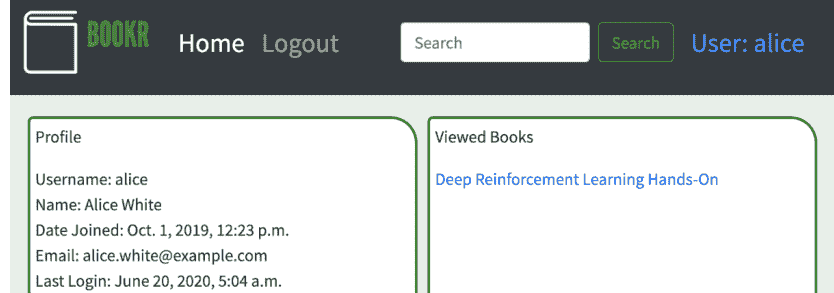

图 9.17 – 包含已查看书籍的个人资料页面

让我们开始步骤：

1. 编辑 `reviews/views.py` 和 `book_detail` 方法。我们只对经过身份验证的用户添加会话信息感兴趣，因此添加一个条件语句来检查用户是否已通过身份验证，并将 `max_viewed_books_length`，即已查看书籍列表的最大长度，设置为 10：

```python
def book_detail(request, pk):
    ...
    if request.user.is_authenticated:
        max_viewed_books_length = 10
```

2. 在同一个条件块内，添加代码以检索 `request.session['viewed_books']` 的当前值。如果会话中不存在此键，则从空列表开始：

```python
viewed_books = request.session.get(
    'viewed_books', [])
```

3. 如果当前书籍的主键已存在于 `viewed_books` 中，则以下代码将删除它：

```python
viewed_book = [book.id, book.title]
if viewed_book in viewed_books:
    viewed_books.pop(
        viewed_books.index(viewed_book))
```

4. 以下代码将当前书籍的主键插入到 `viewed_books` 列表的开头：

```python
viewed_books.insert(0, viewed_book)
```

5. 添加以下键以仅保留列表的前 10 个元素：

```python
viewed_books = viewed_books[
    :max_viewed_books_length]
```

6. 以下代码将我们的 `viewed_books` 添加回 `request.session['viewed_books']`，以便在后续请求中可用：

```python
request.session['viewed_books'] = viewed_books
```

7. 如前所述，在 `book_detail` 函数的末尾，使用请求和上下文数据渲染 `reviews/book_detail.html` 模板：

```python
return render(request, "reviews/book_detail.html", context)
```

完成后，`book_detail` 视图将具有以下条件块：

```python
def book_detail(request, pk):
    ...
    if request.user.is_authenticated:
        max_viewed_books_length = 10
        viewed_books = request.session.get("viewed_books", [])
        viewed_book = [book.id, book.title]
        if viewed_book in viewed_books:
            viewed_books.pop(viewed_books.index(viewed_book))
        viewed_books.insert(0, viewed_book)
        viewed_books = viewed_books[:max_viewed_books_length]
        request.session["viewed_books"] = viewed_books
    return render(request, "reviews/book_detail.html", context)
```

8. 修改 `templates/profile.html` 的页面布局和 CSS 以容纳已查看书籍分区。由于我们将来可能在此页面中添加更多分区，因此一个方便的布局概念是 **flexbox**。我们将添加此 CSS 并将内容分离为嵌套的 div 实例，这些实例将在页面上水平排列。我们将内部 div 实例称为 `infocell` 实例，并为其设置绿色边框和圆角样式：

```
<style>
.flexrow { display: flex;
           border: 2px black;
}
.flexrow > div { flex: 1; }

.infocell {
    border: 2px solid green;
    border-radius: 5px 25px;
    background-color: white;
    padding: 5px;
    margin: 20px 5px 5px 5px;
}

</style>

<div class="flexrow" >
    <div class="infocell" >
        <p>Profile</p>
        ...
    </div>

    <div class="infocell" >
        <p>Viewed Books</p>
        ...
    </div>
</div>
```

9. 修改 `templates/profile.html` 中的已查看书籍 div 元素，以便如果存在书籍，则显示其标题并链接到各个书籍详情页。这将呈现如下：

```
<a href="/books/1">Advanced Deep Learning with Keras</a><br>
```

如果列表为空，则应显示一条消息。整个 div，包括对 `request.session.viewed_books` 的迭代，将如下所示：

```
<div class="infocell" >
    <p>Viewed Books</p>
    <p>
    
    <a href="/books/{{ book_id }}">{{ book_title }}</a><br>
    
        No recently viewed books found.
    
    </p>
</div>
```

一旦合并所有这些更改，完整的个人资料模板将如下所示：

### templates/profile.html

```


Bookr

Profile



<style>
```

你可以在 https://github.com/PacktPublishing/Web-Development-with-Django-Second-Edition/tree/main/Chapter09/Exercise9.06/bookr/templates/profile.html 找到此文件的完整代码。


本练习通过添加最近查看的图书列表增强了个人资料页面。现在，当你访问个人资料链接 `http://127.0.0.1:8000/accounts/profile/` 时，你将看到此页面：

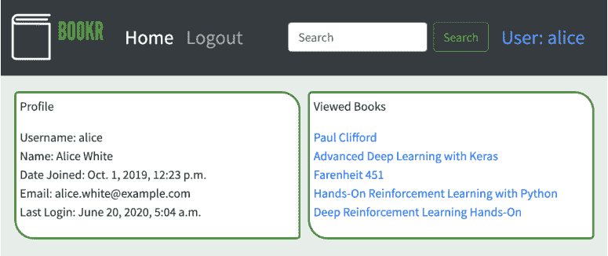

图 9.18 – 最近查看的图书

我们可以使用在 *练习 9.05 – 检查会话键* 中开发的 `sessioninfo` 管理命令，在此功能实现后检查用户的会话。它可以通过在命令行中传递会话数据作为参数来调用：

```bash
python manage.py sessioninfo
```

我们可以看到图书 ID 和标题列在 `viewed_books` 键中。请记住，通过查询 SQLite 数据库中的 `django_session` 表获得编码数据：

```text
> python manage.py sessioninfo
Session Key: mjbbpj6e6y0qayh1mj6sgw27kfugq1qc User: 4 alice alice.white@example.com
{'_auth_user_backend': 'django.contrib.auth.backends.ModelBackend',
 '_auth_user_hash': '384340e0724b154062dca2d2c94a9fc94380dc323b9e1e433aff3aef799b99a3e',
 '_auth_user_id': '4',
 'viewed_books': [[17, 'Paul Clifford'],
                  [1, 'Advanced Deep Learning with Keras'],
                  [13, 'Fahrenheit 451'],
                  [6, 'Hands-On Reinforcement Learning with Python'],
                  [4, 'Deep Reinforcement Learning Hands-On']]}
```

图 9.19 – 查看的图书存储在会话数据中

在本练习中，我们使用了 Django 的会话机制来存储有关用户与 Django 项目交互的临时信息。我们学习了如何从用户会话中检索此信息并在视图中显示，以告知用户其最近的活动。

## 活动 9.02 – 为图书搜索页面使用会话存储

会话是存储有助于在网站上保持有状态体验的短暂信息的有效方式。用户经常重新访问诸如搜索表单之类的页面，当他们返回这些页面时，存储最近使用的表单设置会很方便。在第 3 章 URL 映射、视图和模板中，我们为 bookr 项目开发了图书搜索功能。图书搜索页面有两个搜索范围选项 – 标题和贡献者。目前，每次访问该页面时，它都默认为标题：

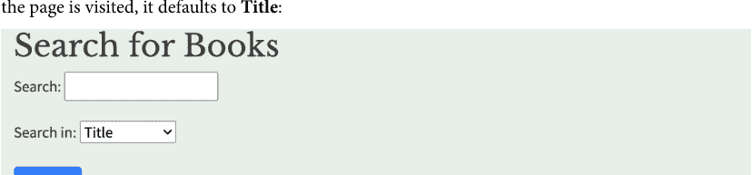

图 9.20 – 图书搜索表单的搜索和搜索范围字段

在此活动中，你将使用会话存储，以便当访问图书搜索页面 /book-search 时，它将默认为最近使用的搜索选项。你还将在个人资料页面添加第三个信息单元，其中包含最近使用的搜索词的链接列表。按照以下步骤完成此活动：

1. 编辑 book_search 视图并从会话中检索 search_history。
2. 当表单收到有效输入且用户已登录时，将搜索选项和搜索文本追加到会话的搜索历史列表中。

   如果表单未填写（例如，首次访问页面时），则使用之前使用的搜索范围选项呈现表单 – 即标题或贡献者（图 9.21）：

   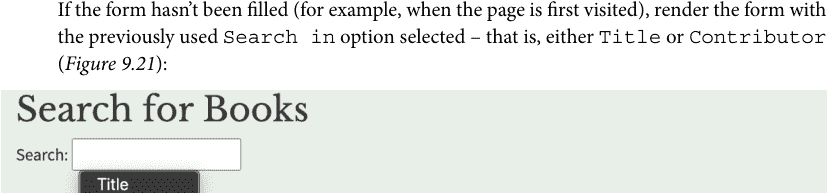

   图 9.21 – 在搜索字段中选择贡献者

3. 在个人资料模板中，包含一个额外的 `infocell` 分区用于搜索历史。
4. 将搜索历史列为一系列指向图书搜索页面的链接。链接将采用以下形式：`/book-search?search=Python&search_in=title`。

此活动将挑战你应用会话数据来解决 Web 表单中的可用性问题。这种方法在许多现实世界情况下都有适用性，并将让你了解会话在创建有状态 Web 体验中的使用。完成此活动后，个人资料页面将包含第三个信息单元，如图 9.22 所示：

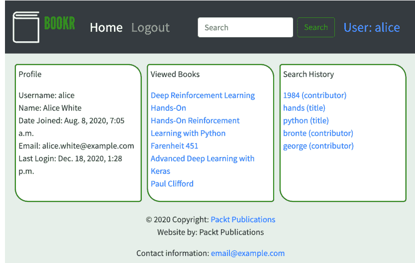

图 9.22 – 带有搜索历史信息单元的个人资料页面

> **注意**
> 你可以在 https://github.com/PacktPublishing/Web-Development-with-Django-Second-Edition/tree/main/ActivitySolutions 上找到此活动的解决方案。

## 摘要

在本章中，我们检查了 Django 的中间件实现的身份验证和会话。我们还学习了如何将身份验证和权限逻辑纳入视图和模板。现在，我们可以对特定页面设置权限并限制其访问仅限经过身份验证的用户。我们还检查了如何在用户的会话中存储数据并在后续页面上呈现它。

有了这些，你就具备了自定义 Django 项目以提供个性化 Web 体验的技能。你可以将内容限制为经过身份验证或特权用户，并根据他们之前的交互个性化用户的体验。在下一章中，我们将重新审视 Admin 应用并学习一些高级技术，我们可以使用这些技术来自定义我们的用户模型并对我们模型的管理员界面进行细粒度更改。
