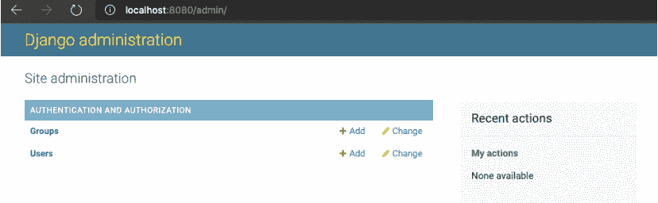
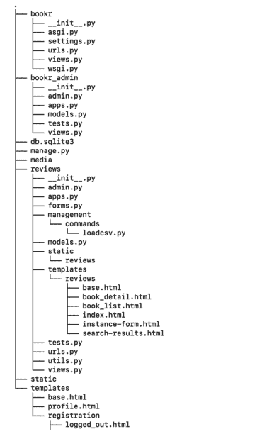
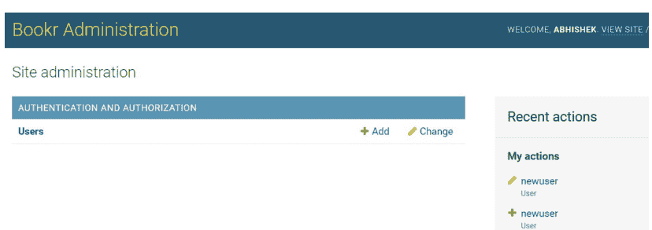
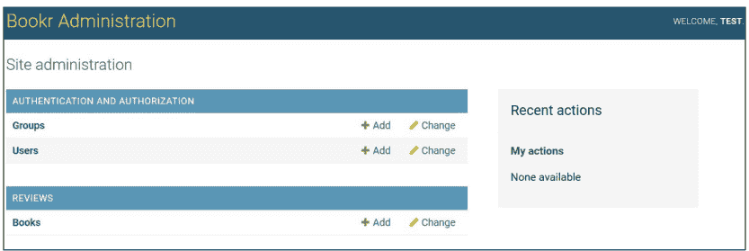
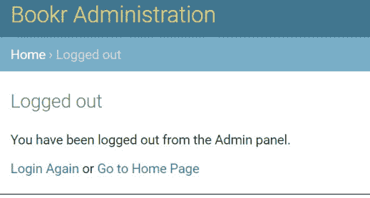
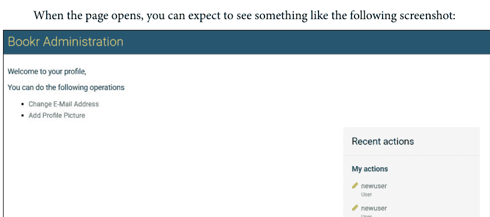
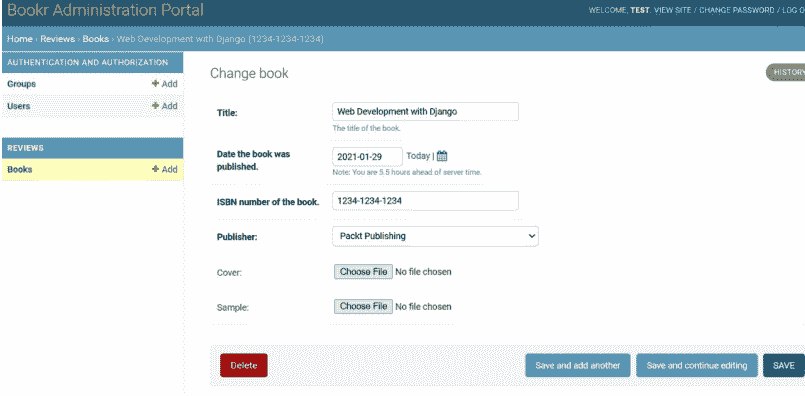

## 高级 Django 管理和自定义

假设我们想要自定义大型组织的管理站点首页。我们希望显示组织中不同系统的健康状况，并查看任何活跃的高优先级警报。如果这是一个建立在 Django 之上的内部网站，我们将需要对其进行自定义。添加此类功能将要求 IT 团队的开发人员自定义默认的管理面板并创建自己的自定义 AdminSite 模块，该模块将呈现与默认管理站点提供的不同的索引页面。幸运的是，Django 使此类自定义变得容易。

在本章中，我们将了解如何利用 Django 的框架及其可扩展性来自定义 Django 的默认管理界面（如 *图 10.1* 所示）。我们不仅将学习如何使界面更个性化；我们还将学习如何控制管理站点的不同方面，以便让 Django 加载自定义管理站点，而不是随默认框架提供的管理站点。这种自定义在我们想要向管理站点引入默认情况下不存在的功能时非常有用：



图 10.1 – 默认 Django 管理面板界面

本章建立在 *第 4 章、Django Admin 简介* 中练习的技能之上。简单回顾一下，我们学习了如何使用 Django 管理站点来控制我们 Bookr 应用的管理和授权。我们还学习了如何注册模型以读取和编辑其内容，以及如何使用 `admin.site` 属性自定义 Django 的管理界面。

本章涵盖以下主题：

- 自定义管理站点
- 向管理站点添加视图

现在，让我们通过了解如何开始自定义管理站点，利用 Django 的 `AdminSite` 模块为我们 Web 应用的管理门户添加强大的新功能，从而进一步扩展我们的知识。

### 技术要求

本章的完整代码文件可以在 `https://github.com/PacktPublishing/Web-Development-with-Django-Second-Edition/tree/main/Chapter10` 找到

### 自定义管理站点

Django 作为一个 Web 框架，为构建 Web 应用提供了大量自定义选项。我们在为项目构建管理应用时将使用 Django 提供的同样自由。

在 *第 4 章、Django Admin 简介* 中，我们查看了如何使用 `admin.site` 属性来自定义 Django 管理界面的元素。但是，如果我们需要更多地控制管理站点的行为怎么办？例如，如果我们想为用户访问 Bookr 管理面板时显示登录页面或注销页面的自定义模板怎么办？在这种情况下，提供的 `admin.site` 属性可能不够，我们将需要构建可以扩展默认管理站点行为的自定义。幸运的是，这可以通过扩展 Django 管理模块中的 `AdminSite` 类轻松实现。但是，在我们开始构建管理站点之前，让我们先了解 Django 如何发现管理文件，以及如何利用此管理文件发现机制在 Django 内部构建一个新应用，该应用将充当我们的管理站点应用。

### 在 Django 中发现管理文件

当我们在 Django 项目中构建应用时，我们经常使用 `admin.py` 文件来注册我们的模型或创建 `ModelAdmin` 类来自定义我们在管理界面中与模型交互的方式。这些 `admin.py` 文件存储此信息并将其提供给项目的管理界面。一旦我们在 `settings.py` 文件的 `INSTALLED_APPS` 部分中添加 `django.contrib.admin`，Django 就会自动执行这些文件的发现：




Figure 10.2 – Bookr 应用结构

如前图所示，我们在 reviews 应用目录下有一个 admin.py 文件，Django 使用它来自定义 Bookr 的管理站点。

当 admin 应用被添加时，它会尝试在我们正在工作的 Django 项目的每个应用中查找 admin 模块，如果找到模块，admin 应用就会从中加载内容。

## Django 的 AdminSite 类

在开始自定义 Django 管理站点之前，我们必须了解默认的管理站点是如何生成并由 Django 处理的。

为了提供默认的管理站点，Django 打包了一个名为 admin 模块的模块，其中包含一个名为 AdminSite 的类。该类实现了大量有用的功能和智能默认值，Django 社区认为这些对于为大多数 Django 网站实现有用的管理面板很重要。默认的 AdminSite 类提供了大量内置属性，这些属性不仅控制默认管理站点在 Web 浏览器中呈现的外观和感觉，还控制我们如何与其交互，以及特定交互将导致什么操作。

这些默认值中的一些包括站点模板属性，例如要在站点标题中显示的文本，要在 Web 浏览器标题栏中显示的文本，与 Django `auth` 模块集成的文本以进行管理站点的身份验证，以及许多其他属性。

随着我们朝着为我们的 Django Web 项目构建自定义管理站点的目标前进，保留 Django `AdminSite` 类中已内置的大量有用功能是非常可取的。这就是 Python 面向对象编程概念来救援的地方。

当我们开始向前迈进创建自定义管理站点时，我们将尝试利用 Django 默认 `AdminSite` 类提供的现有有用功能集。为此，我们不会从头开始构建一切，而是将致力于创建一个继承自 Django `AdminSite` 类的新子类的创建，以利用 Django 已经为我们提供的现有功能集和有用集成。这种方法使我们能够专注于为自定义管理站点添加新的有用功能集，而不是花费时间从头实现基本功能集。例如，以下代码片段展示了如何创建 Django `AdminSite` 类的子类：

```
class MyAdminSite(admin.AdminSite):
    ...
```

为了开始为我们的 Web 应用构建自定义管理站点，让我们首先通过使用我们将要工作的自定义 `AdminSite` 类来覆盖 Django 管理面板的一些基本属性。

可以覆盖的属性包括 `site_header`、`site_title` 等。

> **Note**
> 在创建自定义管理站点时，我们将不得不再次注册任何我们可能使用默认 `admin.site` 变量注册的 `Model` 和 `ModelAdmin` 类。这是因为自定义管理站点不会继承 Django 提供的默认管理站点的实例细节，因此除非我们重新注册我们的 `Model` 和 `ModelAdmin` 接口，否则我们的自定义管理站点将不会显示它们。

现在，知道了 Django 如何发现要加载到管理界面中的内容以及我们如何开始构建自定义管理站点，让我们继续尝试为 Bookr 创建自定义 admin 应用，该应用扩展了 Django 提供的现有 `admin` 模块。在接下来的练习中，我们将使用 Django 的 `AdminSite` 类为我们的 Bookr 应用创建自定义管理站点界面。

## Exercise 10.01 – 为 Bookr 创建自定义管理站点

在本练习中，你将创建一个扩展默认 Django 管理站点的新应用，并允许你自定义界面的组件。因此，你将自定义 Django 管理面板的默认标题。完成此操作后，你将覆盖 Django 的 admin.site 属性的默认值，使其指向你的自定义管理站点：

1. 在开始处理自定义管理站点之前，你首先需要确保你位于项目中可以运行 Django 应用管理命令的正确目录中。为此，使用终端或 Windows 命令提示符导航到 bookr 目录，然后通过运行以下命令创建一个名为 bookr_admin 的新应用，它将作为 Bookr 的管理站点：

```
python3 manage.py startapp bookr_admin
```

一旦此命令成功执行，你应该在项目内部看到一个名为 bookr_admin 的新目录。

2. 现在，默认结构已配置好，下一步是创建一个名为 BookrAdmin 的新类，它将扩展 Django 提供的 AdminSite 类以继承默认管理站点的属性。为此，在 PyCharm 中打开 bookr_admin 目录下的 admin.py 文件。打开文件后，你会看到文件内部已经存在以下代码片段：

```
from django.contrib import admin
```

现在，保持此导入语句不变，从下一行开始，创建一个名为 BookrAdmin 的新类，它继承自你之前导入的 admin 模块提供的 AdminSite 类：

```
class BookrAdmin(admin.AdminSite):
```

在此新的 BookrAdmin 类内部，通过设置 site_header 属性来覆盖 site_header 变量的默认值，该变量负责在 Django 管理面板中渲染站点标题，如下所示：

```
site_header = "Bookr Administration"
```

至此，自定义管理站点类已定义。要使用此类，你将首先创建此类的一个实例。这可以按如下方式完成：

```
admin_site = BookrAdmin(name='bookr_admin')
```

3. 保存文件但不要关闭它；我们将在第 5 步中重新访问它。接下来，让我们编辑 bookr 应用中的 urls.py 文件。

在前面的屏幕截图（Figure 10.3）中，你会看到 Django 显示一条消息，You don't have permission to view or edit anything。权限不足的问题发生是因为在此之前，我们尚未向自定义 AdminSite 实例注册任何模型。该问题也适用于随 Django auth 模块一起提供的 User 和 Groups 模型。现在，让我们通过注册 Django auth 模块中的 User 模型来使我们的自定义管理站点更有用。

+   6. 要注册 Django auth 模块中的 User 模型，请在 PyCharm 中打开 bookr_admin 目录下的 admin.py 文件，并在文件顶部添加以下行：

```
from django.contrib.auth.admin import User
```

在文件末尾，使用你的 BookrAdmin 实例按如下方式注册此模型：

```
admin_site.register(User)
```

到目前为止，你的 admin.py 文件应如下所示：

```
from django.contrib import admin
from django.contrib.auth.admin import User

class BookrAdmin(admin.AdminSite):
    site_header = "Bookr Administration"

admin_site = BookrAdmin(name='bookr_admin')
admin_site.register(User)
```

完成此操作后，重新加载 Web 服务器并访问 http://localhost:8000/admin。现在，你应该能够在管理界面中看到 User 模型以供编辑，如下所示：



Figure 10.4 – 显示我们在 Bookr Administration 站点上已注册模型的首页视图

至此，我们刚刚创建了我们的 admin 站点应用，并且我们也可以现在验证自定义站点具有不同的标题 – **Bookr Administration**。

## 覆盖默认的 admin.site

在上一节中，在我们创建自己的 `AdminSite` 应用后，我们看到我们必须手动注册模型。这是因为我们在自定义管理站点之前构建的大多数应用仍然使用 `admin.site` 属性来注册其模型，如果我们想使用我们的 `AdminSite` 实例，我们将不得不更新所有这些应用以使用我们的实例，如果项目中有很多应用，这可能会变得繁琐。

幸运的是，我们可以通过覆盖默认的 `admin.site` 属性来避免这种额外的负担。为此，我们首先必须创建一个新的 `AdminConfig` 类，它将为我们覆盖默认的 `admin.site` 属性，以便我们的应用被标记为默认管理站点，从而覆盖项目中 `admin.site` 属性。在下一个练习中，我们将了解如何将我们的自定义管理站点映射为应用的默认管理站点。

## Exercise 10.02 – 覆盖默认管理站点

在本练习中，你将使用 `AdminConfig` 类来覆盖项目的默认管理站点，这样你就可以继续使用默认的 `admin.site` 变量来注册模型、覆盖站点属性等：

+   1. 打开 `bookr_admin` 目录下的 `admin.py` 文件并删除你在 *Exercise 10.01 – creating a custom admin site for Bookr* 的第 5 步中编写的 User 模型的导入和 BookrAdmin 实例创建。完成此操作后，文件内容应类似于以下内容：

```
```python
from django.contrib import admin

class BookrAdmin(admin.AdminSite):
    site_header = "Bookr Administration"
```
```

+   2. 然后你需要为自定义管理站点创建一个 `AdminConfig` 类，以便 Django 识别 BookrAdmin 类作为 AdminSite 并覆盖 `admin.site` 属性。为此，打开 `bookr_admin` 目录中的 `apps.py` 文件并用此处显示的内容覆盖文件的内容：

```
```python
from django.contrib.admin.apps import AdminConfig

class BookrAdminConfig(AdminConfig):
    default_site = 'bookr_admin.admin.BookrAdmin'
```
```


在此过程中，我们首先从Django的admin模块中导入了AdminConfig类。该类用于定义哪个应用应被用作默认管理站点，并覆盖Django管理站点的默认行为。

针对我们的用例，我们创建了一个名为BookrAdminConfig的类，它是Django的AdminConfig类的子类，并覆盖了default_site属性，使其指向我们的自定义管理站点BookrAdmin类：

```
default_site = 'bookr_admin.admin.BookrAdmin'
```

完成此操作后，我们需要在Bookr项目中将我们的应用设置为管理应用。为此，打开Bookr项目的settings.py文件，在INSTALLED_APPS部分，将'reviews.apps.ReviewsAdminConfig'替换为'bookr_admin.apps.BookrAdminConfig'。settings.py文件应如下所示：https://github.com/PacktPublishing/Web-Development-with-Django-Second-Edition/tree/main/Chapter10/Exercise10.02/bookr/settings.py.

3. 将应用映射为管理应用后，最后一步涉及修改URL映射，使'admin/'端点使用admin.site属性来查找正确的URL。为此，打开bookr项目下的urls.py文件。请查看urlpatterns列表中的以下条目：

```
path('admin/', admin_site.urls)
```

将其替换为以下条目：

```
from django.contrib import admin

urlpatterns = [
    ...
    path('admin/', admin.site.urls)
]
```

请记住，admin_site.urls是一个模块，而admin.site是Django的内部属性。

完成上述步骤后，让我们重新加载Web服务器，并通过访问http://localhost:8000/admin来检查管理站点是否加载。如果加载的网站如下图所示，那么我们现在就有了自己的自定义管理应用用于管理界面：



图10.5——自定义Bookr管理站点的主页视图

如你所见，一旦我们用自定义管理应用覆盖admin.site，之前使用admin.site.register属性注册的模型就会自动显示出来。

这样一来，我们现在有了一个自定义基础模板，可以利用它来构建Django管理站点其余的自定义功能。随着本章的深入，我们将发现一些有趣的自定义方法，使管理仪表盘成为我们应用程序的集成部分。

## 使用AdminSite属性自定义管理站点文本

就像我们可以使用admin.site属性来自定义Django应用程序的文本一样，我们也可以使用AdminSite类公开的属性来定制这些文本。在练习10.02——覆盖默认管理站点中，我们了解了如何更新管理站点的site_header属性。类似地，还有许多其他属性可以修改。下面描述了一些可以被覆盖的属性：

- site_header：在管理站点每个页面顶部显示的文本（默认为“Django Administration”）。
- site_title：在浏览器标题栏中显示的文本（默认为“Django Admin Site”）。
- site_url：用于“查看站点”选项的链接（默认为/）。当站点运行在自定义路径上时，该属性会被覆盖，重定向应直接将用户带到子路径。
- index_title：应显示在管理应用程序索引页面上的文本（默认为“Site administration”）。

> 注意
> 有关所有AdminSite属性的更多信息，请参阅官方Django文档：https://docs.djangoproject.com/en/4.1/ref/contrib/admin/#adminsite-attributes.

如果我们想在自定义管理站点中覆盖这些属性，过程非常简单，如下所示：

```
class MyAdminSite(admin.AdminSite):
    site_header = "My web application"
    site_title = "My Django Web application"
    index_title = "Administration Panel"
```

正如我们到目前为止在示例中所看到的，我们为Bookr创建了一个自定义管理应用程序，然后将其设为项目的默认管理站点。一个有趣的问题是，既然我们迄今为止所自定义的属性也可以直接使用admin.site对象进行自定义，那么与修改admin.site属性相比，什么时候应该创建自定义管理应用程序呢？

事实证明，有人会选择自定义管理站点可能有多种原因——例如，他们想要更改默认管理站点的布局，使其与应用程序的整体布局保持一致。当你为企业创建Web应用程序时，这一点非常常见，因为内容的同质性非常重要。以下是一小段需求列表，这些需求可能会促使开发人员继续构建自定义管理站点，而不是简单地修改admin.site变量的属性：

- 需要覆盖管理界面的索引模板
- 需要覆盖登录或退出模板
- 需要向管理界面添加自定义视图

## 自定义管理站点模板

与site_header和site_title等出现在管理站点中的一些可自定义公共文本一样，Django也允许我们通过设置AdminSite类中的某些属性来自定义用于渲染管理站点不同页面的模板。

这些自定义可以包括修改用于渲染索引页面、登录页面、模型数据页面等的模板。利用Django提供的模板系统，可以轻松完成这些自定义。例如，以下代码片段展示了如何向Django管理仪表盘添加新模板：

```



<!-- Template Content -->

```

在这个自定义模板中，有几个重要方面需要我们理解。

在通过修改仪表盘内某些页面的外观或向仪表盘添加一组新页面来定制现有Django管理仪表盘时，开发人员可能不想从头重新编写每一段HTML，以保持Django管理仪表盘的基本外观和感觉。

通常，在自定义管理仪表盘时，我们希望保留Django组织仪表盘上显示的不同元素的布局，这样我们就可以专注于修改页面中对我们重要的部分。页面的基本布局以及页眉和页脚等常见页面元素都定义在Django管理站点的基础模板中，该模板也是默认Django管理网站内所有页面的母版模板。

当我们想保留Django管理页面中公共元素的组织和渲染方式时，我们需要扩展这个基础模板，以便我们的自定义模板页面能提供与Django管理仪表盘内其他页面一致的用户体验。这可以通过使用模板扩展标签并扩展Django提供的admin模块中的base_site.html模板来实现：

```

```

完成此操作后，下一个任务是为自定义模板定义我们自己的内容。Django提供的base_site.html模板为开发人员提供了一个基于块的占位符，以便他们为模板添加自己的内容。要添加此内容，开发人员必须将其自定义页面元素的逻辑放在标签内。这实质上覆盖了base_site.html模板中由标签定义的任何内容，遵循了Django中的模板继承概念。

现在，让我们看看如何自定义用于渲染退出页面的模板，即当用户在管理面板中单击“退出”（Logout）按钮时。

## 练习10.03——为Bookr管理站点自定义退出模板

在本练习中，您将自定义用于渲染退出页面的模板，即当用户在管理站点上单击“退出”按钮时。当为银行用户开发的网站可能希望在用户点击“退出”后将其重定向到说明页面，以向他们显示说明，确保其银行会话安全关闭时，这种覆盖会非常有用：

- 1. 在您应该已在前面章节中创建的templates目录下，再创建一个名为admin的目录，该目录将用于存储自定义管理站点的模板。

> 注意
> 在继续之前，请确保templates目录已添加到settings.py文件（位于bookr/project下）的DIRS列表中。

- 2. 现在，目录结构设置已完成，Django也已配置为加载模板，下一步涉及编写您想要渲染的自定义退出模板。为此，让我们在步骤1中创建的templates/admin目录下创建一个名为logout.html的新文件，并在其中添加以下内容：

```



<p>You have been logged out from the Admin panel.</p>
<p><a href="">Login Again</a>
or <a href="{{ site_url }}">Go to Home Page</a></p>

```

在上述代码片段中，我们做了几件事。首先，对于我们的自定义退出模板，我们将使用与django.contrib.admin模块所提供的相同的母版布局。因此，请考虑以下内容：

```

```

当我们编写此代码时，Django会尝试在django.contrib.admin模块提供的templates目录中查找并加载admin/base_site.html模板。

现在，我们的基础模板已经准备好被扩展，接下来我们要做的就是尝试通过以下代码块来覆盖内容块的HTML：

```

...

```


admin:index 和 site_url 的值由 AdminSite 类根据我们定义的设置自动提供。

利用 admin:index 和 site_url 的值，我们将创建 Login Again 超链接（单击后将带用户返回登录表单）和 Go to Home Page 链接（单击后将带用户返回网站主页）。文件现在应如下所示：https://github.com/PacktPublishing/Web-Development-with-Django-Second-Edition/tree/main/Chapter10/Exercise10.03/templates/admin/logout.html。

- 3. 现在，自定义模板已定义，下一步是在我们的自定义管理站点上使用该自定义模板。为此，让我们打开 bookr_admin 目录下的 admin.py 文件，并在 BookrAdmin 类中添加以下字段作为最终值：

```
logout_template = 'admin/logout.html'
```

保存该文件。文件应如下所示：https://github.com/PacktPublishing/Web-Development-with-Django-Second-Edition/tree/main/Chapter10/Exercise10.03/bookr_admin/admin.py。

- 4. 完成上述所有步骤后，让我们通过运行以下命令启动开发服务器：

```
python manage.py runserver localhost:8000
```

然后，我们导航到 http://localhost:8000/admin。

到达那里后，尝试登录，然后点击 Logout。注销后，您将看到呈现以下页面：



图 10.6 – 用户点击 Logout 按钮后看到的注销视图

至此，我们已经成功覆盖了第一个模板。类似地，我们还可以覆盖 Django 管理面板中的其他模板，例如索引视图和登录表单的模板。

## 向管理站点添加视图

就像 Django 内部的常规应用可以关联多个视图一样，Django 也允许开发者向管理站点添加自定义视图，从而扩大管理站点界面的功能范围。

向管理站点添加自定义视图的能力为网站的管理面板提供了很大的可扩展性，可用于多种额外用例。例如，正如本章开头所讨论的，大型组织的 IT 团队可以向管理站点添加一个自定义视图，用于监控组织内各个 IT 系统的运行状况，并让 IT 团队能够快速查看需要处理的紧急警报。

现在，我们需要回答的下一个问题是：如何向管理站点添加自定义视图？

事实证明，在管理模板内部添加一个新视图非常容易，并且与我们为应用创建视图时所用的方法相同，只需要做一些细微的修改。那么，让我们来看看如何向 Django 管理仪表板添加一个自定义视图。

### 创建视图函数

向 Django 应用添加新视图的第一步是创建一个视图函数，该函数实现处理视图的逻辑。在前面的章节中，我们在一个名为 views.py 的独立文件中创建视图函数，该文件用于保存我们所有的基于方法和基于类的视图。

在向 Django 管理仪表板添加新视图的上下文中，要创建新视图，我们需要在自定义 AdminSite 类中定义一个新的视图函数。例如，要添加一个新视图来呈现一个页面，显示组织内不同 IT 系统的运行状况，我们可以在自定义 AdminSite 类的实现中创建一个名为 system_health_dashboard() 的新视图函数，如下面的代码片段所示：

```
class SysAdminSite(admin.AdminSite):
    def system_health_dashboard(self, request):
        # View function logic
```

在视图函数内部，我们可以执行任何需要的操作来生成视图，并最终使用该响应来渲染模板。在这个视图函数中，有一些重要的逻辑需要我们确保正确实现。

第一个是设置视图函数内 request 字段的 current_app 属性。这是必需的，以便模板中的 Django URL 解析器能够正确解析应用的视图函数。要在我们刚刚创建的自定义视图函数中设置此值，我们需要设置 current_app 属性，如下面的代码片段所示：

```
request.current_app = self.name
```

self.name 字段由 Django 的 AdminSite 类自动填充，我们无需显式初始化。至此，我们最简单的自定义视图实现将如下面的代码片段所示：

```
class SysAdminSite(admin.AdminSite):
    def system_health_dashboard(self, request):
        request.current_app = self.name
        # View function logic
```

### 访问常用模板变量

在创建自定义视图函数时，我们可能希望访问常用模板变量，例如 site_header 和 site_title，以便在与视图函数关联的模板中正确渲染它们。事实证明，使用 AdminSite 类提供的 each_context() 方法可以很容易地实现这一点。

AdminSite 类的 each_context() 方法接受一个参数 request，即当前请求上下文，并返回要插入到所有管理站点模板中的模板变量。

例如，如果我们想在自定义视图函数中访问模板变量，我们可以实现类似于以下代码片段的代码：

```
def system_health_dashboard(self, request):
    request.current_app = self.name
    context = self.each_context(request)
    # view function logic
```

each_context() 方法返回的值是一个字典，包含变量名和关联值。

### 为自定义视图映射 URL

定义视图函数后，下一步涉及将此视图函数映射到 URL，以便用户可以访问它，或允许其他视图链接到它。对于 AdminSite 内部定义的视图，此 URL 到视图的映射由 AdminSite 类实现的 get_urls() 方法控制。get_urls() 方法返回映射到 AdminSite 视图的 urlpatterns 列表。

如果我们想为自定义视图添加 URL 映射，首选方法包括在我们自定义的 AdminSite 类中覆盖 get_urls() 的实现并在那里添加 URL 映射。此方法在以下代码片段中进行了演示：

```
class SysAdminSite(admin.AdminSite):
    def get_urls(self):
        base_urls = super().get_urls()  # Get the existing
        # Define our URL patterns for custom views
        urlpatterns = [
            path("health_dashboard/",
                self.system_health_dashboard)
        ]
        return base_urls + urlpatterns  # Return the updated mapping
```

get_urls() 方法通常由 Django 自动调用，我们无需对它进行任何手动处理。

完成此操作后，最后一步涉及确保我们的自定义管理视图只能通过管理站点访问，非管理员用户应该无法访问它。让我们看看如何实现这一点。

### 将自定义视图限制在管理站点内

如果你仔细阅读了前几个小节，那么现在你已有一个可供使用的自定义 AdminSite 视图。然而，有一个小问题：这个视图也可以直接被任何不在管理站点上的用户访问。

为了确保不出现这种情况，我们需要将此视图限制在管理站点内。这可以非常简单地在 admin_view() 调用中包装我们的 URL 路径来实现，如下面的代码片段所示：

```
urlpatterns = [
    self.admin_view(path("health_dashboard/",
                        self.system_health_dashboard))
]
```

admin_view 函数确保提供给它的路径仅限于管理仪表板，并且没有管理员权限的用户无法访问它。

现在，让我们向管理站点添加一个新的自定义视图。


# 练习 10.04 – 向管理站点添加自定义视图

在本练习中，你将向管理站点添加一个自定义视图，该视图将渲染用户个人资料并向用户展示修改其电子邮件和添加新个人资料图片的选项。要构建此自定义视图，请按照以下步骤操作：

+   1. 打开 bookr_admin 目录下的 admin.py 文件并添加以下导入。这些导入将用于在管理站点应用程序内部构建我们的自定义视图：

```
from django.template.response import TemplateResponse
from django.urls import path
```

+   2. 打开 bookr_admin 目录下的 admin.py 文件并在 BookrAdmin 类内部创建一个名为 profile_view 的新方法，该方法以 request 变量作为其参数：

```
def profile_view(self, request):
```

接下来，在方法内部，获取当前应用程序的名称并将其设置在请求上下文中。为此，你可以使用类的 name 属性，该属性由 Django 自动填充。要获取此属性并将其设置在你的请求上下文中，你需要添加以下行：

```
request.current_app = self.name
```

一旦将应用程序名称填充到请求上下文中，下一步就是获取模板变量，这些变量是用于在管理模板中渲染内容（如 site_title 和 site_header）所必需的。为此，利用 AdminSite 类的 each_context() 方法，该方法从类中提供管理站点模板变量的字典：

```
context = self.each_context(request)
```

获取数据后，最后一步是返回一个 TemplateResponse 对象，当有人访问映射到你的自定义视图的 URL 端点时，该对象将渲染自定义个人资料模板：

```
return TemplateResponse(request,
    "admin/admin_profile.html", context)
```

+   3. 在创建了视图函数后，下一步是使 AdminSite 返回将视图映射到 AdminSite 内部路径的 URL。为此，你需要创建一个名为 get_urls() 的新方法，该方法覆盖 AdminSite.get_urls() 方法并返回你的新视图的映射。这可以通过首先在你为自定义管理站点创建的 BookrAdmin 类内部创建一个名为 get_urls() 的新方法来实现：

```
def get_urls(self):
```

在此方法内部，你需要做的第一件事是获取已映射到管理端点的 URL 列表。这是一个必需步骤；否则，如果此映射丢失，你的自定义管理站点将无法加载与模型编辑页面、注销页面等相关联的任何结果。要获取此映射，请调用 BookrAdmin 类派生的基类的 get_urls() 方法：

```
urls = super().get_urls()
```

一旦捕获了来自基类的 URL，下一步就是创建将我们的自定义视图映射到管理站点中 URL 端点的 URL 列表。为此，我们将创建一个名为 url_patterns 的新列表，并将我们的 profile_view 方法映射到 admin_profile 端点。这是通过使用 Django 的 path 实用函数完成的，该函数允许我们使用基于字符串的 API 端点路径将视图函数映射起来：

```
url_patterns = [
    path("admin_profile", self.profile_view)
]
return url_patterns + urls
```

保存 admin.py 文件。它应如下所示：https://github.com/PacktPublishing/Web-Development-with-Django-Second-Edition/tree/main/Chapter10/Exercise10.04/bookr_admin/admin.py。

请注意，get_urls() 返回的值是一个不可修改的列表。在前面的代码片段中，如果我们尝试在合并 url_patterns 和 urls 对象之间切换顺序，该方法将无法工作，并且 admin_profile URL 不会被创建。

4. 现在 BookrAdmin 类已为新视图配置好，下一步是为管理个人资料页面创建模板。为此，在项目根目录的 templates/admin 目录下创建一个名为 admin_profile.html 的新文件。在此文件内部，首先添加一个 extends 标签以确保你是从默认管理模板扩展的：

```

```

此步骤可确保你的所有管理模板样式表和 HTML 都可在你的自定义视图模板中使用。例如，如果没有此 extends 标签，你的自定义视图将不会显示已映射到管理站点的任何特定内容，例如 site_header、site_title 或注销或前往另一页面的链接。

添加 extends 标签后，添加一个 block 标签并为其提供 content 的值。这可确保你在 ... 段之间添加的代码会覆盖 Django 管理模块随附的 index.html 模板中已有的任何值：

```

```

在 block 标签内部，添加在本次练习第 2 步中创建的个人资料视图所需的 HTML：

```
<p>Welcome to your profile, {{ username }}</p>
<p>You can do the following operations</p>
<ul>
    <li><a href="#">Change E-Mail Address</a></li>
    <li><a href="#">Add Profile Picture</a></li>
</ul>

```

该文件现在应如下所示：https://github.com//PacktPublishing/Web-Development-with-Django-Second-Edition/tree/main/Chapter10/Exercise10.04/templates/admin/admin_profile.html。

5. 现在，前面的步骤已完成，通过运行 python manage.py runserver localhost:8000 重新加载你的应用程序服务器，然后访问 http://localhost:8000/admin/admin_profile。

当页面打开时，你可以期望看到如下截图：



图 10.7 – Bookr 管理站点上的个人资料页面视图

注意

到目前为止创建的视图将无论用户是否登录到管理应用程序都能正常渲染。

为了确保此视图仅可供已登录的管理员访问，你需要在 `get_urls()` 方法内部进行少量修改，该方法在本次练习第 2 步中定义。

在 `get_urls()` 方法内部，将 `url_patterns` 列表修改为如下所示：

```
```python
url_patterns = [
    path("admin_profile",
         self.admin_view(self.profile_view)),
]
```
```

在前面的代码中，你将 `profile_view` 方法包装在 `admin_view()` 方法内部。

`AdminSite.admin_view()` 方法会导致视图仅限于已登录的用户。如果当前未登录到管理站点的用户尝试直接访问 URL，他们将被重定向到登录页面，只有在成功登录后才允许他们查看我们自定义页面的内容。

在本练习中，我们利用了我们对为 Django 应用程序编写视图的现有理解，并将其与 `AdminSite` 类的上下文合并，以为我们的管理仪表板构建自定义视图。有了这一知识，我们现在可以继续并向我们的 Django 管理添加有用的功能，以超充电其有用性。

## 使用模板变量向模板传递额外键

在管理站点内部，传递给模板的变量值是通过使用模板变量完成的。这些模板变量由 `AdminSite.each_context()` 方法准备并返回。

现在，如果你想将某个值传递给管理站点的所有模板，你可以覆盖 `AdminSite.each_context()` 方法并将所需字段添加到请求上下文中。让我们看一个示例，了解如何实现这一结果。

考虑我们之前传递给 `admin_profile` 模板的 username 字段。如果我们想将其传递给自定义管理站点内的每个模板，我们首先需要在 BookrAdmin 类内部覆盖 `each_context()` 方法，如下所示：

```
```python
def each_context(self, request):
    context = super().each_context(request)
    context['username'] = request.user.username
    return context
```
```

`each_context()` 方法接受一个单一参数（我们在这里不考虑 `self`），类型为 `HTTPRequest`，它用于评估某些其他值。


现在，在我们重写的 each_context() 方法内部，我们首先调用基类 each_context() 方法来检索 admin 站点的上下文字典：

```
```python
context = super().each_context(request)
```
```

完成之后，下一步要做的是将我们的 username 字段添加到 context 中，并将其值设置为 request.user.username 字段的值：

```
```python
context['username'] = request.user.username
```
```

完成此操作后，最后剩下的就是返回这个修改后的上下文。

现在，每当我们的自定义 admin 站点渲染一个模板时，模板将带上这个额外的 username 变量。

## Activity 10.01 – building a custom admin dashboard with a built-in search

在本活动中，你将利用关于创建自定义 admin 站点的不同方面的知识，为 Bookr 构建一个自定义 admin 仪表板。在此仪表板中，你将引入允许用户通过使用书籍名称或书籍出版商名称来搜索书籍的功能，并允许用户修改或删除这些书籍记录。

以下步骤将帮助你构建一个自定义 admin 仪表板并添加按出版商名称搜索书籍记录的能力：

- 1. 在 Bookr 项目内部创建一个名为 `bookr_admin` 的新应用程序，如果尚未创建的话。这将存储我们自定义 admin 站点的逻辑。
- 2. 在 `bookr_admin` 目录下的 `admin.py` 文件中，创建一个新的类 `BookrAdmin`，它继承自 Django admin 模块的 `AdminSite` 类。
- 3. 在 *步骤 2* 中创建的 `BookrAdmin` 类内部，添加站点标题或 admin 仪表板任何其他品牌组件的自定义设置。
- 4. 在 `bookr_admin` 目录下的 `apps.py` 文件中，创建一个新的 `BookrAdminConfig` 类，并在这个新的 `BookrAdminConfig` 类内部，将默认站点属性设置为我们自定义 admin 站点类 `BookrAdmin` 的完全限定模块名称。
- 5. 在你的 Django 项目的 `settings.py` 文件中，将 *步骤 4* 中创建的 `BookrAdminConfig` 类的完全限定路径作为第一个已安装应用程序添加。
- 6. 为了在 Bookr 中注册来自 `reviews` 应用程序的 Books 模型，打开 `reviews` 目录内的 `admin.py` 文件，并确保 Books 模型已通过使用 `admin.site.register(ModelClass)` 注册到 admin 站点。
- 7. 为了允许用户按出版商名称搜索书籍，在 `reviews` 应用程序的 `admin.py` 文件中，修改 `BookAdmin` 类并向其添加一个名为 `search_fields` 的属性，其中包含 `publisher_name` 作为字段。
- 8. 为了正确获取 `search_fields` 属性的出版商名称，在 `BookAdmin` 类内部引入一个名为 `get_publisher` 的新方法，该方法将从 Book 模型返回出版商的名称字段。
- 9. 确保 `BookAdmin` 类已通过使用 `admin.site.register(Book, BookModel)` 作为 Book 模型的 Model admin 类注册到我们的 Django admin 仪表板中。

完成此活动后，一旦你启动应用程序服务器并访问 http://localhost:8000/admin 并导航到 Book 模型，你应该能够使用出版商名称搜索书籍，并在成功搜索的情况下看到一个类似于以下屏幕截图中所示的页面：



Figure 10.8 – The book editing page inside the Bookr Administration dashboard

> **Note**
> The solution for this activity can be found on https://github.com/PacktPublishing/Web-Development-with-Django-Second-Edition/tree/main/ActivitySolutions

## Summary

在本章中，我们研究了 Django 如何允许自定义其 admin 站点，通过为站点中一些更通用的部分提供易于使用的属性，例如标题字段、标题和主页链接。除此之外，我们学习了如何通过利用 Python 中面向对象编程的概念并创建 AdminSite 的子类来构建自定义 admin 站点。

此功能通过实现注销页面的自定义模板得到了进一步增强。我们还学习了如何通过添加一组新的视图来增强我们的 admin 仪表板，从而允许增强仪表板的使用。

当我们进入下一章时，我们将能够在我们迄今为止学到的知识之上进行构建，并通过介绍构建我们自己的自定义模板标签和过滤器的概念，以及使用类视图概念以面向对象的方式构建视图的能力来扩展该知识。

# 11
