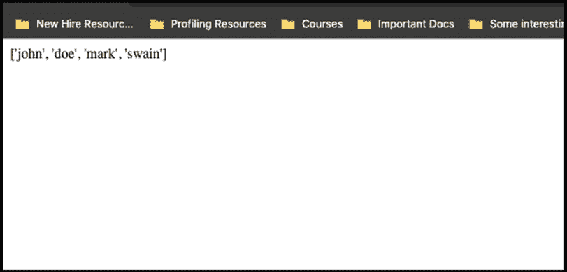
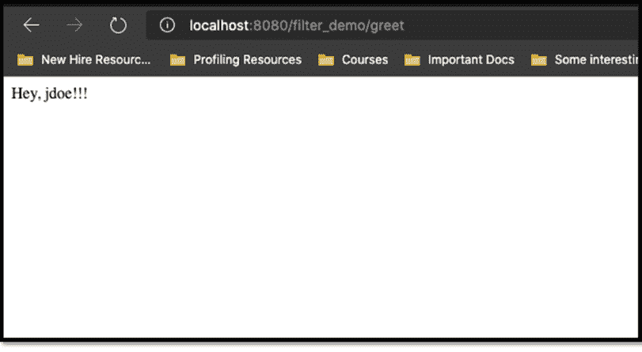
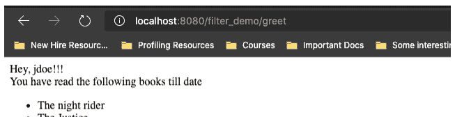
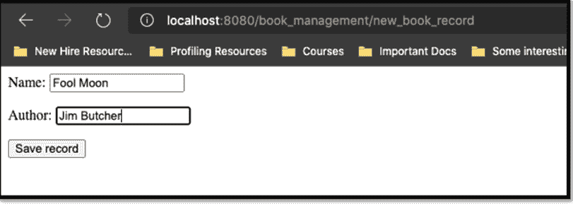
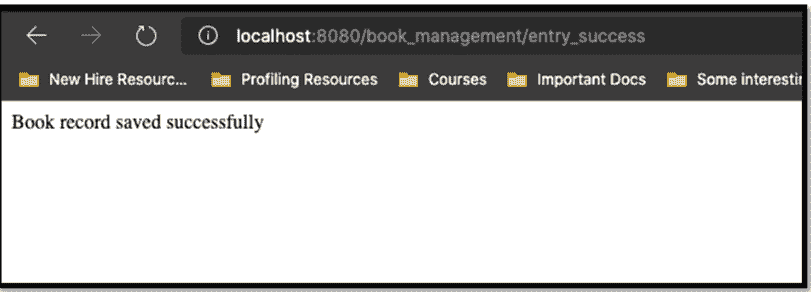
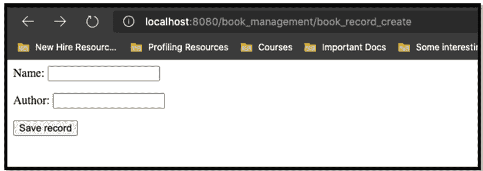
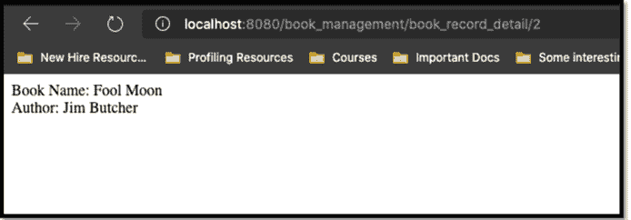
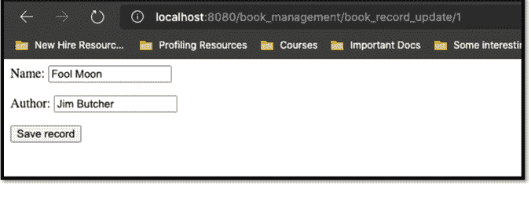
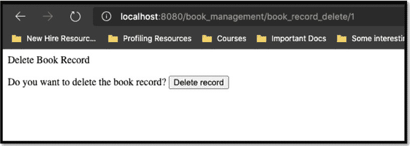
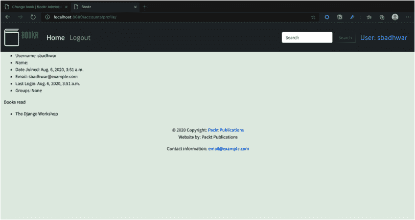

# Advanced Templating and Class-Based Views

在第 3 章 URL Mapping, Views, and Templates 中，我们学习了如何在 Django 中构建视图并创建模板。然后，我们学习了如何使用这些视图来渲染我们构建的模板。在本章中，我们将在使用类视图的基础上发展我们开发视图的知识，允许我们将逻辑方法分组到一个单一实体中。当开发一个映射到同一应用程序编程接口 API 端点的多个 HTTP 请求方法的视图时，此技能非常有用。使用基于方法的视图，我们可能最终会使用大量 if-else 条件来成功处理不同类型的 HTTP 请求方法。相比之下，类视图允许我们为我们想要处理的每个 HTTP 请求方法定义单独的方法。然后，根据收到的请求类型，Django 会负责调用类视图中的正确方法。

除了能够基于不同的开发技术构建视图之外，Django 还配备了强大的模板引擎。该引擎允许开发人员为其 Web 应用程序构建可重用的模板。这种模板引擎的可重用性通过使用模板标签和过滤器进一步增强，这些标签和过滤器有助于在模板内部轻松实现常用功能，例如迭代数据列表、以给定样式格式化数据、从变量中提取一段文本以显示，以及覆盖模板中特定块的内容。所有这些功能也扩展了 Django 模板的可重用性。

在本章中，我们将研究如何通过利用 Django 定义我们自己的自定义模板标签和过滤器的能力来扩展 Django 提供的默认模板过滤器和模板标签集。然后，这些自定义模板标签和过滤器可以以可重用的方式在我们的 Web 应用程序中使用来实现一些常见功能。例如，在构建可在 Web 应用程序内部多个位置显示的用户配置文件徽章时，最好利用编写自定义模板包含标签的能力，该标签只需在我们希望的任何视图中插入徽章的模板，而不是重写整个徽章模板的代码或向模板引入额外的复杂性。

在本章中，我们将涵盖以下主题：

- Template filters
- Custom template filters
- String filters
- Template tags
- Django views

# Technical requirements

本章的完整代码文件可以在 https://github.com/PacktPublishing/Web-Development-with-Django-Second-Edition/tree/main/Chapter11 找到

## Template filters

在开发模板时，开发人员通常只想在将其渲染给用户之前更改模板变量的值。例如，假设我们正在为 Bookr 用户构建一个个人资料页面。在那里，我们想显示用户已阅读的书籍数量。在其下方，我们还想显示他们已阅读的书籍列表表。

为了实现这一点，我们可以从视图向 HTML 模板传递两个单独的变量。一个可以命名为 `books_read`，表示用户阅读的书籍数量。另一个可以是 `book_list`，包含用户阅读的书籍名称列表，例如：

```
```html
<span class="books_read">You have read {{ books_read }}
    books</span>
<ul>
    
        <li>{{ book }}</li>
    
</ul>
```
```

Django 中的 **Template filters** 是简单的基于 Python 的函数，它们接受一个变量作为参数（以及变量上下文中的任何额外数据），根据我们的要求更改其值，然后渲染更改后的值。

现在，通过使用 Django 中的模板过滤器，可以通过以下方式获得与编写前一段代码相同的结果，而无需使用两个单独的变量：

```
```html
<span class="books_read">You have read
    {{ book_list|length }}</span>
<ul>
    
```


```
<li>{{ book }}</li>

</ul>
```

这里，我们使用了 Django 提供的内置 length 过滤器。使用该过滤器会导致对 `book_list` 变量的长度进行求值并返回结果，然后在渲染期间将其插入到我们的 HTML 模板中。

与 length 类似，还有很多其他模板过滤器随 Django 一起预打包并且可供使用。例如，lowercase 过滤器会将文本转换为全小写格式，last 过滤器可用于返回列表中的最后一项，而 json_script 过滤器可用于将传递给模板的 Python 对象作为 JSON 值输出，并在模板中用 `<script>` 标签包裹。

> **重要说明**
> 你可以参考 Django 的官方文档以获取 Django 提供的完整模板过滤器列表，网址为 https://docs.djangoproject.com/en/3.1/ref/templates/builtins/。

现在，在了解了如何使用模板过滤器之后，让我们深入了解如何编写自己的自定义过滤器。

## 自定义模板过滤器

Django 提供了许多有用的过滤器，我们在项目开发过程中可以在模板中使用它们。但如果有人想格式化特定文本并使用不同的字体进行渲染呢？或者说，有人想根据后端中错误代码的映射将错误代码翻译成对用户友好的错误信息。在这些情况下，预定义的过滤器是不够的，我们希望编写一个可以在项目中重复使用的自定义过滤器。

幸运的是，Django 提供了易于使用的 API，我们可以用它来编写自定义过滤器。该 API 为开发人员提供了一些有用的装饰器函数，可用于快速将 Python 函数注册为自定义模板过滤器。一旦 Python 函数被注册为自定义过滤器，开发人员就可以开始在模板中使用该函数。

需要一个模板库方法的实例来访问过滤器。该实例可以通过从 Django 的模板模块实例化 `Library()` 类来创建，如下所示：

```
from django import template
register = template.Library()
```

实例创建后，我们现在可以使用模板库实例中的 filter 装饰器来注册我们的过滤器。

## 创建自定义模板过滤器

创建自定义模板过滤器需要执行几个步骤。让我们尝试了解这些步骤是什么，以及它们如何帮助我们创建自定义模板过滤器，下一个小节将对此进行说明。

### 设置用于存储模板过滤器的目录

需要注意的是，在创建自定义模板过滤器或模板标签时，我们需要将它们放在应用程序目录下的 `templatetags` 目录中。之所以有此要求，是因为 Django 在内部配置为在加载 Web 应用程序时查找自定义模板标签和过滤器。如果目录名称不是 `templatetags`，Django 将不会加载我们创建的自定义模板过滤器和标签。

要创建此目录，首先导航到你想要创建自定义模板过滤器的应用程序文件夹，然后在终端中运行以下命令：

```
mkdir templatetags
```

目录创建后，下一步是在 `templatetags` 目录内创建一个新文件来存储自定义过滤器的代码。这可以通过在 `templatetags` 目录内执行以下命令来完成：

```
touch custom_filter.py
```

> **重要说明**
> 上述命令在 Windows 上不起作用。你可以通过 Windows 资源管理器导航到所需目录并创建新文件。

或者，可以通过 PyCharm 提供的 GUI 界面完成此操作。

### 设置模板库

一旦用于存储自定义过滤器代码的文件创建完成，我们就可以开始着手实现自定义过滤器代码了。为了使自定义过滤器在 Django 中工作，它们需要在模板中使用之前先注册到 Django 的模板库。为此，第一步是设置模板库的一个实例，该实例将用于注册我们的自定义过滤器。为此，在上一节中创建的 `custom_filters.py` 文件内，我们首先需要从 Django 项目导入模板模块：

```
from django import template
```

导入解决后，下一步是创建模板库的实例，添加以下代码行：

```python
register = template.Library()
```

Django 模板模块中的 `Library` 类被实现为一个 **singleton** 类，它返回在应用程序启动时仅初始化一次的相同对象。

模板库实例设置完成后，我们可以继续实现自定义过滤器。

### 实现自定义过滤器函数

Django 中的自定义过滤器不过是简单的 Python 函数，本质上接受以下参数：

- 应用过滤器的值（必需）
- 需要传递给过滤器的任何附加参数（零个或多个）（可选）

这些函数需要用 Django 模板库实例中的 `filter` 属性进行装饰，才能作为模板过滤器发挥作用。例如，自定义过滤器的通用实现如下所示：

```python
@register.filter
def my_filter(value, arg):
    # Implementation logic of the filter
```

至此，我们已经了解了如何实现可在模板中使用的自定义过滤器。在下一节中，我们将学习如何使用这些自定义过滤器。

### 在模板中使用自定义过滤器

过滤器创建后，使用它在模板中非常简单。为此，过滤器必须首先导入到模板中。这可以通过在模板文件顶部添加以下行轻松完成：

```django

```

当 Django 的模板引擎解析模板文件时，前一行会自动由 Django 解析，以找到 `templatetags` 目录下指定的正确模块。因此，`custom_filter` 模块中提到的所有过滤器都会自动在模板中可用。

在模板中使用我们的自定义过滤器与添加以下行一样简单：

```django
{{ some_value|generic_filter:"arg" }}
```

掌握了这些知识后，让我们现在创建我们的第一个自定义过滤器。

## 练习 11.01 – 创建自定义模板过滤器

在本练习中，我们将编写一个名为 `explode` 的自定义过滤器，当提供一个字符串和用户提供的分隔符时，它会返回一个字符串列表。例如，考虑以下字符串：

```text
names = "john,doe,mark,swain"
```

你将对该字符串应用以下过滤器：

```django
{{ names|explode:"," }}
```

应用此过滤器后的输出应如下所示：

```text
["john", "doe", "mark", "swain"]
```

让我们开始执行以下步骤：

- 1. 在 `bookr` 项目内创建一个新的应用程序，可用于演示目的：
  
      ```bash
      python manage.py startapp filter_demo
      ```
  
      上述命令将在你的 Django 项目中设置一个新的应用程序。
  
- 2. 现在，在你的 `filter_demo` 应用程序目录内创建一个名为 `templatetags` 的新目录，以存储自定义模板过滤器的代码。要创建目录，请从终端应用程序或命令提示符中的 `filter_demo` 目录内运行以下命令：
  
      ```bash
      mkdir templatetags
      ```
  
- 3. 目录创建后，在 `templatetags` 目录内创建一个名为 `explode_filter.py` 的新文件。
  
- 4. 打开文件并添加以下行：
  
      ```python
      from django import template

      register = template.Library()
      ```
  
      上述代码创建了一个 Django 库的实例，可用于将我们的自定义过滤器与 Django 注册。


5. 添加以下代码来实现 explode 过滤器：

```
@register.filter
def explode(value, separator):
    return value.split(separator)
```

explode 过滤器接收两个参数；一个是使用该过滤器的 value，另一个是 separator，从模板传递给过滤器。过滤器将使用此分隔符将字符串转换为列表。

6. 自定义过滤器准备好后，创建一个可在此过滤器上应用的模板。为此，首先在 filter_demo 目录下创建一个名为 templates 的新文件夹，然后在其中创建一个名为 index.html 的新文件，其内容如下：

```
<html>
<head>
<title>Custom Filter Example</title>
<body>


{{ names|explode:"," }}
</body>
</html>
```

在第一行，Django 的模板引擎从 explode_filter 模块加载自定义过滤器，以便在模板内部使用。为此，Django 将在 templatetags 目录下查找 explode_filter 模块，如果找到，则会加载它以供使用。

在下一行，你将传递给模板的 names 变量传递过去并对其应用 explode 过滤器，同时将 , 符号作为分隔符值传递给过滤器。

7. 现在模板已创建，接下来要创建的是一[content]

5. 添加以下代码来实现 explode 过滤器：

```
@register.filter
def explode(value, separator):
    return value.split(separator)
```

explode 过滤器接收两个参数；一个是使用该过滤器的 value，另一个是 separator，从模板传递给过滤器。过滤器将使用此分隔符将字符串转换为列表。

6. 自定义过滤器准备好后，创建一个可在此过滤器上应用的模板。为此，首先在 filter_demo 目录下创建一个名为 templates 的新文件夹，然后在其中创建一个名为 index.html 的新文件，其内容如下：

```
<html>
<head>
<title>Custom Filter Example</title>
<body>


{{ names|explode:"," }}
</body>
</html>
```

在第一行，Django 的模板引擎从 explode_filter 模块加载自定义过滤器，以便在模板内部使用。为此，Django 将在 templatetags 目录下查找 explode_filter 模块，如果找到，则会加载它以供使用。

在下一行，你将传递给模板的 names 变量传递过去并对其应用 explode 过滤器，同时将 , 符号作为分隔符值传递给过滤器。

7. 现在模板已创建，接下来要创建的是一个可以渲染此模板并将 name 变量传递给模板的 Django 视图。为此，打开 views.py 文件并添加以下高亮代码：

```
from django.shortcuts import render

def index(request):
    names = "john,doe,mark,swain"
    return render(request, "index.html", {'names':
        names})
```

前面的代码片段执行了一些基本操作。它首先从 django.shortcuts 模块导入 render 辅助函数，该函数有助于渲染模板。导入完成后，它定义了一个名为 index() 的新视图函数，该函数渲染 index.html。

8. 现在将视图映射到 URL，以便随后可以在浏览器中渲染结果。为此，在 filter_demo 目录内创建一个名为 urls.py 的新文件并添加以下代码：

```
from django.urls import path

from . import views

urlpatterns = [
    path('', views.index, name='index')
]
```

9. 将 filter_demo 应用程序添加到项目 URL 映射中。为此，打开 bookr 项目目录中的 urls.py 并在 urlpatterns 内部添加以下高亮行：

```
urlpatterns = [
    path('filter_demo/', include('filter_demo.urls')),
    ...
]
```

进行更改后，bookr 项目目录下的 urls.py 文件应类似于 https://github.com/PacktPublishing/Web-Development-with-Django-Second-Edition/tree/main/Chapter11/Exercise11.01/bookr/urls.py 下所示的文件。

10. 最后，在 bookr 项目的 settings.py 的 INSTALLED_APPS 部分下添加该应用程序：

```
INSTALLED_APPS = [
    ...,
    'filter_demo'
]
```

此要求源于 Django 实施的安全指南，该指南要求实现自定义过滤器/标签的应用程序需要添加到 INSTALLED_APPS 部分。进行更改后，settings.py 文件应类似于 https://github.com/PacktPublishing/Web-Development-with-Django-Second-Edition/tree/main/Chapter11/Exercise11.01/bookr/settings.py 下的文件。

11. 要查看自定义过滤器是否有效，运行以下命令：

```
python manage.py runserver localhost:8000
```

现在，导航到浏览器中的以下页面：http://localhost:8000/filter_demo。

12. 此页面应如图 11.1 所示：



图 11.1 – 使用 explode 过滤器显示的索引页面

至此，我们看到了如何在 Django 中快速创建一个自定义过滤器，然后在模板中使用它。在下一节中，让我们看一下另一种类型的过滤器，即字符串过滤器，它仅对字符串类型的值起作用。

## 字符串过滤器

在练习 11.01 创建自定义模板过滤器 中，我们构建了一个自定义过滤器，它允许我们使用分隔符拆分提供的字符串并从中生成列表。此过滤器可以接受任何类型的变量并根据提供的分隔符将其拆分为值列表。但如果我们希望限制过滤器仅对字符串有效，而不对其他类型的值，例如整数有效，该怎么办？

我们可以使用 Django 模板库提供的 stringfilter 装饰器来开发仅对字符串起作用的过滤器。当使用 stringfilter 装饰器将 Python 方法注册为 Django 中的过滤器时，框架会确保在过滤器执行之前将传递给过滤器的值转换为字符串。这减少了当非字符串值传递给我们的过滤器时可能出现的问题。

实现 **字符串过滤器** 的步骤与我们为构建自定义过滤器所遵循的步骤类似，只是有些细微的改动。

还记得我们在 *设置存储模板过滤器的目录* 部分中创建的 `custom_filter.py` 文件吗？让我们现在在其中添加一个新的 Python 函数，它将充当我们的字符串过滤器。

在我们实现字符串过滤器之前，我们首先需要导入 `stringfilter` 装饰器，该装饰器将自定义过滤器函数标记为字符串过滤器。你可以通过在 `custom_filters.py` 文件中添加以下导入语句来添加此装饰器：

```
from django.template.defaultfilters import stringfilter
```

现在，要实现我们的自定义字符串过滤器，可以使用以下语法：

```
```python
@register.filter
@stringfilter
def generic_string_filter(value, arg):
    # Logic for string filter implementation
```
```

通过这种方法，我们可以构建任意数量的字符串过滤器，并像使用任何其他过滤器一样使用它们。

## 模板标签

模板标签是 Django 模板引擎的一个强大功能。它们允许开发人员通过评估某些条件来生成 HTML，从而构建强大的模板，并避免重复编写常见代码。

一个可能使用模板标签的示例是网站导航栏中的注册/登录选项。在这种情况下，我们可以使用模板标签来评估当前页面上的访问者是否已登录。基于此，我们可以渲染个人资料横幅或注册/登录横幅。

在开发模板时，标签也很常见。例如，考虑以下我们上节在模板中导入自定义过滤器时使用的代码行：

```

```

这使用了一个名为 `load` 的模板标签，负责将 `explode` 过滤器加载到模板中。与过滤器相比，模板标签功能更强大。虽然过滤器只能访问其操作的值，但模板标签可以访问整个模板的上下文，因此它们可用于在模板内部构建大量复杂功能。

让我们现在来看一下 Django 支持的不同类型的模板标签以及如何构建我们自己的自定义模板标签。

## 模板标签的类型

Django 主要支持两种类型的模板标签：

- **简单标签**：这些标签对提供的变量数据（以及传递给它们的任何附加变量）进行操作，并在调用它们的同一模板中渲染。例如，一个这样的用例可以包括根据用户的用户名向用户渲染自定义欢迎消息，或根据用户名显示用户的最后登录时间。
- **包含标签**：这些标签接收提供的变量数据并通过渲染另一个模板来生成输出。例如，标签可以接收对象列表并对其进行迭代以生成 HTML 列表。

在下一节中，我们将了解如何创建这些不同类型的标签并在我们的应用程序中使用它们。

## 简单标签

简单标签为开发人员提供了一种构建模板标签的方式，该标签接收模板中的一个或多个变量，对其进行处理并返回响应。从模板标签返回的响应会替换 HTML 模板中提供的模板标签定义。这些类型的标签可用于构建多种有用的功能，例如日期解析或显示我们想要向用户展示的任何活动警报。

简单标签可以使用模板库提供的 `simple_tag` 装饰器轻松创建，通过装饰应充当模板标签的 Python 方法。现在，让我们看看如何使用 Django 的模板库实现自定义简单标签。

## 创建简单模板标签

创建简单模板标签遵循我们在 *自定义模板过滤器* 部分中讨论的约定，只是有些细微差别。首先，让我们回顾一下如何为在 Django 模板中使用创建模板标签。

## 设置目录

就像自定义过滤器一样，自定义模板标签也需要创建在同一个 `templatetags` 目录内，以便 Django 的模板引擎可以发现它们。该目录可以使用 PyCharm GUI 直接创建，也可以通过在我们想要创建自定义标签的应用程序目录内运行以下命令来创建：

```
mkdir templatetags
```


完成此操作后，我们现在可以使用以下命令创建一个新文件来存储自定义模板标签的代码：

```
touch custom_tags.py
```

> **重要提示**
> 
> 上述命令在 Windows 上无法使用。 但是，您可以使用 Windows 资源管理器创建一个新文件。

## 设置模板库

设置好目录结构并为存储自定义模板标签代码的文件做好准备后，我们现在可以开始创建模板标签。 但在此之前，我们需要像之前一样设置 Django 模板库的实例。 这可以通过向我们的 custom_tag.py 文件添加以下代码行来完成：

```
from django import template
register = template.Library()
```

与自定义过滤器一样，这里使用的模板库实例用于在 Django 模板中注册自定义模板标签以供使用。

## 实现一个简单的模板标签

Django 中的简单模板标签是可以接受我们想要的任意数量参数的 Python 函数。 这些 Python 函数需要用模板库中的 simple_tag 装饰器进行装饰，以将这些函数注册为简单模板标签。 以下代码片段展示了简单模板标签是如何实现的：

```
@register.simple_tag
def generic_simple_tag(arg1, arg2):
    # Logic to implement a generic simple tag
```

接下来，让我们将这些简单标签用于模板中。

## 在模板中使用简单标签

在 Django 模板中使用简单标签非常容易。 在模板文件中，我们首先需要确保标签已在模板中导入，通过将以下内容添加到模板文件的顶部：

```

```

前面的语句将从我们之前定义的 `custom_tag.py` 文件加载所有标签，并使它们在模板中可用。 然后我们可以通过添加以下命令来使用我们的自定义简单标签：

```
```django

```
```

不是很容易吗？！ 现在，让我们将这些知识付诸实践并创建我们的第一个自定义简单标签。

## 练习 11.02 – 创建一个自定义简单标签

在本练习中，我们将创建一个简单标签，它将接受两个参数：第一个是问候信息，第二个是用户的姓名。 该标签将打印格式化的问候信息。 让我们开始步骤：

- 1. 延续 *练习 11.01* 中显示的示例，让我们重用相同的目录结构来存储简单标签的代码。 因此，首先在 `filter_demo` 目录下创建一个名为 `simple_tag.py` 的新文件。 在此文件中，添加以下代码：

```
```python
from django import template

register = template.Library()

@register.simple_tag
def greet_user(message, username):
    return "{greeting_message}, {user}!!!"
        .format(greeting_message=message, user=username)
```
```

在这种情况下，您创建一个新的 Python 方法 `greet_user()`，它接受两个参数，`message`，用于问候的消息，以及 `username`，应被问候的用户的姓名。 然后该方法用 `@register.simple_tag` 装饰，表示该方法是一个简单标签，可以用作模板中的模板标签。

- 2. 现在，创建一个将使用您的简单标签的新模板。 为此，在 `filter_demo/templates` 目录下创建一个名为 `simple_tag_template.html` 的新文件，并向其中添加以下代码：

```
```html
<html>
<head>
    <title>Simple Tag Template Example</title>
</head>
<body>


</body>
</html>
```
```

在浏览器中访问 http://localhost:8000/filter_demo/greet 后，您应该会看到以下页面：



图 11.2 – 使用自定义简单标签生成的问候信息

通过此操作，我们创建了第一个自定义模板标签，并成功地使用它来渲染模板，如图 11.2 所示。 现在，让我们看看简单标签的另一个重要方面，即将模板中可用的上下文变量传递给模板标签。

## 在自定义模板标签中传递模板上下文

在之前的练习中，我们创建了一个简单标签，我们向其传递了两个参数，问候信息和用户名。 但是如果我们想向标签传递大量变量呢？ 或者简单地说，如果我们不想显式地将用户的用户名传递给标签怎么办？

有时开发人员希望模板中存在的所有变量和数据都能在自定义标签内部使用。 幸运的是，对我们来说，实现起来很容易。

使用我们之前 `greet_user` 标签的示例，让我们创建一个名为 contextual_greet_user 的新标签，看看我们如何将模板中可用的数据直接传递给标签，而不是手动将其作为参数传递。

我们需要做的第一个修改是将我们的装饰器修改为如下所示：

```
@register.simple_tag(takes_context=True)
```

通过此操作，我们告诉 Django，当使用我们的 contextual_greet_user 标签时，Django 还应将模板上下文传递给它，该上下文包含从视图传递到模板的所有数据。 完成此添加后，我们需要做的下一件事是更改我们的 contextual_greet_user 实现以接受作为参数添加的上下文。 以下代码显示了使用模板上下文来渲染问候信息的 contextual_greet_user 标签的修改形式：

```
@register.simple_tag(takes_context=True)
def contextual_greet_user(context, message):
    username = context['username']
    return "{greeting_message}, {user}"
        .format(greeting_message=message, user=username)
```

在前面的代码示例中，我们可以看到 contextual_greet_user() 方法是如何被修改为接受作为第一个参数传递的上下文，然后是用户传递的问候信息。

为了利用此修改后的模板标签，我们需要做的就是将 simple_tag_template.html 下 filter_demo 中对 contextual_greet_user 标签的调用更改为如下所示：

```

```

然后，当我们重新加载 Django Web 应用程序时，http://localhost:8000/filter_demo/greet 处的输出应与练习 11.02 – 创建自定义简单标签的步骤 5 中显示的内容相同。

通过此操作，我们学习了如何构建简单标签并处理将模板上下文传递给标签。 现在，让我们看看如何构建一个包含标签，该标签可用于以另一个模板描述的格式呈现数据。

## 包含标签

简单标签允许我们构建接受一个或多个输入变量、对它们进行一些处理并返回输出的标签。 然后此输出将插入简单标签使用的位置。

但是如果我们想构建标签，而不是返回文本输出，而是返回 HTML 模板，该模板可用于呈现页面的各个部分怎么办？ 例如，许多 Web 应用程序允许用户向其个人资料添加自定义小部件。 这些单独的小部件可以构建为包含标签并独立呈现。 这种方法使基本页面模板和单独模板的代码保持分离，从而便于重用和重构。

开发自定义包含标签的过程与开发简单标签的过程类似。 这涉及使用模板库提供的 inclusion_tag 装饰器。 因此，让我们看看我们是如何做到的。

## 练习 11.03 – 构建自定义包含标签

在本练习中，我们将构建一个自定义包含标签，它将呈现用户阅读的书籍列表：

- 1. 对于本练习，您将继续使用与早期练习中相同的演示文件夹。 首先，在 filter_demo/templates 目录下创建一个名为 inclusion_tag.py 的新文件，并在其中写入以下代码：

```
from django import template

register = template.Library()

@register.inclusion_tag('book_list.html')
def book_list(books):
    book_list = [book_name for book_name, book_author
                 in books.items()]
    return {'book_list': book_list}
```

@register.inclusion_tag 装饰器用于将方法标记为自定义包含标签。 此装饰器采用应用于呈现标签函数返回的数据的模板的名称作为参数。

在装饰器之后，我们定义了一个函数来实现自定义包含标签的逻辑。 此函数接受一个名为 books 的单个参数。 此参数将从模板文件传递，并包含读者阅读的书籍列表（以 Python 字典的形式）。 在定义中，我们将字典转换为 Python 书名列表。 字典中的键映射到书名，值映射到作者：

```
books_list = [book_name for book_name, book_author in books.items()]
```

形成列表后，以下代码将列表作为上下文返回给传递给包含标签的模板（在本例中为 book_list.html）：

```
return {'book_list': books_list}
```

此方法返回的值将由 Django 传递给 book_list.html 模板，然后内容将被呈现。

- 2. 接下来，创建实际的模板，该模板将包含模板标签的呈现结构。 为此，在 filter_demo/templates 目录下创建一个新的模板文件 book_list.html，并向其中添加以下内容：

```
<ul>
    
    <li>{{ book }}</li>
    
</ul>
```


在这里，在新的模板文件中，我们创建了一个无序列表，用于存放用户已读的书籍列表。接下来，使用 for 模板标签，我们遍历由自定义模板函数提供的 book_list 中的值：

```

```

此迭代会根据以下内容创建多个列表项：

```
<li>{{ book }}</li>
```

列表项会使用来自 book_list 的内容生成并传递给模板。for 标签执行的次数与 book_list 中存在的项目数量相同。

3. 在为 book_list 标签定义了模板后，修改现有的问候模板以使其在模板内部可用，并使用它来显示用户已读的书籍列表。为此，修改 filter_demo/templates 目录下的 simple_tag_template.html 文件，并将代码更改如下：

```
<html>
<head>
<title>Simple Tag Template Example</title>
</head>
<body>


<br />
<span class="message">You have read the following
books till date</span>

</body>
</html>
```

在此片段中，你做的第一件事是通过编写以下内容加载 inclusion_tag 模块：

```

```

加载标签后，你现在可以在模板中的任何位置使用它。为此，你以以下格式添加了 book_list 标签：

```

```

此标签接受一个参数，即书籍的字典，其中键为书名，键的值为该书的作者。

4. 在模板修改完成后，最后一步涉及将所需数据传递给模板。为此，修改 filter_demo 目录中的 views.py 并将 greeting 视图函数更改如下：

```
def greeting_view(request):
    books = {
"The night rider": "Ben Author",
"The Justice": "Don Abeman"
}
return render(request, 'simple_tag_template.html',
{'username': 'jdoe', 'books': books})
```

在这里，我们修改了 greeting_view 函数以添加书籍及其作者的字典，然后将其传递给 simple_tag_template 上下文。

完成更改后，文件应类似于托管在 https://github.com/PacktPublishing/Web-Development-with-Django-Second-Edition/tree/main/Chapter11/Exercise11.03 的文件。

5. 在实施了上述更改后，现在是时候渲染修改后的模板了。为此，通过运行以下命令重新启动 Django 应用程序服务器：

```
python manage.py runserver localhost:8080
```

6. 导航到 http://localhost:8080/greet，它现在应渲染一个类似于以下屏幕截图的页面：



图 11.3 – 用户访问问候端点时已读书籍列表

该页面显示了用户访问问候端点时已读的书籍列表。你在页面上看到的列表是使用 inclusion 标签渲染的。用于列出这些书籍的模板是先单独创建的，然后使用 inclusion 标签将其添加到页面中。

至此，我们现在拥有了可以构建高度复杂的模板过滤器或自定义标签的基础，这些标签在我们想要从事的项目开发中会很有帮助。

## 现在，让我们来看看 Django 视图，并深入到 Django 提供的基于类的视图这一新领域，以帮助我们利用面向对象编程的力量，从而实现视图渲染的代码重用。

# Django views

回顾一下，Django 中的视图是一段 Python 代码，它允许接收请求，基于请求执行操作，然后向用户返回响应，从而构成了我们 Django 应用程序的重要组成部分。

在 Django 内部，我们有两种不同的构建视图的方法，其中一种我们在前面的示例中已经看到过，称为基于函数的视图，而另一种我们即将介绍的称为基于类的视图：

- **基于函数的视图 (FBVs)**：Django 中的 FBVs 只不过是普通的 Python 函数，它们应该以 `HTTPRequest` 类型对象作为第一个位置参数，并返回对应于视图在请求被处理后想要执行的操作的 `HTTPResponse` 类型对象。在前面的练习中，`index()` 和 `greeting_view()` 就是 FBVs 的示例。
- **基于类的视图 (CBVs)**：CBVs 是严格遵循 Python 面向对象原则的视图，允许将视图调用映射为基于类的表示。这些视图具有专门的性质，给定类型的 CBV 执行特定操作。CBV 提供的优势包括视图易于扩展和代码重用，这在 FBVs 中可能是一项复杂的任务。

现在，基本定义已经明确，并且我们已经掌握了 FBVs 的知识，让我们来看看 CBVs，看看它们为我们准备了什么。

# Class-based views

Django 提供了开发人员为其应用程序编写视图的不同方式。一种方式是将 Python 函数映射为视图函数以创建 FBVs。创建视图的另一种方式是使用 Python 对象实例（基于 Python 类）。这些被称为 CBVs。出现的一个重要问题是，当我们已经可以使用 FBV 方法创建视图时，为什么还需要 CBV？

在创建 FBVs 时，想法是，有时我们可能会一遍又一遍地复制相同的逻辑，例如处理某些字段或处理某些请求类型的逻辑。虽然完全可以创建在逻辑上分离的函数来处理特定逻辑，但随着应用程序复杂性的增加，管理任务变得困难。

这就是 CBVs 派上用场的地方，因为它们抽象掉了我们需要编写的常见重复代码的实现，以处理某些任务，例如模板的渲染，同时还通过使用继承和混入使代码片段易于重用。例如，以下代码片段显示了 CBV 的实现：

```
```python
from django.http import HttpResponse
from django.views import View

class IndexView(View):

    def get(self, request):
        return HttpResponse("Hey there!")
```
```

在前面的示例中，我们通过继承 Django 提供的内置视图类构建了一个简单的 CBV。

使用这些 CBVs 也非常容易。例如，假设我们想将 `IndexView` 映射到应用程序中的 URL 端点。在这种情况下，我们只需在应用程序的 `urls.py` 文件中的 `urlpatterns` 列表中添加以下行即可：

```
```python
urlpatterns = [
    path('my_path', IndexView.as_view(), name='index_view')
]
```
```

在这里，正如我们所观察到的，我们使用了我们创建的 CBV 的 `as_view()` 方法。每个 CBV 都实现了 `as_view()` 方法，该方法允许视图类通过从视图类返回视图控制器的实例来映射到 URL 端点。

Django 提供了一些内置的 CBV，它们提供了大量常见任务的实现，例如如何渲染模板或如何处理特定请求。内置的 CBV 有助于避免在处理基本功能时从头开始重写代码，从而实现代码的重用。其中一些内置视图包括以下内容：

- **View**：这是 Django 中所有 CBV 的基类，允许使用所有提供的功能编写自定义 CBV，并且可以覆盖。用户可以为不同的 HTTP 请求方法实现自己的定义，例如 GET、POST、PUT 和 DELETE，并且视图将根据收到的请求类型自动将调用委托给负责处理请求的方法。
- **TemplateView**：这是一个可用于根据调用 URL 中提供的模板数据参数渲染模板的视图。这使开发人员能够轻松渲染模板，而无需编写与渲染处理相关的任何逻辑。
- **RedirectView**：这是一个视图，可以根据用户发出的请求自动将用户重定向到正确的资源。


`DetailView`：这是一个映射到 Django 模型的视图，可用于使用所选模板渲染从模型获取的数据。

前面的视图只是 Django 默认提供的内置视图中的一些，我们将在本章的后续内容中介绍更多视图。

现在，为了更好地理解 CBV 在 Django 内部的工作原理，让我们尝试构建我们的第一个 CBV。

## 练习 11.04 – 使用 CBV 创建图书目录

在本练习中，我们将创建一个基于类的表单视图，该视图将帮助构建图书目录。此目录将包含图书名称和图书作者的名称：

- 1. 首先，在我们的 `book` 项目中创建一个新的应用程序并将其命名为 `book_management`。这可以通过简单地运行以下命令来完成：

```bash
python manage.py startapp book_management
```

- 2. 现在，在构建图书目录之前，您首先需要定义一个 Django 模型来帮助您将记录存储在数据库中。为此，打开刚刚创建的 `book_management` 应用下的 `models.py` 文件并定义一个名为 Book 的新模型，如下所示：

```python
from django.db import models

class Book(models.Model):
    name = models.CharField(max_length=255)
    author = models.CharField(max_length=50)
```

该模型包含两个字段，图书名称和作者名称。

- 3. 在模型就位后，将模型迁移到数据库，以便您可以开始在数据库中存储数据。

- 4. 一旦完成上述所有步骤，将您的 `book_management` 应用程序添加到 `INSTALLED_APPS` 列表中，以便 Django 可以发现它并且您可以正确使用您的模型。为此，打开 `book` 目录下的 `settings.py` 文件并在 `INSTALLED_APPS` 部分的最后位置添加以下代码：

```python
INSTALLED_APPS = [
    ...,
    'book_management'
]
```

- 5. 更改完成后，`settings.py` 文件应如下所示：https://github.com/PacktPublishing/Web-Development-with-Django-Second-Edition/tree/main/Chapter11/Exercise11.04/book/settings.py。

- 6. 通过运行以下两个命令将您的模型迁移到数据库。这些命令将首先创建 Django 迁移文件，然后在数据库中创建表：

```python
python manage.py makemigrations
python manage.py migrate
```

- 7. 现在，数据库模型已就位，让我们创建一个新表单，我们将使用它来捕获有关图书的信息，例如图书标题、作者和 ISBN。为此，在 `book_management` 目录下创建一个名为 `forms.py` 的新文件并在其中添加以下代码：

```python
from django import forms

from .models import Book
class BookForm(forms.ModelForm):
    class Meta:
        model = Book
        fields = ['name', 'author']
```

在前面的代码片段中，我们首先导入了 Django 的 `forms` 模块，这将使我们能够轻松创建表单并提供表单的渲染功能。下一行导入将存储表单数据的模型：

```python
from django import forms
from .models import Book
```

在下一行，我们创建了一个名为 BookForm 的新类，它继承自 ModelForm。这只是一个将模型字段映射到表单的类。为了成功实现模型和表单之间的映射，我们在 BookForm 类下定义了一个名为 Meta 的新子类，并将属性 model 设置为指向 Book 模型，并将属性 fields 设置为您希望在表单中显示的字段列表：

```python
class Meta:
    model = Book
    fields = ['name', 'author']
```

这允许 ModelForm 在需要时渲染正确的 HTML 表单。ModelForm 类提供了一个内置的 `Form.save()` 方法，当使用时，它会将表单中的数据写入数据库并有助于避免编写冗余代码。

- 8. 现在您已经准备好模型和表单，请继续实现一个视图来渲染表单并接受用户的输入。为此，打开 `book_management` 目录下的 `views.py` 并向文件中添加以下代码行：

```python
from django.http import HttpResponse
from django.views.generic.edit import FormView
from django.views import View
```

```python
from .forms import BookForm

class BookRecordFormView(FormView):
    template_name = 'book_form.html'
    form_class = BookForm
    success_url = '/book_management/entry_success'

    def form_valid(self, form):
        form.save()
        return super(BookRecordFormView).form_valid(form)

class FormSuccessView(View):
    def get(self, request, *args, **kwargs):
        return HttpResponse("Book record saved successfully")
```

在前面的代码片段中，我们创建了两个主要视图，BookRecordFormView，它负责渲染图书目录条目表单，以及 FormSuccessView，如果表单数据成功保存，您将使用它来渲染成功消息。让我们现在分别查看这两个视图并了解我们正在做什么。

首先，我们创建了一个名为 BookRecordFormView CBV 的新视图，它继承自 FormView：

```
class BookRecordFormView(FormView)
```

FormView 类允许我们轻松创建处理表单的视图。对于此类，我们需要提供某些参数，例如它将渲染以显示表单的模板名称、它应用于渲染表单的表单类以及表单成功处理时重定向到的成功 URL：

```
template_name = 'book_form.html'
form_class = BookForm
success_url = '/book_management/entry_success'
```

FormView 类还提供了一个 form_valid() 方法，当表单成功完成验证时调用。在 form_valid() 方法内部，我们可以决定想要做什么。对于我们的用例，当表单验证成功完成时，我们首先调用 form.save() 方法，该方法将表单的数据持久化到数据库中，然后调用基类 form_valid() 方法，这将导致表单视图在表单验证成功的情况下重定向到成功的 URL：

```
def form_valid(self, form):
    form.save()
    return super().form_valid(form)
```

10. CBV 构建完成后，请继续将它们映射到 URL，以便您可以开始使用它们添加新的图书记录。为此，在 book_management 目录下创建一个名为 urls.py 的新文件并添加以下代码：

```python
from django.urls import path

from .views import BookRecordFormView, FormSuccessView

urlpatterns = [
    path('new_book_record',
         BookRecordFormView.as_view(),
         name='book_record_form'),
    path('entry_success', FormSuccessView.as_view(),
         name='form_success')
]
```

前面代码片段的大部分内容与您之前编写的内容相似，但在将 CBV 映射到 URL 模式的方式上有一个不同之处。使用 CBV 时，我们不是直接添加函数名称，而是使用类名及其 as_view 方法，该方法将类对象映射到视图。例如，要将 BookRecordFormView 映射为视图，我们将使用 BookRecordFormView.as_view()。

11. 将 URL 添加到我们的 urls.py 文件后，下一步是将我们的应用程序 URL 映射添加到我们的 bookr 项目。为此，打开 bookr 应用程序下的 urls.py 文件并将以下行添加到 urlpatterns：

```python
urlpatterns = [
    path('book_management/',
         include('book_management.urls')),
    ...
]
```

12. 现在，通过运行以下命令启动开发服务器：

```
python manage.py runserver localhost:8080
```

13. 然后，访问 `http://localhost:8080/book_management/new_book_record`。

如果一切正常，您将看到如下所示的页面：



图 11.4 – 用于向数据库添加新图书的视图

单击 **Save record** 后，您的记录将被写入数据库，并会出现以下页面：



图 11.5 – 记录成功插入时渲染的模板

至此，我们创建了自己的 CBV，它允许我们保存新图书的记录。带着我们对 CBV 的了解，让我们现在看看如何借助 CBV 执行 **创建、读取、更新和删除（CRUD）** 操作。


# 使用CBVs进行CRUD操作

在处理Django模型时，最常见的模式之一涉及对数据库中存储的对象进行创建、读取、更新和删除操作。Django管理界面使我们可以轻松完成这些CRUD操作，但如果想构建自定义视图来获得同样的能力呢？

事实证明，Django的基于类的视图（CBVs）让我们可以非常轻松地实现这一点。我们要做的就是编写自定义的CBV，并继承Django提供的内置基类。基于我们已有的书籍记录管理示例，来看看如何在Django中构建基于CRUD的视图。

## 创建视图

要构建一个帮助创建对象的视图，我们需要打开`book_management`目录下的`view.py`文件，并向其中添加以下代码行：

```
from django.views.generic.edit import CreateView
from .models import Book

class BookCreateView(CreateView):
    model = Book
    fields = ['name', 'author']
    template_name = 'book_form.html'
    success_url = '/book_management/entry_success'
```

这样，我们就为book资源创建了`CreateView`。在可以使用它之前，需要将其映射到URL。为此，我们可以打开`urls.py`文件，并在`urlpatterns`列表下添加以下条目：

```
urlpatterns = [
    ...,
    path('book_record_create', BookCreateView.as_view(),
        name='book_create')
]
```

现在，当我们访问`http://localhost:8080/book_management/book_record_create`时，会看到以下页面：



图11.6——基于创建视图插入新书记录的视图

这看起来与我们使用表单视图时得到的页面类似。填写数据并点击保存记录后，Django会将数据保存到数据库中。

## 读取视图

在这个视图中，我们希望看到数据库为书籍存储的记录列表。为了实现这一点，我们将构建一个名为`DetailView`的视图，它用于渲染所请求书籍的详细信息。要构建这个视图，可以在`book_management`目录下的`views.py`文件中添加以下代码行：

```
from django.views.generic import DetailView

class BookRecordDetailView(DetailView):
    model = Book
    template_name = 'book_detail.html'
```

在上面的代码片段中，我们创建了`DetailView`，它可以帮助我们渲染与所请求书籍ID相关的详细信息。`DetailView`内部使用我们提供的书籍ID查询数据库模型，如果找到记录，则将记录中的数据作为对象变量传入模板上下文，并渲染模板。

完成后，下一步是为书籍详细信息创建模板。为此，我们需要在`book_management`应用内的`templates`目录下创建一个名为`book_detail.html`的新模板文件，内容如下：

```
<html>
<head>
<title>Book List</title>
</head>
<body>
  <span>Book Name: {{ object.name }}</span><br />
  <span>Author: {{ object.author }}</span>
</body>
</html>
```

现在，模板已经创建好了，最后一步是为`DetailView`添加URL映射。可以在`book_management`应用的`urls.py`文件下的`urlpatterns`列表末尾追加以下内容：

```
path('book_record_detail/<int:pk>',
     BookRecordDetailView.as_view(), name='book_detail')
```

现在，所有这些都配置完成后，如果我们打开`http://localhost:8080/book_management/book_record_detail/2`，就能看到书籍的详细信息，如下所示：



图11.7——当我们尝试访问之前存储的书籍记录时渲染的视图

通过前面的示例，我们刚刚为`Book`模型启用了CRUD操作，并且全程使用了CBVs。

## 更新视图

在这个视图中，我们要更新给定记录的数据。为此，需要打开`book_management`目录下的`view.py`文件，并向其中添加以下代码行：

```
from django.views.generic.edit import UpdateView

from .models import Book

class BookUpdateView(UpdateView):
    model = Book
```

```
fields = ['name', 'author']
template_name = 'book_form.html'
success_url = '/book_management/entry_success'
```

在上面的代码片段中，我们使用了内置的`UpdateView`模板类，它允许我们更新已存储的记录。因此，这里的`fields`属性应包含我们允许用户更新的字段名称。

视图创建完成后，下一步是添加URL映射。为此，打开`book_management`目录下的`urls.py`文件，并添加以下代码行：

```
urlpatterns = [
    path('book_record_update/<int:pk>',
        BookUpdateView.as_view(), name='book_update')
]
```

在这个示例中，我们在URL字段中追加了`<int:pk>`。这表示我们需要检索记录所需的字段输入。在Django模型中，Django会插入一个整数类型的主键，用于唯一标识记录。在URL映射中，这就是我们要求插入的字段。

现在，当我们尝试打开`http://localhost:8080/book_management/book_record_update/1`时，它应该会显示我们插入到数据库中的第一条记录，并允许我们对其进行编辑：



图11.8——基于更新视图显示书籍记录更新模板的视图

## 删除视图

顾名思义，删除视图是从数据库中删除记录的视图。要为我们的`Book`模型实现这样一个视图，我们需要打开`book_management`目录下的`views.py`文件，并向其中添加以下代码片段：

```
from django.views.generic.edit import DeleteView
from .models import Book
```

```
class BookDeleteView(DeleteView):
    model = Book
    template_name = 'book_delete_form.html'
    success_url = '/book_management/delete_success'
```

这样，我们就为书籍记录创建了一个删除视图。如我们所见，这个视图使用了不同的模板，我们只需要向用户确认他们是否真的想要删除该记录。为了实现这一点，可以创建一个新的模板文件`book_delete_form.html`，并向其中添加以下代码：

```
<html>
<head>
    <title>Delete Book Record</title>
</head>
<body>
    <p>Delete Book Record</p>
    <form method="POST">
        
        Do you want to delete the book record?
        <input type="submit" value="Delete record" />
    </form>
</body>
</html>
```

> **重要说明**
> 
> 与`/delete_success`端点相关的代码，请参阅本书随附GitHub仓库中第11章目录下的代码文件。

然后，我们可以通过修改`book_management`目录下`urls.py`文件中的`urlpatterns`列表来为删除视图添加映射，如下所示：

```
urlpatterns = [
    ...,
    path('book_record_delete/<int:pk>',
         BookDeleteView.as_view(), name='book_delete')
]
```

现在，当访问`http://localhost:8080/book_management/book_record_delete/1`时，我们应该会看到以下页面：



图11.9——基于删除视图类的“删除书籍记录”视图

点击**删除记录**按钮后，记录将从数据库中删除，并渲染**删除成功**页面。

凭借我们对CRUD视图以及模板过滤器和标签的了解，让我们尝试将其应用于解决一个实现活动。

## 活动11.01——使用包含标签在用户个人资料页面上渲染详细信息

在此活动中，你将创建一个自定义包含标签，用于开发一个用户个人资料页面，该页面不仅渲染用户详细信息，还列出他们读过的书籍。

以下步骤应能帮助你成功完成此活动：

- 1. 在`bookr`项目内的`reviews`应用下创建一个新的`templatetags`目录，为创建自定义模板标签提供位置。
- 2. 创建一个名为`profile_tags.py`的新文件，用于存储包含标签的代码。
- 3. 在`profile_tags.py`文件中，导入Django的模板库，并使用它初始化模板库类的一个实例。
- 4. 从`reviews`应用导入`Review`模型，以获取用户撰写的评论。这将用于筛选当前用户的评论，以便在用户个人资料页面上渲染。
- 5. 接下来，创建一个名为`book_list`的新Python函数，其中包含包含标签的逻辑。此函数应只接受一个参数：当前登录用户的用户名。


- 6. 在 `book_list` 函数体内，添加获取该用户评论并提取该用户已读书籍名称的逻辑。假设用户已阅读了所有他们发表过评论的书籍。

- 7. 使用 `inclusion_tag` 装饰器装饰这个 `book_list` 函数，并为其提供模板名称 `book_list.html`。

- 8. 创建一个名为 `book_list.html` 的新模板文件，该文件在第 7 步中已指定给 inclusion tag 装饰器。在此文件内部，添加代码以渲染书籍列表。这可以通过使用 `for` 循环结构，并为提供的列表中的每个项目渲染 HTML 列表标签来实现。

- 9. 修改模板目录下现有的 `profile.html` 文件，该文件将用于渲染用户个人资料。在此模板文件内部，包含自定义模板标签，并使用它来渲染用户已读的书籍列表。

完成所有这些步骤后，启动应用服务器并访问用户个人资料页面，应该会渲染出一个与 *图 11.10* 中所示页面相似的页面：



图 11.10 – 显示用户已读书籍列表的用户个人资料页面

> **重要说明**
> 
> 本活动的解决方案可在 `https://github.com/PacktPublishing/Web-Development-with-Django-Second-Edition/tree/main/ActivitySolutions` 找到。

## 总结

在本章中，我们学习了 Django 中的高级模板概念，并了解了如何创建自定义模板标签和过滤器，以适应各种用例并支持组件在应用程序中的可重用性。然后，我们研究了 Django 如何为我们提供实现 FBV 和 CBV 的灵活性，以渲染我们的响应。

在探索 CBV 时，我们学习了它们如何帮助我们避免代码重复，并利用内置的 CBV 来渲染保存数据的表单、帮助我们更新现有记录，以及在我们的数据库资源上实现 CRUD 操作。

当我们进入下一章时，我们将利用所学的 CBV 知识来实现 Django 中的 REST API。这将使我们能够在 Bookr 应用程序中对数据执行定义良好的 HTTP 操作，而无需在应用程序内维护任何状态。
