## Using a Frontend JavaScript Library with Django

Django 是构建应用程序后端的绝佳工具。你已经看到设置数据库、路由 URL 和渲染模板是多么容易。然而，如果不使用 JavaScript，这些页面在渲染到浏览器后是静态的，不提供任何交互形式。通过使用 JavaScript，你的页面可以转变为在浏览器中完全交互的应用程序。

本章将简要介绍 JavaScript 框架以及如何将其与 Django 一起使用。虽然它不会深入探讨如何从头开始构建整个 JavaScript 应用程序（那本身就是一本书），但我们将提供足够的介绍，以便你可以在自己的 Django 应用程序中添加交互组件。本章中，我们主要使用 React 框架。即使你没有任何 JavaScript 经验，我们也会介绍足够的内容，以便你在本章结束时能够舒适地编写自己的 React 组件。在第 12 章《Building a REST API》中，你为 Bookr 构建了一个 REST API。我们将使用 JavaScript 与该 API 交互以检索数据。我们将通过在主页面上动态加载并可以分页浏览的评论预览来增强 Bookr。

### Technical requirements

本章练习和活动的代码可以在本书的 GitHub 仓库中找到，地址为 https://github.com/PacktPublishing/Web-Development-with-Django-Second-Edition/tree/main/Chapter16。

### JavaScript frameworks

如今，实时交互是 Web 应用程序的基本组成部分。虽然可以在没有框架的情况下添加简单的交互（不使用框架开发通常称为 *Vanilla JS*），但随着 Web 应用程序的增长，使用框架可以更轻松地管理。没有框架，你需要自己完成以下所有事情：

- 手动定义数据库模式
- 将 HTTP 请求中的数据转换为原生对象
- 编写表单验证
- 编写 SQL 查询以保存数据
- 构造 HTML 以显示响应

将其与 Django 提供的功能进行比较。它的 **对象关系映射（ORM）**、自动表单解析和验证以及模板化大幅减少了你需要编写的代码量。JavaScript 框架为 JavaScript 开发带来了类似的节省时间的增强功能。没有它们，你必须手动更新浏览器中 HTML 元素以反映数据变化。让我们举一个简单的例子：显示按钮被点击次数的计数。没有框架，你需要做以下操作：

- 1. 为按钮点击事件分配一个处理器。
- 2. 增加存储计数的变量。
- 3. 定位包含点击计数显示的元素。
- 4. 用新的点击计数替换元素的文本。

使用框架时，按钮计数变量绑定到显示（HTML），因此你需要编写的过程如下：

- 1. 处理按钮点击。
- 2. 增加变量。

框架负责自动重新渲染数字显示。这只是一个简单的例子；随着应用程序的增长，两种方法之间的复杂性差异会扩大。有多个 JavaScript 框架可用，每个框架都有不同的功能，其中一些得到大型公司的支持和使用。一些最受欢迎的是 React（https://reactjs.org）、Vue（http://vuejs.org）、Angular（https://angularjs.org）、Ember（https://emberjs.com）和 Backbone.js（https://backbonejs.org）。

在本章中，我们将使用 React，因为它很容易集成到现有的 Web 应用程序中，并且允许 *渐进增强*。这意味着你不必从头开始构建针对 React 的应用程序，而是可以简单地将其应用于 Django 生成的 HTML 的某些部分；例如，一个自动解释 Markdown 并在不重新加载页面的情况下显示结果的单个文本字段。我们还将介绍 Django 提供的一些功能，这些功能可以帮助集成多个 JavaScript 框架。

可以有多个不同级别的 JavaScript 集成到 Web 应用程序中。*图 16.1* 显示了我们当前没有任何 JavaScript 的技术栈（请注意，以下图表未显示对服务器的请求）：

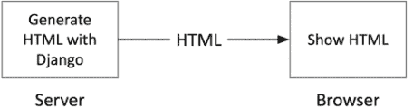

图 16.1 – 当前技术栈

你可以使用 *Node.js*（服务器端 JavaScript 解释器）基于 JavaScript 构建整个应用程序，这将取代技术栈中的 Python 和 Django。*图 16.2* 显示了它可能的样子：

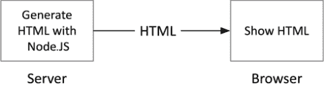

图 16.2 – 使用 Node.js 生成 HTML

或者，你可以将前端和模板完全放在 JavaScript 中，只使用 Django 作为 REST API 为渲染提供数据。*图 16.3* 显示了这种技术栈：

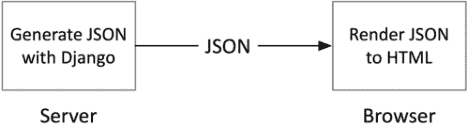

图 16.3 – 从 Django 发送 JSON 并在浏览器中渲染


最终的方法是渐进增强，这正是（正如前面提到的）我们将使用的方法。这样，Django 仍然在生成 HTML 模板，而 React 则在此之上添加交互性：

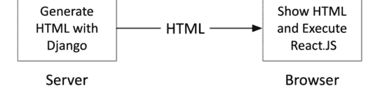

图 16.4 – 使用 Django 生成的 HTML，并由 React 提供渐进增强

请注意，通常会将多种技术组合使用。例如，Django 可能生成初始 HTML，然后在浏览器中应用 React。浏览器随后可以向 Django 查询 JSON 数据，以便使用 React 进行渲染。

为了理解这些方法，我们将首先简要了解一下如何在 Web 应用程序中使用 JavaScript。

## JavaScript 简介

在本节中，我们将简要介绍一些基本的 JavaScript 概念。这包括变量、常量、数组和对象等数据结构，以及函数、类和方法等可调用对象。不同的运算符将在介绍时进行讲解。

这将为我们提供必要的知识，以便开始简要概述 React 框架。

## 加载 JavaScript

JavaScript 可以内联在 HTML 页面中，也可以包含在单独的 JavaScript 文件中。这两种方法都使用 <script> 标签。对于内联 JavaScript，JavaScript 代码直接写在 HTML 文件中的 <script> 标签内；例如，像这样：

```
<script>
// comments in JavaScript can start with //
/* Block comments are also supported. This comment is
   multiple lines and doesn't end until we use a star then
   slash:/
let a = 5; // declare the variable a, and set its value to 5
console.log(a); // print a (5) to the browser console
</script>
```

请注意，console.log 函数会将数据打印到浏览器控制台，该控制台可在浏览器开发者工具中看到：

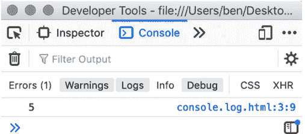

图 16.5 – console.log(a) 调用的结果 – 5 被打印到浏览器控制台

我们也可以将代码放入自己的文件中（在独立文件中不包含 <script> 标签）。然后使用 <script> 标签的 src 属性将其加载到页面中，正如我们在第 5 章《提供静态文件》中看到的那样：

```
<script src=""></script>
```

无论是内联还是包含，源代码在浏览器加载 <script> 标签时就会立即执行。

## 变量和常量

与 Python 不同，JavaScript 中的变量必须使用 var、let 或 const 关键字声明：

```
var a = 1; // variable a has the numeric value 1
let b = 'a'; // variable b has the string value 'a'
const pi = 3.14; // assigned as a constant and can't be redefined
```

不过，与 Python 类似，变量的类型无需声明。你会注意到行尾有分号。JavaScript 不要求行以分号结尾——它们是可选的。然而，一些风格指南强制要求使用它们。你应该为任何项目坚持使用一种约定。

你应该使用 let 关键字来声明变量。变量声明是有作用域的。例如，在 for 循环内部使用 let 声明的变量在循环外部不会被定义。在此示例中，我们将循环遍历 10 到 90 的倍数并求和，然后将结果打印到 console.log。你会注意到我们可以访问在函数级别声明的变量，而在 for 循环内部则不能反向访问：

```
let total = 0;
for (let i=0; i< 10; i++) { // variable i is scoped to the loop
    let toAdd = i * 10; // variable toAdd is also scoped
total += toAdd; /* we can access total since it's in
the outer scope */
```

```
}
console.log(total); // prints 450
console.log(toAdd); /* throws an exception as the variable is not declared in the outer scope */
console.log(i); /* this code is not executed since an exception was thrown the line before, but it would also generate the same exception */
```

const 用于常量数据，不能重新定义。但这并不意味着它指向的对象不能被更改。例如，你不能这样做：

```
const pi = 3.1416;
pi = 3.1; /* raises exception since const values can't be reassigned */
```

var 关键字是旧浏览器所必需的，这些浏览器不支持 let 或 const。如今只有 1% 的浏览器不支持这些关键字，因此在整章的其余部分，我们只会使用 let 或 const。与 let 类似，使用 var 声明的变量可以重新赋值；但是，它们的范围仅限于函数级别。

JavaScript 支持多种类型的变量，包括字符串、数组、对象（类似于字典）和数字。我们现在将在各自的章节中介绍数组和对象。

## 数组

数组的定义方式与 Python 类似，使用方括号。它们可以包含不同类型的数据，就像 Python 一样：

```
const myThings = [1, 'foo', 4.5];
```

关于 const 的另一个需要注意的地方是，它阻止重新分配常量，但不阻止更改常量指向的变量或对象。例如，我们不允许这样做：

```
myThings = [1, 'foo', 4.5, 'another value'];
```

然而，你可以通过使用 push 方法（类似于 Python 的 list.append）来追加新项目，从而更新 myThings 数组的内容：

```
myThings.push('another value');
```

## 对象

JavaScript 对象类似于 Python 字典，提供键值存储。声明它们的语法也类似：

```
const o = {foo: 'bar', baz: 4};
```

请注意，与 Python 不同，JavaScript 对象/字典键在创建时不需要加引号——除非它们包含特殊字符（空格、连字符、点等）。

o 中的值可以通过项目访问或属性访问来获取：

```
o.foo; // 'bar'
o['baz']; // 4
```

另请注意，由于 o 被声明为常量，我们不能重新分配它，但可以更改对象的属性：

```
o.anotherKey = 'another value'  // this is allowed
```

## 函数

在 JavaScript 中定义函数有几种不同的方法。我们将介绍三种。你可以使用 function 关键字定义它们：

```
function myFunc(a, b, c) {
    if (a == b)
        return c;
    else if (a > b)
        return 0;
    return 1;
}
```

JavaScript 中函数的所有参数都是可选的；也就是说，你可以像这样调用前面的函数：myFunc()，也不会引发错误（至少在调用时）。a、b 和 c 变量都将是 undefined 特殊类型。这会在函数的逻辑中造成问题。undefined 特殊类型有点像 Python 中的 None——尽管 JavaScript 也有 null，它更类似于 None。函数也可以通过将其分配给变量（或常量）来定义：

```
const myFunc = function(a, b, c) {
    // function body is implemented the same as above
}
```

我们还可以使用箭头语法定义函数。例如，我们也可以这样定义 myFunc：

```
const myFunc = (a, b, c) => {
    // function body as above
}
```

当在对象的一部分中定义函数时，这更为常见，例如：

```
const o = {
myFunc: (a, b, c) => {
    // function body
}
}
```

在这种情况下，它将像这样调用：

```
o.myFunc(3, 4, 5);
```

在介绍类之后，我们将回到使用箭头函数的理由。

## 类和方法

类使用 class 关键字定义。在类定义内部，方法是在不使用 function 关键字的情况下定义的。JavaScript 解释器可以识别语法并判断它是一个方法。以下是一个示例类，它在实例化时接受一个要添加的数字（通过 toAdd）。该数字将添加到传递给 add 方法的任何内容中，并返回结果：

```
class Adder {
    // A class to add a certain value to any number

    // this is like Python's init method
    constructor (toAdd) {
        /* "this" is like "self" in Python
           it's implicit and not manually passed into every
           method */
        this.toAdd = toAdd;
    }

    add (n) {
        // add our instance's value to the passed in number
        return this.toAdd + n;
    }
}
```


```
console.log(this);  // also refers to o2
}
    inner();
}
}
```

当我们使用箭头语法时，`this` 在两种情况下都保持一致并指向 o2。现在我们对 JavaScript 有了非常简短的介绍，让我们介绍 React。

## Further reading

涵盖 JavaScript 的所有概念超出了本书的范围。想要一门完整的、实践性的 JavaScript 课程，你可以随时参考《The JavaScript Workshop》书籍：https://courses.packtpub.com/courses/javascript。

在完成对核心 JavaScript 编程概念的简要回顾后，我们将开始对 React 编程进行简要概述。

## Working with React

React 允许你使用组件构建应用程序。每个组件都可以通过生成要插入页面的 HTML 来自行渲染。

组件还可以跟踪其自己的状态。如果它确实跟踪自己的状态，当状态发生变化时，组件将自动重新渲染自身。这意味着如果你有一个操作方法更新组件上的状态变量，你就不需要再判断组件是否需要重绘；React 会为你完成。Web 应用应跟踪其自己的状态，这样它就不需要查询服务器来了解如何更新以显示数据。

数据通过属性，即 props 在组件之间传递。传递属性的方法看起来有点像 HTML 属性，但有一些差异，我们将在本章后面介绍。属性以单个 props 对象形式接收。

举例说明，你可能会用 React 构建一个购物清单应用。你将有一个用于列表容器的组件（ListContainer），以及一个用于列表项的组件（ListItem）。ListItem 将被实例化多次，每次对应购物清单上的一个项目。容器将保存一个包含项目名称列表的状态。每个项目名称将作为 prop 传递给 ListItem 实例。每个 ListItem 然后在其自己的状态中存储项目名称和一个 isBought 标志。当你点击一个项目将其标记为已完成时，isBought 将被设置为 true。然后，React 会自动调用 ListItem 的 render 来更新显示。

有几种不同的方法可以在你的应用程序中使用 React。如果你想构建一个深度和复杂的 React 应用程序，你应该使用 npm（Node Package Manager，Node.js 应用程序的管理工具）来设置 React 项目。由于我们将使用 React 来增强一些页面，我们只需使用 `<script>` 标签包含 React 框架代码即可：

```
<script crossorigin
src="https://unpkg.com/react@16/umd/react.development.js">
</script>
<script crossorigin
src="https://unpkg.com/react-dom@16/umd/react-dom.development.js">
</script>
```

> **Note**
> `crossorigin` 属性是为了安全，意味着 cookie 或其他数据不能发送到远程服务器。当使用 unpkg.com 等公共内容分发网络（CDN）时这是必要的，以防有人在那里托管了恶意脚本。

这些应该放在你想要添加 React 的页面上，放在结束的 `</body>` 标签之前。将标签放在这里而不是页面的 `<head>` 中的原因是脚本可能想要引用页面上的 HTML 元素。如果我们将 `<script>` 标签放在 head 中，它将在页面元素可用之前执行（因为它们在后面）。

> **Note**
> 最新 React 版本的链接可以在 https://legacy.reactjs.org/docs/cdn-links.html 找到。

## Components

在 React 中构建组件有两种方式：使用函数或使用类。无论采用哪种方法，要在页面上显示，组件必须返回一些要显示的 HTML 元素。函数式组件是返回元素的单个函数，而基于类的组件将从其 render 方法返回元素。函数式组件无法跟踪自己的状态。

React 与 Django 类似，它会自动转义从 render 返回的字符串中的 HTML。要生成 HTML 元素，必须使用它们的标签、它们应具有的属性/属性以及其内容来构造它们。这是通过 `React.createElement` 函数完成的。组件将返回一个 React 元素，其中可能包含子元素。

让我们看一下同一个组件的两种实现，首先是函数，然后是类。函数式组件将 props 作为参数。这是一个包含传递给它的属性的对象。以下函数返回一个 h1 元素：

```
function HelloWorld(props) {
return React.createElement('h1', null, 'Hello, ' +
    props.name + '!' );
}
```

请注意，函数以大写字母开头是惯例。

虽然函数式组件是生成 HTML 的单个函数，但基于类的组件必须实现 render 方法来执行此操作。render 方法中的代码与函数式组件中的代码相同，只有一个区别：基于类的组件在其构造函数中接受 props 对象，然后 render（或其他）方法可以使用 `this.props` 引用 props。以下是作为类实现的相同 HelloWorld 组件：

```
class HelloWorld extends React.Component {
render() {
return React.createElement('h1', null, 'Hello, ' +
    this.props.name + '!');
}
}
```

使用类时，所有组件都从 `React.Component` 类扩展。基于类的组件相对于函数式组件的一个优势是；它们封装了操作/事件的处理以及它们自己的状态。对于简单的组件，使用函数式风格意味着更少的代码。有关组件和属性的更多信息，请参阅 https://reactjs.org/docs/components-and-props.html。

无论你选择哪种方法来定义组件，使用方式都相同。在本章中，我们将只使用基于类的组件。

我们首先需要在 HTML 页面上为 React 渲染此组件添加一个位置。通常，这使用带有 `id` 属性的 `<div>` 来完成。以下是此示例：

```
<div id="react_container"></div>
```

请注意，`id` 不必是 `react_container`；它只需要对页面唯一即可。然后，在 JavaScript 代码中，在定义所有组件之后，它们使用 `ReactDOM.render` 函数渲染到页面上。此函数接受两个参数：根 React 元素（不是组件）和应渲染它的 HTML 元素。

我们会这样使用它：

```
const container = document.getElementById('react_container');
const componentElement = React.createElement(HelloWorld,
    {name: 'Ben'});
ReactDOM.render(componentElement, container);
```

请注意，传递给 render 函数的不是 HelloWorld 组件（类/函数）本身；它被包装在 `React.createElement` 调用中以实例化它并将其转换为元素。

正如你可能从其名称猜到的那样，`document.getElementById` 函数在文档中定位一个 HTML 元素并返回对其的引用。

组件渲染后浏览器中的最终输出如下：

```
<h1>Hello, Ben!</h1>
```

让我们看一个更高级的示例组件。请注意，由于 `React.createElement` 是一个常用函数，通常会将其别名为更短的名称，例如 `e`：这就是此示例第一行所做的。

此组件显示一个按钮，并有一个内部状态来跟踪按钮被点击的次数。首先，让我们完整地查看组件类：

```
const e = React.createElement;

class ClickCounter extends React.Component {
  constructor(props) {
    super(props);
    this.state = { clickCount: 0 };
  }

  render() {
    return e(
      'button',  // the element name
      {onClick: () => this.setState({
        clickCount: this.state.clickCount + 1 }) }, // element props
      this.state.clickCount  // element content
    );
  }
}
```

关于 `ClickCounter` 类需要注意的一些事项如下：

- props 参数是一个对象（字典），其中包含在使用 HTML 中使用组件时传递给组件的属性值，如下所示：

  ```
  <ClickCounter foo="bar" rex="baz"/>
  ```

  props 字典将包含键 `foo`，值为 `bar`，以及键 `rex`，值为 `baz`。


+   - `super(props)` 调用父类的构造函数方法并传递 props 变量。这与 Python 中的 `super()` 方法类似。
+   - 每个 React 类都有一个 state 变量，它是一个对象。`constructor` 可以初始化它。state 应该使用 `setState` 方法进行更改，而不是直接操作。当它被更改时，`render` 方法会被自动调用以重绘组件。

`render` 方法使用 `React.createElement` 函数返回一个新的 HTML 元素（记住，变量 e 已别名为此函数）。在这种情况下，React.createElement 的参数将返回一个带有点击处理程序且文本内容为 `this.state.clickCount` 的 <button> 元素。基本上，它将返回如下元素（当 clickCount 为 0 时）：

```
<button onClick="this.setState(...)">
  0
</button>
```

onClick 函数被设置为使用箭头语法创建的匿名函数。这类似于以下函数（尽管并不完全相同，因为上下文不同）：

```
const onClick = () => {
  this.setState({clickCount: this.state.clickCount + 1})
}
```

由于函数只有一行，我们还可以去掉一层包装大括号，最终得到如下结果：

```
{ onClick: () => this.setState({
    clickCount: this.state.clickCount + 1}) }
```

我们之前在本节中介绍过如何将 ClickCounter 放置到页面上，大致如下：

```
ReactDOM.render(e(ClickCounter),
  document.getElementById('react_container'));
```

下面的截图显示了页面加载时按钮中的计数器：

此外，DjDt 指的是我们在第 15 章《Django 第三方库》Django Debug Toolbar 部分学到的调试工具栏：

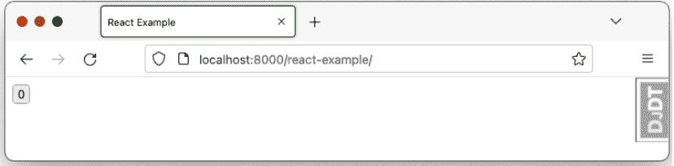

图 16.6 – 计数为 0 的按钮

点击按钮几次后，按钮看起来如 *图 16.7* 所示：

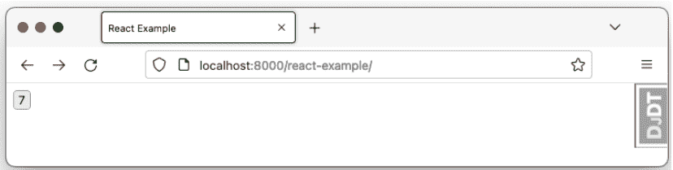

图 16.7 – 点击七次后的按钮

现在，为了演示如何*不*编写 render 函数，我们来看一下如果直接将 HTML 作为字符串返回会发生什么，如下所示：

```
```javascript
render() {
    return '<button>' + this.state.clickCount + '</button>'
}
```
```

现在渲染的页面看起来如 *图 16.8* 所示：

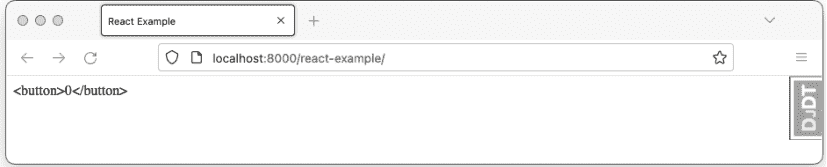

图 16.8 – 作为字符串返回的 HTML

这展示了 React 自动转义 HTML 的功能。现在我们对 JavaScript 和 React 有了简要介绍，让我们在 Bookr 中添加一个示例页面，以便你可以看到它实际运行的效果。

## 练习 16.01 – 设置 React 示例

在本练习中，我们将创建一个示例视图和模板与 React 一起使用。然后我们将实现 ClickCounter 组件。练习结束时，你将能够使用 ClickCounter 按钮与之交互：

+   1. 在 PyCharm 中，进入项目 static 目录下的 New | File。命名新文件为 react-example.js。

+   2. 将此代码放入其中将定义 React 组件，然后将其渲染到我们将要创建的 react_container <div> 中：

```
const e = React.createElement;

class ClickCounter extends React.Component {
    constructor(props) {
        super(props);
        this.state = { clickCount: 0 };
    }

    render() {
        return e(
            'button', { onClick: () => this.setState({
                clickCount: this.state.clickCount + 1
            })}
            ,
            this.state.clickCount
        );
    }
}

ReactDOM.render(e(ClickCounter),
    document.getElementById('react_container'));
```

现在可以保存 react-example.js。

+   3. 进入项目 templates 目录下的 **New | HTML File**：

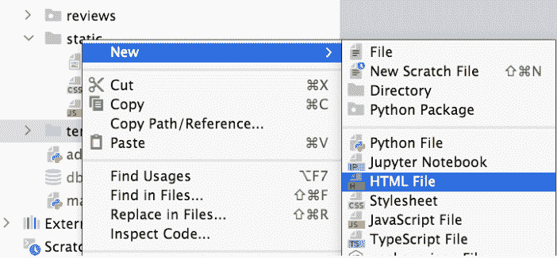

图 16.9 – 创建一个新的 HTML 文件

+   4. 将新文件命名为 `react-example.html`：

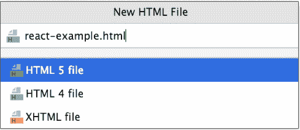

图 16.10 – 将文件命名为 react-example.html

你可以更改 `<title>` 元素中的标题为 *React Example*，但这对本练习不是必需的。

+   5. `react-example.html` 会像我们之前看到的那样创建一些 HTML 骨架。在关闭 `</body>` 标签之前添加以下 `<script>` 标签以包含 React：

```
```html
<script crossorigin
src="https://unpkg.com/react@16/umd/react.development.js">
</script>
<script crossorigin src="https://unpkg.com/
react-dom@16/umd/react-dom.development.js"></script>
```
```

6. react-example.js 文件将使用 <script> 标签包含，我们需要使用 static 模板标签生成脚本路径。首先在文件开头加载 static 模板库，在第二行添加以下内容：

```

```

文件的开头几行将如下图 16.11 所示：

```
<!DOCTYPE html>

<html lang="en">
<head>
```

图 16.11 – 包含的 load static 模板标签

然后，在关闭 </body> 标签之前，但在步骤 5 中添加的 <script> 标签之后，添加此脚本标签以包含 react-example.js：

```
<script src=""></script>
```

7. 我们现在需要添加 React 将要渲染到的包含 <div>。在打开的 <body> 标签后添加此元素：

```
<div id="react_container"></div>
```

你可以保存 react-example.html。

8. 现在我们将添加一个视图来渲染模板。打开 reviews 应用的 views.py 文件并在文件末尾添加 react_example 视图：

```
def react_example(request):
    return render(request, "react-example.html")
```

在这个简单的视图中，我们只需渲染 react-example.html 模板，不带任何上下文数据。

9. 最后，我们需要将 URL 映射到新视图。打开 bookr 包的 urls.py 文件。将此映射添加到 urlpatterns 变量中：

```
path('react-example/',
    reviews.views.react_example)
```

你可以保存并关闭 urls.py。

10. 如果尚未运行，请启动 Django 开发服务器，然后访问 http://127.0.0.1:8000/react-example/。你应该会看到如 图 16.12 所示的 ClickCount 按钮被渲染：

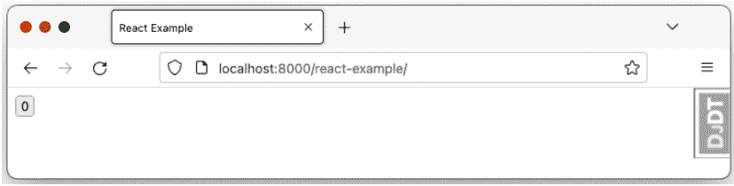

图 16.12 – ClickCount 按钮

尝试点击按钮几次并观察计数器的递增。

在这个示例中，我们创建了第一个 React 组件，然后添加了一个模板和视图来渲染它。我们从 CDN 包含了 React 框架源代码。在下一节中，我们将介绍 JavaScript XML（JSX），它将模板和代码组合到单个文件中，可以简化我们的代码。

## JSX – 一种 JavaScript 语法扩展

使用 React.createElement 函数定义每个元素可能非常冗长——即使我们将其别名为更短的变量名。当我们开始构建更大的组件时，这种冗长会加剧。

在使用 React 时，我们可以使用 JSX 来构建 HTML 元素。JSX 代表 JavaScript XML，因为 JavaScript 和 XML 都写在同一个文件中。例如，考虑以下使用 render 方法创建按钮的代码：

```
return React.createElement('button', { onClick: ... },
  'Button Text')
```

与其这样，我们可以直接返回其 HTML，如下所示：

```
return <button onClick={...}>Button Text</button>; 
```

请注意 HTML 未被引用并且未作为字符串返回。那就是，我们不是这样做的：

```
return '<button onClick={...}>Button Text</button>';
```

由于 JSX 是一种不寻常的语法（HTML 和 JavaScript 在单个文件中的组合），我们需要在使用它之前包含另一个 JavaScript 库：Babel（https://babeljs.io）。这是一个可以在不同版本的 JavaScript 之间转译代码的库。你可以使用最新语法编写代码，并让它转译（翻译和编译的组合）为旧浏览器可以理解的代码版本。

Babel 可以像这样使用 <script> 标签包含：

```
<script crossorigin
src="https://unpkg.com/babel-standalone@6/babel.min.js"></script>
```

这应该在页面上包含在其他 React 相关脚本标签之后，但在包含任何包含 JSX 的文件之前。

任何包含 JSX 的 JavaScript 源代码都必须添加 type="text/babel" 属性：

```
<script src="path/to/file.js" type="text/babel"></script>
```

这样 Babel 就知道要解析该文件而不是将其视为纯 JavaScript。

> **注意**
> 
> 以这种方式使用 Babel 对于大型项目来说可能很慢。它旨在作为 npm 项目构建过程的一部分使用，并提前转译你的 JSX 文件（而不是像我们在这里这样实时转译）。npm 项目设置超出了本书的范围。对于我们的目的和我们使用的少量 JSX，使用 Babel 是可以的。

JSX 使用大括号在 HTML 中包含 JavaScript 数据，类似于 Django 模板中的双大括号。大括号内的 JavaScript 将被执行。我们现在来看如何将按钮创建示例转换为 JSX。我们的 render 方法可以更改为如下：

```
render() {
    return <button onClick={() =>this.setState({
        clickCount: this.state.clickCount + 1
    })>
        {this.state.clickCount}
    </button>;
}
```

请注意 onClick 属性的值周围没有引号；相反，它被大括号包围。这是将内联定义的 JavaScript 函数传递给组件。它将在传递给构造函数方法的该组件的 props 字典中可用。例如，想象一下我们是这样传递它的：

```
onClick="() =>this.setState..."
```


在这种情况下，它会作为字符串值传递给组件，因此无法正常工作。

我们还在按钮的内容中渲染`clickCount`的当前值。这些花括号内也可以执行JavaScript。要显示点击次数加一，我们可以这样做：

```jsx
{this.state.clickCount + 1}
```

在下一个练习中，我们将在模板中加入Babel，然后把组件转换为使用JSX。

## 练习16.02 – JSX与Babel

在本练习中，我们将在组件中实现JSX来简化代码。为此，我们需要对`react-example.js`和`react-example.html`文件做一些修改，以便改用JSX来渲染`ClickCounter`：

- 1. 在PyCharm中，打开`react-example.js`，把render方法替换为以下代码，以改用JSX。你可以参考*练习16.01 – 设置React示例*中的*第2步*，我们在那里定义了这个方法：

```javascript
render() {
    return <button onClick={() => this.setState({
        clickCount: this.state.clickCount + 1
    })}>
        {this.state.clickCount}
    </button>;
}
```

- 2. 现在我们可以把`ClickCounter`本身当作一个元素。在文件末尾的`ReactDOM.render`调用中，你可以将第一个参数`e(ClickCounter)`替换为`<ClickCounter/>`元素，如下所示：

```javascript
ReactDOM.render(<ClickCounter/>,
    document.getElementById('react_container'));
```

- 3. 由于我们不再使用在*练习16.01 – 设置React示例*的*第2步*中创建的`React.create`函数，我们可以删除创建的那个别名，即删掉第一行：

```javascript
const e = React.createElement;
```

你可以保存并关闭文件。

- 4. 打开react-example.html模板。你需要包含Babel库的JavaScript。将这段代码添加到React脚本元素和react-example.js元素之间：

```
<script crossorigin
src="https://unpkg.com/babelstandalone@6/babel.min.js">
</script>
```

- 5. 为react-example.html的`<script>`标签添加`type="text/babel"`属性：

```
<script src=""
type="text/babel"></script>
```

保存react-example.html。

- 6. 启动Django开发服务器（如果尚未运行），然后访问http://127.0.0.1:8000/react-example/。你应该能看到和之前一样的按钮（图16.12）。点击按钮时，你应该也能看到计数递增。

在本练习中，我们没有改变ClickCounter React组件的行为。相反，我们重构它以使用JSX。这样可以更轻松地将组件的输出直接写成HTML，并减少我们需要编写的代码量。在下一节中，我们将了解如何向JSX React组件传递属性。

## JSX属性

基于JSX的React组件的属性设置方式与标准HTML元素上的属性相同。需要记住的重要一点是：你要将它们设置为字符串还是JavaScript值。

让我们来看看一些使用ClickCounter组件的示例。假设我们想扩展ClickCounter，使其能够指定一个目标数字。当达到目标时，按钮应替换为“干得好，<name>!”文本。这些值应作为属性传入ClickCounter。

当使用变量时，我们必须将它们作为JSX值传递：

```
let name = 'Ben'
let target = 5;

ReactDOM.render(
  <ClickCounter name={name} target={target}/>
  document.getElementById('react_container'));
```

我们也可以混合使用传递值的方式。以下也是有效的：

```
ReactDOM.render(<ClickCounter name="Ben" target={5}/>, document.getElementById('react_container'));
```

在下一个练习中，我们将更新ClickCounter，使其从属性中读取这些值，并在达到目标时改变其行为。我们将从Django模板中传入这些值。

## 练习16.03 – React组件属性

在本练习中，我们将修改ClickCounter，使其从props中读取target和name的值。我们将从Django视图中传入这些值，并使用escapejs过滤器使name值在JavaScript字符串中安全使用。完成后，你将能够点击按钮，直到达到目标，然后看到“干得好”消息。让我们开始吧：

- 1. 在PyCharm中，打开reviews应用的views.py。我们将修改react_example视图的render调用，以传入包含name和target的上下文，如下所示：

```
return render(request, "react-example.html", {"name": "Ben", "target": 5})
```

如果你愿意，可以使用自己的名字并选择不同的目标值。保存views.py。

- 2. 打开react-example.js文件。我们将更新constructor方法中的状态设置，以从props中设置name和target，如下所示：

```
constructor(props) {
  super(props);
  this.state = { clickCount: 0, name: props.name, target: props.target};
}
```

- 3. 修改render方法的行为，使其在达到目标后返回“干得好，<name>!”。在render方法中添加这个if语句：

```
if (this.state.clickCount === this.state.target) {
  return <span>Well done, {this.state.name}!</span>;
}
```

- 4. 为了传入这些值，将ReactDOM.render调用移到模板中，以便Django可以渲染那段代码。从react-example.js末尾剪切掉这一行ReactDOM.render代码：

```
ReactDOM.render(<ClickCounter/>, document.getElementById('react_container'));
```

我们将在第6步将其粘贴到模板文件中。react-example.js现在应该只包含ClickCounter类。保存并关闭文件。

5. 打开react-example.html。在所有现有的`<script>`标签之后（但在闭合的`</body>`标签之前），添加带有`type="text/babel"`属性的成对`<script>`标签。在它们内部，我们需要将传递给模板的Django上下文值赋给JavaScript变量。总的来说，你应该添加以下代码：

```
<script type="text/babel">
    let name = "{{ name | escapejs }}";
    let target = {{ target }};
</script>
```

第一行将name上下文变量赋给name变量。我们使用escapejs模板过滤器；否则，如果我们的name中包含双引号，可能会生成无效的JavaScript代码。第二个值target从target赋值。这是一个数字，因此不需要转义。

# 注意

由于Django为JavaScript转义值的方式，name不能像这样直接传递给组件属性：

```
<ClickCounter name="{{ name|escapejs }}"/>
```

JSX不会正确反转义这些值，最终你会得到转义序列。

但是，你可以像这样传入数值target：

```
<ClickCounter target="{ {{ target }} }"/>
```

另外，请注意Django花括号和JSX花括号之间的空格。在本书中，我们将首先把所有属性赋给变量，然后将其传递给组件，以保持一致性。

6. 在这些变量声明下方，粘贴你从react-example.js复制的ReactDOM.render调用。然后，为ClickCounter添加`target={ target }`和`name={ name }`属性。请记住，这些是传入的JavaScript变量，而不是Django上下文变量——它们只是恰好同名。`<script>`块现在应该如下所示：

```
<script type="text/babel">
    let name = "{{ name|escapejs }}";
    let target = {{ target }};
    ReactDOM.render(
        <ClickCounter name={ name } target={ target }/>, 
        document.getElementById('react_container'));
</script>
```

你可以保存react-example.html了。

7. 启动Django开发服务器（如果尚未运行），然后访问http://127.0.0.1:8000/react-example/。试着点击按钮几次——它应该会递增，直到你点击了目标次数。然后，它将被替换为“干得好，<name>!”文本。点击足够多次后，它应该看起来如图16.13所示：

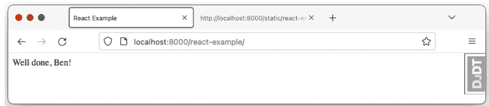

图16.13 – “干得好”消息

在本练习中，我们使用props将数据传递给React组件。在赋值给JavaScript变量时，我们使用escapejs模板过滤器对数据进行了转义。在下一节中，我们将介绍如何使用JavaScript通过HTTP获取数据。

**扩展阅读**

如需更详细、更实践的React课程，你随时可以参考*《React工作坊》*：https://courses.packtpub.com/courses/react.

## JavaScript Promise

许多JavaScript函数以异步方式实现，以避免阻塞长时间运行的操作。它们会立即返回，然后在有结果时调用回调函数。这类函数返回的对象就是Promise对象。回调函数通过调用其`then`方法提供给Promise对象。当函数运行完毕时，它会resolve这个Promise（调用成功函数）或reject它（调用失败函数）。

我们将说明使用Promise的错误和正确方式。考虑一个假设的长期运行函数`getResult`，它执行大量计算。它不返回结果，而是返回一个Promise。你不应该这样使用它：

```
const result = getResult();
console.log(result); // incorrect, this is a Promise
```


相反，应该这样调用：在返回的 Promise 上，将回调函数传递给 then。我们假设 getResult 永远不会失败，因此我们只为 resolve 情况提供一个成功函数：

```
const promise = getResult();
promise.then((result) => {
    console.log(result);  /* this is called when the
                          Promise resolves*/
});
```

通常，你不会将返回的 Promise 赋值给变量。相反，你会将 then 调用链接到函数调用上。我们将在下一个示例中展示这一点，同时还会提供一个失败回调（假设 getResult 现在可能失败）。我们还会添加一些注释来说明代码的执行顺序：

```
getResult().then(
    (result) => {
        // success function
        console.log(result);
        // this is called 2nd, but only on success
    },
    () => {
        // failure function
        console.log("getResult failed");
        // this is called 2nd, but only on failure
    })

// this will be called 1st, before either of the callbacks
console.log("Waiting for callback");
```

既然我们已经介绍了 Promise，接下来可以了解一下用于发出 HTTP 请求的 fetch 函数。它是异步的，通过返回 Promise 来工作。

## fetch 函数

大多数浏览器（95%）支持一个名为 fetch 的函数，它允许你发出 HTTP 请求。它使用带 Promise 的异步回调接口。

fetch 函数接受两个参数。第一个参数是请求的 URL，第二个参数是一个包含请求设置的对象（字典）。例如，考虑以下代码：

```
const promise = fetch("http://www.google.com", {...settings});
```

设置包括以下内容：

- method：请求的 HTTP 方法（GET、POST 等）。
- headers：要发送的另一个 HTTP 头对象（字典）。
- body：要发送的 HTTP 请求体（用于 POST/PUT 请求）。
- credentials：默认情况下，fetch 不会发送任何 cookie。这意味着你的请求会表现为未认证状态。要让 fetch 在请求中携带 cookie，此选项应设置为 same-origin 或 include 值。

让我们通过一个简单的请求来实际使用它：

```
fetch('/api/books/', {
  method: 'GET',
  headers: {
    Accept: 'application/json'
  }
}).then((resp) => {
  console.log(resp)
})
```

上述代码将从 `/api/book-list/` 获取数据，然后调用一个函数，使用 `console.log` 将请求记录到浏览器控制台。

图 16.14 展示了上述响应在 Firefox 中的控制台输出：

```
Response
  body: ReadableStream { locked: false }
  bodyUsed: false
  headers: Headers { }
  ok: true
  redirected: false
  status: 200
  statusText: "OK"
  type: "basic"
  url: "http://127.0.0.1:8000/api/books/"
  <prototype>: ResponsePrototype { clone: clone(), arrayBuffer: arrayBuffer(), blob: blob(), ... }
```

图 16.14 – 控制台中的响应输出

如你所见，当前控制台中没有多少有用的信息。我们需要先解码响应，然后才能处理它。我们可以使用响应对象上的 json 方法将响应体解码为 JSON 对象。这也会返回 Promise，所以我们要先获取 JSON，然后在回调中处理数据。完整的代码块如下：

```
fetch('/api/books/', {
    method: 'GET',
    headers: {
        Accept: 'application/json'
    }
}).then((resp) => {
    return resp.json(); /* doesn't return JSON, returns a Promise */
}).then((data) => {
    console.log(data);
});
```

这会将解码后的 JSON 格式对象记录到浏览器控制台。在 Firefox 中，输出如图 16.15 所示：

```
(18) [...] 
  0: Object { title: "Advanced Deep Learning with Keras", publication_date: "2018-10-31", isbn: "9781788629416", ... }
  1: Object { title: "Hands-On Machine Learning for Algorithmic Trading", publication_date: "2018-12-31", isbn: "9781789346411", ... }
  2: Object { title: "Architects of Intelligence", publication_date: "2018-11-23", isbn: "9781789954531", ... }
  3: Object { title: "Deep Reinforcement Learning Hands-On", publication_date: "2018-06-20", isbn: "9781788834247", ... }
  4: Object { title: "Natural Language Processing with TensorFlow", publication_date: "2018-05-30", isbn: "9781788478311", ... }
  5: Object { title: "Hands-On Reinforcement Learning with Python", publication_date: "2018-06-27", isbn: "9781788836524", ... }
  6: Object { title: "Brave New World", publication_date: "2006-10-18", isbn: "9780060850524", ... }
  7: Object { title: "The Grapes of Wrath", publication_date: "2006-03-28", isbn: "9780143839433", ... }
  8: Object { title: "For Whom The Bell Tolls", publication_date: "2019-07-16", isbn: "9781476787770", ... }
  9: Object { title: "To Kill A Mocking Bird", publication_date: "2002-01-01", isbn: "9780060935467", ... }
  10: Object { title: "The Great Gatsby", publication_date: "2004-09-30", isbn: "9780743273565", ... }
  11: Object { title: "The Catcher in the Rye", publication_date: "2001-01-30", isbn: "9780316769174", ... }
  12: Object { title: "Fahrenheit 451", publication_date: "2012-01-10", isbn: "9781451673319", ... }
```

图 16.15 – 解码后的书籍列表输出到控制台

在练习 16.04 – 获取并渲染书籍中，我们将编写一个新的 React 组件，它将获取书籍列表，然后将每本书渲染为一个列表项（`<li>`）。在此之前，我们需要了解 JavaScript 的 map 方法以及如何在 React 中使用它来构建 HTML。

## JavaScript 的 map 方法

有时，我们希望对不同的输入数据多次执行同一段代码（JavaScript 或 JSX）。在本章中，最有用的场景是生成具有相同 HTML 标签但不同内容的 JSX 元素。在 JavaScript 中，map 方法会遍历目标数组，然后为数组中的每个元素执行一次回调函数。这些元素随后会被添加到新数组中，并最终返回该数组。例如，下面的简短代码片段使用 map 将 numbers 数组中的每个数字翻倍：

```
const numbers = [1, 2, 3];
const doubled = numbers.map((n) => {
    return n * 2;
});
```

现在，doubled 数组包含 [2, 4, 6] 这些值。

我们也可以使用这个方法创建 JSX 值的列表。唯一需要注意的是，列表中的每一项都必须设置唯一的 key 属性。在下一个简短示例中，我们将一个数字数组转换为 `<li>` 元素。然后我们可以将它们放在 `<ul>` 中使用。下面是一个示例 render 函数：

```
render() {
    const numbers = [1, 2, 3];
    const listItems = numbers.map((n) => {
        return <li key={n}>{n}</li>;
    });
    return <ul>{listItems}</ul>
}
```

渲染后，它将生成以下 HTML：

```
<ul>
    <li>1</li>
    <li>2</li>
    <li>3</li>
</ul>
```

在下一个练习中，我们将构建一个带有按钮的 React 组件。当按钮被点击时，它会从 API 获取书籍列表，然后显示该列表。

## 练习 16.04 – 获取并渲染书籍

在本练习中，我们将创建一个名为 `BookDisplay` 的新组件，它会在 `<ul>` 中渲染一个书籍数组。书籍将使用 `fetch` 获取。为此，我们将 React 组件添加到 `react-example.js` 文件中。然后，我们在 Django 模板中将书籍列表的 URL 传递给该组件：

- 1. 在 PyCharm 中，打开你之前在*练习 16.03 的第 9 步 – React 组件属性*中使用的 `react-example.js`。你可以删除整个 `ClickCounter` 类。
- 2. 创建一个名为 `BookDisplay` 的新类，使用 `extends` 继承 `React.Component`。
- 3. 然后，添加一个构造方法，将 `props` 作为参数。它应该调用 `super(props)`，然后像这样设置其状态：

```
this.state = { books: [], url: props.url,
              fetchInProgress: false };
```

这会将 `books` 初始化为一个空数组，从传入的 `url` 属性中读取 API URL，并将 `fetchInProgress` 标志设置为 false。你的构造方法代码应该如下所示：

```
constructor(props) {
    super(props);
    this.state = { books: [], url: props.url,
                   fetchInProgress: false };
}
```

- 4. 接下来，添加一个 `doFetch` 方法。你可以复制并粘贴以下代码来创建它：

```
doFetch() {
    if (this.state.fetchInProgress)
        return;

    this.setState({ fetchInProgress: true })

    fetch(this.state.url, {
        method: 'GET',
        headers: {
            Accept: 'application/json'
        }
    })
    .then((response) => {
        return response.json();
```


}).then((data) => {
    this.setState({ fetchInProgress: false,
                    books: data })
})
}

首先，使用 if 语句检查是否已经开始 fetch。如果是，则从函数中返回。然后，我们使用 setState 更新状态，将 fetchInProgress 设置为 true。这将同时更新按钮显示文本并阻止同时运行多个请求。然后，我们使用 fetch 获取 this.state.url（我们将在练习后面的模板中传入）。响应使用 GET 方法检索，我们只想使用 Accept 来接受 JSON 响应。在获得响应后，我们然后使用 json 方法返回其 JSON。这返回 Promise，因此我们使用另一个 then 来处理 JSON 解析时的回调。在最终回调中，我们设置组件的状态，将 fetchInProgress 恢复为 false，并将 books 数组设置为解码后的 JSON 数据。

5. 接下来，创建 render 方法。你也可以复制粘贴这段代码：

```
render() {
  const bookListItems = this.state.books.map((book) =>
  {
    return <li key={ book.pk }>{ book.title }</li>;
  })

  const buttonText = this.state.fetchInProgress ?
    'Fetch in Progress' : 'Fetch';

  return <div>
<ul>{ bookListItems }</ul>
<button onClick={ () =>this.doFetch() }
  disabled={ this.state.fetchInProgress }>{buttonText}
</button>
</div>;
}
```

这使用 map 方法遍历 state 中的 books 数组。我们为每本书生成 <li>，使用书籍的 pk 作为列表项的 key 实例。<li> 的内容是书籍的 title。我们定义一个 buttonText 变量来存储（并更新）按钮将显示的文本。如果我们当前有一个 fetch 操作正在运行，则它将为 Fetch in Progress。否则，它将为 Fetch。最后，我们返回包含我们想要的所有数据的 <div>。<ul> 的内容是 bookListItems 变量（<li> 实例的数组）。它还包含一个 <button> 实例，以与之前的练习类似的方式添加。onClick 方法调用类的 doFetch 方法。我们可以使用 disabled 使按钮被禁用（即用户不能点击按钮），如果有 fetch 正在进行。我们将按钮文本设置为我们之前创建的 buttonText 变量。你现在可以保存并关闭 react-example.js。

+   6. 打开 react-example.html。我们需要用 BookDisplay 渲染替换 ClickCounter 渲染（来自练习 16.03 - React 组件属性）。删除 name 和 target 变量定义。我们将改为渲染 <BookDisplay>。将 url 属性设置为字符串并传入书籍列表 API 的 URL，使用  模板标签来生成它。ReactDOM.render 调用应该如下所示：

```
ReactDOM.render
  (<BookDisplay url="" />,
    document.getElementById('react_container'));
```

你现在可以保存并关闭 react-example.html。

+   7. 如果尚未运行，请启动 Django 开发服务器，然后访问 http://127.0.0.1:8000/react-example/。你应该在页面上看到一个 Fetch 按钮（图 16.16）：

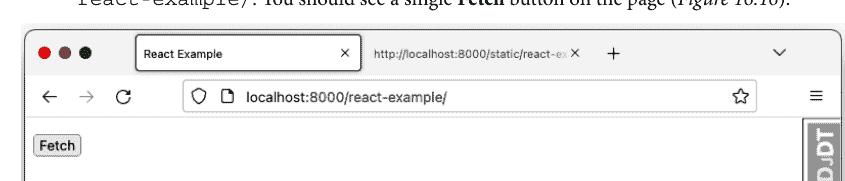

图 16.16 – 书籍 Fetch 按钮

点击 Fetch 按钮后，它应该被禁用并且文本更改为 Fetch in Progress，如下所示：

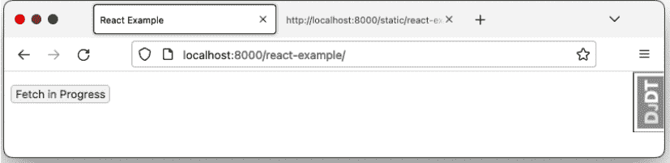

图 16.17 – Fetch in Progress

一旦 fetch 完成，你应该看到书籍列表按如下方式渲染：

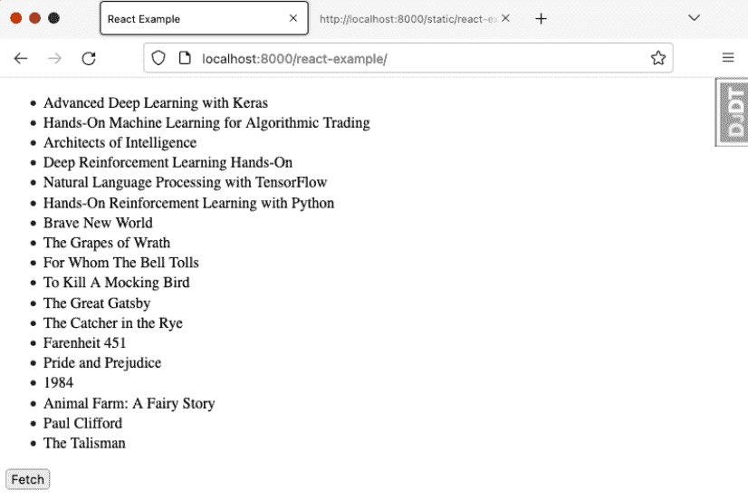

图 16.18 – 书籍 fetch 完成

这个练习是整合 React 与你在 *第 12 章，构建 REST API* 中构建的 Django REST API 的机会。我们构建了一个新的组件（`BookDisplay`），并调用了 `fetch` 来获取书籍列表。我们使用 JavaScript `map` 方法将书籍数组转换为一些 `<li>` 元素。如前所述，我们使用 `button` 在点击时触发 `fetch`。然后我们在 Django 模板中向 React 组件提供了书籍列表 API URL。后来，我们在 Bookr 中看到了使用 REST API 动态加载的书籍列表。

在进入本章的活动之前，我们将讨论在使用 Django 时针对其他 JavaScript 框架的一些考虑因素。

## verbatim 模板标签

我们已经看到在使用 React 时，可以在 Django 模板中使用 JSX 插值值。这是因为 JSX 使用单大括号来插值值，而 Django 使用双大括号。只要 JSX 和 Django 大括号之间有空格，就应该可以正常工作。

其他框架，如 Vue，也使用双大括号进行变量插值。这意味着如果你在模板中有 Vue 组件的 HTML，你可能会尝试像这样插值一个值：

```
<h1>Hello, {{ name }}!</h1>
```

当然，当 Django 渲染模板时，它会在 Vue 框架有机会渲染之前插值 name 值。

我们可以使用 verbatim 模板标签让 Django 按原样输出模板中的数据，而不执行任何渲染或变量插值。使用它与前面的示例一起非常简单，如下所示：

```

<h1>Hello, {{ name }}!</h1>

```

现在当 Django 渲染模板时，模板标签之间的 HTML 将按原样输出，允许 Vue（或其他框架）接管并自行插值变量。许多其他框架将其模板分离到自己的文件中，这不应与 Django 的模板冲突。

有许多 JavaScript 框架可用，你最终决定使用哪一个将取决于你自己的意见或你的公司/团队使用的框架。如果你确实遇到冲突，解决方案将取决于你的特定框架。本节中的示例应该能帮助你找到正确的方向。

我们现在已经涵盖了将 React（或其他 JavaScript 框架）与 Django 集成所需的大部分内容。在下一个活动中，你将实现这些学习成果来获取 Bookr 上最近的评论。

## 活动 16.01 – 评论预览

在这个活动中，我们将更新 Bookr 主页以获取六条最近的评论并显示它们。用户将能够点击按钮向前浏览接下来的六条评论，然后再返回到之前的评论。

以下步骤将帮助你完成活动：

+   1. 首先，我们可以清理之前练习中的一些代码。如果你愿意，可以备份这些文件以供以后参考。或者，你也可以使用 GitHub 版本以供将来参考。删除 `react_example` 视图、`react-example` URL、`react-example.html` 模板和 `react-example.js` 文件。

+   2. 创建一个 `recent-reviews.js` 静态文件。

+   3. 创建两个组件，一个 `ReviewDisplay` 组件显示单个评论的数据，以及一个 `RecentReviews` 组件处理获取评论数据并显示 `ReviewDisplay` 组件列表。

首先，创建 `ReviewDisplay` 类。在其构造函数中，你应该读取通过 props 传入的 `review` 并将其分配给状态。

+   4. ReviewDisplay 的 render 方法应返回如下的 JSX HTML：

```
<div className="col mb-4">
<div className="card">
<div className="card-body">
<h5 className="card-title">{ BOOK_TITLE }
<strong>({ REVIEW_RATING })</strong>
</h5>
<h6 className="card-subtitle mb-2 text-muted">
CREATOR_EMAIL</h6>
<p className="card-text">REVIEW_CONTENT</p>
</div>
<div className="card-footer">
<a href={'/books/' + BOOK_ID + '/'} className="card-link">View Book</a>
</div>
</div>
</div>
```

但是，你应该用组件已获取的 `review` 中的正确值替换 `BOOK_TITLE`、`REVIEW_RATING`、`CREATOR_EMAIL`、`REVIEW_CONTENT` 和 `BOOK_ID` 占位符。

> **注意**
> 请注意在使用 JSX 和 React 时，元素的 `class` 使用 `className` 属性设置，而不是 `class`。当它作为 HTML 渲染时，它会变成 `class`。

5. 创建另一个名为 RecentReviews 的 React 组件。其构造函数方法应使用以下键/值设置状态：

- `reviews: []`（空列表）
- `currentUrl: props.url`
- `nextUrl: null`
- `previousUrl: null`
- `loading: false`

6. 实现一个从 REST API 下载评论的方法。将其命名为 `fetchReviews`。如果 `state.loading` 为 true，则应立即返回。然后，它应将状态的 loading 属性设置为 true。

7. 以你在练习 16.04 - 获取和渲染书籍中所做的方式实现 fetch。它应遵循相同的模式，请求 state.currentUrl 然后从响应中获取 JSON 数据。然后，在状态中设置以下值：

- `loading: false`
- `reviews: data.results`
- `nextUrl: data.next`
- `previousUrl: data.previous`

8. 实现 componentDidMount 方法。这是 React 将组件加载到页面上时调用的方法。它应调用 fetchReviews 方法。

9. 创建 loadNext 方法。如果 state 中的 nextUrl 为 null，则应立即返回。否则，它应将 state.currentUrl 设置为 state.nextUrl，然后调用 fetchReviews。

10. 类似地，创建 loadPrevious 方法；但是，这应将 state.currentUrl 设置为 state.previousUrl。

11. 实现 render 方法。如果状态正在加载，则应返回 <h5> 元素内的 Loading... 文本。

12. 创建两个变量来存储 previousButton 和 nextButton HTML。它们都应具有 btn btn-secondary 类，next 按钮还应具有 float-right 类。它们应将 onClick 属性设置为调用 loadPrevious 或 loadNext 方法。它们应将 disabled 属性设置为 true，如果相应的 previousUrl 或 nextUrl 属性为 null。按钮文本应为 Previous 或 Next。


**图 16.19 – 已完成的评论预览**

在截图中，页面已向下滚动以显示 Previous/Next 按钮。请注意 Previous 按钮处于禁用状态，因为我们处于第一页。

如果点击 **Next**，你应该会看到下一页的评论。如果点击 **Next** 足够多次（取决于你有多少评论），你最终会到达最后一页，然后 **Next** 按钮将被禁用：

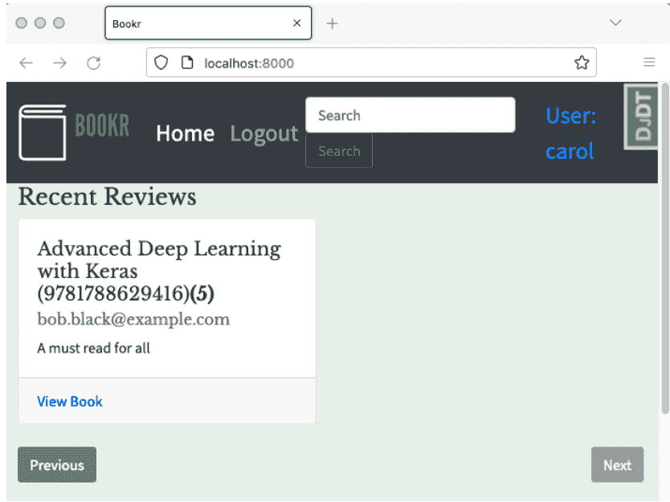

**图 16.20 – Next 按钮被禁用**

如果没有评论，则应看到 **No reviews to display** 消息：

**图 16.21 – No reviews to display 文本**

在页面加载评论时，你应该会看到 Loading... 文本；不过它可能只会显示一瞬间，因为数据是从你自己的计算机加载的：

**图 16.22 – Loading... 文本**

**注意**

此活动的解决方案可以在 `https://github.com/PacktPublishing/Web-Development-with-Django-Second-Edition/tree/main/ActivitySolutions` 找到。

## 摘要

在本章中，我们介绍了 JavaScript 框架并描述了它们如何与 Django 协同工作以增强模板并添加交互性。我们介绍了 JavaScript 语言并涵盖了一些主要特性、变量类型和类。然后我们介绍了 React 背后的概念以及它如何使用组件构建 HTML。我们使用纯 JavaScript 和 `React.createElement` 函数构建了一个 React 组件。之后，我们介绍了 JSX 并看到它如何通过让你直接在 React 组件中编写 HTML 使组件的开发变得更容易。介绍了 promise 和 `fetch` 函数的概念，我们看到了如何使用 `fetch` 从 REST API 获取数据。本章以一个练习结束，该练习使用 REST API 从 Books 中检索评论并以交互式组件的形式渲染到页面上。

在下一章中，我们将了解如何将 Django 项目部署到生产 Web 服务器。
