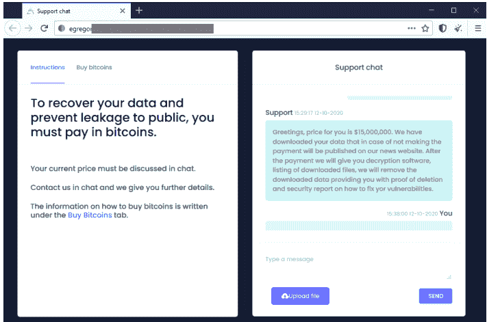
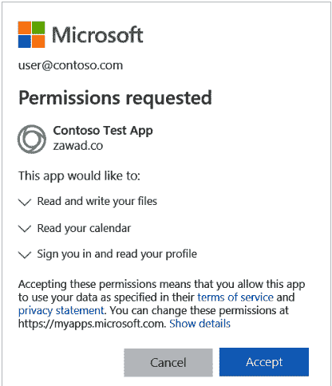
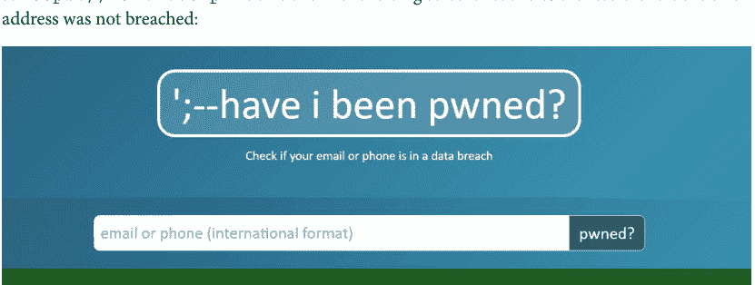
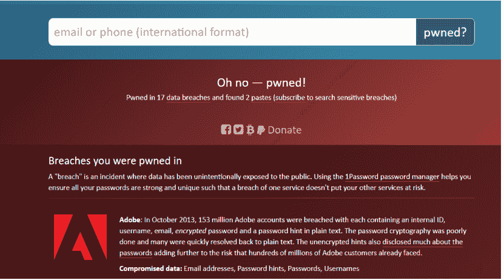
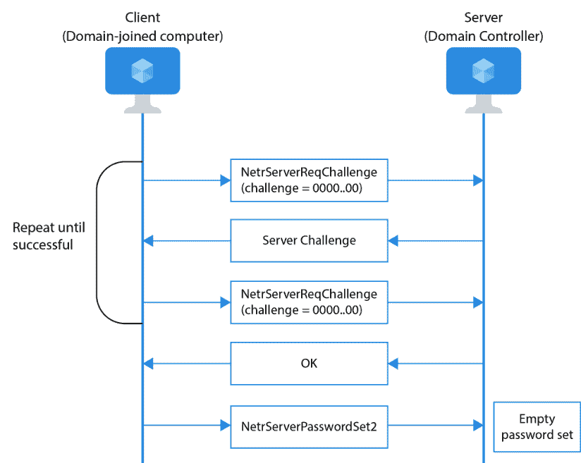

## 勒索软件攻击向量与威胁态势

在本章中，我们将首先介绍勒索软件是什么、攻击是如何进行的、攻击者使用的一些主要攻击向量的概述，以及勒索软件团伙是如何运作的。然后，我们将对一些最知名的勒索软件团伙，如 Conti、LockBit 和 Sodinokibi，进行更深入的介绍，以及它们历史上是如何执行攻击的。

勒索软件有许多复杂的形式。在过去的 5 年里，我们看到勒索软件变得更加复杂。这需要更高水平的处理人员来应对这些威胁行为者。因此，在本章中，我们将更好地了解不同的攻击战术以及攻击是如何进行的。这将在后续章节中得到扩展，当我们介绍不同用于防范此类攻击的对策时。

在本章中，我们将涵盖以下主要主题：

- 勒索软件和攻击向量
- 攻击和勒索战术
- 一些勒索软件运营商的概述
- 身份型攻击是如何进行的
- 如何利用漏洞发起攻击
- 如何监控漏洞

了解这些主题可以帮助我们更好地应对并做好准备。这些都是我们工具箱中必备的知识和技能。

### 勒索软件的演变

勒索软件是一种历史上被设计用来加密数据并使依赖它的系统无法使用的恶意软件。恶意行为者随后要求支付赎金以换取解密数据。

在 2021 年，我们看到了勒索软件攻击数量的巨大增长，许多公司面临其 IT 基础设施和数据被加密的情况，许多数据还被不同的勒索软件团伙窃取。在我所在的挪威，我们在过去一年里也看到了许多大型组织遭到勒索软件攻击，这也影响到了挪威民众。以下是 2021 年在挪威遭到勒索软件攻击的一些组织：

- **Nordic Choice Hotels**：这是斯堪的纳维亚最大的酒店连锁之一。当它们遭到攻击时，需要改用人工办理入住手续。
- **Amedia**：这是挪威第二大新闻出版商，出版超过 90 家报纸。当它们遭到攻击时，报纸生产被迫停止了超过一周。
- **Nortura**：这是挪威最大的食品生产商之一，因此当它遭到勒索软件攻击时，意味着农民无法将动物送去加工。

此外，在其他国家也发生了许多高调的攻击，例如美国 Colonial Pipeline 的攻击以及 MSP 软件提供商 Kaseya 的攻击，后者最终影响了全球近 1,500 名客户。

在 Colonial Pipeline 遭到攻击后，美国政府实施了新的报告法规，这意味着在美国遭到勒索软件攻击的组织必须向 FBI、CISA 或美国特勤局报告事件。

在过去几年里，我们还看到根据 Sophos 的数据，针对医疗保健的勒索软件攻击几乎翻了一番（https://news.sophos.com/en-us/2022/06/01/the-state-of-ransomware-in-healthcare-2022/），然而，针对医疗保健的攻击并非有意为之，因为大多数勒索软件团伙倾向于避免医疗保健企业。2022 年，我们看到一些案例，勒索软件团伙免费向组织提供解密密钥，以避免影响可能影响医院等医疗领域患者治疗的系统。

Kaseya 的攻击是通过其 **Virtual System Administrator (VSA)** 产品进行的，最终影响了瑞典超市连锁 Coop，该连锁在北欧的攻击后被迫关闭 500 家商店。

在 Sophos 进行的一项调查中，他们在 2021 年采访了 5,400 名 IT 决策者，其中约 37% 在过去一年中遭到过勒索软件攻击，这比前一年 51% 的数字有了显著下降，令人欣慰。

然而，攻击者的行为也发生了一些显著变化。最有可能的是，攻击数量的减少可能与更少自动化的攻击和更多动手针对性攻击有关。Emsisoft 是 ID ransomware（malwarehunterteam.com）背后的安全软件公司，允许我们通过上传勒索软件说明文件来识别哪个勒索软件变种加密了文件。Emsisoft 在其网站上发布称，2021 年该服务收到了近 560,000 次提交，比前一年多了 50,000 次。此外，Emsisoft 还估计只有 25% 的受害者会提交到其网站（https://id-ransomware.malwarehunterteam.com/）。

我们还看到了威胁行为者个人参与度的增加。例如，我们看到在圣诞节等节假日附近的攻击有所增加，因为人们通常更紧张，更容易成为网络钓鱼攻击的受害者。

全球许多组织都面临过勒索软件攻击，从统计数据来看，受影响的大型组织数量似乎只是在上升。但勒索软件在过去几年中是否已经演变？

勒索软件主要被攻击者用来利用您基础设施中最薄弱的环节，然后使用某种加密方法加密您的数据和基础设施。一旦加密完成，他们会留下赎金说明并等待。获取原始数据（或能够解密数据）的唯一方法是使用一种数字货币向攻击者购买解密工具。还有其他攻击方法，但我稍后会再谈到。

在赎金说明中，您会得到有关如何联系他们或访问其支持渠道的说明，这些渠道通常隐藏在 Tor 地址之后。当您访问其支持渠道时，一些运营商会提供一些关于发生了什么以及您需要支付多少才能获得解密工具的信息：

图 1.1 – 勒索软件运营商聊天支持

勒索软件攻击通常涉及多个团队或人员。许多不同的勒索软件团伙分为较小的团体和附属机构。许多附属机构通常会共同努力获取对环境的访问权限，甚至可能是内部人员。他们将访问权限出售或提供给部署勒索软件的其他团队。利润通常在附属机构和团伙之间分配，并支付一次性费用以获取对环境的访问权限。

附属机构独立运营或作为有组织团体的成员，而一些最知名的勒索软件团伙正在进行积极的招募计划以获取附属机构。

勒索软件攻击者只专注于获取访问权限、加密数据并等待组织联系。在大多数情况下，勒索软件运营商还对您的组织和员工人数有一定的了解，这也会影响赎金费用。

大多数勒索软件运营商托管自助服务门户，并内置聊天支持以获取有关如何支付解密工具的详细信息，该门户只能通过 Tor 网络访问。最知名的团伙倾向于使用 Monero 作为首选加密货币，因为许多人认为它是不可追踪的货币。然而，我们也看到其他加密货币被使用。此外，最近的证据表明威胁行为者会为彼此做生意，例如使用洗钱服务使资金无法追踪。

虽然大多数安全专业人士都同意您永远不应支付赎金，但许多人在绝望中支付了赎金以获取文件访问权限并恢复服务。考虑一下替代方案——您的整个基础设施、备份和其他服务都消失了，重建服务需要太多时间，您的公司甚至可能破产。

我们还看到许多组织越来越多地依赖网络保险来支付与勒索软件相关的费用。2021 年上半年，勒索软件占所有网络保险索赔的 75%；这也导致保费大幅上涨。

> **重要说明**
> 
> 需要注意的是，在 Sophos 于 2021 年进行的一项调查中，对于支付赎金的组织，平均能够恢复的数据量仅接近 65%（https://news.sophos.com/en-us/2021/04/27/the-state-of-ransomware-2021/）。在某些情况下，当您与攻击者协商价格时，一些勒索软件运营商会为您提供免费样本，以向您展示他们拥有解密工具并且可以解密数据。在大多数情况下，这只能解密单个文件或单个虚拟机。在大多数情况下，他们对环境也有良好的映射，并且知道哪些机器正在运行，例如备份服务，因此您很可能只能解密不重要的虚拟机，例如测试服务器。

当您支付赎金时，您要么支付以获取每台机器的解密密钥，要么获取用于整个环境的解密密钥和工具。一旦您获得解密工具的访问权限，解密单台机器可能需要数小时。如果您需要解密整个环境，可以预期需要很长时间。

## 利用已知漏洞

这里指的是攻击者利用外部服务中的某种漏洞。这可能包括攻击者试图使用某种形式的**远程代码执行（RCE）**来获得访问权限。在过去几年中，我们看到了许多被用来发起勒索软件攻击的不同漏洞。以下是一些曾遭受这些攻击的产品：

- Citrix ADC
- Microsoft Exchange
- Fortinet
- Pulse VPN
- SonicWall

> **重要说明**
>
> 多年来我一直在使用的一个了解已知流量模式的良好来源是 Twitter 上的 Bad Packets，它有一个不错的信息流，会关注当前试图滥用不同服务中易受攻击端点的流量。我建议你将其添加为值得关注的来源：`https://twitter.com/bad_packets`。此外，**网络安全和基础设施安全局（CISA）** 已经编制了一份已知被利用漏洞的列表，可在此处找到：`https://www.cisa.gov/known-exploited-vulnerabilities-catalog`。

去年披露的最大漏洞之一是 ProxyShell，它利用了 Microsoft Exchange 中的多个漏洞。许多安全研究人员迅速使用简单的 Python/PowerShell 脚本提供了概念验证漏洞利用代码，如下所示：`https://github.com/horizon3ai/proxyshell`。

这个漏洞链可让攻击者访问 Exchange 中存储的邮箱，并提供对 Exchange 客户端访问服务器的 Web shell 访问权限。

漏洞不仅用于初始访问，还用于横向移动。2021 年夏天，一个新的漏洞被披露，它是 Windows 中 Print Spooler 服务（也称为 PrintNightmare）的一个弱点，该漏洞允许攻击者在操作系统上执行特权文件操作。

这意味着攻击者可以在本地和远程以系统权限运行任意代码。成功入侵最终用户机器的攻击者可以利用此漏洞进一步访问基础设施，例如运行 Print Spooler 服务的域控制器。

## 通过撞库攻击访问

撞库攻击是指攻击者自动化注入被盗的用户名和密码组合，或尝试登录不同的在线服务。大多数最终用户都有惯性，倾向于在众多第三方服务或网站上重用用户名和密码。当这些第三方服务被攻破时，最终用户的信息——或者更糟，凭据——就会泄露。在许多情况下，攻击者会深入研究这些攻击中的不同数据源，看看能否找到任何可重用的凭据，并尝试访问组织可能拥有的任何外部服务。

检查你的凭据是否泄露的一个好方法是使用在线服务 https://haveibeenpwned.com，你可以在其中输入电子邮件地址，它会检查不同的数据源，以确定你的信息是否泄露以及包含在哪些类型的数据源中。

haveibeenpwned.com 还提供免费的域名通知服务，这意味着如果你的域名中的某个用户出现在数据泄露事件中，你会收到通知。我也强烈推荐你注册该服务。

其他服务也可以提供类似功能来检测用户名或密码是否已被泄露，例如：

- F-Secure ID PROTECTION
- Google Password Manager
- Microsoft Edge Password Monitor

除此之外，许多攻击者还在实施以窃取凭据为目的的网络钓鱼攻击，例如将最终用户引导至伪造的 Office 365 网站以收集用户名和密码。

一种越来越常见的新型攻击方法是对 Azure Active Directory (AD) 进行 OAuth 网络钓鱼，攻击者会发送伪造的 Microsoft 365 登录页面。当用户点击链接以授予应用程序访问权限时，最终用户会看到一个“请求的权限”对话框：

图 1.3 – 网络钓鱼攻击的 OAuth 权限屏幕

如果用户点击“接受”，攻击者将能够访问其在 Office 365 中的个人资料，根据授予的权限类型，这可能还包括对电子邮件和文件的访问权限。

## 通过暴力破解攻击访问

我们见到的最常见的攻击媒介之一是对配置错误服务进行暴力破解攻击，例如攻击公开暴露且启用了远程桌面协议（RDP）的 Windows 服务器。这也可能是任何暴露的、安全机制薄弱的服务，例如缺少 MFA（RDP 默认没有 MFA），因此容易受到攻击。

在我合作的一个客户那里，最初的入侵点是 Azure 中一台暴露的 Windows Server，它有公共 IP 地址并启用了 RDP。由于该机器还加入了域，并且本地管理员帐户密码较弱，攻击者没花多少时间就猜出了正确的用户名和密码组合，从而进入了环境。

正如我们所见，在基于云的环境中，攻击者通常有一组预定义的凭据，用于针对已知 IP 范围进行暴力破解攻击。Azure 环境通常使用诸如 AZADMIN/AZUREADMIN/AZURE 等用户名与不同的密码组合。自动化攻击通常会在机器在 Azure 上线后几分钟内开始。

## 通过被入侵的工作站或最终用户机器访问

勒索软件攻击最常见的入口点之一是通过被入侵的最终用户机器。这通常发生在用户打开收到的附件，或者访问网站并从中运行某种可执行文件时。

这主要是因为最终用户收到了来自网络钓鱼电子邮件的恶意附件，或通过路过式下载（drive-by downloads）中招。恶意内容可以是包含脚本或其他恶意内容的 Word 文档，或带有宏的 Excel 文档。

这些网络钓鱼电子邮件通常以短期活动形式发送。在 60 天内，Akamai 观察到超过 20 亿个与恶意活动相关的唯一域名。其中，近 90% 的域名存活时间不到 24 小时，94% 的域名存活时间不到 2 天。因此，使用 DNS 保护服务来阻止它们变得极其困难。Palo Alto 还表示，大多数（接近 70%）新注册域名（NRDs）与恶意或可疑流量相关，平均每年创建 14 万个域名。

这些钓鱼邮件和附件要么使用恶意脚本，要么使用宏，通常利用漏洞来获得机器访问权限。在大多数情况下，这要求最终用户打开附件并启用内容或触发宏。然而，在 2021 年 8 月，Microsoft 发现少量攻击使用了 MSHTML 中的一个 RCE 漏洞，MSHTML 是 Windows 内置的 HTML 引擎。

这个特定漏洞只需用户在 Windows 资源管理器中查看该文件或文档，即可触发有效负载运行。

在 COVID 疫情和人们居家办公期间，我看到的另一个例子是，许多员工会将工作机器直接连接到家庭路由器，从而从 ISP 获得一个公共 IP 地址。这意味着，如果他们的客户端机器启用了 RDP，就很容易受到暴力破解攻击。除非有特殊需求，否则请确保不要启用 RDP/SMB，并设置好出站防火墙规则。

## 勒索软件是如何运作的？

最糟糕的事情发生了——有人成功入侵了你的基础设施并加密了你的数据。这是怎么发生的？他们是怎么进来的？

让我们探讨一些不同类型勒索软件背后的机制。

### Diavol 勒索软件

Diavol 是一种勒索软件，据推测被一个名为 Wizard Spider 的组织使用，最初由 FortiGuard Labs 于 2021 年 6 月发现。它使用已知恶意软件 BazarLoader 来窃取信息并投放恶意软件有效负载。

初始有效载荷通过钓鱼攻击被投递到一个端点，其中包含一个指向 OneDrive URL 的链接。使用 OneDrive 的原因在于它通常提供一个可以绕过大多数防火墙和垃圾邮件过滤器的 URL。

BazarLoader 倾向于使用常见的云服务以能够绕过安全过滤器。然后，用户会被指示下载一个包含 ISO 文件的 ZIP 文件，以允许其绕过下载文件时的任何安全机制。当用户在其文件系统上挂载 ISO 文件时，它会挂载一个 LNK 和 DLL 文件。一旦用户执行 LNK 文件，BazarLoader 感染就会启动。

最初，与 BazarLoader 一样，它首先通过使用以下等脚本和命令对 Windows 环境进行内部侦察：

- Net group "Domain Computers" /domain
- Nltest /domain_trust /all_trusts
- Net localgroup "administrator"

执行侦察后，BazarLoader 使用 **Background Intelligent Transfer Service (BITS)** 下载一组 DLL 文件，其中包含 Cobalt Strike，并开始与操作员的 Cobalt Strike 服务器通信。然后，从受损机器上，他们通常会运行第二阶段的脚本，使用 AdFind 等工具，然后使用 BAT 脚本转储本地凭据。

攻击者还倾向于使用 Rubeus 等工具执行 Kerberoast，这用于在域中收集使用的 **Ticket Granting Server (TGS)** 票据。

一旦他们设法访问文件服务器，他们会使用 AnyDesk 和 FileZilla 等工具从环境中窃取数据。然后，他们会转移到更关键的系统，例如备份服务器和域控制器。

一旦他们执行了数据外泄并获得了对包括备份系统在内的基础设施核心部分的访问权限，他们就会触发初始有效载荷。

最终有效载荷通常通过 RDP 使用脚本来触发加密过程。为了最大化效果，勒索软件会终止可能锁定文件访问的进程，例如 Office 应用程序和数据库服务。此外，他们还尝试停止可能锁定文件访问的服务，例如 `httpd.exe`、`sqlserver.exe`、`chrome.exe` 等。

他们还使用脚本查找连接到主机机器的所有驱动器。此外，他们会停止 **Volume Shadow Copy Service (VSS)** 并确保在运行加密过程之前删除 VSS 快照。

对于每台被入侵的机器，Diavol 都会创建一个唯一标识符，然后将其传回 C2 地址。

## Initial Access
- Phishing Email
- Download Malicious Attachment
- Run Document Triggering BazarLoader Loader

## Reconnaissance and Credential Dump
- Windows Discovery Scripts
- Dumping Registry Hives
- Establishing Cobalt Strike C2

## Lateral Movement and Persistence
- Kerberoast
- Lateral Movement Using RDP
- File Server Persistence and Exfiltration

## Payload
- RDP and Run Payload

Figure 1.4 – Overview of the attack pattern for Diavol

该概述显示了 Diavol 攻击中的不同阶段和攻击模式，其中最终有效载荷通常使用 RDP 分发到基础设施的所有部分。

## Conti ransomware

Conti 最早于 2020 年 5 月出现，并在 2021 年成为最常见的勒索软件变种之一。主要访问点大多是通过 spear-phishing 活动进行的，在大多数情况下，利用恶意 JavaScript 代码，该代码首先使用 TrickBot、IcedID 或 BazarLoader 将恶意软件加载器投递到基础设施中。

他们也曾使用 RDP 进行暴力攻击。

现在，与 Diavol 和 BazarLoader 一样，Conti 使用各种不同的脚本进行侦察，例如 `nltest`、`whoami` 和 `net.exe`。然后，他们使用 Cobalt Strike 将权限提升到本地系统并与 C2 服务器建立通信。

然后，攻击者使用不同的工具扫描网络并收集信息，例如 AdFind、Router Scan、SharpChrome 和 Seatbelt。他们还使用 Kerberoast 和 Mimikatz 等工具收集管理员哈希或提取密码。

他们花费时间查看本地用户账户配置文件，寻找可用于勒索要挟的重要数据或文件，例如以下内容：

- Outlook (OST files)
- Login data stored within Chrome
- KeePass/LastPass information
- FileZilla (sitemanager.xml)
- Local OneDrive folders

他们也曾使用 Zerologon、PrintNightmare 和 EternalBlue 等常见的基于 Windows 的漏洞来在环境中获得提升的权限。

Cisco Talos 安全研究人员获得了来自不满内部人员的泄露 Conti 文档，其中显示了攻击模式、脚本以及如何使用不同的工具。您可以在此处查看摘要的 PDF 文件：https://s3.amazonaws.com/talos-intelligence-site/production/document_files/files/000/095/639/original/Conti_playbook_translated.pdf?1630583757。

一旦他们获得了提升的权限，他们就会使用 PsExec（微软 Sysinternals 套件的一部分）在网络中的大多数系统上复制并执行 Cobalt Strike Beacon。一旦他们获得了对域控制器的访问权限，他们就会使用内置服务例如 Group Policy 来禁用 Defender 服务以避免被检测到。

完成之后，攻击者运行最终有效载荷，与 Diavol 一样，这将停止许多可能在操作系统上锁定不同文件的内置服务，例如以下内容：

- Microsoft Exchange
- Microsoft SQL
- Acronis Backup
- Backup Exec

大多数勒索软件还内置了一个在加密过程中会白名单的文件夹列表。这是为了确保在数据被加密后系统仍能继续运行。该列表在大多数情况下是静态的，包含以下等文件夹：

- AppData
- Program Files
- Boot
- Windows
- WinNT

然而，如果您有不同的分区布局或数据，例如域控制器的数据库存储在另一个分区上，例如，它将被加密。Conti 还会跳过一些文件扩展名，例如 .exe、.dll、.sys 和 .lnk。加密完成后，所有文件都具有 .CONTI 扩展名，并且在每个文件夹中还会创建勒索说明。

## Sodinokibi/REvil ransomware

Sodinokibi/REvil 也许是我们名单上最猖獗的勒索软件组织之一。他们是臭名昭著的 Kaseya VSA 供应链攻击的幕后黑手，他们还对 Travelex 和 JBS Foods 等其他大型公司发动了攻击。JBS Foods，也是世界上最大的肉类生产商，最终向 REvil 支付了 1100 万美元以恢复对数据的访问。

像前面提到的其他勒索软件运营商一样，REvil 已知使用 IcedID 等恶意软件加载器，以及使用不同的暴力攻击并利用已知漏洞，例如 FortiOS VPN、Pulse VPN、BlueGate、Citrix 和 Oracle WebLogic Server，等等。

他们也是最早开始针对 VMware ESXi 虚拟机的勒索软件运营商之一。他们使用内置的 ESXCLI 命令行强制停止虚拟机，然后直接在 VMware 数据存储级别加密数据。

对于我曾处理过的一位因 Sodinokibi 而受害的客户，初始入口点是通过 Azure 中的一台受损虚拟机（通过 RDP），然后被用来访问虚拟基础设施。

像其他人一样，REvil 也有他们用于侦察网络的一系列脚本和实用程序。有一样东西让他们与众不同的是，他们能够在带网络的安全模式下重启虚拟机，并且仍然能够运行其有效载荷。优势在于他们能够在重启回默认模式之前运行有效载荷并禁用机器上的任何 EDR 服务。

幸运的是，在 2022 年初，俄罗斯政府应美国要求逮捕了 REvil 勒索软件组织的多名关键资源；您可以在此处阅读更多相关信息：https://www.wsj.com/articles/russia-says-it-raided-prolific-ransomware-group-revil-with-arrests-seizures-11642179589。

## LockBit ransomware

截至撰写本文时，最常见的勒索软件组织之一是 LockBit，自 2019 年出现以来，它已影响了许多大型组织，例如 Accenture，该公司在 2021 年底遭到攻击。

LockBit 除其他 **勒索软件即服务 (Ransomware as a Service, RaaS)** 运营商外，使用了一个众所周知的俄语网站论坛 XSS 来宣传其附属计划。然后，XSS 运营商在其网站上禁止了所有勒索软件主题，LockBit 开始使用自己的基础设施来宣传其附属计划。

LockBit 已知会招募内部人员通过其附属计划获得基础设施访问权限，用 *数百万美元* 换取访问有价值公司数据的权限：

## [勒索软件] LockBit 2.0 是一个附属计划。

附属计划 LockBit 2.0 暂时重新开放合作伙伴招募。

该计划自 2019 年 9 月起运行，原生使用 C 和 ASM 语言设计且无任何依赖。加密部分通过完成端口（I/O）实现，加密算法为 AES + ECC。在两年时间内无人能够解密它。

无与伦比的优势是加密速度和自传播功能。

你唯一需要做的是获得对核心服务器的访问权限，其余所有工作 LockBit 2.0 都会完成。启动会在域网络的所有设备上实现，前提是域控制器具有管理员权限。

简要功能集：
- Tor 系统中的管理员面板；
- 通过 Tor 与公司通信，带 PUSH 通知的聊天室；
- 自动测试解密；
- 自动解密器检测；
- 本地子网中的端口扫描器，可检测所有 DFS、SMB、WebDav 共享；
- 在运行时无需脚本即可在域网络中自动分发；
- 终止干扰服务和进程；
- 阻止可能破坏加密过程的进程启动；
- 设置文件权限并移除阻止属性；
- 删除卷影副本；
- 创建隐藏分区，拖放文件和文件夹；
- 清除日志和自我清除；
- 窗口化或隐藏运行模式；
- 通过 Wake-on-Lan 启动已关闭的计算机；
- 在网络打印机上打印勒索要求；
- 适用于所有版本的 Windows 操作系统；

图 1.5 – 显示 LockBit 招募程序的屏幕截图

LockBit 在其网站上宣传，其数据加密方法比其他勒索软件变种快得多，并且他们对加密方面的编程感到非常自豪。

此外，其勒索软件（像大多数其他勒索软件变种一样）在俄语国家和系统语言设置为俄语的基础设施中不运行。在某些情况下，内置检测机制会在系统运行俄语时通知运营商或停止信息收集过程。

他们使用的操作模式与我们谈到的其他组织类似；然而，在过去一年中他们也发展了很多。2021 年 10 月，也有传言称他们开发了首个 LockBit Linux-ESXi 变种。

ESXi 勒索软件并非新事物，但此新变种同时针对 vCenter 和 VMware ESXi，并利用漏洞来获得对 VMware 环境的访问权限。

## 最新增添

现在，在 2023 年，我们看到出现了包含来自旧组织附属或成员的新威胁组织。

我们有以下组织：
- Royal
- RansomHouse
- BlackCat
- ClopLeaks

还有数十个之多。在社交媒体上，我们每天可以看到新的受害者被发布。以下是可以用来跟踪这些不同威胁组织的来源：
- https://twitter.com/TMRansomMonitor
- https://twitter.com/RansomwareNews

由于我们看到新受害者受影响的频率很高，使用这些来源来了解当前趋势并了解哪些组织最活跃非常重要。

## 整体概览

现在我们已经查看了一些主要攻击向量以及更详细的一些勒索软件变种，我想描绘一个更大的图景并提供一些重要的考虑因素。

让我们从勒索软件攻击的第一阶段开始，即初始入侵：
- 在大多数情况下，钓鱼攻击被用来诱使用户点击恶意附件以运行特定有效载荷，从而在受感染端点上触发恶意软件，例如 BazarLoader。
- 其他攻击从利用易受攻击的端点开始，例如 Exchange、RDP 或其他可用的第三方服务。我们看到在附属方获得对组织的访问权限后，该访问权限会以 5,000 美元到 50,000 美元不等的价格出售给威胁行为者，具体取决于访问类型。

一旦攻击者成功获得访问权限，第二阶段就开始了，即收集信息：
- 获得端点访问权限后的初始阶段是评估环境，使用内置脚本和工具获取有关机器/网络/用户/数据的信息。如果他们以后想将访问权限出售，这些信息也用于收集他们已获得访问权限的组织类型的证明。

下表总结了一些勒索软件运营商用于评估环境并尝试进一步访问环境的常用工具和脚本。

需要指出的是，这不是一个完整列表；我只是列出了我在不同客户场景中遇到的一些工具。然而，它能更好地了解黑客用于收集信息的工具：

| ADFind | Atera | Invoke- SMB AutoBrute | Advanced IP Scanner |
| SharpView | BloodHound | Net-GPPPassword | MSSQLUDP Scanner |
| Net Use | DCSync | SharpChrome | Zero.exe |
| NetScan | Router Scan | BITSAdmin | Spashtop Remote |
| Esentutl | Mimikatz | Invoke-ShareFinder | SWLCMD |
| WMI C | Cobalt Strike | PowerView | UAC-TokenMagic |
| Nltest | WDigest | Process Hacker | Kerberoast |
| AnyDesk/TeamViewer | Getuin | FileZilla SFTP | Seatbelt |

图 1.6 – 常用工具和脚本概览表

除了前述表中提到的一些脚本/工具外，攻击者还使用许多内置功能在环境中导航。这些功能可以是 RDP 和文件资源管理器等。一些运营商也已知使用组策略管理在同一时间对多台机器执行操作。

截至撰写本文时，大多数勒索软件针对的是基于 Windows 的环境，因为大多数企业在数据中心的大部分区域都在运行 Windows。这包括 Active Directory、文件服务器和 SQL 服务器，以及 Windows 端点。然而，我们也看到勒索软件运营商转向新的目标类型。还有新的勒索软件变种出现，针对其他服务，例如 NAS 服务。其中一个新变种称为 Deadbolt，针对的是 QNAP NAS 设备。也有针对 Linux 和 Mac OS X 的变种，因此这是我们都应关注的问题。

## 身份攻击

现在我们已经查看了不同的攻击向量以及一些勒索软件变种及其攻击模式，我想更深入地探讨一些常见的攻击向量，从身份攻击开始。

随着向 Microsoft 365 等公共云服务的迁移，身份攻击变得越来越常见。

SaaS 服务有一个共同属性，即它们可从互联网访问，这意味着 *任何人* 都可以访问这些服务。

如前所述，常见的攻击向量之一是凭证填充，攻击者尝试使用从泄露中获取的用户名和/或电子邮件地址列表登录。

以下屏幕截图显示了我们其中一个租户的登录尝试，其中每天从多个位置看到大量登录尝试是典型的。

此屏幕截图取自我们的 Azure AD 登录日志，并使用 Log Analytics 解析（我将在 *第 7 章《使用 Azure 信息保护和数据保护保护信息》中介绍*）：

|  |  |  |  |
|---|---|---|---|
| > | 2/3/2022, 11:13:10.434 AM | Sign-in was blocked because it came from an IP address with malicious activity | RU |
| > | 2/3/2022, 11:14:14.654 AM | Sign-in was blocked because it came from an IP address with malicious activity | RU |
| > | 2/3/2022, 11:15:06.893 AM | Sign-in was blocked because it came from an IP address with malicious activity | RU |
| > | 2/3/2022, 11:15:10.940 AM | Sign-in was blocked because it came from an IP address with malicious activity | RU |
| > | 2/3/2022, 11:15:53.489 AM | Sign-in was blocked because it came from an IP address with malicious activity | RU |
| > | 2/3/2022, 11:15:03.212 AM | Sign-in was blocked because it came from an IP address with malicious activity | RU |
| > | 2/3/2022, 11:15:49.949 AM | Sign-in was blocked because it came from an IP address with malicious activity | RU |
| > | 2/3/2022, 11:16:13.716 AM | Sign-in was blocked because it came from an IP address with malicious activity | RU |
| > | 2/3/2022, 11:16:18.022 AM | Sign-in was blocked because it came from an IP address with malicious activity | RU |
| > | 2/3/2022, 11:16:06.503 AM | Sign-in was blocked because it came from an IP address with malicious activity | RU |

图 1.7 – Office 365 阻止的身份验证尝试概览

现在，由于这是 Azure AD，Microsoft 已内置不同 IP 过滤器来阻止来自已知恶意 IP 地址的登录尝试，这意味着它们在尝试身份验证前就被阻止了。然而，这只是显示了在短时间内有多少身份验证流量进入。

那么，它们是从哪里来的呢？攻击者是如何找到他们试图登录的用户账户的？

在许多情况下，攻击者拥有不同的抓取器和脚本，会爬取网站以收集他们能找到的所有电子邮件地址。这也可能包括从现有数据泄露中收集到的电子邮件地址。

一个了解凭据是从哪里被窃取的好方法是，检查受影响的电子邮件地址是否在 https://haveibeenpwned.com 上。以下截图显示了电子邮件地址未被泄露的结果：

图 1.8 – 显示未找到用户信息的资料

然而，如果信息在服务可访问的某个数据泄露中被找到，则会出现以下结果：

图 1.9 – 显示用户信息在泄露中被找到的资料

在某些情况下，服务不会显示密码已被收集，而是仅显示收集了电子邮件信息。这很可能是因为数据来源在 haveibeenpwned.com 上不可用，或者攻击者有机器人会抓取或爬取网站以获取电子邮件地址等信息。

甚至网上还有免费服务可以用来从 URL 中提取电子邮件，例如 Specrom Analytics（https://www.specrom.com/extract-emails-from-url-free-tool/）或使用一个简单的 Python 脚本也能做到同样的事情。然后，我们可以比较我们收到多次身份验证尝试的用户账户是否可以从公共网站上轻松搜索到。

减少针对用户身份的垃圾邮件和暴力攻击的一种方法是限制可用的公共信息量。

例如，如果你的企业网站发布在 **Web Application Firewall (WAF)** 后面，你就可以根据用户代理来阻止流量。

用户代理是一种身份形式，软件（浏览器）借此向 Web 服务器标识自身。如今大多数常用浏览器都使用用户代理，例如，Mozilla/5.0 (Windows NT 10.0; Win64; x64), AppleWebKit/537.36 (KHTML, like Gecko), Chrome/97.0.4692.99, Safari/537.36, 和 Edge/97.0.1072.76。

## 漏洞是如何被用于攻击的？

那么，在我们更仔细地研究了攻击者如何通过抓取、钓鱼或凭据填充等方式收集我们终端用户的信息之后，我们将更仔细地研究一些不同勒索软件运营商在攻击中已知使用的漏洞。在本节后面，我将介绍你如何监控针对你服务的漏洞。

我们将要介绍的许多漏洞要么被用于初始入侵，要么用于获得对受损机器的提升权限，最后是横向移动。原因是为了让你了解入侵一台机器或服务是多么容易，以及从一个高严重性漏洞被公开到勒索软件运营商开始利用它的时间有多短。

所以，我们将重点关注以下漏洞：

- **PrintNightmare:** CVE-2021-34527
- **Zerologon:** CVE-2020-1472
- **ProxyShell:** 它由三个不同的漏洞组成，作为单一攻击链的一部分使用：CVE-2021-34473、CVE-2021-34523 和 CVE-2021-31207
- **Citrix NetScaler ADC:** CVE-2019-19781

## PrintNightmare

让我们从 PrintNightmare 开始，这是一个于 2021 年 7 月发布的漏洞。利用此漏洞，攻击者可以在远程系统和本地系统上以系统权限运行任意代码，只要 Print Spooler 服务已启用。因此，理论上，你可以利用此漏洞使域控制器运行任意代码，只要 Print Spooler 服务正在运行。这是因为 Point and Print 功能中的功能，该功能允许用户自动从打印服务器直接下载打印机配置信息到客户端。

所有 Microsoft **Common Vulnerabilities and Exposures (CVEs)** 都在 MSRC 上发布，并附有专门的支持文章，说明受影响的系统以及在缓解措施和其他对策方面的建议，如 PrintNightmare 的情况在此处所示：`https://msrc.microsoft.com/update-guide/vulnerability/CVE-2021-34527`。

关于 PrintNightmare，InfoSec 社区制作了多个脚本，可以很容易地使用；例如，这里有一个简单的 PowerShell 有效载荷利用了该漏洞，无需管理员访问权限，并附带一个预定义的 DDL 文件，可在机器上创建本地管理员账户：`https://github.com/calebstewart/CVE-2021-1675`。

**Mimikatz** 的创建者 Benjamin Delpy 也创建了一个概念验证，他设置了一个公共 *print server*，你可以从终端点连接到该公共服务器，然后该服务器会自动创建一个以本地系统上下文运行的 CMD 窗格。

微软花了数周时间才提供补丁和修复建议。在 8 月中旬，仅一个月后，就已有新闻报道称勒索软件运营商正在利用 PrintNightmare 漏洞入侵组织。

微软在漏洞被发现时提供了建议，即在提供安全修复之前禁用 Print Spooler 服务。这也让许多管理员意识到 Print Spooler 服务不需要在非面向终端用户的服务器上运行，例如 Citrix/RDS 服务器。

> **重要说明**
> 一个普遍的最佳实践是确保服务上仅运行所需的服务——例如，Print Spooler 服务*不应*在域控制器上运行。此微软指导文档提供了不同服务的列表以及每个服务的建议：https://docs.microsoft.com/en-us/windows-server/security/windows-services/security-guidelines-for-disabling-system-services-in-windows-server。

## Zerologon

接下来是 Zerologon，另一个高严重性 CVE，利用了 Active Directory 中 Netlogon 进程的漏洞，允许攻击者冒充任何计算机，包括域控制器。

要利用此漏洞，攻击需要能够与域控制器通信，例如拥有加入 Active Directory 域的 Windows 客户端。

然后，攻击者会伪造基础设施中的另一个域控制器，并使用 MS-NRPC 协议更改 Active Directory 中机器账户的密码，这就像发送一个带有新密码的简单 TCP 帧一样简单：

图 1.11 – Zerologon 攻击流程

一旦新密码被接受，攻击者就可以使用该新账户以 Active Directory 域控制器上下文启动新进程，然后用于入侵剩余的基础设施。Zerologon 已在许多勒索软件攻击中被用于通过横向移动入侵 Active Directory 并获得对域控制器的访问权限。

此漏洞在微软 2020 年 8 月的补丁中得到修复。2020 年 9 月，发现该漏洞的 Secura 安全研究人员发布了他们的研究成果，一周之内就已经发布了不同的概念验证，说明如何利用该漏洞。你可以在此处找到有关该漏洞的初始白皮书的链接：https://www.secura.com/uploads/whitepapers/Zerologon.pdf。

在随后的几个月里，许多组织都遭到 Ruyk 的攻击，他们使用了 Zerologon 漏洞。平均而言，大多数安全研究人员表示，从供应商发布补丁到平均组织安装补丁，通常需要 60 到 150 天（约 5 个月）。

## ProxyShell

然后是 ProxyShell，这是一个由三个不同 CVE 组成的漏洞，作为单一攻击链的一部分使用，影响了 Microsoft Exchange 2013/2016/2019，允许攻击者进行预认证 RCE。

主要漏洞位于 Exchange 中的 Client Access Service (CAS) 服务器组件中，该组件默认暴露于互联网，以允许终端用户从外部访问电子邮件服务。

简而言之，ProxyShell 漏洞利用执行以下操作：

- 发送 Autodiscover 请求，使用已知的电子邮件地址泄露用户的 LegacyDN 信息。
- 向 CAS 服务器发送 MAPI 请求，使用 LegacyDN 泄露用户的 SID。
- 使用 SID 和电子邮件地址从 CAS 服务构建有效的身份验证令牌。
- 使用身份验证令牌对 PowerShell 端点进行身份验证并执行代码。示例代码可在 GitHub 上找到，地址为 https://github.com/horizon3ai/proxyshell。

Horizon3.ai 发布了一个 Python 脚本来展示利用此漏洞是多么容易（https://github.com/horizon3ai/proxyshell），你只需运行脚本并指向 Exchange CAS 服务器即可。

所有这些漏洞都在 2021 年 4 月得到修补，但信息在 2021 年 6 月才公开发布。

2022 年 2 月发现，相当数量的组织未能更新其 Exchange 服务，尽管这是紧急需要的。更准确地说，4.3% 的所有可公开访问的 Microsoft Exchange 服务仍未修补 ProxyShell 漏洞。在那些确实应用了 ProxyShell 补丁的组织中，16% 的组织未安装 2021 年 7 月以后发布的后续补丁，这使它们仍然容易受到攻击。因此，许多组织在六个月过去后仍未完全消除该漏洞。如以下 2022 年 2 月的 Shodan 截图所示，仍有相当数量的面向公众的 Exchange 服务器存在该漏洞：

这引发了巨大的动荡，近6万台易受攻击的Citrix ADC服务器受到影响，因为漏洞已经公开，而Citrix尚未准备好补丁。该漏洞于2019年底公开，而Citrix预计在2020年1月底才能提供补丁。此漏洞还影响了ADC平台的四个主要版本，这意味着补丁需要向后移植到早期版本，这影响了补丁准备就绪的时间线。

尽管Citrix提供了缓解该漏洞的变通方案，但由于许可问题以及部分功能不可用，该方案并非适用于所有软件版本。

最终，补丁发布，漏洞被修复，但许多ADC实例已被攻陷。许多实例被感染了简单的比特币挖矿脚本，另一些则被用于部署Web Shell。

有一个后来被称为“Iran Network Team”的组织在他们入侵的每台ADC设备上都创建了一个Web Shell。该组织在大量ADC设备上成功部署了后门。其中许多设备已经打了补丁，但由于攻击者在其设备上留下的无密码后门，它们仍然易受攻击。这个Web Shell只需通过一个简单的HTTP POST命令即可轻松访问。

此外，另一个威胁行为者创建了一个名为NOTROBIN的新后门。他们不是部署Web Shell或挖矿，而是添加自己的带有预定义感染密钥的Shell。此外，他们还会尝试识别并移除任何现有的后门，并尝试阻止对受影响设备的进一步利用。他们通过删除不包含特定感染密钥的新XML文件或脚本来实现这一点。这意味着受感染的ADC设备只能通过带有感染密钥的后门访问。

回顾我所介绍的这些漏洞，其中许多都被用作勒索软件攻击的一部分。需要注意以下几点：

- 从漏洞被发现到攻击者开始利用它之间的时间越来越短。
- 你应该始终尽快应用安全补丁，因为在许多情况下，你可能直到为时已晚才意识到漏洞的影响。
- 漏洞公开后，如果安装补丁修复它花费的时间太长，那么很可能已经有人利用了该漏洞。
- 此外，在许多情况下，攻击者可能已经利用该漏洞创建了后门，即使在安装补丁后，该后门仍可能被利用。
- 许多漏洞在最初公开后会演变。这意味着漏洞被知晓后，许多安全研究人员或攻击者可以找到利用该漏洞的新方法，或者在同一产品/功能/服务中发现漏洞，PrintNightmare就是这种情况。
- CVE的数量逐年增加：https://www.cvedetails.com/browse-by-date.php。

这属于一个称为**漏洞管理**的类别，即识别和修复软件漏洞的实践。修复软件漏洞可以通过配置更改完成，或者大多数情况下，通过应用供应商提供的软件补丁来完成。我们将在*第10章，保护Windows免受勒索软件攻击的最佳实践*中介绍使用工具来修补基础设施和服务，但我想介绍的一件事是如何监控漏洞。

虽然可以使用许多商业产品，但我也倾向于使用其他在线数据源，如下所列，而且社交媒体上的许多来源也非常有用。

例如，您可以使用集中式RSS源来监控不同供应商的安全公告。这是我用来监控供应商漏洞的最常用工具。大多数网站都有RSS源，我可以将其收集到Feedly等RSS阅读器中。我使用的一些RSS源如下：

- VMware安全公告RSS源：https://www.vmware.com/security/advisories.xml。
- Citrix安全RSS源：https://tools.cisco.com/security/center/rss.x?i=44。
- NIST RSS源：https://nvd.nist.gov/vuln/data-feeds。

除了不同的软件供应商之外，我还关注NIST的集中式RSS源。然而，这不是针对特定供应商的，所以我经常用它来将供应商特定的信息与NIST进行关联。

- Microsoft不再使用RSS，而是使用电子邮件通知，您可以在此处注册：https://www.microsoft.com/en-us/msrc/technical-security-notifications?rtc=1。不过，我确实会关注**微软安全响应中心（MSRC）**博客，该博客重点介绍一些严重程度较高的漏洞：https://msrc-blog.microsoft.com/。

需要注意的是，根据您使用的不同供应商，监控所有这些RSS源可能是一个耗时且重复的过程。在许多情况下，您应该将RSS源的数量限制到最少。一些供应商还具有良好的过滤功能，这样您就不会收到与您所没有的产品相关的漏洞信息。浏览这些源中的信息应该成为一种例行工作。在较大的IT团队中，这项任务应由多人轮换执行——例如，应该有人负责浏览信息，并在周一早上呈现相关信息。

虽然RSS源是获取这些信息的一种方式，但我还使用其他一些在线来源来监控当前形势：

- **Vulmon**：这提供了一种自动获取与漏洞相关的警报和通知的方式，并且可以映射到产品。您可以在此处查看最新漏洞：https://vulmon.com/searchpage?q=*&sortby=bydate。此外，您可以将Vulmon用作搜索引擎来查找相关漏洞和更多信息。
- **社交媒体**：Twitter对于监控当前威胁/漏洞可能是一个非常有用的服务。作为Twitter的活跃用户，我有一些关注的主要来源，以了解当前威胁/漏洞的最新情况：
  - vFeed Inc. 漏洞情报即服务（@vFeed_IO）
  - Threat Intel Center（@threatintelctr）

还有一些第三方供应商的产品可以自动化扫描环境并查看当前漏洞，例如Qualys和Rapid7的服务，当您在一个大型环境中混合使用大量第三方服务时，这些工具可以成为您工具箱中的得力工具。需要注意的是，这些产品并不能100%覆盖所有产品/供应商，因此您仍然需要映射当前应用程序供应商及其提供的服务/应用程序，并确保监控每个应用程序的状态。

## 总结

在本章中，我们深入了解了勒索软件运营商用来入门的一些主要攻击向量，无论是通过使用现有凭据还是网络钓鱼攻击来诱骗最终用户并获得对受感染机器的访问权限。

在大多数情况下，攻击者会利用一个或多个漏洞，要么直接在最终用户的机器上，要么利用组织可用的外部服务。

我们还研究了一些攻击者使用的勒索策略，以及其他攻击向量，例如DDoS攻击，以迫使组织支付赎金。

然后，我们仔细研究了一些较为知名的勒索软件运营商及其作案手法，以及一些更常使用的涉及身份和利用漏洞的攻击向量，以及它们如何被用于成功的攻击中。

最后，我们研究了如何监控漏洞，以及一些在您的工具箱中可以成为有用资产的来源。

在下一章中，我们将开始研究对策，为我们的IT服务构建安全基础，并采用基于零信任的安全架构。

