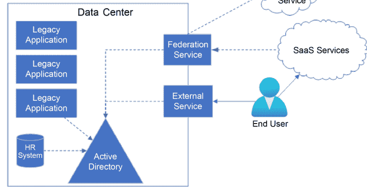
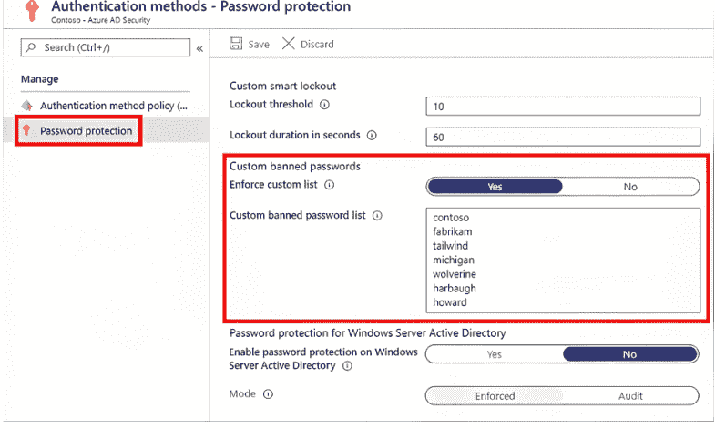
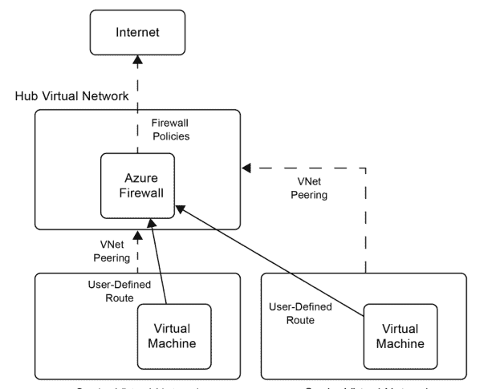

# 构建安全基础

在上一章中，我们深入了解了勒索软件是什么、它是如何运作的、攻击向量有哪些，以及一些不同的勒索软件团伙如何活动。在本章中，我们将首先从架构角度探讨安全基础应该是什么样子；我们还将探讨在网络安全设计、身份访问和发布外部服务方面的一些常见最佳实践。

本章将更多聚焦于高层设计和不同的安全最佳实践，之后我们会在后续章节实现本章提到的不同功能时再详细阐述。最后，我们将仔细研究构建安全监控平台的一些关键组件。

我们还将仔细研究如何使用 Microsoft 参考架构在 Microsoft Azure 中构建新的安全基础，以及这些架构如何保护你的服务和数据。

虽然大多数勒索软件攻击都始于最终用户，源于网络钓鱼攻击，但也有许多攻击始于黑客利用某些漏洞或对外部服务执行暴力破解攻击，然后利用他们在网络中发现的漏洞在网络中横向移动。

我们还见过攻击者使用伪造或木马化的应用程序进入后门，这些后门被用来获取访问权限，或者属于供应链攻击的一部分，类似于 Kaseya 攻击中发生的情况。

如果你所在的公司正考虑迁往云端，这意味着你需要做一些工作来构建一个安全基础，使其包含云平台供应商的常见最佳实践，并能够支持你当前的需求。

在本章中，我们将介绍以下主题：

- 安全基础的零信任设计原则
- 构建安全的网络访问
- 保持对身份和访问控制的管控
- 安全日志记录与监控的基础
- 在 Microsoft Azure 中构建安全基础的关键组件

## 零信任设计原则

如上一章所述，没有安全基础的组织很容易成为勒索软件攻击的受害者。这可能是因为其环境中缺乏安全机制，或对身份（例如用户账户、服务账户、令牌）以及未修补漏洞缺乏适当控制。

一个正成为任何安全基础通用安全标准的主要安全设计原则是 **零信任** 架构。零信任不是一种产品，而是一套安全原则和指南，其重点在于不再让服务和用户拥有隐式信任访问，而是转向默认不信任任何人的模式。

简而言之，其目标是防止对数据和服务的未经授权访问，同时让访问控制的执行尽可能精细化。

让我用一个例子来说明基于零信任的方法如何降低风险。

当你有一个 Active Directory 域，并且用户在办公室的计算机上登录时，除了用户名和密码（以及该计算机具有机器账户）之外，没有对用户身份的验证。没有额外的检查来确定该用户是否确实是他所声称的那个人，或者是否有未经授权的人窃取了他的用户名和密码。

此外，连接到办公室的计算机拥有一个默认被域和 Active Directory 隐式信任的机器账户。没有安全检查来验证该计算机是否安全。

另一个例子是用户在家中或其他地点连接的外部服务。在大多数情况下，你有用户名、密码和某种形式的 MFA 令牌来进行身份验证。虽然这限制了谁能进行身份验证，只有同时拥有用户名、密码和 MFA 令牌的人才能通过，但它没有考虑设备的健康状况，或者设备可能在某个人登录服务之前就已经受损。

在我于新冠疫情期间处理的一个案例中，有一名员工在家中使用他的计算机工作，该计算机通过 **Always On** VPN 连接到公司网络。

**Always On** 使用不同的 **Windows 角色**（包括**路由**、**远程访问**和**网络策略服务**）以及 Active Directory 颁发的证书的组合，让设备能够识别并验证服务，从而建立隧道。在这个案例中，问题在于该设备先前已经通过网络钓鱼攻击被入侵，而借助这条 VPN 隧道，攻击者能够进入网络，并在内部基础设施中取得立足点。他们最终利用包括 **Zerologon** 在内的多种漏洞组合，获得了对整个基础设施的访问权限。

> **注意**
> Always On VPN 支持与 Azure AD 条件访问集成；在这种情况下，它可以在验证身份并建立隧道之前，检查用户是否符合合规要求以及与用户相关的风险。在我的示例中，这会有效阻止此攻击，因为攻击者入侵终端后，Windows 中的安全服务被停止，导致设备在 **Microsoft Intune** 中被标记为不合规。应当注意，攻击者也可以篡改 MEM/Intune 设置的配置，因为他们通常会尝试停止 EDR 代理或其他防病毒机制。

当今许多传统系统依赖隐式信任，这也是勒索软件运营者所利用的根本风险之一；一旦他们获得访问权限，就能在网络中横向移动。

所以，这些仅仅是一些过度依赖用户名和密码进行身份验证而不检查上下文的服务示例；而上下文检查正是任何基于零信任的安全架构中的一个重要方面。

零信任架构由五个不同的支柱组成，这些支柱会在不同成熟度级别上进行衡量。这些支柱如下：

- 身份
- 设备
- 网络/环境
- 应用程序
- 数据

首先，让我们探讨身份支柱的一个示例。

### 身份支柱 – 零信任成熟度

身份支柱列出了关于零信任的身份功能，以及在身份上下文中的可见性与分析、自动化与编排、治理方面的考量。

下表展示了如何衡量身份领域内零信任采用的成熟度水平。例如，风险评估是一项重要功能；要达到最优水平，你需要具备能够检测异常用户行为的安全机制：

| 功能 | 传统 | 优化 |
|---|---|---|
| 身份验证 | 使用用户名、密码以及可能的 MFA 进行身份验证 | 持续验证身份和用户活动 |
| 身份提供商 | Active Directory | 跨云提供商和本地环境同步的全局身份存储 |
| 风险评估 | 有限地检查用户风险 | **用户行为分析**（UBA），并使用机器学习来确定风险 |
| 可见性与分析 | 在单一来源中记录用户身份验证 | 来自不同数据源的集中式日志源，并使用用户与实体行为分析 |
| 自动化与编排 | 从 HR 系统到身份提供商的一些有限自动化 | 用户和组的完全编排生命周期管理，包括即时访问和最小权限访问 |
| 治理能力 | 使用审计和有限的技术策略进行手动检查，以强制密码长度并禁止重复使用旧密码 | 完全自动化的访问审查，通过 MFA 和自助服务强制更改密码 |

表 2.1 – 零信任架构的身份支柱

在零信任优化的身份支柱中，我们跨不同服务集中收集日志，并可以使用这些数据来监控行为分析。此外，我们跨不同服务和身份源实现了与用户生命周期管理相关的完全自动化。

我们还拥有机器学习能力，可以根据收集到的数据理解正常用户模式，并检测异常用户活动。

虽然直接进入优化的基于身份的零信任模型并不简单，但我们将在第 7 章 *使用 Azure 信息保护与数据保护保护信息* 中介绍一些不同的机制。

设备是第二个支柱。在这里，我们同样可以通过从传统方法过渡到优化的零信任方法来衡量成熟度水平。

### 设备支柱 –零信任成熟度

设备是指任何可以连接到网络的硬件资产，包括**物联网 (IoT)** 设备、手机、笔记本电脑、服务器等。本表列出了设备在零信任方面的功能。例如，一个至关重要的功能是合规性监控，用于监控设备的整体安全态势，然后据此计算整体风险：

| 功能 | 传统 | 优化 |
|---|---|---|
| 合规性监控 | 有限或没有设备合规机制 | 不断监控设备安全态势 |
| 数据访问 | 在无需了解流量流向的情况下访问数据 | 基于设备实时风险分析授予数据访问权限 |
| 资产管理 | 有限或没有资产管理 | 在所有环境中集成资产和漏洞管理 |
| 可见性和分析 | 对设备的可见性或监控有限 | 持续运行设备态势并通过 EDR 或类似安全产品深入了解端点上的流程和更改 |

表 2.2 – 零信任架构的设备支柱

设备支柱在于建立合规性和安全态势机制来监控设备的健康状况。这确保了不符合要求的设备无法根据风险级别访问内部数据或应用程序。

例如，使用 Azure AD 和条件访问，我们有一个功能要求用户拥有合规设备。这意味着用户要访问特定应用程序或服务，其设备需要满足 Intune 合规设置中定义的所有设置。

这意味着我们可以定义设备需要启用防火墙、运行防病毒软件、启用 BitLocker 等才能成为合规设备。

我们还可以指定，如果用户来自非合规设备，他们只能访问某些应用程序。

### 网络支柱 –零信任成熟度

随着组织转向基于零信任的网络，他们需要根据应用程序/服务的需要调整网络访问和安全服务，而不是传统网络安全中的隐式信任。

网络支柱展示了零信任的不同功能，并展示了不同组织应努力实现的不同成熟度级别：

| 功能 | 传统 | 优化 |
|---|---|---|
| 网络分段 | 使用大型边界和宏观分段的网络架构，例如 VLAN 和区域划分 | 基于分布式入口/出口微边界和基于应用程序和服务的内部微分段的网络架构 |
| 威胁防护 | 主要使用已知威胁和静态流量过滤进行威胁防护 | 网络集成机器学习，使用来自其他支柱的上下文信号进行威胁防护和过滤 |
| 加密 | 服务明确加密，但对内部和外部流量加密有限 | 尽可能对所有服务和流量进行加密 |
| 自动化和编排 | 更改手动实施 | 使用编排工具（如 CI/CD 和 IaC）实施更改 |
| 可见性和分析 | 基于边界的流量模式可见性和集中式日志分析 | 跨多种传感器类型的集成分析，具有自动化警报和触发器 |

表 2.3 – 零信任架构的网络支柱

与网络支柱相关的最重要方面之一是确保分段基于应用程序及其工作负载，而不是更传统的基于区域的方法。例如，如果用户需要访问需要某种形式 VPN 的特定应用程序，该服务将只提供基于每个应用程序的 VPN，并且该访问围绕应用程序，而不是提供对整个网络的访问。

### 应用程序支柱 –零信任成熟度

为了确保应用程序基于零信任原则，组织需要确保他们拥有提供应用程序可见性和漏洞评估的保护机制

并贯穿其生命周期。这意味着使用例如自动化机制，如将安全测试作为 CI/CD 流水线的一部分：

| 功能 | 传统 | 优化 |
|---|---|---|
| 访问授权 | 对应用程序的访问主要基于本地授权和静态属性 | 访问基于实时风险分析持续监控 |
| 威胁防护 | 与应用程序工作流的集成有限，并对已知威胁应用通用保护 | 将威胁防护深度集成到应用程序工作流中 |
| 可访问性 | 应用程序由用户通过互联网直接访问，其他用户通过 VPN 访问 | 所有应用程序都可直接通过互联网供用户访问。这将网络访问最小化为仅应用程序，而非整个网络 |
| 应用程序安全 | 在部署前使用静态和手动方法进行应用程序安全测试 | 在开发和部署过程中使用 CI/CD 集成应用程序安全测试 |
| 可见性和分析能力 | 对外部传感器和系统的应用程序健康和安全监控 | 对外部和内部系统的持续动态健康和安全监控 |

表 2.4 – 零信任架构的应用程序支柱

获得对现代应用程序的良好控制的困难在于它们所具有的不断增长的漏洞和依赖项数量。解决这个问题需要对开发人员进行安全服务或应用程序构建的教育，并利用诸如安全代码扫描和依赖项扫描之类的工具。

### 数据支柱 –零信任成熟度

数据是我们最宝贵的资产，我们在网络安全方面必须转向*数据中心*的方法。本表展示了我们如何转向更基于零信任的安全策略，关于我们应如何确保数据安全。

第一步应该是识别、分类和盘点数据，并确保您对最关键的数据资产有足够的加密：

| 功能 | 传统 | 优化 |
|---|---|---|
| 库存管理 | 数据未盘点或盘点不佳 | 数据不断盘点并带有标签和跟踪。 |
| 加密 | 数据主要存储在本地，未进行静态加密 | 数据对所有静态数据进行加密，并结合基于文件的加密。 |
| 访问机制 | 访问基于静态访问控制，例如组成员身份 | 对数据的访问是动态的，并支持即时机制和基于持续风险的检测。 |
| 可见性和分析能力 | 拥有有限的数据库存，无法提供有用的可见性 | 所有数据均已盘点，访问已记录。访问会被分析以查找可疑流量模式。 |

表 2.5 – 零信任架构的数据支柱

如果您想阅读有关不同支柱成熟度级别的更多信息并参考零信任架构，我建议您阅读 NIST 关于零信任的零信任标准框架 https://nvlpubs.nist.gov/nistpubs/SpecialPublications/NIST.SP.800-207.pdf。

虽然零信任旨在作为安全设计原则的供应商中立方法，但它仍然需要一套紧密集成的<|message|>

- 在端点上运行的、需要访问某些内部数据源或应用程序服务的应用程序
- 用户需要访问的内部Web应用程序

使用来自端点的VPN客户端可以轻松解决对这些服务的访问问题；然而，这意味着我们仍然面临同样多的风险。由于用户和端点随后可以访问不同的服务，如果一个端点被攻破，它就可能被用来攻击所有这些不同的服务。

这就是一个新术语的用武之地：**零信任网络访问（ZTNA）**。它旨在减少攻击面。该术语不与任何供应商绑定，但其背后的主要概念是，不是像我们通常使用VPN那样提供完全信任的网络访问，而是根据定义好的访问权限提供对内部服务的安全远程访问。这意味着用户只能被授予访问所需应用程序或服务的权限；访问权限始终会被评估，并且通常涉及使用身份风险计算和设备合规性/状态检查。

正如前面提到的示例，条件访问（Conditional Access）在允许用户访问之前提供这些类型的安全检查。还应注意，许多供应商提供类似的功能，但使用不同的名称。

让我用一个例子来说明。微软在 **Azure AD** 中有一项名为 **Azure AD 应用程序代理** 的服务，它允许我们通过反向代理解决方案发布内部Web应用程序。

该服务本身需要一个连接器，该连接器需要安装在您基础设施中的Windows机器上，然后它将与Azure AD通信。

该服务与Azure AD集成，这意味着我们可以使用现有的集成来收集以下信息：

- 用户风险（来自Azure AD）
- 设备风险（来自Intune、Defender for Endpoint和Defender for Cloud Apps）

因此，为了让实际最终用户能够访问内部Web应用程序，我们可以在Azure AD中设置一个**条件访问策略**，在用户获得访问权限之前验证用户和设备几乎没有风险。我们还可以在条件访问中定义用户需要先通过MFA进行身份验证才能获得访问权限，以确保除了实际最终用户之外没有其他人试图向服务进行身份验证：

图2.1 – 使用Azure应用程序代理的安全身份验证概述

这意味着用户只有在设备合规且与该用户关联的风险为零时，才能访问Web应用程序。

然而，这只解决了难题的一部分，即访问内部Web应用程序。但是，文件共享、Active Directory以及端点需要访问的其他服务呢？

Active Directory访问很难安全地解决，因为它需要在最终用户机器和域控制器之间打开大量端口，尤其是因为Windows使用大量随机端口进行访问。

我能提供的最好建议之一是，您应该开始考虑将最终用户机器从Active Directory迁移到Azure AD，微软正在大力投资于此。

将机器迁移到Azure AD意味着您只需要Internet连接即可向服务进行身份验证，而无需位于公司网络内部。微软正在将更多功能引入Azure AD及其周边生态系统。这带来的另一个好处是，它将有效阻止大多数勒索软件恶意软件加载程序在普通端点上触发。

当今勒索软件运营者使用的许多不同工具和脚本都以某种方式依赖对Active Directory的访问，以便绘制网络地图并尝试获得访问权限。如果端点已加入Azure AD，这意味着他们拥有的大部分工具将无法工作。

> **重要说明**
> 微软对于设备如何加入Azure AD有不同的定义。这些定义包括 **Azure AD 已注册**、**Azure AD 已加入** 或 **混合 Azure AD 已加入**。Azure AD 已注册设备通常用于**自带设备（BYOD）**和移动设备。Azure AD 已加入设备通常是公司拥有的设备，且仅适用于Windows设备。混合加入是指先在Active Directory中注册设备，再将其同步到Azure AD的组合方式。

应该注意，让设备加入Azure AD意味着设备不再拥有对内部资源的同等访问权限，例如文件服务器以及依赖基于Windows的身份验证的其他数据源或应用程序。这意味着如果您希望最终用户能够访问应用程序，这些应用程序将需要支持基于Azure AD的身份验证，例如 **SAML** 或 **OAuth**。

运行Windows Server和SMB的常规文件服务器默认不支持基于Azure AD的身份验证，因此您需要迁移到另一个文件服务，例如使用 **OneDrive** 的 **Office 365**，或者迁移到支持SMB并结合基于Azure AD的身份验证的文件服务。

此外，依赖基于Windows的身份验证的应用程序不再提供SSO，因为端点不再依赖**Kerberos**或**NTLM**的使用。这意味着您需要研究其他与Azure AD一起支持的方式，将应用程序发布给最终用户。

这里应该提到的最后一点是，微软最近推出了一项名为“混合云信任”的功能，该功能允许基于Azure AD和混合加入的设备对本地文件服务器进行身份验证。由于该服务的早期版本，它有几个要求，包括一个PKI服务，用于向最终用户机器颁发证书以使用它。

使用Azure AD Kerberos，云Kerberos信任消除了对PKI的需求。Azure AD可以为一个或多个AD域颁发身份验证票据，Windows可以利用这些票据通过Windows Hello for Business进行身份验证，以及访问传统的基于AD的资源。本地域控制器仍然负责Kerberos服务票据和授权。

## 漏洞和补丁管理

在任何环境中，一个重要方面是漏洞管理。漏洞管理远不止关注软件漏洞，但本书将仅专注于识别和修复软件层面的安全漏洞。漏洞管理可分为五个主要阶段：

- 1. **评估：** 这涉及定义所有资产并扫描漏洞。这可以使用第三方应用程序、手动脚本或您可能拥有的其他工具来自动化。例如，Rapid7和Qualys等供应商拥有可用于扫描整个基础设施以查找已知漏洞的产品和云服务。微软也在其名为Defender for Endpoint和Defender for Servers的产品中内置了漏洞检测服务。但是，该产品仅涵盖Windows机器以及这些机器上安装的第三方应用程序。与Rapid7和Qualys的产品不同，它不涵盖VMware、Citrix ADC等第三方软件。
- 2. **确定优先级：** 虽然您应该始终尽快实施安全补丁或更新，但并非总是可行的，可能是因为能力不足或需要一些规划。这是因为某些安全补丁可能需要服务停机或重启，这可能会影响核心服务的可用性。此外，某些漏洞可能并不严重。因此，您应始终根据风险严重程度对漏洞进行优先级排序。
- 3. **行动：** 这是我们在可能的情况下修复已识别漏洞的地方。也可能存在这样的情况：我们没有有效的修复方案来补救漏洞，或者目前唯一可以应用的修复是临时解决方案。例如，2019年Citrix NetScaler中存在的严重漏洞，Citrix花了近3周时间才为该漏洞提供了补丁。与此同时，消除漏洞的唯一方法是应用临时解决方案。在某些情况下，您可能根本没有安全补丁或更新，因此您可能需要应用其他缓解控制措施，或者仅仅接受漏洞的风险。
- 4. **重新评估：** 此步骤旨在确保补救或缓解措施取得成功。另一个关键步骤是确保在此期间没有人能够利用该漏洞。第一部分涉及使用一些工具来验证修复；一个例子是Log4j2漏洞，该漏洞在2021年12月众所周知，影响了全球数百万个端点。社区很快发布了不同的工具，可用于判断某个端点是否存在漏洞，如下所示：`https://github.com/logpresso/CVE-2021-44228-Scanner`。当然，我们不会为所有漏洞都获得这些类型的工具或脚本——在许多情况下，我们只需要依赖供应商的发行说明或文档。然而，我经常使用社交媒体，看看能否找到其他已经做过功课的人，以及能否借用一些脚本/工具，甚至从他人那里获取一些信息，来确定是否有可以做的事情。一些商业工具/产品可以确定漏洞是否已修复。需要记住的一点是，在许多情况下，当漏洞公开时，例如PrintNightmare，许多不同的安全研究人员开始更深入地研究该漏洞和代码，并发现许多利用该漏洞的新方法。一旦微软发布了补丁来修复PrintNightmare的初始漏洞，新的漏洞又出现了，这意味着在许多情况下，我们需要重复这些步骤来修复额外的漏洞。

5. **改进：** 最后的方面是关于持续改进。例如，你可能会发现过去一年中，有一项服务极易受到大量高严重性漏洞的影响。我们应该考虑一种新的方式来暴露此服务，以确保未来的漏洞不会带来同等风险。因此，这关乎于理解漏洞生命周期，并查看你是否能够演进和改进整体安全平台，以便主动防御任何未来的漏洞。

现在，让我们进行一个理论练习。2021年，当PrintNightmare漏洞公开时，我与许多客户合作，了解该漏洞的影响，并查看是否有办法缓解此风险。我们将工作映射到这五个不同的阶段。

## PrintNightmare 的漏洞管理示例

以下是为 PrintNightmare 设置漏洞管理流程中不同任务的示例：

- **评估：**
  - 收集有关漏洞的信息。
  - 阅读 Microsoft 安全响应中心知识库文章，了解缓解或规避漏洞的额外步骤
  - 确定漏洞可被利用进行 **远程代码执行 (RCE)** 或 **本地代码执行 (LCE)** 以提升至系统权限。
  - 影响所有当前 Windows 操作系统。
  - CVSS 分数为 8。
  - 社交媒体 – Twitter 检查漏洞信息以从社区发现更多信息。
  - 确定环境中哪些资产受漏洞影响。
  - 确定更新的影响，如果有的话。如知识库文章所述，它需要重启。
- **优先排序：**
  - 基于受影响的资产，确定应优先处理的资源。首先，如果补丁要求你重启服务器，则应在当前维护窗口之外优先处理。
- **行动：**
  - 实施 Microsoft 知识库文章中定义的安全补丁和额外规避措施，并基于收集到的额外社区信息
  - 确保在不需要的服务器上禁用 Print Spooler 服务（数据库服务器、文件服务器等）
  - 检查资源是否已被漏洞利用
  - 为需要该服务的机器设置 Print Spooler 服务的额外事件日志记录
- **重新评估：**
  - 使用社区构建的脚本确定资产是否仍存在漏洞 – 例如，https://github.com/calebste wart/CVE-2021-1675 – 或其他验证安全补丁或规避措施影响的方法
  - 查看社区和知识库文章，看看是否发现了同一漏洞中的任何更改或新利用
- **改进：**
  - 确定资产是否除了 Print Spooler 外还运行推荐的 Windows 服务，以减少其他 Windows 服务的攻击面
  - 确定是否有新的处理打印方式，例如基于云的打印或第三方服务，可以使用，从而降低未来漏洞的风险

希望这能让你对如何构建漏洞管理框架和流程有一个概念。

就确保你为所有资产打补丁而言，你首先需要查看基础设施中拥有的不同厂商和软件，并确定你运行的版本以及每个厂商的当前版本的整体状态。许多组织拥有 **软件资产管理 (SAM)** 或 IT 资产管理工具，可以提供有关基础设施上运行的软件当前版本的洞察。其中一些工具还提供补丁管理，允许你确定当前状态并对 Microsoft 和第三方服务应用补丁。

我过去曾与其中一些厂商/产品合作，例如 Flexera、IBM BigFix，以及 System Center Configuration Manager 和 Patch My PC 的组合。

虽然这些工具为许多不同的操作系统和第三方应用程序提供补丁管理，但这些工具并不总是涵盖第三方核心服务，例如网络、虚拟化和备份产品，因为这些产品具有不同的生命周期，并且安装补丁需要更多工作。这意味着你需要有一种方法来确定这些服务的状态。

我收集更新相关信息的一种方式是使用 RSS 工具中的 RSS 源，例如 Feedly，我通常有许多不同的 RSS 源来收集更新的发行说明，例如 VMware 和 Citrix：

- VMware ESXi: `https://docs.vmware.com/en/VMware-vSphere/rn_rss.xml`
- Citrix: `https://support.citrix.com/feed/products/citrix_adc/securitybulletins.rss`

我们通常也为其他软件厂商有 RSS 源。RSS 是一种获取有关新更新信息的简单方法。然而，它需要我们做大量手动工作来分析收集到的信息并确定其对我们资产的影响。

## 身份和访问控制

正如我在上一章提到的，我们看到更多涉及被盗凭据重用或利用弱密码的暴力攻击的攻击。

随着大多数组织现在采用不同的 SaaS 服务，身份正成为确保你拥有足够安全的身份验证方法的最重要部分，同时也确保你对用户账户生命周期的控制。

> **注意**
> 
> 2021 年导致美国东海岸最大燃油管道 Colonial Pipeline 停运的勒索软件攻击，是由于一个未启用 MFA 的单个被入侵用户名和密码造成的。该账户据称已不再使用，但密码在暗网上被发现。

用户的生命周期不再仅仅是确保用户离职后账户被禁用，还要确保对任何第三方 SaaS 服务的访问也被管理。这意味着确保在员工离职后撤销对这些第三方服务的访问。

大多数组织拥有不同的应用程序和服务，这些应用程序和服务仅支持某些身份提供者或身份验证协议（如 LDAP）或具有内置身份验证机制。此外，你还有不同的云服务，其中许多支持身份联合或具有内置身份验证服务：

图 2.2 – 身份联合概述以及与 MFA 的集成

从身份和访问管理角度来看，任何安全基础的重要方面之一是控制以下内容：

- 跨身份源和服务的用户生命周期管理
- 强密码和强身份验证方法
- 基于角色的访问控制并确保授予的访问权限使用最小权限原则

让我们更详细地看一下这些内容。

## 用户生命周期管理

当新用户入职时，用户生命周期通常从 HR 系统开始，该系统确定用户将拥有的角色类型。然后，你有一个导出作业收集此信息以在你的身份目录中创建用户。

在大多数情况下，此身份目录是 Active Directory，然后配置为同步用户到 Azure AD。这随后允许用户使用 Office 365 等云服务进行身份验证。

这听起来很简单，但我们如何与第三方应用程序集成？

不建议也不总是可能直接将 Active Directory 与第三方 SaaS 服务集成；然而，Azure AD 与大量第三方提供商有丰富的集成。

此外，Azure AD 具有不同的集成，可以处理身份联合，这也允许将其用于身份验证。

从生命周期角度来看，请考虑以下几点：

- 查看将 Azure AD 与第三方应用程序集成的用途，通过身份联合使用 SAML 或 OAuth 等协议。这意味着服务将使用 Azure AD 作为身份验证点，允许我们使用 Azure AD 中的安全机制，同时允许用户一旦经过身份验证即可使用 SSO。如果你有不支持 Azure AD 原生的服务，Microsoft 还有基于密码的 SSO 集成，使用浏览器扩展插入到用户的登录会话中。
- 如果你使用基于云的 HR 系统，例如 **Workday** 或 **SuccessFactors**，你可以使用 Azure AD 中的内置 HR 供应服务自动为在这些 HR 系统中创建的用户进行供应。
- 查看对支持此功能的应用程序/服务使用基于 **SCIM** 的供应。这允许 Azure AD 自动管理这些服务中用户的生命周期。对于不支持 SCIM 的旧系统，Microsoft 还有针对使用 **SQL** 或 **LDAP** 基于身份验证协议的系统的自定义供应程序。一些第三方服务还支持使用 API 直接与 Azure AD 集成。

尽管此列表绝不全面，但 Microsoft 对如何设置这些不同集成有相当好的文档：

- 基于 SCIM 的供应：https://docs.microsoft.com/en-us/azure/active-directory/app-provisioning/on-premises-scim-provisioning
- Azure AD 和使用 SAML 的身份联合：https://docs.microsoft.com/en-us/azure/active-directory/saas-apps/tutorial-list

除此之外，Azure AD 还支持用于身份验证的其他身份验证协议（https://docs.microsoft.com/en-us/azure/active-directory/fundamentals/auth-sync-overview），这为零信任架构下的身份支柱提供了良好的基础。

## 确保强密码和身份验证方法

今天许多组织尚未在其服务中完全实施 MFA，这意味着用户可以在没有任何二次身份验证形式的情况下访问外部服务，仅凭用户名和密码。

幸运的是，越来越多的组织正在实施此功能。Microsoft 在 2019 年的一篇博客文章中指出，通过实施 MFA，你可以阻止 99.9% 的所有账户入侵：https://www.microsoft.com/security/blog/2019/08/20/one-simple-action-you-can-take-to-prevent-99-9-percent-of-account-attacks/。

大多数用户会创建易于记忆的密码，例如他们通常使用当前年份作为密码，或者只对旧密码进行小幅修改，因为许多组织强制实施严格的密码更改策略。密码重置策略多年来一直是最佳实践，但NIST发现，如果攻击者已经知道用户之前的密码，那么破解新密码并不困难。

此外，与复杂性相比，密码的长度更为重要；因此，你可以尝试使用易于使用的短语，而不是复杂的密码。

例如，根据Bitwarden的密码强度测试工具，使用xE3r2v!1作为密码大约需要3小时才能破解。然而，如果我使用“are you sure this is secure”这个短语，则需要几个世纪才能破解，而且对最终用户来说更容易记住。

**美国国家标准与技术研究院（NIST）** 制定了一套与数字身份相关的指南，可访问 https://pages.nist.gov/800-63-3/sp800-63-3.html 查看，其中定义了与密码相关的标准最佳实践。这是一份很长的文档，但概括来说，指南如下：

-   强制使用更长的密码，而不要求复杂性
-   取消定期密码重置
-   双因素认证不应使用短信验证码
-   不应使用基于知识的身份验证，例如“你出生的城市叫什么名字？”
-   应允许用户在锁定前进行10次失败的密码尝试
-   不应允许使用与上下文相关的词语

需要注意的是，除此之外，我们还应该监控过度的用户登录尝试，以确保没有人试图暴力破解。我们将在*第3章“使用Microsoft Sentinel和Defender进行安全监控”*中详细介绍这一点。

在Active Directory和Azure AD中，我们可以跨基础设施和最终用户客户端为用户和管理员帐户强制执行这些类型的密码策略。此外，对于未主动使用的帐户，例如服务帐户或本地管理员帐户，我们还可以使用服务来确保每6个月定期轮换密码，相关服务如下：

-   **Azure AD 身份保护（AADIP）**：它利用微软在Azure AD、Microsoft帐户和Xbox等不同领域的专业知识来保护用户。AADIP生成的信息可供条件访问等工具用于做出访问决策。AADIP检测多种类型的风险，包括匿名IP地址使用、异常旅行、与恶意软件相关的IP地址、不熟悉的登录属性、泄露的凭据和密码喷洒。这些风险信号可以提示修复操作，例如强制实施MFA、启用自助密码重置或阻止访问。
-   **Azure AD 密码保护：** 这是一个Azure AD功能，可以检测并阻止Active Directory中的弱密码。它使用与Azure AD相同的全局禁用密码列表。此功能包含安装在域控制器上的代理，该代理侦听密码更改事件并确定新密码是被接受还是被拒绝：

图2.3 – 在Azure AD中定义自定义禁用密码

此外，我们还有智能锁定功能，它决定用户在Azure AD中经过一定次数的失败登录尝试后应被锁定的时长。

-   **Active Directory 和 Azure AD 密码策略：** Active Directory 在默认域策略中有一个全局默认密码策略。此策略适用于域内的所有用户。从Server 2008及以上版本开始，你还可以选择创建可为特定用户或组定义的细粒度密码策略。需要注意的是，Azure AD密码策略机制不适用于从本地同步的用户，除非我们在Azure AD Connect中启用**EnforceCloudPasswordPolicyForPasswordSyncedUsers**功能。
-   **Microsoft LAPS 和 CloudLAPS：** 在许多情况下，你可能需要在机器上拥有本地管理员帐户，以防AD加入设备或Azure AD加入设备出现问题时，你需要登录进行故障排除。在这些情况下，许多人在设备上使用相同的本地用户名和密码以便于记忆，但你不应该这样做。相反，请使用Microsoft LAPS等服务，这些服务将按计划自动轮换已定义用户帐户的密码。通过确保每月轮换本地管理员帐户密码，可以降低有人尝试暴力破解这些密码的风险。如果你需要获取密码，LAPS UI提供了一种简单的方式，在需要时显示密码，前提是你在域中具有管理员权限。对于Azure AD加入的设备，没有原生服务提供相同的功能；幸运的是，社区中有人为Azure AD加入的设备构建了类似的服务，你可以在此处了解更多信息：https://msendpointmgr.com/cloudlaps/。

实施这些功能将使我们能够确保用户获得更好的用户体验，同时仍然确保我们组织内拥有强大的密码策略。

## 基于角色的访问控制和使用最小权限

那些拥有管理权限的人应始终确保以最小权限运行。

这是为了确保在设备上发生恶意活动时，恶意代码无法利用管理员帐户的上下文执行具有管理权限的操作。这适用于端点、基础设施，甚至包括Microsoft Azure等云平台。这一点也很重要，可以确保不可逆的操作不能在未经同意的情况下直接执行。

此外，你应该有适当定义的访问控制，以确保用户只能访问他们需要的内容。

让我们从端点的访问控制和最小权限开始。对于端点，有一个名为**Make Me Admin**的开源工具，它允许你临时提升访问权限：https://github.com/pseymour/MakeMeAdmin。这确保用户可以使用常规访问权限运行，但允许他们在需要安装应用程序时自行提升权限。

还应注意，作为新的Intune Premium SKU的一部分，微软正在添加一项新的特权身份管理服务。这利用了Windows 11和Azure AD中新增的功能。用户请求提升访问权限的工作流直接通过操作系统完成。

如果你需要在端点上拥有管理员权限，或者帮助台需要特定访问权限来执行故障排除，他们应该有一组专门的用户，这些用户仅提供对机器的访问权限，并与其常规办公帐户分开。如果你是一个IT员工很少的小型组织，你仍然应该有在域中具有管理员权限的单独帐户，以及另一个对端点具有管理员访问权限的帐户。这样做的原因是，如果有人设法入侵了端点，他们会尝试收集机器上的本地用户帐户，或者尝试找到已登录的现有帐户并获取其凭据。

对于Active Directory，更高版本中提供了一些新功能，可以帮助确保我们以最小权限执行操作，例如基于时间的组成员资格。还有一些指导原则，确保管理帐户不能登录普通成员服务器。例如，应该有一个组策略，限制对域管理员帐户或其他敏感帐户的访问，该策略执行以下操作：

- 拒绝从网络访问这台计算机
- 拒绝作为批处理作业登录
- 拒绝作为服务登录
- 拒绝本地登录
- 拒绝通过远程桌面服务登录

这样可以确保即使有人设法入侵了域管理员账户，也无法利用该账户通过RDP在成员服务器之间进行横向移动或直接访问服务器。同时，这也确保拥有域管理员账户的人员不会意外使用该账户（例如通过RDP）登录到其他成员服务器。

> **注意**
> 
> 您还应确保域管理员账户不会同步到Azure AD，并应为管理Active Directory和Azure AD分别准备独立的账户。

## 安全日志记录与监控

到目前为止，我们探讨了各种零信任设计原则和用户生命周期管理，以及如何确保用户采用最低权限访问。现在，让我们更深入地了解安全监控的基础——日志记录。

无论我们部署了多少安全机制，始终重要的是在系统中部署服务或工具来监控活动与事件，无论这些系统是本地数据中心内运行的还是云服务。一旦具备了监控能力，我们就能利用收集到的数据来寻找已知攻击迹象、异常用户活动或异常流量。

例如，要想全面了解进出虚拟机的流量类型，并能在操作系统内部活动的背景下查看这些流量，就需要多种日志源，例如：

- 来自网络的数据（NetFlow或其他流量日志）
- 来自设备上EDR或其他工具的、用于查看服务连接流的数据
- 来自安全事件或应用程序日志的数据

然而，在构建安全监控解决方案时，我们不能简单地设置并捕获基础设施中的所有数据和事件，因为这会产生海量数据。例如，NetFlow日志或其他原始网络数据捕获将造成巨大的存储消耗。

我们应始终根据自身拥有的资源以及面临的安全风险数量来设计监控服务。此外，还应确定哪些攻击向量对我们的基础设施构成最大风险。

让我举例说明我曾参与过的另一个客户项目。

对于这个客户，我们拥有许多外部服务，如Citrix、VPN，以及通过代理服务对外可用的Web应用程序。大多数服务都与Active Directory和Azure AD集成以进行身份验证。此外，他们在办公室拥有大量不同的网络设备，并部署了集中式防火墙。终端设备也直接加入了Azure AD。

我们很快确定，该组织面临的风险与公开可用的外部服务相关，例如暴力破解尝试或漏洞利用。其次，风险可能与凭据被盗或撞库攻击有关。因此，基于这些风险，我们确定了需要收集以下数据源：

- Active Directory安全事件
- Azure AD登录日志和审计日志
- 来自外部服务与身份验证尝试相关的Syslog
- IIS错误日志

这些数据源随后被收集到集中式日志服务中用于分析。虽然收集正确的数据只是问题的一部分，另一部分则在于能够分析数据并知道应该寻找什么。

在此，您应围绕需要监控的内容定义一些用例，例如：

- 针对服务发生了多少次错误身份验证尝试？（例如来自同一设备的多次失败登录尝试）
- 谁在异常时间进行了远程登录？（例如午夜后的多次登录尝试）
- 身份验证尝试来自何处？（例如来自不同地理位置的登录尝试）

一旦定义了用例，您就需要了解需要寻找哪些类型的活动来与这些用例对应。

例如，如果我们要跨不同数据源查找失败的登录尝试，就需要内置一些分析功能，以便跨不同数据集进行查询：

| 来源 | 事件ID | 描述 |
|---|---|---|
| Active Directory安全事件 | 4625 | 登录尝试失败 |
| Azure AD登录日志 | 50126 | 用户名或密码无效 |
| Citrix ADC Syslog | AAA LOGIN_FAILED | 当AAA模块无法使用户登录时 |

*表 2.6 – 用于查找登录尝试的数据源示例*

如果您不确定还应关注哪些其他事件，Microsoft提供的这份列表列出了您应关注的不同事件ID：https://docs.microsoft.com/en-us/windows-server/identity/ad-ds/plan/appendix-1--events-to-monitor。

对于Azure AD，Microsoft也创建了类似的要关注的事件ID列表：https://docs.microsoft.com/en-us/azure/active-directory/fundamentals/security-operations-user-accounts#unusual-sign-ins。

> **注意**
> 
> 由于Microsoft没有为Azure AD中的不同事件ID及其含义创建列表，因此我在此创建了一份列表：https://github.com/msandbu/azuread/blob/main/azuread.md。

虽然我们可能有产品可以收集日志并进行分析，但我们仍可能拥有太多需要处理或判断是否为已知攻击模式的数据。因此，安全监控的另一个重要方面是威胁情报。

威胁情报可以被视为一组包含已知攻击行为、目标和来源的数据，通常也可以作为服务集成。

为了收集和分析所有这些数据，我们需要某种服务或工具。根据您的需求，有许多不同的选项可供选择。虽然一些供应商只提供纯云服务，但另一些供应商则同时提供本地和基于云的服务。一些能够提供日志收集、分析和警报的产品和服务示例如下：

- **Splunk**：市场领导者之一，可提供本地和基于云的服务
- **Graylog**：开源，但也提供基于云和本地服务的商业模式
- **ELK**：开源，更侧重于纯日志收集；安全警报是附加功能
- **Sumologic**：基于云的安全信息和事件管理（SIEM）服务
- **Humio**：基于云的日志服务
- **Exabeam**：基于云的SIEM服务
- **Azure Sentinel**：基于云的SIEM服务

虽然所有这些产品在安全监控方面都是不错的选择，但在下一章中，我们将重点讨论如何使用Azure Sentinel作为基于云的服务，根据此处列出的用例进行日志收集和安全监控。

## Microsoft Azure中的安全基础

虽然我们已经涉及了大量与零信任和身份访问管理相关的内容，这些是预防勒索软件的关键因素，但我们还需要更仔细地研究如何构建安全的网络设计。

最常见的网络模型是基于区域的方法，即根据功能或安全性级别将网络划分为不同的分段区域。这些不同区域之间的流量通过集中式安全机制（如防火墙）进行处理。

此外，放置在内部区域中的这些资源不应能够直接与互联网通信。我们在勒索软件案例中看到的主要元凶之一是服务器直接暴露于互联网，并带有SSH/RDP/SMB等面向公众的服务，遭到暴力破解。另一个元凶是服务器可直接访问互联网——如果攻击者成功入侵它们，他们就能更容易地与C2服务器或文件服务通信，或者在需要下载额外载荷时实现这一点。

因此，建立适当的网络安全机制至少可以减缓攻击速度。这些类型的安全措施还可以减缓路过式下载（drive-by downloads），以防有人不幸尝试安装受恶意软件感染的软件。

因此，您还应在内部资源与互联网之间设置一个安全中枢，以确保出站流量得到控制。

需要向互联网公开的服务（如Web应用程序）应始终放在安全机制之后。这是为了确保服务器不会直接暴露于互联网，同时对流量流有更多控制，并能应用更好的安全机制，例如防范已知的基于Web的攻击。

虽然许多人可能会认为您应具备可检查进出流量的网络安全功能，例如TLS检查（即解密流量以查看流量内容），但我们已经进入了一个使用HTTP/3等更新传输协议的时代。

让我们更仔细地看看如何在Microsoft Azure中构建安全的网络基础。由于许多设计原则是相同的，因此在Microsoft Azure中构建与任何其他安全网络设计架构并没有太大不同。

因为我们只会介绍在 Azure 中构建安全网络的主要要点，所以我们将讨论一些关于如何设计网络的思路，因为在为组织部署时有许多因素需要考虑。

在 Azure 中，首先，有一些主要概念和功能你应该了解：

- **Azure 资源组：** 这是 Azure 中的一个逻辑容器，用于部署资源。例如，一台虚拟机将由网络卡、虚拟磁盘和虚拟机对象等不同资源组成。所有在 Azure 中创建的资源都需要属于一个资源组。
- **VNet：** 这是 Azure 中的一个软件定义虚拟网络。作为客户，你可以在 Azure 中拥有一个或多个虚拟网络。这些虚拟网络绑定到特定的 Azure 区域，并具有定义的地址空间，例如 `10.0.0.0/16`。
- **网络安全组 (NSG)：** 这是一组 5 元组 (IP、端口、协议) 的防火墙规则，可以分配给子网或网络接口。
- **NSG 流日志：** 这是一个功能，允许我们收集有关流经 NSG 的流量的日志信息（以 JSON 格式），无论是允许的流量还是被阻止的流量。然后可以将此日志信息导出到 Azure 中的不同服务，例如 Log Analytics、存储账户或 Event Hubs。
- **用户定义路由 (UDR)：** 这是一个路由功能，允许你创建路由表，然后将其关联到一个或多个子网。
- **VNet 对等互连：** 这是一个功能，允许你将一个虚拟网络与另一个虚拟网络连接。此功能还会自动在每个虚拟网络之间传播所有路由。
- **Azure 防火墙：** 这是 Azure 中运行在虚拟网络的专用子网上的托管防火墙服务。此防火墙服务提供不同的安全功能，例如网络规则、应用规则、NAT 功能、TLS 检查和 IPS 机制，具体取决于所使用的 SKU 类型。
- **Azure 应用网关：** 这是一个在 HTTP 层运行的负载均衡服务，意味着它可以根据内容进行流量负载均衡。它还提供 Web 应用防火墙机制，可用于保护通过该服务发布的 Web 应用免受已知的 HTTP 攻击向量。
- **Azure 云 Defender：** 这是一个基于云的威胁检测服务，可以针对 Azure 中的不同 PaaS 服务和 IaaS 提供威胁检测。例如，它可用于检测进入环境的异常流量。对于虚拟机，它提供 EDR 功能，并可通过 Microsoft 内置服务或 Qualys 进行漏洞检测选项。
- **Azure Bastion：** 这提供了使用 RDP 或 SSH 安全连接到虚拟机的能力，而无需将机器暴露到其公共 IP 地址。连接通过 Azure Web 门户完成。此服务还支持任何 IP 连接，意味着我们可将其用于本地资源，也提供易于管理的便利。
- **Azure 策略：** 这些允许我们定义中央组织策略，以确保有权访问 Azure 的人员无法在没有某些属性的情况下配置资源，或确保他们只能在特定区域内创建资源。此外，它们还可用于阻止 Azure 中的某些操作，例如阻止访问以使管理员无法为虚拟机配置公共 IP 地址。这意味着我们可以使用 Azure 策略来确保资源的治理。
- **Azure Log Analytics：** 这是 Azure 中的集中式日志服务，可以从 Azure 中的 PaaS 和 IaaS 服务收集日志/事件/指标。它还可用于从本地其他来源收集日志数据。这是用于 Azure Sentinel 的基础服务。

除此之外，Azure 中还有一个主要编排层，称为 Azure 资源管理器。你通过 Azure 门户或 CLI/API/SDK 执行的所有操作都是通过 Azure 资源管理器完成的。

此外，要在 Azure 中设置任何资源，你需要一个活跃的订阅，即资源所链接的计费账户。然后，你需要在 Azure AD 租户中拥有一个用户账户，并且该账户对订阅具有权限，才能在 Azure 中配置任何资源。

在 Microsoft Azure 中，网络流非常简单。如果你在虚拟网络中配置了一台放置在虚拟网络中的虚拟机，它默认情况下将具有互联网访问权限。对于在 Azure 中配置的每个 VNet，Microsoft 会自动为 VNet 分配一个隐藏的公共 IP，以便虚拟机可以连接到互联网。此外，放置在同一 VNet 中的所有资源都能够相互通信，因为同一 VNet 内所有资源的路由都是自动配置的。

除非我们设置了 NSG 规则禁止虚拟机与外部或同一网络上的其他机器通信，否则上述情况成立。

在 Azure 中设置一个扁平的虚拟网络并将所有资源放置在该网络中并不是推荐的做法。这意味着你没有正确分割流量的方式，并且控制或限制流量的唯一方式是使用 NSG 规则，而 NSG 规则相当有限。

首选的方法是使用如图下所示的 hub-and-spoke 基于拓扑：

图 2.5 – Microsoft Azure 中的 Hub-and-spoke 架构

Hub-and-spoke 架构类似于其他基于区域的设计，其中每个 spoke 都是充当独立区域的虚拟网络。Hub 通常是虚拟网络中的集中式防火墙机制，例如 Azure 防火墙或某些第三方网络虚拟设备 (NVA)。Hub 也是所有面向互联网的流量将被路由的地方，并且还将托管用于发布外部服务等其他服务，例如 Azure Web 应用防火墙。

所有 spoke 都使用 VNet 对等互连连接到 hub，并且由于 VNet 对等互连是非传递的，这意味着如果 VNet A 和 B 相连且 VNet B 和 C 相连，A 和 C 仍然无法直接相互通信。在每个 VNet 中，我们将有一个关联的 UDR，将所有指向通过集中式防火墙服务到达另一子网的流量指向，以允许不同 spoke 之间的通信。

这种方法可确保不同区域之间的所有流量都由集中式防火墙服务处理，在该服务中我们可以应用流量检测和阻止。这应与应用于每个子网的 NSG 规则结合使用，以确保你在每个子网内也有分段。

虽然没有一种适用于所有情况的架构和设计，但 Microsoft 提供了许多可根据你的需求或合规要求使用的参考架构。这些可以在 https://docs.microsoft.com/en-us/azure/governance/blueprints/samples/ 找到。因此，在构建 Microsoft Azure 中的安全基础时，请考虑将这些作为起点。

## Summary

在本章中，我们概述了一些应成为安全基础的一部分的机制，例如强大的身份验证机制、身份生命周期管理和漏洞管理。然后，我们查看了不同的零信任支柱，例如身份、设备和网络。最后，我们查看了安全监控如何帮助我们检测攻击或入侵迹象。

将此作为我们安全基础的一部分，可以大大降低利用弱安全凭证或漏洞的任何类型攻击的风险。

在下一章中，我们将更详细地了解如何使用 Microsoft Sentinel 和 Microsoft Defender for Cloud 设置安全监控，以提供对我们环境的更好洞察。

